<div align="center">


# 소규모 공연 티켓팅 · 공동 정산 플랫폼

여러 밴드가 함께 여는 소규모 공연의 <b>티켓 예매·입장부터 수익 정산까지</b>를 하나로 잇는 플랫폼.<br/>
관객이 누구를 보러 왔는지 선택하면, 사전 합의·잠금된 규칙으로 스마트 컨트랙트가 팀별 수익을 자동 정산한다.

**SSAFY 15기 특화 프로젝트 · 핀테크(금융) 트랙 · B204**<br/>
2026.08 ~ 2026.09.28 발표 완료 · <a href="https://j15b204.p.ssafy.io">j15b204.p.ssafy.io</a>

</div>

---

## 📜 목차

1. [서비스 소개](#-서비스-소개)
2. [주요 기능](#-주요-기능)
3. [서비스 화면](#-서비스-화면)
4. [기술 스택](#-기술-스택)
5. [시스템 아키텍처](#-시스템-아키텍처)
6. [ERD](#-erd)
7. [기술 특이점](#-기술-특이점)
8. [산출물](#-산출물)
9. [팀원 소개](#-팀원-소개)
10. [개발 가이드](#-개발-가이드)

---

## 🎫 서비스 소개

#### 기획 배경

취미·인디 밴드 공연은 3~4팀이 함께 무대를 채우는 **공동 공연이 표준**입니다. 그런데 정산은 아직도 "팀별 매표 코드 분리 → 자기가 판 만큼 가져가기"나 구두 합의로 이뤄지고, 사후 규칙 변경·불투명한 계산 때문에 분쟁이 잦습니다. 예매는 구글폼·계좌이체, 입장은 수기 명단 확인이 현실입니다.

| 문제 | 해결 |
|------|------|
| 공동 공연에서 팀별 기여도를 알 수 없음 | 예매 시 **관람 목적 팀 선택** → 정산 가중치로 반영 |
| 정산 규칙이 사후에 바뀌고 계산이 불투명함 | 판매 시작 전 참여팀 전원 동의로 규칙을 **스마트 컨트랙트에 잠금**, 누구나 검증 가능한 공개 정산 페이지 |
| 수기 정산·수기 입장 관리 | 컨트랙트 `release`로 팀 지갑에 자동 정산, 서명된 동적 QR 입장 |

#### 핵심 흐름

```
가입·지갑 등록 → 공동 공연 생성 → 정산 규칙 전원 동의·온체인 잠금
→ 응원 팀 선택·서명 결제 → 동적 QR 입장 → 정산 release → 공개 검증
```

1. 관객은 Web3Auth 소셜 로그인으로 가입하고 지갑을 등록해 기본 코인(YoYo)을 받는다.
2. 참여팀은 공연을 만들고 정산 규칙에 동의해 규칙을 컨트랙트에 잠근 뒤 판매를 연다.
3. 관객은 응원할 팀을 골라 서명 결제하고, QR로 입장한다.
4. 공연이 끝나면 컨트랙트가 팀별 분배액을 계산해 자동 정산하고, 누구나 그 값을 공개 페이지에서 재계산해 검증할 수 있다.

#### 대상 사용자

**타겟**: 티켓 100매 이내 규모의 취미·소규모 밴드, 3~4팀 공동 공연.

| 역할 | 하는 일 |
|------|---------|
| **관객** | 소셜 로그인·지갑 등록, 응원 팀 선택 예매·서명 결제, QR 입장, 취소·환불 |
| **공연자(참여팀)** | 공연 생성·팀 초대, 정산 규칙 동의, 보증금 납부, 정산 수령 |
| **검표** | 로그인 없이 검표 링크로 접속해 QR 스캔·입장 처리 |
| **누구나** | 공개 정산 검증·발행량 공시 확인 |

#### 블록체인이 보장하는 것 / 보장하지 않는 것

- **보장**: 판매 시작 전 잠긴 정산 규칙의 사후 변조 불가 · 기록의 소급 수정 불가 · 분배 계산의 결정론적 재현 · 참여팀이 플랫폼 화면을 거치지 않고 익스플로러로 독립 검증
- **보장하지 않음**: 입력 데이터의 진실성(오라클 문제) — 관객의 팀 선택을 결제 트랜잭션 안에서 온체인 이벤트로 직접 기록해 "위조하면 발각되는 구조"로 대응한다. QR 입장 보안은 서버 서명 QR의 몫이며 블록체인 성과가 아니다.

> **2026-09-08** — 코인 개명 KRWS → YoYo (name·symbol "YoYo", 환경변수·산출물 키 YOYO/YoYo, 로직 불변). 법정화폐가 없는 세계관을 가정한 시연이다.

---

## ✨ 주요 기능

| 기능 | 설명 |
|------|------|
| **① 가입·선호 장르** | Web3Auth 소셜 로그인으로 가입하면 지갑이 자동 생성되고 기본 코인(YoYo)을 받는다. 고른 선호 장르가 홈 추천의 시드가 된다 |
| **② 홈·AI 추천** | "판매중" / "AI 추천" 두 탭. 선호 장르 × 공연 장르 SQL 매칭, 매칭이 없으면 곧 시작하는 판매중 공연으로 폴백(`basis=FALLBACK`), 6건에 못 미치면 부족분만 같은 방식으로 채운다 |
| **③ 공동 공연·참여 팀** | 리더가 공연을 만들고 참여팀을 초대해 포스터를 업로드한다. 참여팀은 각자 팀 지갑으로 참여를 확정한다 |
| **④ 정산 규칙 온체인 잠금** | 참여팀 전원이 정산 규칙(팀별 배분율)에 동의해야 판매가 열린다. 전원 동의 순간 RevenueSplitter 컨트랙트에 잠겨 변경 불가 |
| **⑤ 응원 팀 선택·서명 결제** | 표마다 응원할 팀을 고르고 지갑 서명 한 번으로 결제. 수수료는 서버(OPERATOR)가 대납하고, 결제 직전 패스키(지문·Face ID)로 본인 확인 |
| **⑥ 동적 QR 입장** | 결제가 끝나면 서명된 동적 QR 티켓이 발권된다. 검표가 QR을 스캔하면 서버가 서명을 검증하고 입장 처리 |
| **⑦ 정산 release·보증금 반환** | 공연 후 온체인 판매 집계와 잠긴 규칙으로 팀별 분배액을 계산해 각 팀 지갑으로 `release`. 전원이 이의 없이 조기 동의하면 이의제기 카운트다운 없이 곧바로 정산하고 보증금 반환 |
| **⑧ 공개 검증·발행량 공시** | 누구나 온체인 이벤트로 같은 분배 값을 재계산해 확인한다. 체인과 DB의 코인 수량을 30초 주기로 대조해 불일치가 나오면 발행·지급을 자동으로 멈춘다 |
| **⑨ 환불·공연 취소** | 취소 마감(공연일 D-3) 전 관객 취소와 공연 취소 때 환불하고, 공연 취소면 보증금도 돌려준다. 정산 잠금 뒤 이의제기 기간에는 환불이 막힌다. 서명을 거부하면 잔액이 그대로 남아 다시 시도할 수 있고, 15분 안에 결제하지 않으면 주문이 자동 취소되며 잡아 둔 좌석이 돌아간다. 실패한 온체인 처리는 잡으로 재시도하고, 그래도 안 풀리면 운영자가 안내를 받는다 |

---

## 🎬 서비스 화면

### 관객 — 예매·결제

| 홈 | 주문 확인 및 결제 |
|:-:|:-:|
| 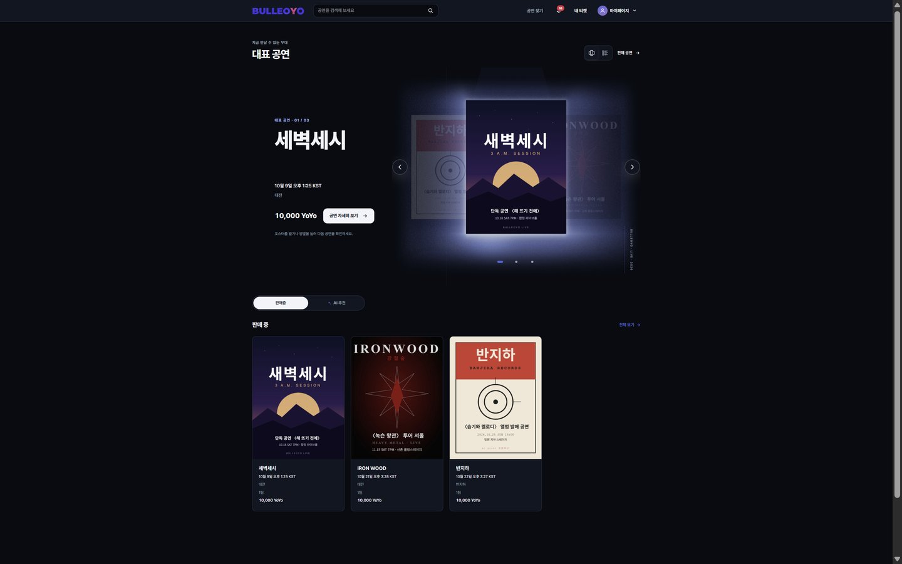 |  |
| <sub>대표 공연 캐러셀 · 판매중 / AI 추천 탭</sub> | <sub>응원 팀 · 결제 후 잔액</sub> |

| 잔액과 거래 내역 | 내 티켓 |
|:-:|:-:|
| 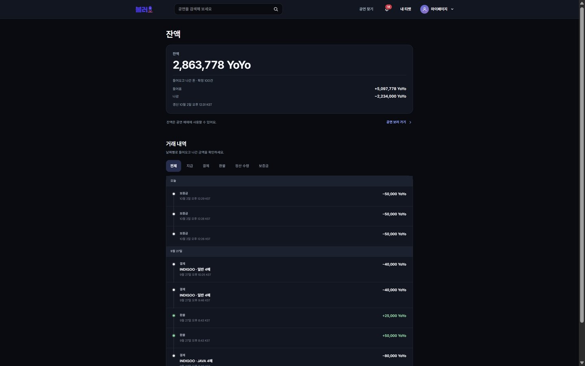 | 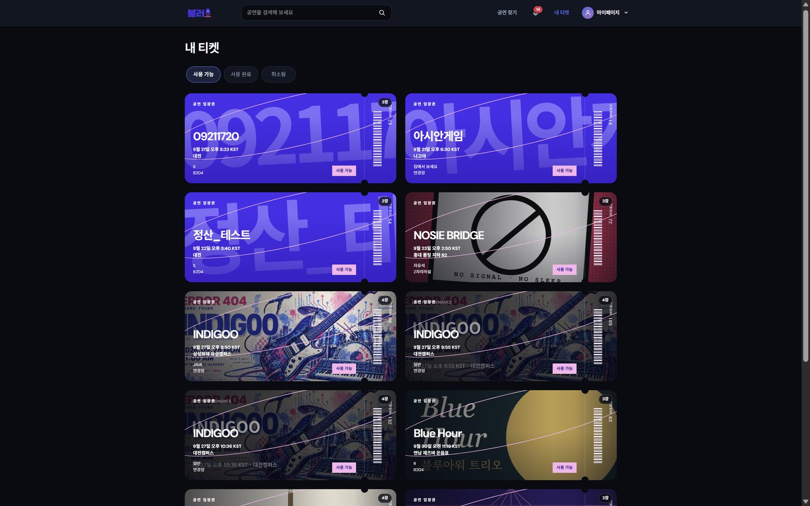 |
| <sub>지급 · 결제 · 환불 · 정산 수령 · 보증금</sub> | |

### 티켓·입장

| 티켓 상세 | 입장용 QR | 검표 |
|:-:|:-:|:-:|
| 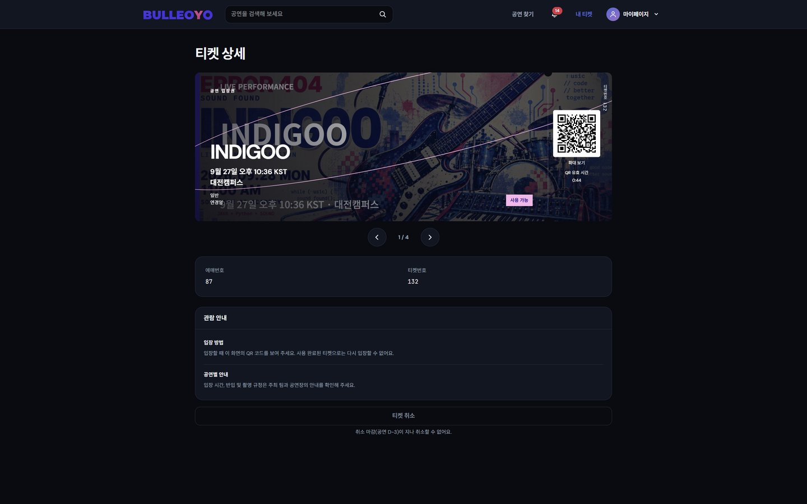 | 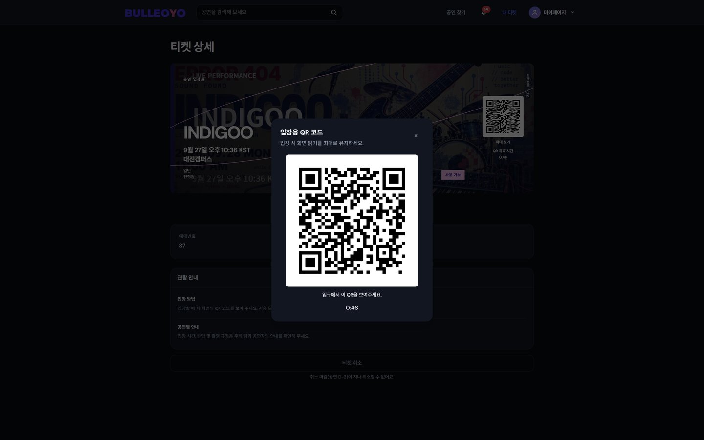 | 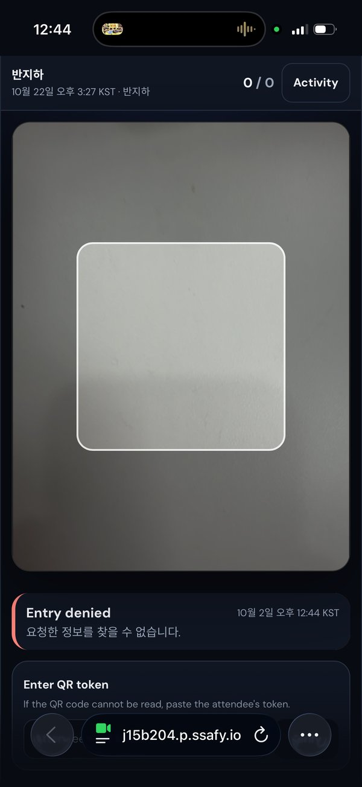 |
| | <sub>60초마다 바뀌는 입장용 QR</sub> | <sub>로그인 없이 검표 링크로 접속, 모바일</sub> |

### 공연자 — 스튜디오

| 스튜디오 대시보드 | 팀 관리 |
|:-:|:-:|
| 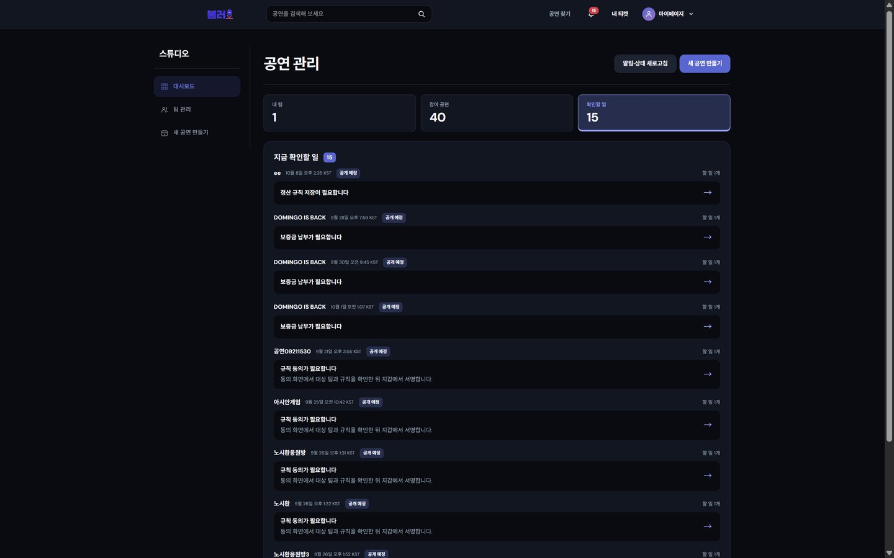 | 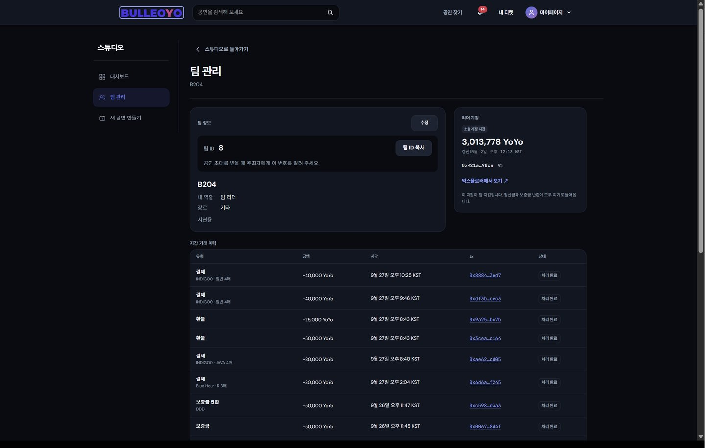 |
| <sub>내 팀 · 참여 공연 · 지금 확인할 일(규칙 저장·동의·보증금 납부 안내)</sub> | <sub>팀 ID · 리더 지갑 · 거래 이력</sub> |

| 정산 규칙 설정 | 팀별 규칙 동의 |
|:-:|:-:|
| 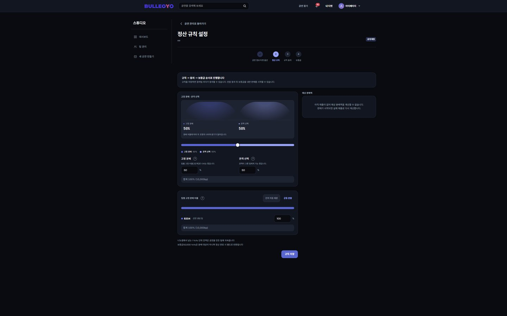 | 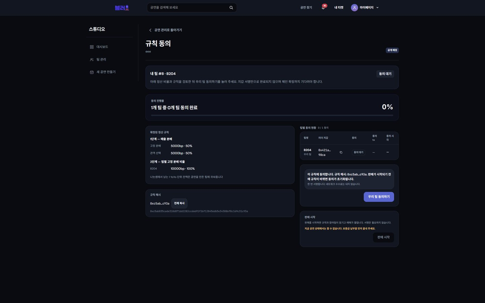 |
| <sub>고정 분배 · 관객 선택 비율, 팀별 몫</sub> | <sub>규칙 해시 확인 후 서명</sub> |

### 정산·공개 검증

| 정산 대시보드 | 정산 검증 |
|:-:|:-:|
| 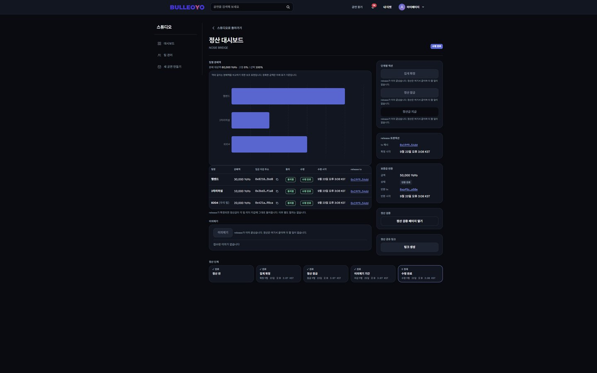 | 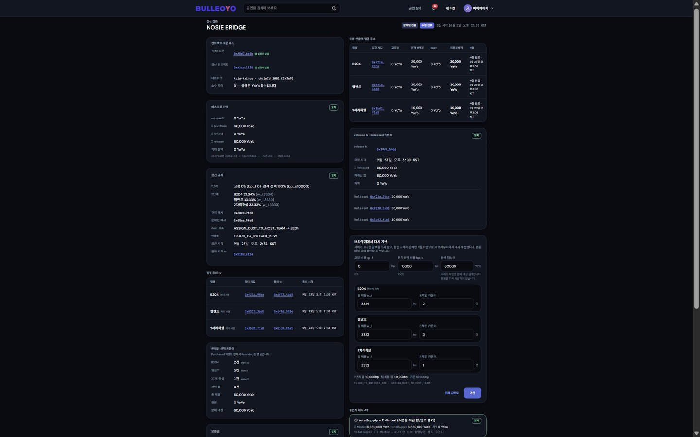 |
| <sub>팀별 분배액 · release tx · 보증금 반환 · 정산 단계(집계 확정 → 잠금 → 이의제기 기간 → 수령 완료)</sub> | <sub>컨트랙트 주소·에스크로·잠긴 규칙·온체인 선택 카운터를 체인에서 읽어 브라우저에서 다시 계산, 불변식 대사</sub> |

<!-- TODO(팀): 대표 시연 GIF → docs/readme/00-demo.gif, 가입·선호 장르 선택 → docs/readme/screens/signup-genre.jpg, 환불·공연 취소 → docs/readme/screens/refund-cancel.jpg -->

---

## 🧰 기술 스택

### Frontend


### Backend


### Blockchain


### Infra / CI·CD


### Monitoring


### 협업


<details>
<summary>버전·세부 구성</summary>

| 영역 | 스택 |
|------|------|
| 프론트엔드 | React 19, TypeScript, Vite 7, React Router 7, TanStack Query 5, Tailwind CSS v4, ethers 6 + `@kaiachain/ethers-ext/v6`, Node 22, pnpm 12.3.4 |
| 백엔드 | Spring Boot 3.5.6, Java 17, JPA, Flyway, MySQL 8.0, Redis 7, `io.kaia:web3j-ext` |
| 블록체인 | Solidity 0.8.28, OpenZeppelin v5, Hardhat 3 · **Kaia Kairos 테스트넷 단일**(chainId 1001) · 컨트랙트 2종 YoYo(ERC-20, decimals 0, mint만) + RevenueSplitter |
| 지갑·인증 | Web3Auth Plug-and-Play Modal(소셜 로그인, 비수탁) + Kaia Wallet 자체 챌린지 — 지갑은 사용자 소유. 패스키 step-up 본인 확인(결제·규칙 동의·보증금·정산 동의·정산금 지급) |
| 추천 | 1차 선호 장르 × 공연 장르 SQL 매칭(운영) · 실험: Ollama Qwen3 4B(LLM 태깅), XGBoost(CTR 랭커) — [`docs/ml/RECOMMENDATION_EXPERIMENTS.md`](./docs/ml/RECOMMENDATION_EXPERIMENTS.md) |
| 인프라 | Docker, Jenkins(Multibranch Pipeline, EC2 도커 컨테이너) + GitLab 웹훅, AWS EC2, 호스트 Nginx + router 컨테이너 블루/그린 전환, Redis AOF, Prometheus·Grafana·Alertmanager(→ Mattermost) |

</details>

---

## 🧩 시스템 아키텍처

<p align="center">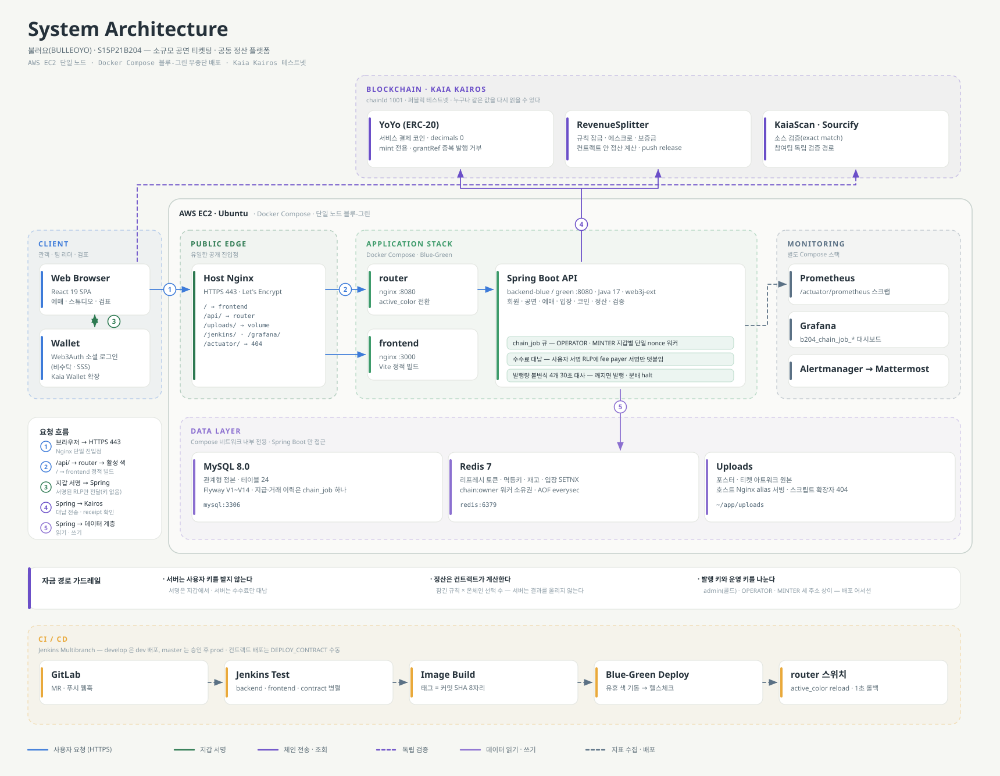</p>

<details>
<summary>아키텍처 설명</summary>

관객·공연자는 `https://j15b204.p.ssafy.io`로 접속한다. 호스트 Nginx(443)가 `/api/`는 router 컨테이너(127.0.0.1:8080)로, 나머지는 frontend 컨테이너(127.0.0.1:3000, 내부 nginx가 정적 빌드 서빙)로 넘긴다. router는 지금 활성 색(`backend-blue` 또는 `backend-green`)으로 요청을 전달해 배포 때 무중단 전환·1초 롤백을 가능하게 한다. 백엔드는 MySQL(정본 데이터)과 Redis(리프레시 토큰·멱등키·입장 상태·체인 소유권, AOF 영속)를 쓰고, 체인 작업은 Kaia Kairos 테스트넷의 YoYo·RevenueSplitter 컨트랙트로 나간다. 배포는 Jenkins(Multibranch Pipeline, GitLab 웹훅)가 자동으로 수행하고, Prometheus·Grafana가 지표를 모아 Alertmanager가 Mattermost로 알린다.

> 그림 원본은 `docs/readme/architecture.gen.mjs`다. 고친 뒤 `node docs/readme/architecture.gen.mjs`로 SVG를 다시 만든다(의존성 없음).

</details>

<!-- TODO(팀): 결제·정산 시퀀스 다이어그램 → docs/readme/sequence-payment.png -->
<!-- <p align="center"></p> -->

---

## 📐 ERD

ERD Cloud 다이어그램을 내보낸 그림이다(도메인별 색 구분, 테이블 21). 지급·거래 이력 테이블은 따로 없고 `chain_job` 하나가 모든 온체인 작업을 담는다.

<p align="center"><a href="docs/readme/erd.png">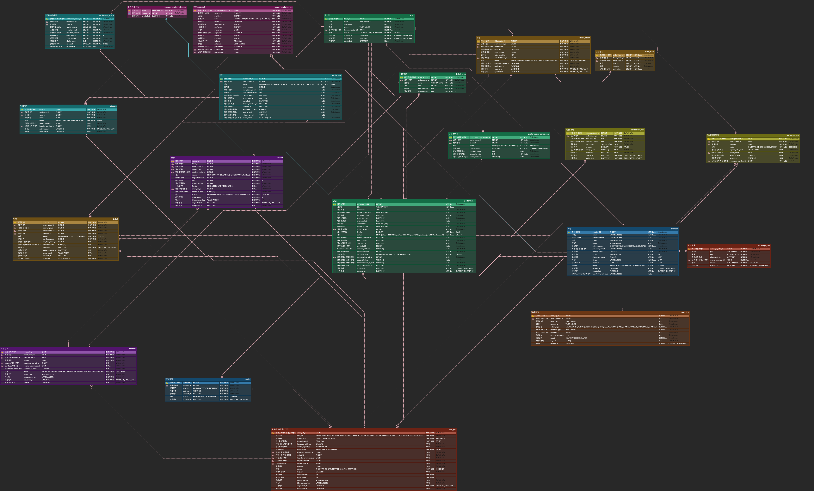</a></p>

> 정본은 [ERD Cloud 다이어그램](https://www.erdcloud.com/d/kpxqsmzYGNrskWTMF), 설계 문서는 [`docs/design/16_ERD_v6.md`](./docs/design/16_ERD_v6.md)다. 이후 마이그레이션으로 추가된 `file`(V12) · `performance_media`(V8) · `webauthn_credential`(V14)는 아직 다이어그램에 없다 — 실제 스키마는 `backend/src/main/resources/db/migration/`.

---

## 💡 기술 특이점

<details>
<summary><b>1. 두 서버 중 누가 돈을 보내는가 — 블루/그린 × 체인 워커</b></summary>

- **문제**: 무중단 배포로 백엔드가 두 벌 뜨면 같은 OPERATOR 지갑으로 이중 전송·nonce 충돌이 날 수 있다.
- **해결**: Redis `chain:owner`(60초 임대)와 `chain:active`(TTL 없음, 지금 일해야 하는 색)를 분리하고, DB 조건부 UPDATE로 claim을 펜싱한다. 재부팅 시 옛 색이 소유권을 다시 집는 경로도 막는다.
- **결과**: 배포 중 체인 전송 주체를 항상 1개로 보장하고, 롤백 트래픽은 1초 안에 전환된다.

</details>

<details>
<summary><b>2. 대납·멱등·공개 검증 — 이중 지급 차단과 발행량 자동 halt</b></summary>

- **문제**: 가스비를 서버가 대납하면 같은 요청이 중복 전송돼 이중 지급될 위험이 있고, 발행량이 체인과 DB에서 어긋나도 알 수 없다.
- **해결**: 사용자는 서명만 하고 가스는 서버가 대납한다. `Idempotency-Key`와 온체인 `orderRef`/`grantRef`(keccak256)로 같은 요청은 체인에서도 한 번만 처리된다. 발행량 공시가 체인과 DB를 불변식 4개로 30초 주기 대조하고, 불일치 시 발행·지급을 자동으로 halt한다.
- **결과**: 9/8·9/13 장부 밖 민팅 사고(로컬 테스트·로컬 compose가 운영 키로 발행) 때 불변식 1(`totalSupply` = 확정된 MINT 합)이 어긋나자 발행·지급이 자동으로 halt됐고, 장부 보정·재배포로 복구했다. 이후 실 컨트랙트 상태를 바꾸는 테스트는 로컬에서 돌리지 않는다.

</details>

<details>
<summary><b>3. 이미지 빌드 캐시 — 도커 Build 542초 → 48~132초</b></summary>

- **문제**: `docker image prune`이 legacy 빌더 캐시를 매 배포마다 지워 `Using cache`가 0회였다.
- **해결**: `DOCKER_BUILDKIT=1` + 캐시 마운트(백엔드는 gradle, 프론트는 pnpm store)로 바꿨다.
- **결과**: 도커 Build 단계가 **542초 → 48~132초**로 줄었다(develop #138 실측은 MR !195 설명, #170~#172는 Jenkins 로그 122·132·48초). 단축분의 대부분은 캐시 마운트보다 BuildKit 전환 자체에서 나왔다.

</details>

<details>
<summary><b>4. 보이지 않던 모니터링 — 11일간 수집 0건</b></summary>

- **문제**: 백엔드 지표가 호스트 루프백 포트에 있어 컨테이너에서 닿지 않아 9/11부터 11일간 수집이 0건이었고(`1be54eba`), 적체 경보 PromQL도 라벨 불일치로 항상 빈 벡터였다.
- **해결**: 앱 네트워크에서 컨테이너 이름으로 스크랩하도록 바꾸고, 경보에 `promtool test rules` 유닛 테스트(현재 5건)를 붙였다.
- **결과**: 모든 타깃이 UP 상태가 되었다. 경보 규칙을 고칠 때 `promtool test rules`로 검사한다(CI에는 아직 넣지 않았다 — 실행법은 `exec/monitoring/README.md`).

</details>

<details>
<summary><b>5. 정산 계산을 컨트랙트 안에서 — 1 YoYo 오차 0, 누구나 재현</b></summary>

- **문제**: 서버가 분배액을 계산해 결과만 올리면 참여팀은 그 값이 잠긴 규칙대로인지 확인할 방법이 없다. 정수 나눗셈의 나머지를 흘리면 분배 합계가 매출과 어긋난다.
- **해결**: 2단계 비율(고정 분배 + 관객 선택 비율 → 팀별 몫, 모두 bp 정수)을 `RevenueSplitter`가 직접 계산한다. `Math.mulDiv`(512비트 중간값)로 곱셈을 먼저 하고 내림하며, 남는 1 YoYo 단위(dust)는 공연을 만든 팀에 귀속한다. 전원 환불로 선택 표가 0이 되면 선택분을 균등 분배한다 — 이 분기가 없으면 0 나눗셈으로 그 공연의 정산이 영구히 멈춘다.
- **결과**: Σ분배 = 매출(오차 0). 같은 공식을 Solidity · Java(`SettlementCalculator`) · TypeScript(검증 페이지) 세 곳에 두고 기준 벡터 6개로 결과가 같음을 테스트로 고정했다. 실체인 리허설의 온체인 분배액도 독립 재계산과 1 YoYo 차이 없이 일치했다.

</details>

<details>
<summary><b>6. 잠긴 규칙은 바뀌지 않는다 — 상태 기계 · 동의 epoch · 집계 대조</b></summary>

- **문제**: 규칙이 바뀌면 동의를 초기화해야 하는데 `mapping(bool)`은 지울 수 없어 재동의가 막혔다(감사 M-03·M-06). 서버 대사(블록 N)와 집계 채굴(N+2) 사이에 서버가 모르는 결제를 끼워 넣으면 오염된 선택 수가 그대로 확정됐다(감사 H-04, TOCTOU).
- **해결**: 상태(`NONE → CREATED → LOCKED_RULES → AGGREGATED → LOCKED → RELEASED / HALTED`)마다 호출 가능한 함수를 제한하고, RELEASED 뒤에는 수정 함수를 두지 않았다. 동의는 `agreedEpoch[team] == rulesEpoch`로 판정해 규칙 변경 시 `++rulesEpoch` 한 줄로 초기화한다. `aggregate`는 서버가 신고한 표 수와 온체인 선택 합계가 다르면 `AggregateMismatch`로 revert한다(실패해도 상태가 그대로라 복구 절차를 쓸 수 있다).
- **결과**: 결제 tx 한 번에 코인 이동과 관객의 팀 선택이 함께 기록되고, 그 선택 수가 잠긴 규칙과 만나야만 집계가 확정된다. 두 결함 모두 재현 테스트로 고정했다.

</details>

<details>
<summary><b>7. 소각 없는 코인과 "못 본 것은 통과가 아니다" — 대사 판정 규칙</b></summary>

- **문제**: 노드가 응답하지 않을 때 불변식 1이 자기 값과 자기 값을 비교해 "일치"를 냈고, 분배 마감이 비어 있으면 "기간 끝남"으로 판정해 48시간 이의제기 대기가 사라졌다. 검증하지 못한 것을 통과로 내리는 자리가 여섯 곳 넘게 나왔다.
- **해결**: YoYo를 소수점 없이(decimals 0) **mint만 있고 burn이 없게** 설계해 `발행량 = 지갑 합계 + 에스크로 합계`가 언제나 성립해야 하는 등식으로 만들었다(`mint(to, amount, grantRef)` + `usedGrantRef`로 같은 지급의 중복 발행도 온체인에서 거부). 대사는 "못 보면 값을 비우고(null) 사유를 적는다"로 통일했고, 자산이 움직이는 판정은 fail-closed, 공용 RPC 깜빡임에는 서비스를 멈추지 않도록(관측·경고) 자리마다 나눴다.
- **결과**: 공시 화면이 "검사 0건인데 일치"로 보이는 거짓 신호가 사라졌고, 발행 게이트는 요청 스레드에서 RPC를 부르지 않고 마지막 스냅샷만 읽는다.

</details>

<details>
<summary><b>8. 적대적 감사와 키 분리 — 무한 발행 경로를 배포 전에 닫았다</b></summary>

- **문제**: 감사 첫 라운드에서 치명 C-01이 나왔다 — 수수료 대납에 쓰여 항상 온라인인 OPERATOR 키 하나로 `rotateMinter(자기)` → 무제한 mint가 가능한 배포 구성이었다. 높음 4건(표 수·금액 미결속, 부분 환불 잔액 영구 잠김 등)도 함께 나왔다.
- **해결**: 키를 admin(콜드, 배포·pause·rotate 전용) · OPERATOR · MINTER 세 주소로 나누고 생성자와 rotate 경로 양쪽에서 서로 다른지 강제했다. 역할 함수(`grantRole` 등)는 봉인하고, 배포 스크립트 어서션 4개(decimals 0 · 토큰 주소 · 세 키 상이 · 권한 readback)로 잘못된 배포를 배포 시점에 막는다. 모든 발견은 재현 테스트를 먼저 쓰고 고쳤다.
- **결과**: 컨트랙트 테스트 92건 통과, KaiaScan·Sourcify 소스 검증 exact match. 컨트랙트 error ↔ 서버 selector ↔ 문서를 CI에서 3자 대조하도록 해 손 대조가 놓친 OpenZeppelin 상속 error 7개를 잡았다.

</details>

<details>
<summary><b>9. 정산 확정 반영 펜싱 — 서버 두 대가 같은 확정을 두 번 쓰지 않게</b></summary>

- **문제**: 블루/그린으로 백엔드가 두 벌 뜨면 같은 체인 확정을 두 인스턴스가 나란히 반영해 팀별 정산 몫이 두 배로 들어가거나 이벤트가 두 번 나갈 수 있었다. 잠금 없이 상태 가드만으로 멱등을 기대했고, 같은 클래스 안 호출(`this.apply()`)이라 `@Transactional`이 무시돼 한 공연이 실패하면 배치 전체가 롤백되는 잠재 결함도 있었다.
- **해결**: settlement 한 행만 잡는 비관적 락(생성 SQL로 범위 확인), job마다 `TransactionTemplate(REQUIRES_NEW)` 격리, 체인 조회는 락 밖에서 먼저 하고 락 안에서는 `em.refresh(PESSIMISTIC_WRITE)` 뒤 재판정·쓰기만, 보증금 반환은 조건부 UPDATE로 막았다.
- **결과**: 경쟁·격리 테스트를 만들고, 수정을 하나씩 되돌리면 정확히 그 이유로 실패하는지 역검증까지 했다. 이후 dev에서 정산 전 구간(잠금 → 분배)이 52초에 관통했다.

</details>

<details>
<summary><b>10. 비동기 결제 상태와 재시도 복구 — 요청 접수부터 확정까지 화면이 이어받는다</b></summary>

- **문제**: 결제 API의 `202`는 작업 접수이며 결제 완료가 아니다. 서명 거부·체인 확정 지연·새로고침을 같은 실패로 처리하면 진행 중인 결제를 다시 보내거나, 재시도 결과를 놓친 채 화면이 기다릴 수 있었다.
- **해결**: 공통 `useChainJob`이 `PENDING`·`SUBMITTED`만 서버의 `pollAfterMs` 간격으로 조회하고, `CONFIRMED`에서 관련 주문·티켓·잔액 쿼리를 무효화한다. 같은 감시 안의 종단 콜백은 한 번만 실행하되 새 재시도에서는 같은 `jobId`의 결과도 다시 전달하며, 화면의 120초 관측 상한은 결제 실패가 아닌 지연 안내·재조회로 처리한다. 지갑 서명 거부는 주문 확인으로 돌아가고, 재진입한 `PAYING` 결제는 기존 `purchaseJobId`를 이어서 조회한다.
- **결과**: 요청 접수·서명·확정 대기·지연·실패를 구분하고, 확정 전에는 완료 화면으로 이동하지 않는다. 같은 작업 재시도의 콜백 복구, 서명 거부 후 복귀, 진행 중 작업 복원과 지연 시 서명 재전송 방지를 [훅 회귀 테스트](./frontend/src/shared/queries/chainRetry.test.tsx)와 [결제 화면 테스트](./frontend/src/pages/PaymentPage.live.test.tsx)에 담았다.

</details>

<details>
<summary><b>11. 표별 응원 팀 배분과 부분 결제 — 먼저 발급된 티켓은 계속 사용할 수 있게</b></summary>

- **문제**: 여러 표를 서로 다른 팀에 배분하면 하나의 예매 안에 하위 주문·결제가 여러 개 생긴다. 일부만 결제됐는데 전체를 완료로 표시하거나, 남은 결제가 실패·만료됐다는 이유로 이미 발급된 티켓까지 가리면 실제 결제 상태와 화면이 어긋난다.
- **해결**: 팀별 배분 수량을 `items[].chosenTeamId`로 주문 요청에 담고, `payments[]`의 하위 주문 상태와 `purchaseJobId`를 각각 추적한다. 재시도는 결제 가능한 미결제 주문만 서명하며 진행 중인 작업은 기존 조회를 이어간다. 화면에는 결제된 표·남은 금액·발급 티켓을 구분해 표시하고, 잔여 결제가 만료되면 재결제 동작만 닫는다.
- **결과**: 한 하위 결제가 처리 중이거나 실패·만료돼도 결제된 티켓과 내 티켓 진입 경로를 유지한다. 미결제 주문만 재서명하는 흐름은 [결제 화면 테스트](./frontend/src/pages/PaymentPage.live.test.tsx), 부분 영수증·발급 티켓·만료 후 접근은 [그룹 주문 화면 테스트](./frontend/src/pages/GroupedOrders.live.test.tsx)로 회귀 조건을 정리했다.

</details>

<details>
<summary><b>12. 공연을 넘겨보는 공간감 — WebGPU 조명과 CSS 기본 화면을 함께 설계했다</b></summary>

- **문제**: 공연 포스터를 크게 보여 주면서도 다른 공연을 탐색할 수 있어야 했고, 포스터마다 비율이 달라 고정 좌표의 조명은 실제 이미지 가장자리와 어긋날 수 있었다. GPU 효과를 전제로 화면을 만들면 미지원 브라우저나 동작 줄이기 설정에서 같은 탐색 경험을 제공하기 어렵다.
- **해결**: 중앙 포스터는 크게, 양옆은 크기·투명도 차이로 깊이를 주고 드래그·스와이프·방향키로 넘기도록 구성했다. 포스터·목록 보기는 같은 공연 데이터와 선택 상태를 공유하며, `StageFlare`는 중앙 카드와 실제 이미지 표시 영역을 측정해 조명을 맞추고 `motion/vgpu`의 스프링으로 움직임을 연결한다. 보안 컨텍스트·WebGPU 지원·동작 줄이기 설정을 확인한 뒤 GPU 모듈을 동적으로 불러오며, CSS 조명을 기본으로 두고 화면 밖·숨겨진 탭에서는 루프 정지, 언마운트 시 자원 해제, DPR 상한 1.5를 적용했다.
- **결과**: 보기 방식을 바꿔도 선택한 공연과 상세 링크가 유지되고, GPU를 켜지 못하는 환경에서도 CSS 화면으로 탐색을 이어간다. 선택 유지와 화면 정보는 [공연 화면 테스트](./frontend/src/features/performance/PerformanceEditorial.test.tsx), 이미지 로드·반응형 변경에 따른 조명 경계 재측정은 [StageFlare 테스트](./frontend/src/shared/fx/StageFlare.test.tsx)에 담았다.

</details>

<details>
<summary><b>13. 공연별 티켓·개별 QR과 접근성 — 티켓 연출에도 실제 입장 정보를 유지한다</b></summary>

- **문제**: 같은 공연의 티켓이 여러 장이면 목록은 반복되지만 입장용 QR은 표마다 달라야 한다. 티켓 연출이나 색상 처리가 QR 접근을 막거나 원본 아트웍을 바꾸지 않도록, 장식과 실제 티켓 상태를 함께 다뤄야 했다.
- **해결**: 목록은 공연 ID와 상태별로 묶어 보유 수량을 보여 주고 실제 티켓 ID를 보존하며, 상세에서는 같은 공연의 개별 티켓 QR을 앞뒤로 순환한다. QR 토큰·유효 시간은 서버 응답을 따르고 사용·취소·만료 상태에는 유효 QR을 표시하지 않으며, 확대 화면은 Escape 닫기와 버튼으로의 포커스 복귀를 지원한다. 티켓 인쇄 연출은 실제 티켓 한 장에 적용하고 동작 줄이기 설정에서는 즉시 정적으로 보여 주며, 업로드 아트웍에는 브랜드 색상 덮임·상태 필터를 배제하고 글자 주변의 중립 명암을 사용한다.
- **결과**: 공연별로 간결하게 목록을 보면서 입장 시에는 각 표의 QR을 확인하고, 현재 티켓 번호와 상태를 확인하며 앞뒤로 넘길 수 있다. 묶음·개별 QR 순환은 [티켓 묶음 테스트](./frontend/src/features/ticket/ticketGrouping.test.ts)와 [상세 테스트](./frontend/src/features/ticket/TicketDetail.test.tsx), 만료 이미지 제거·포커스 복귀는 [QR 테스트](./frontend/src/features/ticket/TicketQr.test.tsx), 원본 색상·동작 줄이기는 [아트웍 테스트](./frontend/src/features/ticket/ConcertTicket.test.tsx)와 [인쇄 연출 테스트](./frontend/src/features/ticket/TicketRevealStage.test.tsx)에 담았다.

</details>

---

## 📁 산출물

**정본은 이 저장소 `docs/`다. 노션은 사본이며 최신이 아닐 수 있다.**

| 산출물 | 저장소 | 사본 |
|--------|--------|------|
| 포팅 매뉴얼 | [`exec/01_포팅_매뉴얼.md`](./exec/01_포팅_매뉴얼.md) | [노션](https://app.notion.com/p/3e92746d15ab8136a33cef84564adace) |
| 외부 서비스 | [`exec/02_외부_서비스.md`](./exec/02_외부_서비스.md) | [노션](https://app.notion.com/p/3e92746d15ab817db478c3d4747af19b) |
| 시연 시나리오 | [`exec/04_시연_시나리오.md`](./exec/04_시연_시나리오.md) | [노션](https://app.notion.com/p/3e92746d15ab81b38721fceb441ca0f1) |
| 인프라 파일 위치·배포 흐름·런북 | [`exec/README.md`](./exec/README.md) | |
| API 문서(Swagger) | https://j15b204.p.ssafy.io/docs/ (basic auth, 계정은 팀 채널) | |

#### 설계 문서

| 문서 | 저장소 | 사본 |
|------|--------|------|
| 요구사항 명세서 v7 | [`docs/design/04_요구사항_명세서_v7.md`](./docs/design/04_요구사항_명세서_v7.md) | [노션](https://app.notion.com/p/3e92746d15ab81f89e2ae253719f8895) |
| 기능 명세서 v7 | [`docs/design/05_기능_명세서_v7.md`](./docs/design/05_기능_명세서_v7.md) | [노션](https://app.notion.com/p/3e92746d15ab811f86efcf90c1d184f8) |
| API 명세서 v7 | [`docs/design/06_API_명세서_v7.md`](./docs/design/06_API_명세서_v7.md) | |
| 화면설계 v8 | [`docs/design/07_화면설계_v8.md`](./docs/design/07_화면설계_v8.md) | [노션](https://app.notion.com/p/3e92746d15ab8101b4ffe7ad64a4cdf4) |
| ERD v6 | [`docs/design/16_ERD_v6.md`](./docs/design/16_ERD_v6.md) | [ERD Cloud](https://www.erdcloud.com/d/kpxqsmzYGNrskWTMF) |
| 비기능 요구사항 v1 | [`docs/design/03_비기능_요구사항_명세서_v1.md`](./docs/design/03_비기능_요구사항_명세서_v1.md) | [노션](https://app.notion.com/p/3d42746d15ab81b18b33fca77817c1ef) |
| 기술 스택 v3 | [`docs/design/09_기술_스택_v3.md`](./docs/design/09_기술_스택_v3.md) | [노션](https://app.notion.com/p/3d42746d15ab81368b3beb43c081604a) |
| 디자인 토큰 v2 | [`docs/design/14_디자인_토큰_v2.md`](./docs/design/14_디자인_토큰_v2.md) | [노션](https://app.notion.com/p/3e92746d15ab813bac8dda9e46f90456) |
| 개발 컨벤션 | [`docs/design/02_개발_컨벤션.md`](./docs/design/02_개발_컨벤션.md) | [노션](https://app.notion.com/p/3d42746d15ab81308591e6ca1a731f08) |
| API 공통 응답 규격 v3 | [`docs/design/01_API_공통_응답_규격.md`](./docs/design/01_API_공통_응답_규격.md) | [노션](https://app.notion.com/p/3e92746d15ab812c9400c9a251945c45) |
| 컨트랙트 인터페이스 v1(ABI·이벤트·revert 계약) | [`docs/design/13_컨트랙트_인터페이스_v1.md`](./docs/design/13_컨트랙트_인터페이스_v1.md) | [노션](https://app.notion.com/p/3e92746d15ab8122a31be957b6e6fc8d) |
| 추천 설계 | [`docs/superpowers/specs/2026-09-22-recommendation-design.md`](./docs/superpowers/specs/2026-09-22-recommendation-design.md) | [노션](https://app.notion.com/p/3e92746d15ab817185a8d74f0377ec54) |
| 추천 실험 기록 | [`docs/ml/RECOMMENDATION_EXPERIMENTS.md`](./docs/ml/RECOMMENDATION_EXPERIMENTS.md) | [노션](https://app.notion.com/p/3e92746d15ab81c9bb70f6796498a542) |

#### 기획 문서

| 문서 | 저장소 | 사본 |
|------|--------|------|
| 기획 초안 v4 | [`docs/planning/01_기획_초안_v4.md`](./docs/planning/01_기획_초안_v4.md) | [노션](https://app.notion.com/p/3cf2746d15ab81f28164f139b6e048d6) |
| 방향 전환 결정 v2 | [`docs/planning/06_방향전환_코인전환_v2.md`](./docs/planning/06_방향전환_코인전환_v2.md) | [노션](https://app.notion.com/p/3cf2746d15ab81198867c892f0e1d2e5) |
| MVP 범위·인원 분배 v1 | [`docs/planning/09_MVP_범위_인원분배_v1.md`](./docs/planning/09_MVP_범위_인원분배_v1.md) | [노션](https://app.notion.com/p/3d12746d15ab808f9149ec613abd396b) |
| 개발 환경 안내 v1 | [`docs/planning/11_개발_환경_안내_v1.md`](./docs/planning/11_개발_환경_안내_v1.md) | [노션](https://app.notion.com/p/3d22746d15ab818aaa30c64622f16b62) |
| 서비스 흐름도 v5(mermaid) | [`docs/planning/12_서비스_흐름도_v5.md`](./docs/planning/12_서비스_흐름도_v5.md) | [노션](https://app.notion.com/p/3d42746d15ab814f9990c998032e1131) |
| 결제·정산·코인 흐름 v1 | [`docs/planning/10_결제_정산_코인_흐름_v1.md`](./docs/planning/10_결제_정산_코인_흐름_v1.md) | [노션](https://app.notion.com/p/3e92746d15ab81b5b5c3c9a5d7ae30b5) |
| 협의 안건·결정 v1 | | [노션](https://app.notion.com/p/3c92746d15ab8194aa5dcefeab08aefb) |
| 사전조사 | [`docs/planning/02_사전조사.md`](./docs/planning/02_사전조사.md) | [노션](https://app.notion.com/p/3c82746d15ab813aa16bf7ed8cac6770) |

구버전(기획 v1~v3, 명세 v1~v5, ERD v1~v4)은 `docs/` 같은 폴더에 원본 보존, 노션은 「📦 지난 버전 보관」.

---

## 👥 팀원 소개

<div align="center">

| **신현경** | **강병구** | **양해미** | **오민근** | **이강륜** |
|:-:|:-:|:-:|:-:|:-:|
| UI/UX | FE | BE | BE·컨트랙트 | Infra·서버 체인 |
| 디자인 토큰, 공통 UI 컴포넌트, 화면 33개 마크업, ko 번역 | 앱 골격, 화면 로직·서버 상태, 지갑 연동(Web3Auth·ethers-ext) | 체인 무관 도메인 API 전부 + entry | YoYo·RevenueSplitter 컨트랙트, coin·settlement API | 인프라, 서버 체인 모듈(web3j-ext), verify API, 배포 파이프라인 |

</div>

---

## 🧭 개발 가이드

<details>
<summary><b>저장소 구조</b></summary>

```
S15P21B204/
├── README.md
├── backend/        # Spring Boot API 서버
├── frontend/       # React 모바일 웹 (관객 · 공연자 · 검표)
├── blockchain/     # Hardhat — YoYo · RevenueSplitter
├── scripts/        # 개발용 보조 스크립트 (예: dev-login.mjs)
├── docs/
│   ├── design/     # 설계 정본 (요구사항·기능·API·화면·ERD·기술스택·컨벤션)
│   ├── planning/   # 기획 초안, 사전조사, MVP 범위, 개발 환경 안내
│   ├── ml/         # 추천 실험 기록 (E-01~)
│   └── readme/     # README 그림 (아키텍처·ERD·화면)
├── exec/           # 최종 산출물 — 포팅 매뉴얼·외부 서비스·DB 덤프·시연 시나리오, 운영 런북(블루/그린·롤백·모니터링)
├── .claude/        # Claude Code 하네스 (스킬·에이전트)
├── .codex/         # Codex 하네스
├── AGENTS.md       # Codex용 에이전트 안내
├── Jenkinsfile
├── docker-compose.yml  docker-compose.local.yml
├── .gitlab/        # MR · 이슈 템플릿
├── .gitignore  .gitattributes  .editorconfig  .nvmrc
```

</details>

<details>
<summary><b>협업 규칙 — 브랜치 · 커밋 · 일정</b></summary>

#### 브랜치

```
master              배포·발표용 (MR로만 병합)
└── develop         통합 브랜치
    ├── feat/be/{도메인}     예) feat/be/settlement, feat/be/infra
    ├── feat/fe/{도메인}     예) feat/fe/ticket
    ├── feat/bc/{도메인}     예) feat/bc/contract
    ├── feat/ml/{도메인}     예) feat/ml/recommendation
    ├── fix/{파트}/{내용}    예) fix/be/settlement-balance-refresh (서술형, 도메인 목록 제약 없음)
    └── docs/{내용}          예) docs/readme-final (서술형)
```

- 브랜치는 **도메인 단위**로 만든다. 기능 하나당 브랜치를 만들지 않고, 브랜치명에 Jira 키는 넣지 않는다.
- 도메인 목록 제약은 `feat/`에만 적용된다. `fix/`·`docs/`의 `{내용}`은 서술형 한 줄 요약이다. 인프라 작업의 파트는 `be`(프론트에만 속하면 `fe`), 리프는 `infra`.
- `develop`·`master` 직접 push 금지 — 병합은 **GitLab MR로만**, `develop` 병합은 `--no-ff`.
- MR은 해당 도메인을 직접 작성하지 않은 사람의 **1명 이상 승인** 후 병합. 템플릿(`.gitlab/merge_request_templates/default.md`)을 채운다.

#### 커밋 메시지

```
type: 한국어 요약            예) feat: RevenueSplitter startSale 규칙 잠금 추가

type : feat · fix · refactor · style · docs · test · chore · build · ci
```

- 이슈가 있는 작업은 본문 마지막 줄에 정식 Jira 키(`S15P21B204-19` 형식)를 붙인다 — Jira 개발 패널 자동 연동을 위해 `#19`가 아닌 정식 키를 쓴다. 이슈 없는 간단한 작업은 참조 없이 본문만 적는다.
- 비밀키·`.env`·`application-*.yml`은 절대 커밋하지 않는다 (`.gitignore` 참조). 예시 파일은 `*.example`로만.

#### 일정

| 주차 | 기간 | 목표 |
|------|------|------|
| W3 | 9/7–9/13 | PoC 6항목 통과 + 0층 시연 세로축 Kairos 관통, 9/11(금) 판정 |
| W4 | 9/15–9/21 | 1층 전체(조회·관리, 예외 경로) |
| W5 | 9/22–9/28 | 리허설 2회, 컷 라인 정리, **9/28(월) 발표 완료** |

</details>

<details>
<summary><b>로컬 개발</b></summary>

팀원 각자 노트북에서 개발할 때의 환경이다. 기본은 **인프라(MySQL·Redis)만 도커 컨테이너로 띄우고, 백엔드·프론트는 호스트에서 직접 실행**이다. JDK·Gradle을 세팅하지 않은 사람(FE·UX)은 `--profile backend`로 **백엔드까지 컨테이너로** 띄울 수 있다(아래 「인프라 컨테이너」). 운영 compose(`docker-compose.yml`)는 빌드된 이미지와 서버 `.env`를 전제하므로 로컬에서 띄우지 않는다.

> 월요일 착수 순서·파트별 계약·API 문서·Claude Code 하네스까지 전체 안내는 [docs/planning/11_개발_환경_안내_v1.md](./docs/planning/11_개발_환경_안내_v1.md).

#### 준비물

| 도구 | 버전 | 비고 |
|------|------|------|
| Docker | Docker Desktop 또는 docker engine + compose v2 | `docker compose version`으로 v2 확인 |
| Java | **17 (Temurin)** | Java 21 금지 — Kaia `web3j-ext` 보증 범위(11~18) 밖이다 (기술 스택 v2 §2) |
| Node | 22 LTS | `corepack enable`로 pnpm 활성화 |
| pnpm | corepack 제공 버전 | npm·yarn 혼용 금지 (lockfile 고정) |
| Git | 2.x | |

#### 인프라 컨테이너

```bash
docker compose -f docker-compose.local.yml up -d
docker compose -f docker-compose.local.yml ps        # 상태 확인
docker compose -f docker-compose.local.yml down      # 중지
docker compose -f docker-compose.local.yml down -v   # 초기화 (볼륨 삭제 = DB 전체 삭제)
```

백엔드까지 한 번에 띄우려면 `backend` 프로파일을 켠다. 이미지를 여기서 직접 빌드하므로 첫 실행은 2분쯤 걸리고, 그 뒤로는 백엔드 코드를 고칠 때만 `--build`를 다시 붙이면 된다.

```bash
docker compose -f docker-compose.local.yml --profile backend up -d --build
curl http://127.0.0.1:8080/actuator/health        # {"status":"UP"}
docker compose -f docker-compose.local.yml --profile backend down
```

프론트는 넣지 않았다 — `pnpm dev`가 HMR을 주므로 개발 중에는 컨테이너가 손해다(아래 「프론트엔드」).

로컬 MySQL은 호스트에 **3307**로 공개된다(SSAFY 노트북에 기본 설치된 3306과 겹치지 않게). 3307도 쓰고 있으면 `MYSQL_LOCAL_PORT=3308 docker compose ...` 로 비켜 준다.

컨테이너끼리는 compose 내부 네트워크(`mysql:3306`)로 붙으므로 `--profile backend` 경로는 이 값과 무관하다. **호스트에서 `bootRun` 할 때만** 이 포트를 탄다 — `application.yml` local 프로파일의 `DB_URL` 기본값이 3307이라 기본 설정으로도 맞고, `MYSQL_LOCAL_PORT`를 바꿨다면 `DB_URL`도 같이 바꾼다.

| 항목 | host | port | database | user | password |
|------|------|------|----------|------|----------|
| MySQL | 127.0.0.1 | 3307 | `b204` | `b204` | `b204` |
| MySQL (root) | 127.0.0.1 | 3307 | — | `root` | `root` |
| Redis | 127.0.0.1 | 6379 | — | — | — |

이 계정은 `127.0.0.1`에만 바인딩된 로컬 전용 값이라 비밀이 아니다. 운영 값은 Jenkins Credentials에만 있다.

스키마를 갈아엎고 싶으면 `down -v` 후 다시 `up -d` 하면 Flyway가 처음부터 다시 적용한다.

#### 백엔드

```bash
cd backend
cp src/main/resources/application-example.yml src/main/resources/application-local.yml
./gradlew bootRun --args='--spring.profiles.active=local'
```

- `application-local.yml`은 `.gitignore` 대상이다 (`application-example.yml`만 커밋한다).
- `application-example.yml`은 환경변수를 `${ENV:기본값}` 형태로 참조하고, 변수 이름은 `.env.example`과 동일하게 쓴다 — `DB_URL` `DB_USERNAME` `DB_PASSWORD` `REDIS_HOST` `REDIS_PORT` `JWT_SECRET` `OPERATOR_PRIVATE_KEY` `MINTER_PRIVATE_KEY` `KAIA_RPC_URL` `KAIA_CHAIN_ID` `CONTRACT_YOYO_ADDRESS` `CONTRACT_SPLITTER_ADDRESS` `OPERATOR_ADDRESS` `WEB3AUTH_CLIENT_ID` `APP_BASE_URL`.
- 로컬 기본값: `DB_URL=jdbc:mysql://localhost:3307/b204?useSSL=false&allowPublicKeyRetrieval=true&serverTimezone=Asia/Seoul&characterEncoding=UTF-8`, `DB_USERNAME=b204`, `DB_PASSWORD=b204`, `REDIS_HOST=localhost`, `REDIS_PORT=6379`.
- 기동하면 Flyway가 로컬 MySQL에 `V{n}__*.sql` 마이그레이션을 적용한다. `ddl-auto=none`이므로 스키마 정본은 Flyway다.
- **체인 변수(`OPERATOR_PRIVATE_KEY` · `MINTER_PRIVATE_KEY` · `CONTRACT_*_ADDRESS`)가 비어 있어도 애플리케이션이 기동해야 한다.** 키가 없는 팀원(프론트·백엔드 대부분)이 API 개발을 할 수 있어야 하기 때문이다. 빈 값이면 체인 관련 빈은 비활성 또는 지연 초기화로 두고, 실제 호출 시점에만 실패시킨다.
- 확인: http://localhost:8080/actuator/health

#### 프론트엔드

```bash
cd frontend
corepack enable
pnpm install
pnpm dev            # http://localhost:5173
```

- `vite.config.ts`에 `/api` → `http://localhost:8080` 프록시를 둔다. 그래야 `VITE_API_BASE_URL=/api` 한 값이 로컬·운영에서 그대로 통한다(운영은 Nginx가 같은 경로를 백엔드로 넘긴다).
- 환경변수는 `frontend/.env.local`(gitignore 대상)에 `VITE_` 접두사로 둔다. 이름은 `.env.example`의 `VITE_*` 블록과 같다.
- Web3Auth 대시보드의 허용 도메인(Whitelist)에 `http://localhost:5173`이 등록돼 있어야 로컬에서 소셜 로그인이 된다. 등록은 Web3Auth 프로젝트 소유자가 한다.

#### 블록체인

```bash
cd blockchain
pnpm install
npx hardhat test
```

컨트랙트 로직 테스트는 누구나 로컬에서 돌릴 수 있다. Kairos 배포는 `OPERATOR_PRIVATE_KEY`가 필요해 담당자만 수행하며, 결과는 `blockchain/deployments/kairos.json`으로 커밋된다. CI가 이 파일을 읽어 백엔드·프론트 환경변수로 주입한다.

#### 흔한 문제

| 증상 | 원인 | 해결 |
|------|------|------|
| `bind: address already in use` (3307) | 호스트가 이미 3307을 쓰고 있다 | `MYSQL_LOCAL_PORT=3308 docker compose -f docker-compose.local.yml up -d` 로 비켜 띄우고, 호스트에서 `bootRun` 할 때는 `DB_URL` 포트도 같이 바꾼다. `--profile backend`로 띄우면 호스트 포트를 안 타므로 신경 쓸 것이 없다 |
| `bootRun` 이 `Connection refused` (3306) | 예전 안내대로 3306에 붙고 있다 | 로컬 컨테이너는 이제 **3307**에 공개된다. `DB_URL` 을 손으로 잡아 뒀다면 포트를 3307로 바꾸거나 그 환경변수를 지워 기본값을 쓴다 |
| 기동 실패 `Unsupported Database: MySQL 8.0` | `org.flywaydb:flyway-mysql` 의존성 누락 | Flyway 10부터 MySQL 지원이 별도 모듈이다. `flyway-core`와 함께 선언한다 |
| 빌드가 Java 21로 잡힘 | 시스템 기본 JDK가 21 | Gradle toolchain을 17로 고정하고, `java -version` · `./gradlew -version`의 JVM이 17인지 확인한다 |

#### 배포

운영 배포는 `develop` 머지 시 Jenkins가 자동으로 수행한다(`master`는 발표 환경 — 승인 후 배포). 로컬에서 서버에 직접 배포하거나 운영 compose를 띄우지 않는다.

</details>

---

<div align="center">


**불러요** — 소규모 공연 티켓팅 · 공동 정산 플랫폼

</div>
