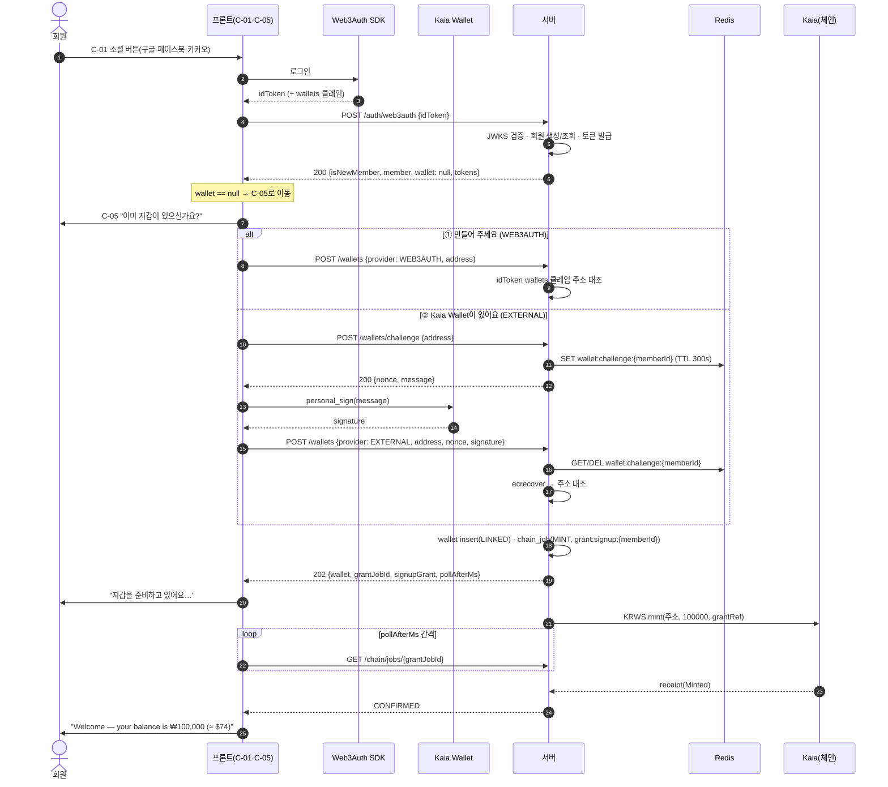

# v6 변경 계획 v1 — HALTED 정정 · 양도 제외 · 잔액 캐시 Redis · 지갑 등록 분리 · 화면설계 반응형 전환

- 작성일: 2026-09-03
- 대상 v5 문서: `04_요구사항_명세서_v5.md` · `05_기능_명세서_v5.md` · `06_API_명세서_v5.md` · `07_화면설계_v5.md` · `11_ERD_v4.md`(+SQL 2종)
- 산출물: `04~07_*_v6.md` 4종 + `12_ERD_v5.md` + `12_ERD_v5_import.sql` + `12_ERD_v5_import_mvp.sql`
- **이 문서는 계획서다. 여기서는 어떤 기존 문서도 수정하지 않는다.**

## 이 계획이 묶는 네 가지 변경

| | 변경 | 성격 | 상태값·스키마 영향 |
|---|------|------|------------------|
| **§A** | 정산 `HALTED` 진입 조건 서술 정정 | 문구 정정 (설계 변경 아님) | 없음 |
| **§B** | 양도(선물) 기능 **설계에서 완전 삭제** | 범위 축소 (설계 변경) | 있음 — 테이블 1개·enum 값 1개·에러코드 6개 삭제 |
| **§B′** | 지갑 잔액 캐시를 Redis로 이전 + 갱신 시점 보강 | 부수 발견 (저장소 변경) | 있음 — `wallet` 컬럼 2개 삭제 |
| **§B″** | **지갑 등록을 로그인에서 분리**(방안 B 확정) | 부수 발견 (흐름 변경) | 없음 — 챌린지는 Redis, 테이블 무변경 |

§B는 9/2 `[팀 9/2]` 결정의 "양도 P2 최후순위"를 **"설계에서 완전 삭제"로 격상**한 9/3 사용자 결정을 반영한다. §B′·§B″는 그 과정에서 사용자 질의로 드러난 부수 발견이며 각각 9/3에 확정됐다. 네 변경을 **v6 한 세트로 함께** 낸다.

- §A — HALTED 진입 조건 정정
- §B — 양도 완전 제외
- §B′ — 지갑 잔액 캐시 Redis 이전
- §B″ — 지갑 등록을 로그인에서 분리 (방안 B)
- §C — 작성 원칙(ERD 결합도) · 공통 작업 순서 · 검증

---

# §A. 정산 `HALTED` 진입 조건 문구 정정

> 이 절 안의 `§n.m` 상호 참조는 모두 §A 내부 번호다(예: `§4.3` = `§A-4.3`). `§6-D1`은 `§A-5 D1`을 가리킨다.

### A-1. 문제 정의

#### 1.1 현재 문구가 만드는 오해

`04_요구사항_명세서_v5.md:307` — 정산 상태 테이블의 `HALTED` 행:

```
| `HALTED` | 중단 — 공연 취소 또는 치명적 불일치 | 공연 취소, 또는 집계 불일치·이의 처리 불가 | 종단 상태 | 집계·`release` 영구 차단, 전액 환불 |
```

이 한 줄이 다음 두 가지를 동시에 오해하게 만든다.

1. **"시스템이 불일치를 감지하면 자동으로 `HALTED`가 된다"** — 진입 조건에 "집계 불일치"가 그대로 적혀 있어, 온체인 카운터와 서버 집계가 어긋나면 상태가 자동으로 `HALTED`로 넘어가는 것처럼 읽힌다.
2. **"불일치를 고치면 다시 `RELEASED`로 갈 수 있다"** — "치명적 불일치"라는 표현이 "치명적이지 않은 불일치는 `HALTED` 후 복구 가능"이라는 여지를 남긴다. 실제로는 `HALTED`에 복구 경로가 없다.

#### 1.2 실제 설계

**(A) `HALTED`는 온체인 `Splitter.halt(showId)`와 묶인 종단 상태다.**

| 근거 | 파일:행 | 내용 |
|------|---------|------|
| halt 실행 | `04:776` | "운영자가 `Splitter.halt(showId)`를 보내 이후 집계·`release`가 실행되지 않게 하고 `refund`만 허용되게 한다" |
| halt tx 확정 확인 | `04:1424` | "공연 상태가 `CANCELLED`이고 정산이 `HALTED`이며 `halt` tx가 확정됐는지 확인한다" |
| 영구 차단 명시 | `04:2027` | "정산은 `HALTED`로 전이되어 집계·`release`가 영구히 차단되며 전 티켓이 수수료 없이 환불된 뒤 보증금이 반환된다. (P-12)" |
| tx_type 정의 | `04:271` | `` | `HALT` | OPERATOR | `halt(showId)` — 공연 취소 | `` |
| API 처리 순서 | `06:2153` | "① `halt(showId)` ② 티켓·주문별 `refund(...)` 순차 전송 ③ 전 건 완료 후 `returnDeposit(showId)`" |
| 기능 명세 | `05:589` | "공연 상태를 `CANCELLED`로 전환하고 운영자가 `Splitter.halt(showId)`를 실행해 이후 환불만 허용한다" |

즉 `HALTED` 진입 = 컨트랙트가 `refund`만 남기고 `aggregate`/`release`를 영구히 잠그는 것 + 전 티켓 무수수료 일괄 환불 + 보증금 반환. 에스크로가 비므로 물리적으로도 `release`가 불가능하다. **되돌아올 수 없다.**

**(B) "고칠 수 있는 불일치"는 `HALTED`로 가지 않는다.** 각각 다른 3가지 장치가 담당한다.

| 장치 | 근거 파일:행 | 동작 | 상태 변화 |
|------|-------------|------|-----------|
| 집계 불일치 409 게이트 | `06:4693`, `06:4727`, `06:4737`, `05:1334` | 집계 확정 시 온체인 카운터 합 ≠ 서버 집계면 `SETTLEMENT_AGGREGATE_MISMATCH`(409)로 **확정만 거부** | **없음** — `NONE` 유지 |
| 이의 접수 중 release 보류 | `04:1723`(이의 `OPEN` 생성 시 보류), `05:1363`, `06:4851` | `OPEN` 이의가 남아 있으면 자동·수동 `release` 모두 막힘 | **없음** — `DISPUTE_OPEN` 유지 |
| 발행량 대사 깨짐 | `06:3470`, `06:3506`, `06:3539` | 불변식 1·4가 깨지면 `releaseHalted: true` 플래그로 `release`만 잠시 차단 | **없음** — 정산 상태 그대로 |

세 장치 모두 **상태를 바꾸지 않고 다음 동작만 막는다.** 원인을 고치면 원래 흐름으로 그대로 이어진다. `HALTED`와는 성격이 완전히 다르다.

**(C) `HALTED` 진입 경로는 2개뿐이다.**

| 경로 | 근거 파일:행 | 트리거 |
|------|-------------|--------|
| (a) 공연 취소 | `04:172`, `04:777`, `06:2153`, `05:589` | 공연 생성자(또는 관리자)의 공연 취소 요청 → `halt` |
| (b) 관리자 판정 | `04:1739` | 이의 처리 중 "집계 자체를 되돌려야 한다"고 판정 → `HALTED` + 관리자 수동 처리 |

경로 (b)의 현재 문구도 애매하다(§4.2 참조).

#### 1.3 부수적으로 드러난 불일치 (결정 필요 — §6-D1)

`06:5318`은 이의 `RESOLVED` 처리 후 **"관리자가 `settlement/aggregate`부터 다시 진행한다"** 고 적고 있는데, `04:305`의 정산 상태 테이블에는 `DISPUTE_OPEN → AGGREGATED` 역전이가 없다(`DISPUTE_OPEN`의 허용 전이는 `RELEASED`·`HALTED`뿐). 온체인 `lock(showId)`이 이미 확정된 뒤이므로 재집계도 컨트랙트가 막는다. 06과 04가 서로 다른 이야기를 하고 있다.

---

### A-2. 수정 원칙

1. **v5 문서는 한 글자도 건드리지 않는다.** `04/05/06/07`의 v5 파일을 그대로 두고 `*_v6.md`를 새로 만든다. (산출물 덮어쓰기 금지 원칙)
2. **v6은 필요한 문서만 만든다.** §A만 놓고 보면 실제 문구가 바뀌는 문서는 **04 · 06 · 07** 3개이고 05는 §3 조사상 필수 변경이 없다(§A-5 D1의 연쇄로 뒤집힌다 — D2 참조). ※ **§B 양도 삭제가 04/05/06/07 전부를 건드리므로 최종 산출물은 4종 모두 v6이다.**
3. **ERD는 §A 범위에서는 건드리지 않는다.** `settlement.status` enum 6값(`11_ERD_v4.md:395`)에 변화가 없고 컬럼 추가·삭제도 없다. ※ **다만 §B 양도 삭제로 `transfer` 테이블과 `ticket` 컬럼이 바뀌므로, 최종적으로는 §B-4의 `12_ERD_v5.*` 신규 파일 계획과 §C-1 통합 순서를 따른다.**
4. **의미를 바꾸는 게 아니라 이미 결정된 의미를 문장으로 정확히 적는 작업이다.** 상태값·에러코드·API 시그니처·화면 구성은 하나도 바뀌지 않는다. 결정 문서(`결정 v2 §7`)의 재해석이 아니라 서술 정정이다.
5. **v6 헤더에 변경 사유를 남긴다.** 각 v6 문서 상단 변경 이력에 "`HALTED` 진입 조건 서술 정정 — 상태값·API 변경 없음" 한 줄을 넣어 diff 범위를 명시한다(§B의 "양도 삭제" 한 줄과 함께 **2줄** — §C-1 9번).

---

### A-3. 영향 범위 조사 결과

검색어: `HALTED` · `치명적` · `불일치` · `SETTLEMENT_HALTED` · `halt` / `releaseHalted` (04/05/06/07 v5 전수).
`불일치`는 발행량 대사·서명 검증 등 정산과 무관한 히트가 많아 **정산·halt 문맥만** 표에 남기고 나머지는 표 아래에 일괄 사유를 적었다.

#### 3.1 `04_요구사항_명세서_v5.md`

| 행 | 현재 문구(요약) | 수정 | 수정안 / 불필요 사유 |
|----|----------------|:----:|---------------------|
| 172 | 공연 `CANCELLED` 행 — "…정산 `HALTED`, 완료 후 보증금 반환" | ✕ | 공연 취소 경로 서술로 정확하다. `HALTED`가 취소의 결과라는 사실만 말하고 진입 조건을 정의하지 않는다 |
| 271 | `` | `HALT` | OPERATOR | `halt(showId)` — 공연 취소 | `` | **○** | 설명을 "공연 취소 또는 관리자 중단 판정"으로 확장 (§4.4) |
| 302 | `NONE` 행 허용 전이 "→ `AGGREGATED`, → `HALTED`" | ✕ | 공연 취소는 `NONE` 시점에도 가능하므로 전이 자체는 맞다 |
| 303 | `AGGREGATED` 행 허용 전이 "→ `LOCKED`, → `HALTED`" | ✕ | 같은 이유 |
| 305 | `DISPUTE_OPEN` 행 허용 전이 "→ `RELEASED`, → `HALTED`" | ✕ | 경로 (b)가 여기서 발생하므로 맞다. 단 §1.3의 06과의 충돌은 D1에서 처리 |
| **307** | **`HALTED` 행 전체** | **●** | **핵심 수정. 의미·진입 조건·허용 전이 3칸 모두 교체 (§4.1)** |
| **316** | dispute `RESOLVED` 행 비고 "필요 시 정산 `HALTED`" | **●** | 관리자 결정임을 명시 (§4.2) |
| 777 | 공연 취소 흐름 "정산 상태를 `HALTED`로 전이하고…" | ✕ | 경로 (a)의 정상 서술 |
| 1424 | 일괄 환불 선행조건 "…`halt` tx가 확정됐는지 확인한다" | ✕ | 정확하다. `HALTED`가 온체인과 묶여 있다는 근거 문장이기도 하다 |
| 1643~1648 | 정산 장 도입부 | **●** | "일시 정지 후 재개"와 `HALTED`를 구분하는 설명 문단 신설 위치 (§4.3) |
| 1654 | 정산 상태값 나열 | ✕ | 값 나열일 뿐 |
| 1687 | 집계 확정 "정산이 `HALTED`면 거부한다" | ✕ | 맞다 — 영구 차단의 서버측 표현 |
| 1723 | 이의 접수 "이의를 `OPEN`으로 생성하고 `release` 자동 실행을 보류한다" | ✕ | "보류"와 `HALTED`가 다르다는 근거 문장. 유지 |
| **1739** | 이의 처리 "집계 자체를 되돌려야 하는 경우에는 정산을 `HALTED`로 전이하고 관리자 수동 처리로 넘긴다" | **●** | "되돌릴 수 없다고 판정 → 전액 환불 결정"으로 교체 (§4.2) |
| 1803 | 실패 사유 "온체인 선택 카운터 합과 서버 집계가 불일치한 경우 (`SETTLEMENT_AGGREGATE_MISMATCH`)" | ✕ | 409 게이트의 정확한 서술 |
| **1812** | 실패 사유 "공연 취소로 정산이 `HALTED`인 상태에서 집계·잠금·`release`를 시도한 경우" | **○** | "공연 취소로" → "공연 취소 또는 관리자 중단 판정으로" (§4.5) |
| 2027 | §7.4 "공연 취소는 예외 경로다… 영구히 차단되며" | △ | 내용은 정확. 경로 (b)를 한 문장 덧붙일지 D3에서 결정 |
| **2259** | §12 `SETTLEMENT_HALTED` 에러 설명 "공연 취소로 정산이 `HALTED`인 상태에서…" | **○** | 설명 확장 (§4.5) |

`불일치` 기타 히트(101·105·240·635·639·765·894·898·902·1137·1140·1266·1340 등) — 발행량 대사·tx 서명 검증·ChainJob 실패 문맥이며 정산 상태 전이와 무관하다. **수정 불필요.**

#### 3.2 `05_기능_명세서_v5.md`

| 행 | 현재 문구(요약) | 수정 | 수정안 / 불필요 사유 |
|----|----------------|:----:|---------------------|
| 578 | F-performance-08 예외 "대사 불일치(`SETTLEMENT_AGGREGATE_MISMATCH`, 409, 집계 확정 단계에서 차단)" | ✕ | "차단"이라 적혀 있고 상태 전이를 말하지 않는다. 정확 |
| 589 | F-performance-09 "…`Splitter.halt(showId)`를 실행해 이후 환불만 허용한다" | ✕ | 경로 (a)의 정상 서술 |
| 866 | F-verify "카운터가 서버 집계와 어긋나면 집계 확정이 차단된다(`SETTLEMENT_AGGREGATE_MISMATCH`, 409)" | ✕ | 정확 |
| 1315 | F-settlement-01 상태 머신 나열 "… → `RELEASED` / `HALTED`" | ✕ | 값 나열 |
| **1331** | F-settlement-02 "…**불일치면 자동 정산을 중단한다**" | **△** | "중단"이 `HALTED`로 읽힐 여지. "확정을 거부하고 상태를 그대로 둔다"로 다듬으면 좋지만 다음 줄(1334)이 409를 명시해 오해 가능성이 낮다 → **D2 참조** |
| 1334 | 예외 "대사 실패(`SETTLEMENT_AGGREGATE_MISMATCH`, 409, 관리자 확인 후 진행)" | ✕ | "관리자 확인 후 진행" = 복구 가능함을 명시. 정확 |
| 1363 | F-settlement-04 "release 자동 실행을 보류한다" | ✕ | 정확 |
| 1377 | F-settlement-05 "…발행량 불변식 상태를 확인한다(불일치면 중단)" | ✕ | `releaseHalted` 플래그 문맥. 정산 상태 전이 아님 |
| 1386 | 예외 "발행량 불변식 불일치 … release 중단 + 관리자 알림" | ✕ | 같은 이유 |
| 1509 | F-admin-06 "승인 시 집계·규칙을 재조정하고, 반려 시 release 보류를 해제한다" | **△** | `HALTED`를 언급하지 않아 04:1739·06:5318과 어긋난다 → **D1에서 함께 정리** |
| 1537 | 재시도 대상 tx 목록에 `halt` 포함 | ✕ | 목록일 뿐 |
| 992·1013·1043·1130·1427·1441·1444·1542 | `COIN_RESERVE_MISMATCH` 계열 "중단" | ✕ | 발행량 대사 문맥. 정산 상태 전이와 무관 |

#### 3.3 `06_API_명세서_v5.md`

| 행 | 현재 문구(요약) | 수정 | 수정안 / 불필요 사유 |
|----|----------------|:----:|---------------------|
| 2057 | "불일치가 있으면 `counterMatched: false`… 집계 확정이 `SETTLEMENT_AGGREGATE_MISMATCH`로 막힌다" | ✕ | 정확 |
| 2126 | API-performance-12 "…`halt(showId)`를 걸어 이후 `refund`만 허용한다 [권] P-12" | ✕ | 경로 (a)의 정상 서술 |
| 2153 | 처리 순서 "① `halt` ② `refund` ③ `returnDeposit`" | ✕ | 정확. 에스크로가 비는 이유의 근거 |
| 3470·3506·3539 | `mintHalted`·`releaseHalted` 플래그 | ✕ | 정산 상태와 이름만 비슷할 뿐 별개 장치. **단 §4.3 설명 문단에서 이 구분을 명시적으로 언급한다** |
| **4590** | §12 도입부 "Settlement 상태는 `NONE → … → RELEASED` / `HALTED`다(결정 v2 §7)" | **●** | 바로 아래에 §4.3 설명 문단을 추가 |
| **4596** | "집계는 … 불일치면 **자동 정산을 중단한다**" | **●** | "중단"이 `HALTED`로 읽힌다. "집계 확정을 거부하고(`SETTLEMENT_AGGREGATE_MISMATCH`) 상태는 그대로 둔다"로 교체 (§4.6) |
| 4693 | API-settlement-02 "불일치면 `SETTLEMENT_AGGREGATE_MISMATCH`로 중단하고 관리자 확인으로 넘긴다(REL-06)" | **○** | "중단" → "집계 확정을 거부" (§4.6) |
| 4727 | 409 응답 예시 `msg` "집계 검증에 실패했습니다. 관리자 확인 후 정산이 진행됩니다." | ✕ | "관리자 확인 후 진행"이 복구 가능성을 이미 말한다. 정확 |
| 4737·4786 | 409 표의 `SETTLEMENT_AGGREGATE_MISMATCH` 행 | ✕ | 코드·조건 나열 |
| **4788** | API-settlement-03 409 표 "`PERFORMANCE_INVALID_STATUS` | 공연이 `CANCELLED`(정산 `HALTED`)" | **○** | "(정산 `HALTED`)" → "또는 정산이 `HALTED`" (§4.5) |
| 4851 | API-settlement-05 "열린 이의가 있으면 자동·수동 모두 막힌다 — 관리자가 처리해야 재개된다" | ✕ | "재개"를 명시. 정확 |
| **5318** | API-admin-06 "`RESOLVED`(이의 인정)이면 재집계가 필요하므로 자동 재개하지 않고 관리자가 `settlement/aggregate`부터 다시 진행한다" | **●** | 04:305 상태 테이블과 충돌 → **D1** |
| 5650 | v5 체크리스트 "Settlement 5값 + `HALTED`" | ✕ | 값 개수 확인용 |

#### 3.4 `07_화면설계_v5.md`

| 행 | 현재 문구(요약) | 수정 | 수정안 / 불필요 사유 |
|----|----------------|:----:|---------------------|
| 1019 | P-08 영역 구성 단계 표시 "… `RELEASED` / `HALTED`" | ✕ | 값 나열 |
| 1038 | P-08 에러 "`SETTLEMENT_AGGREGATE_MISMATCH`(409) — 관리자 확인 안내" | ✕ | 정확 |
| 1039 | P-08 "발행량 대사 불일치 … release가 중단된 상태를 배너로" | ✕ | `releaseHalted` 문맥. 정산 상태와 별개 |
| **1040** | P-08 "`HALTED`: **공연 취소로** 정산이 중단된 경우 일괄 환불 진행률과 보증금 반환 예정을 함께 표시" | **●** | 경로 (b)가 빠져 있다 (§4.7) |
| 1062 | P-10 안내 텍스트 "전 티켓이 수수료 없이 … 정산이 중단됩니다" | ✕ | 공연 취소 모달이므로 경로 (a) 문맥이 맞다 |
| 1223 | M-02 이의 상세 패널 구성 | **△** | 관리자가 "중단 판정"을 내릴 UI가 없다 → **D1** |
| 1298 | §5.1 라벨 표 `HALTED` = "정산 중단" | ✕ | 라벨은 그대로 좋다 |
| 1301 | `ChainJob.tx_type` `HALT` = "정산 중단" | ✕ | 라벨 적절 |
| 1162·1193·1197·1253 | `COIN_SUPPLY_MISMATCH` 중단 배너 | ✕ | 발행량 대사 문맥 |

#### 3.5 요약

| 파일 | 필수 수정(●) | 문구 확장(○) | 검토 후 결정(△) | 수정 불필요 | v6 생성 |
|------|:---:|:---:|:---:|:---:|:---:|
| 04 | 4 | 3 | 1 | 12 | **필요** |
| 05 | 0 | 0 | 2 | 12 | D1·D2 결과에 따름 |
| 06 | 3 | 2 | 0 | 9 | **필요** |
| 07 | 1 | 0 | 1 | 8 | **필요** |
| **합계** | **8** | **5** | **4** | **41** | **3~4개** |

---

### A-4. 구체 수정안 (before / after)

#### 4.1 [04:307] 정산 상태 테이블 `HALTED` 행 — 핵심

**Before**
```
| `HALTED` | 중단 — 공연 취소 또는 치명적 불일치 | 공연 취소, 또는 집계 불일치·이의 처리 불가 | 종단 상태 | 집계·`release` 영구 차단, 전액 환불 |
```

**After**
```
| `HALTED` | 중단 — 공연 취소 또는 복구 불가 판정 | 공연 취소, 또는 관리자가 이의 처리 중 집계를 되돌릴 수 없다고 판정해 전액 환불을 결정한 경우 | **종단 상태**(온체인 `halt` 확정 후 `refund`만 허용) | 진입 즉시 전 티켓 무수수료 일괄 환불 → 보증금 반환. 집계·`release`는 컨트랙트가 영구 차단하며 에스크로가 비므로 되돌아올 수 없다 |
```

#### 4.2 [04:316] dispute `RESOLVED` 행 + [04:1739] 이의 처리 흐름

**Before (316)**
```
| `RESOLVED` | 해결 — 관리자가 이의를 인정하고 처리 | 관리자 처리 | 종단 상태 | 필요 시 정산 `HALTED` |
```

**After (316)**
```
| `RESOLVED` | 해결 — 관리자가 이의를 인정하고 처리 | 관리자 처리 | 종단 상태 | **관리자가 집계를 되돌릴 수 없다고 판정해 전액 환불을 결정한 경우에만** 정산을 `HALTED`로 전이한다(자동 전이가 아니다) |
```

**Before (1739)**
```
   - 집계 자체를 되돌려야 하는 경우에는 정산을 `HALTED`로 전이하고 관리자 수동 처리로 넘긴다.
```

**After (1739)**
```
   - **집계를 되돌릴 수 없다고 관리자가 판정한 경우에만** 전액 환불을 결정하고 정산을 `HALTED`로 전이한다. 이 전이는 관리자의 명시적 결정이며 시스템이 자동으로 수행하지 않는다. 전이하면 공연 취소와 같은 경로로 온체인 `halt(showId)` → 전 티켓 무수수료 일괄 환불 → 보증금 반환이 진행되고, 정산은 다시 열리지 않는다.
```

#### 4.3 "일시 정지 후 재개"와 `HALTED`를 구분하는 설명 문단 (신설)

**배치 위치 — 2곳에 같은 취지로 넣는다.**

1. **`04` 정산 장 도입부 (`04:1643~1648`, `## 정산 settlement` 바로 아래, 기존 "v5에서 이 장의 끝이 바뀌었다" 문단 다음)** — 요구사항 레벨의 정본.
2. **`06` §12 도입부 (`06:4590` 상태 머신 문장 바로 아래)** — API 독자가 상태 머신을 처음 보는 자리.

`04`의 §상태 머신 표(298~309) 아래 주석 자리는 이미 "v4에서 `RELEASED` 뒤에…" 주석이 차지하고 있고, 표 바로 밑에 긴 문단을 넣으면 상태 테이블 가독성이 떨어진다. **정산 장 도입부를 정본으로 삼고, 상태 테이블 아래에는 한 줄 포인터만 둔다.**

**04:309 아래 추가할 한 줄 포인터**
```
- **`HALTED`는 "잠시 멈춤"이 아니다.** 진행을 잠시 막는 세 장치(집계 409 게이트·이의 중 release 보류·발행량 대사 `releaseHalted`)는 정산 상태를 바꾸지 않는다. 자세한 구분은 §정산 장 도입부를 보라.
```

**04 정산 장 도입부 / 06 §12 도입부에 추가할 문단 (신규)**
```
> **정산이 멈추는 방식은 두 종류이고, `HALTED`는 그중 하나뿐이다.**
>
> **① 되돌릴 수 있는 정지 — 상태는 그대로 두고 다음 동작만 막는다.** 세 가지가 있다.
> - **집계 확정 게이트** — 온체인 선택 카운터 합과 서버 집계가 어긋나면 `SETTLEMENT_AGGREGATE_MISMATCH`(409)로 **집계 확정만 거부**한다. 정산 상태는 `NONE` 그대로다. 원인을 확인한 뒤 다시 확정하면 그대로 이어진다.
> - **이의 접수 중 release 보류** — `OPEN` 이의가 남아 있으면 자동·수동 `release`가 모두 막힌다. 상태는 `DISPUTE_OPEN`을 유지하고, 관리자가 모든 이의를 처리하면 보류가 풀려 `release`로 이어진다.
> - **발행량 대사 차단** — 불변식 1·4가 깨지면 `releaseHalted` 플래그가 서고 `release`만 잠시 막힌다(`mintHalted`와 같은 계열의 운영 플래그이며 정산 상태값이 아니다). 대사가 맞으면 플래그가 내려간다.
>
> **② 되돌릴 수 없는 중단 — `HALTED`.** 온체인 `Splitter.halt(showId)`와 한 몸이다. 컨트랙트가 이후 `refund`만 허용하고 `aggregate`·`release`를 **영구히** 차단한다. 진입하면 곧바로 전 티켓 무수수료 일괄 환불이 시작되고, 전 건이 끝나면 보증금이 반환된다. 환불로 에스크로가 비므로 분배할 재원 자체가 남지 않는다. **`HALTED`에서 `RELEASED`로 가는 경로는 존재하지 않는다.**
>
> 진입 경로는 **공연 취소**와 **관리자가 이의 처리 중 집계를 되돌릴 수 없다고 판정해 전액 환불을 결정한 경우** 둘뿐이다. 어느 쪽도 시스템이 불일치를 감지해 자동으로 전이시키지 않는다.
```

#### 4.4 [04:271] ChainJob `HALT` tx_type 설명

**Before**
```
| `HALT` | OPERATOR | `halt(showId)` — 공연 취소 |
```

**After**
```
| `HALT` | OPERATOR | `halt(showId)` — 공연 취소 또는 관리자 중단 판정 시 정산을 종단 중단 |
```

#### 4.5 `SETTLEMENT_HALTED` 계열 설명 확장 — **확장 필요하다**

경로 (b)가 존재하는 한 "공연 취소로"만 적으면 발생 조건을 잘못 좁힌다. 서버 구현자가 조건 분기를 `performance.status == CANCELLED`로만 짤 위험이 실재한다. 3곳 모두 확장한다.

**[04:2259] §12 에러 표**
- Before: `| `SETTLEMENT_HALTED` | 409 | 공연 취소로 정산이 `HALTED`인 상태에서 집계·잠금·`release`를 시도 | `PERFORMANCE_INVALID_STATUS` | `settlement` |`
- After: `| `SETTLEMENT_HALTED` | 409 | 정산이 `HALTED`(공연 취소 또는 관리자 중단 판정)인 상태에서 집계·잠금·`release`를 시도 | `PERFORMANCE_INVALID_STATUS` | `settlement` |`

**[04:1812] 정산 장 실패 사유**
- Before: `- 공연 취소로 정산이 `HALTED`인 상태에서 집계·잠금·`release`를 시도한 경우 — …`
- After: `- 정산이 `HALTED`(공연 취소 또는 관리자 중단 판정)인 상태에서 집계·잠금·`release`를 시도한 경우 — `PERFORMANCE_INVALID_STATUS`(§12 `SETTLEMENT_HALTED`)`

**[06:4788] API-settlement-03 409 표**
- Before: `| 409 | `PERFORMANCE_INVALID_STATUS` | 공연이 `CANCELLED`(정산 `HALTED`) |`
- After: `| 409 | `PERFORMANCE_INVALID_STATUS` | 공연이 `CANCELLED`이거나 정산이 `HALTED`(§16.1 `SETTLEMENT_HALTED`) |`

#### 4.6 [06:4596] / [06:4693] "자동 정산을 중단한다" → 정지의 성격 명시

**Before (4596)**
```
집계는 서버 DB값이 아니라 **온체인 선택 카운터**와 대조해 확정하고(REL-06), 불일치면 자동 정산을 중단한다.
```
**After (4596)**
```
집계는 서버 DB값이 아니라 **온체인 선택 카운터**와 대조해 확정하고(REL-06), 불일치면 **집계 확정을 거부한다**(`SETTLEMENT_AGGREGATE_MISMATCH`, 409). 정산 상태는 그대로 남고 `HALTED`로 전이하지 않는다 — 원인을 확인한 뒤 다시 확정하면 이어진다.
```

**Before (4693)**
```
- 서버 집계와 **온체인 선택 카운터의 합**을 대조한다. 불일치면 `SETTLEMENT_AGGREGATE_MISMATCH`로 중단하고 관리자 확인으로 넘긴다(REL-06).
```
**After (4693)**
```
- 서버 집계와 **온체인 선택 카운터의 합**을 대조한다. 불일치면 `SETTLEMENT_AGGREGATE_MISMATCH`(409)로 **집계 확정만 거부**하고 관리자 확인으로 넘긴다(REL-06). **정산 상태는 바뀌지 않는다** — `HALTED`로 전이하는 경로가 아니다.
```

#### 4.7 [07:1040] P-08 `HALTED` 표시 조건

**Before**
```
- `HALTED`: 공연 취소로 정산이 중단된 경우 일괄 환불 진행률과 보증금 반환 예정을 함께 표시
```
**After**
```
- `HALTED`: 정산이 종단 중단된 경우(공연 취소, 또는 관리자가 이의 처리 중 전액 환불을 결정한 경우) 중단 사유 문구와 함께 일괄 환불 진행률·보증금 반환 예정을 표시하고 **집계 확정·잠금·release 버튼을 모두 비활성**으로 둔다. 재개 버튼은 두지 않는다(되돌아올 수 없는 상태다).
```

#### 4.8 05에서의 연쇄 수정

D2 판단(§6)에 따라 **05:1331 한 줄만** 다듬는다.

**Before**
```
2. 일치하면 운영자가 `Splitter.aggregate(showId, validTicketCount)`를 실행해 유효 티켓 수를 확정한다. 불일치면 자동 정산을 중단한다.
```
**After**
```
2. 일치하면 운영자가 `Splitter.aggregate(showId, validTicketCount)`를 실행해 유효 티켓 수를 확정한다. 불일치면 집계 확정을 거부하고 정산 상태는 그대로 둔다(`HALTED` 전이 아님).
```

---

### A-5. 결정 사항 — 추천안으로 진행한다

질문으로 남기지 않는다. 아래 추천안대로 v6을 작성하고, 사용자가 다르게 지시하면 그때 되돌린다.

#### D1. 이의 `RESOLVED` 이후 경로 — 04와 06이 충돌한다

- 현황: `04:1739`는 "집계를 되돌려야 하면 `HALTED`", `06:5318`은 "`RESOLVED`이면 `settlement/aggregate`부터 다시 진행", `05:1509`는 "승인 시 집계·규칙을 재조정", `04:305` 상태 테이블은 `DISPUTE_OPEN → AGGREGATED` 역전이를 허용하지 않는다.
- **추천안 — 04를 정본으로 삼고 06:5318을 고친다.**
  - 근거 ①: 온체인 `lock(showId)`이 이미 확정된 뒤라 컨트랙트가 `aggregate` 재실행을 막는다. 06의 재집계 서술은 온체인 제약과 어긋난다.
  - 근거 ②: 상태 테이블(04:305)에 역전이가 없으므로 06을 살리려면 상태 머신 자체를 바꿔야 하는데, 이는 이번 작업 범위(문구 정정)를 넘고 ERD·컨트랙트까지 영향이 간다.
  - 근거 ③: MVP에서 이의 인정 케이스는 시연 시나리오에 없다. 경로를 하나로 줄이는 쪽이 구현 위험이 낮다.
  - **적용**: `06:5318`을 다음으로 교체한다.
    > **`REJECTED`이면 release 보류가 풀려** 자동 스케줄이 재개된다. `RESOLVED`(이의 인정)이면 정산 잠금이 이미 온체인에 확정돼 재집계가 불가능하므로, 관리자는 ① 분배 결과를 그대로 두고 `release`를 진행하거나 ② **집계를 되돌릴 수 없다고 판정해 전액 환불을 결정**하고 정산을 `HALTED`로 전이하는(= 공연 취소와 같은 `halt` → 일괄 환불 → 보증금 반환) 두 가지 중 하나를 택한다. **`AGGREGATED`로 되돌리는 경로는 없다.**
  - 연쇄: `05:1509`의 "승인 시 집계·규칙을 재조정하고" → "승인 시 관리자가 release 진행 또는 `HALTED` 중단을 결정하고"로 수정. → **05 v6도 만든다.**

#### D2. 05 v6을 만들 것인가

- **추천안 — 만든다.** D1 연쇄로 `05:1509`가 반드시 바뀌고, `05:1331`의 "자동 정산을 중단한다"도 06:4596과 같은 오해를 그대로 안고 있다. 05만 v5로 남으면 4개 문서 세트의 버전이 어긋나 참조가 헷갈린다.
- 최종 산출물: **04·05·06·07 모두 v6.** (§2 원칙 2의 "05는 만들지 않는다" 예상을 D1 결과로 뒤집는다.)

#### D3. 04:2027(§7.4 시점 규칙)에 경로 (b)를 덧붙일 것인가

- **추천안 — 덧붙이지 않는다.** §7.4는 "정상 경로의 시점 순서"를 설명하는 절이고 해당 항목은 "공연 취소는 예외 경로다"로 시작한다. 관리자 판정 경로는 시점 규칙의 문제가 아니라 이의 처리 결과이므로, §4.3 설명 문단과 04:1739에서 다루는 것으로 충분하다. §7.4에 넣으면 시점 규칙 절의 초점이 흐려진다.

#### D4. 관리자가 "중단 판정"을 내릴 UI를 M-02에 신설할 것인가

- 현황: `07:1225`의 M-02는 승인·반려 버튼 2개뿐이고, `06:5334`의 `status`도 `RESOLVED`/`REJECTED` 2값이다. D1 추천안대로면 관리자가 `HALTED` 결정을 내릴 화면 요소가 없다.
- **추천안 — MVP에서는 신설하지 않고, 07 v6의 M-02 비고에 한 줄만 남긴다.**
  - 근거: 전액 환불 결정은 공연 취소(P-10)와 결과가 동일하므로, 관리자는 이의를 `RESOLVED`로 처리한 뒤 **기존 공연 취소 경로(API-performance-12)** 를 그대로 쓰면 된다. 별도 API·화면·상태값을 추가하지 않아도 경로가 완결된다. MVP 관리자 화면을 M-02·M-03 두 개로 묶어 둔 결정(07:111)도 지킬 수 있다.
  - **적용**: `07:1228` 부근 M-02 비고에 추가 —
    > - 이의를 인정해 **집계를 되돌릴 수 없다고 판정한 경우**, 관리자는 이의를 `RESOLVED`로 처리한 뒤 공연 취소 경로(P-10 / API-performance-12)로 전액 환불을 실행한다. 그 결과로 정산이 `HALTED`가 된다. M-02에 별도 중단 버튼을 두지 않는다.
  - 같은 취지를 `04:1739` After 문구 끝에 "(실행은 공연 취소와 같은 경로를 쓴다)"로 덧붙인다.

#### D5. `SETTLEMENT_HALTED` 에러 설명을 확장할 것인가

- **추천안 — 확장한다** (§4.5). 조건을 "공연 취소"로만 적으면 구현자가 `performance.status == CANCELLED`만 검사할 위험이 있다. 실제 게이트는 `settlement.status == HALTED`여야 한다. 3곳(04:1812·04:2259·06:4788) 모두 수정한다.

---

# §B. 양도(선물) 기능 완전 제외

## B-1. 결정과 원칙

**9/3 사용자 결정** — 양도(선물)를 **설계에서 완전히 삭제**한다. 9/2 `[팀 9/2]` 결정의 "P2 최후순위(설계·테이블은 남기고 구현만 미룸)"에서 **"설계 산출물에서 제거"** 로 격상한다.

원칙:

1. **"P2로 남긴다"가 아니라 "없다"로 쓴다.** v6에서는 `transfer` 도메인·화면·API·테이블·상태값·에러코드가 존재하지 않는다. `[P2]` 꼬리표를 붙여 남기는 방식은 쓰지 않는다.
2. **삭제 사실은 각 문서 상단 변경 이력 한 줄로만 남긴다.** 본문 안에 "양도는 삭제됐다"를 반복하지 않는다(§C-2 잔존 0건 검증과 충돌한다).
3. **양도 삭제로 사라지는 "설계 한계"도 함께 삭제한다.** 양도가 없으면 "양도 후 재선택의 온체인 반영 한계"라는 미결 안건 자체가 사라진다(§B-3 (d)).
4. **ERC-20 `transfer`/`transferFrom`, `REFUND_TRANSFER_FAILED`, `REDEEM_BANK_TRANSFER_FAILED` 는 양도와 무관하다.** 이름만 겹치므로 **전부 유지**한다(§B-2의 "오탐" 열).
5. v5 원본은 보존하고 v6/ERD v5를 새 파일로 만든다.

## B-2. 영향 범위 조사 결과

검색: `grep -n -i "양도\|transfer\|선물"` (대소문자 무시, `TRANSFER_*` 포함).

### B-2.1 파일별 건수

| 파일 | 전체 히트 | 오탐(ERC-20 `transfer`·`REFUND_TRANSFER_FAILED` 등) | **실제 양도 건수** | v6 처리 |
|------|---:|---:|---:|---|
| `04_요구사항_명세서_v5.md` | 69 | 6 | **63** | v6 생성 |
| `05_기능_명세서_v5.md` | 44 | 3 | **41** | v6 생성 |
| `06_API_명세서_v5.md` | 78 | 7 | **71** | v6 생성 |
| `07_화면설계_v5.md` | 43 | 0 | **43** | v6 생성 |
| `11_ERD_v4.md` | 18 | 0 | **18** | → `12_ERD_v5.md` |
| `11_ERD_v4_import.sql` | 9 | 0 | **9** | → `12_ERD_v5_import.sql` |
| `11_ERD_v4_import_mvp.sql` | 5 | 0 | **5** | → `12_ERD_v5_import_mvp.sql` |
| `planning/06_방향전환_코인전환_v2.md` | 22 | 3 | **19** | **원본 유지** + §14-34 안건 추가(§B-3 (h)) |
| `planning/01_기획_초안_v4.md` | 28 | 5 | **23** | **원본 유지**(§B-5 D-B3) |
| **합계** | **316** | **24** | **292** | |

오탐 24건은 전부 남긴다 — ERC-20 표준 함수(`transfer`/`transferFrom`/`token.transferFrom`), `release`의 push 전송, `REFUND_TRANSFER_FAILED`(환불 tx 실패), `REDEEM_BANK_TRANSFER_FAILED`(이미 철회된 코드), `ExternalIssuer`의 "운영지갑 보유분 `transfer`로 대체".

### B-2.2 구간별 위치 (설계 문서 4종)

| 문서 | 구간 | 행 | 성격 |
|------|------|-----|------|
| 04 | §4 역할 정의 `GUEST` | 65 | (c) 문구 삭제 |
| 04 | §5-1 티켓 상태 | 213·214 | (b) enum 값·전이 삭제 |
| 04 | §5-1 양도 상태 테이블 | 289~296 | (a) 표 전체 삭제 |
| 04 | §5 ChainJob·도메인 표 | 351 | (f) 행 삭제 |
| 04 | §6 `ticket` 엔티티·`qr_secret` | 936·937·941·946 | (d) 컬럼 서술 정리 |
| 04 | §6 `ticket` 관람팀 재선택 | 976 | (d) 삭제 |
| 04 | §6 `refund` 수령 지갑 | 1407 | (e) 문구 축약 |
| 04 | **§6 `transfer` 장 전체** | **1469~1560** | (a) 장 전체 삭제(92행) |
| 04 | §6 `entry` 실패 사유 | 1637 | (b) 항목 삭제 |
| 04 | §6 `verify` 표시 항목 | 1832 | (d) 삭제 |
| 04 | §8 보안(SEC-07) | 2063 | (d) 양도 문장 삭제 |
| 04 | §8 규제(공연법 제4조의2) | 2079 | (i) 문구 조정 — **D-B2** |
| 04 | §9 MVP·여유 시간 | 2134·2166 | 숫자·순서 문구 조정 |
| 04 | §10 확장 범위 표 | 2200·2231 | (a) 행 재작성 — **D-B1** |
| 04 | §12 `WALLET_NOT_LINKED` 도메인 | 2248 | (f) 도메인 태그에서 `transfer` 제거 |
| 04 | §12.5·12.6 미결 | 2309·2318 | (d) 항목 전체 삭제 |
| 05 | §A 표 F-ticket-05·10 | 81·86 | (b)(d) 상태·문구 정리 |
| 05 | **§A 표 F-transfer-01~04** | **104~107** | (a) 4행 삭제 |
| 05 | §B F-ticket-05·10 | 787·793·862 | (d) 문구 삭제 |
| 05 | **§B B-10 양도 도메인 절 전체** | **1190~1250** | (a) 절 전체 삭제(61행) |
| 05 | §C API·화면 커버리지 표 | 1615~1618·1655·1656 | (a) 행 삭제 |
| 05 | §C 도메인 유지 목록·우선순위 분포 | 1690·1692·1708·1757 | 숫자·목록 갱신 |
| 06 | §0 rate limit | 244 | (d) "양도 수락" 삭제 |
| 06 | §5 도메인 표 | 278 | (f) 행 삭제 |
| 06 | §6 티켓 상태·조회 | 2768·2984·2994·3010·3030·3047·3071·3093·3094·3130 | (b)(d) `TRANSFER_PENDING`·`transferable` 삭제 |
| 06 | §9 환불 409 | 4136·4214 | (b) `TRANSFER_NOT_ALLOWED` 행 삭제 |
| 06 | **§10 `transfer` 장 전체** | **4225~4453** | (a) 장 전체 삭제(229행) |
| 06 | §11 입장 409 | 4468·4525 | (b) 행 삭제 |
| 06 | §15 예약 경로 | 5392 | (a) 행 삭제 |
| 06 | §16.1 신설 제안 | 5470·5473 | (i) `TICKET_TRANSFER_PENDING`·`TRANSFER_CHOICE_TEAM_REQUIRED` 철회 |
| 06 | §16 미결 6번 | 5506 | (d) 항목 삭제 |
| 06 | §19 검수표 | 5554·5559·5625·5648·5657 | 숫자·목록 갱신 |
| 07 | §1 원칙 7 | 71 | (a) 원칙 행 삭제 |
| 07 | §2 IA 진입점·네비 | 80·88 | (c) 문구 삭제 |
| 07 | **§3 흐름도 ② 양도·수락** | **146~157** | (a) 흐름도 블록 삭제 |
| 07 | §4 C-01·C-02 복귀 경로 | 256·291·295·309·314 | (c) 양도 복귀 배너·경로 삭제 |
| 07 | §4 A-08 티켓 상세 | 622·625·635·636·640 | (b) 양도 버튼·배지 삭제 |
| 07 | **§4 A-09·A-10 화면 2개** | **647~700** | (a) 화면 절 전체 삭제 |
| 07 | §5.1 상태 라벨 표 | 1301·1302 | (b) `Transfer` 행·`TRANSFER_PENDING` 삭제 |
| 07 | §5 공통 규칙·서명 링크·소셜 복귀 | 1342·1351·1359 | (c) 문구 삭제 |
| 07 | §7 검수표·§8 예약 화면 | 1483·1484·1622 | (a) 행 삭제 |

## B-3. 삭제 대상 분류와 v6 처리안

### (a) `transfer` 도메인 장·상태 머신·API·화면 전체 — **삭제**

| 대상 | 위치 | 처리 |
|------|------|------|
| 04 §6 `transfer` 장 (`### transfer` 엔티티 + 흐름 4개 + 실패 사유) | 04:1469~1560 | **장 전체 삭제.** §6 도메인이 14 → **13**개 |
| 04 §5-1 "양도 상태 (`transfer.status`) — P2" 표 | 04:289~296 | **표 전체 삭제** |
| 05 §B "B-10. 양도 (`transfer`)" 절 + F-transfer-01~04 | 05:1190~1250 | **절 전체 삭제.** §A 표에서도 4행 삭제 → 활성 84행 → **80행**, `[P2] 확정 4` → **0** |
| 06 §10 "transfer — 양도(선물)" 장 + API-transfer-01~04 | 06:4225~4453 | **장 전체 삭제.** 도메인 14 → **13**, 장 번호 §11~§14를 §10~§13으로 당김 |
| 07 A-09 양도 링크 생성 · A-10 양도 수락 | 07:647~700 | **화면 2개 삭제.** 화면 수 33 → **31**(C 5 · A **11** · P 9 · S 2 · V 2 · M 2) |
| 07 §3 흐름도 "② 관객 양도·수락 [P2]" | 07:146~157 | **mermaid 블록째 삭제.** 이후 흐름도 번호 ③~⑥ → ②~⑤ |
| 04 §10 확장 범위 표 "티켓 양도(선물)" 행 | 04:2200 | **D-B1** — 행을 남기되 "삭제됨"으로 재작성 |

> **장·화면 번호 재배열 주의** — 06의 §10 삭제로 뒤 장 번호가 밀린다. 문서 안 상호 참조(`§12 settlement` 등)를 **일괄 치환**해야 한다. 07의 A-09·A-10 삭제 후 A-11~A-13을 A-09~A-11로 당길지는 **D-B4**에서 "당기지 않는다"로 결정했다.

### (b) 티켓 상태 `TRANSFER_PENDING`과 관련 전이 — **삭제**

| 대상 | 위치 | 처리 |
|------|------|------|
| 티켓 상태 enum 4값 → **3값** (`ISSUED`/`USED`/`CANCELLED`) | 04:213·214·937, 07:1301, ERD | `TRANSFER_PENDING` 행·값 삭제 |
| `ISSUED` 행의 "양도 취소·만료 시 복귀(P2)" 진입 조건 | 04:213 | 문구 삭제 → 진입 조건은 "결제 receipt 확정 후 발급"만 |
| `ISSUED` 허용 전이에서 `→ TRANSFER_PENDING(P2)` | 04:213 | 삭제 → `→ USED`, `→ CANCELLED` |
| 07 §5.1 `Transfer [P2]` 상태 라벨 행 | 07:1302 | **행 삭제** |
| 06 티켓 목록 `status` 쿼리 enum·응답 예시 | 06:2984·2994·3010·3094 | `TRANSFER_PENDING` 제거 |
| 06 티켓 상세 응답 `transferable` 필드 | 06:3071 | **필드 삭제** |
| 06 QR·환불·입장의 `TRANSFER_NOT_ALLOWED` 409 행 | 06:3130·4136·4214·4525 | **행 삭제**(발생 경로 소멸) |
| 04 `entry` 실패 사유 "양도 중인 티켓인 경우" | 04:1637 | **항목 삭제** |
| 05 §A F-ticket-05 선행/결과 상태 | 05:81 | `ISSUED OR USED OR CANCELLED`로 축약 |

### (c) `GUEST` 역할의 "양도 링크 진입(P2)" — **삭제**

| 대상 | 위치 | 처리 |
|------|------|------|
| 04 §4 `GUEST` 행 권한 목록 | 04:65 | "양도 링크 진입(P2)," 삭제 |
| 07 §2 진입점 | 07:80 | "양도 수락 링크(A-10 …)," 삭제 |
| 07 §2 네비게이션 | 07:88 | "예매·결제·양도(P2)·취소 흐름" → "예매·결제·취소 흐름" |
| 07 C-01 로그인 진입 경로 | 07:256 | "양도 수락(A-10) 로그인 유도" 삭제 |
| 07 C-02 가입 진입 경로·폼·복귀 배너·복귀 경로 | 07:291·295·309·314 | **"양도 복귀 안내 배너(P2)" 컴포넌트 행 삭제**, 복귀 경로에서 `/transfers/:token` 분기 삭제 |
| 07 §5 소셜 로그인 복귀 경로 | 07:1359 | 같은 분기 삭제 |
| 07 §5 서명 링크 사용 화면 | 07:1351 | "A-09 양도 링크(P2)" 삭제 → P-04·P-08 둘만 |
| 07 §5 비가역 액션 목록 | 07:1342 | "양도 취소(P2)" 삭제 |
| 06 §0 rate limit | 06:244 | "로그인·QR 검증·양도 수락" → "로그인·QR 검증" |

### (d) `qr_secret` 재생성 · 소유자/구매자 구분 · "양도 후 재선택은 오프체인" — **단순화·삭제**

| 대상 | 위치 | 처리 |
|------|------|------|
| `qr_secret` "양도 수락 시 재생성" | 04:941·946, 06:3093, ERD 주석 | **"티켓 발급 시 1회 생성"으로 단순화.** 재생성 경로 삭제 |
| 04 "QR 비밀키" 소절 두 번째 문장 | 04:946 | "티켓 발급 시 1회 생성한다."로 축약 |
| 04 §8 SEC-07 양도 링크 문장 | 04:2063 | 문장 삭제(QR 회전·재사용 차단 서술만 남긴다) |
| **`ticket.owner_member_id` / `buyer_member_id`** | 04:936, ERD:262·263 | **D-B5 — 하나로 합친다**(`member_id` 단일 컬럼). 소유자가 바뀔 경로가 없다 |
| "양도 수락 시 재선택(P2) — 온체인 카운터 갱신하지 않음" | 04:976, 05:862, 06:4229 | **삭제.** 재선택 자체가 없어 오프체인 기록 규칙이 불필요 |
| 04 §12.5 "양도 후 관객 선택의 온체인 반영 한계" | 04:2309 | **항목 삭제** |
| 04 §12.6 미결 1번 (§14-21 대응) | 04:2318 | **행 삭제** |
| 06 §16 미결 6번 (같은 항목) | 06:5506 | **행 삭제** |
| 04 §6 `verify` "양도 후 온체인 반영 한계를 화면에 명시" | 04:1832 | **삭제** |
| 05 §A F-ticket-10 설명의 "양도 후 재선택은 …" | 05:86 | 문구 삭제 |
| 05 §B F-ticket-05 동작·비고 | 05:787·793 | "양도(P2)/취소 가능 여부" → "취소 가능 여부", "양도 버튼은 감춘다" 비고 삭제 |
| 06 티켓 상세 처리 "취소·양도 판정" | 06:3030·3047 | "취소 판정"으로 축약 |


**검토 후 현행 유지 — `ticket_type.sold_quantity`(사용자 결정 9/3)**: 그룹바이 집계로 대체하거나 `reserved_quantity`로 개명하는 안을 검토했으나 **v4 그대로 유지**한다. 근거 — ① 재고는 주문 생성 시 선점되고 티켓은 결제 확정 후 생성되므로 티켓 집계로는 선점분이 빠진다 ② 조건부 UPDATE 한 문장이 행 잠금과 상한 검사를 겸해 초과 판매 0건(REL-01)을 DB가 강제한다 ③ 잔여 수량은 공연 상세 조회마다 필요한 뜨거운 경로다. 그룹바이 집계는 검산 쿼리로만 쓴다. v6에서 이 컬럼은 손대지 않는다.

**추가 — `ticket.original_price` 개명(사용자 질의 9/3)**: 이 컬럼은 발급 시점 가격을 티켓에 복사해 두는 **환불액 산정 기준 스냅샷**이다(04:938). `ticket_type.price`는 공연자가 변경 가능하고 `order_item.unit_price`는 주문 단위라 티켓 단위 환불 계산에 직접 쓸 수 없어 컬럼 자체는 유지한다. 다만 "최초(original)"라는 수식은 **양도로 소유자가 바뀔 때 최초 구매가가 재판매 상한이 된다**(04:2204, 공연법 제4조의2)는 전제에서 온 것이라, 양도 삭제 후에는 의미가 없다(`buyer_member_id`/`owner_member_id` 통합과 같은 이유). → **`purchase_price`로 개명**, 논리명 "구매 금액", COMMENT "환불액 산정 기준(발급 시점 가격 스냅샷)". ERD Cloud·SQL·04 저장 항목·06 응답 필드(`originalPrice` → `purchasePrice`, 있으면) 함께 갱신. `refund.original_amount`는 "환불 계산에 쓴 원 결제액"이라는 다른 의미이므로 **유지**.

### (e) 환불 수령 지갑의 "양도된 티켓이면 양수인" — **문구 축약**

- 04:1407 Before: `수령 지갑은 **티켓의 현재 소유자 지갑**이다(양도된 티켓이면 양수인 지갑, 양도는 P2).`
- 04:1407 After: `수령 지갑은 **티켓 구매자 지갑**이다.`
- 06:2768 티켓 상태 흐름 `ISSUED → TRANSFER_PENDING → ISSUED(새 소유자)` → `ISSUED → USED / CANCELLED`로 축약.

### (f) 도메인 표의 `transfer` 행 — **삭제**

| 문서 | 표 | Before | After |
|------|-----|--------|-------|
| 04 | §5 도메인 목록 | 14개 도메인 · 흐름 **67** | **13개** 도메인 · 흐름 **63**(`transfer` 4 제외). 11~14번 재번호 |
| 06 | §5 도메인 표 | 14행, 10번 `transfer` `TRANSFER_*` | **13행**, 10~13번 재번호 |
| 04 | §12 `WALLET_NOT_LINKED` 도메인 태그 | `… coin` `transfer` | `transfer` 제거 |
| 06 | §19 검수표 "도메인 14개 전부 절 존재" | 14 | **13** |
| **`01_API_공통_응답_규격.md` §3.12 TRANSFER** | 규격 문서 §3이 15개 절 | **§B-5 D-B6 — 규격 원본은 손대지 않고 06 v6 §16에 "철회"로 기록** |

### (g) ERD — **`transfer` 테이블·FK·컬럼 삭제**

| 대상 | 위치 | 처리 |
|------|------|------|
| `transfer` 테이블 DDL | `11_ERD_v4.md:369~387`, `11_ERD_v4_import.sql:350~365` | **테이블 삭제.** 전체 21 → **20 테이블**, MVP 20 → **20**(둘이 같아진다 — **D-B7**) |
| `transfer` FK 3개(`ticket_id`·`sender_id`·`receiver_id`) | 같은 DDL | 삭제 |
| 테이블 목록 표 15번 행 | `11_ERD_v4.md:44` | 행 삭제, 16~21번 재번호 |
| `ticket.status` ENUM | `11_ERD_v4.md:264`, SQL:282/284 COMMENT | `ENUM('ISSUED','USED','CANCELLED')` (3값) |
| `ticket.owner_member_id` / `buyer_member_id` | `11_ERD_v4.md:262·263`, FK 2개 | **D-B5 — `member_id` 단일 컬럼 + FK 1개**로 통합 |
| `ticket.qr_secret` 주석 | `11_ERD_v4.md:272`, SQL:290/292 | "TOTP용 QR 비밀키 (발급 시 1회 생성)" |
| 관계도 `├─< transfer (sender, receiver)` / `├─< transfer (P2)` / `qr_secret … 양도 시 재생성` | `11_ERD_v4.md:494·527·528` | 3줄 삭제·수정 |
| 인덱스 표 `transfer (ticket_id, status)` | `11_ERD_v4.md:564` | 행 삭제 |
| 변경 이력·파일 안내의 transfer 언급 | `11_ERD_v4.md:594·604·606`, SQL 헤더 21·32·34 | v5 기준으로 재작성 |

### (h) 결정 문서 v2 §14에 신규 안건 추가 — **34번**

현재 §14의 마지막 번호는 **33**(`리프레시 토큰 저장소 (v4.1)`, 9/3 커밋 `4d816df`·`cba876e`로 정리됨). 신규 안건은 **34번**이다.

`planning/06_방향전환_코인전환_v2.md` §14 표에 추가할 행:

```
| **34** | **양도(선물) 기능 범위 (9/3)** | **[사용자 9/3] 설계에서 완전 삭제** — v1 §14-25의 "P2 최후순위"를 격상. `transfer` 도메인·API 4개·화면 A-09/A-10·`transfer` 테이블·`TRANSFER_PENDING`·`TRANSFER_*` 코드 6종을 v6/ERD v5에서 제거하고, 양도 후 재선택의 온체인 한계(§14-21)도 함께 폐기한다 | P2로 되돌려 재도입 | §5 도메인 표, §8 ERD, §10 화면, §11 API, §14-21·25 |
```

동시에 §14-25(양도 우선순위)와 §14-21(양도 후 선택 재지정)은 **"폐기 — 34번으로 대체"** 표기를 다는 것을 권한다(§B-5 D-B3).

### (i) 에러 코드 `TRANSFER_*` 계열 — **철회**

| 코드 | 현재 위치 | 처리 |
|------|-----------|------|
| `TRANSFER_LINK_NOT_FOUND` (404) | 04:1554, 06:4339·4407, 07:696 | 발생 경로 소멸 → **삭제** |
| `TRANSFER_LINK_EXPIRED` (410) | 04:1555, 06:4288·4341·4411, 07:696 | **삭제** |
| `TRANSFER_LINK_ALREADY_USED` (409) | 04:1556, 06:4340·4408·4451, 07:696 | **삭제** |
| `TRANSFER_SELF_NOT_ALLOWED` (400) | 04:1557, 06:4404, 07:696 | **삭제** |
| `TRANSFER_NOT_ALLOWED` (409) | 04:1558, 05:1202, 06:3130·4136·4214·4279·4410·4525, 07:670 | **삭제** |
| `TICKET_TRANSFER_PENDING` (신설 제안) | 06:5470 | 06 §16.1 신설 제안에서 **철회**로 이동 |
| `TRANSFER_CHOICE_TEAM_REQUIRED` (신설 제안) | 06:5473 | 06 §16.1 신설 제안에서 **철회**로 이동 |
| `REFUND_TRANSFER_FAILED` | 04:1457, 05:596·1170·1542, 06:4221·5511 | **유지** — 이름만 겹치는 환불 tx 실패 코드다 |

06 §16 "철회된 제안" 표에 추가할 행:

```
| `TICKET_TRANSFER_PENDING` · `TRANSFER_CHOICE_TEAM_REQUIRED` | 양도 도메인이 v6에서 삭제되어 발생 경로가 0이 됐다(결정 v2 §14-34) |
```

규격 문서(`01_API_공통_응답_규격.md`) §3.12의 `TRANSFER_*` 6코드는 **원본을 고치지 않고** 06 v6 §16에 "v6에서 사용하지 않음(발생 경로 0)"으로 기록한다(**D-B6**).

## B-4. ERD v5 신규 파일 계획

새로 만든다(기존 `11_*` 3종은 그대로 둔다):

| 새 파일 | 내용 |
|---------|------|
| `12_ERD_v5.md` | v4에서 `transfer` 테이블 삭제 → **20 테이블**. `ticket` 컬럼 통합(D-B5)·`status` 3값·`qr_secret` 주석 수정. §변경 이력에 "v4 → v5: transfer 삭제, ticket.owner/buyer 통합" 표 |
| `12_ERD_v5_import.sql` | 전체 DDL **20 테이블**. `transfer` CREATE·FK 3개 삭제, `ticket` FK 2개 → 1개 |
| `12_ERD_v5_import_mvp.sql` | **D-B7 — 전체본과 동일해지므로 파일은 만들되 "전체 = MVP"임을 헤더에 명시.** 20 테이블 |

- **FK 수** — v4 전체 44개 기준에서 `transfer` FK 3개 + `ticket.buyer_member_id` FK 1개가 빠져 **40개**가 되는지 MySQL 8.4 컨테이너 실행으로 확인한다(v4가 검증한 것과 같은 방식).
- **ERD Cloud(`kpxqsmzYGNrskWTMF`) 반영 — SQL 재import 금지, MCP 증분 편집만.** 팀이 9/2 import 이후 FK 물리명을 수작업으로 고쳐 왔고(9/3 기준 `transfer` 없음·`ticket.member_id` 단일·FK명 규칙 준수 완료) 재import는 그 작업을 지운다. 적용 전 **스냅샷 1회 생성**을 사용자에게 요청. v5에서 실제로 남는 증분: ① `wallet.cached_krws_balance`·`last_balance_check_at` 삭제(§B′) ② PK 이탈 5건 개명(결정 시) ③ 상태 컬럼 CHECK는 ERD Cloud 미지원이면 COMMENT 유지 ④ `12_ERD_v5_import*.sql`은 **ERD Cloud 현재 상태를 export한 것을 정본으로** 작성(SQL → Cloud 방향이 아니라 Cloud → SQL 방향).

- **FK 물리명 규칙(사용자 확정 9/3 · ERD Cloud 43개 FK 전수 반영 완료)** — ① 역할 없는 일반 관계 = `{entity}_id`(참조 PK명 그대로, `owner_` 같은 역할을 만들어내지 않음) ② 참조 대상에 명확한 역할이 있으면 `{role}_{entity}_id` ③ 같은 부모를 여러 역할로 참조하면 반드시 역할 구분 ④ `leader_id`·`requester_id`처럼 참조 엔티티가 드러나지 않는 이름 금지. 역할이 소유 테이블 개념과 겹치면(refund의 환불 작업, rule_agreement의 동의 작업) 일반 관계로 본다. FK 제약명은 `fk_자식_부모[_역할]`.

  | 테이블 | v4 SQL / 직전 Cloud | 확정(Cloud 반영) | 참조 | 역할 |
  |---|---|---|---|---|
  | exchange_rate | `published_by` / `member_id` | `creator_member_id` | member | 환율 등록 관리자 |
  | chain_job | `requester_id` / `member_id` | `requester_member_id` | member | 요청자 |
  | chain_job | `performance_id` | `target_performance_id` | performance | 대상 |
  | chain_job | `ticket_id` | `target_ticket_id` | ticket | 대상 |
  | chain_job | `team_id` | `target_team_id` | team | 대상 |
  | team | `leader_id` / `member_id` | `leader_member_id` | member | 팀 리더 |
  | performance | `team_id` | `creator_team_id` | team | 생성 팀 |
  | performance | `deposit_job_id` / `chain_job_id` | `deposit_chain_job_id` | chain_job | 보증금 납부 |
  | rule_agreement | `requested_by` / `member_id` | `requester_member_id` | member | 동의 요청자 |
  | ticket_order | `team_id` | `selected_team_id` | team | 관객 선택 팀 |
  | payment | `wallet_id` | `payer_wallet_id` | wallet | 결제(서명) 지갑 |
  | payment | `approve_job_id` / `purchase_job_id` | `approve_chain_job_id` / `purchase_chain_job_id` | chain_job | 2회 참조 |
  | refund | `to_wallet_id` | `receiver_wallet_id` | wallet | 환불 수령 |
  | dispute | `member_id` | `handler_member_id` | member | 처리 관리자 |
  | audit_log | `member_id` | `actor_member_id` | member | 행위자 |

  일반 관계로 유지: wallet.member_id, ticket.member_id(소유자지만 일반 소유 관계), ticket_order.member_id, *.performance_id, *.ticket_order_id, *.ticket_type_id, *.settlement_id, participant/agreement/share/dispute의 team_id, refund.chain_job_id, rule_agreement.chain_job_id, refund.payment_id·ticket_id. **검토 필요 1건**: `chain_job.wallet_id`(논리명 "서명·수신 지갑") — USER tx에서는 서명자, MINT·REFUND에서는 수신자로 tx_type에 따라 역할이 갈려 하나의 role로 못 정함. 후보 `subject_wallet_id`(대상 지갑) 또는 컬럼 분리(`signer_wallet_id`/`receiver_wallet_id`). 팀 결정 대기, 그때까지 `wallet_id` 유지.

  ERD v5 md·SQL은 Cloud를 export해 작성(FK 제약명 `fk_payment_chain_job_approve`처럼 역할 접미). 04·05·06 v6의 컬럼명 잔존분과 JPA `@JoinColumn` 예시 갱신. `02_개발_컨벤션.md` §4에 이 규칙 4항 추가는 팀 합의 후.
  - **PK 이탈 5건(미수정, 결정 필요 → 추천: 컨벤션대로 개명)** — `exchange_rate.rate_id`, `performance_participant.participant_id`, `settlement_rule.rule_id`, `rule_agreement.agreement_id`, `settlement_share.share_id`. 어느 것도 FK로 참조되지 않아 개명 연쇄 없음.

- **상태 컬럼 타입 = ENUM (사용자 확정 9/3 · ERD Cloud 반영 완료)** — 팀이 ERD Cloud에서 이미 3개 컬럼을 ENUM으로 바꾸기 시작했고, 사용자가 "모든 상태 데이터타입을 ENUM으로"로 확정. 9/3에 값 집합이 문서에 확정된 **23개 컬럼**을 ENUM(값 목록 포함)으로 변경: member.auth_provider·status / chain_job.tx_type·signer_type·issuer_type·status / wallet.provider·status / team.status / performance.status·deposit_status / performance_participant.status / rule_agreement.status / ticket_order.status / ticket.status(`ISSUED`,`USED`,`CANCELLED` — 양도 제외) / payment.status / refund.reason·fee_tier(`BEFORE_D7`,`BEFORE_D3`)·status / settlement.status / dispute.status / audit_log.action_type·result. **VARCHAR 유지(값 집합이 열려 있거나 미정의)**: member.locale·display_currency, exchange_rate.source, ticket.entry_result(`ADMITTED` 외 실패 코드 문자열), audit_log.actor_role(값 집합 미정의 — 04 §4 actor 코드로 정의 후 ENUM 전환 가능)·resource_type(테이블명). 앞서 검토한 VARCHAR+CHECK 안은 **폐기**. ERD v5 md·SQL은 ERD Cloud의 ENUM을 그대로 export하며, 값 변경 시 `ALTER TABLE ... MODIFY` 마이그레이션이 필요함을 ERD v5 헤더에 명시. JPA는 `@Enumerated(EnumType.STRING)` + `columnDefinition` 또는 Hibernate 6 `@JdbcTypeCode(SqlTypes.NAMED_ENUM)`.

## B-5. 결정 사항 — 추천안으로 진행한다

#### D-B1. 04 §10 "확장 범위" 표에 양도를 남길 것인가

- **추천안 — 행은 남기되 "삭제됨"으로 재작성한다.** §10은 "MVP 밖에 무엇이 있는지"를 설명하는 절이고, 심사·발표에서 "양도는 왜 없나"라는 질문이 확실히 나온다. 완전히 지우면 답할 근거가 사라진다.
- After 문구: `| **티켓 양도(선물)** | `[사용자 9/3]` 결정으로 **설계에서 제외**했다. 핵심 서사(결제 → 입장 → 정산 수령)에 기여하지 않고, 양도 후 관객 선택을 온체인에 옮길 수단이 없어 정산 근거를 흐린다. 재도입하려면 `transfer` 테이블·API 4개·화면 2개를 되살려야 한다 | — |`
- 04:2231 마지막 문단의 "양도·자국 코인 교환·…는 그 경로 밖에 있으므로 확장 범위로 남긴다"는 **그대로 유지**한다(§10 표와 같은 취지이며 §C-2 검증에서 예외로 허용한다 — D-B8).

#### D-B2. 공연법 제4조의2 관련 서술(04:2079, planning 여러 곳)

- **추천안 — 04 §8 규제 항목에서 "양도(P2)는 …" 조항을 삭제하고, 대신 한 줄로 바꾼다.** 양도 기능이 없으면 제4조의2(재판매 규제)의 적용 대상 행위가 이 서비스에 존재하지 않는다.
- After: `③ 공연법 제4조의2: **양도·재판매 기능을 제공하지 않으므로 적용 대상 행위가 없다.** 재도입 시 플랫폼 동의 하 구입가 이하 이전 요건을 갖춰야 한다.`
- 근거: 규제 항목을 통째로 지우면 "검토하지 않았다"로 읽힌다. "해당 없음 + 재도입 조건"이 발표에서 더 안전하다.

#### D-B3. planning 문서(`01_기획_초안_v4.md`·`06_방향전환_코인전환_v2.md`)를 고칠 것인가

- **추천안 — `06_방향전환_코인전환_v2.md` §14에 34번 안건만 추가하고, 본문과 `01_기획_초안_v4.md`는 손대지 않는다.**
  - 근거 ①: 결정 문서 §14는 **누적 안건 대장**이고 34번을 붙이는 것이 그 문서의 설계 의도다(33번도 9/3에 같은 방식으로 추가됐다).
  - 근거 ②: `01_기획_초안_v4.md`는 9/2 시점 기획 스냅샷이다. 소급 수정하면 "무엇이 언제 결정됐는지"의 이력이 사라진다(산출물 덮어쓰기 금지 원칙과 같은 취지).
  - 근거 ③: §14-21·25에 "폐기 — 34번으로 대체" 한 줄을 붙이면 대장 안에서 추적이 끝난다.
- 따라서 §C-2 잔존 0건 검증의 **대상은 `docs/design/`의 v6 4종 + ERD v5 3종뿐**이고 planning 문서는 제외한다.

#### D-B4. A-09·A-10 삭제 후 화면 ID를 당길 것인가

- **추천안 — 당기지 않는다.** A-11·A-12·A-13은 그대로 두고 A-09·A-10을 **결번**으로 둔다.
  - 근거 ①: 화면 ID는 05 기능 명세·06 API 명세·Jira 이슈·팀 대화에서 이미 고유 참조로 쓰이고 있다. 재번호는 세 문서 + 이슈 전부를 동시에 고쳐야 하고, 하나라도 놓치면 조용히 어긋난다.
  - 근거 ②: 결번은 문서 안에서 한 줄로 설명하면 끝난다.
- 07 v6 §4 머리에 한 줄: `> **A-09·A-10은 결번이다** — 양도 화면 2개가 v6에서 삭제됐고, 나머지 화면 ID는 그대로 유지한다.` (이 줄은 §C-2 검증 예외 — D-B8)
- 화면 수는 **31개**(C 5 · A 11 · P 9 · S 2 · V 2 · M 2)로 갱신한다.

#### D-B5. `ticket.owner_member_id` + `buyer_member_id`를 합칠 것인가

- **추천안 — 합친다. `member_id` 단일 컬럼(FK → `member`) 하나만 둔다.**
  - 근거 ①: 두 컬럼을 나눈 유일한 이유가 양도(소유자 이전)였다. 양도가 없으면 두 값은 **항상 같다** — 다른 값이 될 경로가 설계에 없다.
  - 근거 ②: 항상 같은 두 컬럼을 남기면 구현자가 어느 쪽으로 조회할지 매번 판단해야 하고, 두 값이 갈라지는 버그가 생길 수 있다.
  - 근거 ③: 환불 수령 지갑 판정(04:1407)이 "현재 소유자 vs 최초 구매자" 분기 없이 한 줄로 끝난다.
- 컬럼명은 **`member_id`** 를 권한다(`owner_`·`buyer_` 접두는 둘 중 하나를 고르면 삭제된 개념을 연상시킨다). 04 §6 `ticket` 엔티티 서술도 "구매자 회원 식별자" 한 줄로 축약한다.
- 되돌릴 때 고칠 곳: ERD `ticket`, 04 §6 `ticket`·`refund`, 06 티켓·환불 API 응답.

#### D-B6. 규격 문서 `01_API_공통_응답_규격.md` §3.12를 고칠 것인가

- **추천안 — 고치지 않는다.** 06 v6 §16 "철회" 표에 기록만 한다.
  - 근거 ①: 이 문서는 **외부에서 받은 규격 기준선**이고, 본 프로젝트 문서들은 "규격에 없는 코드는 배포하지 않는다"를 규격 쪽 방향으로만 참조한다. 규격에 코드가 남아 있는 것 자체는 문제가 아니다(우리가 안 쓰면 그만이다).
  - 근거 ②: 규격을 고치면 `_v1`·`_v2`·현행 3개 파일의 버전 관계를 다시 정리해야 하고, 이번 변경 범위를 넘는다.
- 06 v6 §16에 한 줄: `- 규격 §3.12 `TRANSFER_*` 6코드 — v6에는 발생 경로가 없다. 사용하지 않는다.`

#### D-B7. `12_ERD_v5_import_mvp.sql`을 별도로 만들 것인가

- **추천안 — 만든다(내용은 전체본과 동일).**
  - 근거 ①: MVP SQL을 나눈 유일한 이유가 "`transfer` 제외"였으므로 내용이 같아진다. 하지만 **ERD Cloud 반영본은 `_mvp.sql`이라는 약속**이 `11_ERD_v4.md:604`·팀 대화에 박혀 있어, 파일이 없어지면 반영 대상이 애매해진다.
  - 근거 ②: 파일 헤더에 `-- [MVP 버전] v5부터 전체본과 동일하다 — transfer 삭제로 제외할 테이블이 없어졌다. ERD Cloud(kpxqsmzYGNrskWTMF) 반영본.` 한 줄이면 혼동이 없다.
  - 대안(파일 1개로 통합)은 나중에 P1 테이블이 들어오면 다시 갈라야 하므로 채택하지 않는다.

#### D-B8. 잔존 0건 검증의 허용 예외

- **추천안 — 다음 4곳만 예외로 허용하고, 그 외에는 0건이어야 한다.**
  1. 각 v6/ERD v5 문서 상단 **변경 이력 1행** — "양도(선물) 기능 삭제".
  2. 07 v6 §4 머리의 **A-09·A-10 결번 안내 1줄**(D-B4).
  3. 04 v6 §10 **확장 범위 표의 양도 행 + 2231 문단**(D-B1).
  4. **오탐 24건** — ERC-20 `transfer`/`transferFrom`, `release`의 push 전송, `REFUND_TRANSFER_FAILED`, `REDEEM_BANK_TRANSFER_FAILED`, `ExternalIssuer`의 `transfer` 대체 설명.
- 예외 1~3은 전부 **"삭제됐다"는 이력·안내**이며 기능 명세가 아니다.

---

# §B′. 부수 발견 — 지갑 잔액 캐시를 Redis로 이전 + 갱신 규칙 보강 (v6에 함께 반영)

사용자 질의(9/3, "잔액 캐시·마지막 조회 일시가 왜 있나" → "Redis 캐싱 쓰면 되지 않나")에서 나온 결정. `wallet.cached_krws_balance`·`last_balance_check_at`은 표시용 사본(PERF-01·AVAIL-02)이면서 **V-02 발행량 대사의 "지갑 보유 합계" 입력**으로도 쓰인다(06:3488). 문제 둘:

1. **저장 위치** — 잔액 조회 API(API-wallet-01, 06:1099·1121)가 불릴 때마다 `wallet` 행에 UPDATE가 발생한다(읽기가 쓰기를 만든다). 표시용 컬럼이 ERD에 끼어 결합도도 올라간다(§C-0).
2. **갱신 시점** — 갱신은 API-wallet-01 조회와 `MINT` 확정(04:1231) 두 곳뿐. `PURCHASE`·`DEPOSIT`(발신)·`REFUND`·`RELEASE`·`DEPOSIT_RETURN`(수신) 확정 시 갱신 문장이 04·05·06 어디에도 없다. 결제 직후 에스크로는 즉시 늘지만 구매자 캐시는 그대로라 Σ지갑 + Σ에스크로 > `totalSupply`(음수 차이)가 되어 §7.6-4 규칙대로면 **정상 결제가 mint·release 중단을 유발**한다. 이 문제는 저장소를 바꿔도 그대로이므로 별도로 고친다.

**v6 처리안(사용자 확정 9/3 — Redis에만 저장)** — 리프레시 토큰으로 Redis가 이미 스택에 있다(§14-33).

| 항목 | 내용 |
|------|------|
| 키 | 해시 `wallet:balance` — field = `walletId`, value = `"{balance}|{checkedAtEpochMs}"`. **TTL 없음**(노드 장애 시 낡은 값이라도 보여야 함, AVAIL-02) |
| 신선도 | value의 `checkedAt`이 10초보다 낡으면 노드 `balanceOf` 조회 후 갱신. 노드 실패 시 낡은 값 + `stale: true`·`cachedAt` 반환(기존 계약 유지) |
| 갱신 시점 | ① API-wallet-01이 노드를 읽었을 때 ② **지갑이 관여하는 `chain_job`이 `CONFIRMED`될 때** — 결제·보증금 = 발신 지갑, 환불·release·보증금 반환·`MINT` = 수신 지갑 |
| V-02 합계 | `HVALS wallet:balance` 합산(1분 캐시). MVP 지갑 수(수백)에서 비용 무시 가능. 커지면 러닝섬 키 `wallet:balance:sum` 추가 |
| 재시작 | Redis 비면 다음 조회에서 체인 재조회로 재구축(데이터 손실 아님). Redis+노드 동시 장애 시 표시 불가 — MVP 수용, 필요 시 AOF |
| ERD | `wallet.cached_krws_balance`·`last_balance_check_at` **컬럼 2개 삭제** → 12_ERD_v5 `wallet` 7컬럼. import SQL 2종 동일 반영, ERD Cloud 반영 항목에 추가 |

**문서 반영 위치** — 04 `wallet` 장 "주요 정보"(558행)에서 두 항목 삭제 + "잔액 캐시는 Redis(`wallet:balance`)에 두고 원장은 체인" 문장, 잔액 조회 흐름(594행)에 갱신 규칙 ②. 06 §0 저장소 규약에 Redis 키 추가(`auth:refresh:*` 옆), API-wallet-01(1099·1121)·API-member 프로필(624)·admin 회원 목록(920)·V-02(3488) 문구를 `wallet.cached_krws_balance` → Redis 해시로, 각 202 job 확정 절(API-payment·refund·settlement release·performance deposit·coin grant)의 "상태 전이" 줄에 `wallet:balance 갱신` 추가. 05 F-wallet-01 비고 한 줄. §12.6-2의 "양수 차이는 정상" 판정은 그대로 둔다.

**채택하지 않은 대안 2개**
- `Transfer` 이벤트 인덱스로 지갑 합계 산출 — 정확하지만 인덱서 작업이 늘어난다.
- **Redis + DB 스냅샷 2층 구성** — Redis는 표시용 최신 사본, DB 컬럼은 **온체인 확정 이벤트에서만** 갱신하는 스냅샷(조회로는 갱신 안 함)으로 역할을 나누는 안. 장점: Redis 재시작+노드 장애 동시 발생 시 대체값, 검산을 `SUM()`으로, 어드민 SQL 집계. 단점: 진실 3곳(체인·DB·Redis) 정합 규칙, 갱신 코드 2벌, ERD 컬럼 잔존. **사용자 결정(9/3): 잔액 캐시는 Redis에만 저장한다.** DB 스냅샷 층은 만들지 않으며 확장 범위에도 올리지 않는다(필요해지면 그때 결정 문서 §14에 새 안건으로).

---

# §B″. 지갑 등록을 로그인에서 분리한다 (방안 B 확정)

## B″-1. 결정과 원칙

사용자 질의(9/3, "지갑 있는 사람도 자동 생성되나")에서 발견. 04 v5 `wallet` 장 "외부 지갑 등록"(575~588행)은 **"이미 지갑을 쓰는 회원이 C-05에서 Kaia Wallet을 연결"** 하는 흐름이고 "요청자에게 이미 다른 지갑이 있으면 거부"한다. 그런데 v5에서 지갑 없는 회원은 이메일 가입(`LOCAL`, **P1**) 회원뿐이다 — Web3Auth 소셜 로그인 회원은 로그인 순간 MPC 지갑이 자동 등록되므로(562~573행) C-05 외부 등록은 **항상 거부**된다. 07 v5 90행도 "Web3Auth로 가입한 회원에게 C-05는 정보 표시 화면"으로 같은 사실을 인정한다. 지갑 교체는 P1이라 우회도 없다.

**실제 동작** — 외부 지갑 사용자는 **첫 로그인 C-01에서 Web3Auth 모달의 Kaia Wallet 입구**를 골라야 한다(04:392 1단계에 이미 "또는 Web3Auth 모달에서 Kaia Wallet을 연결한다"가 있음). 이 경우 MPC 지갑은 생성되지 않고 외부 주소가 idToken `wallets` 클레임으로 와서 `provider = EXTERNAL`로 등록된다. 소셜을 먼저 누르면 MPC 지갑이 묶여 되돌릴 수 없다.

**검토한 방안 4개(9/3)**

| 방안 | 내용 | 판정 |
|------|------|------|
| A. 지갑 있는 사람 = 자체 OAuth, 없는 사람 = Web3Auth (사용자 제안) | 로그인 체계 2벌 | ✗ 첫 선택 함정이 그대로(로그인 전에 자기 분류), 같은 구글 계정이 두 회원으로 갈림, Spring OAuth2 3종 + Web3Auth 이중 구현 |
| **B. 로그인 = Web3Auth 단일, 지갑 등록 = 로그인 후 별도 1회 단계** | 소셜 로그인 → 첫 1회 "지갑이 있으신가요?" → 없음: idToken `wallets` 주소를 `WEB3AUTH`로 등록 / 있음: Kaia Wallet로 서버 nonce 서명 → 주소 복원 → `EXTERNAL` 등록. 기본 지급은 **지갑 등록 시점**에 트리거 | **✓ 채택 — 사용자 확정(9/3).** 신원 1개, 함정 제거(로그인 후 명시 선택), Web3Auth Kaia 어댑터 유무(§14-27)에 비의존, P1 지갑 교체·LOCAL 가입이 같은 화면으로 확장. 비용: API-wallet-03·04 P1→**MVP 승격**, C-05 재활용 |
| C. MVP에서 외부 지갑 제외, 전원 MPC | 외부 지갑 연결 P1로 하향 | 폴백. §14-27 실패 또는 일정 압박 시. 9/2 "Kaia Wallet만 MVP" 결정 번복 필요 |
| D. 지갑 서명 로그인(SIWE) | 신원 = 주소 | ✗ 이메일·프로필 없음, 일반 관객 UX 악화(외국인 관객 우선과 충돌) |

**원칙 (B 확정 기준)**

1. **로그인 API는 신원만 만든다.** 회원 생성·토큰 발급까지. 지갑 등록·기본 지급은 하지 않는다.
2. **지갑 등록은 로그인 후 첫 1회, 명시 선택이다.** 두 갈래(`WEB3AUTH` / `EXTERNAL`)를 한 화면(C-05)·한 엔드포인트로 받는다. **입구를 하나로 유지한다** — 입구가 둘이면 §B″가 없애려는 "첫 선택 함정"이 API 층에 그대로 재현된다.
3. **기본 지급(`MINT`)은 지갑 등록 성공 직후 한 번.** 멱등키는 회원 단위(`grant:signup:{memberId}`)라 재등록·재로그인에 중복되지 않는다.
4. **지갑 종류는 첫 등록 때 결정되며 변경은 P1이다.** "이미 다른 지갑이 있으면 거부"는 유지한다.
5. **Web3Auth 모달의 외부 지갑 어댑터에 의존하지 않는다.** 소유 증명은 자체 챌린지(nonce → `personal_sign` → `ecrecover`)로 한다. 이로써 §14-27의 검증 항목에서 "Kaia 어댑터 유무"가 빠진다.

## B″-2. 영향 범위 조사 결과

검색어: `Web3Auth 지갑 등록` · `외부 지갑` · `C-05` · `API-wallet-03` · `API-wallet-04` · `wallet-03` · `wallet-04` · `grantJobId` · ``wallets`` 클레임 · `기본 지급` · `WALLET_LINK` · `wallet:challenge` · `모달`(Web3Auth 모달·어댑터) · `Already have a wallet` · `isNewMember` · `F-wallet-0` · `F-member-01` · `§14-23` · `§14-26` · `§14-27`.

범례: **●** 필수 수정 / **○** 문구 조정 / **△** 검토 후 결정 / **✕** 수정 불필요.

### B″-2.1 `04_요구사항_명세서_v5.md`

| 행 | 현재 문구(요약) | 수정 | 처리안 / 불필요 사유 |
|----|----------------|:----:|---------------------|
| 53 | "관객과 팀 리더 모두 소셜 로그인 … 지갑은 사용자 소유" | ○ | "로그인 뒤 첫 1회 지갑 등록 단계를 거친다" 한 절 추가 |
| **151** | `LINKED` 진입 조건 "Web3Auth: idToken 검증 성공 즉시 / 외부 지갑: **모달 어댑터로 받은 주소** 등록 시" | **●** | §B″-3.3 |
| 154 | 회원당 1개·주소 UNIQUE·교체 P1 | ✕ | 방안 B에서도 그대로다 |
| **161** | `EXTERNAL` 행 "외부 지갑 — MVP는 Kaia Wallet만" | **○** | 등록 경로를 "자체 챌린지 서명"으로 명시 |
| **260** | `MINT` tx_type "**가입 시** 기본 지급(요청자 NULL)" | **○** | "**지갑 등록 시** 기본 지급" |
| 280 | `WalletTx.GRANT` "가입 기본 지급·관리자 지급" | ○ | 같은 취지 |
| 330·1897 | `action_type`에 `WALLET_LINK` | ✕ | 값 자체는 그대로 쓴다 |
| **342** | 도메인 표 `member` "변경(가입 시 기본 지급 트리거)" · 기능 수 **6** | **●** | v4 대비 열을 "지갑 등록·지급 트리거 분리"로. 기능 수 6 유지 |
| **344** | 도메인 표 `wallet` 기능 수 **5** | **●** | 등록 2절 → 1절이므로 **4** |
| **392** | 로그인 1단계 "구글·페이스북·카카오 버튼 하나를 누르거나, **Web3Auth 모달에서 Kaia Wallet을 연결한다**" | **●** | 뒷부분 삭제 (§B″-3.1) |
| **397** | "요청에 실려 온 지갑 주소를 그 회원의 지갑으로 등록한다" | **●** | 삭제 |
| **398** | "신규 회원이면 시연용 기본 지급을 건다 — `chain_job(MINT …)`" | **●** | 삭제 → 지갑 등록 절로 이동 |
| **402** | 3단계 성공 "**Welcome — your balance is ₩100,000**" | **●** | 지갑 등록 완료 화면으로 이동 |
| 415 | LOCAL 가입 "지갑을 연결하는 시점에 지급한다" | ○ | **전원 공통 규칙**이 되므로 "P1 회원도 같은 규칙" 한 줄로 축약 |
| 476 | 실패 사유 "기본 지급 `mint` job 최종 실패 — 로그인 자체는 성공시키고" | ○ | `member` 장 → `wallet` 장으로 옮기고 "지갑 등록 자체는 성공시키고"로 |
| 504·958 | 팀 생성·주문의 `LINKED` 확인 → 없으면 C-05 | ✕ | 방안 B에서 오히려 정상 경로가 된다 |
| 546 | 서버 키 2개 | ✕ | 무관 |
| **562~574** | **"Web3Auth 지갑 등록" 절 전체**(자동 등록) | **●** | §B″-3.2 통합 |
| **575~588** | **"외부 지갑 등록" 절 전체** | **●** | §B″-3.2 통합 |
| **584** | "**자체 챌린지 서명 API는 `[팀 9/2]` 결정으로 P1이다.** Web3Auth가 소유 증명을 대신 수행" | **●** | 문장 삭제 — MVP 경로가 된다 |
| 1228 | 멱등키 `grant:signup:{memberId}` | △ | **유지 추천** — 회원 단위 1회라는 성질이 그대로다. 이름만 "signup"이나 트리거 시점이 지갑 등록으로 바뀐 것을 한 줄 주석으로 |
| 2014 | §7.4 시점 0 "회원 가입(**지갑 등록 확정**) → 시연용 기본 지급" | ○ | 이미 "지갑 등록 확정"이라 방안 B와 정합. "로그인 → 지갑 등록 → 지급" 3단계로만 풀어 쓴다 |
| **2091** | SEC-18 "외부 지갑 챌린지 필수 — **챌린지는 P1**(Web3Auth가 소유 증명 대행)" | **●** | "챌린지 **MVP 필수**"로 |
| **2139** | MVP 기능 2번 "외부 지갑 등록(**Web3Auth 모달 어댑터** · Kaia Wallet)" | **●** | "지갑 등록(첫 1회 선택 — MPC / Kaia Wallet 챌린지 서명)" |
| 2162 | 컷 라인 ③ "외부 지갑(Kaia Wallet) → Web3Auth만" | ○ | 유지(폴백 = 방안 C). "이 경우 C-05는 등록 확인만" 한 줄 |
| 2164 | 컷 불가 "Web3Auth 로그인·지갑·기본 지급" | ✕ | 그대로 |
| **2180** | 확장 범위 "**외부 지갑 등록 챌린지** — MVP는 Web3Auth가 소유 증명을 대행한다" | **●** | **행 삭제**(MVP로 승격) |
| 2184 | 확장 범위 "지갑 교체 화면" | ✕ | P1 그대로 |
| **2250** | `WALLET_CHALLENGE_EXPIRED` "(**챌린지는 P1**)" | **●** | 괄호 표기 삭제 |
| **2251** | `WALLET_SIGNATURE_INVALID` "(**챌린지는 P1**)" | **●** | 괄호 표기 삭제 |
| 2283 | `WALLET_CREATION_FAILED` 폐기 후보 | ✕ | 서버가 키를 만들지 않는 사실은 그대로 |
| 2295 | `COIN_MINT_PENDING` 발생 조건 "가입 기본 지급 또는…" | ○ | "지갑 등록 기본 지급 또는…" |
| **2306** | "챌린지를 테이블로 만들지 않는다 [권]. **챌린지 자체가 P1이고**, 되살릴 경우 Redis 키(`wallet:challenge:{memberId}`, TTL 300초)로만" | **●** | "챌린지는 **MVP 경로이며** Redis 키(`wallet:challenge:{memberId}`, TTL 300초)에만 둔다"로 확정 |
| 2321 | 미결 4 "기본 지급 실패 시 로그인 성공 유지" | ○ | "지갑 등록 성공 유지"로 |
| 2323 | 미결 6 "지갑을 연결하는 시점에 지급" | ○ | 전원 규칙이 되어 미결이 아니게 된다 → 확정 문구로 |

**04 소계 — ● 16 · ○ 11 · △ 1 · ✕ 8**

### B″-2.2 `05_기능_명세서_v5.md`

| 행 | 현재 문구(요약) | 수정 | 처리안 / 불필요 사유 |
|----|----------------|:----:|---------------------|
| **30** | "**Web3Auth 최초 로그인 시** 100,000 KRWS가 지급되고(F-member-01 → F-coin-01)" | **●** | "지갑 등록 완료 시(F-wallet-01 → F-coin-01)" |
| 33 | 우선순위 상 = "Web3Auth 로그인·지갑·기본 지급" | ○ | "로그인·지갑 등록·기본 지급" |
| **45** | §A 표 F-member-01 "…회원을 생성·조회하고 **지갑을 등록**한다" | **●** | 지갑 등록 문구 삭제 |
| **57** | §A 표 F-wallet-01 "**지갑 등록(Web3Auth)** — 소셜 로그인으로 생성된 MPC 주소를 자동 등록" | **●** | **"지갑 등록(첫 1회 선택)"** 으로 재정의, F-wallet-05 흡수 |
| **60** | §A 표 F-wallet-05 "**외부 지갑 등록 [P1]**" | **●** | **행 삭제**(F-wallet-01에 통합). 활성 행 −1 |
| 139 | F-wallet-04 [v5 삭제] 행 | ✕ | 무관 |
| **159** | B-1 원칙 "**로그인 하나로 가입·지갑·기본 잔액까지 끝난다**" | **●** | "로그인으로 계정이 생기고, 첫 1회 지갑 등록으로 잔액이 생긴다" |
| **169·171** | F-member-01 동작 3(지갑 등록)·5(기본 지급 트리거) | **●** | 두 단계 삭제 → F-wallet-01로 |
| 178 | F-member-01 예외 "기본 지급 job 실패" | ○ | F-wallet-01 예외로 이동 |
| 192 | `walletLinked=false` → C-05 유도 배너 | ○ | 배너가 아니라 **필수 온보딩 진입**으로 |
| 279·285 | LOCAL 가입 [P1] 비고 | ○ | "지갑 등록 경로는 전원 동일" 한 줄 |
| **354~372** | **F-wallet-01 절 전체**(선행조건 = idToken 검증, 트리거 = F-member-01 내부 호출) | **●** | §B″-3.5 재작성 |
| **404~421** | **F-wallet-05 절 전체 [P1]** | **●** | F-wallet-01 (b) 갈래로 흡수, 절 삭제 |
| **421** | "MVP에서는 Kaia Wallet을 **Web3Auth 모달의 외부 지갑 어댑터**로 연결하고 자체 챌린지 API는 P1" | **●** | 문장 삭제 |
| **979·981** | F-coin-01 지급 근거 "① `wallet` 등록 확정(F-wallet-01, **API-member-01 성공**)" | **●** | "(F-wallet-01, 지갑 등록 API 성공)" |
| **1561** | 매핑 API-member-01 → "F-member-01, F-wallet-01, F-coin-01(기본 지급 트리거)" | **●** | "F-member-01"만 |
| **1570·1571** | 매핑 API-wallet-03·04 → F-wallet-05 **[P1]** | **●** | F-wallet-01로, [P1] 제거 |
| 1642 | C-01 매핑 "F-coin-01(환영 문구 잔액)" | ○ | C-05로 이동 |
| **1646** | C-05 매핑 "F-wallet-01(**정보 표시**), F-wallet-05 [P1]" | **●** | "F-wallet-01, F-coin-01(지급 트리거)" |
| 1634 | 매핑 74행 | ○ | 재계산 |
| **1688·1692·1694** | 활성 **84행**·P0 65·P1 15 분포 | **●** | §B 이후 80 → **79**, P1 **14** (§B″-5) |
| 1707·1709·1710 | 에러 표 `WALLET_*` "F-wallet-05 [P1]" | ○ | [P1] 제거, 참조를 F-wallet-01로 |
| **1756** | "P1 강등·확정 4 — F-member-02, F-member-10, **F-wallet-05**, F-coin-09" | **●** | F-wallet-05 제거 → **3** |

**05 소계 — ● 13 · ○ 8 · △ 0 · ✕ 1**

### B″-2.3 `06_API_명세서_v5.md`

| 행 | 현재 문구(요약) | 수정 | 처리안 / 불필요 사유 |
|----|----------------|:----:|---------------------|
| §0 (신설) | Redis 키가 본문 여기저기에 흩어져 있다(`auth:refresh:*` 352·448·514, `wallet:challenge:*` 1258·1281·1352) | **●** | **§0.12 "서버 측 저장소(Redis) 키 규약" 신설** — `auth:refresh:{jti}`(TTL 14일)·`auth:refresh:member:{memberId}`·**`wallet:challenge:{memberId}`(TTL 300초)**·§B′의 `wallet:balance` 한 표로 (**D-C3**) |
| **271** | 도메인 표 "`wallet` … API-wallet-01·02 (**03·04는 P1**, 05는 삭제)" | **●** | "API-wallet-01·02·03·04" |
| **297** | API-member-01 제목 "**[v5 변경 — 신규 회원 기본 지급 트리거]**" | **●** | "[v6 변경 — 지갑 등록·기본 지급 분리]" |
| **304·305** | "신규 회원이면 기본 잔액 지급 job을 건다" / "기존 회원 로그인에는 `grantJobId`가 `null`" | **●** | 두 항목 삭제 |
| **352** | 처리 5 "`member`·`wallet`·`chain_job` 저장 + … 감사 로그(`WALLET_LINK`)" | **●** | "`member` 저장 + 리프레시 토큰 Redis" 로 축소 |
| **361·377** | 응답 `isNewMember: true` / `grantJobId` | **●** | `isNewMember` **유지**, `grantJobId`·`signupGrant` **삭제**, `wallet` **nullable** |
| **394·395** | `grantJobId`·`signupGrant` 필드 정의 | **●** | 삭제 |
| **397** | "`isNewMember: true`면 … **Welcome — ₩100,000** 안내를 띄운다" | **●** | "`wallet`이 `null`이면 지갑 등록(C-05)으로 보낸다"로 교체 |
| 410 | 502 시 "지갑 연결 안내 화면(C-05)으로 우회" | ○ | 표현 유지, 근거만 갱신 |
| **422** | "**[v4]** 이 경로(LOCAL)로 로그인한 회원은 지갑이 없을 수 있다. `wallet`이 `null`이면 … C-05로" | **●** | **전원 공통 규칙으로 승격** — LOCAL 한정 표기를 걷어낸다 |
| 604·624·920 | 프로필·관리자 목록의 지갑 요약·잔액 캐시 | ✕ | §B′ 소관(잔액 캐시). §B″와 무관 |
| 750·794 | LOCAL 가입이 지갑을 만들지 않는다 | ○ | "전원 동일 경로" 한 줄 |
| 848 | 팀 생성 `WALLET_NOT_FOUND` → C-05 | ✕ | 그대로 |
| **1087·1088** | provider 등록 경로 표 — `WEB3AUTH`: "API-member-01 로그인 시 **자동**" / `EXTERNAL`: "**Web3Auth 모달의 외부 지갑 어댑터** → 자체 챌린지는 **P1**" | **●** | 두 행 모두 지갑 등록 API 경유로 재작성 |
| 1102 | API-wallet-01 `pendingGrantJobId` | ○ | 유지(폴링 대상). 근거 문구만 "지갑 등록 시 지급"으로 |
| 1104 | 지갑 없으면 404 → C-05 | ✕ | 그대로 |
| **1253** | API-wallet-03 제목 "**[v4 신설 · P1 — 9/2 최소화: Web3Auth 모달 어댑터로 대체]**" | **●** | **P0 승격**, 대괄호 표기 삭제 |
| **1317** | API-wallet-04 제목 "**[v4 신설 · P1 — 9/2 최소화]**" | **●** | **P0 승격 + 경로·역할 확장**(`POST /api/v1/wallets`) — **D-C2** |
| **1325** | "Web3Auth 회원은 이 API를 쓰지 않는다(C-05에서 정보 표시만)" | **●** | 삭제 — 전원이 쓴다 |
| 1258·1281·1352 | Redis `wallet:challenge:{memberId}` TTL 300s | ○ | 유지 + §0.12에서 재확인 |
| 1391 | API-wallet-05(가스) v5 삭제 | ✕ | 삭제된 번호는 재사용하지 않는다(D-C2 근거) |
| 5381 | 지갑 교체 신설 제안 `/wallets/me/replace` | ✕ | P1 그대로 |
| **5389·5390** | 예약 경로 표 "API-wallet-03·04 | P1 | 외부 지갑 = Web3Auth 모달의 Kaia Wallet 어댑터로 대체(결정 v1 §14-23)" | **●** | **두 행 삭제**(예약 아님) |
| 5436·5437·5438 | §16.1 `WALLET_*` "API-wallet-04(**P1**)" | ○ | (P1) 표기 제거 |
| 5561 | §19 증감 내역 | ○ | 재계산 |
| 5567 | 검수표 API-member-01 "v5 변경 — 기본 지급 `MINT` job + `grantJobId`" | ○ | v6 문구로 |
| **5583·5584** | 검수표 API-wallet-03·04 "**P1** — Kaia Wallet 어댑터로 대체" | **●** | P0로, 비고 교체 |

**06 소계 — ● 14 · ○ 8 · △ 0 · ✕ 5**

### B″-2.4 `07_화면설계_v5.md`

| 행 | 현재 문구(요약) | 수정 | 처리안 / 불필요 사유 |
|----|----------------|:----:|---------------------|
| **41** | "C-05 지갑 연결은 '**이미 지갑이 있는 사람**'용" | **●** | "로그인 후 첫 1회 지갑 등록 온보딩" |
| **66** | 원칙 2 "연결은 **Web3Auth 모달의 외부 지갑 어댑터**로 처리하고, 자체 챌린지 서명 API는 **P1**" | **●** | "연결은 자체 챌린지 서명(API-wallet-03·04, MVP)" |
| **90** | 설정 "**Web3Auth로 가입한 회원에게 C-05는 정보 표시 화면이다**" | **●** | 삭제 → C-05는 전원 필수 온보딩 |
| 80 | 진입점 목록 | ○ | C-05 온보딩 진입 추가 |
| §3 ① | 흐름도 ① 관객 첫 진입(로그인 → 홈) | **●** | 로그인과 홈 사이에 **C-05 지갑 등록** 노드 삽입 |
| **234·235** | 흐름도 ⑦ "C-05 지갑 연결\<br/\>**Web3Auth 모달 → Kaia Wallet**" → "연결 확인 → 지갑 등록" | **●** | "C-05 지갑 등록(2택)" → "챌린지 서명 → EXTERNAL 등록 + 기본 지급" |
| 246·247 | 흐름 주석(회원당 1개·시연 기본 데스크톱) | ○ | 유지, 어댑터 언급만 제거 |
| **270·272** | C-01 "준비 중 표시 — **지갑 생성과 기본 지급은 이 안에서 조용히 끝난다**" / "지급 지연 표시" | **●** | 두 컴포넌트를 **C-05로 이동** |
| **278·279** | C-01 "기본 지급 실패" 상태 / "재로그인에서는 환영 패널이 뜨지 않는다" | **●** | C-05로 이동 |
| 341 | C-03 지갑 연결 패널 | ○ | "미등록이면 C-05로" 분기 추가 |
| **389~415** | **C-05 절 전체** — 목적("이미 지갑을 가진 사용자"), 9/2 최소화 문단, 안내 문구 `Already have a wallet?`, 지갑 목록, 연결하기 버튼(`POST /auth/web3auth` 호출), 챌린지 서명 영역 **(P1)** | **●** | §B″-3.7 전면 재작성 |
| 1294 | `Wallet.provider` 라벨 표 | ✕ | 값·라벨 그대로 |
| 1390 | §5.14 "(C-05의 소유 증명 서명은 …)" | ○ | 괄호를 본문으로 승격 — MVP 서명 액션이 4개가 된다 |
| 1411·1412 | §5.15 제공자 배지 | ○ | 사용 화면에 C-05(온보딩) 명시 |
| **1474** | §7 검수표 C-05 "✅ (wallet-01 / **wallet-03·04는 P1**)" | **●** | "(wallet-01·03·04)" |
| **1533** | 용어 예외 "C-05 전체 … **이미 지갑을 가진 사용자만 오는 화면**(진입 문구가 `Already have a wallet?`)" | **●** | 근거 교체 — 전원이 오는 화면이 되므로 "지갑" 낱말 허용 근거를 "등록 단계라 대상 자체가 지갑"으로 |
| **1536** | 용어 예외 C-01 "지갑 생성과 기본 지급은 이 안에서 조용히 끝난다" | **●** | 행 삭제(C-01에서 일어나지 않는다) |
| **1615** | §8 예약 화면 "P1 | C-05 안의 외부 지갑 챌린지·서명 등록 | 자체 챌린지 서명 API가 P1" | **●** | **행 삭제** |
| 1630 | 컷 라인 ① "C-05 외부 지갑 안내 → 소셜 로그인만" | ○ | 폴백(방안 C) 표현으로 유지 |
| 1639·1641·1642 | 에러 표 `WALLET_CHALLENGE_EXPIRED`·`WALLET_SIGNATURE_INVALID` "**P1**" | ○ | (P1) 표기 제거 |
| **1660** | 라우트 표 "`/me/wallet/link` | C-05 | Kaia Wallet 안내(**등록 API는 P1**)" | **●** | 라우트·설명 갱신 (**D-C4** — 라우트명) |
| **1674** | 변경 API 목록 "`POST /auth/web3auth`(신규 회원 기본 지급 job 트리거, 응답 `grantJobId?` — C-01)" | **●** | 지갑 등록 API로 이동 |
| 화면 수 | 33(§B 후 **31**) | ✕ | **신규 화면 없음 — 31 유지**(C-05 재활용) |

**07 소계 — ● 13 · ○ 8 · △ 0 · ✕ 2**

### B″-2.5 결정 문서 · 기획 문서 · ERD SQL 헤더

| 파일:행 | 현재 문구 | 수정 | 처리안 |
|---------|----------|:----:|--------|
| `planning/06_방향전환_코인전환_v2.md:28` | 유지 항목 "외부 지갑(Kaia Wallet, **Web3Auth 모달 어댑터**)" | **●** | "외부 지갑(Kaia Wallet, 자체 챌린지 서명)" + §14-35 참조 |
| `planning/06_v2:264` | P-1·P-2 "v1 + `[팀 9/2]`(Web3Auth 동결, 이메일 가입 P1, **외부 지갑 = Kaia Wallet**)" | **○** | "외부 지갑 = Kaia Wallet(등록은 자체 챌린지)" |
| `planning/06_v2:380` | API 표 "API-wallet-03·04 … **P1(v1 §14-23)**" | **●** | P0로 |
| `planning/06_v2:422` | 화면 표 "C-05 지갑 연결 | 유지 | **Kaia Wallet 안내 화면**(v1 §14-23·26)" | **●** | "지갑 등록 온보딩(§14-35)" |
| `planning/06_v2:511` | 여유 시간 "① 수수료 대납 검증·안정화(§14-27)" | ○ | §14-27 검증 항목 축소 반영 |
| **`planning/06_v2` §14** | 마지막 번호 33 → §B가 34 추가 | **●** | **35번 행 추가**(§B″-3.8) + §14-23·26에 "일부 번복 — 35번" 표기 |
| `planning/01_기획_초안_v4.md:22·186·229·569·633` | `[팀 9/2]` 결정 노트 · 지갑 표 · "두 경로" · §14-23 · 외부 지갑 연결 행 — 전부 "Web3Auth 모달 어댑터" | ✕ | **수정하지 않는다** — 9/2 시점 기획 스냅샷(§B-5 D-B3와 같은 이유). 추적은 결정 v2 §14-35가 담당 |
| `11_ERD_v4_import.sql:32` · `11_ERD_v4_import_mvp.sql:32` | 헤더 주석 "9/2 팀 결정 유지: … **외부 지갑 = Kaia Wallet**, 수수료 대납, 양도 P2" | ○ | `12_ERD_v5_import*.sql` 헤더에서 "양도 P2" 삭제(§B)·"외부 지갑 = Kaia Wallet(자체 챌린지 등록)"으로 |
| `01_API_공통_응답_규격*.md` | `WALLET_*` 3코드(`CREATION_FAILED`·`NOT_FOUND`·`KEY_DECRYPT_FAILED`)만 존재 — **`WALLET_ALREADY_LINKED`·`WALLET_CHALLENGE_EXPIRED`·`WALLET_SIGNATURE_INVALID`는 규격에 없다** | △ | 규격 원본은 고치지 않는다(D-B6와 동일). 세 코드는 v5에서 이미 §12.1/§16.1 **신설 제안**으로 관리 중이므로 **잠정 매핑을 그대로 쓴다**(`COMMON_CONFLICT`·`COMMON_CONFLICT`·`COMMON_VALIDATION_FAILED`) — **D-C5** |

### B″-2.6 소계

| 파일 | ● 필수 | ○ 문구 | △ 검토 | ✕ 불필요 | 합계 |
|------|---:|---:|---:|---:|---:|
| 04 요구사항 | **16** | 11 | 1 | 8 | 36 |
| 05 기능 | **13** | 8 | 0 | 1 | 22 |
| 06 API | **14** | 8 | 0 | 5 | 27 |
| 07 화면 | **13** | 8 | 0 | 2 | 23 |
| planning·ERD SQL·규격 | **4** | 3 | 1 | 1 | 9 |
| **합계** | **60** | **38** | **2** | **17** | **117** |

## B″-3. 구체 수정안 (before / after)

### B″-3.1 [04:392~403] `member` 장 "Web3Auth 로그인·가입"

**Before (발췌)**
```
1. 비로그인 방문자는 로그인 화면(`C-01`)에서 구글·페이스북·카카오 버튼 하나를 누르거나, Web3Auth 모달에서 Kaia Wallet을 연결한다. …
2. 시스템 처리
   …
   - **요청에 실려 온 지갑 주소를 그 회원의 지갑으로 등록한다**(`wallet` 장 "Web3Auth 지갑 등록"). 이미 다른 회원이 쓰는 주소면 거부한다.
   - **신규 회원이면 시연용 기본 지급을 건다** — `chain_job(tx_type = MINT, wallet_id = 방금 등록한 지갑, amount = 100000, …)`
   …
3. 처리 결과
   - **성공**
     - … 신규 회원에게는 **"Welcome — your balance is ₩100,000 (≈ $74)"** 안내가 뜬다 …
```

**After**
```
1. 비로그인 방문자는 로그인 화면(`C-01`)에서 구글·페이스북·카카오 버튼 하나를 누른다. Web3Auth SDK가 인증을 마치고 idToken을 돌려준다.
2. 시스템 처리
   … (idToken 검증·회원 조회·생성·토큰 발급은 그대로) …
   - **이 단계에서는 지갑을 등록하지 않고 기본 지급도 걸지 않는다.** 응답에 그 회원의 지갑을 담되, 아직 등록 전이면 **`wallet: null`** 로 내려보낸다. 클라이언트는 `wallet`이 `null`이면 지갑 등록 화면(`C-05`)으로 보낸다.
   - 액세스 토큰(30분)·리프레시 토큰(14일)을 발급하고 … (그대로)
3. 처리 결과
   - **성공**
     - 인증 상태가 되고, 지갑이 이미 등록된 회원은 이전에 요청한 화면 또는 홈으로 이동한다. **지갑이 없는 회원(첫 로그인)은 지갑 등록 단계로 이동한다.**
   - **실패**
     - 인증 상태가 되지 않고 회원도 만들어지지 않는다. (지갑·지급은 이 흐름에서 다루지 않는다.)
```

> 잔액 안내 **"Welcome — your balance is ₩100,000 (≈ $74)"** 문구는 §B″-3.2의 지갑 등록 성공 결과로 옮긴다.

### B″-3.2 [04:562~588] `wallet` 장 — 두 절을 "지갑 등록(첫 1회 선택)" 한 절로

**Before** — `### Web3Auth 지갑 등록`(자동, 13행) + `### 외부 지갑 등록`(모달 어댑터, 14행)

**After (신설 1절)**
```
### 지갑 등록(첫 1회 선택)

1. 로그인을 마친 회원은 지갑 등록 화면(`C-05`)에서 두 가지 중 하나를 고른다 — ① **"지갑을 만들어 주세요"**(소셜 계정 지갑) ② **"이미 지갑이 있어요"**(Kaia Wallet). 회원당 한 번만 거치는 단계다.
2. 시스템 처리
   - **공통 확인** — 요청자에게 이미 지갑이 있으면 거부한다(지갑 교체는 P1). 주소 형식(`0x` + 40 hex, 체크섬)을 확인하고, 이미 다른 회원에게 연결된 주소인지 확인한다.
   - **① 소셜 계정 지갑(`WEB3AUTH`)** — 로그인에 쓴 idToken의 `wallets` 클레임에 담긴 주소를 받아, 그 idToken이 요청자 본인의 것인지 다시 검증한 뒤 등록한다. 서버는 키·샤드를 보관하지 않는다.
   - **② 외부 지갑(`EXTERNAL`)** — 서버가 난수 nonce와 도메인을 담은 메시지를 만들어 내려보내고(유효 5분·1회용), 회원이 지갑 앱에서 그 메시지에 서명한다. 서버는 서명에서 주소를 복원해 요청 주소와 대조한다. 대상 지갑은 **수수료 대납 트랜잭션의 발신자 서명을 지원하는 Kaia Wallet 하나다**(MetaMask·WalletConnect는 P1).
   - **공통 등록** — `status = LINKED`, `verified_at = 검증 시각`으로 등록하고 provider를 ①이면 `WEB3AUTH`, ②면 `EXTERNAL`로 기록한다.
   - **등록 직후 시연용 기본 지급(`MINT`)을 건다** — 멱등키는 회원 단위이므로 재시도·재로그인으로 중복되지 않는다(`coin` 장).
   - 등록 사실을 감사 로그(`WALLET_LINK`)에 남긴다.
3. 처리 결과
   - **성공** — 지갑이 계정에 연결되고 **"Welcome — your balance is ₩100,000 (≈ $74)"** 가 표시된다(지급이 확정되기 전에는 "잔액 반영 중"으로 둔다). 이 지갑으로 결제·보증금·동의 서명을 할 수 있게 되고, 외부 지갑이면 "외부 지갑" 배지가 붙는다.
   - **실패** — 지갑은 등록되지 않고 지급도 실행되지 않는다. 회원과 로그인 세션은 그대로 유지되며 다시 시도할 수 있다. 실패 사유를 제공한다.

- **지갑 종류는 첫 등록 때 결정되며 변경은 P1이다.** 이후의 모든 서명은 등록된 지갑으로만 한다.
```

**`wallet` 장 실패 사유(04:630 부근)에 추가할 항목** — 규격에 전용 코드가 없어 v5가 §12.1 신설 제안으로 관리 중인 3개를 그대로 쓴다(D-C5).
```
- 요청자에게 이미 지갑이 연결되어 있거나 그 주소가 다른 회원의 것인 경우 (`WALLET_ALREADY_LINKED`, 잠정 `COMMON_CONFLICT`)
- 등록 챌린지가 만료(5분)되었거나 이미 사용된 경우 (`WALLET_CHALLENGE_EXPIRED`, 잠정 `COMMON_CONFLICT`)
- 서명에서 복원한 주소가 요청 주소와 다른 경우 (`WALLET_SIGNATURE_INVALID`, 잠정 `COMMON_VALIDATION_FAILED`)
- 기본 지급 `MINT` job이 최종 실패한 경우 — **지갑 등록 자체는 성공시키고** `COIN_MINT_FAILED`를 job 상태로 돌려준 뒤 관리자 지급으로 복구한다
```

### B″-3.3 [04:151·161] 상태 정의 표

**Before (151)**
```
| `LINKED` | 연결 — 회원과 지갑 주소가 검증되어 묶인 상태 | Web3Auth: idToken 검증 성공 즉시 / 외부 지갑: 모달 어댑터로 받은 주소 등록 시 | → `SUSPENDED` | … |
```
**After**
```
| `LINKED` | 연결 — 회원과 지갑 주소가 검증되어 묶인 상태 | **지갑 등록 단계 성공 시** — `WEB3AUTH`: idToken `wallets` 클레임 주소 검증 / `EXTERNAL`: 챌린지 서명에서 복원한 주소가 요청 주소와 일치 | → `SUSPENDED` | … |
```

**Before (161)** — `| `EXTERNAL` | 외부 지갑 — **MVP는 Kaia Wallet만** … | 지갑 앱에서 발신자 서명 → 서버 대납 서명 | … |`
**After** — `| `EXTERNAL` | 외부 지갑 — **MVP는 Kaia Wallet만**(대납 서명을 지원하는 지갑). MetaMask·WalletConnect는 P1 | **등록: 서버 챌린지 서명 → 주소 복원 대조.** 이후 지갑 앱에서 발신자 서명 → 서버 대납 서명 | … |`

### B″-3.4 [04:2091·2139·2180·2250·2251·2306] P-1·P-2 전제와 `[팀 9/2]` 결정 노트

| 위치 | Before | After |
|------|--------|-------|
| 2091 SEC-18 | "외부 지갑 챌린지 필수 — **챌린지는 P1**(Web3Auth가 소유 증명 대행). 주소 회원당 1개·UNIQUE는 유지" | "외부 지갑 챌린지 필수 — **MVP 필수 경로**(nonce 5분·1회용, `ecrecover` 대조). 주소 회원당 1개·UNIQUE는 유지" |
| 2139 MVP 기능 2 | "**외부 지갑 등록(Web3Auth 모달 어댑터 · Kaia Wallet)** — 팀 리더 시나리오" | "**지갑 등록(첫 1회 선택 — 소셜 계정 지갑 / Kaia Wallet 챌린지 서명)** — 전 회원 공통, 팀 리더는 ②를 쓴다" |
| 2180 확장 범위 | "**외부 지갑 등록 챌린지** | 서버 난수 nonce → 메시지 서명 → 주소 복원. MVP는 Web3Auth가 소유 증명을 대행한다" | **행 삭제** — MVP 경로로 승격됐다 |
| 2250·2251 §12 표 | "… (**챌린지는 P1**)" | 괄호 표기 삭제 |
| 2306 §12.5 | "챌린지를 테이블로 만들지 않는다 [권]. **챌린지 자체가 P1이고**, 되살릴 경우 Redis 키(`wallet:challenge:{memberId}`, TTL 300초)로만 둔다" | "챌린지를 테이블로 만들지 않는다 [권]. **MVP 경로이며** Redis 키(`wallet:challenge:{memberId}`, TTL 300초)에만 둔다" |

**`[팀 9/2]` 결정 노트 ②항** — 노트는 `planning/01_기획_초안_v4.md:22`, `planning/06_v2:7·28·264`, `11_ERD_v4_import*.sql:32` 헤더에 있다. 이 중 **planning 두 파일의 본문 노트는 고치지 않고**(스냅샷 보존, §B-5 D-B3), 결정 v2 §14-35에서 번복 사실을 밝힌다. `12_ERD_v5_import*.sql` 헤더만 갱신한다. **추가(9/3 확정)** — 본문과 §14가 어긋나 보이는 문제는, 결정 v2 **§14 도입부에 "본문과 §14가 어긋나면 §14가 정본" 한 줄**을 넣어 해소한다. 본문 5곳(`06_v2:28·264·380·422·511`)은 그대로 둔다.
- Before: `-- 9/2 팀 결정 유지: Web3Auth 소셜 3종 단일(이메일 가입 P1), 외부 지갑 = Kaia Wallet, 수수료 대납, 양도 P2,`
- After: `-- 9/2 팀 결정 유지: Web3Auth 소셜 3종 단일(이메일 가입 P1), 외부 지갑 = Kaia Wallet, 수수료 대납`
- After(다음 줄 추가): `-- 9/3 결정 반영: 양도 삭제(§14-34), 지갑 등록을 로그인에서 분리·자체 챌린지 MVP 승격(§14-35)`

### B″-3.5 [06] API 계약

#### (1) API-member-01 `POST /api/v1/auth/web3auth` — 응답 축소

**Before (응답 data 발췌)**
```json
{ "isNewMember": true, "member": { … }, "wallet": { "address": "0x…", "provider": "WEB3AUTH", "status": "LINKED" },
  "grantJobId": "chain_01J9G1A2B3", "signupGrant": { "amount": 100000, "currency": "KRW", "display": { … } },
  "accessToken": "…", "refreshToken": "…" }
```
**After**
```json
{ "isNewMember": true, "member": { … }, "wallet": null,
  "accessToken": "…", "refreshToken": "…" }
```

| 필드 | 변경 |
|------|------|
| `isNewMember` | **유지** — 보조 폼(국가·언어·통화·시간대) 1회 노출 조건 |
| `wallet` | **nullable로 명시** — 지갑 등록 전이면 `null`. `null`이면 클라이언트는 `C-05`로 보낸다(기존 LOCAL 전용 문장 422행을 전원 규칙으로 승격) |
| `grantJobId` · `signupGrant` | **삭제** — 지갑 등록 응답으로 이동 |

처리 단계에서 `wallet` 저장·`chain_job(MINT)` 생성·감사 로그 `WALLET_LINK`를 걷어낸다(352행).

#### (2) 지갑 등록 — `POST /api/v1/wallets` (**API-wallet-04 경로·역할 확장**, D-C2)

`POST /api/v1/wallets` · 권한: 회원 · 우선: **P0** · 연관 화면: `C-05 지갑 등록` · 연관 기능: `F-wallet-01 지갑 등록(첫 1회 선택)`

**요구사항**
- 회원당 **첫 1회**만 성공한다. 이미 지갑이 있으면 `WALLET_ALREADY_LINKED`(409). 교체는 P1(`/wallets/me/replace` 신설 제안, §16.2).
- `provider = WEB3AUTH`면 `nonce`·`signature`를 받지 않는다. 서버는 요청자의 idToken `wallets` 클레임 주소와 `address`가 같은지 확인한다.
- `provider = EXTERNAL`이면 API-wallet-03이 발급한 `nonce`와 그 메시지에 대한 `signature`가 필수다. 서버는 Redis `wallet:challenge:{memberId}`를 조회해 `nonce`·`address`·미만료를 확인하고 `ecrecover`로 복원한 주소를 대조한 뒤 키를 삭제한다.
- 등록 성공 즉시 기본 지급 `MINT` job을 건다(멱등키 `grant:signup:{memberId}`). 온체인 확정을 기다리지 않으므로 **`202 Accepted`** 다.
- `Idempotency-Key` 헤더는 요구하지 않는다 — 회원당 1회라는 제약과 지급 멱등키가 중복을 막는다.

**Request**
```json
{ "provider": "EXTERNAL", "address": "0x7a3f9c1d2e4b5a6c8d0e1f2a3b4c5d6e7f809a1b",
  "nonce": "9f2c4a1b8e7d6035", "signature": "0x…" }
```

| 필드 | 타입 | 필수 | 제약 | 설명 |
|------|------|:----:|------|------|
| `provider` | string | Y | `WEB3AUTH` \| `EXTERNAL` | 등록할 지갑 종류. 첫 등록 때 결정되며 이후 변경은 P1 |
| `address` | string | Y | `0x` + 40 hex(42자) | 등록할 주소 |
| `nonce` | string | `EXTERNAL`만 | 16 hex | API-wallet-03이 발급한 값 |
| `signature` | string | `EXTERNAL`만 | `0x` + 130 hex | 챌린지 메시지에 대한 `personal_sign` 결과 |

**Response 202 Accepted**
```json
{ "code": "SUCCESS",
  "data": { "wallet": { "address": "0x7a3f…9a1b", "provider": "EXTERNAL", "status": "LINKED", "verifiedAt": "2026-09-19T14:02:11+09:00" },
            "grantJobId": "chain_01J9G1A2B3",
            "signupGrant": { "amount": 100000, "currency": "KRW", "display": { "currency": "USD", "approx": 74.07, "rate": 1350.0 } },
            "pollAfterMs": 1500 },
  "msg": "지갑을 연결했습니다. 기본 잔액을 지급하고 있습니다." }
```

**시스템 처리** — 1. 회원 확인 → 기존 지갑 유무 확인 → 주소 형식·전역 중복 확인. 2. provider별 소유 증명(위). 3. 상태 전이: `wallet` insert(`LINKED`), `chain_job(MINT)` 생성, `EXTERNAL`이면 Redis 챌린지 키 삭제. 4. 감사 로그 `WALLET_LINK`(주소·provider·검증 시각) + 지급 `GRANT`.

**4xx/5xx**

| status | code | 발생 조건 |
|--------|------|-----------|
| 400 | `COMMON_VALIDATION_FAILED` | 주소 형식 오류, `EXTERNAL`인데 `nonce`·`signature` 누락 |
| 400 | `WALLET_SIGNATURE_INVALID`(잠정 `COMMON_VALIDATION_FAILED`) | 복원 주소 ≠ 요청 주소 |
| 401 | `COMMON_UNAUTHORIZED` | 미인증 |
| 409 | `WALLET_ALREADY_LINKED`(잠정 `COMMON_CONFLICT`) | 이미 지갑이 있음 / 그 주소가 다른 회원의 것 |
| 409 | `WALLET_CHALLENGE_EXPIRED`(잠정 `COMMON_CONFLICT`) | 챌린지 만료(5분)·재사용 |
| 502 | `COMMON_EXTERNAL_SERVICE_ERROR` | `WEB3AUTH` 경로에서 JWKS 조회 실패이며 캐시도 없음 |

#### (3) API-wallet-03 `POST /api/v1/wallets/challenge` — **P1 → P0**

제목의 `[v4 신설 · P1 — 9/2 최소화: Web3Auth 모달 어댑터로 대체]` 를 `[v6 변경 — MVP 승격]` 으로 바꾼다. 본문(Redis TTL 300초, 회원당 1건 덮어쓰기, 감사 로그)은 그대로 쓴다.

#### (4) 06 §0.12 서버 측 저장소(Redis) 키 규약 — 신설 (D-C3)

| 키 | 값 | TTL | 쓰는 곳 |
|----|----|-----|---------|
| `auth:refresh:{jti}` | 리프레시 토큰 해시 | 14일 | API-member-01·03·04 |
| `auth:refresh:member:{memberId}` | 그 회원의 유효 `jti` 집합 | — | 전체 로그아웃·재사용 감지 |
| **`wallet:challenge:{memberId}`** | `{nonce, address, message, issuedAt}` | **300초** | API-wallet-03 → `POST /wallets` |
| `wallet:balance` (해시, §B′) | field=`walletId`, value=`"{balance}|{checkedAtEpochMs}"` | 없음 | API-wallet-01·V-02·job 확정 |

### B″-3.6 [05] 기능 명세

**F-wallet-01 — 재작성**
```
### F-wallet-01 지갑 등록(첫 1회 선택)
**선행조건**
- 로그인 상태이며 아직 지갑이 없다.
**트리거**
- 회원이 C-05에서 "지갑을 만들어 주세요" 또는 "이미 지갑이 있어요"를 고른다.
**동작**
1. 이미 지갑이 있으면 거부한다(`WALLET_ALREADY_LINKED`). 주소 형식·전역 중복을 확인한다.
2. (a) `WEB3AUTH` — idToken `wallets` 클레임 주소를 검증해 등록한다.
   (b) `EXTERNAL` — 챌린지(nonce·도메인 바인딩·5분·1회용, Redis `wallet:challenge:{memberId}`)를 발급하고 지갑 서명에서 복원한 주소를 대조해 등록한다. 대상은 Kaia Wallet(대납 서명 지원)뿐이다.
3. `status=LINKED`로 저장하고 **기본 잔액 지급 job(F-coin-01)을 트리거**한 뒤 202 + `grantJobId`를 돌려준다.
4. 감사 로그(`WALLET_LINK`)를 남긴다.
**예외 / 제한사항**
- 이미 지갑 있음·주소 중복(`WALLET_ALREADY_LINKED`, 409)
- 챌린지 만료·재사용(`WALLET_CHALLENGE_EXPIRED`, 409) / 서명 검증 실패(`WALLET_SIGNATURE_INVALID`, 400)
- 기본 지급 job 실패(`COIN_MINT_FAILED`, 500) — 등록은 유지하고 지급만 재시도한다(F-coin-04)
**비고**
- 요구사항 흐름: 지갑 등록(첫 1회 선택)
- **v6 변경** — v5의 F-wallet-01(자동 등록)과 F-wallet-05(외부 지갑 등록 [P1])를 하나로 합쳤다. 지갑 종류는 첫 등록 때 결정되며 변경은 P1이다(결정 v2 §14-35).
```

**F-member-01 — 동작 3·5 삭제**
- Before 3: `지갑 주소를 회원에 1:1로 등록한다(F-wallet-01, provider=WEB3AUTH, status=LINKED).`
- Before 5: `**신규 회원이면 기본 잔액 지급 job을 트리거한다** — chain_job(tx_type=MINT, …)`
- After: 두 단계를 삭제하고 마지막에 `4. 응답에 회원 정보와 지갑(`null` 가능)을 담는다. 지갑이 없으면 클라이언트가 C-05로 보낸다.` 를 둔다. 비고에 `**v6 변경** — 지갑 등록·기본 지급이 F-wallet-01로 분리됐다(§14-35).`

**F-wallet-05 절 삭제** · **§A 표에서 F-wallet-05 행 삭제**(활성 −1) · **§C 우선순위 분포 재계산**(§B″-5).

### B″-3.7 [07] C-05 재작성 — 지갑 연결 → **지갑 등록 온보딩**

```
### C-05 지갑 등록 **[v6 변경 — 온보딩 필수 단계로 승격]**

- 사용자 회원 / 라우트 `/onboarding/wallet` / 진입 경로: **로그인 응답의 `wallet`이 `null`이면 자동 진입**(C-01·C-02 직후), C-03 지갑 패널 / 목적: 회원이 쓸 지갑을 첫 1회 정하고 등록해 기본 잔액을 받는다.
- **v6 변경 요지** — ① v5의 "이미 지갑이 있는 사람만 오는 화면"에서 **전 회원이 한 번 거치는 온보딩**으로 바뀌었다 ② 연결 수단이 Web3Auth 모달 어댑터에서 **자체 챌린지 서명**으로 바뀌었다 ③ C-01에 있던 **환영 카드·지급 지연 표시가 이 화면으로 이동**했다.
- 이 화면은 §1.2 원칙 2의 예외다 — **지갑을 정하는 단계 자체이므로 "지갑"이라는 낱말을 쓴다.** 가스·해시·체인은 쓰지 않고 주소는 축약해 보여준다.

**영역 구성**
- 헤더: 타이틀 `Set up your wallet` / "지갑 준비" · 본문: (선택) 2택 카드 / (진행) 단계 표시·서명 요약 / (완료) 환영 카드 · 하단 고정 액션: 선택 확정 버튼

**컴포넌트**

| 컴포넌트 | 유형 | 표시 데이터 / 입력 필드 | 동작 | 연결 API | 연결 기능 |
|---|---|---|---|---|---|
| 안내 문구 | 텍스트 | `Do you already have a wallet?` / "이미 지갑이 있으신가요?" | - | - | - |
| 선택 카드 ① | 카드 버튼 | `Create one for me` / "만들어 주세요" — `Recommended` 배지 | 탭 시 `provider=WEB3AUTH`로 등록 요청 | POST /api/v1/wallets | 지갑 등록(첫 1회 선택) |
| 선택 카드 ② | 카드 버튼 | `I have Kaia Wallet` / "Kaia Wallet이 있어요" | 탭 시 챌린지 발급 → 지갑 서명 요청 | POST /api/v1/wallets/challenge → POST /api/v1/wallets | 지갑 등록(첫 1회 선택) |
| 미설치 안내(②) | 텍스트·링크 | 지갑이 감지되지 않으면 설치 링크 + ①로 유도 | - | - | - |
| 단계 표시(②) | 진행 인디케이터(§5.14) | `1 Choose → 2 Sign in your wallet → 3 Done` / "1 선택 → 2 지갑에서 서명 → 3 완료" | 단계 완료 시 자동 진행 | - | - |
| 서명 요약(②) | 패널(§5.14) | `You are proving you own this wallet. No funds move.` / "이 지갑이 본인 것임을 확인하는 서명이에요. 자금은 이동하지 않아요." + 축약 주소 | - | - | - |
| 준비 중 표시 | 배지/로딩 | `Setting up your wallet…` / "지갑을 준비하고 있어요…" | 202 접수 후 | GET /api/v1/chain/jobs/{jobId} | 비동기 작업 상태 조회 |
| **환영 카드** | 패널 | `Welcome — your balance is ₩100,000 (≈ $74)` / "환영합니다 — 잔액 ₩100,000(≈ $74)" + 제공자 배지(§5.15) | 확인 시 홈(A-01) 또는 원래 요청 화면 | GET /api/v1/chain/jobs/{jobId} | 지갑 등록·기본 지급 |
| 지급 지연 표시 | 텍스트 | `Almost there…` / "거의 다 됐어요…" — 지급 job이 아직 `CONFIRMED`가 아닐 때 | 폴링 | GET /api/v1/chain/jobs/{jobId} | 비동기 작업 상태 조회 |
| 연결 정보 패널(등록됨) | 패널 | 제공자 배지, 축약 주소, 등록 시각 | 읽기 전용 | GET /api/v1/wallets/me | 내 지갑 조회 |
| 교체 안내(등록됨) | 텍스트 | `To change your wallet, contact support.` / "지갑을 바꾸려면 고객센터로 문의해 주세요." — 교체 화면은 P1 | - | - | - |

**상태**
- 처리 중: 선택·서명·등록 각 단계에서 버튼 비활성 + 단계 표시 갱신
- 에러: `WALLET_ALREADY_LINKED`(잠정 `COMMON_CONFLICT` 409) — 연결 정보 패널로 전환 / `WALLET_CHALLENGE_EXPIRED`(409) — "다시 시작해 주세요" + 1단계 복귀 / `WALLET_SIGNATURE_INVALID`(400) — "다른 지갑으로 서명했을 수 있어요" + 재시도 / `COMMON_EXTERNAL_SERVICE_ERROR`(502)
- **서명 거부**: 지갑 팝업을 닫으면 에러 화면을 띄우지 않고 **1단계 선택 상태로 조용히 복귀**한다(§1.2 원칙 6)
- **기본 지급 실패**: 지갑 등록은 성공으로 두고 환영 카드의 금액 자리에 `—`와 "잠시 후 다시 확인해 주세요"를 표시한다. 지급 job은 서버가 재시도하고 관리자가 M-03에서 복구한다
- 재로그인·이미 등록된 회원: 이 화면에 자동 진입하지 않는다(C-03에서 확인만)
```

**흐름도** — §3 ①(관객 첫 진입)에 로그인과 홈 사이에 `C-05 지갑 등록` 노드를 넣고, ⑦(리더)의 234~235행을 다음으로 바꾼다.
```
    L["팀 리더 로그인(C-01)"] --> C05["C-05 지갑 등록<br/>① 만들어 주세요 / ② Kaia Wallet 있어요"]
    C05 --> SIGN["✍️ 소유 증명 서명(챌린지, 자금 이동 없음)"]
    SIGN --> OK["EXTERNAL 등록 + 기본 지급<br/>수수료 대납이므로 가스 준비 없음"]
```

### B″-3.8 결정 문서 v2 §14 — **35번 행**

§B가 34번(양도 삭제)을 추가하므로 이번 안건은 **35번**이다.

```
| **35** | **지갑 등록 단계 분리 + 자체 챌린지 MVP 승격 (9/3)** | **[사용자 9/3] 방안 B 확정** — 로그인(Web3Auth 소셜 3종)은 신원만 만들고, **지갑 등록을 로그인 후 첫 1회 별도 단계**로 뺀다. C-05가 전 회원 온보딩이 되고, 기본 지급(`MINT`)은 지갑 등록 성공 직후로 옮긴다. 외부 지갑 소유 증명은 Web3Auth 모달 어댑터 대신 **자체 챌린지(API-wallet-03·04) MVP 승격**으로 한다. §14-23(모달 어댑터로 연결)·§14-26(대납 지원 지갑만 MVP) 중 **연결 방식 부분을 번복**하고, 대상 지갑이 Kaia Wallet뿐이라는 결론은 유지한다. §14-27 검증 항목에서 **"Web3Auth Kaia 어댑터 유무"를 삭제**하고 "MPC 키·Kaia Wallet 각각으로 대납 발신자 서명 가능"만 남긴다 | 방안 C(외부 지갑 P1 하향, 전원 MPC) | §5 도메인 표, §9 API(wallet-03·04 P0), §10 화면(C-05), §14-23·26·27 |
```

§14-23·§14-26에는 `**일부 번복 — 35번 참조**` 표기를 단다. §14-27 본문은 다음으로 줄인다.
- Before: `① Web3Auth 지갑에서 eth_private_key 내보내기 → ethers-ext로 대납 tx 발신자 서명 ② web3j-ext fee payer 서명·kaia_sendRawTransaction ③ Kairos에서 대납 tx 영수증 … (+ Kaia 어댑터 유무)`
- After: `① Web3Auth MPC 키로 대납 tx 발신자 서명 ② Kaia Wallet으로 같은 형식의 발신자 서명 ③ web3j-ext fee payer 서명·kaia_sendRawTransaction ④ Kairos 영수증 확인. **Web3Auth 모달의 Kaia 어댑터 동작 여부는 검증 대상에서 제외한다(§14-35).**`

## B″-4. 등록 시퀀스



## B″-5. 숫자 정합에 미치는 변화

| 항목 | v5 | §B 적용 후 | **§B″ 적용 후** | 근거 |
|------|---:|---:|---:|---|
| 04 도메인 수 | 14 | 13 | **13** | §B″는 장을 더하거나 빼지 않는다 |
| 04 `member` 기능 수 | 6 | 6 | **6** | 로그인 흐름은 남고 내용만 축소 |
| **04 `wallet` 기능 수** | 5 | 5 | **4** | "Web3Auth 지갑 등록" + "외부 지갑 등록" → "지갑 등록(첫 1회 선택)" |
| **04 흐름 합계** | 67 | 63 | **62** | 63 − 1 |
| **05 활성 기능 행** | 84 | 80 | **79** | F-wallet-05를 F-wallet-01에 흡수 |
| **05 P0(상·중)** | 65 | 65 | **65** | 통합 행은 P0 유지 |
| **05 `[P1]`** | 15 | 15 | **14** | F-wallet-05 제거 |
| 05 `[P2] 확정` | 4 | 0 | **0** | §B |
| 05 "P1 강등·확정" 목록 | 4 | 4 | **3** | F-wallet-05 제외 |
| **06 P0 API** | 59 | 55 | **57** | API-wallet-03·04 P1 → P0 |
| 06 총 엔드포인트 | — | −4 | **증감 없음** | 신규 번호를 만들지 않고 API-wallet-04를 확장(D-C2) |
| 06 도메인 수 / 장 번호 | 14 / §1~§14 | 13 / §1~§13 | **13 / §1~§13** | §B″ 영향 없음 |
| **07 화면 수** | 33 | 31 | **31 (유지)** | C-05 재활용, 신규 화면 없음 |
| 07 예약 화면(§8) | — | — | **−1행** | "C-05 안의 외부 지갑 챌린지(P1)" 삭제 |
| ERD 테이블 | 21 | 20 | **20** | 챌린지는 Redis, 테이블 없음 |
| **결정 v2 §14 마지막 번호** | 33 | 34 | **35** | 34 = 양도 삭제, 35 = 지갑 등록 분리 |

## B″-6. 결정 사항 — 추천안으로 진행한다

#### D-C1. 지갑 등록 입구를 몇 개로 둘 것인가

- **추천안 — 화면 1개(C-05) · 엔드포인트 1개(`POST /api/v1/wallets`).** 두 갈래는 요청 본문 `provider`로만 나눈다.
- 근거: §B″가 없애려는 문제가 "첫 화면에서 자기 유형을 잘못 고르면 되돌릴 수 없다"이다. 입구를 나누면 그 함정이 UI·API 층에 그대로 재현된다. 한 화면에서 고르면 잘못 골라도 뒤로 가서 다시 고를 수 있다(등록 전이므로 부작용이 없다).

#### D-C2. 신규 엔드포인트 번호를 만들 것인가

- **추천안 — 만들지 않는다. `API-wallet-04`의 경로와 역할을 확장한다** (`POST /api/v1/wallets/verify` → `POST /api/v1/wallets`, `EXTERNAL` 전용 → 2 provider 공통).
- 근거 ①: `/wallets/verify`는 "챌린지 검증"이라는 `EXTERNAL` 전용 이름이라 `WEB3AUTH` 등록을 담기에 맞지 않는다. `POST /wallets`(컬렉션에 자원 생성)가 두 갈래를 모두 담는 정직한 이름이다.
- 근거 ②: 번호를 새로 만들면 "등록 API 2개"가 되어 D-C1과 충돌한다.
- 근거 ③: `API-wallet-05`는 v5에서 삭제된 번호(가스 지원)다. **삭제된 번호는 재사용하지 않는다** — 이력 추적이 깨진다.
- §19 검수표에는 `API-wallet-04 | POST /api/v1/wallets | 지갑 등록(첫 1회 선택) | v6 변경 — 경로·역할 확장, P1 → P0` 으로 적는다.

#### D-C3. 06 §0에 Redis 키 규약 소절을 신설할 것인가

- **추천안 — 신설한다(§0.12).** 현재 Redis 키가 본문 7곳에 흩어져 있고, §B′(`wallet:balance`)와 §B″(`wallet:challenge`)가 각각 키를 추가하면 더 흩어진다. §0.8 멱등키 소절과 같은 층위의 규약이므로 §0이 맞는 자리다.
- 본문 각 지점(352·448·514·1258·1281·1352)은 그대로 두고 `(§0.12)` 참조만 단다 — 지역 문맥을 지우면 API별 처리 단계가 읽기 어려워진다.

#### D-C4. C-05의 라우트를 바꿀 것인가

- **추천안 — `/me/wallet/link` → `/onboarding/wallet` 으로 바꾼다.**
- 근거: `/me/*`는 로그인 후 설정 영역의 규칙이고, C-05는 **홈에 닿기 전 거치는 온보딩**이 됐다. 라우트가 화면 성격과 어긋나면 진입 가드(로그인 응답 `wallet == null` → 강제 이동)를 짤 때 헷갈린다.
- C-03에서 확인 목적으로 들어오는 경로는 같은 라우트를 재사용한다(등록됨 상태 = 읽기 전용 패널). 07 §7 라우트 표와 §8 목록 두 곳을 함께 고친다.

#### D-C5. `WALLET_ALREADY_LINKED`·`WALLET_CHALLENGE_EXPIRED`·`WALLET_SIGNATURE_INVALID` 를 어떻게 다룰 것인가

- 현황: 규격 문서(`01_API_공통_응답_규격*.md`)의 `WALLET_*`는 `CREATION_FAILED`·`NOT_FOUND`·`KEY_DECRYPT_FAILED` 3개뿐이고, 위 3코드는 v5가 **§12.1/§16.1 신설 제안**으로만 갖고 있다.
- **추천안 — 규격 원본은 고치지 않고(D-B6와 동일 근거) 잠정 매핑을 그대로 쓴다.** 본문은 잠정 코드로 응답하고 괄호로 제안 코드를 병기한다: `COMMON_CONFLICT`(제안 `WALLET_ALREADY_LINKED`), `COMMON_CONFLICT`(제안 `WALLET_CHALLENGE_EXPIRED`), `COMMON_VALIDATION_FAILED`(제안 `WALLET_SIGNATURE_INVALID`).
- 다만 세 코드가 **P1 예약에서 MVP 필수 경로로 올라왔으므로**, 06 §16.1 제안 표의 "발생 API" 열을 `API-wallet-04(P1)` → `POST /wallets`(P0)로 고쳐 **제안 우선순위가 올라갔다는 사실**을 남긴다.

#### D-C6. `isNewMember`를 유지할 것인가

- **추천안 — 유지한다.** 지갑 등록과는 별개로 **보조 폼(국가·언어·통화·시간대) 1회 노출** 조건이라 여전히 쓰인다(07 C-02). `wallet: null`과 의미가 다르다 — 기존 회원이 지갑만 없는 상태(지급 실패 후 재시도, P1 LOCAL 회원)가 존재한다.

#### D-C7. 기본 지급 멱등키 이름을 바꿀 것인가

- **추천안 — `grant:signup:{memberId}` 를 그대로 둔다.**
- 근거: 이 키는 `KRWS.mint(..., bytes32 grantRef)`의 `grantRef`로 **온체인에 그대로 들어간다**(06:240). 이름을 바꾸면 기존 문서·컨트랙트 설명·검증 페이지 설명이 함께 흔들리는데, 얻는 것은 어감뿐이다. "회원당 1회"라는 성질은 그대로다.
- 04:1228과 06:240에 `— 트리거 시점은 v6에서 지갑 등록 성공 직후로 옮겼다(§14-35). 키 이름은 유지한다.` 한 줄만 단다.

---

> **9/3 정정** — 계획 초안의 "P0 57"은 양도 4개가 P0 59에 포함된다고 본 계산이었다. v5 §19 검수표는 양도를 "P1·P2인데 상세 있음"으로 따로 세고 있었으므로 삭제해도 P0는 줄지 않는다. **확정값은 P0 61**(59 + wallet-03·04 승격 2)이며 06 v6 §19가 정본이다.

# §C. 공통 작업 순서 · 작성 원칙 · 검증

## C-0. 작성 원칙 — ERD 결합도 완화

사용자 지적(9/3): 설계 문서가 ERD에 과하게 묶여 있어 스키마 한 곳이 바뀌면 문서 4종·ERD·SQL·ERD Cloud·노션 미러로 연쇄된다. 측정 결과 결합은 **04 요구사항 한 곳에 집중**돼 있다.

| 문서(v5) | 줄 수 | snake_case 스키마 식별자 | 고유 | DB 타입 표기(BIGINT·DATETIME(6)·UNIQUE 등) |
|---|---:|---:|---:|---:|
| 04 요구사항 | 2,328 | 126 | 63 | 18 |
| 05 기능 | 1,758 | 47 | 32 | 0 |
| 06 API | 5,682 | 171 | 55 | 0 |
| 07 화면 | 1,676 | 4 | 3 | 0 |

04의 도메인별 "주요 정보" 절이 원인이다(예: 회원 절 `member_id`, BIGINT AUTO_INCREMENT / 수정 일시 `DATETIME(6)`). 06의 언급은 대부분 `chain_job`·`tx_type` 같은 테이블·enum명으로 계약 설명에 필요한 수준이다.

v6부터 적용하는 원칙 3개 (전면 재작성은 하지 않는다 — 9/28 발표):

1. **컬럼명·DB 타입은 ERD 문서(`12_ERD_v5.md`)에만 둔다.** 04는 업무 속성명으로만 쓴다 — "회원 식별자, 이메일(유니크)"처럼. 백틱 컬럼명·타입은 쓰지 않는다.
2. **v6에서 손대는 절에 한해** 04의 DB 타입 표기와 불필요한 컬럼명 백틱을 걷어낸다. 대상은 §A·§B가 건드리는 절(정산 장 도입부·상태 테이블·티켓 절·환불 절·이의 처리 절 등). 손대지 않는 절은 그대로 두고 이후 버전에서 만나는 대로 정리한다.
3. **06은 JSON 필드명·enum 값만 쓴다.** 테이블명은 상태 전이 설명에 필요할 때만 남긴다. 05/07은 상태값만 참조한다.

**원칙 1 적용 예시 (04 도메인별 "주요 정보" 절)**

- Before: `- 회원 식별자(`member_id`, BIGINT AUTO_INCREMENT), 이메일(`email`, VARCHAR(255) UNIQUE), 가입 일시(`created_at`, DATETIME(6))`
- After: `- 회원 식별자, 이메일(유니크), 가입 일시`

타입은 **업무 제약으로 바꿔 쓴다** — `VARCHAR(200)` → "최대 200자", `BIGINT KRWS` → "KRWS 정수 금액", `CHAR(66)` → "tx 해시". 길이·정밀도가 업무 규칙이면 남기고 저장 형식일 뿐이면 지운다. 컬럼명 백틱은 **그 이름 자체가 논의 대상일 때만** 남긴다(예: `settlement_share.released`가 "수령 완료"의 정의라는 설명).

**문서별 참조 수준**

| 문서 | 쓸 수 있는 것 | 쓰지 않는 것 |
|------|--------------|-------------|
| **04 요구사항** | 업무 속성명, 상태값(`HALTED` 등), 업무 제약(자릿수·유니크 여부) | 컬럼명, DB 타입, `AUTO_INCREMENT`·`ENUM(...)` 같은 DDL 어휘 |
| **05 기능** | 상태값만 | 컬럼명·테이블명 |
| **06 API** | **JSON 필드명**(`releaseTxHash`)과 **enum 값**(`AGGREGATED`·`MINT`). 테이블명은 **상태 전이 설명에 필요할 때만**(예: "`settlement` → `HALTED`") | 컬럼명 나열, DB 타입 |
| **07 화면** | 상태값만 (현재도 4회뿐 — 그대로) | 컬럼명·테이블명 |

- **§A·§B가 만드는 신규 문장에는 이 원칙을 처음부터 적용한다** — 새로 쓰는 설명 문단(§A-4.3)·삭제 후 재작성 문장(§B-3)에 DB 타입이나 불필요한 컬럼명을 넣지 않는다.
- 원칙 2 때문에 v6 안에는 정리된 절과 정리되지 않은 절이 섞인다. **의도된 상태이며 불일치가 아니다.**

## C-1. 작업 순서

§A(문구 정정)·§B(양도 삭제)·§B′(잔액 캐시 Redis)·§B″(지갑 등록 분리)를 **같은 v6 파일에 함께** 적용한다. 파일을 두 번 복사하지 않는다.

1. **브랜치** — 현재 `docs/design-specs-w1`에서 이어가거나 `docs/v6-halted-and-transfer-removal`를 새로 만든다(사용자 지시에 따른다).
2. **04** — `cp 04_요구사항_명세서_v5.md 04_요구사항_명세서_v6.md`
   → §A-4.1·4.2·4.3·4.4·4.5 적용 → §B-3 (a)(b)(c)(d)(e)(f)(i) 적용 → §B′ `wallet` 주요 정보 2항목 삭제 → **§B″-3.1·3.2·3.3·3.4 적용**(로그인 절 축소, 등록 2절 → 1절, 상태표 2행, SEC-18·MVP 기능표·확장범위·§12 표·§12.5) → 도메인 13개·**흐름 62개**·MVP 13개 문구 갱신.
3. **05** — `cp … 05_기능_명세서_v6.md` → §A-4.8 + A-5 D1 연쇄 → §B-3 (a)(b)(d) → **§B″-3.6 적용**(F-wallet-01 재작성·F-wallet-05 흡수·F-member-01 동작 3·5 삭제·매핑 표) → 활성 **79행**, `[P2] 확정 4` 행 삭제, `[P1]` **14**, "P1 강등·확정" **3**, 우선순위 분포 재계산.
4. **06** — `cp … 06_API_명세서_v6.md` → §A-4.3·4.5·4.6 + A-5 D1 → §B-3 (a)(b)(d)(f)(i) → **§10 장 삭제 후 §11~§14를 §10~§13으로 재번호 + 문서 전체 상호 참조 일괄 치환** → **§B″-3.5 적용**(§0.12 Redis 키 규약 신설 · API-member-01 응답 축소 · API-wallet-03 P0 · API-wallet-04 → `POST /api/v1/wallets` 확장 · provider 등록 경로 표 · 예약 경로 2행 삭제) → §19 검수표 숫자 갱신(**P0 57**).
5. **07** — `cp … 07_화면설계_v6.md` → §A-4.7 + A-5 D4 → §B-3 (a)(b)(c) → **§B″-3.7 적용**(C-05 전면 재작성·라우트 `/onboarding/wallet`·C-01 환영/지급 컴포넌트 이관·흐름도 ①·⑦·§7 검수표·§8 예약 1행 삭제) → 화면 **31개 유지**, 흐름도 번호 재배열, A-09·A-10 결번 안내.
6. **ERD** — `cp 11_ERD_v4.md 12_ERD_v5.md`, SQL 2종도 `12_*`로 복사 → §B-3 (g) + D-B5 적용 → MySQL 8.4 컨테이너에서 두 SQL 실행 검증(테이블 20 / FK 수 보고).
7. **ERD Cloud** — 스냅샷 1회 생성(사용자) → **재import 금지**, `update_columns`/`delete_column`으로 §B-4 증분만 반영. 이후 Cloud 상태를 기준으로 `12_ERD_v5_import*.sql` 작성.
8. **결정 문서** — `planning/06_방향전환_코인전환_v2.md` §14에 **34번(양도 삭제)·35번(지갑 등록 분리) 두 행 추가** + §14-21·25에 "폐기 — 34번", §14-23·26에 "일부 번복 — 35번" 표기, **§14-27 검증 항목 축소**(Kaia 어댑터 유무 삭제). 본문 28·264·380·422·511행도 함께 갱신(§B″-2.5). 이 파일만 예외적으로 직접 수정한다(누적 대장이므로). `01_기획_초안_v4.md`는 손대지 않는다.
9. 각 v6/ERD v5 상단 변경 이력 4줄:
   - `v6 — 정산 HALTED 진입 조건 서술 정정(상태값·API 변경 없음)`
   - `v6 — 양도(선물) 기능 설계에서 삭제(결정 v2 §14-34)`
   - `v6 — 지갑 등록을 로그인에서 분리, 자체 챌린지 MVP 승격(결정 v2 §14-35)`
   - `v6 — 수정 범위 내 한정으로 DB 타입·컬럼명 표기를 업무 속성명으로 정리(전면 정리는 이후 버전 — §C-0)`
10. **화면설계 목업(§D)** — 07 v6 확정 후 `docs/design/mockup/07_화면설계_v6_mockup.html` 작성(1차 10화면, 모바일/PC 토글). 설계 확정 전에는 만들지 않는다(D-D4).
11. 커밋은 사용자 요청 시에만. push는 명시 요청 시에만.

> **순서 권고** — 6번(ERD)을 2~5번보다 **먼저** 끝내면 `ticket.member_id` 통합(D-B5)이 확정되어 04·06의 엔티티·응답 서술을 한 번에 맞출 수 있다.

## C-2. 검증

### (1) 양도 잔존 0건

```bash
cd docs/design
# 허용 예외(D-B8) 4종을 제외하고 0건이어야 한다
grep -n -i "양도\|transfer\|선물" 0{4,5,6,7}_*_v6.md 12_ERD_v5*.md 12_ERD_v5*.sql \
  | grep -v -E "REFUND_TRANSFER_FAILED|REDEEM_BANK_TRANSFER_FAILED|transferFrom|token\.transfer|\`transfer\`\(push\)|보유분 \`transfer\`|표준 \`transfer" \
  | grep -v -E "변경 이력|A-09·A-10은 결번|확장 범위"
# 기대: 0건 (남으면 각 건을 D-B8 예외에 해당하는지 확인)

# 상태값·코드 잔존
grep -n "TRANSFER_PENDING\|TRANSFER_LINK_\|TRANSFER_SELF_\|TRANSFER_NOT_ALLOWED\|TRANSFER_CHOICE_\|TICKET_TRANSFER_PENDING" 0{4,5,6,7}_*_v6.md 12_ERD_v5*   # 기대: 0건
grep -n "API-transfer\|F-transfer\|A-09\|A-10" 0{4,5,6,7}_*_v6.md   # 기대: 07의 결번 안내 1줄만
grep -n "CREATE TABLE transfer" 12_ERD_v5*                          # 기대: 0건
grep -n "owner_member_id\|buyer_member_id" 12_ERD_v5* 0{4,6}_*_v6.md # 기대: 0건 (D-B5 통합)
```

### (2) ERD 결합도 원칙 — v6에서 수정한 절에 DB 타입 잔존 0건 (§C-0 원칙 1·2)

```bash
cd docs/design
# v5 → v6 에서 실제로 바뀐/추가된 줄에만 적용한다. 문서 전체 0건은 목표가 아니다(§C-0 원칙 2).
for n in 04_요구사항_명세서 05_기능_명세서 06_API_명세서 07_화면설계; do
  echo "===== $n ====="
  diff -u ${n}_v5.md ${n}_v6.md | grep '^+' | grep -v '^++' \
    | grep -nE "BIGINT|VARCHAR|DATETIME|AUTO_INCREMENT|CHAR\(|ENUM\("
done
# 기대: 0건
# 참고(전체 추이): grep -c -E "BIGINT|VARCHAR|DATETIME|AUTO_INCREMENT" 04_요구사항_명세서_v6.md  → v5의 18건 이하
# 12_ERD_v5.* 는 이 검사 대상이 아니다 — DDL이 있어야 하는 문서다.
```

### (3) HALTED 잔존 표현 0건 (§A)

```bash
grep -n "치명적" 0{4,5,6,7}_*_v6.md                        # 기대: 0건
grep -n "집계 불일치·이의 처리 불가" 0{4,5,6,7}_*_v6.md      # 기대: 0건
grep -n "공연 취소로 정산이 \`HALTED\`" 0{4,5,6,7}_*_v6.md   # 기대: 0건
grep -n "불일치면 자동 정산을 중단" 0{5,6}_*_v6.md            # 기대: 0건
```

### (4) 남아 있어야 할 것

```bash
grep -c "HALTED" 04_요구사항_명세서_v6.md      # v5와 같거나 증가(설명 문단 추가분)
grep -c "REFUND_TRANSFER_FAILED" 0{4,5,6}_*_v6.md   # v5와 동일(양도와 무관)
grep -n "ENUM('ISSUED','USED','CANCELLED')" 12_ERD_v5.md    # 티켓 3값
grep -n "settlement.*ENUM" 12_ERD_v5.md        # settlement.status 6값 그대로(HALTED 포함)
```

### (5) 숫자 정합 체크리스트

| 항목 | v5 | v6 기대값 | 확인 위치 |
|------|---:|---:|---|
| 04 도메인 수 | 14 | **13** | 04 §5 표 합계 행 |
| 04 흐름 합계 | 67 | **62** | 같은 표 (§B −4 양도, §B″ −1 지갑 등록 통합) |
| 04 `wallet` 기능 수 | 5 | **4** | 같은 표 |
| 05 활성 기능 행 | 84 | **79** | 05 §A-1 제목·§C |
| 05 `[P1]` | 15 | **14** | 05 §C 우선순위 분포 |
| 05 "P1 강등·확정" | 4 | **3** | 05 §D |
| 05 `[P2] 확정` | 4 | **0** | 05 §C |
| 06 도메인 수 | 14 | **13** | 06 §5 표·§19 검수표 |
| 06 P0 API | 59 | **57** | 06 §19 (§B −4, §B″ +2) |
| 06 장 번호 | §1~§14 | **§1~§13** | 06 목차·상호 참조 |
| 07 화면 수 | 33 | **31 (§B″는 불변)** | 07 머리말·§4 제목·§7.1 |
| 07 A 화면 수 | 13 | **11** | 07 머리말 괄호 |
| ERD 전체 테이블 | 21 | **20** | 12_ERD_v5.md 표·SQL |
| ERD MVP 테이블 | 20 | **20** | `_mvp.sql` 헤더 |
| ERD FK | 44 / 46 | **40 전후 — 실행으로 확인** | MySQL 8.4 실행 로그 |
| `ticket` 컬럼(회원 FK) | 2 | **1** | 12_ERD_v5.md |
| 결정 v2 §14 마지막 번호 | 33 | **35** | planning/06_v2 §14 (34 = 양도, 35 = 지갑 등록) |

### (6) v5 ↔ v6 diff 범위 확인

```bash
for n in 04_요구사항_명세서 05_기능_명세서 06_API_명세서 07_화면설계; do
  echo "===== $n ====="
  diff -u docs/design/${n}_v5.md docs/design/${n}_v6.md | grep '^[+-]' | grep -v '^[+-][+-]'
done
diff -u docs/design/11_ERD_v4.md docs/design/12_ERD_v5.md
```

변경 줄은 다음 중 하나에 해당해야 한다. 아니면 **되돌린다**.
- §A 키워드: `HALTED` / `halt` / `SETTLEMENT_HALTED` / `SETTLEMENT_AGGREGATE_MISMATCH` / `releaseHalted`
- §A-4.3 설명 문단 신설 블록
- §B 키워드: `양도` / `transfer` / `TRANSFER_` / `선물` / `TRANSFER_PENDING` / `owner_member_id` / `buyer_member_id`
- §B′ 키워드: `cached_krws_balance` / `last_balance_check_at` / `wallet:balance`
- §B″ 키워드: `지갑 등록` / `wallet:challenge` / `grantJobId` / `signupGrant` / `모달` / `API-wallet-03` / `API-wallet-04` / `C-05` / `onboarding/wallet`
- §B·§B″로 인한 **숫자·번호 갱신**((5)번 표에 오른 항목만)
- 변경 이력 2줄

> 06의 장 재번호(§11~§14 → §10~§13)는 diff를 크게 만든다. **재번호 hunk만 따로 확인**하려면 `diff -u … | grep -E '^[+-].*§1[0-4]'` 로 좁혀 본다.


### (7) 상호 정합 수작업 체크

- 04 상태표 `DISPUTE_OPEN` 허용 전이 ↔ 06 API-admin-06 서술(§A-5 D1)
- 04 §6 `ticket` 엔티티 ↔ 12_ERD_v5 `ticket` DDL (컬럼 1:1)
- 05 §C 커버리지 표의 API·화면 참조가 06/07 v6에 실제로 존재하는가(`API-transfer-*`·`A-09`·`A-10` 참조 잔존 없음)
- 06 장 번호 변경 후 문서 안 `§10`~`§14` 상호 참조가 전부 맞는가
- **(§B″)** 04 "지갑 등록(첫 1회 선택)" 절 · 05 F-wallet-01 · 06 `POST /wallets` · 07 C-05 네 곳이 **같은 2갈래·같은 에러코드·같은 지급 시점**을 말하는가
- **(§B″)** 로그인(04 `member` 장 · 05 F-member-01 · 06 API-member-01 · 07 C-01) 어디에도 지갑 등록·기본 지급이 남아 있지 않은가
- **(§B″)** 결정 v2 §14-35의 "영향 문서" 열에 적힌 위치가 v6에 실제로 반영됐는가

### (8) 지갑 등록 분리 반영 확인 (§B″)

```bash
cd docs/design
# 8-1. 옛 경로·옛 표현이 남아 있으면 안 된다 (변경 이력 줄은 예외)
grep -n "Web3Auth 지갑 등록\|모달 어댑터\|모달의 외부 지갑" 0{4,5,6,7}_*_v6.md 12_ERD_v5*.sql \
  | grep -v "변경 이력"                                   # 기대: 0건

# 8-2. 기본 지급 트리거가 로그인 응답에서 빠졌는가
sed -n '/API-member-01/,/API-member-02/p' 06_API_명세서_v6.md | grep -n "grantJobId\|signupGrant"   # 기대: 0건
grep -n "grantJobId" 06_API_명세서_v6.md | head            # 기대: POST /wallets 절과 API-wallet-01(pendingGrantJobId)에만

# 8-3. 챌린지가 MVP 경로로 올라왔는가
grep -n "챌린지는 P1\|챌린지 자체가 P1\|wallet-03·04는 P1\|P1 — 9/2 최소화" 0{4,5,6,7}_*_v6.md   # 기대: 0건
grep -n "wallet:challenge" 06_API_명세서_v6.md            # 기대: §0.12 + API-wallet-03 + POST /wallets

# 8-4. 신규 등록 엔드포인트와 C-05 진입 조건
grep -n "POST /api/v1/wallets\b" 06_API_명세서_v6.md 07_화면설계_v6.md    # 기대: 각 1건 이상
grep -n "wallet.*null.*C-05\|onboarding/wallet" 0{6,7}_*_v6.md          # 기대: 진입 가드 문구 존재

# 8-5. F-wallet-05 소멸
grep -n "F-wallet-05" 0{5,6,7}_*_v6.md                    # 기대: 0건
```

---

# §D. 화면설계 방향 전환 — 레퍼런스 기반 레이아웃 · 반응형 · HTML 초안 (사용자 지시 9/3)

## D-1. 무엇이 바뀌나

v1~v5의 화면설계는 **"디자인 제외, 구조·흐름·컴포넌트만, ASCII 그림 금지"**(8/28 지시)였다. 9/3 사용자 지시로 세 가지가 추가된다.

1. **레퍼런스 2곳을 기준으로 레이아웃을 정한다** — NOL 티켓(`nol.yanolja.com/ticket`), 티켓링크(`ticketlink.co.kr`).
2. **PC와 모바일을 반응형으로 다르게 보여준다** — 화면별로 두 레이아웃을 명시한다.
3. **설계 완료 후 HTML 초안을 뽑아 클릭해 볼 수 있게 한다.**

> **저작권 경계** — 참고하는 것은 **레이아웃 관용구**(정보 배치·카드 구성·내비게이션 패턴)뿐이다. 로고·이미지·서체·문구·색상 팔레트를 그대로 가져오지 않는다. 목업의 포스터·배너는 자체 더미 이미지를 쓴다.

## D-2. 레퍼런스에서 가져올 패턴

NOL 티켓 구조는 실측했다(9/3 조회). 티켓링크는 클라이언트 렌더링이라 본문을 읽지 못했으므로 **팀이 스크린샷을 공유한 뒤 보강**한다(미확인 항목을 추측으로 적지 않는다).

| 영역 | NOL 티켓에서 확인된 것 | 우리 적용 |
|---|---|---|
| 헤더 | 로고 + 마이·찜·장바구니·최근 본 상품 | 로고 + 검색 + 언어/통화 + 로그인/마이. 찜·장바구니·최근본상품은 **없는 기능이라 제외** |
| 카테고리 내비 | 뮤지컬·콘서트·스포츠 등 10개 | 우리는 인디 공연 단일 도메인이라 **장르 필터**(밴드·재즈 등)로 축소하거나 생략 |
| 히어로 | 대형 슬라이드 배너(16장) | 배너 1~3장 수준. MVP는 **정적 1장 + 추천 공연**으로 충분 |
| 섹션 구성 | 오픈 예정 / 장르별 랭킹 / 할인 / 테마 추천 | **오픈 예정**(판매 시작 전)·**판매 중**·**곧 마감** 3섹션. 랭킹·할인은 데이터가 없어 제외 |
| 공연 카드 | 포스터·공연명·장소·기간·뱃지(좌석우위·단독판매)·오늘/내일 표시 | 포스터·공연명·**출연팀 수**·장소·일시·가격(₩ + ≈USD)·뱃지(**공동공연**·**마감임박**·**매진**) |
| 푸터 | 파트너 공연장 로고 | 서비스 고지 + **가정 기반 시연 문구**(§1.1) + 검증 페이지(V-02) 링크 |
| 모바일 | 하단 탭바(홈·찜·마이) + 1컬럼 | 하단 탭바 **4개**(홈·내 티켓·잔액·마이) + 1컬럼 |
| PC | 카드 3~4열 그리드 | 카드 **3열**(≥1024px) / 2열(768~1023px) |

## D-3. 반응형 규칙

브레이크포인트는 2개만 둔다(5주 일정 고려).

| 구간 | 폭 | 레이아웃 |
|---|---|---|
| 모바일 | < 768px | 1컬럼, **하단 고정 탭바 4개**, 하단 고정 액션 버튼, 헤더는 로고+검색 아이콘만(메뉴는 햄버거·시트) |
| 태블릿/PC | ≥ 768px | 콘텐츠 최대폭 1200px 중앙 정렬, 카드 2~3열, **탭바 없음**(헤더 내비게이션), 액션 버튼은 우측 사이드 패널 또는 본문 내 배치 |

화면별 반영 원칙:
- **관객 화면(A·C)** — 모바일 우선. 실제 관객은 공연장에서 폰으로 쓴다. 예매·결제·QR은 모바일 레이아웃이 정본이고 PC는 중앙 정렬 확대판.
- **공연자·관리자 화면(P·M)** — PC 우선. 표·폼이 많다. 모바일은 표를 카드로 접는다(가로 스크롤 금지, §화면설계 공통 규칙).
- **검표 화면(S-02·S-03)** — 모바일 전용에 가깝다. 카메라 뷰가 화면 대부분을 차지한다.
- **검증 화면(V-01·V-02)** — PC 우선(심사위원이 노트북으로 본다). 숫자 표가 핵심.

## D-4. HTML 초안 산출 계획

**시점** — 07 화면설계 v6이 확정된 뒤. 설계가 정본이고 HTML은 그 시각화다(반대가 되지 않게 한다).

**범위(1차 10화면)** — 시연 경로 순서대로: `C-01` 로그인 → `C-05` 지갑 등록 온보딩 → `A-01` 홈·탐색 → `A-02` 공연 상세 → `A-03` 옵션·수량 → `A-04` 팀 선택 → `A-05` 결제(서명 2단계) → `A-08` 티켓·QR → `P-08` 정산 대시보드 → `V-02` 발행량 공시. 2차로 `P-01`·`P-03`·`P-05`·`P-06`·`S-02`·`V-01`.

**형식** — 정적 HTML 1파일에 화면을 나열하고 상단 토글로 **모바일/PC 뷰를 전환**해 한 페이지에서 두 레이아웃을 비교한다. 더미 데이터는 시연 시나리오의 값(₩15,000 / ≈$11.10 / 세 밴드 / ₩100,000 잔액)을 그대로 쓴다. 화면 간 이동은 앵커 링크로 연결해 흐름을 눌러 볼 수 있게 한다.

**산출 경로** — `docs/design/mockup/07_화면설계_v6_mockup.html`(로컬 커밋 대상). 팀 공유는 **Artifact로 게시**해 링크로 연다.

**주의** — 목업은 로직이 없다. 서명 팝업·QR 회전·잔액 갱신은 정지 화면으로 표현하고, 상태별 화면(성공·실패·잔액 부족·매진)을 **각각 별도 화면으로** 그려 둔다(§5.16 잔액 부족 안내 등 공통 컴포넌트 포함).

## D-5. 07 화면설계 v6에 추가될 절

- **§1.x 레이아웃 원칙** — 브레이크포인트 2개, 화면군별 우선 뷰(관객=모바일 / 공연자·관리자=PC), 콘텐츠 최대폭.
- **각 화면 절에 "레이아웃" 항목 신설** — 현재 각 절은 "사용자·라우트·진입 경로·목적 / 컴포넌트 표 / API / 상태" 구성이다. 여기에 **모바일 배치 / PC 배치** 2줄을 추가한다.
- **§5.x 공통 컴포넌트에 반응형 규칙** — 헤더, 하단 탭바(모바일 전용), 하단 고정 액션 버튼, 카드 그리드, 표→카드 접기.
- **부록** — 레퍼런스 대조표(D-2)와 목업 파일 링크.

## D-6. 결정 사항

- **D-D1** 브레이크포인트는 **2개**(768px)로 한다. 3~4개는 5주 일정에 과하고 화면마다 검증 부담이 는다.
- **D-D2** 장르 카테고리 내비게이션은 **넣지 않는다**. 인디 공연 단일 도메인이고 MVP 데이터가 적어 빈 카테고리가 생긴다. 대신 홈에 상태별 3섹션(오픈 예정·판매 중·곧 마감).
- **D-D3** 찜·장바구니·최근 본 상품은 **넣지 않는다**. 기능 자체가 없다.
- **D-D4** HTML 목업은 **설계 확정 후**에 만든다. 병행하면 목업이 정본이 되어 문서와 어긋난다.
- **D-D5** 티켓링크는 본문을 못 읽었으므로 **팀 스크린샷 확보 후 D-2 표를 보강**한다. 그때까지 추측으로 채우지 않는다.

---
