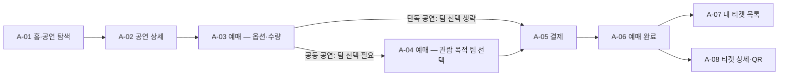
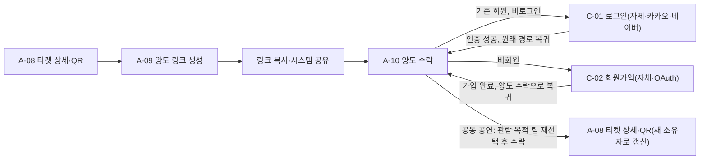
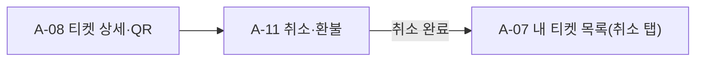
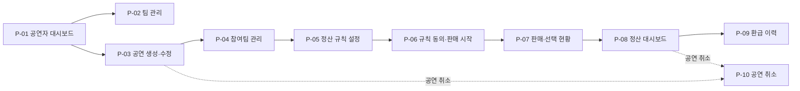
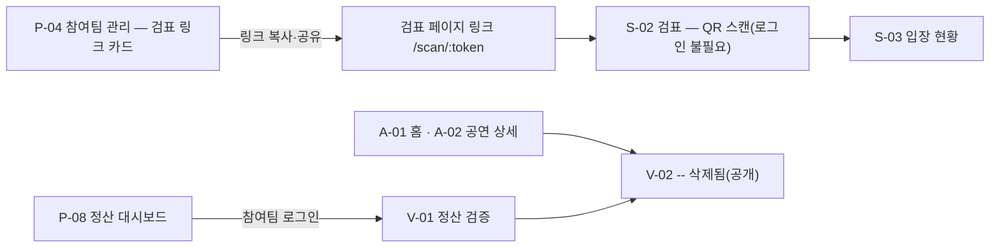

# 화면설계 v3 (디자인 제외 — 구조·흐름·컴포넌트)

> 대상: S15P21B204 · 작성 2026-08-28(금) · 개정 2026-08-31(월) · 상태: 초안 · 기준: [00_설계문서_작성계획_v1.md](./00_설계문서_작성계획_v1.md) §1(SSOT)·§2.4 · **[요구사항 명세서 v3](./04_요구사항_명세서_v3.md)(상위 문서)** · [기획 초안 v2.1](../planning/01_기획_초안_v2.md) · [API 공통 응답 규격 v3](./01_API_공통_응답_규격.md) · [개발 컨벤션](./02_개발_컨벤션.md) · [비기능 요구사항 명세서 v0 계획](./03_비기능_요구사항_명세서_v0_계획.md) · [README](../../README.md) · v1: [화면설계 v1](./07_화면설계_v1.md)
>
> 표기 — **[팀]** 팀 결정 / **[권]** 권고안(이견 시 변경). 화면 ID·화면명·라우트·상태값·API 경로는 00_설계문서_작성계획_v1.md §1을 그대로 쓴다.
>
> **"디자인 제외"의 정의** — 색·타이포·아이콘 모양·간격·이미지·모션·비주얼 톤·ASCII 와이어프레임은 다루지 않는다. 화면 목록·정보 구조·흐름·화면별 논리 영역(헤더/본문/하단 고정 액션)·컴포넌트·표시 데이터/입력 필드·동작·상태·입력 검증 규칙·연결 API·연결 기능·모바일 고려·접근성 최소만 다룬다.
>
> **화면 수** — 요구사항 명세서 v2 반영 기준 **30개**(C 3 · A 12 · P 10 · S 2 · V 2 · M 1). v1의 34개에서 S-01(검표 관계자 지정 화면)·M-01·M-03·M-04를 제거했다. · **노션 미러**: [링크](https://app.notion.com/p/3ca2746d15ab812bae71d51cb25705b2)

---

## 0. 변경 이력

| 버전 | 날짜 | 작성 | 내용 |
|------|------|------|------|
| v1 | 2026-08-28 | B204 | 최초 작성 — 화면 34개 명세(IA·흐름도·화면별 컴포넌트·공통 컴포넌트·검수표) |
| v3 | 2026-09-01 | B204 | **ERD v2 반영** — ① 팀원·초대 UI 삭제(team_member·team_invitation 삭제, P-02 팀원 목록·초대 컴포넌트 제거) ② 정산 2단계 비율(fixed_ratio_bp + selection_ratio_bp + team_share_bp, P-05·P-06·V-01 전면 수정) ③ 정산 공유 링크 카드 추가(P-08, share_token) ④ QR TOTP 방식 전환(A-08, ticket.qr_secret) ⑤ "소속" → "리더" 용어 통일 ⑥ Refund 상태 배지 추가. 23개 테이블 기준 |
| v2 | 2026-08-31 | B204 | 요구사항 명세서 v2 반영. **검표 관계자 지정 → 검표 페이지 링크** — S-01 삭제, S-02·S-03을 링크 토큰 라우트(`/scan/:token`)로 전환, P-04에 검표 링크 카드 추가. **정산 공식 2단계 단순화** — P-05·P-06·V-01에서 공통 비용·기획 기여 항목 제거(균등·관객 선택 2항목). **OAuth P0 승격** — C-01·C-02에 카카오·네이버 버튼과 가입 후 복귀 경로 추가. **정산 검증 참여팀 전용화** — V-01 로그인 필수, A-02의 검증 링크 제거(V-02 -- 삭제됨만 공개 유지). **판매 마감 분리** — A-02·A-03에 판매 마감(공연 시작 1시간 전) 배지·안내 추가. **관리자 화면 최소화** — M-01·M-03·M-04를 P1로 이관하고 M-02(이의제기 처리)만 유지. **양도 공유 방식 변경** — 카카오 공유 → 링크 복사·시스템 공유, A-10에 팀 재선택·비회원 가입 유도 추가. **체인 전환** — Polygon Amoy → Kaia Kairos(chainId 1001) |

---

## 1. 개요·원칙

- **기준 폭**: 모바일 웹 360px. 관객 화면(A·C)은 모바일 우선, 공연자(P) · 관리자(M) 화면은 데스크톱 우선이되 모바일에서도 동작해야 한다(웹 전용, 컨벤션 §1).
- **관객 UX 블록체인 용어 0**: 관객이 보는 화면(A·C 접두)에는 지갑·가스·주소·tx·컨트랙트라는 단어를 노출하지 않는다. 단 **V-01(정산 검증, 참여팀 전용)·V-02(-- 삭제됨, 공개)** 와 **P·M 접두 화면**(공연자·관리자)은 예외로 허용한다.
- **검표 화면은 링크 토큰으로 접근한다**: 검표 담당자에게는 계정을 만들지 않는다. 공연 생성 시 자동 생성된 **공연별 검표 페이지 링크**(서명 토큰, 해당 공연에만 유효)로 `/scan/:token`에 접속하면 로그인 없이 검표 화면이 열린다. 화면은 토큰의 유효성만 검증하고 담당자 정보를 저장하지 않는다(SEC-03).
- **검표 판정 피드백**: S-02 QR 스캔 판정은 1초 이내에 색상 표시 + 소리 + 진동으로 알린다(PERF-03·UX-04).
- **검증 페이지 접근 권한**: **V-01 정산 검증은 해당 공연의 참여팀 리더만 로그인 후 접근한다**(AUDIT-01). 무로그인 공개는 **V-02 -- 삭제됨**만 유지한다.
- **판매 마감과 취소 마감은 다르다**: 취소 마감은 공연일 D-3 00:00, **판매 마감은 공연 시작 1시간 전**이다. 두 시각 사이 구간은 "예매 가능·환불 불가"이므로 A-02·A-03·A-11 문구에서 구분해 표기한다.
- **비동기 작업(202) 처리**: `POST`가 `202 + jobId`를 반환하면 화면은 즉시 "처리 중" 상태로 전환하고 `GET /api/v1/chain/jobs/{jobId}`를 폴링해 결과를 반영한다. 완료 전 이탈 시에도 재진입하면 최신 상태를 다시 조회한다.
- **에러 처리**: 모든 실패 응답은 `code`로 분기하고, `msg`는 그대로 토스트에 노출한다(클라이언트는 `msg` 문자열로 분기하지 않는다).
- **토큰 재발급(전 화면 공통)**: 인증이 필요한 화면 어디서든 `AUTH_TOKEN_EXPIRED`(401)를 받으면 화면 전환 없이 `POST /api/v1/auth/refresh`로 조용히 재발급받아 원요청을 재시도한다(토큰 재발급). 특정 화면에 속하지 않으므로 개별 화면 절에는 반복 기재하지 않는다.
- **금액 표기**: 원 단위 정수, 천 단위 구분 기호.
- **상태값**: 00_설계문서_작성계획_v1.md §1.5 문자열을 화면 배지·필터 값으로 그대로 쓴다.
- **체인·익스플로러**: 모든 tx 링크는 **Kaia Kairos(chainId 1001)** 익스플로러(Kaiascan)를 새 창으로 연다.

---

## 2. 사용자 유형별 정보 구조(IA)·네비게이션

### GUEST

- **진입점**: 홈(A-01), 공유된 공연 상세 링크(A-02), 로그인(C-01), 회원가입(C-02), 양도 수락 링크(A-10, 조회는 가능·수락은 가입/로그인 필요), -- 삭제됨(V-02, 로그인 불필요), 검표 페이지 링크(S-02, 링크 토큰만으로 접근). **정산 검증(V-01)은 GUEST 진입점이 아니다**(참여팀 로그인 필수).
- **네비게이션**: 하단 탭 없음. 상단에 홈/로그인/회원가입만 노출.
- **권한 없는 화면 접근**: 로그인이 필요한 화면(예매, 마이페이지, 티켓 등) 접근 시 C-01로 이동시키고 원래 경로를 저장해 로그인 성공 후 복귀시킨다. 토스트는 `COMMON_UNAUTHORIZED`의 `msg`("로그인이 필요합니다.")를 그대로 띄운다.

### AUDIENCE

- **진입점**: 로그인 후 기본 홈(A-01).
- **네비게이션**: 하단 탭 4개 — 홈(A-01) · 내 티켓(A-07) · 주문내역(A-12) · 마이페이지(C-03). 예매·결제·양도·취소 흐름은 탭 바 없이 단계형(뒤로가기)으로 진행한다.
- **공연자 전환**: 마이페이지(C-03)에서 리더인 팀이 있으면 "내 팀" 진입 버튼으로 PERFORMER 영역(P-01)에 들어간다. 같은 계정이 관객·공연자 역할을 동시에 가질 수 있다.
- **권한 없는 화면**: 본인 소유가 아닌 티켓 상세 접근 시 `TICKET_NOT_OWNED`(403) → 목록으로 복귀 + 토스트.

### PERFORMER

- **진입점**: C-03 "내 팀" 또는 로그인 시 리더인 팀이 있으면 P-01로 바로 진입 가능.
- **네비게이션**: 데스크톱은 사이드 메뉴 — 대시보드(P-01) · 팀 관리(P-02) · (공연 선택 후) 참여팀·규칙·동의·판매현황·정산·환급(P-03~P-09) · 정산 검증(V-01, 참여팀 전용). 모바일은 상단 드로어 메뉴로 대체.
- **권한**: 팀 리더만 공연자 화면에 진입할 수 있다(팀원 개념 없음). 공연 생성자 전용 기능(공연 수정·참여팀 관리·규칙 설정·판매 시작·집계 확정·잠금·release·공연 취소)은 다른 참여팀 리더에게 비활성 처리한다.
- **권한 없는 화면**: 자기 팀이 아닌 공연 관리 화면 접근 시 `PERFORMANCE_NOT_OWNER`/`COMMON_FORBIDDEN`(403) → 안내 후 P-01로 복귀.

### STAFF(검표 담당자 — 링크 토큰)

- **진입점**: 계정·로그인이 없다. 공연 생성자에게 공유받은 **검표 페이지 링크** `/scan/:token`(S-02)이 유일한 진입점이다.
- **네비게이션**: 별도 탭·메뉴 없음. S-02 → S-03(입장 현황)의 단일 목적 흐름만 제공하며, 두 화면 모두 같은 토큰을 라우트에 유지한다.
- **권한 없는 화면**: 토큰이 위조·만료되었거나 다른 공연의 토큰이면 `ENTRY_SCANNER_NOT_AUTHORIZED`(403) → 접근 차단 안내 화면(공연 생성자에게 링크 재요청 안내). 복귀할 목록 화면이 없으므로 홈(A-01) 이동 버튼만 제공한다.

### ADMIN

- **진입점**: 관리자 로그인 후 M-02(이의제기 처리). **MVP의 관리자 화면은 M-02 하나뿐이다.**
- **네비게이션**: 사이드 메뉴 없이 단일 화면. 대시보드(구 M-01)·회원/공연 관리(구 M-03)·운영지갑·감사 로그(구 M-04)와 실패 작업 수동 재처리는 **P1로 이관**했다. 실패한 발행·소각·분배·환급은 시스템이 자동 재시도하고 결정적 실패만 알림으로 알린다.
- **권한 없는 화면**: 관리자 권한 없는 계정의 `/admin/*` 접근은 `COMMON_FORBIDDEN`(403) → 로그인 화면 또는 홈으로 리다이렉트.

---

## 3. 화면 흐름도

### ① 관객 예매

### ② 관객 양도·수락

### ③ 관객 취소

### ④ 공연자 — 공연 생성 → 참여팀 → 규칙 → 동의 → 판매 시작 → 판매 현황 → 정산 → 환급

### ⑤ 검표(링크 토큰) + 검증

---

## 4. 화면 명세 (30개)

### C-01 로그인

- 사용자 GUEST / 라우트 `/login` / 진입 경로: 앱 최초 진입 시 로그인 버튼, 권한 없는 화면 접근 시 리다이렉트, C-02 회원가입 완료 후 이동, 양도 수락(A-10)에서 로그인 유도 / 목적: 이메일 또는 카카오·네이버 OAuth로 인증한다.

**영역 구성**
- 헤더: 서비스 타이틀 · 본문: 이메일·비밀번호 입력 폼, 회원가입 이동 링크, **소셜 로그인 영역(카카오·네이버 버튼)** · 하단 고정 액션: 로그인 버튼

**컴포넌트**

| 컴포넌트 | 유형 | 표시 데이터 / 입력 필드 | 동작 | 연결 API | 연결 기능 |
|---|---|---|---|---|---|
| 이메일 입력 | 폼 필드 | 이메일 | 형식 실시간 검증 | - | - |
| 비밀번호 입력 | 폼 필드 | 비밀번호(마스킹) | 필수 입력 | - | - |
| 로그인 버튼 | 버튼 | - | 제출 | POST /api/v1/auth/login | 로그인 |
| 회원가입 이동 링크 | 버튼 | - | C-02 이동 | - | - |
| 카카오 로그인 버튼 | 버튼 | - | 카카오 인가 화면 → 콜백 → 토큰 발급 후 원래 경로 복귀 | POST /api/v1/auth/kakao | 회원 가입·로그인(OAuth) |
| 네이버 로그인 버튼 | 버튼 | - | 네이버 인가 화면 → 콜백 → 토큰 발급 후 원래 경로 복귀 | POST /api/v1/auth/naver | 회원 가입·로그인(OAuth) |

**상태**
- 에러: `AUTH_INVALID_CREDENTIALS`(401) — 필드 하단 안내 + 토스트. **OAuth 전용 회원이 비밀번호 로그인을 시도하면** 같은 코드로 응답하되 `msg`에 담긴 "해당 소셜 로그인 이용" 안내를 그대로 노출한다
- 에러: `COMMON_EXTERNAL_SERVICE_ERROR`(502) — OAuth 인가 코드 교환·제공자 조회 실패 시 "잠시 후 다시 시도" 토스트, 이메일 로그인 폼은 그대로 유지
- 처리 중: 제출 중 버튼 비활성, OAuth 콜백 복귀 대기 중에는 전체 화면 로딩

**입력 검증**
- 이메일 형식, 비밀번호 필수 입력

**모바일·접근성 고려**
- 터치 타겟 44px. 카카오·네이버 로그인은 각 제공자의 인앱 브라우저에서도 동작해야 한다. 소셜 버튼은 제공자 브랜드 가이드(색·로고·비율)를 따르므로 디자인 단계에서 별도 확정한다(§6).

---

### C-02 회원가입

- 사용자 GUEST / 라우트 `/signup` / 진입 경로: C-01 회원가입 링크, **양도 수락(A-10)의 비회원 가입 유도** / 목적: 이메일·비밀번호 또는 카카오·네이버 OAuth로 신규 가입한다.

**영역 구성**
- 헤더: 뒤로가기 · 본문: **소셜 가입 영역(카카오·네이버 버튼)**, 구분선, 이메일·비밀번호·비밀번호 확인·이름·연락처 폼, 약관 동의 체크박스, (양도 링크 진입 시) 복귀 안내 배너 · 하단 고정 액션: 가입하기 버튼

**컴포넌트**

| 컴포넌트 | 유형 | 표시 데이터 / 입력 필드 | 동작 | 연결 API | 연결 기능 |
|---|---|---|---|---|---|
| 이메일 입력 | 폼 필드 | 이메일 | 형식 검증 | - | - |
| 비밀번호/확인 입력 | 폼 필드 | 비밀번호 2회 | 일치 검증 | - | - |
| 이름·연락처 입력 | 폼 필드 | 이름, 연락처 | 필수 입력 | - | - |
| 약관 동의 체크박스 | 폼 필드 | 동의 여부 | 필수 체크 | - | - |
| 가입하기 버튼 | 버튼 | - | 제출 | POST /api/v1/auth/signup | 회원가입 |
| 카카오로 가입 버튼 | 버튼 | - | 카카오 인가 → 약관 동의 → 회원 생성 후 복귀 경로로 이동 | POST /api/v1/auth/kakao | 회원 가입·로그인(OAuth) |
| 네이버로 가입 버튼 | 버튼 | - | 네이버 인가 → 약관 동의 → 회원 생성 후 복귀 경로로 이동 | POST /api/v1/auth/naver | 회원 가입·로그인(OAuth) |
| 양도 복귀 안내 배너 | 텍스트 | "가입하면 받은 티켓을 바로 수락할 수 있어요" | - | - | - |

**상태**
- 에러: `AUTH_EMAIL_DUPLICATED`(409) — 이메일 필드 하단 안내 + 토스트. 같은 이메일의 자체 가입 회원이 이미 있는 상태에서 OAuth로 들어오면 서버가 계정을 연동하므로 이 에러를 띄우지 않고 그대로 로그인시킨다
- 에러: `COMMON_VALIDATION_FAILED`(400) — 필드별 안내, `COMMON_EXTERNAL_SERVICE_ERROR`(502) — OAuth 제공자 오류 안내
- **복귀 경로**: 양도 링크(`/transfers/:token`)에서 진입한 경우 복귀 경로를 저장했다가 가입 완료 즉시 **A-10 양도 수락 화면으로 되돌린다**. 그 밖의 경우 원래 요청 화면 또는 홈(A-01)으로 이동한다

**입력 검증**
- 이메일 형식, 비밀번호 최소 길이·확인 일치, 이름 필수, 연락처 형식, 약관 필수 동의. **OAuth 가입은 이메일·이름을 제공자에서 받아 채우고 약관 동의만 별도로 받는다**(비밀번호 입력 없음)

**모바일·접근성 고려**
- 터치 타겟 44px, 입력 필드별 적절한 키보드 타입(이메일·전화번호). 소셜 버튼은 제공자 브랜드 가이드를 따른다(§6)

---

### C-03 마이페이지

- 사용자 AUDIENCE·PERFORMER / 라우트 `/me` / 진입 경로: 하단 탭 "마이페이지", 결제 화면(A-05)에서 계좌 미연결 안내 / 목적: 프로필·금융망 계좌 확인, 내 팀 진입.

**영역 구성**
- 헤더: 타이틀 · 본문: 프로필 카드, 금융망 계좌 연결 카드, 내 팀 진입 카드, (P1) 관람 기록 카드 · 하단 고정 액션: 로그아웃 버튼

**컴포넌트**

| 컴포넌트 | 유형 | 표시 데이터 / 입력 필드 | 동작 | 연결 API | 연결 기능 |
|---|---|---|---|---|---|
| 프로필 카드 | 카드 | 이름·이메일·연락처 | 수정 진입 | GET /api/v1/members/me | 내 정보 조회 |
| 프로필 수정 폼 | 폼 필드(바텀시트) | 이름·연락처 | 저장 | PATCH /api/v1/members/me | 내 정보 수정 |
| 계좌 연결 카드 | 카드 | 연결 계좌 마스킹 정보 또는 미연결 상태 | 등록·변경 진입 | PUT /api/v1/members/me/bank-account | 금융망 계좌 연결 |
| 내 팀 진입 버튼 | 버튼 | - | P-01 이동 | GET /api/v1/teams/me | 내 팀 목록 조회 |
| 관람 기록 카드(P1) | 카드 | - | - | - | 관람 기록(P1) |
| 로그아웃 버튼 | 버튼 | - | 세션 종료 후 A-01 이동 | POST /api/v1/auth/logout | 로그아웃 |

**상태**
- 로딩: 스켈레톤 카드 / 에러: `COMMON_UNAUTHORIZED`(401) → C-01 이동

**입력 검증**
- 계좌 등록 시 예금주명 일치는 서버 검증(실패 시 토스트로 안내)

**모바일·접근성 고려**
- 터치 타겟 44px

---

### A-01 홈·공연 탐색

- 사용자 GUEST·AUDIENCE / 라우트 `/` / 진입 경로: 앱 최초 진입, 하단 탭 "홈" / 목적: 판매 중 공연을 탐색한다.

**영역 구성**
- 헤더: 검색 입력, 로그인 버튼(GUEST) 또는 프로필 아이콘(AUDIENCE) · 본문: 날짜 필터, 공연 카드 목록 · 하단 고정 액션: 없음(하단 탭 바)

**컴포넌트**

| 컴포넌트 | 유형 | 표시 데이터 / 입력 필드 | 동작 | 연결 API | 연결 기능 |
|---|---|---|---|---|---|
| 검색 입력 | 폼 필드 | 키워드 | 목록 필터링 | GET /api/v1/performances | 공연 목록 조회 |
| 날짜 필터 | 폼 필드 | 날짜 범위 | 목록 필터링 | GET /api/v1/performances | 공연 목록 조회 |
| 공연 카드 목록 | 목록 | 제목·일시·장소·참여팀 수·판매상태 배지 | 탭 시 A-02 이동 | GET /api/v1/performances | 공연 목록 조회 |
| 빈 상태 안내 | 텍스트 | "조건에 맞는 공연이 없습니다" | 필터 초기화 | - | - |

**상태**
- 로딩: 스켈레톤 카드 / 빈: 검색·필터 결과 없음 / 에러: `COMMON_INTERNAL_ERROR`(500) — 토스트 + 재시도

**모바일·접근성 고려**
- 360px 1열 카드, 터치 타겟 44px

---

### A-02 공연 상세

- 사용자 GUEST·AUDIENCE / 라우트 `/performances/:id` / 진입 경로: A-01 카드 탭, 공유 링크 / 목적: 공연 정보를 확인하고 예매로 진입한다. **정산 검증(V-01) 링크는 참여팀 전용이 되어 이 화면에서 제거했다**(공연자는 P-08에서 진입).

**영역 구성**
- 헤더: 뒤로가기, 공유 버튼 · 본문: 공연 기본 정보, 판매 상태 배지, 출연팀 목록, 티켓 옵션 목록, 판매 마감 안내, -- 삭제됨 링크 · 하단 고정 액션: 예매하기 버튼

**컴포넌트**

| 컴포넌트 | 유형 | 표시 데이터 / 입력 필드 | 동작 | 연결 API | 연결 기능 |
|---|---|---|---|---|---|
| 공연 정보 카드 | 카드 | 제목·일시·장소·설명 | - | GET /api/v1/performances/{performanceId} | 공연 상세 조회 |
| 출연팀 목록 | 목록 | 팀명 | - | GET /api/v1/performances/{performanceId} | 공연 상세 조회 |
| 티켓 옵션 목록 | 목록 | 타입명·가격·잔여 수량 | - | GET /api/v1/performances/{performanceId} | 공연 상세 조회 |
| 판매 상태 배지 | 배지 | `ON_SALE` 판매 중 / `SALE_CLOSED` **판매 마감** / `ENDED` 공연 종료 / `CANCELLED` 공연 취소됨(§5.1) | - | GET /api/v1/performances/{performanceId} | 공연 상세 조회 |
| 판매 마감 안내 | 텍스트 | 판매 중이면 "공연 시작 1시간 전까지 예매할 수 있어요"(+ 마감 시각), 마감 후면 "판매가 마감되었습니다" | - | GET /api/v1/performances/{performanceId} | 공연 상세 조회 |
| -- 삭제됨 링크 | 버튼 | - | V-02 이동 | - | -- 삭제됨 조회 |
| 예매하기 버튼 | 버튼 | - | 비로그인 시 C-01, 로그인 시 A-03 이동. **`SALE_CLOSED`·`ENDED`·`CANCELLED`에서는 비활성** | - | 예매 진입 |

**상태**
- 로딩: 스켈레톤 / 에러: `PERFORMANCE_NOT_FOUND`(404) — 빈 안내 + 홈 이동 / 판매전: `TICKET_SALE_NOT_STARTED` 배지 / 매진: `TICKET_SOLD_OUT` 배지 / **판매 마감: `SALE_CLOSED` 배지 + "판매 마감" 문구, 예매하기 버튼 비활성(기존 티켓의 입장·양도는 계속 가능함을 함께 안내)**

**모바일·접근성 고려**
- 터치 타겟 44px. 판매 마감은 색 배지만이 아니라 문구로도 알린다(색 의존 금지)

---

### A-03 예매 — 옵션·수량

- 사용자 AUDIENCE / 라우트 `/performances/:id/order` / 진입 경로: A-02 예매하기 / 목적: 티켓 타입·수량을 선택한다.

**영역 구성**
- 헤더: 뒤로가기, 타이틀 · 본문: 판매 마감 안내 문구, 티켓 타입별 수량 선택, 금액 합계 · 하단 고정 액션: 다음 버튼

**컴포넌트**

| 컴포넌트 | 유형 | 표시 데이터 / 입력 필드 | 동작 | 연결 API | 연결 기능 |
|---|---|---|---|---|---|
| 판매 마감 안내 | 텍스트 | "공연 시작 1시간 전(MM/DD HH:mm)에 판매가 마감돼요" · 취소 마감(D-3)이 지난 경우 "지금부터는 예매는 가능하지만 환불은 되지 않아요"를 함께 표시 | - | GET /api/v1/performances/{performanceId} | 공연 상세 조회 |
| 티켓 타입 목록 | 목록 | 타입명·가격·잔여 수량 | - | GET /api/v1/performances/{performanceId} | 공연 상세 조회(옵션 포함) |
| 수량 선택 | 폼 필드 | 타입별 수량(0~4) | 증감 | - | - |
| 금액 합계 | 텍스트 | 합계 금액(원) | 자동 계산 | - | - |
| 다음 버튼 | 버튼 | - | 공동 공연 → A-04 이동, 단독 공연 → 주문 생성 후 A-05 이동 | POST /api/v1/orders(단독 공연인 경우) | 주문 생성 |

**상태**
- 에러: `TICKET_SOLD_OUT`(409) — 옵션별 매진 표시, `TICKET_PURCHASE_LIMIT_EXCEEDED`(409) — 안내 토스트, `TICKET_SALE_NOT_STARTED`(409) — 안내 후 이전 화면, **`TICKET_SALE_CLOSED`(409) — "판매가 마감되었습니다" 안내 후 A-02로 복귀(체류 중 마감 시각이 지나 제출한 경우 포함)**

**입력 검증**
- 1인 1공연 최대 4매, 최소 1매 이상 선택

**모바일·접근성 고려**
- 수량 증감 버튼 터치 타겟 44px

---

### A-04 예매 — 관람 목적 팀 선택

- 사용자 AUDIENCE / 라우트 `/performances/:id/order/choice` / 진입 경로: A-03 다음(공동 공연에서만 노출) / 목적: "어떤 팀을 보러 오셨나요?" 한 팀을 선택한다.

**영역 구성**
- 헤더: "어떤 팀을 보러 오셨나요?" 안내 · 본문: 참여팀 선택 목록(단일 선택) · 하단 고정 액션: 결제하기 버튼

**컴포넌트**

| 컴포넌트 | 유형 | 표시 데이터 / 입력 필드 | 동작 | 연결 API | 연결 기능 |
|---|---|---|---|---|---|
| 안내 텍스트 | 텍스트 | "어떤 팀을 보러 오셨나요?" | - | - | - |
| 팀 선택 목록 | 목록(단일 선택 카드) | 팀명 | 탭 시 선택 표시 | - | - |
| 결제하기 버튼 | 버튼 | - | 주문 생성 요청 후 A-05 이동 | POST /api/v1/orders | 주문 생성 |

**상태**
- 에러: `TICKET_TEAM_CHOICE_REQUIRED`(400) — 선택 안내 강조, `TICKET_TEAM_CHOICE_INVALID`(400) — 목록 재조회 안내

**입력 검증**
- 한 팀 필수 선택(§1.4 P-4). 미선택 시 버튼 비활성

**모바일·접근성 고려**
- 선택 카드 터치 영역을 넓게, 44px 이상

---

### A-05 결제

- 사용자 AUDIENCE / 라우트 `/orders/:orderId/payment` / 진입 경로: A-04(공동 공연) 또는 A-03(단독 공연) 완료 후 주문 생성 성공 시 / 목적: 연결 계좌로 결제를 요청한다.

**영역 구성**
- 헤더: 타이틀 · 본문: 주문 요약, 연결 계좌 확인(미연결 시 등록 유도) · 하단 고정 액션: 결제하기 버튼

**컴포넌트**

| 컴포넌트 | 유형 | 표시 데이터 / 입력 필드 | 동작 | 연결 API | 연결 기능 |
|---|---|---|---|---|---|
| 주문 요약 카드 | 카드 | 티켓 옵션·수량·합계 금액 | - | GET /api/v1/orders/{orderId} | 주문 상세 조회 |
| 연결 계좌 카드 | 카드 | 계좌 마스킹 정보 | 미연결 시 C-03 이동 | GET /api/v1/members/me | 내 정보 조회 |
| 계좌 등록 버튼 | 버튼 | - | C-03 이동 | PUT /api/v1/members/me/bank-account | 금융망 계좌 연결 |
| 결제하기 버튼 | 버튼 | - | 결제 요청(202) | POST /api/v1/orders/{orderId}/payment | 결제 요청 |
| 처리 중 표시 | 배지/모달 | "결제 처리 중" | 폴링 후 A-06 이동 | GET /api/v1/orders/{orderId}/payment, GET /api/v1/chain/jobs/{jobId} | 결제 상태 조회 |

**상태**
- 처리 중: 202 폴링(`pollAfterMs` 간격) · 에러: `PAYMENT_AMOUNT_MISMATCH`(409) — 처음부터 다시 시도 안내, `PAYMENT_INSUFFICIENT_BALANCE`(409), `PAYMENT_REQUEST_FAILED`(502), `PAYMENT_TIMEOUT`(504) — 주문내역 확인 안내, `PAYMENT_ALREADY_PAID`(409)

**모바일·접근성 고려**
- 결제 처리 중 화면 이탈 방지 안내

---

### A-06 예매 완료

- 사용자 AUDIENCE / 라우트 `/orders/:orderId/complete` / 진입 경로: A-05 결제 성공 / 목적: 발급 안내 후 내 티켓으로 유도.

**영역 구성**
- 헤더: 없음 · 본문: 완료 안내, 주문 요약 · 하단 고정 액션: 내 티켓으로 이동 버튼

**컴포넌트**

| 컴포넌트 | 유형 | 표시 데이터 / 입력 필드 | 동작 | 연결 API | 연결 기능 |
|---|---|---|---|---|---|
| 완료 안내 | 텍스트 | "예매가 완료되었습니다" | - | - | - |
| 주문 요약 카드 | 카드 | 공연·티켓 정보 | - | GET /api/v1/orders/{orderId} | 주문 상세 조회 |
| 내 티켓 이동 버튼 | 버튼 | - | A-07 이동 | - | - |

**상태**
- 로딩: 발급 처리 중이면 처리 중 배지

**모바일·접근성 고려**
- 터치 타겟 44px

---

### A-07 내 티켓 목록

- 사용자 AUDIENCE / 라우트 `/tickets` / 진입 경로: 하단 탭 "내 티켓", A-06 완료 후 / 목적: 보유 티켓을 상태별로 확인.

**영역 구성**
- 헤더: 타이틀 · 본문: 상태 탭(예정/사용완료/취소), 티켓 카드 목록 · 하단 고정 액션: 없음

**컴포넌트**

| 컴포넌트 | 유형 | 표시 데이터 / 입력 필드 | 동작 | 연결 API | 연결 기능 |
|---|---|---|---|---|---|
| 상태 탭 | 탭 | 예정/사용완료/취소 | 목록 필터 전환 | GET /api/v1/tickets/me | 내 티켓 목록 조회 |
| 티켓 카드 목록 | 목록 | 공연명·일시·상태 배지 | 탭 시 A-08 이동 | GET /api/v1/tickets/me | 내 티켓 목록 조회 |
| 빈 상태 안내 | 텍스트 | "티켓이 없습니다" | 홈 이동 | - | - |

**상태**
- 로딩: 스켈레톤 / 빈: 해당 탭 티켓 없음 / 에러: `COMMON_INTERNAL_ERROR`(500)

**모바일·접근성 고려**
- 터치 타겟 44px

---

### A-08 티켓 상세·QR

- 사용자 AUDIENCE / 라우트 `/tickets/:ticketId` / 진입 경로: A-07 카드 탭, A-06, A-10 수락 완료 후 / 목적: 회전 QR을 보여주고 양도·취소로 진입.

**영역 구성**
- 헤더: 뒤로가기, 타이틀 · 본문: 공연 정보, 회전 QR 영역(남은 시간 표시, 화면 밝기 안내), 상태 배지 · 하단 고정 액션: 양도하기 버튼, 취소하기 버튼

**컴포넌트**

| 컴포넌트 | 유형 | 표시 데이터 / 입력 필드 | 동작 | 연결 API | 연결 기능 |
|---|---|---|---|---|---|
| 공연 정보 카드 | 카드 | 공연명·일시·장소·좌석 없음(스탠딩) 표기 | - | GET /api/v1/tickets/{ticketId} | 티켓 상세 조회 |
| QR 표시 영역 | QR | QR 이미지, 남은 유효 시간(초) 카운트다운 | TOTP 방식: 최초 진입 시 서버에서 qr_secret 수신 → 클라이언트가 HMAC(qr_secret, ticketId + floor(now/30))으로 30초마다 자동 회전. 네트워크 불필요 | GET /api/v1/tickets/{ticketId}/qr | 동적 QR 발급(TOTP) |
| 화면 밝기 안내 | 텍스트 | "화면 밝기를 높여주세요" | - | - | - |
| 상태 배지 | 배지 | ISSUED/TRANSFER_PENDING/USED/CANCELLED → 라벨 매핑(§5) | - | - | - |
| 양도하기 버튼 | 버튼 | - | A-09 이동(ISSUED 상태만 활성) | - | - |
| 취소하기 버튼 | 버튼 | - | A-11 이동(취소 가능 상태만 활성) | - | - |

**상태**
- 로딩: 스켈레톤 / 에러: `ENTRY_QR_EXPIRED`(401) — 자동 재발급 재시도, `TICKET_NOT_OWNED`(403) — 목록 복귀 / 양도중: `TRANSFER_PENDING` 배지, 양도·취소 버튼 비활성 + 안내 / 사용완료·취소: QR 숨김, 상태 안내만 표시

**모바일·접근성 고려**
- 화면 자동 잠금 방지, 화면 밝기 최대 안내, 터치 타겟 44px

---

### A-09 양도 링크 생성

- 사용자 AUDIENCE / 라우트 `/tickets/:ticketId/transfer` / 진입 경로: A-08 양도하기 / 목적: 양도 링크를 만들어 **복사하거나 시스템 공유 시트로** 선물한다.

**영역 구성**
- 헤더: 뒤로가기, 타이틀 · 본문: 대상 티켓 정보, 링크 생성 전/후 상태, 생성된 링크 표시 영역, 만료 안내, 양도중 배지 · 하단 고정 액션: 링크 생성 버튼(생성 전) / 링크 복사·공유 버튼 + 양도 취소 버튼(생성 후)

**컴포넌트**

| 컴포넌트 | 유형 | 표시 데이터 / 입력 필드 | 동작 | 연결 API | 연결 기능 |
|---|---|---|---|---|---|
| 티켓 정보 카드 | 카드 | 공연명·일시 | - | - | - |
| 링크 생성 버튼 | 버튼 | - | 양도 링크 생성 요청 | POST /api/v1/tickets/{ticketId}/transfers | 양도 링크 생성 |
| 생성된 링크 표시 | 텍스트(읽기 전용 입력) | 양도 링크 URL(말줄임 표시, 전체 선택 가능) | 탭 시 전체 선택 | - | - |
| 링크 복사 버튼 | 버튼 | - | 클립보드 복사 후 "링크를 복사했어요" 토스트 | - | 양도 링크 생성 |
| 공유 버튼 | 버튼 | - | 시스템 공유 시트 호출(Web Share API). 미지원 브라우저에서는 숨기고 링크 복사 버튼만 노출 | - | 양도 링크 생성 |
| 만료 안내 | 텍스트 | "24시간 후 만료" + 만료 시각 | - | - | - |
| 양도중 배지 | 배지 | "양도 중" | - | - | - |
| 양도 취소 버튼 | 버튼 | - | 확인 모달 → 취소 요청 | DELETE /api/v1/transfers/{token} | 양도 취소 |
| 확인 모달 | 모달 | "양도를 취소하시겠어요?" | 확인/취소 | - | - |

**상태**
- 에러: `TRANSFER_NOT_ALLOWED`(409) — 목록 복귀 안내

**모바일·접근성 고려**
- 특정 메신저 SDK에 의존하지 않는다. Web Share API 미지원·비보안 컨텍스트에서는 링크 복사로 대체하고, 복사 실패 시 링크를 길게 눌러 직접 복사할 수 있게 전체 텍스트를 노출한다. 터치 타겟 44px

---

### A-10 양도 수락

- 사용자 GUEST→AUDIENCE / 라우트 `/transfers/:token` / 진입 경로: 공유받은 양도 링크(메신저 인앱 브라우저 포함) / 목적: 티켓 정보를 확인하고, 가입·로그인 후 **공동 공연이면 관람 목적 팀을 다시 선택해** 수락한다.

**영역 구성**
- 헤더: 타이틀 · 본문: 티켓 정보 확인, 비로그인 시 로그인·가입 안내, **공동 공연이면 관람 목적 팀 재선택 목록** · 하단 고정 액션: 수락하기 버튼

**컴포넌트**

| 컴포넌트 | 유형 | 표시 데이터 / 입력 필드 | 동작 | 연결 API | 연결 기능 |
|---|---|---|---|---|---|
| 티켓 정보 카드 | 카드 | 공연명·일시 | - | GET /api/v1/transfers/{token} | 양도 정보 조회 |
| 로그인 유도 안내 | 텍스트·버튼 | "로그인 후 수락할 수 있어요" | C-01 이동(복귀 경로 저장) | - | - |
| 비회원 가입 유도 안내 | 텍스트·버튼 | "회원 가입 후 받은 티켓을 수락할 수 있어요" — 자체 가입 / 카카오·네이버 가입 | **C-02 이동(복귀 경로 저장) → 가입 완료 후 이 화면으로 자동 복귀** | - | 회원 가입·로그인(OAuth) |
| 관람 목적 팀 재선택 목록 | 목록(단일 선택 카드) | 참여팀명 — **공동 공연에서만 노출** | 탭 시 선택 표시, 미선택 시 수락 버튼 비활성 | GET /api/v1/transfers/{token} | 양도 정보 조회 |
| 재선택 안내 텍스트 | 텍스트 | "어떤 팀을 보러 오시나요? 수락하면 이 선택으로 바뀝니다" | - | - | - |
| 수락하기 버튼 | 버튼 | - | 수락 요청(선택 팀 포함) 후 A-08 이동. 온체인 선택 갱신은 202로 접수되어 뒤에서 처리되며 화면은 기다리지 않는다 | POST /api/v1/transfers/{token}/accept | 양도 수락 |

**상태**
- 에러: `TRANSFER_LINK_NOT_FOUND`(404), `TRANSFER_LINK_EXPIRED`(410) — 만료 안내, `TRANSFER_LINK_ALREADY_USED`(409), `TRANSFER_SELF_NOT_ALLOWED`(400), `TICKET_PURCHASE_LIMIT_EXCEEDED`(409) — 해당 공연 보유 4매 초과 안내, `TICKET_TEAM_CHOICE_REQUIRED`(400) — 재선택 목록 강조
- 인증 상태 분기: 비로그인 GUEST에게도 티켓 정보는 그대로 보여주고, 수락 액션만 인증을 요구한다. 기존 회원은 C-01, 비회원은 C-02로 보내며 두 경로 모두 복귀 후 선택 상태를 유지한다

**입력 검증**
- 공동 공연이면 관람 목적 팀 한 팀 필수 선택(A-04와 동일 규칙)

**모바일·접근성 고려**
- 메신저 인앱 브라우저에서 정상 동작 확인, 불가 시 외부 브라우저로 열기 안내. 선택 카드 터치 영역 44px 이상

---

### A-11 취소·환불

- 사용자 AUDIENCE / 라우트 `/tickets/:ticketId/cancel` / 진입 경로: A-08 취소하기 / 목적: 환불액을 확인하고 취소를 확정한다.

**영역 구성**
- 헤더: 뒤로가기, 타이틀 · 본문: 환불액 미리보기(수수료 구간), 안내 문구 · 하단 고정 액션: 취소 확정 버튼

**컴포넌트**

| 컴포넌트 | 유형 | 표시 데이터 / 입력 필드 | 동작 | 연결 API | 연결 기능 |
|---|---|---|---|---|---|
| 환불 미리보기 카드 | 카드 | 결제 금액·수수료율·환불 예정액, 구간 안내(D-7 전액 / D-3 50% / D-3 00:00 이후 불가) | - | GET /api/v1/tickets/{ticketId}/refund-quote | 환불액 미리보기 |
| 취소 확정 버튼 | 버튼 | - | 확인 모달 → 취소 요청(202) | POST /api/v1/tickets/{ticketId}/cancel | 개별 취소·환불 |
| 확인 모달 | 모달 | 환불 예정액 재확인 | 확인/취소 | - | - |
| 처리 중 표시 | 배지 | "취소 처리 중" | 폴링 | GET /api/v1/chain/jobs/{jobId} | 비동기 작업 상태 조회 |

**상태**
- 처리 중: 202 폴링 · 에러: `REFUND_DEADLINE_PASSED`(409) — 취소 불가 안내, `REFUND_ALREADY_REQUESTED`(409), `REFUND_AFTER_SETTLEMENT_LOCK`(409) — 고객센터 안내

**모바일·접근성 고려**
- 되돌릴 수 없는 액션이므로 확인 모달 필수, 터치 타겟 44px

---

### A-12 주문 내역

- 사용자 AUDIENCE / 라우트 `/orders` · `/orders/:orderId` / 진입 경로: C-03, A-06 완료 후 / 목적: 주문·결제·환불 상태를 확인한다.

**영역 구성**
- 헤더: 타이틀 · 본문: 주문 목록(목록 화면), 주문 상세(상세 화면) · 하단 고정 액션: 없음

**컴포넌트**

| 컴포넌트 | 유형 | 표시 데이터 / 입력 필드 | 동작 | 연결 API | 연결 기능 |
|---|---|---|---|---|---|
| 주문 목록 | 목록 | 주문번호·공연명·금액·상태 배지 | 탭 시 상세 전개 | GET /api/v1/orders/me | 내 주문 목록 조회 |
| 주문 상세 카드 | 카드 | 결제·환불 상태 이력, 티켓 목록 | - | GET /api/v1/orders/{orderId} | 주문 상세 조회 |

**상태**
- 로딩: 스켈레톤 / 빈: "주문 내역이 없습니다" / 에러: `COMMON_INTERNAL_ERROR`(500)

**모바일·접근성 고려**
- 터치 타겟 44px

---

### P-01 공연자 대시보드

- 사용자 PERFORMER / 라우트 `/studio` / 진입 경로: C-03 "내 팀" 버튼, 공연자 로그인 후 기본 진입 / 목적: 내 팀·참여 공연·정산 진행을 한눈에 확인.

**영역 구성**
- 헤더: 타이틀, 팀 전환(다중 팀 리더 시) · 본문: 내 팀 목록 카드, 참여 공연 목록, 정산 진행 요약 · 하단 고정 액션: 새 공연 만들기 버튼

**컴포넌트**

| 컴포넌트 | 유형 | 표시 데이터 / 입력 필드 | 동작 | 연결 API | 연결 기능 |
|---|---|---|---|---|---|
| 내 팀 목록 | 목록 | 팀명 | 탭 시 P-02 이동 | GET /api/v1/teams/me | 내 팀 목록 조회 |
| 참여 공연 목록 | 목록 | 공연명·공연 상태 배지·정산 상태 배지 | 탭 시 해당 공연 관리 화면(P-03~P-09) 이동 | GET /api/v1/performances/me | 내 팀 참여 공연 목록 조회 |
| 새 공연 만들기 버튼 | 버튼 | - | P-03 이동 | - | - |
| 팀 만들기 버튼 | 버튼 | - | P-02(생성 모드) 이동 | - | - |

**상태**
- 로딩: 스켈레톤 / 빈: "리더인 팀이 없습니다" — 팀 만들기 버튼으로 P-02 생성 모드 진입 유도 / 권한 없음: 팀이 없는 회원에게는 공연 관리 메뉴 숨김

**모바일·접근성 고려**
- 데스크톱 우선이나 모바일 접근 가능, 터치 타겟 44px

---

### P-02 팀 관리

- 사용자 PERFORMER(리더) / 라우트 `/studio/teams/:teamId`(관리 모드) · `/studio/teams/new`(생성 모드) / 진입 경로: P-01 팀 카드 탭(관리 모드), P-01 "팀 만들기" 버튼(생성 모드) / 목적: 팀을 생성하거나 팀 정보·팀 지갑·정산 계좌를 관리한다.

**영역 구성**
- 헤더: 팀명(관리 모드) 또는 "팀 만들기"(생성 모드) · 본문: (생성 모드) 팀명·소개 입력 폼 / (관리 모드) 팀 정보 카드(수정), 팀 지갑 카드(주소·잔액·익스플로러 링크), 지갑 tx 이력, 정산 계좌 등록 · 하단 고정 액션: (생성 모드) 팀 만들기 버튼 / (관리 모드) 없음(항목별 액션)

**컴포넌트**

| 컴포넌트 | 유형 | 표시 데이터 / 입력 필드 | 동작 | 연결 API | 연결 기능 |
|---|---|---|---|---|---|
| 팀 생성 폼(생성 모드) | 폼 필드 | 팀명·소개 | 제출 시 팀 생성(+팀 지갑 자동 생성) 후 P-02 관리 모드로 전환 | POST /api/v1/teams | 팀 생성(+팀 지갑 생성) |
| 팀 정보 카드 | 카드 | 팀명·소개 | 수정(리더) | GET /api/v1/teams/{teamId} | 팀 상세 조회 |
| 팀 정보 수정 폼 | 폼 필드 | 팀명·소개 | 저장 | PATCH /api/v1/teams/{teamId} | 팀 수정 |
| 팀 지갑 카드 | 카드 | 지갑 주소, 잔액, 익스플로러 링크 | 링크 탭 시 익스플로러 새 창 | GET /api/v1/teams/{teamId}/wallet | 팀 지갑 조회 |
| 지갑 tx 이력 목록 | 목록 | tx 해시(축약)·유형·시각·상태 | 탭 시 익스플로러 이동 | GET /api/v1/teams/{teamId}/wallet/transactions | 팀 지갑 tx 이력 조회 |
| 정산 계좌 등록 폼 | 폼 필드 | 은행·계좌번호·예금주명 | 예금주 검증 후 저장(리더) | PUT /api/v1/teams/{teamId}/settlement-account | 정산 계좌 등록 |

**상태**
- 로딩: 스켈레톤 / 에러: `TEAM_NOT_FOUND`(404), `WALLET_NOT_FOUND`(404), `WALLET_CREATION_FAILED`(500, 생성 모드에서 팀 생성 실패 시 재시도 안내) / 처리 중: 계좌 검증 처리 중 배지

**입력 검증**
- 계좌번호 형식·예금주명 필수(서버 검증 실패 시 필드 에러)

**모바일·접근성 고려**
- 데스크톱 우선, 모바일 터치 타겟 44px

---

### P-03 공연 생성·수정

- 사용자 PERFORMER(리더) / 라우트 `/studio/performances/new` · `/studio/performances/:id/edit` / 진입 경로: P-01 새 공연 만들기, 공연 목록에서 수정 진입 / 목적: 공연 기본 정보·티켓 옵션을 설정한다.

**영역 구성**
- 헤더: 타이틀 · 본문: 기본 정보(제목·설명), 일시·장소·예매 마감, 티켓 옵션 목록(추가/삭제/수정) · 하단 고정 액션: 저장 버튼

**컴포넌트**

| 컴포넌트 | 유형 | 표시 데이터 / 입력 필드 | 동작 | 연결 API | 연결 기능 |
|---|---|---|---|---|---|
| 기본 정보 폼 | 폼 필드 | 제목·설명 | - | POST /api/v1/performances(생성) | 공연 생성 |
| 일시·장소 폼 | 폼 필드 | 공연 일시·장소·예매 마감 | - | PATCH /api/v1/performances/{performanceId}(수정) | 공연 수정 |
| 티켓 옵션 목록(편집형) | 목록·폼 필드 | 타입명·가격·수량 | 추가/삭제/수정 | PUT /api/v1/performances/{performanceId}/ticket-types | 티켓 옵션 설정 |
| 저장 버튼 | 버튼 | - | 제출 | 위 API 3종 | - |
| 공연 취소 진입 버튼 | 버튼 | - | P-10 모달 진입 | - | - |

**상태**
- 에러: `PERFORMANCE_DATE_INVALID`(400) — 필드 에러, `COMMON_VALIDATION_FAILED`(400), `PERFORMANCE_ALREADY_ON_SALE`(409) — 판매 시작 후 수정 시도 시 읽기 전용 전환, `PERFORMANCE_NOT_OWNER`(403)

**입력 검증**
- 제목 1~100자, 공연 일시는 미래, 예매 마감은 공연 일시 이전, 티켓 타입 1개 이상, 가격·수량은 양의 정수

**모바일·접근성 고려**
- 데스크톱 우선, 모바일 터치 타겟 44px

---

### P-04 참여팀 관리

- 사용자 PERFORMER(리더) / 라우트 `/studio/performances/:id/participants` / 진입 경로: P-03 완료 후, 공연 관리 메뉴 / 목적: 참여팀 초대·승인을 관리하고 **검표 페이지 링크를 확인·공유**한다.

**영역 구성**
- 헤더: 공연명 · 본문: 참여팀 목록(승인 현황 배지), 참여팀 초대 폼, 참여 수락 액션(초대받은 팀 리더 화면), **검표 페이지 링크 카드** · 하단 고정 액션: 없음(항목별 액션)

**컴포넌트**

| 컴포넌트 | 유형 | 표시 데이터 / 입력 필드 | 동작 | 연결 API | 연결 기능 |
|---|---|---|---|---|---|
| 참여팀 목록 | 목록 | 팀명·승인 상태 배지(초대중/승인/거절) | 제외(잠금 전, 생성자) | DELETE /api/v1/performances/{performanceId}/participants/{teamId} | 참여팀 제외 |
| 참여팀 초대 폼 | 폼 필드 | 팀 검색·선택 | 초대 발송(생성자) | POST /api/v1/performances/{performanceId}/participants | 참여팀 초대 |
| 참여 수락 버튼 | 버튼 | - | 수락 처리(초대팀 리더) | POST /api/v1/performances/{performanceId}/participants/{teamId}/accept | 참여 수락 |
| 검표 페이지 링크 카드 | 카드 | 공연 생성 시 자동 발급된 검표 페이지 링크 `/scan/:token`(말줄임 표시), 안내 문구 "이 링크를 받은 사람은 로그인 없이 검표할 수 있어요" | - | GET /api/v1/performances/{performanceId} | 검표 페이지 링크 |
| 링크 복사 버튼 | 버튼 | - | 클립보드 복사 후 "검표 링크를 복사했어요" 토스트 | - | 검표 페이지 링크 |
| 검표 화면 열기 버튼 | 버튼 | - | 새 창으로 S-02 열기(생성자 본인이 직접 검표하는 경우) | - | 검표 페이지 접근 |

**상태**
- 에러: `TEAM_ALREADY_JOINED`(409), `PERFORMANCE_ALREADY_ON_SALE`(409) — 잠금 후 초대·제외 비활성
- 검표 링크는 공연 생성 시점에 이미 발급되어 있으므로 별도 생성 액션·빈 상태가 없다. 링크는 참여팀 리더 화면에서도 동일하게 노출한다

**입력 검증**
- 없음(검표 링크는 입력 없이 발급된 값을 보여주기만 한다). **v1의 "검표 관계자 최소 1명 지정" 규칙은 링크 방식 전환으로 삭제됐다**

**모바일·접근성 고려**
- 데스크톱 우선. 링크는 잘려도 전체를 선택·복사할 수 있게 노출하고, 복사 버튼에는 접근 가능한 이름("검표 페이지 링크 복사")을 붙인다

---

### P-05 정산 규칙 설정

- 사용자 PERFORMER(생성자) / 라우트 `/studio/performances/:id/rules` / 진입 경로: P-04 완료 후, 공연 관리 메뉴 / 목적: **고정 분배·관객 선택 비율과 팀별 고정 분배 비율(2단계)**을 설정하고 시뮬레이션한다.

**영역 구성**
- 헤더: 공연명 · 본문: 1단계 비율 입력(고정/관객 선택, bp 단위, 합 10000), 2단계 팀별 고정 분배 비율 입력(team_share_bp, 합 10000), dust 귀속 안내, 시뮬레이션 결과 · 하단 고정 액션: 저장 버튼

**컴포넌트**

| 컴포넌트 | 유형 | 표시 데이터 / 입력 필드 | 동작 | 연결 API | 연결 기능 |
|---|---|---|---|---|---|
| 1단계 비율 입력 | 폼 필드 | 고정 분배(fixed_ratio_bp) / 관객 선택(selection_ratio_bp) bp(**기본값 5000 / 5000**) | 한쪽을 바꾸면 합이 10000이 되도록 나머지를 자동 보정하고, 합계를 상시 표시 | PUT /api/v1/performances/{performanceId}/rules | 정산 규칙 설정 |
| 2단계 팀별 비율 입력 | 폼 필드 | 참여팀별 고정 분배 비율(team_share_bp, bp), 합 10000. **기본값: 참여팀 수로 균등 분할** | 팀별 비율 변경 시 합계 실시간 검증, 잔여 자동 배분 옵션 | PUT /api/v1/performances/{performanceId}/rules | 정산 규칙 설정 |
| dust 귀속 안내 | 텍스트 | "나눗셈에서 남는 1원 단위 잔액은 공연을 만든 팀에 귀속됩니다" | - | - | - |
| 시뮬레이션 결과 카드 | 카드 | 가상 매출 기준 팀별 예상 분배액(고정분(team_share_bp 기반) · 관객 선택분 · dust 귀속분으로 분해 표시) | 입력값 변경 시 재계산 | GET /api/v1/performances/{performanceId}/rules | 규칙·동의 현황 조회 |
| 규칙 변경 경고 | 텍스트 | "규칙을 저장하면 이미 받은 팀 동의가 모두 초기화됩니다" — 동의가 1건 이상 있을 때만 노출 | - | GET /api/v1/performances/{performanceId}/rules | 규칙·동의 현황 조회 |
| 저장 버튼 | 버튼 | - | 제출(동의 초기화 대상이 있으면 확인 모달) | PUT /api/v1/performances/{performanceId}/rules | 정산 규칙 설정 |

**상태**
- 에러: `RULE_RATIO_SUM_INVALID`(400) — 합계 필드 강조, `RULE_ALREADY_LOCKED`(409) — 판매 시작 후 읽기 전용, `PERFORMANCE_NOT_OWNER`(403), `PERFORMANCE_INVALID_STATUS`(409)
- 저장 성공: 공연 상태가 `PENDING_AGREEMENT`로 전이되고 P-06 진입 버튼이 활성화된다

**입력 검증**
- **1단계: 고정+관객 선택 합계 10000(bp), 각 항목 0 이상 허용. 2단계: 팀별 team_share_bp 합계 10000, 각 팀 0 이상 허용.** v1의 공통 비용·기획 기여 입력은 삭제했다

**모바일·접근성 고려**
- 데스크톱 우선. bp 입력은 숫자 키보드와 단위 라벨(bp·%)을 함께 제공한다

---

### P-06 규칙 동의·판매 시작

- 사용자 PERFORMER(리더) / 라우트 `/studio/performances/:id/agreements` / 진입 경로: P-05 저장 후, P-01 진행 상태 카드 탭 / 목적: 팀별 규칙 동의 트랜잭션 후 판매를 시작한다.

**영역 구성**
- 헤더: 공연명 · 본문: 확정된 규칙 요약(읽기 전용), 팀별 동의 현황 목록 · 하단 고정 액션: 우리 팀 동의 버튼(리더), 판매 시작 버튼(생성자, 전원 동의 후 활성)

**컴포넌트**

| 컴포넌트 | 유형 | 표시 데이터 / 입력 필드 | 동작 | 연결 API | 연결 기능 |
|---|---|---|---|---|---|
| 규칙 요약 카드 | 카드 | **1단계: 고정(fixed_ratio_bp)·관객 선택(selection_ratio_bp) / 2단계: 팀별 고정 비율(team_share_bp)**, 규칙 해시, dust 귀속 규칙 | - | GET /api/v1/performances/{performanceId}/rules | 규칙·동의 현황 조회 |
| 팀별 동의 현황 목록 | 목록 | 팀명·동의 상태 배지(PENDING/AGREED)·동의 tx 링크 | - | GET /api/v1/performances/{performanceId}/rules | 규칙·동의 현황 조회 |
| 우리 팀 동의 버튼 | 버튼 | - | 동의 요청(202) | POST /api/v1/performances/{performanceId}/rules/agreements | 내 팀 동의(agreeToRules) |
| 판매 시작 버튼 | 버튼 | - | 전원 동의 확인 후 요청(202) | POST /api/v1/performances/{performanceId}/sale/start | 판매 시작(startSale 잠금) |
| 처리 중 표시 | 배지 | "처리 중" | 폴링 | GET /api/v1/chain/jobs/{jobId} | 비동기 작업 상태 조회 |

**상태**
- 처리 중: 202 폴링(동의 tx 확정 시 AGREED로 갱신) / 에러: `RULE_NOT_AGREED_BY_ALL`(409) — 미동의 팀 강조, `RULE_HASH_MISMATCH`(409) — 새로고침 안내, `RULE_ALREADY_LOCKED`(409), `TEAM_MIN_COUNT_NOT_MET`(409), `PERFORMANCE_NOT_OWNER`(403) — 판매 시작은 생성자만

**모바일·접근성 고려**
- 데스크톱 우선

---

### P-07 판매·선택 현황

- 사용자 PERFORMER / 라우트 `/studio/performances/:id/sales` / 진입 경로: P-01, P-06 이후 / 목적: 매출·잔여·관람 선택 집계를 확인한다.

**영역 구성**
- 헤더: 공연명 · 본문: 매출 요약, 팀별 관람 선택 집계(온체인 카운터 대조) · 하단 고정 액션: 없음

**컴포넌트**

| 컴포넌트 | 유형 | 표시 데이터 / 입력 필드 | 동작 | 연결 API | 연결 기능 |
|---|---|---|---|---|---|
| 매출 요약 카드 | 카드 | 총 매출·판매 매수·잔여 매수 | - | GET /api/v1/performances/{performanceId}/sales | 판매·선택 현황 조회 |
| 팀별 선택 집계 목록 | 목록 | 팀명·선택 수·비율(%)·서버 집계 vs 온체인 카운터 일치 배지 | - | GET /api/v1/performances/{performanceId}/sales | 판매·선택 현황 조회 |

**상태**
- 로딩: 스켈레톤 / 불일치 표시: 대조 결과 불일치 시 경고 배지 / 에러: `COMMON_INTERNAL_ERROR`(500)

**모바일·접근성 고려**
- 데스크톱 우선, 표는 가로 스크롤 허용

---

### P-08 정산 대시보드

- 사용자 PERFORMER / 라우트 `/studio/performances/:id/settlement` / 진입 경로: P-01, P-07 이후 / 목적: 정산 상태 머신을 단계별로 표시하고 액션을 실행한다.

**영역 구성**
- 헤더: 공연명 · 본문: 정산 단계 표시(§1.5 Settlement 상태 머신 — `NONE`→`AGGREGATED`→`LOCKED`→`DISPUTE_OPEN`→`RELEASED`→`REDEEMED`/`HALTED`), 팀별 분배액 목록, 이의제기 내역 · 하단 고정 액션: 단계별 액션 버튼(집계 확정·잠금·이의제기·release, 현재 단계에서 허용되는 것만 활성)

**컴포넌트**

| 컴포넌트 | 유형 | 표시 데이터 / 입력 필드 | 동작 | 연결 API | 연결 기능 |
|---|---|---|---|---|---|
| 정산 단계 표시 | 배지(단계 인디케이터) | 현재 상태(§1.5) | - | GET /api/v1/performances/{performanceId}/settlement | 정산 상태·집계·분배액·tx 조회 |
| 팀별 분배액 목록 | 목록 | 팀명·분배액·release tx 링크 | 탭 시 익스플로러 이동 | GET /api/v1/performances/{performanceId}/settlement | 정산 상태·집계·분배액·tx 조회 |
| 집계 확정 버튼 | 버튼 | - | 확인 모달 → 요청(202), 권한: 생성자·ADMIN | POST /api/v1/performances/{performanceId}/settlement/aggregate | 집계 확정 |
| 정산 잠금 버튼 | 버튼 | - | 확인 모달 → 요청(202), 권한: 생성자·ADMIN | POST /api/v1/performances/{performanceId}/settlement/lock | 정산 잠금 |
| 이의제기 버튼·폼 | 버튼·폼 필드(사유) | 사유 텍스트 | DISPUTE_OPEN 기간 내 제출, 권한: 참여팀 리더 | POST /api/v1/performances/{performanceId}/settlement/disputes | 이의제기 |
| release 버튼 | 버튼 | - | 확인 모달 → 요청(202), 권한: 생성자·ADMIN(자동 스케줄 병행) | POST /api/v1/performances/{performanceId}/settlement/release | release 실행 |
| 이의제기 내역 목록 | 목록 | 제기팀·사유·상태(OPEN/RESOLVED/REJECTED) | - | GET /api/v1/performances/{performanceId}/settlement | 정산 상태·집계·분배액·tx 조회 |
| 정산 검증 페이지 링크 | 버튼 | - | **V-01 이동(참여팀 리더만 노출)** — 정산이 `LOCKED` 이상일 때 활성 | - | 정산 검증 데이터 조회 |
| 정산 공유 링크 카드 | 카드·버튼 | 공유 링크 URL | "링크 생성" → share_token 발급, "복사" → 클립보드 복사. 밴드 멤버에게 전달해 로그인 없이 정산 내역 열람 가능. 재생성 시 이전 링크 무효화 안내 | POST /api/v1/performances/{performanceId}/settlement/share-link | 정산 내역 공유 링크 생성 |
| 처리 중 표시 | 배지 | "처리 중" | 폴링 | GET /api/v1/chain/jobs/{jobId} | 비동기 작업 상태 조회 |

**상태**
- 처리 중: 각 단계 전이 시 202 폴링 / 에러: `SETTLEMENT_NOT_LOCKED`(409) — release 버튼 비활성 안내, `SETTLEMENT_DISPUTE_PERIOD`(409) — 남은 시간 표시, `SETTLEMENT_ALREADY_RELEASED`(409), `SETTLEMENT_AGGREGATE_MISMATCH`(409) — 관리자 확인 안내, `SETTLEMENT_NOT_PARTICIPANT`(403) — 참여팀만 조회 가능

**입력 검증**
- 이의제기 사유 필수 입력

**모바일·접근성 고려**
- 데스크톱 우선, 비가역 액션은 확인 모달 필수

---

### P-09 환급 이력

- 사용자 PERFORMER(리더) / 라우트 `/studio/teams/:teamId/redemptions` / 진입 경로: P-01, P-08 이후 / 목적: 자동 환급 결과를 확인한다.

**영역 구성**
- 헤더: 팀명 · 본문: 환급 이력 목록 · 하단 고정 액션: 없음

**컴포넌트**

| 컴포넌트 | 유형 | 표시 데이터 / 입력 필드 | 동작 | 연결 API | 연결 기능 |
|---|---|---|---|---|---|
| 환급 이력 목록 | 목록 | 공연명·금액·금융망 이체 ID·상태 배지(PENDING/TRANSFERRED/FAILED) | 실패 건 상세 표시 | GET /api/v1/teams/{teamId}/redemptions | 환급 이력 조회 |

**상태**
- 로딩: 스켈레톤 / 빈: "환급 이력이 없습니다" / 실패 표시: `FAILED` 배지 + "관리자 처리 중" 안내(재시도는 M-02에서 ADMIN이 수행)

**모바일·접근성 고려**
- 데스크톱 우선

---

### P-10 공연 취소

- 사용자 PERFORMER(생성자) / 모달(P-03·P-08에서 진입) / 진입 경로: 공연 관리 화면 내 "공연 취소" 버튼 / 목적: 공연을 취소하고 전 티켓을 일괄 환불한다.

**영역 구성**
- 헤더(모달): "공연을 취소하시겠어요?" · 본문: 전체 환불 안내(수수료 없음, 정산 중단) · 하단 고정 액션: 취소 확정 버튼, 닫기 버튼

**컴포넌트**

| 컴포넌트 | 유형 | 표시 데이터 / 입력 필드 | 동작 | 연결 API | 연결 기능 |
|---|---|---|---|---|---|
| 안내 텍스트 | 텍스트 | "전 티켓이 수수료 없이 환불되며 정산이 중단됩니다" | - | - | - |
| 취소 확정 버튼 | 버튼 | - | 요청(202) | POST /api/v1/performances/{performanceId}/cancel | 공연 취소(일괄 환불) |
| 처리 중 표시 | 배지 | "취소 처리 중" | 폴링 | GET /api/v1/chain/jobs/{jobId} | 비동기 작업 상태 조회 |

**상태**
- 처리 중: 202 폴링 / 에러: `PERFORMANCE_INVALID_STATUS`(409) — 이미 종료·취소된 공연, `PERFORMANCE_NOT_OWNER`(403)

**모바일·접근성 고려**
- 터치 타겟 44px, 비가역 액션 확인 필수

---

> **v1의 `S-01 검표 — 공연 선택`은 삭제했다.** 검표 담당자에게 계정을 만들지 않고 공연별 검표 페이지 링크로 바로 스캔 화면에 진입하므로, "내가 담당하는 공연을 고르는" 화면이 성립하지 않는다. 링크는 P-04 검표 링크 카드에서 확인·공유한다. 관련 API(`GET /api/v1/performances/staff/me`, `PUT /api/v1/performances/{performanceId}/staff`)도 함께 사라진다.

### S-02 검표 — QR 스캔

- 사용자 STAFF(검표 페이지 링크 보유자, **로그인 불필요**) / 라우트 `/scan/:token` / 진입 경로: 공연 생성자에게 공유받은 검표 페이지 링크 / 목적: 링크 토큰으로 해당 공연의 검표 화면에 들어가 QR을 스캔하고 입장을 판정한다.

**영역 구성**
- 헤더: 공연명·입장 가능 시간대, 입장 요약(입장 완료/총 티켓), 입장 현황 이동 버튼 · 본문: 카메라 뷰(QR 스캔 영역), 최근 판정 결과 · 하단 고정 액션: 없음(연속 스캔)

**컴포넌트**

| 컴포넌트 | 유형 | 표시 데이터 / 입력 필드 | 동작 | 연결 API | 연결 기능 |
|---|---|---|---|---|---|
| 검표 컨텍스트 헤더 | 카드 | 공연명·일시·장소, 입장 허용 시간대, 입장 완료/총 티켓 수 | 진입 시 토큰 검증과 함께 1회 조회 | GET /api/v1/scan/{token} | 검표 페이지 접근 |
| 카메라 뷰 | 카메라 뷰 | 실시간 카메라 프리뷰 | QR 인식 시 자동 검증 요청(요청에 검표 링크 토큰 첨부) | POST /api/v1/entries/verify | QR 검증·입장 처리 |
| 판정 결과 배지 | 배지 | 성공/실패 + 사유 텍스트(중복 시도는 최초 입장 시각 함께 표시) | 표시와 동시에 소리·진동 | POST /api/v1/entries/verify | QR 검증·입장 처리 |
| 카메라 권한 거부 안내 | 텍스트·버튼 | 권한 재요청 안내 | 브라우저 설정 안내 | - | - |
| 입장 현황 이동 버튼 | 버튼 | - | S-03 이동(같은 토큰을 라우트에 유지) | - | 입장 현황 조회 |
| 링크 무효 안내 | 텍스트·버튼 | "검표 링크가 유효하지 않아요. 공연 담당자에게 링크를 다시 받아주세요" | 홈(A-01) 이동 | - | - |

**상태**
- 에러: `ENTRY_QR_EXPIRED`(401) — 재스캔 안내, `ENTRY_QR_SIGNATURE_INVALID`(401) — 실패 판정, `ENTRY_ALREADY_ENTERED`(409) — 최초 입장 시각 표시, `ENTRY_NOT_IN_TIME_WINDOW`(409), `TICKET_CANCELED`(409) — 취소된 티켓, `COMMON_NOT_FOUND`(404) — 다른 공연의 티켓
- **토큰 무효**: `ENTRY_SCANNER_NOT_AUTHORIZED`(403) — 카메라를 열지 않고 링크 무효 안내 화면만 표시한다(복귀할 목록 화면이 없다)
- 권한 없음: 카메라 권한 거부 시 대안 안내

**모바일·접근성 고려**
- 판정 결과는 1초 이내에 색 + 소리 + 진동으로 표시(PERF-03·UX-04), 카메라 권한 거부 시 대안 안내, 연속 스캔 가능(디바운스)
- **로그인 UI를 노출하지 않는다.** 토큰은 라우트에 있으므로 화면 어디에도 토큰 문자열을 그대로 보여주지 않고, 링크 공유·재발급 안내만 문구로 제공한다

---

### S-03 입장 현황

- 사용자 STAFF(검표 링크 토큰)·PERFORMER(참여팀 리더) / 라우트 `/scan/:token/entries`(검표 담당자) · `/studio/performances/:id/entries`(공연자) / 진입 경로: S-02 헤더 버튼, P-01·P-07에서도 접근 / 목적: 입장 진행 현황을 확인한다.

**영역 구성**
- 헤더: 공연명 · 본문: 입장 수/총 매수, 최근 입장 이력, 중복 시도 이력 · 하단 고정 액션: 없음

**컴포넌트**

| 컴포넌트 | 유형 | 표시 데이터 / 입력 필드 | 동작 | 연결 API | 연결 기능 |
|---|---|---|---|---|---|
| 입장 요약 | 텍스트 | "입장 42 / 총 80" | 새로고침·폴링 | GET /api/v1/scan/{token}/entries(검표 링크) · GET /api/v1/performances/{performanceId}/entries(참여팀 로그인) | 입장 현황 조회 |
| 입장 이력 목록 | 목록 | 시각·티켓 종류·중복 시도 여부 배지(**관객 개인정보는 표시하지 않는다**) | - | 위와 동일 | 입장 현황 조회 |
| 스캔 화면 복귀 버튼 | 버튼 | - | S-02 이동(토큰 유지) — 검표 링크로 진입한 경우에만 노출 | - | - |

**상태**
- 로딩: 스켈레톤 / 빈: 입장 이력 없음
- 에러: `ENTRY_SCANNER_NOT_AUTHORIZED`(403) — 토큰 무효 시 링크 무효 안내, `COMMON_FORBIDDEN`(403) — 검표 링크 없이 참여팀도 아닌 회원이 조회한 경우

**모바일·접근성 고려**
- 터치 타겟 44px

---

### V-01 정산 검증

- 사용자 PERFORMER(**해당 공연 참여팀 리더, 로그인 필수**) / 라우트 `/verify/:performanceId` / 진입 경로: P-08 정산 대시보드의 검증 페이지 링크, 직접 URL / 목적: 정산 결과를 참여팀이 직접 재계산·검증한다.
- **v1 대비 변경** — "공개 검증"에서 **참여팀 전용**으로 바뀌었다. 비로그인·비참여팀 접근은 차단되고, 무로그인 공개는 V-02 -- 삭제됨만 유지한다. A-02(공연 상세)의 검증 링크도 제거했다.

**영역 구성**
- 헤더: 공연명, "정산 검증" 타이틀, 참여팀 전용 배지 · 본문: 컨트랙트 주소, 잠긴 규칙 요약, 팀별 동의 tx 목록, 온체인 선택 카운터, 팀별 산출액, release tx, 브라우저 재계산 위젯, 온체인-금융망 대사 결과 · 하단 고정 액션: 없음

**컴포넌트**

| 컴포넌트 | 유형 | 표시 데이터 / 입력 필드 | 동작 | 연결 API | 연결 기능 |
|---|---|---|---|---|---|
| 컨트랙트 주소 카드 | 카드 | 주소(축약), Kaia Kairos 익스플로러 링크 | 탭 시 외부 이동 | GET /api/v1/performances/{performanceId}/verification | 정산 검증 데이터 조회 |
| 잠긴 규칙 카드 | 카드 | **1단계: 고정(bp_f)·관객 선택(bp_s) / 2단계: 팀별 고정 비율(w_i)**, 규칙 해시, dust 귀속 규칙(공연 생성 팀) | - | GET /api/v1/performances/{performanceId}/verification | 정산 검증 데이터 조회 |
| 팀별 동의 tx 목록 | 목록 | 팀명·지갑 주소(축약)·tx 링크·동의 시각 | 탭 시 익스플로러 이동 | GET /api/v1/performances/{performanceId}/verification | 정산 검증 데이터 조회 |
| 온체인 선택 카운터 | 카드 | 팀별 선택 수(체인 이벤트 합), 유효 티켓 수, 총 매출 | - | GET /api/v1/performances/{performanceId}/verification | 정산 검증 데이터 조회 |
| 팀별 산출액 목록 | 목록 | 팀명·고정분(team_share_bp 기반)·관객 선택분·dust 귀속분·최종 분배액 | - | GET /api/v1/performances/{performanceId}/verification | 정산 검증 데이터 조회 |
| release tx 카드 | 카드 | tx 해시·확정 시각·익스플로러 링크 | 탭 시 익스플로러 이동 | GET /api/v1/performances/{performanceId}/verification | 정산 검증 데이터 조회 |
| 재계산 위젯 | 폼 필드·텍스트(결과) | **잠긴 비율(bp_f·bp_s)·팀별 고정 비율(w_i)·온체인 카운터·총 매출**(자동 입력, 수정 가능) | "계산" 버튼 → 브라우저에서 §7 2단계 공식을 그대로 실행 → 서버 표시값과 대조 → 일치/불일치 표시(2초 이내) | GET /api/v1/performances/{performanceId}/verification | 정산 재계산 검증 |
| 대사 결과 카드 | 카드 | "온체인-금융망 불일치 0건" 또는 불일치 건수 | - | GET /api/v1/performances/{performanceId}/verification | 온체인-금융망 대사 |
| -- 삭제됨 링크 | 버튼 | - | V-02 이동 | - | -- 삭제됨 조회 |

**상태**
- 로딩: 스켈레톤 / 빈: 정산 전 단계는 "아직 정산 데이터가 없습니다" + 현재 진행 단계·다음 단계 예정 시각 안내
- 에러: `PERFORMANCE_NOT_FOUND`(404), **`COMMON_UNAUTHORIZED`(401) — 비로그인 접근은 C-01로 보내고 복귀 경로를 저장한다**, **`COMMON_FORBIDDEN`(403) — 참여팀 리더가 아닌 회원에게는 "이 공연의 참여팀 리더만 볼 수 있어요" 안내만 표시하고 데이터를 일절 노출하지 않는다**, `COMMON_TOO_MANY_REQUESTS`(429), `CHAIN_TX_TIMEOUT`(504) — 체인 조회 지연 안내 후 재시도

**모바일·접근성 고려**
- **참여팀 로그인 필수**(v1의 무로그인 접근 원칙은 이 화면에서 폐기). 표는 가로 스크롤 허용. 재계산 결과의 일치/불일치는 색과 함께 문구로도 알린다

---

### V-02 -- 삭제됨

- 사용자 GUEST / 라우트 `/verify/reserve` / 진입 경로: V-01 링크, A-01·A-02 하단 링크 / 목적: 에스크로 잔액과 원화 유통량의 1:1 여부를 공개한다. **v2에서 유일하게 무로그인 공개를 유지하는 검증 화면이다.**

**영역 구성**
- 헤더: 타이틀 · 본문: 에스크로 잔액 vs 원화 유통량, 갱신 시각, 1:1 배지 · 하단 고정 액션: 없음

**컴포넌트**

| 컴포넌트 | 유형 | 표시 데이터 / 입력 필드 | 동작 | 연결 API | 연결 기능 |
|---|---|---|---|---|---|
| 준비금 비교 카드 | 카드 | 에스크로 잔액(원)·원화 유통량·비율 | - | GET /api/v1/public/reserve-proof, GET /api/v1/coin/supply | -- 삭제됨 조회 / 원화 유통량·준비금 요약 조회 |
| 갱신 시각 텍스트 | 텍스트 | 마지막 조회 시각 | - | GET /api/v1/public/reserve-proof | -- 삭제됨 조회 |
| 1:1 배지 | 배지 | "1:1 일치" / "불일치 확인 중" | - | GET /api/v1/public/reserve-proof | -- 삭제됨 조회 |

| 모의 시연 고지 | 텍스트 | "테스트넷(Kaia Kairos)에서 모의 발행한 원화이며 실제 가상자산이 아닙니다" · "잔액 조회값은 서버를 경유합니다" | - | - | -- 삭제됨 조회 |

**상태**
- 로딩: 스켈레톤 / 불일치 표시: `SETTLEMENT_BALANCE_MISMATCH` 발생 시 경고 배지 + "정산이 중단되었습니다" 안내 / 에러: `COMMON_EXTERNAL_SERVICE_ERROR`(502) — 마지막 성공 조회 시각 안내, `COMMON_INTERNAL_ERROR`(500)

**모바일·접근성 고려**
- 로그인 없이 접근(무로그인 공개 유지), 터치 타겟 44px

---

> **v1의 `M-01 관리자 대시보드` · `M-03 회원·공연 관리` · `M-04 운영지갑·감사 로그`는 삭제하고 P1로 이관했다.** MVP의 관리자 기능은 최소화한다 — 실패한 발행·소각·분배·환급 작업은 관리자가 수동으로 재처리하지 않고 시스템이 자동 재시도하며, 결정적 실패만 알림으로 알린다. 감사 로그는 화면 없이 append-only로 적재만 한다. 남는 관리자 화면은 M-02 하나다.

### M-02 이의제기 처리 (MVP 유일 관리자 화면)

- 사용자 ADMIN / 라우트 `/admin/disputes` / 진입 경로: 관리자 로그인 후 기본 진입, 이의제기 접수 알림 / 목적: 접수된 정산 이의제기를 검토해 승인·반려한다.
- **v1 대비 변경** — v1의 `M-02 정산·작업 관리`에서 발행/소각 작업 재시도·환급 재시도·정산 목록 조회를 덜어내고 **이의제기 처리만 남겼다**(자동 재시도로 대체). 화면명도 그에 맞춰 바꿨다.

**영역 구성**
- 헤더: 타이틀, 상태 필터(검토 중/처리 완료/반려) · 본문: 이의제기 목록, 선택 건 상세(정산 요약·사유 전문·처리 의견 입력) · 하단 고정 액션: 없음(항목별 액션)

**컴포넌트**

| 컴포넌트 | 유형 | 표시 데이터 / 입력 필드 | 동작 | 연결 API | 연결 기능 |
|---|---|---|---|---|---|
| 상태 필터 | 탭 | OPEN/RESOLVED/REJECTED → 검토 중/처리 완료/반려(§5.1) | 목록 필터 전환 | GET /api/v1/admin/disputes | 이의제기 처리 |
| 이의제기 목록 | 목록 | 공연명·제기팀·제기 일시·상태 배지 | 탭 시 상세 전개 | GET /api/v1/admin/disputes | 이의제기 처리 |
| 이의 상세 카드 | 카드 | 사유 전문, 해당 공연의 정산 상태·팀별 분배액 요약, 이의제기 마감 시각 | - | GET /api/v1/performances/{performanceId}/settlement | 정산 상태·집계·분배액·tx 조회 |
| 처리 의견 입력 | 폼 필드 | 처리 의견(필수) | - | - | - |
| 승인·반려 버튼 | 버튼 | - | 확인 모달 → 처리 요청. 처리 결과는 감사 로그에 남는다 | PATCH /api/v1/admin/disputes/{disputeId} | 이의제기 처리 |

**상태**
- 로딩: 스켈레톤 / 빈: "처리할 이의제기가 없습니다"
- 에러: `COMMON_FORBIDDEN`(403) — 관리자가 아닌 계정, `COMMON_UNAUTHORIZED`(401) — 인증 없음, `COMMON_NOT_FOUND`(404) — 대상 이의·정산 없음, `COMMON_CONFLICT`(409) — 이미 처리된 이의를 다시 처리, `COMMON_INTERNAL_ERROR`(500)

**입력 검증**
- 처리 의견 필수 입력(승인·반려 모두)

**모바일·접근성 고려**
- 데스크톱 우선. 비가역 처리이므로 확인 모달 필수(§5.6)

---

## 5. 공통 컴포넌트

### 5.1 상태 배지 (§1.5 상태값 → 화면 라벨 매핑)

| 엔티티 | 상태값 | 화면 라벨(안) |
|---|---|---|
| Performance | `DRAFT` | 준비 중 |
| Performance | `PENDING_AGREEMENT` | 규칙 동의 대기 |
| Performance | `ON_SALE` | 판매 중 |
| Performance | `SALE_CLOSED` | 판매 마감 |
| Performance | `ENDED` | 공연 종료 |
| Performance | `CANCELLED` | 공연 취소됨 |
| Settlement | `NONE` | 정산 전 |
| Settlement | `AGGREGATED` | 집계 확정 |
| Settlement | `LOCKED` | 정산 잠금 |
| Settlement | `DISPUTE_OPEN` | 이의제기 기간 |
| Settlement | `RELEASED` | 분배 완료 |
| Settlement | `REDEEMED` | 환급 완료 |
| Settlement | `HALTED` | 정산 중단 |
| RuleAgreement | `PENDING` | 동의 대기 |
| RuleAgreement | `AGREED` | 동의 완료 |
| TicketOrder | `PENDING_PAYMENT` | 결제 대기 |
| TicketOrder | `PAID` | 결제 완료 |
| TicketOrder | `CANCELLED` | 주문 취소 |
| TicketOrder | `REFUNDED` | 환불 완료 |
| Ticket | `ISSUED` | 사용 가능 |
| Ticket | `TRANSFER_PENDING` | 양도 중 |
| Ticket | `USED` | 사용 완료 |
| Ticket | `CANCELLED` | 취소됨 |
| Transfer | `PENDING` | 대기 중 |
| Transfer | `COMPLETED` | 수락 완료 |
| Transfer | `EXPIRED` | 만료됨 |
| Transfer | `CANCELLED` | 취소됨 |
| Payment | `REQUESTED` | 요청됨 |
| Payment | `CONFIRMED` | 결제 완료 |
| Payment | `FAILED` | 결제 실패 |
| Payment | `REFUNDED` | 환불됨 |
| CoinJob·ChainJob | `PENDING`/`SUBMITTED` | 처리 중 |
| CoinJob·ChainJob | `CONFIRMED` | 처리 완료 |
| CoinJob·ChainJob | `FAILED` | 처리 실패 |
| Refund | `PENDING` | 환불 대기 |
| Refund | `PROCESSING` | 환불 처리 중 |
| Refund | `COMPLETED` | 환불 완료 |
| Refund | `FAILED` | 환불 실패 |
| Redemption | `PENDING` | 처리 중 |
| Redemption | `TRANSFERRED` | 이체 완료 |
| Redemption | `FAILED` | 이체 실패 |
| Dispute | `OPEN` | 검토 중 |
| Dispute | `RESOLVED` | 처리 완료 |
| Dispute | `REJECTED` | 반려 |

> **v2 변경** — Transfer의 종단 상태를 `ACCEPTED` → **`COMPLETED`**로 바꿨다(요구사항 v2 §5-1 양도 상태). 화면 라벨은 "수락 완료"로 동일하다.

### 5.2 202 처리 중 표시

- 트리거: `202 + { jobId, status: "IN_PROGRESS", pollAfterMs }` 응답.
- 화면 반응: 액션 버튼을 비활성화하고 "처리 중" 배지 또는 모달을 노출, `pollAfterMs` 간격으로 `GET /api/v1/chain/jobs/{jobId}`를 재조회.
- 종료 조건: `CONFIRMED` → 성공 상태로 갱신, `FAILED` → 에러 상태 + 재시도 안내(관리자 재처리 대상인 경우 "관리자 확인 중"으로 표기).
- 화면 이탈 후 재진입: 원본 리소스 조회 API로 최신 상태를 다시 가져온다(별도 로컬 상태에 의존하지 않음).

### 5.3 tx 링크

- 표시: tx 해시를 앞 6자리…뒤 4자리로 축약해 보여주고, 탭하면 새 창으로 **Kaia Kairos(chainId 1001)** 익스플로러를 연다.
- 사용 화면: P-02, P-06, P-08, V-01(관객 화면 A·C에는 노출하지 않는다).

### 5.4 금액 표기

- 원 단위 정수, 천 단위 구분 기호(예: `45,000원`). 소수점을 쓰지 않는다(원화 decimals=0).

### 5.5 토스트

- API 응답의 `msg`를 그대로 노출한다. 성공 시 `msg`가 빈 문자열이면 토스트를 띄우지 않는다. 클라이언트는 `msg` 문자열로 분기하지 않고 `code`로만 분기한다.

### 5.6 확인 모달

- 비가역 액션(양도 취소, 취소 확정, 집계 확정·잠금·release, 공연 취소)에는 항상 확인 모달을 거친다. 모달 문구는 결과를 구체적으로 요약한다(예: "환불 예정액 32,000원으로 취소하시겠어요?").

### 5.7 빈 상태

- 아이콘·이미지 없이 안내 문구 + 다음 행동 버튼(예: "티켓이 없습니다" + 홈으로 이동)으로 구성한다.

### 5.8 링크 복사·공유 (v2 신설)

- 사용 화면: A-09 양도 링크, P-04 검표 페이지 링크.
- 구성: 링크 전문을 읽기 전용으로 노출 + "링크 복사" 버튼(클립보드) + (지원 브라우저에 한해) "공유" 버튼(Web Share API).
- 특정 메신저 SDK에 의존하지 않는다. Web Share API 미지원·비보안 컨텍스트에서는 공유 버튼을 숨기고 복사만 제공하며, 복사 API가 막힌 환경에서는 사용자가 직접 선택·복사할 수 있게 링크 전문을 그대로 둔다.
- 복사 성공 시 "링크를 복사했어요" 토스트를 띄운다(서버 `msg`가 아닌 클라이언트 문구이므로 §5.5의 예외로 표기한다).

### 5.9 소셜 로그인 버튼 (v2 신설)

- 사용 화면: C-01 로그인, C-02 회원가입, A-10의 가입 유도.
- 구성: 카카오·네이버 버튼을 같은 크기로 세로 배치하고, 자체 이메일 폼과 구분선으로 나눈다.
- 복귀 경로: OAuth 콜백에서 돌아온 뒤에는 진입 전 저장한 경로로 이동한다. 양도 링크(`/transfers/:token`)에서 시작한 경우 A-10으로 되돌린다.
- 제공자 브랜드 가이드(색·로고·최소 크기)는 디자인 단계에서 확정한다(§6).

---

## 6. 디자인 단계 인수인계 노트

### Figma에서 정할 것

- 컬러 팔레트(브랜드 컬러, 상태 배지별 색 — 성공/실패/진행 중/경고 구분)
- 타이포그래피(폰트, 크기·굵기 스케일)
- 아이콘 세트(탭 바, 버튼, 상태 배지 아이콘 모양)
- 여백·그리드 시스템, 컴포넌트 간 간격
- 일러스트·이미지 톤(빈 상태, 온보딩 등)
- 로고·워드마크
- 다크모드 지원 여부
- 모션(전환 애니메이션, 로딩 스피너 형태, QR 카운트다운 시각 표현)
- 카드·버튼·모달의 실제 시각적 스타일(모서리, 그림자 등)
- **소셜 로그인 버튼(카카오·네이버) 디자인** — 각 제공자의 브랜드 가이드(지정 색·로고 에셋·최소 크기·여백 규칙)를 따라야 하므로 자체 컴포넌트와 별개로 확정한다. 자체 이메일 로그인 버튼과의 시각적 위계(어느 쪽을 주 액션으로 둘지)도 함께 정한다
- **검표 화면(S-02)의 판정 피드백 시각 표현** — 성공/실패를 1초 안에 구분할 색과 전체 화면 플래시 강도. 색만으로 판별하지 않도록 아이콘·문구와 병행한다

### 이 문서에서 이미 확정된 것

- 정보 구조·내비게이션 구조(§2), 화면 간 흐름(§3)
- 화면별 논리 영역(헤더/본문/하단 고정 액션) 구성
- 컴포넌트 목록·표시 데이터·입력 필드·동작·연결 API·연결 기능(§4)
- 상태 처리 규칙 — 로딩/빈/에러/권한 없음/처리 중(202)의 화면별 반응
- 입력 검증 규칙
- 상태 배지의 의미 매핑(§5.1, 실제 색상은 미정)
- 문구 톤 — `msg`를 그대로 노출, 관객 화면 블록체인 용어 0, 검증 페이지(V-01·V-02)는 전문 용어 허용
- 모바일 기준(360px, 터치 타겟 44px)과 접근성 최소 요건(카메라 권한 안내, 메신저 인앱 브라우저 대응)

---

## 7. 검수표

### 7.1 화면 30개 체크리스트

| ID | 화면명 | 명세 존재 | 연결 API가 정의됨 |
|---|---|---|---|
| C-01 | 로그인 | ✅ | ✅ (OAuth 2건 §8) |
| C-02 | 회원가입 | ✅ | ✅ (OAuth 2건 §8) |
| C-03 | 마이페이지 | ✅ | ✅ |
| A-01 | 홈·공연 탐색 | ✅ | ✅ |
| A-02 | 공연 상세 | ✅ | ✅ |
| A-03 | 예매 — 옵션·수량 | ✅ | ✅ |
| A-04 | 예매 — 관람 목적 팀 선택 | ✅ | ✅ |
| A-05 | 결제 | ✅ | ✅ |
| A-06 | 예매 완료 | ✅ | ✅ |
| A-07 | 내 티켓 목록 | ✅ | ✅ |
| A-08 | 티켓 상세·QR | ✅ | ✅ |
| A-09 | 양도 링크 생성 | ✅ | ✅ |
| A-10 | 양도 수락 | ✅ | ✅ |
| A-11 | 취소·환불 | ✅ | ✅ |
| A-12 | 주문 내역 | ✅ | ✅ |
| P-01 | 공연자 대시보드 | ✅ | ✅ |
| P-02 | 팀 관리 | ✅ | ✅ |
| P-03 | 공연 생성·수정 | ✅ | ✅ |
| P-04 | 참여팀 관리(+검표 링크) | ✅ | ✅ |
| P-05 | 정산 규칙 설정 | ✅ | ✅ |
| P-06 | 규칙 동의·판매 시작 | ✅ | ✅ |
| P-07 | 판매·선택 현황 | ✅ | ✅ |
| P-08 | 정산 대시보드 | ✅ | ✅ |
| P-09 | 환급 이력 | ✅ | ✅ |
| P-10 | 공연 취소 | ✅ | ✅ |
| S-02 | 검표 — QR 스캔 | ✅ | ✅ (검표 페이지 접근 §8) |
| S-03 | 입장 현황 | ✅ | ✅ (토큰 경로 §8) |
| V-01 | 정산 검증 | ✅ | ✅ (참여팀 전용 경로 §8) |
| V-02 | -- 삭제됨 | ✅ | ✅ |
| M-02 | 이의제기 처리 | ✅ | ✅ (목록 조회 §8) |

**커버리지** — 30 / 30 = **100%**. v1의 34개에서 4개(S-01·M-01·M-03·M-04)를 삭제했다.

### 7.2 v1 대비 삭제된 화면

| ID | 화면명 | 삭제 사유 | 대체 |
|---|---|---|---|
| S-01 | 검표 — 공연 선택 | 검표 담당자에게 계정을 두지 않으므로 "담당 공연 목록"이 성립하지 않는다 | 검표 페이지 링크 `/scan/:token` → S-02 직행. 링크는 P-04 카드에서 공유 |
| M-01 | 관리자 대시보드 | 관리자 기능 최소화(MVP) | P1 이관 |
| M-03 | 회원·공연 관리 | 관리자 기능 최소화(MVP) | P1 이관 |
| M-04 | 운영지갑·감사 로그 | 감사 로그는 화면 없이 적재만 한다 | P1 이관 |

### 7.3 관객 화면 금지 용어 검색

- 대상: C-01~C-03, A-01~A-12 절 본문(§4의 해당 화면 절 전체).
- 검색어: 지갑·가스·주소·tx·컨트랙트.
- 결과: 0건. (`계좌`는 금융망 계좌를 뜻하며 "지갑"이 아니므로 제외 대상이 아님. V-01·V-02·P·M 화면 절에는 해당 용어가 의도적으로 존재하며 검색 대상에서 제외했다.) A-10의 "온체인 선택 갱신" 서술은 컴포넌트 동작 주석이며 화면 노출 문구가 아니다 — 화면에는 표시하지 않는다.

### 7.4 v2 반영 확인

| 요구사항 v2 변경 | 반영 위치 |
|---|---|
| 검표 관계자 지정 → 검표 페이지 링크 | §1 원칙, §2 STAFF, §3 흐름 ⑤, P-04 검표 링크 카드, S-02·S-03 라우트, S-01 삭제 |
| 정산 공식 2단계 단순화(공통 비용·기획 기여 제거) | P-05, P-06 규칙 요약, V-01 잠긴 규칙 카드·재계산 위젯 |
| 판매 마감(공연 시작 1시간 전) 분리 | §1 원칙, A-02 배지·안내, A-03 안내 문구·`TICKET_SALE_CLOSED` |
| 정산 검증 참여팀 전용화 | §1 원칙, §2 GUEST·PERFORMER, V-01, A-02 검증 링크 제거, P-08 진입 링크 |
| OAuth(카카오·네이버) P0 승격 | C-01, C-02, A-10 가입 유도, §5.9, §6 |
| 양도 공유 방식 변경 | §3 흐름 ②, A-09, §5.8 |
| 양도 수락 팀 재선택 | §3 흐름 ②, A-10 |
| 관리자 기능 최소화 | §2 ADMIN, M-01·M-03·M-04 삭제, M-02 이의제기 처리 |
| Transfer `ACCEPTED` → `COMPLETED` | §5.1 |
| Polygon Amoy → Kaia Kairos(chainId 1001) | §1 원칙, §5.3, V-01·V-02 |

---

## 8. 신설 제안

v1은 계획 §1.6·§1.7의 화면·API를 그대로 썼다. v2에서 요구사항 명세서 v2를 반영하면서 아래 API가 **신설·변경·삭제**되었다. 계획 §1.7과 API 명세서에 반영이 필요하다.

### 8.1 신설

| API | 용도 | 연관 화면 |
|---|---|---|
| `POST /api/v1/auth/naver` | 네이버 OAuth 로그인·가입 | C-01, C-02 |
| `GET /api/v1/scan/{token}` | 검표 페이지 접근 — 링크 토큰 검증 + 공연명·입장 시간대·입장 요약 조회(로그인 불필요) | S-02 |
| `GET /api/v1/scan/{token}/entries` | 검표 링크 토큰으로 입장 현황·이력 조회(로그인 불필요) | S-03 |
| `GET /api/v1/admin/disputes` | 이의제기 목록 조회 — v1은 `GET /api/v1/admin/settlements` 응답에 섞여 있었으나 해당 화면이 삭제되어 분리 | M-02 |

### 8.2 변경

| v1 | v2 | 사유 |
|---|---|---|
| `POST /api/v1/auth/kakao` (P1) | 동일 경로, **P0 승격** | 소셜 로그인 MVP 편입 |
| `GET /api/v1/public/performances/{performanceId}/verification` | `GET /api/v1/performances/{performanceId}/verification` | 정산 검증이 참여팀 전용이 되어 `/public` 네임스페이스에서 벗어남(V-02만 `/public` 유지) |
| `GET /api/v1/performances/{performanceId}` | 응답에 **검표 페이지 링크 토큰 추가**(생성자·참여팀 리더에게만) | P-04 검표 링크 카드 |
| `POST /api/v1/entries/verify` | 요청에 **검표 링크 토큰 첨부**(로그인 토큰 대신) | S-02 무로그인 검표 |
| `POST /api/v1/transfers/{token}/accept` | 요청에 **관람 목적 팀 식별자 추가**(공동 공연) | A-10 팀 재선택 |
| `PUT /api/v1/performances/{performanceId}/rules` | 요청에서 **공통 비용·기획 기여 비율 제거**(균등·관객 선택 2항목) | P-05 |

### 8.3 삭제

| API | 사유 |
|---|---|
| `PUT /api/v1/performances/{performanceId}/staff` | 검표 관계자 지정 폐지(검표 페이지 링크로 대체) |
| `GET /api/v1/performances/staff/me` | S-01 삭제 |
| `GET /api/v1/admin/dashboard` | M-01 삭제(P1) |
| `GET /api/v1/admin/members`, `PATCH /api/v1/admin/members/{memberId}/status`, `GET /api/v1/admin/performances` | M-03 삭제(P1) |
| `GET /api/v1/admin/operator-wallet`, `GET /api/v1/admin/audit-logs` | M-04 삭제(P1, 감사 로그는 화면 없이 적재만) |
| `GET /api/v1/admin/settlements`, `GET /api/v1/admin/coin/jobs`, `POST /api/v1/admin/coin/jobs/{jobId}/retry`, `POST /api/v1/admin/redemptions/{redemptionId}/retry` | 실패 작업 수동 재처리 폐지 — 시스템 자동 재시도 + 결정적 실패 알림으로 대체(P1) |

### 8.4 신설 라우트

| 라우트 | 화면 | 비고 |
|---|---|---|
| `/scan/:token` | S-02 | v1 `/scan/:performanceId` 대체, 로그인 불필요 |
| `/scan/:token/entries` | S-03 | 검표 담당자 경로 |
| `/studio/performances/:id/entries` | S-03 | 공연자(참여팀 로그인) 경로 |
| `/admin/disputes` | M-02 | v1 `/admin/settlements`·`/admin/jobs` 대체 |

삭제된 라우트: `/scan`(S-01), `/admin`(M-01), `/admin/members`·`/admin/performances`(M-03), `/admin/wallet`·`/admin/audit`(M-04).
