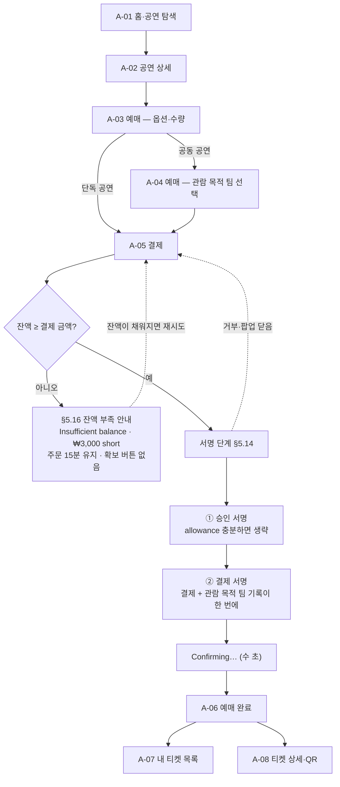
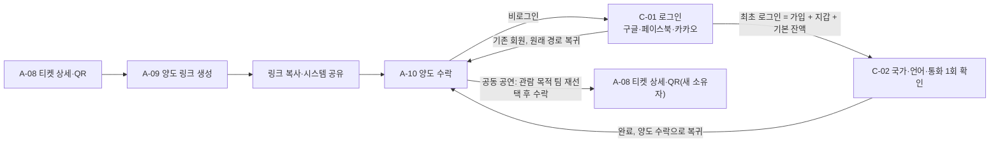
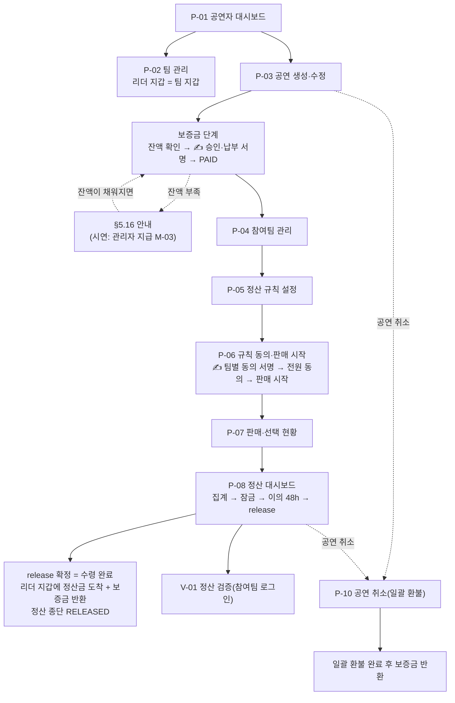
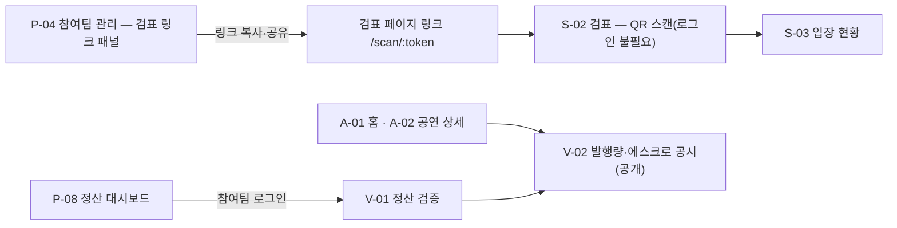
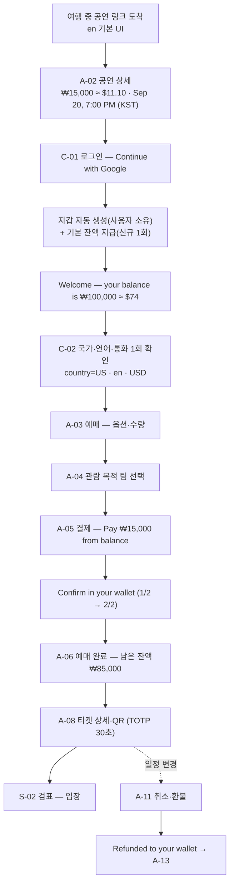
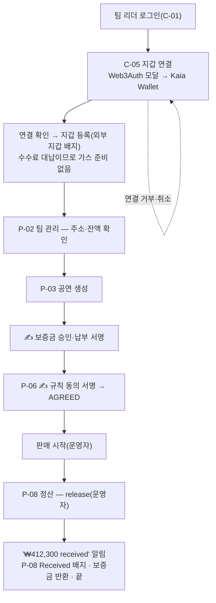

# 화면설계 v5 (디자인 제외 — 구조·흐름·컴포넌트)

> 대상: S15P21B204 · 작성 2026-08-28(금) · **개정 2026-09-02(수) 오후 · 기준: [06_방향전환_코인전환_v2.md](../planning/06_방향전환_코인전환_v2.md)(+ 덧씌워지지 않은 v1 절)** · 상태: 초안 · 참조: [00_설계문서_작성계획_v1.md](./00_설계문서_작성계획_v1.md) §1.6(결정 문서가 덧씌우지 않은 부분만) · [API 공통 응답 규격 v3](./01_API_공통_응답_규격.md) · [개발 컨벤션](./02_개발_컨벤션.md) · 이전 버전: [화면설계 v4](./07_화면설계_v4.md) · [화면설계 v3](./07_화면설계_v3.md) · [화면설계 v1](./07_화면설계_v1.md)
>
> 표기 — **[팀]** 팀 결정 / **[권]** 권고안(이견 시 변경) / **P1·P2** MVP 제외. 화면 ID·화면명·라우트는 결정 문서 v2 §10, 상태값은 §7, API 경로는 §9를 그대로 쓴다.
>
> **"디자인 제외"의 정의** — 색·타이포·아이콘 모양·간격·이미지·모션·비주얼 톤·**ASCII 와이어프레임은 다루지 않는다**. 화면 목록·정보 구조·흐름·화면별 논리 영역(헤더/본문/하단 고정 액션)·컴포넌트·표시 데이터/입력 필드·동작·상태·입력 검증 규칙·연결 API·연결 기능·모바일 고려·접근성 최소만 다룬다.
>
> **용어 한 가지** — v4까지 UI 요소를 부르던 "카·드"라는 낱말은 이 세계에 존재하지 않는 결제 수단을 연상시키므로 문서 전체에서 쓰지 않는다. 같은 뜻의 UI 요소는 **패널**이라고 부른다(§7.5).
>
> **화면 수** — **33개**(C 5 · A 13 · P 9 · S 2 · V 2 · M 2). v4의 35개에서 **삭제 2개**(A-14 · P-09), **개편 2개**(V-02 · M-03), **변경 10개**(C-01·C-03·A-05·A-11·A-12·A-13·P-01·P-02·P-08·V-01)를 반영했다.

---

## 0. 변경 이력

| 버전 | 날짜 | 작성 | 내용 |
|------|------|------|------|
| v1 | 2026-08-28 | B204 | 최초 작성 — 화면 34개 명세(IA·흐름도·화면별 컴포넌트·공통 컴포넌트·검수표) |
| v2 | 2026-08-31 | B204 | 요구사항 v2 반영 — 검표 링크 토큰화(S-01 삭제), 정산 공식 2단계, OAuth P0 승격, V-01 참여팀 전용화, 관리자 화면 최소화, 체인 Kaia Kairos 전환. 30개 |
| v3 | 2026-09-01 | B204 | ERD v2 반영 — 팀원·초대 UI 삭제, 정산 2단계 비율(fixed/selection/team_share), 정산 공유 링크, QR TOTP, "리더" 용어 통일, Refund 상태 배지. 30개 |
| v4 | 2026-09-02 오전 | B204 | 방향 전환 v1 반영 — 전부 코인 결제, 외국인 관객 타깃(en 기본·환산 병기·KST 병기), 비수탁 지갑(Web3Auth 3종), 사용자 서명 UX, 하단 탭 5개, §5.10~§5.15 신설. 35개 |
| **v5** | **2026-09-02 오후** | **B204** | **방향 전환 v2 반영(결정 문서 v2 §10)** — ① **화폐가 코인인 세계**: 법정화폐 입출구 화면이 전부 사라졌다. 코인은 **가입 시 기본 지급 + 관리자 추가 지급**으로만 생기고, 팀은 `release`로 지갑에 받으면 그것으로 끝난다 ② **삭제 2개** — A-14, P-09 ③ **개편 2개** — V-02(발행량·에스크로 공시), M-03(표시 환율·코인 지급) ④ **변경 10개** — C-01(첫 로그인 기본 잔액 안내), C-03·A-13(계좌·확보 진입 삭제), A-05(잔액 결제 단일 경로 + 서명 2단계), A-11·A-12, P-01·P-02(계좌 항목 삭제), P-08(수령 완료가 종단), V-01(예치 대비 언급 삭제·불변식 4 대사) ⑤ **공통 컴포넌트** — §5.12 삭제, §5.14 수정(수수료 대납), **§5.16 잔액 부족 안내 신설** ⑥ 9/2 팀 결정(Web3Auth 단일·외부 지갑 = Kaia Wallet·수수료 대납·양도 P2·이메일 가입 P1·체인 설정 환경변수)을 상단 노트가 아니라 **본문 규칙으로 확정 반영**. **33개** |

---

## 1. 개요·원칙

### 1.1 이 서비스가 화면에서 지켜야 할 전제

- **화폐가 코인인 미래를 가정한다. 플랫폼은 시연용 코인을 지급할 뿐 발행·상환·준비금의 주체가 아니며, 모든 가치 이동은 지갑 간 온체인 이체다.** 이 한 문장이 v4까지 화면에 있던 법정화폐 입출구(코인 확보 화면·팀 수령 화면·예치 대비 공시)를 전부 대체한다. 관객은 이미 지갑에 ₩를 갖고 있고, 처음 로그인하는 사람에게는 그 자리에서 기본 잔액이 들어온다.
- **지갑은 사용자 소유(Web3Auth/Kaia Wallet), 서버는 사용자 키를 보관하지 않는다.** 그래서 값이 움직이는 순간(결제·보증금·규칙 동의)에는 반드시 **사용자 서명 단계**가 화면에 들어간다. 서버가 대신 눌러줄 수 있는 액션은 판매 시작·환불·집계·잠금·release·보증금 반환·시연용 지급뿐이다.
- **잔액이 모자라도 화면은 안내만 한다.** 돈을 더 넣는 경로가 이 세계에는 없다. 부족하면 `Insufficient balance`와 모자란 금액을 보여주고 주문을 15분간 붙잡아 둘 뿐이며, 시연에서는 관리자가 M-03에서 지급해 해결한다(§5.16).
- **탈중앙을 주장하지 않는다.** 정산 흐름은 운영자가 발의하고 사용자가 서명한다. 화면 문구도 그 사실에 맞춘다.
- **가정 기반 시연임을 공개 화면에서 밝힌다.** V-02 하단 고지 문구는 결정 문서 v2 §2.1 그대로 — `Test network (Kaia Kairos). A demo that assumes a future where money is a coin. No real assets, no real currency.` / "테스트넷(Kaia Kairos) 시연입니다. 화폐가 코인인 미래를 가정했으며 실가상자산·실화폐가 아닙니다."

### 1.2 화면 원칙 13개

1. **기준 폭**: 모바일 웹 360px. 관객 화면(A·C 접두)은 모바일 우선, 공연자(P)·관리자(M) 화면은 데스크톱 우선이되 모바일에서도 동작해야 한다(웹 전용, 컨벤션 §1).
2. **블록체인 용어 0**: 관객이 보는 화면(A·C 접두)에는 가스·주소·tx 해시·컨트랙트·토큰·체인·mint라는 단어를 노출하지 않는다. **예외 3가지만 허용한다** — ① **V-01 정산 검증**(참여팀 리더 전용) ② **V-02 발행량·에스크로 공시**(공개) ③ **서명 단계의 한 줄** `Confirm in your wallet` / "지갑에서 확인해 주세요"(§5.14). P·M 접두 화면은 종전대로 전문 용어를 허용한다.
   - A-13의 문서상 화면명은 "내 지갑"이지만 **화면에 실제로 찍히는 라벨은 `Balance` / "잔액"** 이다. C-05 지갑 연결은 "이미 지갑이 있는 사람"만 오는 화면이라 지갑이라는 단어를 쓴다(진입 문구가 `Already have a wallet?`).
3. **금액 표기 (P-22)**: 금액은 **원 값(₩ 정수, 천 단위 구분)을 항상 먼저 쓰고**, 회원의 `display_currency`가 KRW가 아니면 **환산값을 `≈`로 병기**한다(예: `₩15,000 ≈ $11.10`). 환산은 **표시 전용**이며, 결제·환불·정산·분배·지급 요청에 실리는 값은 언제나 원 정수(= KRWS, decimals=0)다. 환산값에는 사용한 환율과 시각을 툴팁으로 붙인다(§5.4).
4. **언어 (P-22·P-23)**: 관객 화면 문구는 **en 기본 + ko 병기**로 설계한다(타깃 = 외국인 관객). 공연자(P)·관리자(M) 화면은 ko. 모든 화면 헤더에서 **언어 스위치(en/ko)**에 닿을 수 있어야 한다(§5.11). 로그인 전에는 브라우저 로케일로 제안하고, 로그인 후에는 `member.locale`을 따른다.
5. **시간 표기 (P-22)**: 공연 일시·마감 시각은 **회원 시간대 기준으로 표시하고 KST를 괄호로 병기**한다(예: `Sep 20, 7:00 PM (KST 19:00)`). 공연은 한국에서 열리므로 KST가 사실상의 기준 시각이다(§5.13).
6. **서명 UX 원칙 (P-18)**: 사용자 서명이 필요한 액션은 ① **지갑 팝업을 띄우기 전에 무엇에 서명하는지 사람이 읽을 수 있는 요약**(금액·대상·건수)을 화면에 먼저 보여주고 ② **사용자가 팝업을 닫거나 거부하면 직전 화면 상태로 그대로 되돌린다**(진행 중이던 주문·요청은 사라지지 않는다) ③ **네트워크 수수료는 플랫폼이 대납하므로 사용자에게 노출하지 않는다** — 사용자 지갑에 KAIA를 넣지 않고, 프론트가 발신자 서명만 하고 서버(운영지갑 = fee payer)가 대납 서명·전송한다 `[팀 9/2]`. 서명은 결제 시 최대 2회(승인 → 결제)이며, 이미 승인이 충분하면 1회로 줄어든다.
7. **하단 탭 5개**: 관객 하단 탭은 **홈(A-01) · 내 티켓(A-07) · 주문내역(A-12) · 내 지갑(A-13) · 마이페이지(C-03)**. v4와 같다.
8. **비동기 작업(202) 처리**: `POST`가 `202 + jobId`를 반환하면 화면은 즉시 "처리 중" 상태로 전환하고 `GET /api/v1/chain/jobs/{jobId}`를 폴링해 결과를 반영한다. **사용자 서명 tx도 같다** — 프론트가 발신자 서명을 만든 뒤 `POST …/signed-tx {kind, senderSignedRlp}`로 보고하면 `202 + jobId`가 오고, 서버가 대납 서명·전송·receipt 검증을 마칠 때까지 같은 방식으로 폴링한다 `[팀 9/2]`. 완료 전 이탈 시에도 재진입하면 원본 리소스 조회 API로 최신 상태를 다시 가져온다.
9. **에러 처리**: 모든 실패 응답은 `code`로 분기하고, `msg`는 그대로 토스트에 노출한다(클라이언트는 `msg` 문자열로 분기하지 않는다). 규격 v3에 없는 코드는 §8.2 "규격 v5 신설 제안"에 모아 두었다.
10. **토큰 재발급(전 화면 공통)**: 인증이 필요한 화면 어디서든 `AUTH_TOKEN_EXPIRED`(401)를 받으면 화면 전환 없이 `POST /api/v1/auth/refresh`로 조용히 재발급받아 원요청을 재시도한다. 개별 화면 절에는 반복 기재하지 않는다.
11. **체인·익스플로러**: 모든 tx 링크는 **Kaia Kairos(chainId 1001 = `0x3e9`)** 익스플로러(Kaiascan)를 새 창으로 연다. **체인·컨트랙트 설정은 프론트 환경변수로 고정한다** `[팀 9/2]` — 설정 조회 API는 P1이며 MVP 화면은 이를 호출하지 않는다. **tx 링크는 P·M·V 화면에만 노출한다.**
12. **잔액 부족은 안내만 한다(충전 유도 없음)**: 관객·리더 어느 화면에도 잔액을 늘리는 버튼·탭·링크를 두지 않는다. 부족하면 `Insufficient balance · ₩3,000 short` 형태로 **모자란 금액만** 알리고, 진행 중이던 주문·요청은 유지한다(§5.16). 시연 중 부족은 관리자 지급(M-03)으로 푼다.
13. **가정 기반 시연 고지**: 공개 화면(V-02)과 발표용 진입점에는 §1.1의 고지 문구를 그대로 노출한다. 관객 결제 흐름(A 접두) 안에서는 이 고지를 반복하지 않는다 — 세계관 설명이 예매를 방해하지 않게 한다.

### 1.3 v3·v4에서 그대로 유지되는 규칙

- **검표 화면은 링크 토큰으로 접근한다**: 검표 담당자에게 계정을 만들지 않는다. 공연 생성 시 자동 생성된 공연별 검표 페이지 링크로 `/scan/:token`에 접속하면 로그인 없이 검표 화면이 열린다(SEC-03).
- **검표 판정 피드백**: S-02 QR 스캔 판정은 1초 이내에 색상 표시 + 소리 + 진동으로 알린다(PERF-03·UX-04).
- **V-01 접근 권한**: 정산 검증은 해당 공연의 참여팀 리더만 로그인 후 접근한다(AUDIT-01). 무로그인 공개는 **V-02 발행량·에스크로 공시**만이다.
- **판매 마감과 취소 마감은 다르다**: 취소 마감은 공연일 D-3 00:00, 판매 마감은 공연 시작 1시간 전. 두 시각 사이는 "예매 가능·환불 불가" 구간이므로 A-02·A-03·A-11 문구에서 구분해 표기한다.

### 1.4 본문에 이미 반영된 팀 결정 `[팀 9/2]`

아래는 별도 노트가 아니라 이 문서 전체의 전제다. 각 화면 절은 이미 이 결정을 적용한 상태로 쓰였다.

1. **인증·지갑 = Web3Auth 단일**(구글·페이스북·카카오 3종). 자체 이메일 가입·로그인은 **P1**이며 C-02는 소셜 최초 로그인 1회 확인 폼으로만 동작한다.
2. **외부 지갑은 Kaia Wallet만 MVP** — 수수료 대납 서명을 지원하는 지갑이 그것뿐이다. 연결은 Web3Auth 모달의 외부 지갑 어댑터로 처리하고, 자체 챌린지 서명 API는 **P1**. C-05는 안내 화면으로 축소한다.
3. **코인 확보는 시연용 지급뿐** — 가입 시 기본 **100,000 KRWS** 1회 자동, 이후는 관리자(M-03)가 지급한다. 관객 화면에는 확보 경로가 없다.
4. **체인·컨트랙트 설정은 프론트 환경변수 하드코딩**(설정 조회 API는 P1).
5. **기본 언어 en·표시 통화 USD 고정**(국가별 자동 제안 없음, 수동 스위치만).
6. **코인 이름은 티커 `KRWS`만 쓴다.** 관객 화면에는 `₩`만 노출하고 티커도 보이지 않는다.
7. **양도(선물)는 최후순위(P2)** — A-09·A-10은 화면 명세만 남기고 구현은 마지막이다.
8. **가스 = Kaia 수수료 대납(fee delegation)** — 사용자 지갑에 KAIA를 넣지 않는다. `signed-tx` 보고 본문은 `{kind, senderSignedRlp}`(발신자 서명 RLP)다.

---

## 2. 사용자 유형별 정보 구조(IA)·네비게이션

### GUEST

- **진입점**: 홈(A-01), 공유된 공연 상세 링크(A-02), 로그인(C-01), 양도 수락 링크(A-10, 조회는 가능·수락은 로그인 필요, P2), **발행량·에스크로 공시(V-02, 로그인 불필요)**, 검표 페이지 링크(S-02, 링크 토큰만으로 접근). **정산 검증(V-01)은 GUEST 진입점이 아니다.**
- **네비게이션**: 하단 탭 없음. 상단에 홈 / **언어 스위치(en·ko)** / 로그인만 노출한다.
- **로그인 = 소셜 3버튼**: C-01은 **구글·페이스북·카카오** 버튼 3개가 전부다. 최초 로그인이 곧 가입이며, 이때 지갑이 자동으로 만들어지고 **기본 잔액이 들어온다**. 국가·언어·통화는 그 직후 한 번 확인받는다(C-02 1회 노출).
- **권한 없는 화면 접근**: 로그인이 필요한 화면(예매·결제·내 티켓·내 지갑·마이페이지) 접근 시 C-01로 이동시키고 원래 경로를 저장해 로그인 성공 후 복귀시킨다. 토스트는 `COMMON_UNAUTHORIZED`의 `msg`를 그대로 띄운다.

### AUDIENCE

- **진입점**: 로그인 후 기본 홈(A-01).
- **네비게이션**: **하단 탭 5개** — 홈(A-01) · 내 티켓(A-07) · 주문내역(A-12) · **내 지갑(A-13)** · 마이페이지(C-03). 예매·결제·양도(P2)·취소 흐름은 탭 바 없이 단계형(뒤로가기)으로 진행한다.
- **잔액 접점**: 잔액은 A-13(탭)과 A-05(결제) 두 곳에서 항상 확인할 수 있다. **잔액을 늘리는 화면은 없다** — A-13에도 A-05에도 확보 버튼이 없고, 부족하면 §5.16 안내만 뜬다.
- **설정**: 마이페이지(C-03)에서 **언어·통화 설정(C-04)**과 **지갑 연결(C-05)**로 들어간다. Web3Auth로 가입한 회원에게 C-05는 정보 표시 화면이다.
- **공연자 전환**: C-03에서 리더인 팀이 있으면 "내 팀" 버튼으로 PERFORMER 영역(P-01)에 들어간다. 같은 계정이 관객·공연자 역할을 동시에 가진다.
- **권한 없는 화면**: 본인 소유가 아닌 티켓 상세 접근 시 `TICKET_NOT_OWNED`(403) → 목록 복귀 + 토스트.

### PERFORMER (한국인 팀 리더)

- **진입점**: C-03 "내 팀" 또는 로그인 시 리더인 팀이 있으면 P-01로 바로 진입.
- **네비게이션**: 데스크톱은 사이드 메뉴 — 대시보드(P-01) · 팀 관리(P-02) · (공연 선택 후) 참여팀·규칙·동의·판매현황·정산(P-03~P-08) · 정산 검증(V-01, 참여팀 전용). 모바일은 상단 드로어 메뉴로 대체한다. **v4의 팀 수령 메뉴(P-09)는 사라졌다** — 정산금은 `release` 시점에 리더 지갑에 이미 들어와 있다.
- **서명이 필요한 지점 2곳**: ① **P-03 보증금 납부**(공연 생성 직후, 규칙 설정 진입 전) ② **P-06 규칙 동의**. 두 곳 모두 §5.14 서명 단계 컴포넌트를 같은 모양으로 쓴다.
- **지갑 = 리더 지갑 = 팀 지갑**: 팀에 별도 지갑을 만들지 않는다. P-02는 리더 지갑의 주소·잔액·익스플로러 링크를 보여준다. **정산 계좌 항목은 삭제됐다** — 이 세계에는 은행이 없고, 코인이 곧 돈이다.
- **권한**: 팀 리더만 공연자 화면에 진입한다(팀원 개념 없음). 공연 생성자 전용 기능(공연 수정·참여팀 관리·규칙 설정·판매 시작·집계 확정·잠금·release·공연 취소·보증금)은 다른 참여팀 리더에게 비활성 처리한다.
- **권한 없는 화면**: 자기 팀이 아닌 공연 관리 화면 접근 시 `PERFORMANCE_NOT_OWNER`/`COMMON_FORBIDDEN`(403) → 안내 후 P-01 복귀.

### STAFF (검표 담당자 — 링크 토큰)

- **진입점**: 계정·로그인이 없다. 공연 생성자에게 공유받은 검표 페이지 링크 `/scan/:token`(S-02)이 유일한 진입점이다.
- **네비게이션**: 별도 탭·메뉴 없음. S-02 → S-03(입장 현황)의 단일 목적 흐름만 제공하며, 두 화면 모두 같은 토큰을 라우트에 유지한다.
- **권한 없는 화면**: 토큰이 위조·만료되었거나 다른 공연의 토큰이면 `ENTRY_SCANNER_NOT_AUTHORIZED`(403) → 접근 차단 안내(링크 재요청 안내). 복귀할 목록이 없으므로 홈(A-01) 이동 버튼만 제공한다.

### ADMIN

- **진입점**: 관리자 로그인 후 M-02(이의제기 처리). **MVP 관리자 화면은 M-02·M-03 두 개다.**
- **네비게이션**: 상단에 이의제기(M-02) · **코인 운영(M-03)** 두 항목만 둔다. 대시보드·회원/공연 관리·운영지갑·감사 로그·실패 작업 수동 재처리는 P1로 이관했다(실패한 지급·환불·분배는 시스템이 자동 재시도하고 결정적 실패만 알림).
- **M-03이 하는 일**: ① 표시 환율 등록·이력 확인 ② **시연용 코인 지급**(회원 검색 또는 주소·금액·메모) ③ **지급 이력 확인** ④ **발행량 이상 경고 확인**. 불변식이 깨지면 지급(mint)과 release가 중단되고 이 화면에 중단 상태가 뜬다.
- **권한 없는 화면**: 관리자 권한 없는 계정의 `/admin/*` 접근은 `COMMON_FORBIDDEN`(403) → 홈 또는 로그인으로 리다이렉트.

---

## 3. 화면 흐름도

### ① 관객 예매 — 잔액 결제 + 서명 2단계(부족은 안내 분기)



- 서명을 거부하면 **주문은 `PENDING_PAYMENT`로 15분간 유지되고 잔액은 그대로 남는다**(A-05 상태 절). 돈이 사라지는 경로는 없다.
- 승인·결제 두 서명은 화면상 하나의 진행 표시(1/2 → 2/2)로 묶어 보여준다.
- **부족 분기에 화면 전환이 없다** — 같은 화면에서 안내만 갱신한다.

### ② 관객 양도·수락 **[P2]**



### ③ 관객 취소·환불 — 지갑으로 반환

```mermaid
flowchart LR
    A08["A-08 티켓 상세·QR"] --> A11["A-11 취소·환불"]
    A11 -->|취소 확정(운영자 refund, 서명 없음)| REF["Refunded to your wallet<br/>에스크로 → 관객 지갑"]
    REF --> A07["A-07 내 티켓 목록(취소 탭)"]
    REF --> A13["A-13 내 지갑 — 잔액·이력 갱신"]
```

- 환불은 **운영자가 실행**하므로 관객 서명이 없다. 환불 코인은 **관객 지갑으로 돌아와 다음 예매에 그대로 쓰인다**(P-20).

### ④ 공연자 — 공연 생성 → 보증금 서명 → 참여팀 → 규칙 → 동의 서명 → 판매 → 정산 → 수령 완료



- v4에 있던 **팀 수령 화면(P-09)이 사라졌다.** `release`가 리더 지갑으로 코인을 밀어 넣는 순간이 곧 수령 완료이며, 그 뒤에 사용자가 눌러야 할 버튼이 없다.

### ⑤ 검표(링크 토큰) + 검증



### ⑥ 외국인 관객 end-to-end — 구글 로그인 → 기본 잔액 → 서명 결제 → 입장 → 환불



- 이 흐름 전체에서 관객에게 노출되는 블록체인 어휘는 서명 단계의 `Confirm in your wallet` 한 줄뿐이다(§1.2 원칙 2).
- 국내 계좌·본인인증·휴대폰 인증을 한 번도 요구하지 않는다(P-23). **자국 코인 → KRWS 교환은 여행 전 플랫폼 밖에서 끝난 것으로 가정**하므로 교환 화면도 없다(P2).

### ⑦ 리더 — Kaia Wallet 연결 → 보증금 서명 → 동의 서명 → 정산금 수령



- 외부 지갑 등록은 **회원당 1개**이고, 이미 지갑이 있으면 `WALLET_ALREADY_LINKED`로 막는다. 지갑 교체는 MVP에서 관리자 처리이며 화면은 P1(§8.1).
- **시연 기본은 데스크톱 브라우저의 Kaia Wallet 확장 + Web3Auth**다. 모바일 외부 지갑은 리허설 후 결정한다.

---
## 4. 화면 명세 (33개)

> 표기 — 화면명 옆의 **[개편]·[변경]·[유지]·[P1]·[P2]**는 결정 문서 v2 §10의 처분이다. 관객 화면(A·C)의 문구는 `en 예시 / ko 병기` 형태로 적었다. 실제 구현은 i18n 키로 관리하고, 이 문서의 문구는 en 원문과 ko 대역의 기준값이다. UI 요소는 모두 **패널**이라고 부른다(문서 상단 "용어 한 가지").

### C-01 로그인 **[변경]**

- 사용자 GUEST / 라우트 `/login` / 진입 경로: 앱 최초 진입 시 로그인 버튼, 권한 없는 화면 접근 리다이렉트, 양도 수락(A-10) 로그인 유도 / 목적: **소셜 로그인 3종으로 인증하고, 최초 로그인이면 그 자리에서 가입·지갑 준비·기본 잔액 지급까지 끝낸다.**
- **변경 요지** — 최초 로그인 직후 **"Welcome — your balance is ₩100,000"** 안내가 붙었다(이 세계에서 사람들이 이미 갖고 있던 돈을 화면이 확인해 주는 장면이다). 이메일 로그인 폼은 **P1**로 내려가 MVP 화면에서 사라졌고, 소셜 버튼 3개만 남는다 `[팀 9/2]`.

**영역 구성**
- 헤더: 서비스 타이틀, **언어 스위치(en/ko)** · 본문: 소셜 로그인 버튼 3개(구글·페이스북·카카오), 준비 중 표시, 최초 로그인 환영 패널, 안내 문구 · 하단 고정 액션: 없음(버튼이 본문에 있음)

**컴포넌트**

| 컴포넌트 | 유형 | 표시 데이터 / 입력 필드 | 동작 | 연결 API | 연결 기능 |
|---|---|---|---|---|---|
| 언어 스위치 | 토글(§5.11) | `EN` / `한국어` | 즉시 문구 전환(비로그인은 로컬 저장) | - | 언어·통화 설정 |
| 구글 로그인 버튼 | 버튼 | `Continue with Google` / "구글로 계속하기" | 소셜 인증 → idToken·주소 확보 → 서버 검증 → 세션 발급 → 최초면 환영 패널 후 C-02, 아니면 원래 경로 복귀 | POST /api/v1/auth/web3auth | Web3Auth 로그인·가입 |
| 페이스북 로그인 버튼 | 버튼 | `Continue with Facebook` / "페이스북으로 계속하기" | 위와 동일 | POST /api/v1/auth/web3auth | Web3Auth 로그인·가입 |
| 카카오 로그인 버튼 | 버튼 | `Continue with Kakao` / "카카오로 계속하기" | 위와 동일 | POST /api/v1/auth/web3auth | Web3Auth 로그인·가입 |
| 준비 중 표시 | 배지/전체 로딩 | `Setting up your account…` / "계정을 준비하고 있어요…" | 소셜 콜백 복귀 후 세션 발급까지. **지갑 생성과 기본 지급은 이 안에서 조용히 끝난다**(mint·주소를 문구로 노출하지 않는다) | POST /api/v1/auth/web3auth(응답 `grantJobId?`) · GET /api/v1/chain/jobs/{jobId} | Web3Auth 로그인·가입 / 비동기 작업 상태 조회 |
| 최초 로그인 환영 패널 | 패널 | `Welcome — your balance is ₩100,000 ≈ $74` / "환영합니다 — 잔액 ₩100,000 ≈ $74", 보조 문구 `Ready to book.` / "바로 예매할 수 있어요." | 신규 회원에게만 1회. 확인 시 C-02로 이동 | GET /api/v1/wallets/me · GET /api/v1/coin/rates | 내 지갑 조회 / 표시 환율 조회 |
| 지급 지연 표시 | 텍스트 | `Almost there…` / "거의 다 됐어요…" — 기본 지급 job이 아직 `CONFIRMED`가 아닐 때 | 폴링. 지연돼도 원인(체인 처리)을 노출하지 않는다 | GET /api/v1/chain/jobs/{jobId} | 비동기 작업 상태 조회 |
| 안내 문구 | 텍스트 | `Signing in creates your account and your wallet.` / "로그인하면 계정과 지갑이 함께 만들어져요." | - | - | - |

**상태**
- 처리 중: 소셜 콜백 복귀 대기·세션 발급 중에는 전체 화면 로딩, 버튼 전부 비활성
- 에러: `AUTH_WEB3AUTH_TOKEN_INVALID`(§8.2, 잠정 `AUTH_INVALID_CREDENTIALS` 401) — "다시 시도해 주세요" 안내 후 버튼 재활성 / `COMMON_EXTERNAL_SERVICE_ERROR`(502) — 제공자 응답 없음, 다른 제공자 사용 권유 / `COMMON_TOO_MANY_REQUESTS`(429)
- **기본 지급 실패**: 로그인 자체는 성공 처리하고 환영 패널의 금액 자리에 `—`와 "잠시 후 다시 확인해 주세요"를 표시한다. 지급 job은 서버가 자동 재시도하며, 화면은 A-13에서 갱신된 잔액을 다시 보여준다
- 재로그인·지갑 교체(P1)에서는 환영 패널이 뜨지 않는다(기본 지급은 **신규 회원 1회**)

**입력 검증**
- 없음(폼 없음)

**모바일·접근성 고려**
- 소셜 버튼은 세로 배치, 터치 타겟 44px. 팝업 차단 환경에서는 리다이렉트 방식으로 대체하고 안내를 띄운다

---

### C-02 회원가입(보조) **[P1]**

- 사용자 GUEST / 라우트 `/signup` / 진입 경로: **소셜 최초 로그인 직후 1회 자동 노출**(MVP 용도), 양도 수락(A-10)의 가입 유도(P2) / 목적: 소셜 최초 로그인 회원에게 **국가·언어·통화·시간대를 한 번 확인받는다.**
- **P1 표기 이유** — 이메일 가입·로그인 자체가 P1로 내려갔다 `[팀 9/2]`. MVP에서 이 화면은 **이메일 폼 없이** 국가·언어·통화·시간대 확인 폼으로만 뜬다. 아래 표에서 이메일 관련 컴포넌트는 P1 표기다.

**영역 구성**
- 헤더: 뒤로가기, 언어 스위치 · 본문: 환영 문구 + 국가·언어·통화·시간대 폼, (P1) 이메일·비밀번호·이름 + 약관 동의, (양도 링크 진입 시) 복귀 안내 배너 · 하단 고정 액션: `Continue` / "계속하기" 버튼

**컴포넌트**

| 컴포넌트 | 유형 | 표시 데이터 / 입력 필드 | 동작 | 연결 API | 연결 기능 |
|---|---|---|---|---|---|
| 환영 문구 | 텍스트 | `You're all set — ₩100,000 is in your wallet.` / "준비 끝 — 지갑에 ₩100,000이 있어요." | 신규 회원에게만 | GET /api/v1/wallets/me | 내 지갑 조회 |
| 국가 선택 | 폼 필드(선택) | `Country` / "국가" — ISO 3166-1 alpha-2 목록. **자기 선언이며 증빙을 받지 않는다** | 선택 시 언어·통화·시간대 기본값 자동 제안 | PATCH /api/v1/members/me | 내 정보 수정 |
| 언어 선택 | 폼 필드(선택) | `Language` / "언어" — English(기본) · 한국어 | 즉시 미리보기 전환 | PATCH /api/v1/members/me | 언어·통화 설정 |
| 표시 통화 선택 | 폼 필드(선택) | `Display currency` / "표시 통화" — USD(기본)·JPY·EUR·KRW | 안내 문구 갱신 | PATCH /api/v1/members/me | 언어·통화 설정 |
| 시간대 선택 | 폼 필드(선택) | `Time zone` / "시간대" — IANA. 국가로 기본 제안 | - | PATCH /api/v1/members/me | 언어·통화 설정 |
| 표시 통화 안내 | 텍스트 | `Tickets are priced in Korean won (₩). We show an approximate amount in your currency.` / "티켓 가격은 원(₩) 기준이고, 선택한 통화로 대략의 금액을 함께 보여드려요." | - | - | - |
| 이메일·비밀번호·이름 입력(P1) | 폼 필드 | 이메일, 비밀번호 2회, 이름 | 형식·일치 검증 | POST /api/v1/auth/signup(P1) | 자체 이메일 가입(P1) |
| 약관 동의 체크박스(P1) | 폼 필드 | 동의 여부 | 필수 체크 | - | - |
| 양도 복귀 안내 배너(P2) | 텍스트 | `Finish signing up to accept your ticket.` / "가입을 마치면 받은 티켓을 바로 수락할 수 있어요" | - | - | - |
| 계속하기 버튼 | 버튼 | - | 제출 후 복귀 경로 또는 홈 이동 | PATCH /api/v1/members/me | 내 정보 수정 |

**상태**
- 에러: `COMMON_VALIDATION_FAILED`(400) — 필드별 안내 / (P1) `AUTH_EMAIL_DUPLICATED`(409)
- **복귀 경로**: 양도 링크(`/transfers/:token`, P2)에서 진입했으면 완료 즉시 A-10으로 되돌린다. 그 밖에는 원래 요청 화면 또는 홈(A-01)
- 소셜 최초 로그인 진입: 국가만 미입력이면 저장 버튼 비활성. 나머지는 제안값 그대로 저장 가능. 이 폼은 **회원당 1회만** 뜬다(이후 변경은 C-04)

**입력 검증**
- 국가 필수. **연락처·주민 정보·국내 계좌는 받지 않는다**(P-23)

**모바일·접근성 고려**
- 터치 타겟 44px, 입력 필드별 적절한 키보드 타입. 국가·시간대 선택은 검색 가능한 목록으로 제공한다

---

### C-03 마이페이지 **[변경]**

- 사용자 AUDIENCE·PERFORMER / 라우트 `/me` / 진입 경로: 하단 탭 "마이페이지" / 목적: 프로필과 **잔액 요약(₩ + ≈ USD)**을 확인하고, 언어·통화 설정(C-04)·지갑 연결(C-05)·내 팀(P-01)으로 이동한다.
- **변경 요지** — **계좌 항목이 완전히 사라졌다**(이 세계에는 은행이 없다). 잔액 요약 패널에서 **잔액을 늘리는 버튼도 사라졌다** — 탭하면 A-13으로만 이동한다.

**영역 구성**
- 헤더: 타이틀, 언어 스위치 · 본문: 프로필 패널, **잔액 요약 패널(§5.10)**, 언어·통화 설정 진입 패널, 지갑 연결 패널, 내 팀 진입 패널, (P1) 관람 기록 패널 · 하단 고정 액션: 로그아웃 버튼

**컴포넌트**

| 컴포넌트 | 유형 | 표시 데이터 / 입력 필드 | 동작 | 연결 API | 연결 기능 |
|---|---|---|---|---|---|
| 프로필 패널 | 패널 | 이름·이메일·로그인 제공자 표시(`Signed in with Google` / "구글로 로그인") | 이름 수정 진입 | GET /api/v1/members/me | 내 정보 조회 |
| 프로필 수정 폼 | 폼 필드(바텀시트) | 이름 | 저장 | PATCH /api/v1/members/me | 내 정보 수정 |
| 잔액 요약 패널 | 패널(§5.10) | `Balance ₩85,000 ≈ $63.00` / "잔액 ₩85,000 ≈ $63.00", **제공자 배지(§5.15)** | 탭 시 A-13 이동. **액션 버튼 없음** | GET /api/v1/wallets/me · GET /api/v1/coin/rates | 내 지갑 조회 / 표시 환율 조회 |
| 언어·통화 설정 패널 | 패널 | 현재 언어·표시 통화·시간대 요약 | 탭 시 C-04 이동 | GET /api/v1/members/me | 내 정보 조회 |
| 지갑 연결 패널 | 패널 | `Connected` / "연결됨" + 제공자 배지(§5.15) | 탭 시 C-05 이동 | GET /api/v1/wallets/me | 내 지갑 조회 |
| 내 팀 진입 버튼 | 버튼 | - | P-01 이동(리더인 팀이 있을 때만 노출) | GET /api/v1/teams/me | 내 팀 목록 조회 |
| 관람 기록 패널(P1) | 패널 | - | - | - | 관람 기록(P1) |
| 로그아웃 버튼 | 버튼 | `Sign out` / "로그아웃" | 세션 종료 후 A-01 이동 | POST /api/v1/auth/logout | 로그아웃 |

**상태**
- 로딩: 스켈레톤 패널 / 잔액 조회 실패: 잔액 자리에 `—`와 "다시 시도" 링크(다른 패널은 정상 표시) / 에러: `COMMON_UNAUTHORIZED`(401) → C-01 이동

**입력 검증**
- 이름 1~50자

**모바일·접근성 고려**
- 터치 타겟 44px. 잔액은 색이 아니라 금액 문자열로 읽히게 하고, 환산값은 보조 텍스트 위계로 둔다

---

### C-04 언어·통화 설정 **[유지]**

- 사용자 회원 / 라우트 `/me/preferences` / 진입 경로: C-03 언어·통화 설정 패널, 헤더 언어 스위치의 "더 보기" / 목적: **언어(locale)·표시 통화(display_currency)·시간대(timezone)**를 바꾼다.
- v4와 구조가 같다. 환산 고지 문구에서 "충전"이라는 낱말만 빠졌다.

**영역 구성**
- 헤더: 뒤로가기, 타이틀 `Language & currency` / "언어·통화" · 본문: 언어 선택, 표시 통화 선택, 시간대 선택, 미리보기 패널, 환산 고지 · 하단 고정 액션: `Save` / "저장" 버튼

**컴포넌트**

| 컴포넌트 | 유형 | 표시 데이터 / 입력 필드 | 동작 | 연결 API | 연결 기능 |
|---|---|---|---|---|---|
| 언어 선택 | 폼 필드(라디오) | English / 한국어 | 선택 즉시 화면 문구 미리보기 전환 | PATCH /api/v1/members/me | 언어·통화 설정 |
| 표시 통화 선택 | 폼 필드(선택) | USD(기본)·JPY·EUR·KRW | 선택 시 미리보기 금액 재환산 | PATCH /api/v1/members/me · GET /api/v1/coin/rates | 언어·통화 설정 / 표시 환율 조회 |
| 시간대 선택 | 폼 필드(선택) | IANA 시간대(검색 가능) | 선택 시 미리보기 시각 갱신 | PATCH /api/v1/members/me | 언어·통화 설정 |
| 미리보기 패널 | 패널 | `₩15,000 ≈ $11.10` · `Sep 20, 7:00 PM (KST 19:00)` | 선택값에 따라 실시간 갱신 | GET /api/v1/coin/rates | 표시 환율 조회 |
| 환산 고지 | 텍스트 | `Converted amounts are for reference only. All payments, refunds and settlements are in Korean won.` / "환산 금액은 참고용이며, 결제·환불·정산은 모두 원 기준이에요." + 적용 환율·기준 시각 | - | GET /api/v1/coin/rates | 표시 환율 조회 |
| 저장 버튼 | 버튼 | - | 저장 후 이전 화면 복귀 + 토스트 | PATCH /api/v1/members/me | 언어·통화 설정 |

**상태**
- 로딩: 환율 조회 중에는 환산값 자리에 스켈레톤. **환율 조회에 실패해도 원 값은 항상 그대로 보여준다**
- 에러: `COMMON_VALIDATION_FAILED`(400) — 지원하지 않는 통화·시간대 / `COMMON_UNAUTHORIZED`(401) → C-01
- 저장 성공: 전 화면 문구·금액 표기가 즉시 갱신된다(재로그인 불필요)

**입력 검증**
- 표시 통화는 `exchange_rate`에 등록된 pair만 선택 가능. 등록되지 않은 통화는 목록에 노출하지 않는다

**모바일·접근성 고려**
- 언어 전환 시 화면 전체 리렌더가 아니라 문구만 교체해 스크롤 위치를 유지한다. 터치 타겟 44px

---

### C-05 지갑 연결 **[유지]**

- 사용자 회원 / 라우트 `/me/wallet/link` / 진입 경로: C-03 지갑 연결 패널 / 목적: **이미 지갑을 가진 사용자(주로 팀 리더)가 Kaia Wallet을 계정에 연결**한다. 소셜 가입 회원에게는 연결 상태를 보여주는 정보 화면이다.
- **9/2 최소화 반영** — 연결은 **Web3Auth 모달의 외부 지갑 어댑터**가 처리하고, 자체 챌린지 서명 API는 **P1**이다. MVP 외부 지갑은 수수료 대납 서명을 지원하는 **Kaia Wallet만**이다 `[팀 9/2]`.
- 이 화면은 §1.2 원칙 2의 예외가 아니다 — **"이미 지갑이 있는 사람"만 오는 화면이므로 지갑이라는 낱말은 쓰되, 가스·서명 알고리즘·주소 형식 같은 세부 용어는 쓰지 않는다.** 주소는 축약 표기(앞 6자…뒤 4자)로만 보여준다.

**영역 구성**
- 헤더: 뒤로가기, 타이틀 `Connect a wallet` / "지갑 연결" · 본문: (미연결) 안내 문구 + 지갑 목록 + 단계 표시 / (연결됨) 연결 정보 패널 · 하단 고정 액션: (미연결) `Connect` / "연결하기" 버튼

**컴포넌트**

| 컴포넌트 | 유형 | 표시 데이터 / 입력 필드 | 동작 | 연결 API | 연결 기능 |
|---|---|---|---|---|---|
| 안내 문구 | 텍스트 | `Already have a wallet? Connect it to use it for payments.` / "이미 지갑이 있나요? 연결하면 결제에 쓸 수 있어요." | - | - | - |
| 지갑 목록 | 목록(단일 선택) | **Kaia Wallet**(MVP 유일) · (P1) 그 외 | 선택 시 설치 여부 감지, 미설치면 설치 안내 링크 | - | 외부 지갑 연결 |
| 연결하기 버튼 | 버튼 | - | Web3Auth 모달의 외부 지갑 어댑터 실행 → 연결 확인 → 지갑 등록 | POST /api/v1/auth/web3auth | Web3Auth 로그인·가입 |
| 단계 표시 | 진행 인디케이터(§5.14) | `1 Connect → 2 Confirm in your wallet → 3 Done` / "1 연결 → 2 지갑에서 확인 → 3 완료" | 각 단계 완료 시 자동 진행 | 위와 동일 | 외부 지갑 연결 |
| 서명 요약 | 패널(§5.14) | `You are connecting this wallet to your account. No funds move.` / "이 지갑을 계정에 연결하는 절차예요. 자금은 이동하지 않아요." + 축약 주소 | 팝업 전에 항상 먼저 보여준다 | - | 외부 지갑 연결 |
| 연결 정보 패널(연결됨) | 패널 | 제공자 배지(§5.15), 축약 주소, 연결 시각(회원 시간대 + KST) | 소셜 회원은 읽기 전용 | GET /api/v1/wallets/me | 내 지갑 조회 |
| 교체 안내(연결됨) | 텍스트 | `To change your wallet, contact support.` / "지갑을 바꾸려면 고객센터로 문의해 주세요." — MVP는 관리자 처리, 교체 화면은 P1 | - | - | - |
| 챌린지 서명 영역(P1) | 진행 인디케이터 | 자체 챌린지(nonce·5분·1회용) 서명 절차 — **P1**, MVP에서는 노출하지 않는다 | - | POST /api/v1/wallets/challenge(P1) · POST /api/v1/wallets/verify(P1) | 외부 지갑 등록(P1) |

**상태**
- 처리 중: 모달 대기·연결 확인 각 단계에서 버튼 비활성 + 단계 표시 갱신
- 에러: `WALLET_ALREADY_LINKED`(§8.2, 잠정 `COMMON_CONFLICT` 409) — "이미 연결된 지갑이 있어요" + 연결 정보 패널로 전환 / `COMMON_EXTERNAL_SERVICE_ERROR`(502) — 지갑 확장 응답 없음 / (P1) `WALLET_CHALLENGE_EXPIRED`·`WALLET_SIGNATURE_INVALID`
- **거부 처리**: 사용자가 지갑 팝업을 닫으면 **에러 화면을 띄우지 않고 1단계 선택 상태로 조용히 복귀**한다(§1.2 원칙 6)
- 미설치: 선택한 지갑이 감지되지 않으면 설치 안내와 함께 소셜 계정 사용을 권한다

**입력 검증**
- 회원당 지갑 1개

**모바일·접근성 고려**
- 시연 기준은 데스크톱 브라우저 확장 지갑이다. 모바일 접속 시에는 "모바일에서는 소셜 로그인 계정을 사용해 주세요" 안내를 우선 노출한다. 터치 타겟 44px

---
### A-01 홈·공연 탐색 **[유지]**

- 사용자 GUEST·AUDIENCE / 라우트 `/` / 진입 경로: 앱 최초 진입, 하단 탭 "홈" / 목적: 판매 중 공연을 탐색한다.
- **v5에서 달라진 점** — 하단 공개 링크가 **발행량·에스크로 공시(V-02)**로 바뀌었고 링크 문구도 세계관에 맞게 교체됐다. 나머지는 v4 그대로다.

**영역 구성**
- 헤더: 검색 입력, **언어 스위치**, 로그인 버튼(GUEST) 또는 프로필 아이콘(AUDIENCE) · 본문: 날짜 필터, 공연 패널 목록, 하단 공시 링크 · 하단 고정 액션: 없음(하단 탭 바 5개)

**컴포넌트**

| 컴포넌트 | 유형 | 표시 데이터 / 입력 필드 | 동작 | 연결 API | 연결 기능 |
|---|---|---|---|---|---|
| 검색 입력 | 폼 필드 | `Search shows` / "공연 검색" | 목록 필터링 | GET /api/v1/performances | 공연 목록 조회 |
| 날짜 필터 | 폼 필드 | 날짜 범위(회원 시간대 + KST 병기) | 목록 필터링 | GET /api/v1/performances | 공연 목록 조회 |
| 공연 패널 목록 | 목록 | 제목·일시(KST 병기)·장소·참여팀 수·**최저가 `₩15,000 ≈ $11.10`**·판매 상태 배지 | 탭 시 A-02 이동 | GET /api/v1/performances · GET /api/v1/coin/rates | 공연 목록 조회 / 표시 환율 조회 |
| 공시 링크 | 버튼 | `How the money is tracked` / "돈이 어떻게 추적되나요" | V-02 이동 | - | 발행량·에스크로 공시 조회 |
| 빈 상태 안내 | 텍스트 | `No shows match your filters.` / "조건에 맞는 공연이 없습니다" | 필터 초기화 | - | - |

**상태**
- 로딩: 스켈레톤 패널 / 빈: 검색·필터 결과 없음 / 에러: `COMMON_INTERNAL_ERROR`(500) — 토스트 + 재시도
- 환율 조회 실패: 환산값만 숨기고 원 값은 그대로 표시한다(§5.4)

**모바일·접근성 고려**
- 360px 1열 패널, 터치 타겟 44px. 언어 스위치는 헤더에서 2탭 이내

---

### A-02 공연 상세 **[유지]**

- 사용자 GUEST·AUDIENCE / 라우트 `/performances/:id` / 진입 경로: A-01 패널 탭, 공유 링크 / 목적: 공연 정보를 확인하고 예매로 진입한다.
- **v5에서 달라진 점** — 결제 방식 안내 한 줄이 **잔액 결제 단일 문구**로 바뀌었다(`Pay with your balance.`). 공시 링크는 V-02로 연결된다.

**영역 구성**
- 헤더: 뒤로가기, 공유 버튼, 언어 스위치 · 본문: 공연 기본 정보, 판매 상태 배지, 출연팀 목록, 티켓 옵션 목록, 판매 마감 안내, 결제 방식 안내, 공시 링크 · 하단 고정 액션: `Book now` / "예매하기" 버튼

**컴포넌트**

| 컴포넌트 | 유형 | 표시 데이터 / 입력 필드 | 동작 | 연결 API | 연결 기능 |
|---|---|---|---|---|---|
| 공연 정보 패널 | 패널 | 제목·일시(회원 시간대 + KST)·장소·설명 | - | GET /api/v1/performances/{performanceId} | 공연 상세 조회 |
| 출연팀 목록 | 목록 | 팀명 | - | GET /api/v1/performances/{performanceId} | 공연 상세 조회 |
| 티켓 옵션 목록 | 목록 | 타입명·**가격 `₩15,000 ≈ $11.10`**·잔여 수량 | - | GET /api/v1/performances/{performanceId} · GET /api/v1/coin/rates | 공연 상세 조회 / 표시 환율 조회 |
| 판매 상태 배지 | 배지 | `ON_SALE` 판매 중 / `SALE_CLOSED` 판매 마감 / `ENDED` 공연 종료 / `CANCELLED` 공연 취소됨(§5.1) | - | GET /api/v1/performances/{performanceId} | 공연 상세 조회 |
| 판매 마감 안내 | 텍스트 | `Booking closes 1 hour before the show (Sep 20, 6:00 PM KST).` / "공연 시작 1시간 전까지 예매할 수 있어요" · 마감 후 `Booking has closed.` / "판매가 마감되었습니다" | - | GET /api/v1/performances/{performanceId} | 공연 상세 조회 |
| 결제 방식 안내 | 텍스트 | `Priced in Korean won. Pay with your balance.` / "원(₩) 기준이며, 지갑 잔액으로 결제해요." | - | - | - |
| 공시 링크 | 버튼 | `How the money is tracked` / "돈이 어떻게 추적되나요" | V-02 이동 | - | 발행량·에스크로 공시 조회 |
| 예매하기 버튼 | 버튼 | `Book now` / "예매하기" | 비로그인 시 C-01, 로그인 시 A-03 이동. `SALE_CLOSED`·`ENDED`·`CANCELLED`에서는 비활성 | - | 예매 진입 |

**상태**
- 로딩: 스켈레톤 / 에러: `PERFORMANCE_NOT_FOUND`(404) — 빈 안내 + 홈 이동 / 판매전: `TICKET_SALE_NOT_STARTED` 배지 / 매진: `TICKET_SOLD_OUT` 배지 / 판매 마감: `SALE_CLOSED` 배지 + 문구, 예매 버튼 비활성(기존 티켓의 입장은 계속 가능함을 함께 안내)

**모바일·접근성 고려**
- 터치 타겟 44px. 판매 마감은 색 배지만이 아니라 문구로도 알린다(색 의존 금지). 환산값은 원 값보다 낮은 위계로 배치한다

---

### A-03 예매 — 옵션·수량 **[유지]**

- 사용자 AUDIENCE / 라우트 `/performances/:id/order` / 진입 경로: A-02 예매하기 / 목적: 티켓 타입·수량을 선택한다.
- 구조는 v4와 같다. 주문 생성 응답에 `orderRef`·`walletBalance`·`shortfall`이 실려 A-05가 곧바로 부족 여부를 판단한다.

**영역 구성**
- 헤더: 뒤로가기, 타이틀 · 본문: 판매 마감 안내, 티켓 타입별 수량 선택, 금액 합계 · 하단 고정 액션: `Next` / "다음" 버튼

**컴포넌트**

| 컴포넌트 | 유형 | 표시 데이터 / 입력 필드 | 동작 | 연결 API | 연결 기능 |
|---|---|---|---|---|---|
| 판매 마감 안내 | 텍스트 | `Booking closes at 6:00 PM KST on Sep 20.` / "공연 시작 1시간 전(MM/DD HH:mm KST)에 판매가 마감돼요" · 취소 마감(D-3)이 지난 경우 `You can still book, but this ticket is non-refundable.` / "지금부터는 예매는 가능하지만 환불은 되지 않아요"를 함께 표시 | - | GET /api/v1/performances/{performanceId} | 공연 상세 조회 |
| 티켓 타입 목록 | 목록 | 타입명·가격(`₩` + `≈`)·잔여 수량 | - | GET /api/v1/performances/{performanceId} | 공연 상세 조회(옵션 포함) |
| 수량 선택 | 폼 필드 | 타입별 수량(0~4) | 증감 | - | - |
| 금액 합계 | 텍스트 | `Total ₩30,000 ≈ $22.20` / "합계 ₩30,000 ≈ $22.20" | 자동 계산 | GET /api/v1/coin/rates | 표시 환율 조회 |
| 다음 버튼 | 버튼 | - | 공동 공연 → A-04, 단독 공연 → 주문 생성 후 A-05 이동 | POST /api/v1/orders(단독 공연, 응답 `orderRef`·`walletBalance`·`shortfall`) | 주문 생성 |

**상태**
- 에러: `TICKET_SOLD_OUT`(409) — 옵션별 매진 표시, `TICKET_PURCHASE_LIMIT_EXCEEDED`(409), `TICKET_SALE_NOT_STARTED`(409) — 안내 후 이전 화면, `TICKET_SALE_CLOSED`(409) — 마감 안내 후 A-02 복귀

**입력 검증**
- 1인 1공연 최대 4매, 최소 1매

**모바일·접근성 고려**
- 수량 증감 버튼 터치 타겟 44px

---

### A-04 예매 — 관람 목적 팀 선택 **[유지]**

- 사용자 AUDIENCE / 라우트 `/performances/:id/order/choice` / 진입 경로: A-03 다음(공동 공연에서만 노출) / 목적: `Which band are you here to see?` / "어떤 팀을 보러 오셨나요?" 한 팀을 선택한다.
- 이 선택은 별도 트랜잭션이 아니라 **결제 서명 한 번(`purchase`)에 함께 기록된다**. 화면 동작은 v3·v4와 같고, 사용자에게는 그 사실을 노출하지 않는다.

**영역 구성**
- 헤더: 안내 문구 · 본문: 참여팀 선택 목록(단일 선택) · 하단 고정 액션: `Continue to payment` / "결제하기" 버튼

**컴포넌트**

| 컴포넌트 | 유형 | 표시 데이터 / 입력 필드 | 동작 | 연결 API | 연결 기능 |
|---|---|---|---|---|---|
| 안내 텍스트 | 텍스트 | `Which band are you here to see?` / "어떤 팀을 보러 오셨나요?" | - | - | - |
| 팀 선택 목록 | 목록(단일 선택 패널) | 팀명 | 탭 시 선택 표시 | - | - |
| 선택 사용처 안내 | 텍스트 | `Your choice decides part of how the money is shared between bands.` / "이 선택이 공연 수익의 일부를 나누는 기준이 돼요." | - | - | - |
| 결제하기 버튼 | 버튼 | - | 주문 생성 요청 후 A-05 이동 | POST /api/v1/orders | 주문 생성 |

**상태**
- 에러: `TICKET_TEAM_CHOICE_REQUIRED`(400) — 선택 안내 강조, `TICKET_TEAM_CHOICE_INVALID`(400) — 목록 재조회 안내

**입력 검증**
- 한 팀 필수 선택. 미선택 시 버튼 비활성

**모바일·접근성 고려**
- 선택 패널 터치 영역 44px 이상

---

### A-05 결제 **[변경 — 재설계]**

- 사용자 AUDIENCE / 라우트 `/orders/:orderId/payment` / 진입 경로: A-04(공동 공연) 또는 A-03(단독 공연) 주문 생성 성공 시 / 목적: **지갑 잔액으로 결제한다.** 결제 확정에는 사용자 서명이 들어간다.
- **재설계 요지** — v4의 6단계 화면(잔액 확인 → 방식 선택 → 부족분 확보 → 서명 → 확정 → 완료)이 **① 주문·잔액 확인 → ② 서명 단계(승인 → 결제) → ③ Confirming → ④ 완료**의 4단계로 줄었다. **결제 방식 선택·입력 폼·환전 고지·확보 진행 표시가 전부 사라졌고**, 잔액이 모자라면 §5.16 안내만 뜬다. 결제 시작 요청에는 **본문이 없다**(v4의 `mode` 삭제).

**영역 구성**
- 헤더: 뒤로가기(서명 단계 진입 전까지만), 타이틀 `Payment` / "결제" · 본문: 주문 요약 패널, 잔액 패널, (부족 시) 잔액 부족 안내(§5.16), 서명 단계 영역(§5.14), 진행 표시 · 하단 고정 액션: `Pay ₩15,000 from balance` / "잔액으로 ₩15,000 결제" 버튼

**컴포넌트**

| 컴포넌트 | 유형 | 표시 데이터 / 입력 필드 | 동작 | 연결 API | 연결 기능 |
|---|---|---|---|---|---|
| 주문 요약 패널 | 패널 | 공연명·티켓 옵션·수량·합계 `₩15,000 ≈ $11.10`·주문 만료 남은 시간(15분) | 만료 임박 시 강조 | GET /api/v1/orders/{orderId} | 주문 상세 조회 |
| 잔액 패널 | 패널(§5.10) | `Balance ₩85,000 ≈ $63.00` / "잔액 ₩85,000" | **액션 버튼 없음** | POST /api/v1/orders(응답 `walletBalance`·`shortfall`) · GET /api/v1/wallets/me | 주문 생성 / 내 지갑 조회 |
| 잔액 부족 안내 | 텍스트·패널(§5.16) | `Insufficient balance · ₩3,000 short` / "잔액 부족 · ₩3,000 모자라요" + `Your order is held for 15 minutes.` / "주문은 15분간 유지돼요." | **확보 버튼·링크를 두지 않는다.** 결제 버튼 비활성 | POST /api/v1/orders/{orderId}/payment(409) | 결제 시작 |
| 결제 버튼 | 버튼 | `Pay ₩15,000 from balance` / "잔액으로 ₩15,000 결제" | 결제 시작(본문 없음) → 서명 파라미터 수령 → 서명 단계 진입 | POST /api/v1/orders/{orderId}/payment | 결제 시작 |
| 서명 요약 패널(§5.14) | 패널 | `Confirm ₩15,000 payment` / "₩15,000 결제를 확인해 주세요" + 공연명·매수·선택한 팀 | 팝업 전 항상 먼저 표시 | GET /api/v1/orders/{orderId}/payment(서명 파라미터 포함) | 결제 상태 조회 |
| 서명 단계 진행 | 진행 인디케이터(§5.14) | `Confirm in your wallet (1/2)` → `(2/2)` / "지갑에서 확인해 주세요 (1/2 → 2/2)". **승인(allowance)이 이미 충분하면 1/1** | 각 서명 후 발신자 서명 RLP 보고 | POST /api/v1/orders/{orderId}/payment/signed-tx `{kind: APPROVE\|PURCHASE, senderSignedRlp}` | 결제 서명 tx 보고(수수료 대납) |
| 확정 대기 표시 | 배지/모달 | `Confirming…` / "확인 중…" (보통 수 초) | 202 폴링 → `PAID` 시 A-06 이동 | GET /api/v1/chain/jobs/{jobId} · GET /api/v1/orders/{orderId}/payment | 비동기 작업 상태 조회 / 결제 상태 조회 |

**상태**
- 상태 매핑(§7 Payment): `REQUESTED` 요청됨 → `AWAITING_SIGNATURE` 서명 대기 → `PAYING` 확인 중 → `PAID` 결제 완료 / `FAILED` 결제 실패 / `REFUNDED` 환불됨. **v4의 `CHARGING`은 없다.**
- 처리 중: 각 단계 202 폴링(`pollAfterMs` 간격). **화면을 이탈했다 돌아와도 `GET /orders/{orderId}/payment`로 현재 단계를 복원한다**
- **잔액 부족**: `PAYMENT_INSUFFICIENT_BALANCE`(§8.2, 잠정 `COMMON_CONFLICT` 409) — 에러 화면이 아니라 §5.16 안내로 표시하고 주문은 `PENDING_PAYMENT`로 유지한다. 잔액이 채워지면(시연에서는 관리자 지급) 같은 화면에서 다시 결제 버튼이 활성화된다
- **서명 거부·팝업 닫음**: `PAYMENT_SIGNATURE_REJECTED`(§8.2, 잠정 `COMMON_CONFLICT` 409) — 에러 화면이 아니라 결제 대기 상태로 되돌리고 `Payment cancelled. Your balance is unchanged and the order is held for 15 minutes.` / "결제를 취소했어요. 잔액은 그대로이고 주문은 15분간 유지돼요."를 안내한다
- 에러: `PAYMENT_AMOUNT_MISMATCH`(409) — 처음부터 다시 시도 안내 / `PAYMENT_TX_MISMATCH`(§8.2, 잠정 `COMMON_CONFLICT` 409) — "결제 내역을 확인하는 중이에요" 후 재조회 / `PAYMENT_TIMEOUT`(504) — 주문내역(A-12) 확인 안내 / `PAYMENT_ALREADY_PAID`(409) — A-06으로 이동 / `TICKET_SOLD_OUT`(409) — 결제 직전 매진 시 잔액 그대로 유지하고 목록 복귀 / `WALLET_NOT_LINKED`(§8.2, 잠정 `COMMON_FORBIDDEN` 403) — C-05 이동
- 주문 만료: 15분 내 미결제 시 주문 `CANCELLED`. `Your balance is unchanged.` / "잔액은 그대로예요."를 함께 안내한다

**입력 검증**
- 없음(입력 필드가 없다 — 금액은 주문에서 확정되고 사용자가 손대지 않는다)

**모바일·접근성 고려**
- 서명 단계에서는 화면 이탈 방지 안내를 띄우고 뒤로가기를 막는다. 지갑 팝업이 새 창으로 뜨는 경우 팝업 차단 안내를 제공한다. 진행 단계는 색이 아니라 `1/2`·`2/2` 문자열로도 읽히게 한다. 터치 타겟 44px

---

### A-06 예매 완료 **[유지]**

- 사용자 AUDIENCE / 라우트 `/orders/:orderId/complete` / 진입 경로: A-05 결제 성공 / 목적: 발급 안내 후 내 티켓으로 유도.

**영역 구성**
- 헤더: 없음 · 본문: 완료 안내, 주문 요약 패널, 잔여 잔액 안내 · 하단 고정 액션: `View my tickets` / "내 티켓으로 이동" 버튼

**컴포넌트**

| 컴포넌트 | 유형 | 표시 데이터 / 입력 필드 | 동작 | 연결 API | 연결 기능 |
|---|---|---|---|---|---|
| 완료 안내 | 텍스트 | `You're in! Your ticket is ready.` / "예매가 완료되었습니다" | - | - | - |
| 주문 요약 패널 | 패널 | 공연·일시(KST 병기)·티켓 정보·결제 금액(`₩` + `≈`) | - | GET /api/v1/orders/{orderId} | 주문 상세 조회 |
| 잔여 잔액 안내 | 텍스트 | `Remaining balance ₩85,000` / "남은 잔액 ₩85,000" | 탭 시 A-13 이동 | GET /api/v1/wallets/me | 내 지갑 조회 |
| 내 티켓 이동 버튼 | 버튼 | - | A-07 이동 | - | - |

**상태**
- 로딩: 티켓 발급 처리 중이면 처리 중 배지(보통 즉시 완료)

**모바일·접근성 고려**
- 터치 타겟 44px

---

### A-07 내 티켓 목록 **[유지]**

- 사용자 AUDIENCE / 라우트 `/tickets` / 진입 경로: 하단 탭 "내 티켓", A-06 완료 후 / 목적: 보유 티켓을 상태별로 확인.

**영역 구성**
- 헤더: 타이틀 · 본문: 상태 탭(`Upcoming`·`Used`·`Cancelled` / 예정·사용완료·취소), 티켓 패널 목록 · 하단 고정 액션: 없음

**컴포넌트**

| 컴포넌트 | 유형 | 표시 데이터 / 입력 필드 | 동작 | 연결 API | 연결 기능 |
|---|---|---|---|---|---|
| 상태 탭 | 탭 | 예정/사용완료/취소 | 목록 필터 전환 | GET /api/v1/tickets/me | 내 티켓 목록 조회 |
| 티켓 패널 목록 | 목록 | 공연명·일시(KST 병기)·상태 배지 | 탭 시 A-08 이동 | GET /api/v1/tickets/me | 내 티켓 목록 조회 |
| 빈 상태 안내 | 텍스트 | `No tickets yet.` / "티켓이 없습니다" | 홈 이동 | - | - |

**상태**
- 로딩: 스켈레톤 / 빈: 해당 탭 티켓 없음 / 에러: `COMMON_INTERNAL_ERROR`(500)

**모바일·접근성 고려**
- 터치 타겟 44px

---

### A-08 티켓 상세·QR **[유지]**

- 사용자 AUDIENCE / 라우트 `/tickets/:ticketId` / 진입 경로: A-07 패널 탭, A-06, A-10 수락 완료 후(P2) / 목적: 회전 QR을 보여주고 양도(P2)·취소로 진입.

**영역 구성**
- 헤더: 뒤로가기, 타이틀 · 본문: 공연 정보, 회전 QR 영역(남은 시간, 화면 밝기 안내), 상태 배지 · 하단 고정 액션: `Transfer` / "양도하기"(P2), `Cancel` / "취소하기" 버튼

**컴포넌트**

| 컴포넌트 | 유형 | 표시 데이터 / 입력 필드 | 동작 | 연결 API | 연결 기능 |
|---|---|---|---|---|---|
| 공연 정보 패널 | 패널 | 공연명·일시(회원 시간대 + KST)·장소·`Standing (no seat number)` / "스탠딩(좌석 없음)" | - | GET /api/v1/tickets/{ticketId} | 티켓 상세 조회 |
| QR 표시 영역 | QR | QR 이미지, 남은 유효 시간(초) 카운트다운 | TOTP 방식: 최초 진입 시 서버에서 `qr_secret` 수신 → 클라이언트가 30초마다 자동 회전. 네트워크 불필요 | GET /api/v1/tickets/{ticketId}/qr | 동적 QR 발급(TOTP) |
| 화면 밝기 안내 | 텍스트 | `Turn your screen brightness up.` / "화면 밝기를 높여주세요" | - | - | - |
| 입장 시간 안내 | 텍스트 | `Doors open 6:00 PM (KST 18:00)` / "입장 시작 오후 6:00 (KST 18:00)" | - | GET /api/v1/tickets/{ticketId} | 티켓 상세 조회 |
| 상태 배지 | 배지 | ISSUED/TRANSFER_PENDING/USED/CANCELLED → 라벨 매핑(§5.1) | - | - | - |
| 양도하기 버튼(P2) | 버튼 | - | A-09 이동(ISSUED만 활성) | - | - |
| 취소하기 버튼 | 버튼 | - | A-11 이동(취소 가능 상태만 활성) | - | - |

**상태**
- 로딩: 스켈레톤 / 에러: `ENTRY_QR_EXPIRED`(401) — 자동 재발급 재시도, `TICKET_NOT_OWNED`(403) — 목록 복귀 / 양도중(P2): `TRANSFER_PENDING` 배지, 두 버튼 비활성 + 안내 / 사용완료·취소: QR 숨김, 상태 안내만

**모바일·접근성 고려**
- 화면 자동 잠금 방지, 밝기 최대 안내, 터치 타겟 44px

---

### A-09 양도 링크 생성 **[P2]**

- 사용자 AUDIENCE / 라우트 `/tickets/:ticketId/transfer` / 진입 경로: A-08 양도하기 / 목적: 양도 링크를 만들어 복사하거나 시스템 공유 시트로 전달한다.
- **P2** — 구현은 최후순위다 `[팀 9/2]`. 명세는 v4를 그대로 승계한다.

**영역 구성**
- 헤더: 뒤로가기, 타이틀 · 본문: 대상 티켓 정보, 링크 생성 전/후 상태, 생성된 링크 표시, 만료 안내, 양도중 배지 · 하단 고정 액션: 링크 생성 버튼(생성 전) / 복사·공유 버튼 + 양도 취소 버튼(생성 후)

**컴포넌트**

| 컴포넌트 | 유형 | 표시 데이터 / 입력 필드 | 동작 | 연결 API | 연결 기능 |
|---|---|---|---|---|---|
| 티켓 정보 패널 | 패널 | 공연명·일시(KST 병기) | - | - | - |
| 링크 생성 버튼 | 버튼 | `Create transfer link` / "양도 링크 만들기" | 양도 링크 생성 요청 | POST /api/v1/tickets/{ticketId}/transfers(P2) | 양도 링크 생성 |
| 생성된 링크 표시 | 텍스트(읽기 전용 입력) | 양도 링크 URL(말줄임, 전체 선택 가능) | 탭 시 전체 선택 | - | - |
| 링크 복사 버튼 | 버튼 | `Copy link` / "링크 복사" | 클립보드 복사 후 토스트 | - | 양도 링크 생성 |
| 공유 버튼 | 버튼 | `Share` / "공유" | 시스템 공유 시트(Web Share API). 미지원 브라우저에서는 숨김 | - | 양도 링크 생성 |
| 만료 안내 | 텍스트 | `Expires in 24 hours (Sep 19, 8:00 PM KST)` / "24시간 후 만료" + 만료 시각(KST 병기) | - | - | - |
| 양도중 배지 | 배지 | `Transfer pending` / "양도 중" | - | - | - |
| 양도 취소 버튼 | 버튼 | - | 확인 모달 → 취소 요청 | DELETE /api/v1/transfers/{token}(P2) | 양도 취소 |
| 가격 안내 | 텍스트 | `Transfers are free. Selling above the original price is not allowed.` / "양도는 무료이며, 구입가보다 비싸게 파는 것은 허용되지 않아요." | - | - | - |

**상태**
- 에러: `TRANSFER_NOT_ALLOWED`(409) — 목록 복귀 안내

**모바일·접근성 고려**
- 특정 메신저 SDK에 의존하지 않는다. Web Share API 미지원·비보안 컨텍스트에서는 복사만 제공한다. 터치 타겟 44px

---

### A-10 양도 수락 **[P2]**

- 사용자 GUEST→AUDIENCE / 라우트 `/transfers/:token` / 진입 경로: 공유받은 양도 링크 / 목적: 티켓 정보를 확인하고, 로그인 후 공동 공연이면 관람 목적 팀을 다시 선택해 수락한다.
- **P2** — 수락에는 결제가 없으므로 **사용자 서명이 필요 없다**(선택 갱신은 서버가 처리한다). 최초 로그인으로 들어오면 지갑과 기본 잔액이 함께 준비된다.

**영역 구성**
- 헤더: 타이틀, 언어 스위치 · 본문: 티켓 정보, 비로그인 시 로그인 안내, 공동 공연이면 관람 목적 팀 재선택 목록 · 하단 고정 액션: `Accept ticket` / "수락하기" 버튼

**컴포넌트**

| 컴포넌트 | 유형 | 표시 데이터 / 입력 필드 | 동작 | 연결 API | 연결 기능 |
|---|---|---|---|---|---|
| 티켓 정보 패널 | 패널 | 공연명·일시(KST 병기)·장소 | - | GET /api/v1/transfers/{token}(P2) | 양도 정보 조회 |
| 로그인 유도 안내 | 텍스트·버튼 | `Sign in to accept this ticket.` / "로그인 후 수락할 수 있어요" — 구글·페이스북·카카오 버튼 | C-01 이동(복귀 경로 저장) | POST /api/v1/auth/web3auth | Web3Auth 로그인·가입 |
| 관람 목적 팀 재선택 목록 | 목록(단일 선택 패널) | 참여팀명 — 공동 공연에서만 노출 | 탭 시 선택 표시, 미선택 시 수락 버튼 비활성 | GET /api/v1/transfers/{token}(P2) | 양도 정보 조회 |
| 재선택 안내 텍스트 | 텍스트 | `Which band are you here to see? Accepting will update this choice.` / "어떤 팀을 보러 오시나요? 수락하면 이 선택으로 바뀝니다" | - | - | - |
| 수락하기 버튼 | 버튼 | - | 수락 요청(선택 팀 포함) 후 A-08 이동 | POST /api/v1/transfers/{token}/accept(P2) | 양도 수락 |

**상태**
- 에러: `TRANSFER_LINK_NOT_FOUND`(404), `TRANSFER_LINK_EXPIRED`(410), `TRANSFER_LINK_ALREADY_USED`(409), `TRANSFER_SELF_NOT_ALLOWED`(400), `TICKET_PURCHASE_LIMIT_EXCEEDED`(409), `TICKET_TEAM_CHOICE_REQUIRED`(400) — 재선택 목록 강조
- 인증 상태 분기: 비로그인 GUEST에게도 티켓 정보는 보여주고 수락 액션만 인증을 요구한다. C-01 최초 로그인이면 C-02를 1회 거친 뒤 이 화면으로 복귀하며 선택 상태를 유지한다

**입력 검증**
- 공동 공연이면 관람 목적 팀 한 팀 필수 선택(A-04와 동일 규칙)

**모바일·접근성 고려**
- 메신저 인앱 브라우저 동작 확인, 불가 시 외부 브라우저 열기 안내. 선택 패널 터치 영역 44px 이상

---

### A-11 취소·환불 **[변경]**

- 사용자 AUDIENCE / 라우트 `/tickets/:ticketId/cancel` / 진입 경로: A-08 취소하기 / 목적: 환불액을 확인하고 취소를 확정한다.
- **변경 요지** — 환불 문구가 `Refunded to your wallet` / **"지갑으로 환불돼요"**로 바뀌었다. v4에 있던 "다른 수단으로 되돌리는 환불"에 대한 보조 문구는 **삭제**됐다 — 이 세계에는 그런 수단이 없으므로 언급 자체가 사라진다. **사용자 서명은 없다**(운영자가 `refund` 실행).

**영역 구성**
- 헤더: 뒤로가기, 타이틀 · 본문: 환불액 미리보기(수수료 구간), 환불 방식 안내 · 하단 고정 액션: `Cancel ticket` / "취소 확정" 버튼

**컴포넌트**

| 컴포넌트 | 유형 | 표시 데이터 / 입력 필드 | 동작 | 연결 API | 연결 기능 |
|---|---|---|---|---|---|
| 환불 미리보기 패널 | 패널 | 결제 금액·수수료율·환불 예정액(`₩` + `≈`), 구간 안내(D-7 전액 / D-3 50% / 이후 불가) | - | GET /api/v1/tickets/{ticketId}/refund-quote | 환불액 미리보기 |
| 환불 방식 안내 | 텍스트 | `Refunded to your wallet. You can use it for your next booking.` / "지갑으로 환불되고, 다음 예매에 바로 쓸 수 있어요." | - | - | - |
| 취소 확정 버튼 | 버튼 | - | 확인 모달 → 취소 요청(202) | POST /api/v1/tickets/{ticketId}/cancel | 개별 취소·환불 |
| 확인 모달 | 모달 | `Cancel and get ₩15,000 back to your wallet?` / "환불 예정액 ₩15,000을 지갑으로 돌려받고 취소할까요?" | 확인/취소 | - | - |
| 처리 중 표시 | 배지 | `Processing refund…` / "환불 처리 중" | 폴링 | GET /api/v1/chain/jobs/{jobId} | 비동기 작업 상태 조회 |
| 완료 안내 | 텍스트·버튼 | `Refunded to your wallet.` / "지갑으로 환불되었어요." → A-13 이동 버튼 | - | GET /api/v1/wallets/me | 내 지갑 조회 |

**상태**
- 상태 매핑(§7 Refund): `PENDING` 환불 대기 → `PROCESSING` 환불 처리 중 → `COMPLETED` 환불 완료 / `FAILED` 환불 실패
- 처리 중: 202 폴링 / 에러: `REFUND_DEADLINE_PASSED`(409) — 취소 불가 안내, `REFUND_ALREADY_REQUESTED`(409), `REFUND_AFTER_SETTLEMENT_LOCK`(409) — 고객센터 안내, `PERFORMANCE_INVALID_STATUS`(409)

**모바일·접근성 고려**
- 되돌릴 수 없는 액션이므로 확인 모달 필수, 터치 타겟 44px

---

### A-12 주문 내역 **[변경]**

- 사용자 AUDIENCE / 라우트 `/orders` · `/orders/:orderId` / 진입 경로: 하단 탭 "주문내역", A-06 완료 후 / 목적: 주문·결제·환불 상태를 확인한다.
- **변경 요지** — 결제 상태 라벨이 §7 Payment 6상태(`REQUESTED`/`AWAITING_SIGNATURE`/`PAYING`/`PAID`/`FAILED`/`REFUNDED`)로 줄었고, v4의 **결제 수단 표기와 연결 확보 내역 패널이 삭제**됐다. 결제 경로가 하나뿐이므로 구분할 것이 없다.

**영역 구성**
- 헤더: 타이틀 · 본문: 주문 목록(목록 화면), 주문 상세(상세 화면) · 하단 고정 액션: 없음

**컴포넌트**

| 컴포넌트 | 유형 | 표시 데이터 / 입력 필드 | 동작 | 연결 API | 연결 기능 |
|---|---|---|---|---|---|
| 주문 목록 | 목록 | 주문번호·공연명·금액(`₩` + `≈`)·상태 배지(§5.1) | 탭 시 상세 전개 | GET /api/v1/orders/me | 내 주문 목록 조회 |
| 주문 상세 패널 | 패널 | 결제·환불 상태 이력(시각은 회원 시간대 + KST), 티켓 목록 | - | GET /api/v1/orders/{orderId} | 주문 상세 조회 |
| 미완료 주문 이어하기 | 버튼 | `Resume payment` / "결제 이어하기" — `PENDING_PAYMENT` 주문에만 | A-05 이동 | - | 결제 상태 조회 |

**상태**
- 로딩: 스켈레톤 / 빈: `No orders yet.` / "주문 내역이 없습니다" / 에러: `COMMON_INTERNAL_ERROR`(500)
- 잔액 부족으로 멈춘 주문: 목록에서 `Pending payment`로 보이고, 이어하기로 들어가면 A-05가 §5.16 안내를 다시 보여준다

**모바일·접근성 고려**
- 터치 타겟 44px. 상태 배지는 색과 함께 문구로도 구분되게 한다

---

### A-13 내 지갑 **[변경]**

- 사용자 회원(AUDIENCE·PERFORMER) / 라우트 `/wallet` / 진입 경로: **하단 탭 5번째**, C-03 잔액 패널, A-05·A-06·A-11의 잔액 링크 / 목적: **₩ 잔액과 거래 이력을 본다.**
- **변경 요지** — **잔액을 늘리는 버튼과 그 이력 진입이 전부 삭제**됐다. 거래 이력 필터는 §7 `WalletTx.type`(`GRANT`/`PURCHASE`/`REFUND`/`RELEASE`/`DEPOSIT`/`DEPOSIT_RETURN`)에 맞춰 재정의됐고, v4의 가스 유형은 이제 존재하지 않는다(수수료 대납).
- **화면 라벨은 `Balance` / "잔액"이다**(§1.2 원칙 2). 문서상 화면명만 "내 지갑"이며, 화면에는 주소·tx 해시를 노출하지 않는다.

**영역 구성**
- 헤더: 타이틀 `Balance` / "잔액", 언어 스위치 · 본문: 잔액 패널(§5.10), 잔액 설명, 거래 이력 필터·목록 · 하단 고정 액션: 없음(하단 탭 바)

**컴포넌트**

| 컴포넌트 | 유형 | 표시 데이터 / 입력 필드 | 동작 | 연결 API | 연결 기능 |
|---|---|---|---|---|---|
| 잔액 패널 | 패널(§5.10) | `₩85,000 ≈ $63.00`, 마지막 갱신 시각 | 당겨서 새로고침. **액션 버튼 없음** | GET /api/v1/wallets/me · GET /api/v1/coin/rates | 내 지갑 조회 / 표시 환율 조회 |
| 잔액 설명 | 텍스트 | `Your balance is yours and can be used for any show.` / "잔액은 온전히 내 것이고 어떤 공연 예매에도 쓸 수 있어요." | - | - | - |
| 거래 이력 필터 | 탭·선택 | `All` · `Credit`(GRANT) · `Payment`(PURCHASE) · `Refund`(REFUND) — 팀 리더에게는 `Payout`(RELEASE) · `Deposit`(DEPOSIT·DEPOSIT_RETURN) 추가 / "전체·지급·결제·환불·정산 수령·보증금" | 목록 필터 전환 | GET /api/v1/wallets/me/transactions | 내 지갑 거래 이력 조회 |
| 거래 이력 목록 | 목록 | 유형 라벨·설명(공연명 등)·금액(`+₩100,000` / `−₩15,000`, `≈` 병기)·시각(회원 시간대 + KST)·상태 | 탭 시 관련 화면(A-12 주문 등)으로 이동 | GET /api/v1/wallets/me/transactions | 내 지갑 거래 이력 조회 |
| 지급 내역 설명 | 텍스트 | `Credit` 항목 탭 시: `Added to your wallet when you joined.` / "가입할 때 지갑에 들어온 금액이에요." (관리자 추가 지급이면 메모 노출) | - | GET /api/v1/wallets/me/transactions | 내 지갑 거래 이력 조회 |
| 빈 상태 안내 | 텍스트 | `No activity yet.` / "아직 내역이 없어요" | - | - | - |

**상태**
- 로딩: 잔액·목록 각각 스켈레톤 / 잔액 조회 실패: `—` + 재시도 링크(이력은 그대로 노출)
- 진행 중 항목: 지급·결제(`PAYING`)·환불(`PROCESSING`)은 "처리 중" 배지로 표시하고 완료 시 자동 갱신
- 에러: `COMMON_UNAUTHORIZED`(401) → C-01 / `WALLET_NOT_LINKED`(§8.2, 잠정 `COMMON_FORBIDDEN` 403) — C-05 이동 안내
- 지갑 정지(`SUSPENDED`): 잔액은 보여주되 결제 버튼을 비활성하고 고객센터 안내를 띄운다

**입력 검증**
- 없음(조회 전용)

**모바일·접근성 고려**
- 목록은 무한 스크롤 + 당겨서 새로고침. 방향은 색이 아니라 부호(`+`/`−`)와 유형 라벨로 구분한다. 터치 타겟 44px

---
### P-01 공연자 대시보드 **[변경]**

- 사용자 PERFORMER / 라우트 `/studio` / 진입 경로: C-03 "내 팀" 버튼, 공연자 로그인 후 기본 진입 / 목적: 내 팀·참여 공연·정산 진행을 한눈에 확인.
- **변경 요지** — ① 내 팀 목록의 **계좌 등록 배지가 지갑 연결 배지로 교체**됐다 ② 할 일 배너의 "정산금 수령" 항목이 **완료 알림**으로 바뀌었다(누를 화면이 없어졌으므로 P-08로만 보낸다) ③ 팀 잔액 패널에서 잔액을 늘리는 진입이 사라졌다.

**영역 구성**
- 헤더: 타이틀, 팀 전환(다중 팀 리더 시) · 본문: 내 팀 목록, 참여 공연 목록, 정산 진행 요약, 할 일 배너 · 하단 고정 액션: 새 공연 만들기 버튼

**컴포넌트**

| 컴포넌트 | 유형 | 표시 데이터 / 입력 필드 | 동작 | 연결 API | 연결 기능 |
|---|---|---|---|---|---|
| 내 팀 목록 | 목록 | 팀명·**리더 지갑 연결 배지**(연결됨/미연결) | 탭 시 P-02 이동 | GET /api/v1/teams/me · GET /api/v1/wallets/me | 내 팀 목록 조회 / 내 지갑 조회 |
| 참여 공연 목록 | 목록 | 공연명·공연 상태 배지·정산 상태 배지·**보증금 상태 배지**(UNPAID/PAID/RETURNED) | 탭 시 해당 공연 관리 화면(P-03~P-08) 이동 | GET /api/v1/performances/me | 내 팀 참여 공연 목록 조회 |
| 할 일 배너 | 패널 | "보증금 납부가 필요합니다"(P-03) · "규칙 동의가 필요합니다"(P-06) · **"정산금 ₩412,300이 지갑에 도착했습니다"(P-08, 확인용)** | 탭 시 해당 화면 이동 | GET /api/v1/performances/me · GET /api/v1/performances/{performanceId}/settlement | 내 팀 참여 공연 목록 조회 / 정산 상태 조회 |
| 팀 잔액 패널 | 패널(§5.10) | 리더 지갑 잔액(₩ 정수) | 탭 시 P-02 이동. **액션 버튼 없음** | GET /api/v1/wallets/me | 내 지갑 조회 |
| 새 공연 만들기 버튼 | 버튼 | - | P-03 이동 | - | - |
| 팀 만들기 버튼 | 버튼 | - | P-02(생성 모드) 이동 | - | - |

**상태**
- 로딩: 스켈레톤 / 빈: "리더인 팀이 없습니다" — 팀 만들기 버튼으로 P-02 생성 모드 유도 / 권한 없음: 팀이 없는 회원에게는 공연 관리 메뉴 숨김
- 지갑 미연결: "공연을 만들려면 먼저 지갑을 연결해야 합니다" 배너 → C-05 이동

**모바일·접근성 고려**
- 데스크톱 우선이나 모바일 접근 가능, 터치 타겟 44px

---

### P-02 팀 관리 **[변경]**

- 사용자 PERFORMER(리더) / 라우트 `/studio/teams/:teamId`(관리) · `/studio/teams/new`(생성) / 진입 경로: P-01 팀 항목 탭, P-01 "팀 만들기" / 목적: 팀을 만들고 **리더 지갑(= 팀 지갑)**을 확인한다.
- **변경 요지** — **정산 계좌 등록 폼·안내가 통째로 삭제**됐다(은행이 없는 세계). 리더 지갑 패널에서 **잔액을 늘리는 진입도 삭제**됐고, 잔액이 모자라면 §5.16 안내만 뜬다. 팀 생성 시 서버는 리더의 지갑 연결 여부만 검사한다.

**영역 구성**
- 헤더: 팀명(관리 모드) 또는 "팀 만들기"(생성 모드) · 본문: (생성 모드) 팀명·소개 폼 + 지갑 연결 확인 / (관리 모드) 팀 정보 패널, **리더 지갑 패널**, 지갑 거래 이력 · 하단 고정 액션: (생성 모드) 팀 만들기 버튼 / (관리 모드) 없음(항목별 액션)

**컴포넌트**

| 컴포넌트 | 유형 | 표시 데이터 / 입력 필드 | 동작 | 연결 API | 연결 기능 |
|---|---|---|---|---|---|
| 지갑 연결 확인(생성 모드) | 패널 | 연결됨: 제공자 배지(§5.15) + 축약 주소 / 미연결: "지갑 연결이 필요합니다" | 미연결이면 C-05 이동, 팀 만들기 버튼 비활성 | GET /api/v1/wallets/me | 내 지갑 조회 |
| 팀 생성 폼(생성 모드) | 폼 필드 | 팀명·소개 | 제출 시 팀 생성 후 관리 모드 전환. **정산 계좌 필드 없음** | POST /api/v1/teams | 팀 생성 |
| 팀 정보 패널 | 패널 | 팀명·소개 | 수정(리더) | GET /api/v1/teams/{teamId} | 팀 상세 조회 |
| 팀 정보 수정 폼 | 폼 필드 | 팀명·소개 | 저장 | PATCH /api/v1/teams/{teamId} | 팀 수정 |
| 리더 지갑 패널 | 패널 | **제공자 배지(§5.15)**, 지갑 주소(축약 + 전체 복사), KRWS 잔액(₩ 정수), 익스플로러 링크, "이 지갑이 팀 지갑입니다" 안내 | 링크 탭 시 Kaia Kairos 익스플로러 새 창. **잔액을 늘리는 버튼 없음** | GET /api/v1/wallets/me | 내 지갑 조회 |
| 지갑 거래 이력 목록 | 목록 | 유형(지급·결제·환불·정산 수령·보증금·보증금 반환)·금액·시각(KST)·tx 링크·상태 | 탭 시 익스플로러 이동 | GET /api/v1/wallets/me/transactions | 내 지갑 거래 이력 조회 |
| 잔액 부족 안내 | 텍스트(§5.16) | "보증금 ₩50,000을 내기에 잔액이 ₩12,000 모자랍니다." — 보증금 미납 공연이 있을 때만 | 안내만 한다. 시연 중에는 관리자 지급(M-03)으로 해결 | GET /api/v1/wallets/me | 내 지갑 조회 |

**상태**
- 로딩: 스켈레톤 / 에러: `TEAM_NOT_FOUND`(404), `WALLET_NOT_LINKED`(§8.2, 잠정 `COMMON_FORBIDDEN` 403) — 팀 생성 차단 + C-05 안내
- 잔액 부족: §5.16 안내만 노출하고 다른 액션은 그대로 둔다

**입력 검증**
- 팀명 1~50자

**모바일·접근성 고려**
- 데스크톱 우선, 모바일 터치 타겟 44px. 지갑 주소는 축약 표기 + 전체 복사 버튼

---

### P-03 공연 생성·수정 **[유지]**

- 사용자 PERFORMER(리더) / 라우트 `/studio/performances/new` · `/studio/performances/:id/edit` / 진입 경로: P-01 새 공연 만들기, 공연 목록 수정 진입 / 목적: 공연 기본 정보·티켓 옵션을 설정하고, **보증금을 서명으로 납부한다.**
- **v5에서 달라진 점** — 보증금 단계에서 잔액이 모자랄 때의 처리가 **안내(§5.16)로만** 바뀌었다. 나머지 구조는 v4와 같다. 보증금은 리더가 직접 서명한다(승인 → 납부, 수수료 대납).

**영역 구성**
- 헤더: 타이틀, 단계 표시(정보 입력 → 티켓 옵션 → **보증금**) · 본문: 기본 정보(제목·설명), 일시·장소·예매 마감, 티켓 옵션 목록(추가/삭제/수정), **보증금 패널** · 하단 고정 액션: 저장 버튼 / (보증금 단계) 보증금 납부 버튼

**컴포넌트**

| 컴포넌트 | 유형 | 표시 데이터 / 입력 필드 | 동작 | 연결 API | 연결 기능 |
|---|---|---|---|---|---|
| 기본 정보 폼 | 폼 필드 | 제목·설명 | - | POST /api/v1/performances(생성) | 공연 생성 |
| 일시·장소 폼 | 폼 필드 | 공연 일시(KST 기준 입력)·장소·예매 마감 | - | PATCH /api/v1/performances/{performanceId}(수정) | 공연 수정 |
| 티켓 옵션 목록(편집형) | 목록·폼 필드 | 타입명·가격(원 정수)·수량 | 추가/삭제/수정 | PUT /api/v1/performances/{performanceId}/ticket-types | 티켓 옵션 설정 |
| 보증금 패널 | 패널 | 보증금 금액(**₩50,000 고정**), 상태 배지(`UNPAID` 미납 / `PAID` 납부 완료 / `RETURNED` 반환 완료), 리더 지갑 잔액, 반환 조건 안내 | 잔액 부족 시 §5.16 안내 표시(확보 버튼 없음) | GET /api/v1/performances/{performanceId} · GET /api/v1/wallets/me | 공연 상세 조회 / 내 지갑 조회 |
| 보증금 안내 | 텍스트 | "보증금은 정산이 완료(`RELEASED`)되거나 공연 취소 후 일괄 환불이 끝나면 리더 지갑으로 돌아옵니다." | - | - | - |
| 보증금 서명 요약(§5.14) | 패널 | "₩50,000을 보증금으로 예치합니다. 공연: {공연명}" + 대상 컨트랙트 축약 주소 | 팝업 전 항상 먼저 표시 | POST /api/v1/performances/{performanceId}/deposit/prepare | 보증금 서명 납부 |
| 보증금 납부 버튼 | 버튼 | "보증금 납부하기" | ① 서명 파라미터 요청 → ② 승인 서명 → ③ 납부 서명 → ④ 발신자 서명 RLP 보고 → ⑤ 확정 대기 | POST /api/v1/performances/{performanceId}/deposit/prepare → POST /api/v1/performances/{performanceId}/deposit/signed-tx `{kind, senderSignedRlp}` | 보증금 서명 납부 |
| 보증금 진행 표시 | 진행 인디케이터(§5.14) | "지갑에서 확인해 주세요 (1/2 → 2/2)" → "확인 중…" → "납부 완료" | 202 폴링 | GET /api/v1/chain/jobs/{jobId} | 비동기 작업 상태 조회 |
| 다음 단계 버튼 | 버튼 | "참여팀 관리로" | `deposit_status = PAID`일 때만 활성 → P-04 이동 | - | - |
| 저장 버튼 | 버튼 | - | 제출 | 위 API 3종 | - |
| 공연 취소 진입 버튼 | 버튼 | - | P-10 모달 진입 | - | - |
| 보증금 몰수 표시(P1) | 배지 | `FORFEITED` 몰수됨 — **P1**, 자리만 두고 비활성 | - | - | 보증금 몰수(P1) |

**상태**
- 에러: `PERFORMANCE_DATE_INVALID`(400) — 필드 에러, `COMMON_VALIDATION_FAILED`(400), `PERFORMANCE_ALREADY_ON_SALE`(409) — 판매 시작 후 수정 시도 시 읽기 전용 전환, `PERFORMANCE_NOT_OWNER`(403), `PERFORMANCE_DEPOSIT_REQUIRED`(§8.2, 잠정 `PERFORMANCE_INVALID_STATUS` 409) — 보증금 미납 상태에서 다음 단계 진입 시도 시 보증금 패널로 스크롤 + 강조
- **보증금 서명 거부**: 에러로 처리하지 않고 보증금 패널 초기 상태로 되돌린다. 공연은 `DRAFT`로 그대로 남는다(§1.2 원칙 6)
- **잔액 부족**: `PAYMENT_INSUFFICIENT_BALANCE`(§8.2, 잠정 `COMMON_CONFLICT` 409) — §5.16 안내. 공연은 `DRAFT`·`UNPAID`로 유지되고 나중에 다시 시도할 수 있다

**입력 검증**
- 제목 1~100자, 공연 일시는 미래, 예매 마감은 공연 일시 이전, 티켓 타입 1개 이상, 가격·수량은 양의 정수(가격은 원 정수, 소수점 없음)

**모바일·접근성 고려**
- 데스크톱 우선. 서명 단계에서는 화면 이탈 방지 안내. 터치 타겟 44px

---

### P-04 참여팀 관리 **[유지]**

- 사용자 PERFORMER(리더) / 라우트 `/studio/performances/:id/participants` / 진입 경로: P-03 보증금 납부 완료 후, 공연 관리 메뉴 / 목적: 참여팀 초대·승인을 관리하고 검표 페이지 링크를 확인·공유한다.
- 참여팀 목록에 **각 팀 리더의 지갑 연결 여부**가 표시된다. 지갑이 연결되지 않은 팀이 있으면 규칙 설정·판매 시작으로 넘어갈 수 없다(정산 수령 주소가 없기 때문).

**영역 구성**
- 헤더: 공연명 · 본문: 참여팀 목록(승인 현황·지갑 연결 배지), 참여팀 초대 폼, 참여 수락 액션, 검표 페이지 링크 패널 · 하단 고정 액션: 없음(항목별 액션)

**컴포넌트**

| 컴포넌트 | 유형 | 표시 데이터 / 입력 필드 | 동작 | 연결 API | 연결 기능 |
|---|---|---|---|---|---|
| 참여팀 목록 | 목록 | 팀명·승인 상태 배지(초대중/승인/거절)·**지갑 연결 배지**(연결됨/미연결) | 제외(잠금 전, 생성자) | DELETE /api/v1/performances/{performanceId}/participants/{teamId} | 참여팀 제외 |
| 참여팀 초대 폼 | 폼 필드 | 팀 검색·선택 | 초대 발송(생성자) | POST /api/v1/performances/{performanceId}/participants | 참여팀 초대 |
| 참여 수락 버튼 | 버튼 | - | 수락 처리(초대팀 리더) | POST /api/v1/performances/{performanceId}/participants/{teamId}/accept | 참여 수락 |
| 지갑 미연결 경고 | 텍스트 | "지갑이 연결되지 않은 팀이 있어 정산 규칙을 설정할 수 없습니다. 해당 팀 리더에게 지갑 연결을 요청하세요." | - | GET /api/v1/performances/{performanceId} | 공연 상세 조회 |
| 검표 페이지 링크 패널 | 패널 | 검표 페이지 링크 `/scan/:token`(말줄임), 안내 문구 "이 링크를 받은 사람은 로그인 없이 검표할 수 있어요" | - | GET /api/v1/performances/{performanceId} | 검표 페이지 링크 |
| 링크 복사 버튼 | 버튼 | - | 클립보드 복사 후 토스트 | - | 검표 페이지 링크 |
| 검표 화면 열기 버튼 | 버튼 | - | 새 창으로 S-02 열기 | - | 검표 페이지 접근 |

**상태**
- 에러: `TEAM_ALREADY_JOINED`(409), `PERFORMANCE_ALREADY_ON_SALE`(409) — 잠금 후 초대·제외 비활성, `WALLET_NOT_LINKED`(§8.2, 잠정 `COMMON_FORBIDDEN` 403) — 미연결 팀 강조
- 검표 링크는 공연 생성 시점에 발급되므로 별도 생성 액션·빈 상태가 없다

**입력 검증**
- 없음(검표 링크는 발급된 값을 보여주기만 한다)

**모바일·접근성 고려**
- 데스크톱 우선. 링크는 잘려도 전체 선택·복사 가능하게 노출하고, 복사 버튼에 접근 가능한 이름을 붙인다

---

### P-05 정산 규칙 설정 **[유지]**

- 사용자 PERFORMER(생성자) / 라우트 `/studio/performances/:id/rules` / 진입 경로: P-04 완료 후, 공연 관리 메뉴 / 목적: **고정 분배·관객 선택 비율과 팀별 고정 분배 비율(2단계)**을 설정하고 시뮬레이션한다.
- 시뮬레이션 금액 단위는 KRWS(= 원 정수)이며, 보증금은 분배 대상이 아니다. 구조·공식은 v3·v4와 같다.

**영역 구성**
- 헤더: 공연명 · 본문: 1단계 비율 입력(고정/관객 선택, bp, 합 10000), 2단계 팀별 고정 분배 비율(team_share_bp, 합 10000), dust 귀속 안내, 보증금 제외 안내, 시뮬레이션 결과 · 하단 고정 액션: 저장 버튼

**컴포넌트**

| 컴포넌트 | 유형 | 표시 데이터 / 입력 필드 | 동작 | 연결 API | 연결 기능 |
|---|---|---|---|---|---|
| 1단계 비율 입력 | 폼 필드 | 고정 분배(fixed_ratio_bp) / 관객 선택(selection_ratio_bp), 기본값 5000 / 5000 | 한쪽 변경 시 합 10000이 되도록 나머지 자동 보정, 합계 상시 표시 | PUT /api/v1/performances/{performanceId}/rules | 정산 규칙 설정 |
| 2단계 팀별 비율 입력 | 폼 필드 | 참여팀별 고정 분배 비율(team_share_bp), 합 10000. 기본값 = 참여팀 수 균등 분할 | 합계 실시간 검증, 잔여 자동 배분 옵션 | PUT /api/v1/performances/{performanceId}/rules | 정산 규칙 설정 |
| dust 귀속 안내 | 텍스트 | "나눗셈에서 남는 1원 단위 잔액은 공연을 만든 팀에 귀속됩니다" | - | - | - |
| 보증금 제외 안내 | 텍스트 | "보증금 ₩50,000은 분배 대상이 아니며 정산 완료 시 별도로 반환됩니다" | - | - | - |
| 시뮬레이션 결과 패널 | 패널 | 가상 매출 기준 팀별 예상 분배액(고정분·관객 선택분·dust 귀속분 분해, 원 정수) | 입력값 변경 시 재계산 | GET /api/v1/performances/{performanceId}/rules | 규칙·동의 현황 조회 |
| 규칙 변경 경고 | 텍스트 | "규칙을 저장하면 이미 받은 팀 동의가 모두 초기화됩니다" — 동의 1건 이상일 때만 | - | GET /api/v1/performances/{performanceId}/rules | 규칙·동의 현황 조회 |
| 저장 버튼 | 버튼 | - | 제출(동의 초기화 대상이 있으면 확인 모달) | PUT /api/v1/performances/{performanceId}/rules | 정산 규칙 설정 |

**상태**
- 에러: `RULE_RATIO_SUM_INVALID`(400) — 합계 필드 강조, `RULE_ALREADY_LOCKED`(409) — 판매 시작 후 읽기 전용, `PERFORMANCE_NOT_OWNER`(403), `PERFORMANCE_INVALID_STATUS`(409), `PERFORMANCE_DEPOSIT_REQUIRED`(§8.2) — 보증금 미납 시 P-03으로 안내
- 저장 성공: 공연 상태가 `PENDING_AGREEMENT`로 전이되고 P-06 진입 버튼이 활성화된다

**입력 검증**
- 1단계 합계 10000(bp), 각 항목 0 이상. 2단계 팀별 합계 10000, 각 팀 0 이상

**모바일·접근성 고려**
- 데스크톱 우선. bp 입력은 숫자 키보드와 단위 라벨(bp·%)을 함께 제공한다

---

### P-06 규칙 동의·판매 시작 **[유지]**

- 사용자 PERFORMER(리더) / 라우트 `/studio/performances/:id/agreements` / 진입 경로: P-05 저장 후, P-01 할 일 배너 / 목적: **각 팀 리더가 지갑 서명으로 규칙에 동의**하고, 전원 동의 후 생성자가 판매를 시작한다.
- v4의 재설계(동의 = 리더 지갑 서명)를 그대로 유지하며, 보고 본문만 발신자 서명 RLP다. 판매 시작은 종전대로 운영자가 실행한다.

**영역 구성**
- 헤더: 공연명 · 본문: 확정된 규칙 요약(읽기 전용), 규칙 해시, 팀별 동의 현황 목록, 서명 요약 영역 · 하단 고정 액션: 우리 팀 동의 버튼(리더), 판매 시작 버튼(생성자, 전원 동의 후 활성)

**컴포넌트**

| 컴포넌트 | 유형 | 표시 데이터 / 입력 필드 | 동작 | 연결 API | 연결 기능 |
|---|---|---|---|---|---|
| 규칙 요약 패널 | 패널 | 1단계: 고정(fixed_ratio_bp)·관객 선택(selection_ratio_bp) / 2단계: 팀별 고정 비율(team_share_bp), **규칙 해시**, dust 귀속 규칙 | - | GET /api/v1/performances/{performanceId}/rules | 규칙·동의 현황 조회 |
| 팀별 동의 현황 목록 | 목록 | 팀명·리더 지갑 주소(축약)·동의 상태 배지(`PENDING` 동의 대기 / `SIGNING` 서명 확인 중 / `AGREED` 동의 완료)·동의 tx 링크·동의 시각(KST) | tx 링크 탭 시 익스플로러 | GET /api/v1/performances/{performanceId}/rules | 규칙·동의 현황 조회 |
| 동의 서명 요약(§5.14) | 패널 | "이 규칙에 동의합니다. 규칙 해시 {앞6…뒤4}. 동의 후에는 판매가 시작될 때까지 규칙이 바뀌면 동의가 초기화됩니다." | 팝업 전 항상 먼저 표시 | POST /api/v1/performances/{performanceId}/rules/agreements/prepare | 정산 규칙 동의 |
| 우리 팀 동의 버튼 | 버튼 | "우리 팀 동의하기" | ① 서명 파라미터 요청 → ② 지갑 서명 → ③ 발신자 서명 RLP 보고 → ④ 확정 대기 | POST …/rules/agreements/prepare → POST …/rules/agreements/signed-tx `{kind, senderSignedRlp}` | 정산 규칙 동의 |
| 동의 진행 표시 | 진행 인디케이터(§5.14) | "지갑에서 확인해 주세요" → "확인 중…" → "동의 완료" | 202 폴링, 확정 시 `AGREED`로 갱신 | GET /api/v1/chain/jobs/{jobId} | 비동기 작업 상태 조회 |
| 판매 시작 버튼 | 버튼 | "판매 시작" | 전원 동의 확인 후 요청(202) — **생성자만, 서명 없음**(운영자 실행) | POST /api/v1/performances/{performanceId}/sale/start | 판매 시작(startSale 잠금) |
| 판매 시작 확인 모달 | 모달 | "판매를 시작하면 규칙과 참여팀이 잠깁니다. 계속할까요?" | 확인/취소 | - | - |

**상태**
- 처리 중: 동의 tx 확정 대기(`SIGNING`), 판매 시작 202 폴링
- **서명 거부**: `PENDING` 상태로 되돌리고 "동의를 취소했어요. 언제든 다시 동의할 수 있습니다" 안내(§1.2 원칙 6). 실패로 기록하지 않는다
- 에러: `RULE_NOT_AGREED_BY_ALL`(409) — 미동의 팀 강조, `RULE_HASH_MISMATCH`(409) — 새로고침 안내, `RULE_ALREADY_LOCKED`(409), `TEAM_MIN_COUNT_NOT_MET`(409), `PERFORMANCE_NOT_OWNER`(403) — 판매 시작은 생성자만, `PAYMENT_TX_MISMATCH`(§8.2) — 보고된 tx가 규칙 해시와 다를 때 재시도 안내
- 다른 팀의 동의는 폴링으로 자동 갱신된다(현황 목록)

**입력 검증**
- 없음(읽기 + 서명)

**모바일·접근성 고려**
- 데스크톱 우선. 서명 진행 중 화면 이탈 방지 안내. 규칙 해시는 축약 표기 + 전체 복사

---

### P-07 판매·선택 현황 **[유지]**

- 사용자 PERFORMER / 라우트 `/studio/performances/:id/sales` / 진입 경로: P-01, P-06 이후 / 목적: 매출·잔여·관람 선택 집계를 확인한다.
- 매출은 에스크로에 쌓인 KRWS(= 원)이며, **에스크로 잔액과 서버 집계의 일치 여부**를 함께 표시한다.

**영역 구성**
- 헤더: 공연명 · 본문: 매출 요약, 에스크로 대조 배지, 팀별 관람 선택 집계 · 하단 고정 액션: 없음

**컴포넌트**

| 컴포넌트 | 유형 | 표시 데이터 / 입력 필드 | 동작 | 연결 API | 연결 기능 |
|---|---|---|---|---|---|
| 매출 요약 패널 | 패널 | 총 매출(원)·판매 매수·잔여 매수·환불 건수·환불액 | - | GET /api/v1/performances/{performanceId}/sales | 판매·선택 현황 조회 |
| 에스크로 대조 배지 | 배지 | "에스크로 잔액 = 판매액 − 환불액 일치" 또는 불일치 경고 | - | GET /api/v1/performances/{performanceId}/sales | 판매·선택 현황 조회 |
| 팀별 선택 집계 목록 | 목록 | 팀명·선택 수·비율(%)·서버 집계 vs 온체인 카운터 일치 배지 | - | GET /api/v1/performances/{performanceId}/sales | 판매·선택 현황 조회 |

**상태**
- 로딩: 스켈레톤 / 불일치 표시: 대조 결과 불일치 시 경고 배지 + "관리자 확인 중" / 에러: `COMMON_INTERNAL_ERROR`(500)

**모바일·접근성 고려**
- 데스크톱 우선, 표는 가로 스크롤 허용

---

### P-08 정산 대시보드 **[변경]**

- 사용자 PERFORMER / 라우트 `/studio/performances/:id/settlement` / 진입 경로: P-01, P-07 이후 / 목적: 정산 상태 머신을 단계별로 표시하고 액션을 실행하며, **`release`로 수령이 끝났음을 확인**한다.
- **변경 요지** — ① 팀별 목록에서 **수령 이후 단계가 사라졌다**. `released`·`releasedAt`·`walletAddress`만 남고 v4의 수령 후 상태·누적액 열은 삭제됐다 ② **`Received` 배지**가 들어왔다 — release 확정이 곧 수령 완료다 ③ **v4의 "원화로 받기" 진입 버튼이 삭제**됐다(갈 화면이 없다) ④ 불일치 배너 문구가 **발행량 대사** 기준으로 바뀌었다. 정산 종단은 `RELEASED`다.

**영역 구성**
- 헤더: 공연명 · 본문: 정산 단계 표시(`NONE`→`AGGREGATED`→`LOCKED`→`DISPUTE_OPEN`→`RELEASED` / `HALTED`), 팀별 분배액 목록, release tx 패널, 보증금 반환 패널, 이의제기 내역, 정산 공유 링크 패널 · 하단 고정 액션: 단계별 액션 버튼(집계 확정·잠금·이의제기·release)

**컴포넌트**

| 컴포넌트 | 유형 | 표시 데이터 / 입력 필드 | 동작 | 연결 API | 연결 기능 |
|---|---|---|---|---|---|
| 정산 단계 표시 | 배지(단계 인디케이터) | 현재 상태(§5.1). **종단 = `RELEASED`** | - | GET /api/v1/performances/{performanceId}/settlement | 정산 상태·집계·분배액·tx 조회 |
| 팀별 분배액 목록 | 목록 | 팀명·분배액(원)·**입금 지갑 주소(축약, `walletAddress`)**·**`Received` 배지**(`released` = true)·수령 시각(`releasedAt`, KST)·release tx 링크 | tx·주소 탭 시 익스플로러 이동 | GET /api/v1/performances/{performanceId}/settlement | 정산 상태·집계·분배액·tx 조회 |
| 수령 완료 안내 | 텍스트 | "release가 확정되면 정산금이 각 팀 리더 지갑에 그대로 들어옵니다. 이후 별도 절차는 없습니다." | - | - | - |
| release tx 패널 | 패널 | `releaseTxHash`(축약)·확정 시각(KST)·익스플로러 링크 | 탭 시 익스플로러 | GET /api/v1/performances/{performanceId}/settlement | 정산 상태·집계·분배액·tx 조회 |
| 보증금 반환 패널 | 패널 | 보증금 금액·상태(`PAID` 예치 중 / `RETURNED` 반환 완료)·반환 tx 링크·반환 시각 | 탭 시 익스플로러 | GET /api/v1/performances/{performanceId}/settlement | 정산 상태·집계·분배액·tx 조회 |
| 단계별 액션 버튼 | 버튼 | 집계 확정 / 잠금 / release — **모두 운영자 실행(서명 없음)**, 현재 단계에서 허용되는 것만 활성 | 확인 모달 → 요청(202) | POST …/settlement/aggregate · /lock · /release | 집계 확정 / 정산 잠금 / release 실행 |
| 이의제기 버튼·폼 | 버튼·폼 필드 | 이의 사유(필수) | `LOCKED`·`DISPUTE_OPEN` 기간에만 활성 | POST /api/v1/performances/{performanceId}/disputes | 이의제기 등록 |
| 이의제기 내역 목록 | 목록 | 제기팀·사유·상태(OPEN/RESOLVED/REJECTED) | - | GET /api/v1/performances/{performanceId}/settlement | 정산 상태·집계·분배액·tx 조회 |
| 정산 검증 페이지 링크 | 버튼 | - | V-01 이동(참여팀 리더만 노출) — `LOCKED` 이상일 때 활성 | - | 정산 검증 데이터 조회 |
| 정산 공유 링크 패널 | 패널·버튼 | 공유 링크 URL | "링크 생성" → share_token 발급, "복사" → 클립보드. 재생성 시 이전 링크 무효화 안내 | POST /api/v1/performances/{performanceId}/settlement/share-link | 정산 내역 공유 링크 생성 |
| 처리 중 표시 | 배지 | "처리 중" | 폴링 | GET /api/v1/chain/jobs/{jobId} | 비동기 작업 상태 조회 |

**상태**
- 처리 중: 각 단계 전이 시 202 폴링 / 에러: `SETTLEMENT_NOT_LOCKED`(409) — release 버튼 비활성 안내, `SETTLEMENT_DISPUTE_PERIOD`(409) — 남은 시간 표시(48h), `SETTLEMENT_ALREADY_RELEASED`(409), `SETTLEMENT_AGGREGATE_MISMATCH`(409) — 관리자 확인 안내, `SETTLEMENT_NOT_PARTICIPANT`(403) — 참여팀만 조회 가능
- **발행량 대사 불일치**: `COIN_SUPPLY_MISMATCH`(§8.2, 잠정 `COIN_RESERVE_MISMATCH` 409) — release가 중단된 상태를 배너로 표시하고 "관리자 확인 중"으로 안내한다(M-03에서 처리)
- `HALTED`: 공연 취소로 정산이 중단된 경우 일괄 환불 진행률과 보증금 반환 예정을 함께 표시

**입력 검증**
- 이의제기 사유 필수 입력

**모바일·접근성 고려**
- 데스크톱 우선, 비가역 액션은 확인 모달 필수

---

### P-10 공연 취소 **[유지]**

- 사용자 PERFORMER(생성자) / 모달(P-03·P-08에서 진입) / 진입 경로: 공연 관리 화면 내 "공연 취소" 버튼 / 목적: 공연을 취소하고 전 티켓을 일괄 환불한다.
- 환불 코인은 관객 **지갑으로** 돌아가고, **일괄 환불 완료 후 보증금이 반환**된다.

**영역 구성**
- 헤더(모달): "공연을 취소하시겠어요?" · 본문: 전체 환불 안내(수수료 없음, 정산 중단, 보증금 반환), 진행률 · 하단 고정 액션: 취소 확정 버튼, 닫기 버튼

**컴포넌트**

| 컴포넌트 | 유형 | 표시 데이터 / 입력 필드 | 동작 | 연결 API | 연결 기능 |
|---|---|---|---|---|---|
| 안내 텍스트 | 텍스트 | "전 티켓이 수수료 없이 관객 지갑으로 환불되며 정산이 중단됩니다. 일괄 환불이 끝나면 보증금 ₩50,000이 반환됩니다." | - | - | - |
| 취소 확정 버튼 | 버튼 | - | 확인 후 요청(202) | POST /api/v1/performances/{performanceId}/cancel | 공연 취소(일괄 환불) |
| 진행률 표시 | 진행 인디케이터 | "환불 42 / 80 처리" | 건별 job 진행률 폴링 | GET /api/v1/chain/jobs/{jobId} | 비동기 작업 상태 조회 |
| 보증금 반환 표시 | 배지 | "보증금 반환 대기" → "보증금 반환 완료" | 일괄 환불 완료 후 자동 진행 | GET /api/v1/performances/{performanceId}/settlement | 보증금 반환 |

**상태**
- 처리 중: 202 폴링(건별 진행률) / 에러: `PERFORMANCE_INVALID_STATUS`(409) — 이미 종료·취소된 공연, `PERFORMANCE_NOT_OWNER`(403), 일부 환불 실패 시 실패 건수 표시 + 자동 재시도 안내

**모바일·접근성 고려**
- 터치 타겟 44px, 비가역 액션 확인 필수

---

### S-02 검표 — QR 스캔 **[유지]**

- 사용자 STAFF(검표 페이지 링크 보유자, **로그인 불필요**) / 라우트 `/scan/:token` / 진입 경로: 공연 생성자에게 공유받은 검표 페이지 링크 / 목적: 링크 토큰으로 해당 공연의 검표 화면에 들어가 QR을 스캔하고 입장을 판정한다.
- v5에서 바뀐 것이 없다. 검표는 티켓 유효성만 판정하며 **값이 움직이지 않으므로 서명·잔액과 무관**하다.

**영역 구성**
- 헤더: 공연명·입장 가능 시간대(KST), 입장 요약(입장 완료/총 티켓), 입장 현황 이동 버튼 · 본문: 카메라 뷰, 최근 판정 결과 · 하단 고정 액션: 없음(연속 스캔)

**컴포넌트**

| 컴포넌트 | 유형 | 표시 데이터 / 입력 필드 | 동작 | 연결 API | 연결 기능 |
|---|---|---|---|---|---|
| 검표 컨텍스트 헤더 | 패널 | 공연명·일시·장소, 입장 허용 시간대, 입장 완료/총 티켓 수 | 진입 시 토큰 검증과 함께 1회 조회 | GET /api/v1/scan/{token} | 검표 페이지 접근 |
| 카메라 뷰 | 카메라 뷰 | 실시간 카메라 프리뷰 | QR 인식 시 자동 검증 요청(검표 링크 토큰 첨부) | POST /api/v1/entries/verify | QR 검증·입장 처리 |
| 판정 결과 배지 | 배지 | 성공/실패 + 사유 텍스트(중복 시도는 최초 입장 시각 함께 표시) | 표시와 동시에 소리·진동 | POST /api/v1/entries/verify | QR 검증·입장 처리 |
| 카메라 권한 거부 안내 | 텍스트·버튼 | 권한 재요청 안내 | 브라우저 설정 안내 | - | - |
| 입장 현황 이동 버튼 | 버튼 | - | S-03 이동(같은 토큰 유지) | - | 입장 현황 조회 |
| 링크 무효 안내 | 텍스트·버튼 | "검표 링크가 유효하지 않아요. 공연 담당자에게 링크를 다시 받아주세요" | 홈(A-01) 이동 | - | - |

**상태**
- 에러: `ENTRY_QR_EXPIRED`(401) — 재스캔 안내, `ENTRY_QR_SIGNATURE_INVALID`(401) — 실패 판정, `ENTRY_ALREADY_ENTERED`(409) — 최초 입장 시각 표시, `ENTRY_NOT_IN_TIME_WINDOW`(409), `TICKET_CANCELED`(409), `COMMON_NOT_FOUND`(404) — 다른 공연의 티켓
- 토큰 무효: `ENTRY_SCANNER_NOT_AUTHORIZED`(403) — 카메라를 열지 않고 링크 무효 안내만 표시
- 권한 없음: 카메라 권한 거부 시 대안 안내

**입력 검증**
- 없음(스캔 입력)

**모바일·접근성 고려**
- 판정 결과는 1초 이내에 색 + 소리 + 진동으로 표시(PERF-03·UX-04), 연속 스캔 가능(디바운스)
- 로그인 UI를 노출하지 않는다. 토큰 문자열을 화면에 그대로 보여주지 않는다

---

### S-03 입장 현황 **[유지]**

- 사용자 STAFF(검표 링크 토큰)·PERFORMER(참여팀 리더) / 라우트 `/scan/:token/entries`(검표 담당자) · `/studio/performances/:id/entries`(공연자) / 진입 경로: S-02 헤더 버튼, P-01·P-07 / 목적: 입장 진행 현황을 확인한다.

**영역 구성**
- 헤더: 공연명 · 본문: 입장 수/총 매수, 최근 입장 이력, 중복 시도 이력 · 하단 고정 액션: 없음

**컴포넌트**

| 컴포넌트 | 유형 | 표시 데이터 / 입력 필드 | 동작 | 연결 API | 연결 기능 |
|---|---|---|---|---|---|
| 입장 요약 | 텍스트 | "입장 42 / 총 80" | 새로고침·폴링 | GET /api/v1/scan/{token}/entries(검표 링크) · GET /api/v1/performances/{performanceId}/entries(참여팀 로그인) | 입장 현황 조회 |
| 입장 이력 목록 | 목록 | 시각(KST)·티켓 종류·중복 시도 여부 배지(**관객 개인정보는 표시하지 않는다**) | - | 위와 동일 | 입장 현황 조회 |
| 스캔 화면 복귀 버튼 | 버튼 | - | S-02 이동(토큰 유지) — 검표 링크 진입 시에만 노출 | - | - |

**상태**
- 로딩: 스켈레톤 / 빈: 입장 이력 없음 / 에러: `ENTRY_SCANNER_NOT_AUTHORIZED`(403), `COMMON_FORBIDDEN`(403)

**입력 검증**
- 없음(조회 전용)

**모바일·접근성 고려**
- 터치 타겟 44px

---

### V-01 정산 검증 **[변경]**

- 사용자 PERFORMER(**해당 공연 참여팀 리더, 로그인 필수**) / 라우트 `/verify/:performanceId` / 진입 경로: P-08 검증 페이지 링크, 직접 URL / 목적: 정산 결과를 참여팀이 직접 재계산·검증한다.
- **변경 요지** — ① **예치 대비 공시에 대한 언급이 사라졌다**. 이 세계에는 코인 뒤에 받쳐 둘 다른 화폐가 없으므로 대사 대상이 **발행량**으로 바뀌었다 ② 불변식 대사 패널이 **결정 문서 v2 §3.8의 4개**를 그대로 대조한다 ③ 하단 링크 이름이 **발행량·에스크로 공시(V-02)** 로 바뀌었다 ④ 팀별 목록의 종단 표시는 **수령 완료(`released`)** 다.
- 이 화면은 §1.2 원칙 2의 **명시적 예외**다. 전문 용어를 그대로 쓴다.

**영역 구성**
- 헤더: 공연명, "정산 검증" 타이틀, 참여팀 전용 배지 · 본문: 컨트랙트·토큰 주소 패널, 에스크로 잔액 패널, 잠긴 규칙 요약, 팀별 동의 tx 목록, 온체인 선택 카운터, 팀별 산출액·입금 주소, release tx·`Released` 이벤트, 브라우저 재계산 위젯, 불변식 대사 결과, 발행량·에스크로 공시 링크 · 하단 고정 액션: 없음

**컴포넌트**

| 컴포넌트 | 유형 | 표시 데이터 / 입력 필드 | 동작 | 연결 API | 연결 기능 |
|---|---|---|---|---|---|
| 컨트랙트·토큰 주소 패널 | 패널 | **정산 컨트랙트 주소**·**KRWS 토큰 주소**(각 축약), Kaia Kairos 익스플로러 링크, chainId 1001(`0x3e9`) | 탭 시 외부 이동. 주소는 프론트 환경변수 값과 응답값이 같은지 화면에서 대조해 보여준다 `[팀 9/2]` | GET /api/v1/performances/{performanceId}/verification | 정산 검증 데이터 조회 |
| 에스크로 잔액 패널 | 패널 | `escrowOf(showId)` 값, `Σ purchase − Σ refund − Σ release`와의 대조 결과(불변식 ②) | - | GET /api/v1/performances/{performanceId}/verification | 정산 검증 데이터 조회 |
| 잠긴 규칙 패널 | 패널 | 1단계: 고정(bp_f)·관객 선택(bp_s) / 2단계: 팀별 고정 비율(w_i), 규칙 해시, dust 귀속 규칙 | - | GET /api/v1/performances/{performanceId}/verification | 정산 검증 데이터 조회 |
| 팀별 동의 tx 목록 | 목록 | 팀명·리더 지갑 주소(축약)·tx 링크·동의 시각(KST) | 탭 시 익스플로러 | GET /api/v1/performances/{performanceId}/verification | 정산 검증 데이터 조회 |
| 온체인 선택 카운터 | 패널 | 팀별 선택 수(`Purchased` 이벤트 합 − `Refunded` 차감), 유효 티켓 수, 총 매출 | - | GET /api/v1/performances/{performanceId}/verification | 정산 검증 데이터 조회 |
| 팀별 산출액·입금 주소 목록 | 목록 | 팀명·**입금 지갑 주소(축약)**·고정분·관객 선택분·dust 귀속분·최종 분배액·**수령 완료 여부(`released`·`releasedAt`)** | 주소 탭 시 익스플로러 | GET /api/v1/performances/{performanceId}/verification | 정산 검증 데이터 조회 |
| release·Released 이벤트 패널 | 패널·목록 | `releaseTxHash`·확정 시각(KST)·**`Released(showId, teamWallet, amount)` 이벤트 목록** | 탭 시 익스플로러 | GET /api/v1/performances/{performanceId}/verification | 정산 검증 데이터 조회 |
| 보증금 패널 | 패널 | 보증금 예치 tx·반환 tx·상태(`UNPAID`/`PAID`/`RETURNED`) | 탭 시 익스플로러 | GET /api/v1/performances/{performanceId}/verification | 정산 검증 데이터 조회 |
| 재계산 위젯 | 폼 필드·텍스트(결과) | 잠긴 비율(bp_f·bp_s)·팀별 고정 비율(w_i)·온체인 카운터·총 매출(자동 입력, 수정 가능) | "계산" → 브라우저에서 2단계 공식 실행 → 서버 표시값과 대조 → 일치/불일치 표시(2초 이내) | GET /api/v1/performances/{performanceId}/verification | 정산 재계산 검증 |
| 불변식 대사 패널 | 패널 | **결정 문서 v2 §3.8 그대로 4행** — ① `totalSupply` = Σ`Minted`(시연용 지급 합, 단조 증가) ② `escrowOf(showId)` = Σpurchase − Σrefund − Σrelease(보증금은 별도 계정) ③ 공연별 Σ`Released` = 잠긴 규칙 × 카운터 재계산 합(dust 포함, 1원 오차 0) ④ `totalSupply` = Σ(전 지갑 잔액) + Σ(전 공연 `escrowOf` + 보증금) — 각 행에 일치/불일치와 차액 | ④는 전역 값이므로 V-02와 같은 소스를 쓴다 | GET /api/v1/performances/{performanceId}/verification · GET /api/v1/coin/supply | 온체인 대사 / 발행량·에스크로 공시 조회 |
| 발행량·에스크로 공시 링크 | 버튼 | `Coin supply & escrow` / "발행량·에스크로 공시" | V-02 이동 | - | 발행량·에스크로 공시 조회 |

**상태**
- 로딩: 스켈레톤 / 빈: 정산 전 단계는 "아직 정산 데이터가 없습니다" + 현재 단계·다음 단계 예정 시각
- 에러: `PERFORMANCE_NOT_FOUND`(404), `COMMON_UNAUTHORIZED`(401) — C-01로 보내고 복귀 경로 저장, `COMMON_FORBIDDEN`(403)·`SETTLEMENT_NOT_PARTICIPANT`(403) — "이 공연의 참여팀 리더만 볼 수 있어요" 안내만 표시하고 데이터를 일절 노출하지 않는다, `COMMON_TOO_MANY_REQUESTS`(429), `CHAIN_TX_TIMEOUT`(504) — 체인 조회 지연 안내 후 재시도
- 불변식 불일치: 해당 행만 불일치로 표시하고 차액을 함께 보여준다. ①·④가 깨지면 `COIN_SUPPLY_MISMATCH`(§8.2, 잠정 `COIN_RESERVE_MISMATCH` 409) 상태로 보고 **"관리자 확인 중 — 지급·release 중단"** 배너를 상단에 띄운다(M-03에서 처리)

**입력 검증**
- 재계산 위젯의 수동 입력값은 정수(원)·비율(bp)만 허용하고, 합이 10,000bp를 넘으면 계산 전에 막는다

**모바일·접근성 고려**
- 참여팀 로그인 필수. 표는 가로 스크롤 허용. 재계산 결과의 일치/불일치는 색과 함께 문구로도 알린다

---

### V-02 발행량·에스크로 공시 **[개편]**

- 사용자 GUEST(**로그인 불필요**) / 라우트 `/verify/supply` / 진입 경로: A-01·A-02 하단 링크, V-01 하단 링크, 발표용 진입점, 직접 URL / 목적: **이 세계에 코인이 얼마나 있고, 그중 얼마가 공연 에스크로에 잠겨 있으며, 나머지가 사람들 지갑에 있는지를 로그인 없이 공개**한다.
- **개편 요지** — v4의 "예치 대비 공시"를 **발행량·에스크로 공시**로 바꿨다. ① 비교 대상이 "다른 화폐로 받쳐 둔 잔액 ↔ 유통량"에서 **`totalSupply` ↔ (에스크로 합계 + 지갑 보유 합계)** 로 바뀌었다 ② 지급은 **시연용 지급(faucet)뿐**이고 소각이 없으므로 발행량은 단조 증가한다 ③ 데이터 소스가 `GET /api/v1/coin/supply` **하나로 통합**됐다(v4의 공시 전용 API는 삭제) ④ **가정 기반 시연 고지**(§1.1)를 이 화면이 대표로 노출한다.
- 이 화면은 §1.2 원칙 2의 **명시적 예외**다. 다만 관객이 A-01·A-02에서 눌러 들어오는 화면이므로 첫 문단은 일상어로 쓰고, 주소·이벤트 같은 전문 항목은 하단 접기 영역에 둔다.

**영역 구성**
- 헤더: 타이틀 `Coin supply & escrow` / "발행량·에스크로 공시", 언어 스위치 · 본문: 한 줄 요약, 발행량 구성 패널, 대사 결과 배지, 갱신 시각, 가정 기반 시연 고지, 지급 요약, 전문 항목 접기 영역 · 하단 고정 액션: 없음

**컴포넌트**

| 컴포넌트 | 유형 | 표시 데이터 / 입력 필드 | 동작 | 연결 API | 연결 기능 |
|---|---|---|---|---|---|
| 한 줄 요약 | 텍스트 | `All the money in this world is on-chain. Here's where it is right now.` / "이 세계의 돈은 전부 온체인에 있습니다. 지금 그 돈이 어디에 있는지 그대로 공개합니다." | - | - | - |
| 발행량 구성 패널 | 패널 | **총 발행량 `totalSupply`** · **에스크로 합계 `escrowTotal`**(판매 중·정산 전 공연에 잠긴 금액 + 보증금) · **지갑 보유 합계 `walletTotal`** — 모두 원 정수(₩), 회원 통화 설정이 있으면 `≈` 병기 | 세 값의 관계(`totalSupply = escrowTotal + walletTotal`)를 한 줄로 함께 표시 | GET /api/v1/coin/supply | 발행량·에스크로 공시 조회 |
| 대사 결과 배지 | 배지 | `Balanced` / "일치" · `Checking` / "확인 중" · `Mismatch` / "불일치" — 결정 문서 v2 §3.8 불변식 4개의 종합 판정 | 불일치면 어떤 불변식이 깨졌는지 행 단위로 펼친다 | GET /api/v1/coin/supply | 발행량·에스크로 공시 조회 |
| 불변식 4행 목록 | 목록 | ① `totalSupply` = Σ`Minted` ② 공연별 `escrowOf` = Σpurchase − Σrefund − Σrelease ③ 공연별 Σ`Released` = 재계산 분배액 합(1원 오차 0) ④ `totalSupply` = Σ지갑 잔액 + Σ(에스크로 + 보증금) — 각 행 일치/불일치·차액 | 기본 접힘. ①·④는 전역, ②·③은 공연 단위 요약(상세는 V-01) | GET /api/v1/coin/supply | 발행량·에스크로 공시 조회 |
| 지급 요약 | 텍스트 | `grantCount`(지급 건수)와 합계 — "가입 기본 지급 + 관리자 추가 지급의 합이 곧 총 발행량입니다"(개인 식별 정보 없음) | - | GET /api/v1/coin/supply | 발행량·에스크로 공시 조회 |
| 갱신 시각 텍스트 | 텍스트 | `asOf` — 마지막 조회 시각(브라우저 시간대 + KST 병기, §5.13). 1분 캐시 안내 | - | GET /api/v1/coin/supply | 발행량·에스크로 공시 조회 |
| 가정 기반 시연 고지 | 텍스트 | **§1.1 문구 그대로** — `Test network (Kaia Kairos). A demo that assumes a future where money is a coin. No real assets, no real currency.` / "테스트넷(Kaia Kairos) 시연입니다. 화폐가 코인인 미래를 가정했으며 실가상자산·실화폐가 아닙니다." | 항상 노출(접지 않는다) | - | - |
| 전문 항목 접기 영역 | 접기 영역·목록 | KRWS 토큰 주소·정산 컨트랙트 주소(축약)·chainId 1001(`0x3e9`)·익스플로러 링크·최근 `Minted` 이벤트 요약 | 탭 시 익스플로러 | GET /api/v1/coin/supply | 발행량·에스크로 공시 조회 |
| 중단 안내 배너 | 배너 | 불일치 시: `Coin grants and payouts are paused while we verify.` / "확인이 끝날 때까지 코인 지급과 정산금 지급이 중단됩니다." | 상단 고정 | GET /api/v1/coin/supply | 발행량·에스크로 공시 조회 |
| 검증 페이지 안내 | 텍스트 | `Participating teams can verify each show's settlement in detail.` / "공연별 정산 상세 검증은 참여팀 리더가 볼 수 있어요."(V-01은 로그인 필요) | - | - | - |

**상태**
- 로딩: 스켈레톤 / 불일치: `COIN_SUPPLY_MISMATCH`(§8.2, 잠정 `COIN_RESERVE_MISMATCH` 409) 감지 시 경고 배지 + 중단 안내 배너
- 에러: `COMMON_EXTERNAL_SERVICE_ERROR`(502)·`CHAIN_TX_TIMEOUT`(504) — 체인 조회 지연, 마지막 성공 조회 시각 안내, `COMMON_INTERNAL_ERROR`(500)
- 값 일부 실패: 실패한 값만 `—`로 두고 나머지는 그대로 렌더한다(패널 전체를 에러로 덮지 않는다)

**입력 검증**
- 없음(조회 전용)

**모바일·접근성 고려**
- 로그인 없이 접근. 숫자는 큰 위계로, 불일치는 색이 아니라 배지 문구·배너 위치로 구분한다. 터치 타겟 44px

---

### M-02 이의제기 처리 **[유지]**

- 사용자 ADMIN / 라우트 `/admin/disputes` / 진입 경로: 관리자 로그인 후 기본 진입, 이의제기 접수 알림 / 목적: 접수된 정산 이의제기를 검토해 승인·반려한다.
- v5에서 바뀐 것이 없다. 이의제기는 분배 비율에 대한 다툼이며 값의 입출구와 무관하다.

**영역 구성**
- 헤더: 타이틀, 상태 필터(검토 중/처리 완료/반려) · 본문: 이의제기 목록, 선택 건 상세(정산 요약·사유 전문·처리 의견 입력) · 하단 고정 액션: 없음(항목별 액션)

**컴포넌트**

| 컴포넌트 | 유형 | 표시 데이터 / 입력 필드 | 동작 | 연결 API | 연결 기능 |
|---|---|---|---|---|---|
| 상태 필터 | 탭 | OPEN/RESOLVED/REJECTED → 검토 중/처리 완료/반려(§5.1) | 목록 필터 전환 | GET /api/v1/admin/disputes | 이의제기 처리 |
| 이의제기 목록 | 목록 | 공연명·제기팀·제기 일시(KST)·상태 배지 | 탭 시 상세 전개 | GET /api/v1/admin/disputes | 이의제기 처리 |
| 이의 상세 패널 | 패널 | 사유 전문, 해당 공연의 정산 상태·팀별 분배액 요약·release tx·팀별 수령 완료 여부, 이의제기 마감 시각(48h) | - | GET /api/v1/performances/{performanceId}/settlement | 정산 상태·집계·분배액·tx 조회 |
| 처리 의견 입력 | 폼 필드 | 처리 의견(필수) | - | - | - |
| 승인·반려 버튼 | 버튼 | - | 확인 모달(§5.6) → 처리 요청. 결과는 감사 로그에 남는다 | PATCH /api/v1/admin/disputes/{disputeId} | 이의제기 처리 |

**상태**
- 로딩: 스켈레톤 / 빈: "처리할 이의제기가 없습니다"
- 에러: `COMMON_FORBIDDEN`(403), `COMMON_UNAUTHORIZED`(401), `COMMON_NOT_FOUND`(404), `COMMON_CONFLICT`(409) — 이미 처리된 이의, `COMMON_INTERNAL_ERROR`(500)

**입력 검증**
- 처리 의견 필수 입력(승인·반려 모두)

**모바일·접근성 고려**
- 데스크톱 우선. 비가역 처리이므로 확인 모달 필수(§5.6)

---

### M-03 표시 환율·코인 지급 **[개편]**

- 사용자 ADMIN / 라우트 `/admin/coin` / 진입 경로: 관리자 메뉴 "코인 운영", 발행량 이상 알림, A-05·P-03의 잔액 부족 안내를 받은 시연 운영자 / 목적: **표시 환율을 등록·관리하고, 시연용 코인을 지급하며, 발행량 이상 경고와 중단 상태를 확인한다.**
- **개편 요지** — v4의 "예치 대비 경고" 자리에 **시연용 코인 지급**이 들어왔다. ① **지급 폼**(회원 검색 또는 주소·금액·메모)과 **지급 이력**이 신설됐다 — 이 화면이 **이 세계에서 코인이 생기는 유일한 곳**이다 ② 상태 패널이 **발행량 구성**(V-02와 같은 소스)으로 바뀌었다 ③ 표시 환율 등록·이력은 v4 그대로다.
- **§5.16 잔액 부족 안내를 받은 관객·리더의 유일한 해결 경로**가 이 화면이다. 관객 화면에는 지급을 요청하는 버튼조차 없으므로, 시연 중에는 운영자가 직접 여기서 지급한다.

**영역 구성**
- 헤더: 타이틀 "코인 운영", 탭(지급 / 표시 환율) · 본문: 발행량 상태 패널, 중단 배너, 시연용 지급 폼, 지급 이력 목록, 표시 환율 등록 폼, 환율 이력 목록 · 하단 고정 액션: 없음(항목별 액션)

**컴포넌트**

| 컴포넌트 | 유형 | 표시 데이터 / 입력 필드 | 동작 | 연결 API | 연결 기능 |
|---|---|---|---|---|---|
| 발행량 상태 패널 | 패널 | 총 발행량·에스크로 합계·지갑 보유 합계·갱신 시각·불변식 4행 판정(V-02와 같은 값) | 새로고침 | GET /api/v1/coin/supply | 발행량·에스크로 공시 조회 |
| 중단 배너 | 배너 | 불일치 시: "발행량 대사가 맞지 않아 코인 지급(mint)과 정산금 지급(release)이 중단되었습니다. 원인 확인 후 해제하세요." + 감지 시각·차액·깨진 불변식 번호 | 확인 처리(감사 로그 `STATUS_CHANGE` 기록). 해제 전까지 지급 버튼 비활성 | GET /api/v1/coin/supply | 발행량·에스크로 공시 조회 |
| 회원 검색 | 폼 필드·목록 | 검색어(이메일·회원 ID·팀명), 결과 목록(회원 표시명·지갑 주소 축약·현재 잔액) | 선택 시 지급 폼에 채움 | GET /api/v1/admin/members(관리자 조회) | 회원 조회 |
| 시연용 지급 폼 | 폼 필드 | **대상**(회원 선택 또는 지갑 주소 직접 입력) · **금액**(원 정수) · **메모**(지급 사유, 필수) | 확인 모달(§5.6, 대상·금액 요약) → 요청(202 + jobId) → §5.2 처리 중 → `CONFIRMED` 시 잔액 갱신 | PUT /api/v1/admin/coin/grants · GET /api/v1/chain/jobs/{jobId} | 시연용 코인 지급 / 비동기 작업 상태 조회 |
| 지급 한도 안내 | 텍스트 | "가입 기본 지급 ₩100,000(자동·1회) · 관리자 1회 최대 ₩1,000,000 · 회원당 누적 상한 없음(시연)" | - | - | - |
| 지급 이력 목록 | 목록 | 지급 시각(KST)·대상(회원 표시명·주소 축약)·금액·메모·요청자·상태(처리 중/처리 완료/처리 실패)·tx 링크 | 필터(대상·기간), tx 탭 시 익스플로러 | GET /api/v1/admin/coin/grants | 지급 이력 조회 |
| 표시 환율 등록 폼 | 폼 필드 | 통화쌍(`USD_KRW`·`JPY_KRW`·`EUR_KRW`), 환율(1 base = n KRW), 적용 시각 | 저장 | PUT /api/v1/admin/coin/rates | 표시 환율 등록 |
| 환율 용도 안내 | 텍스트 | "이 환율은 **표시 환산에만** 사용됩니다. 결제·환불·정산·분배·지급 금액에는 절대 사용하지 않습니다."(P-17) | - | - | - |
| 환율 이력 목록 | 목록 | 통화쌍·환율·적용 시각·등록자·출처(`MANUAL`) | - | GET /api/v1/coin/rates | 표시 환율 조회 |
| 온체인 작업 목록 진입(P1) | 버튼 | "온체인 작업 목록" — **P1**, MVP에서는 비활성 표시 | - | GET /api/v1/admin/coin/jobs(P1) | 온체인 작업 목록(P1) |

**상태**
- 처리 중: 지급 요청은 202 폴링(§5.2). 같은 대상·금액·메모의 연속 요청은 멱등키(`grantRef`)로 1건 처리되며 화면은 "이미 처리된 지급"으로 안내한다
- 로딩: 스켈레톤 / 빈: 등록된 환율이 없으면 "환율을 먼저 등록하세요" — 이 경우 관객 화면의 환산 병기는 표시되지 않고 원 값만 나온다. 지급 이력이 없으면 "아직 지급 내역이 없습니다"
- 에러: `COIN_GRANT_LIMIT_EXCEEDED`(§8.2, 잠정 `COMMON_VALIDATION_FAILED` 400) — 1회 한도 초과, `WALLET_NOT_LINKED`(§8.2, 잠정 `COMMON_FORBIDDEN` 403) — 지갑 없는 회원 지급 시도, `COMMON_FORBIDDEN`(403), `COMMON_VALIDATION_FAILED`(400) — 환율 범위·통화쌍 오류, `COMMON_CONFLICT`(409) — 같은 통화쌍·적용 시각 중복, `COIN_SUPPLY_MISMATCH`(§8.2, 잠정 `COIN_RESERVE_MISMATCH` 409) — 지급 중단 상태
- 지급 실패(`FAILED`): 이력 행에 실패 사유와 재시도 버튼을 두고, 같은 멱등키로 재요청한다

**입력 검증**
- 지급 금액은 1 이상 1,000,000 이하 정수(원). 주소 직접 입력은 형식 검사 후 잔액 조회로 존재를 확인한다. 메모 필수(감사 로그에 남는다)
- 환율은 양수(소수점 6자리까지), 통화쌍은 정해진 목록. 적용 시각은 과거·현재만(미래 예약 없음)

**모바일·접근성 고려**
- 데스크톱 우선. 지급은 비가역이므로 확인 모달 필수. 중단 경고는 색이 아니라 문구와 배너 위치로 구분한다

---

## 5. 공통 컴포넌트

> v4 §5를 계승하되 이 세계에 없는 것을 덜어냈다. **§5.12(환산 고지 문구) 삭제** — 값을 다른 화폐로 바꿔 주는 주체가 없으므로 고지할 대상 자체가 없다. **§5.14 수정** — 수수료 대납이 확정되어 "네트워크 수수료" 관련 서술이 사라졌다. **§5.16 잔액 부족 안내 신설**. §5.1 상태 배지는 **결정 문서 v2 §7 enum**으로 다시 맞췄다.

### 5.1 상태 배지 (결정 문서 v2 §7 상태값 → 화면 라벨 매핑)

| 엔티티 | 상태값 | 화면 라벨(ko) | 화면 라벨(en) |
|---|---|---|---|
| Performance | `DRAFT` | 준비 중 | Draft |
| Performance | `PENDING_AGREEMENT` | 규칙 동의 대기 | Pending agreement |
| Performance | `ON_SALE` | 판매 중 | On sale |
| Performance | `SALE_CLOSED` | 판매 마감 | Booking closed |
| Performance | `ENDED` | 공연 종료 | Ended |
| Performance | `CANCELLED` | 공연 취소됨 | Cancelled |
| Performance.deposit_status | `UNPAID` / `PAID` / `RETURNED` / `FORFEITED`(P1) | 보증금 미납 / 납부 완료 / 반환 완료 / 몰수됨 | — (공연자 화면 전용) |
| Wallet | `LINKED` / `SUSPENDED` | 연결됨 / 이용 정지 | Connected / Suspended |
| Wallet.provider | `WEB3AUTH` / `EXTERNAL` | 소셜 계정 지갑 / 외부 지갑(Kaia Wallet) | Social account / External wallet |
| Member.auth_provider | `GOOGLE` / `FACEBOOK` / `KAKAO`(`LOCAL` P1 예약) | 구글 / 페이스북 / 카카오 | Google / Facebook / Kakao |
| **Payment** | `REQUESTED` / `AWAITING_SIGNATURE` / `PAYING` / `PAID` / `FAILED` / `REFUNDED` | 요청됨 / 서명 대기 / 확인 중 / 결제 완료 / 결제 실패 / 환불됨 | Requested / Waiting for confirmation / Confirming / Paid / Payment failed / Refunded |
| RuleAgreement | `PENDING` / `SIGNING` / `AGREED` | 동의 대기 / 서명 확인 중 / 동의 완료 | — (공연자 화면 전용) |
| Settlement | `NONE` / `AGGREGATED` / `LOCKED` / `DISPUTE_OPEN` / `RELEASED` / `HALTED` | 정산 전 / 집계 확정 / 정산 잠금 / 이의제기 기간 / **수령 완료(종단)** / 정산 중단 | — |
| **settlement_share** | `released` = false / true | 지급 대기 / **수령 완료** | Pending / **Received** |
| TicketOrder | `PENDING_PAYMENT` / `PAID` / `CANCELLED` / `REFUNDED` | 결제 대기 / 결제 완료 / 주문 취소 / 환불 완료 | Pending payment / Paid / Cancelled / Refunded |
| Ticket | `ISSUED` / `TRANSFER_PENDING`(P2) / `USED` / `CANCELLED` | 사용 가능 / 양도 중 / 사용 완료 / 취소됨 | Valid / Transfer pending / Used / Cancelled |
| Transfer **[P2]** | `PENDING` / `COMPLETED` / `EXPIRED` / `CANCELLED` | 대기 중 / 수락 완료 / 만료됨 / 취소됨 | Pending / Completed / Expired / Cancelled |
| Refund | `PENDING` / `PROCESSING` / `COMPLETED` / `FAILED` | 환불 대기 / 환불 처리 중 / 환불 완료 / 환불 실패 | Refund pending / Processing / Refunded / Failed |
| ChainJob.status | `PENDING` / `SUBMITTED` / `CONFIRMED` / `FAILED` | 처리 중 / 처리 중 / 처리 완료 / 처리 실패 | Processing / Processing / Done / Failed |
| **ChainJob.tx_type**(관리자·공연자 화면 필터) | `MINT` / `APPROVE` / `PURCHASE` / `REFUND` / `DEPOSIT` / `DEPOSIT_RETURN` / `DEPOSIT_FORFEIT`(P1) / `AGREE` / `LOCK` / `AGGREGATE` / `RELEASE` / `HALT` (12) | 지급 / 승인 / 결제 / 환불 / 보증금 납부 / 보증금 반환 / 보증금 몰수 / 규칙 동의 / 정산 잠금 / 집계 확정 / 정산금 지급 / 정산 중단 | — |
| **WalletTx.type**(A-13 이력 필터) | `GRANT` / `PURCHASE` / `REFUND` / `RELEASE` / `DEPOSIT` / `DEPOSIT_RETURN` (6) | 지급 / 결제 / 환불 / 정산 수령 / 보증금 / 보증금 반환 | Credit / Payment / Refund / Payout / Deposit / Deposit returned |
| Dispute | `OPEN` / `RESOLVED` / `REJECTED` | 검토 중 / 처리 완료 / 반려 | — |

> **v4 §5.1 대비 변경** — ① **v4에 있던 코인 확보(6상태)·팀 수령(7상태) 엔티티 행 전체 삭제**(두 엔티티가 v5에 없다) ② `Payment`에서 코인 확보 중 상태 삭제 → **6상태** ③ `WalletTx.type` 재정의(코인 확보·가스 유형 삭제, `GRANT` 신설) ④ `ChainJob.tx_type` **12종**으로 확정(소각·운영지갑 입출 유형 삭제) ⑤ `settlement_share.released` **`Received` 배지** 신설 ⑥ `Member.auth_provider` 행 추가.
> **en 라벨이 `—`인 항목**은 공연자·관리자 화면에서만 쓰이므로 ko만 정의한다.

### 5.2 202 처리 중 표시

- 트리거: `202 + { jobId, status: "IN_PROGRESS", pollAfterMs }` 응답. **운영자 실행 tx와 사용자 서명 tx 보고(`…/signed-tx`) 모두 같은 형태다.**
- 화면 반응: 액션 버튼을 비활성화하고 "처리 중" 배지 또는 모달을 노출, `pollAfterMs` 간격으로 `GET /api/v1/chain/jobs/{jobId}` 재조회.
- 종료 조건: `CONFIRMED` → 성공 상태로 갱신, `FAILED` → 에러 상태 + 재시도 안내(자동 재시도 대상이면 "확인 중"으로 표기).
- 화면 이탈 후 재진입: 원본 리소스 조회 API로 최신 상태를 다시 가져온다(로컬 상태에 의존하지 않음).
- **관객 화면에서는 `jobId`·tx 개념을 노출하지 않는다** — "확인 중…" / "잔액에 반영 중" 같은 결과 중심 문구만 쓴다.

### 5.3 tx 링크

- 표시: tx 해시를 앞 6자리…뒤 4자리로 축약해 보여주고, 탭하면 새 창으로 **Kaia Kairos(chainId 1001 = `0x3e9`)** 익스플로러(Kaiascan)를 연다. 주소도 같은 축약 규칙을 쓴다.
- **사용 화면: P-02·P-03·P-06·P-08·P-10·V-01·V-02·M-03.** 관객 화면(A·C)에는 노출하지 않는다(§1.2 원칙 11).
- **익스플로러·체인·컨트랙트 주소는 프론트 환경변수로 고정한다** `[팀 9/2]` — 설정 조회 API는 P1이며 MVP 화면은 호출하지 않는다.

### 5.4 금액 표기

- **원 값이 항상 먼저다**: `₩15,000` — 원 단위 정수, 천 단위 구분 기호, 소수점 없음(decimals=0).
- **환산 병기**: 회원의 `display_currency`가 KRW가 아니면 뒤에 `≈ $11.10`을 붙인다. 환산값에는 **적용 환율과 기준 시각을 툴팁**으로 붙인다(`1 USD = 1,350 KRW · Sep 2, 09:00 KST`).
- **환산은 표시 전용이다**: 결제·환불·정산·분배·지급 요청에 실리는 값은 언제나 원 정수(= KRWS, decimals=0)다. 사용자가 입력하는 금액도 언제나 원이다.
- **환율이 없거나 조회에 실패하면 환산값만 감춘다** — 원 값은 어떤 경우에도 그대로 보여준다.
- 부호 표기: 잔액 이력에서 들어온 값은 `+₩15,000`, 나간 값은 `−₩15,000`. 색이 아니라 부호와 유형 라벨로 구분한다.
- API 응답의 `display: {currency, amount, rate, rateAt}` 객체를 그대로 쓰고, 클라이언트가 환율을 재계산하지 않는다.

### 5.5 토스트

- API 응답의 `msg`를 그대로 노출한다. 성공 시 `msg`가 빈 문자열이면 토스트를 띄우지 않는다. 클라이언트는 `msg` 문자열로 분기하지 않고 `code`로만 분기한다.
- `Accept-Language` 헤더를 보내 서버가 en/ko `msg`를 내려주게 한다. 클라이언트 자체 문구(복사 성공 등)는 예외로 표기한다.

### 5.6 확인 모달

- 비가역 액션(취소 확정, 집계 확정·잠금·release, 공연 취소, 이의 처리, **시연용 코인 지급**, 양도 취소(P2))에는 항상 확인 모달을 거친다. 모달 문구는 결과를 구체적으로 요약한다(예: `Cancel and get ₩15,000 back to your wallet?` / "취소하고 ₩15,000을 지갑으로 돌려받을까요?").
- **서명 팝업은 확인 모달을 대신하지 않는다** — 서명 전 요약(§5.14)이 그 역할을 한다.

### 5.7 빈 상태

- 아이콘·이미지 없이 안내 문구 + 다음 행동 버튼으로 구성한다(예: `No tickets yet.` / "아직 티켓이 없어요" + 홈으로 이동).

### 5.8 링크 복사·공유

- 사용 화면: P-04 검표 페이지 링크, P-08 정산 공유 링크, A-09 양도 링크(P2).
- 구성: 링크 전문을 읽기 전용으로 노출 + "링크 복사" 버튼(클립보드) + (지원 브라우저에 한해) "공유" 버튼(Web Share API).
- 특정 메신저 SDK에 의존하지 않는다. 미지원·비보안 컨텍스트에서는 복사만 제공하고, 복사 API가 막힌 환경에서는 링크 전문을 그대로 둔다.

### 5.9 소셜 로그인 버튼

- 사용 화면: C-01 로그인, C-02 진입 유도, A-10 로그인 유도(P2).
- **구성: 구글·페이스북·카카오 3개 버튼을 같은 크기로 세로 배치**한다. **이메일 폼이 P1로 내려갔으므로 구분선도 보조 영역도 없다** `[팀 9/2]` — 소셜 3버튼이 로그인 화면의 전부다.
- 복귀 경로: 콜백에서 돌아온 뒤 진입 전 저장한 경로로 이동한다. 양도 링크(`/transfers/:token`, P2)에서 시작했으면 A-10으로 되돌린다. 최초 로그인이면 환영 패널 → C-02 확인 폼을 1회 거친다.
- 제공자 브랜드 가이드(색·로고·최소 크기)는 디자인 단계에서 확정한다(§6).

### 5.10 잔액 패널

- 사용 화면: C-03, A-05, A-06, A-13, P-01, P-02.
- 구성: **원 값(큰 위계) + 환산 병기(작은 위계) + 갱신 시각**. **액션 버튼이 없다** — 잔액을 늘리는 경로가 이 세계에 없으므로 패널에 붙일 액션이 없다(§1.2 원칙 12).
- 조회 실패 시: 금액 자리에 `—`와 "다시 시도" 링크를 두고 **다른 정보는 그대로 렌더한다**(패널 전체를 에러로 덮지 않는다).
- 진행 중 항목이 있으면 패널 하단에 "처리 중 −₩15,000"(결제) · "처리 중 +₩15,000"(환불·지급) 같은 보류 줄을 한 줄 붙인다.
- 관객 화면에서 패널 제목은 `Balance` / "잔액"이다. 지갑·주소·체인 정보를 넣지 않는다. 공연자 화면(P-02)에서는 축약 주소·provider 배지(§5.15)를 함께 보여준다.

### 5.11 언어 스위치

- 사용 화면: 전 화면 헤더(관객·GUEST 화면은 필수, 공연자·관리자 화면은 선택).
- 구성: `EN` / `한국어` 2값 토글. **기본 언어는 en, 기본 표시 통화는 USD로 고정한다** `[팀 9/2]` — 국가별 자동 제안은 하지 않고 수동 스위치만 둔다. 비로그인 값은 로컬에 저장하고, 로그인 후에는 `member.locale`을 따르며 변경 시 `PATCH /members/me`로 저장한다.
- 전환은 화면 새로고침 없이 문구만 교체하고 스크롤 위치를 유지한다. 서버 `msg`는 `Accept-Language`로 맞춘다.
- 세부 설정(표시 통화·시간대)은 스위치의 "더 보기"에서 C-04로 보낸다.

### 5.12 (삭제)

- v4 §5.12 환산 고지 문구는 **삭제한다.** 값을 다른 화폐로 바꿔 주는 주체가 이 세계에 없으므로 고지할 대상이 없다. 표시 환산에 대한 안내는 §5.4와 C-04 미리보기 패널이 대신한다.

### 5.13 KST 병기

- 사용 화면: 공연 일시·판매 마감·취소 마감·입장 시간·이의제기 마감·이력 시각 등 **시각이 나오는 모든 곳**.
- 표기: `Sep 20, 7:00 PM (KST 19:00)` / "9월 20일 오후 7:00 (KST 19:00)". 회원 시간대가 KST면 병기를 생략한다.
- 이유: 공연은 한국에서 열리고 마감·입장은 현지 시각 기준이므로, 회원 시간대만 보여주면 착오가 난다.
- 입력(공연자의 공연 일시 등)은 **KST 기준으로만 받는다**.

### 5.14 지갑 서명 단계 컴포넌트 **(수정)**

사용자 서명이 필요한 **3개 액션 — 결제(A-05)·보증금 납부(P-03)·규칙 동의(P-06)** 가 모두 같은 컴포넌트를 쓴다. (C-05의 소유 증명 서명은 자체 챌린지 API가 P1이라 MVP 화면에 없다.)

| 단계 | 화면 | 문구(en / ko) |
|---|---|---|
| ① 요약 | 무엇에 서명하는지 사람이 읽을 수 있게 표시. 금액·대상·건수, 필요하면 축약 주소 | `Confirm ₩15,000 payment` / "₩15,000 결제를 확인해 주세요" |
| ② 대기 | 지갑 팝업이 뜬 상태. 진행 카운터(`1/2`·`2/2`) 표시 | `Confirm in your wallet` / "지갑에서 확인해 주세요" |
| ③ 확정 대기 | 발신자 서명 RLP 보고 후 서버가 대납 서명·전송·receipt를 검증하는 동안 | `Confirming…` / "확인 중…" |
| ④ 완료 | 결과 화면 전환 | `Done` / "완료" |
| ④' 거부 | **에러가 아니다.** 직전 화면 상태로 복귀 + 안내 | `Payment cancelled. Your balance is unchanged.` / "취소했어요. 잔액은 그대로예요." |

규칙:
- **팝업 전에 요약을 반드시 보여준다**(결정 문서 v2 §2.3 사람이 읽을 수 있는 tx 표시). 요약 없이 곧바로 팝업을 띄우지 않는다.
- **거부·팝업 닫기는 실패가 아니다** — 진행 중이던 주문·요청은 유지되고 **잔액은 그대로 남는다**. 화면은 에러 토스트 대신 안내 문구를 쓴다.
- **네트워크 수수료는 화면에 등장하지 않는다** `[팀 9/2]`. 수수료 대납(fee delegation)이 확정이라 사용자 지갑에 네트워크 코인을 넣을 필요가 없다. 프론트는 발신자 서명만 만들고 서버(운영지갑 = fee payer)가 대납 서명·전송한다. **v4에 있던 "부족하면 플랫폼이 조용히 채운다"는 대기 문구·`Preparing…` 단계는 삭제됐다** — 채울 것이 없다. 준비 단계 실패는 `Couldn't start. Please try again.` / "시작하지 못했어요. 다시 시도해 주세요."로만 안내한다.
- **관객 화면에서 허용되는 유일한 블록체인 어휘가 `wallet` / "지갑" 한 단어**다(§1.2 원칙 2).
- 승인(approve)이 이미 충분하면 카운터는 `1/1`로 줄어든다. 두 서명은 하나의 진행 표시로 묶는다.
- 서명 진행 중에는 뒤로가기·이탈을 막고 안내를 띄운다. 팝업이 새 창으로 뜨는 브라우저에서는 팝업 차단 안내를 제공한다.
- 서명 거부는 `PAYMENT_SIGNATURE_REJECTED`(§8.2, 잠정 `COMMON_CONFLICT` 409)로 오지만, 화면은 이를 **에러 UI로 처리하지 않는다**.

### 5.15 provider 배지

- 사용 화면: C-03, C-05, P-01(팀 잔액 패널), P-02.
- 값: `WEB3AUTH` → `Social account` / "소셜 계정 지갑"(로그인 제공자 아이콘 병기: 구글·페이스북·카카오), `EXTERNAL` → `External wallet` / "외부 지갑"(**MVP는 Kaia Wallet만** `[팀 9/2]`).
- **관객 화면(C-03)에서는 배지 문구를 "소셜 계정으로 연결됨"처럼 부드럽게 쓰고**, 공연자 화면(P-02)에서는 provider 값과 축약 주소를 함께 보여준다.
- 상태가 `SUSPENDED`면 배지 옆에 "이용 정지" 표시를 붙이고 결제·보증금·동의 액션을 비활성화한다.

### 5.16 잔액 부족 안내 **[신설]**

이 세계에는 잔액을 늘리는 화면이 없다. 그래서 부족은 **막다른 길이 아니라 안내**로 처리한다.

- **사용 화면**: A-05 결제(관객), P-03 보증금 납부(리더). A-13·C-03·P-01·P-02의 잔액 패널에는 이 안내를 띄우지 않는다(부족 여부를 상시 판정하지 않는다).
- **트리거**: ① 주문 생성 응답(`POST /orders`)의 `walletBalance`·`shortfall` ② 결제 시작(`POST /orders/{orderId}/payment`)의 **`PAYMENT_INSUFFICIENT_BALANCE`**(§8.2, 잠정 `COMMON_CONFLICT` 409) ③ 보증금 준비 요청의 같은 코드.
- **문구**: `Insufficient balance · ₩3,000 short` / "잔액이 부족해요 · ₩3,000 모자라요". 보조 문구는 `Your order is saved for 15 minutes.` / "주문은 15분 동안 그대로 둘게요." 리더용은 "보증금 ₩50,000 중 ₩3,000이 모자라요".
- **구성**: 부족액(원 값 + `≈` 병기) · 현재 잔액 · 필요 금액 · **재시도 버튼**(잔액을 다시 조회해 판정) · **잔액 보기 링크**(A-13). **끝.**
- **두지 않는 것**: 잔액을 늘리는 버튼·탭·링크, 관리자에게 지급을 요청하는 버튼, 외부 거래소·지갑 앱으로 보내는 링크, 남은 시간 카운트다운 외의 재촉 문구. **"어떻게 채우세요"라고 안내하지 않는다** — 이 세계의 사용자는 이미 돈을 갖고 있고, 시연 중 부족은 운영자가 M-03에서 지급해 푼다.
- **주문 유지**: 안내가 떠도 주문은 `PENDING_PAYMENT`로 15분 살아 있다. 그 사이 잔액이 채워지면 재시도 버튼 한 번으로 §5.14 서명 단계로 곧장 넘어간다. 15분이 지나면 주문은 `CANCELLED`가 되고 화면은 A-03으로 되돌린다.
- **접근성**: 부족액은 색이 아니라 문구로 알리고, 화면 전환 없이 결제 화면 안에서 인라인으로 표시한다(모달로 덮지 않는다).

---

## 6. 디자인 단계 인수인계 노트

### Figma에서 정할 것

- 컬러 팔레트(브랜드 컬러, 상태 배지별 색 — 성공/실패/진행 중/경고 구분)
- 타이포그래피(폰트, 크기·굵기 스케일). **en·ko 두 언어의 줄바꿈·글자 폭 차이**를 견디는 스케일이어야 한다(en 문구가 ko보다 길어지는 경우가 많다)
- 아이콘 세트(하단 탭 5개, 버튼, 상태 배지)
- 여백·그리드 시스템, 컴포넌트 간 간격
- 일러스트·이미지 톤(빈 상태, 온보딩)
- 로고·워드마크, 다크모드 지원 여부
- 모션(전환 애니메이션, 로딩 스피너, QR 카운트다운 시각 표현)
- 패널·버튼·모달의 실제 시각적 스타일
- **소셜 로그인 버튼 3종(구글·페이스북·카카오) 디자인** — 각 제공자 브랜드 가이드(지정 색·로고 에셋·최소 크기·여백)를 따라야 하므로 자체 컴포넌트와 별개로 확정한다. **이메일 폼이 없으므로 위계 고민은 사라졌다**(버튼 3개가 화면의 전부)
- **금액 병기의 시각 위계(§5.4)** — `₩15,000`과 `≈ $11.10`의 크기·색 대비. 환산값이 원 값보다 눈에 띄면 안 된다
- **서명 단계 컴포넌트(§5.14)의 시각 표현** — 단계 인디케이터(`1/2`·`2/2`), 대기 상태의 정적/동적 표현, 거부 시의 "실패처럼 보이지 않는" 색·문구 톤
- **잔액 패널(§5.10)** — 큰 숫자 위계, 보류 줄(처리 중) 표현. **액션 버튼이 없는 패널**이라 여백 구성이 v4와 달라진다
- **잔액 부족 안내(§5.16)** — 경고처럼 보이되 막다른 길로 보이지 않는 톤. 부족액을 가장 크게, 재시도를 유일한 주 액션으로
- **최초 로그인 환영 패널(C-01)** — `Welcome — your balance is ₩100,000`의 위계. 이 세계에서 "이미 갖고 있던 돈"을 확인해 주는 장면이라 축하보다 담담한 톤이 맞다
- **검표 화면(S-02)의 판정 피드백** — 성공/실패를 1초 안에 구분할 색과 전체 화면 플래시 강도. 색만으로 판별하지 않게 아이콘·문구 병행
- **발행량·에스크로 공시(V-02)의 숫자 표현** — 총 발행량 = 에스크로 + 지갑 보유의 관계를 한눈에 보이게 하는 레이아웃(누적 막대 형태 등). ASCII·와이어프레임은 이 문서에서 다루지 않는다

### 이 문서에서 이미 확정된 것

- 정보 구조·내비게이션(§2, 하단 탭 5개), 화면 간 흐름(§3, 7개 흐름도)
- 화면별 논리 영역(헤더/본문/하단 고정 액션) 구성
- 컴포넌트 목록·표시 데이터·입력 필드·동작·연결 API·연결 기능(§4, 33개 화면)
- 상태 처리 규칙 — 로딩/빈/에러/권한 없음/처리 중(202)/**서명 거부**/**잔액 부족**의 화면별 반응
- 입력 검증 규칙, 상태 배지 의미 매핑(§5.1, 색상 미정)
- 문구 톤 — `msg` 그대로 노출, **관객 화면 블록체인 용어 0(예외 3가지)**, 관객 문구 en 기본 + ko 병기, 금액 원 값 우선 + 환산 병기, 시각 KST 병기
- **없는 것을 확정했다** — 잔액을 늘리는 화면·버튼, 팀 수령 이후 절차, 계좌·예치 대비 공시. 디자인 단계에서 되살리지 않는다
- 모바일 기준(360px, 터치 타겟 44px)과 접근성 최소 요건(카메라 권한 안내, 색 의존 금지, 인앱 브라우저 대응)

---

## 7. 검수표

### 7.1 화면 33개 체크리스트

| ID | 화면명 | 처분 | 명세 존재 | 연결 API가 정의됨(결정 문서 v2 §9) |
|---|---|---|---|---|
| C-01 | 로그인 | 변경 | ✅ | ✅ (member-01, wallet-01, coin-02, chain-01) |
| C-02 | 회원가입(보조) | **P1** | ✅ | ✅ (member-06 / member-02·08은 P1) |
| C-03 | 마이페이지 | 변경 | ✅ | ✅ (member-05·06, wallet-01, coin-02) |
| C-04 | 언어·통화 설정 | 유지 | ✅ | ✅ (member-06, coin-02) |
| C-05 | 지갑 연결 | 유지 | ✅ | ✅ (wallet-01 / wallet-03·04는 P1) |
| A-01 | 홈·공연 탐색 | 유지 | ✅ | ✅ (performance-02, coin-02) |
| A-02 | 공연 상세 | 유지 | ✅ | ✅ (performance-03, coin-02) |
| A-03 | 예매 — 옵션·수량 | 유지 | ✅ | ✅ (performance-03, ticket-01) |
| A-04 | 예매 — 관람 목적 팀 선택 | 유지 | ✅ | ✅ (ticket-01) |
| A-05 | 결제 | **변경(재설계)** | ✅ | ✅ (payment-01·02·03, wallet-01, chain-01) |
| A-06 | 예매 완료 | 유지 | ✅ | ✅ (ticket-02, wallet-01) |
| A-07 | 내 티켓 목록 | 유지 | ✅ | ✅ (ticket-03) |
| A-08 | 티켓 상세·QR | 유지 | ✅ | ✅ (ticket-04·05) |
| A-09 | 양도 링크 생성 | **P2** | ✅ | ✅ (transfer-01·04, P2) |
| A-10 | 양도 수락 | **P2** | ✅ | ✅ (transfer-02·03, P2) |
| A-11 | 취소·환불 | 변경 | ✅ | ✅ (refund-01·02, chain-01, wallet-01) |
| A-12 | 주문 내역 | 변경 | ✅ | ✅ (ticket-06) |
| A-13 | 내 지갑 | 변경 | ✅ | ✅ (wallet-01·02, coin-02) |
| P-01 | 공연자 대시보드 | 변경 | ✅ | ✅ (team-02, performance-04, wallet-01) |
| P-02 | 팀 관리 | 변경 | ✅ | ✅ (team-01·03·04, wallet-01·02) |
| P-03 | 공연 생성·수정 | 유지 | ✅ | ✅ (performance-01·05·06·13·14, chain-01) |
| P-04 | 참여팀 관리(+검표 링크) | 유지 | ✅ | ✅ (performance-07·08·09·03) |
| P-05 | 정산 규칙 설정 | 유지 | ✅ | ✅ (rule-01·02) |
| P-06 | 규칙 동의·판매 시작 | 유지 | ✅ | ✅ (rule-02·03·04·05, chain-01) |
| P-07 | 판매·선택 현황 | 유지 | ✅ | ✅ (performance-10) |
| P-08 | 정산 대시보드 | 변경 | ✅ | ✅ (settlement-01~05·07, chain-01) |
| P-10 | 공연 취소 | 유지 | ✅ | ✅ (performance-11, chain-01, settlement-01) |
| S-02 | 검표 — QR 스캔 | 유지 | ✅ | ✅ (entry-01·02, 토큰 경로) |
| S-03 | 입장 현황 | 유지 | ✅ | ✅ (entry-02, 토큰 경로) |
| V-01 | 정산 검증 | 변경 | ✅ | ✅ (verify-01, coin-01) |
| V-02 | 발행량·에스크로 공시 | **개편** | ✅ | ✅ (coin-01) |
| M-02 | 이의제기 처리 | 유지 | ✅ | ✅ (admin-06·09, settlement-01) |
| M-03 | 표시 환율·코인 지급 | **개편** | ✅ | ✅ (coin-07·08·01·02·03, chain-01 / coin-05는 P1) |

**커버리지** — 33 / 33 = **100%**. 내역: **개편 2**(V-02·M-03) · **변경 10**(C-01·C-03·A-05·A-11·A-12·A-13·P-01·P-02·P-08·V-01 — 이 중 A-05는 재설계 수준) · **유지 18** · **P1 1**(C-02) · **P2 2**(A-09·A-10) = 33. **삭제된 API에 의존하는 화면은 0개**다(코인 확보·팀 수령·계좌·공시 전용 API를 쓰던 화면이 함께 사라졌다).

### 7.2 v4 대비 화면 증감

| 구분 | ID | 내용 |
|---|---|---|
| **삭제** | A-14 코인 확보 | 이 세계에 법정화폐 입구가 없다. 코인은 가입 기본 지급·관리자 지급으로만 생긴다(결정 문서 v2 §3.0·§3.1) |
| **삭제** | P-09 팀 수령 | `release`로 리더 지갑에 들어오면 끝이다. 정산 종단 `RELEASED`(§3.6) |
| **개편** | V-02 준비 대비 공시 → **발행량·에스크로 공시** | 비교 대상이 `totalSupply` ↔ (에스크로 + 지갑 보유)로 재정의. 데이터 소스도 `GET /coin/supply` 하나로 통합 |
| **개편** | M-03 → **표시 환율·코인 지급** | 예치 경고 자리에 **시연용 지급 폼·지급 이력**이 들어왔다. 이 화면이 코인이 생기는 유일한 곳 |
| 변경 | C-01 로그인 | 최초 로그인 직후 `Welcome — your balance is ₩100,000` 안내. 이메일 폼 P1 이관 |
| 변경 | C-03 마이페이지 | 정산 계좌 항목 삭제, 잔액 패널에서 확보 버튼 삭제 |
| 변경 | A-05 결제 | 잔액 결제 단일 경로 + 서명 2단계. 결제 수단 탭·확보 진행·환산 고지 삭제, 부족은 §5.16 안내 |
| 변경 | A-11 취소·환불 | `Refunded to your wallet` — 환불 코인이 관객 지갑으로 돌아온다 |
| 변경 | A-12 주문 내역 | 코인 확보 이력 항목 삭제 |
| 변경 | A-13 내 지갑 | 확보 버튼 삭제, 이력 필터를 `WalletTx.type` 6종으로 재정의 |
| 변경 | P-01·P-02 | 팀 잔액 패널에서 확보 진입 삭제, 정산 계좌 항목 삭제 |
| 변경 | P-08 정산 대시보드 | 수령 이후 단계 삭제, `Received` 배지, 발행량 대사 불일치 배너 |
| 유지 | 나머지 21개 | v4 명세 그대로(문구의 낱말 교정만) |

### 7.3 관객 화면 금지 용어 검사

- **대상**: C-01~C-05, A-01~A-13 절 본문(§4 해당 절 전체).
- **검색어**: 가스 / gas · 주소 / address · tx · 해시 / hash · 컨트랙트 / contract · 체인 / chain · 토큰 / token · 발행 / mint · 소각 · 온체인.
- **결과**: 화면 노출 문구 기준 **0건**. 아래는 의도된 예외이며 화면에 찍히는 문구가 아니거나 §1.2 원칙 2의 허용 범위다.

| 위치 | 표현 | 판정 |
|---|---|---|
| A-05 서명 단계 | `Confirm in your wallet` / "지갑에서 확인해 주세요" | **허용**(원칙 2 예외 ③, 한 줄) |
| C-05 전체 | "지갑" | **허용** — 이미 지갑을 가진 사용자만 오는 화면(진입 문구가 `Already have a wallet?`). 가스·해시·체인은 쓰지 않고 주소는 축약 표기만 |
| A-13 화면명 | "내 지갑" | 문서상 ID 이름일 뿐, **화면 라벨은 `Balance` / "잔액"** |
| C-01·A-05·A-13 컴포넌트 표의 "연결 API"·"동작" 열 | 서명 RLP 보고, 폴링, 지급 job 등 | **화면 문구가 아니다** — 구현 동작 서술 |
| C-01 준비 중 표시 | "지갑 생성과 기본 지급은 이 안에서 조용히 끝난다" | 서술이며 화면 문구는 `Setting up your account…` 한 줄 |
| A-13 지급 내역 설명 | "가입할 때 지갑에 들어온 금액이에요" | 지급(mint)을 사용자 언어로 바꾼 문구 |

- **v4 대비**: 가스 관련 예외 항목이 **사라졌다**(수수료 대납 확정으로 화면에서 개념 자체가 없어졌다). A-14가 삭제되며 "잔액에 반영 중" 예외도 사라졌다.
- V-01·V-02·P·M 화면 절에는 전문 용어가 의도적으로 존재하며 검색 대상에서 제외했다.

### 7.4 결정 문서 v2 §15.5 체크리스트 반영 확인

| 결정 문서 v2 §15.5 항목 | 반영 위치 | 판정 |
|---|---|---|
| §1 원칙: 법정화폐 입출구·코인 확보·환산 고지 서술 삭제 | §1.1·§1.2 전면 재작성, §5.12 삭제 명시 | ✅ |
| §1 원칙: **"잔액 부족은 안내만(확보 유도 없음)"** 추가 | §1.1 세 번째 항목, §1.2 원칙 12, §5.16 | ✅ |
| §1 원칙: 고지 문구 §2.1 | §1.1 다섯 번째 항목, §1.2 원칙 13, V-02 "가정 기반 시연 고지" | ✅ |
| §3 흐름 ①: 잔액 결제 + 서명 2단계, 부족 분기 = 안내 | §3 ① | ✅ |
| §3 흐름 ④: 공연자(보증금·동의·release 수령) | §3 ④ | ✅ |
| §3 흐름 ⑥: 외국인 관객 end-to-end | §3 ⑥ | ✅ |
| §3 흐름 ⑦: 리더(Kaia Wallet → 보증금 → 동의 → 수령) | §3 ⑦ | ✅ |
| §3: 코인 확보·팀 수령 흐름도 삭제 | §3에 해당 흐름 없음(v4의 두 흐름 제거) | ✅ |
| §4 화면 **33개**(§10) | §4 전체 33절, §7.1 | ✅ |
| §4: A-14·P-09 삭제 | 두 절 없음. §7.2·§8.1에 삭제 사유 기재 | ✅ |
| §4: V-02·M-03 개편 | V-02·M-03 절 | ✅ |
| §4: A-05·A-13·C-03·P-02·P-08 변경 | 각 절 "변경 요지" | ✅ |
| §4: 디자인 제외·ASCII 금지 | 문서 상단 "디자인 제외"의 정의, ASCII 그림 0건 | ✅ |
| §5: §5.12 삭제 | §5.12 (삭제) 표기 | ✅ |
| §5: §5.14 수정 | §5.14 **(수정)** — 수수료 대납, 서명 3개 액션 | ✅ |
| §5: **§5.16 잔액 부족 안내** 신설 | §5.16 | ✅ |
| §5.1 배지 = v2 §7 enum | §5.1 표(Payment 6상태·WalletTx 6종·ChainJob.tx_type 12종) | ✅ |
| §7 검수표 | §7.1~§7.5 | ✅ |
| §8 예약 화면(P1·P2) | §8.1 | ✅ |
| 공통 규칙 ⑨ 문장 1회 | §1.1 첫 번째 항목 | ✅ (1회) |
| 공통 규칙 ⑩ 문장 1회 | §1.1 두 번째 항목 | ✅ (1회) |
| 공통 규칙 ⑪ 팀 결정 본문 반영 | §1.4 + 각 화면 절(상단 노트로 미루지 않음) | ✅ |
| 금지 문자열 ④ 0건 | §7.5 | ✅ |

### 7.5 금지 문자열 검사 (결정 문서 v2 §15 공통 규칙 ④)

> 검사 방법 — 18개 문자열을 문서 전체에 대해 대소문자 무시 `grep -oi`로 세었다. **아래 표에는 검사 대상을 낱말 그대로 적지 않는다**(적는 순간 그 자체가 등장 건수가 되기 때문). 대신 뜻으로 지칭한다.

| 검사 대상(v2 §15 ④의 18개) | 본문 등장 | 비고 |
|---|---|---|
| 실물 결제 수단 명칭 | **0건** | UI 요소를 부르던 낱말까지 **패널**로 바꿨다(문서 상단 "용어 한 가지") |
| 모의 입금 계좌 명칭 | **0건** | 코인 확보 화면(A-14)과 함께 삭제 |
| 금융 네트워크 명칭 | **0건** | §14-28 A안 확정 |
| 예치 대비 공시 용어 | **1건** | §1.1 첫 항목 — **공통 규칙 ⑨가 토씨까지 지정한 문장** 안에서만 등장 |
| 지갑 밖으로 값을 빼는 행위 용어 | **0건** | P-09 삭제. §3.7 "플랫폼은 그 개념을 갖지 않는다" |
| 값을 되돌려 주는 행위 용어(환불 아님) | **0건** | |
| 값을 되갚는 행위 용어 | **1건** | 위와 같은 ⑨ 문장 안에서만 |
| 값을 옮기는 행위 용어(계좌 간) | **1건** | 위와 같은 ⑨ 문장 안 "온체인 —" 용법. 다른 곳은 "가치 이동"·"지갑으로 돌아온다"로 표기 |
| 계좌 테이블명 | **0건** | ERD v4에서 삭제된 테이블 |
| 소각 관련 2종(동사·권한 이름) | **0건** | 코인 소각이 없다(§2.1) |
| 코인 확보 접두어(도메인·API·기능 ID) | **0건** | v4 §5.1의 엔티티 행까지 뜻으로 바꿔 적었다 |
| 값 인출 접두어(도메인·API·기능 ID) | **0건** | 같은 이유 |
| 입출구 용어(en) 2종 | **0건** | |
| 코인 성격을 다른 화폐에 고정된 것으로 규정하는 용어 | **0건** | KRWS는 이 세계의 원화 그 자체(§2.1) |
| 서버 측 키 암호화 방식 용어(en) | **0건** | 사용자 키를 서버가 보관하지 않는다 |
| 삭제된 소셜 제공자명 | **0건** | 소셜 로그인은 구글·페이스북·카카오 3종 동결 |

**총 3건이 남았고 셋 다 §1.1 첫 항목의 한 문장 안에 있다.** 그 문장은 결정 문서 v2 §15 공통 규칙 ⑨가 "각 문서 개요에 1회" 넣으라고 **토씨까지 지정한 문장**이므로 고칠 수 없다. 규칙 ④(0건)와 ⑨(1회)가 같은 낱말에서 충돌하며, 이 문서는 **⑨를 우선**했다. 그 문장을 제외하면 18개 전부 0건이다.

부수 검사:

| 항목 | 결과 |
|---|---|
| ASCII 와이어프레임·그림 | **0건**(mermaid 흐름도 7개만 사용) |
| `REDEEMED` / `Redemption` | **0건** — 정산 종단은 `RELEASED` |
| `CoinJob` | **0건** — `ChainJob`으로 단일화 |
| 관객에게 지갑이 없다는 취지의 서술 | **0건** — 관객도 지갑을 가진다. 화면 문구에서 그렇게 부르지 않을 뿐(§1.2 원칙 2) |
| 잔액을 늘리는 버튼·탭·링크 | **0건** — §1.2 원칙 12, §5.10, §5.16 |
| 화면 수 | `grep -c "^### [CAPSVM]-"` = **33** |

---

## 8. 예약 화면·신설 제안

### 8.1 예약 화면 (P1·P2 — 이 문서에서 명세하지 않는다)

| 우선순위 | ID(가칭) | 화면 | 사유 |
|---|---|---|---|
| P1 | C-02 안의 이메일 가입·로그인 폼 | 자체 계정 가입 | 인증은 Web3Auth 단일로 동결 `[팀 9/2]`. 화면 자리만 두고 폼은 비활성 |
| P1 | C-05 안의 외부 지갑 챌린지·서명 등록 | 소유 증명 | 자체 챌린지 서명 API가 P1. MVP의 C-05는 Kaia Wallet 안내 화면 |
| P1 | C-06 | 지갑 교체 | 잔액 0 확인 후 교체. MVP는 관리자 처리 |
| P1 | M-01 | 관리자 대시보드 | v3에서 이관, 유지 |
| P1 | M-04 | 회원·공연 관리 | v4의 M-03과 ID가 겹치므로 P1 승격 시 M-04로 재배정 |
| P1 | M-05 | 운영지갑·감사 로그, 실패 작업 수동 재처리 | 감사 로그는 MVP에서 화면 없이 적재만. 실패 작업은 자동 재시도 |
| P1 | M-03 안의 "온체인 작업 목록" | 체인 작업 조회 | 자리만 두고 비활성 |
| P1 | — | 체인·컨트랙트 설정 조회 화면 | 설정은 프론트 환경변수 하드코딩 `[팀 9/2]` |
| P2 | A-09·A-10 | 양도 링크 생성·수락 | 최후순위 `[팀 9/2]`. 명세는 §4에 남아 있고 구현만 미룬다 |
| P2 | — | 외국인 관객의 자국 코인 ↔ KRWS 교환 화면 | 여행 전 플랫폼 밖에서 끝난 것으로 가정(결정 문서 v2 §0) |
| P2 | — | 외부 주소 전송 화면 | 비수탁 지갑이라 사용자가 지갑 앱에서 직접 옮기는 것은 막을 수 없으나, **플랫폼은 그 경로를 화면으로 안내하지 않는다**(§3.7) |
| P2 | — | 외국인 팀 정산 | 팀은 한국인 가정 |
| P2 | — | NFT 티켓·월렛 패스 | 결정 문서 §1 P2 |

- **v4의 예약 화면 중 법정화폐 관련 항목(관객 잔액 인출 화면)은 예약 목록에서도 삭제**했다. 예약이 아니라 **개념이 없다**.
- **화면 내 P1 요소**: C-03 관람 기록 패널, P-03 보증금 몰수 표시(`FORFEITED` 배지)는 자리만 두고 비활성으로 둔다.
- **컷 라인**(결정 문서 v2 §13, 위에서부터 먼저 제외): ① C-05 외부 지갑 안내 → 소셜 로그인만 ② P-03 보증금 단계 → 안내만 ③ ko 번역 → en만 ④ 정산 공유 링크 ⑤ V-01 재계산 위젯 → 표시만. **컷 불가**: C-01 소셜 로그인 + 기본 잔액 지급, A-05 서명 결제, §5.16 잔액 부족 안내, P-06 동의 서명, P-08 release·`Received`, V-01·V-02, M-03 시연용 지급, en UI.

### 8.2 규격 v5 신설 제안 — 화면이 분기해야 하는 새 에러 코드

아래 코드는 **API 공통 응답 규격 v3에 없다.** 규격 v5에 추가하기 전까지는 "잠정 대체 코드"로 응답하고, 화면은 그 코드로 분기하되 문구는 아래 의미에 맞춘다. (API 명세서 v5·요구사항 명세서 v5의 동일 목록과 문자열이 일치해야 한다 — 결정 문서 v2 §15 공통 규칙 ⑧.)

| 제안 코드 | HTTP | 의미 | 잠정 대체 | 사용 화면 |
|---|---|---|---|---|
| `AUTH_WEB3AUTH_TOKEN_INVALID` | 401 | 소셜 로그인 토큰 검증 실패(서명·aud·exp·nonce) | `AUTH_INVALID_CREDENTIALS` | C-01 |
| `WALLET_ALREADY_LINKED` | 409 | 회원당 지갑 1개 규칙 위반 | `COMMON_CONFLICT` | C-05 |
| `WALLET_NOT_LINKED` | 403 | 지갑 미연결 회원의 결제·팀 생성·잔액 조회·지급 대상 지정 | `COMMON_FORBIDDEN` | A-05·A-13·P-02·P-04·M-03 |
| `WALLET_CHALLENGE_EXPIRED` | 409 | 외부 지갑 챌린지 만료(5분) 또는 재사용 — **P1** | `COMMON_CONFLICT` | C-05(P1) |
| `WALLET_SIGNATURE_INVALID` | 400 | 챌린지 서명 검증 실패 — **P1** | `COMMON_VALIDATION_FAILED` | C-05(P1) |
| **`PAYMENT_INSUFFICIENT_BALANCE`** | 409 | **잔액 < 결제·보증금 금액. 응답에 부족액(`shortfall`)을 실어 §5.16이 그대로 표시한다** | `COMMON_CONFLICT` | A-05·P-03 |
| `PAYMENT_SIGNATURE_REJECTED` | 409 | 사용자가 서명을 거부·취소(**화면은 에러로 처리하지 않는다**, §5.14 ④') | `COMMON_CONFLICT` | A-05·P-03·P-06 |
| `PAYMENT_TX_MISMATCH` | 409 | 보고된 발신자 서명 tx가 주문·규칙과 불일치(금액·주소·이벤트) | `COMMON_CONFLICT` | A-05·P-03·P-06 |
| `PERFORMANCE_DEPOSIT_REQUIRED` | 409 | 보증금 미납 상태에서 규칙 설정·판매 시작 시도 | `PERFORMANCE_INVALID_STATUS` | P-03·P-05·P-06 |
| **`COIN_GRANT_LIMIT_EXCEEDED`** | 400 | 관리자 1회 지급 한도(1~1,000,000) 위반 | `COMMON_VALIDATION_FAILED` | M-03 |
| **`COIN_SUPPLY_MISMATCH`** | 409 | 발행량 대사 불일치(§3.8 불변식 ①·④) — 지급·release 중단 | `COIN_RESERVE_MISMATCH` | P-08·V-01·V-02·M-03 |
| `COIN_ISSUANCE_PAUSED` | 503 | 대사 불일치로 지급·정산금 지급이 중단된 상태에서의 요청 | `COMMON_EXTERNAL_SERVICE_ERROR` | P-08·M-03 |

- **v4에서 철회된 제안**: 코인 확보 관련 4종·값 인출 관련 3종은 해당 화면·API가 사라져 **제안 목록에서 삭제**했다(결정 문서 v2 §9).
- `COIN_SUPPLY_MISMATCH`의 잠정 대체 `COIN_RESERVE_MISMATCH`는 규격 v3에 이미 있는 409 코드다. 이름이 옛 개념을 담고 있으므로 규격 v5에서 개명하는 것이 이 제안의 요지다.

### 8.3 라우트

| 라우트 | 화면 | 비고 |
|---|---|---|
| `/login` | C-01 | 소셜 3버튼 |
| `/me/preferences` | C-04 | 언어·통화·시간대 |
| `/me/wallet/link` | C-05 | Kaia Wallet 안내(등록 API는 P1) |
| `/wallet` | A-13 | 하단 탭 5번째. 화면 라벨은 "잔액" |
| `/scan/:token` · `/scan/:token/entries` | S-02·S-03 | 링크 토큰 |
| `/verify/:performanceId` | V-01 | 참여팀 리더 로그인 |
| **`/verify/supply`** | **V-02** | **신설** — v4의 공시 라우트를 대체한다. 화면 개편에 맞춰 경로 이름도 발행량 기준으로 바꿨다 |
| `/admin/disputes` | M-02 | |
| `/admin/coin` | M-03 | 표시 환율·코인 지급(v4 라우트 유지) |
| `/studio/…` | P-01~P-10 | v4 그대로 |

- **삭제된 라우트 3개** — v4의 ① 코인 확보 화면(A-14) ② 팀 수령 화면(P-09) ③ 예치 대비 공시 화면(V-02 구 경로). 세 경로 문자열은 금지 문자열 ④에 걸리므로 여기 적지 않는다. 프론트 라우터에서 제거하고, 옛 링크로 들어오면 각각 A-13 · P-08 · `/verify/supply`로 리다이렉트한다 `[권]`.

### 8.4 화면이 의존하는 API 중 v5에서 신설·변경된 것

- **신설**: `GET /coin/supply`(V-02·V-01·M-03) · `PUT /admin/coin/grants`(M-03) · `GET /admin/coin/grants`(M-03).
- **변경**: `POST /auth/web3auth`(신규 회원 기본 지급 job 트리거, 응답 `grantJobId?` — C-01) · `GET /wallets/me`(가스 상태 삭제 — A-13·P-02) · `GET /wallets/me/transactions`(`WalletTx.type` 6종 — A-13) · `POST /orders`(응답 `orderRef`·`walletBalance`·`shortfall` — A-03·A-04) · `POST /orders/{orderId}/payment`(본문 없음, 부족이면 409 — A-05) · `GET /orders/{orderId}/payment`(코인 확보 중 상태 없음 — A-05) · `POST /teams`·`GET /teams/{teamId}`(정산 계좌 필드 없음 — P-02) · `GET /performances/{performanceId}/settlement`(팀별 `released`·`releasedAt`·`walletAddress`, 수령 이후 항목 삭제 — P-08) · `GET /performances/{performanceId}/verification`(대사 3종, 예치 대비 언급 삭제 — V-01).
- **삭제된 API에 의존하던 화면 정리**: 코인 확보 4종·값 인출 4종·계좌 등록 2종·공시 전용 1종은 **그 화면과 함께 사라졌다.** 남은 화면 중 삭제된 API를 호출하는 곳은 **0개**다(§7.1).
- `POST /orders/{orderId}/payment/signed-tx` · `POST /performances/{id}/deposit/prepare`·`/signed-tx` · `POST /performances/{id}/rules/agreements/prepare`·`/signed-tx`는 v4 그대로이며, 본문은 `{kind, senderSignedRlp}`(발신자 서명 RLP) 규약을 따른다 `[팀 9/2]`.
