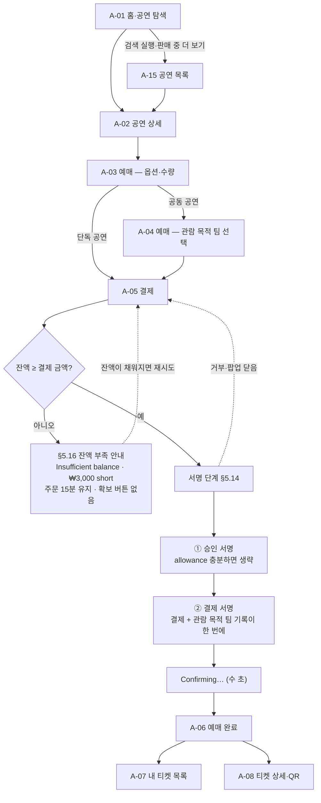
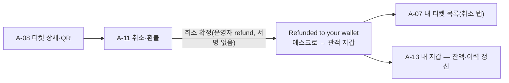
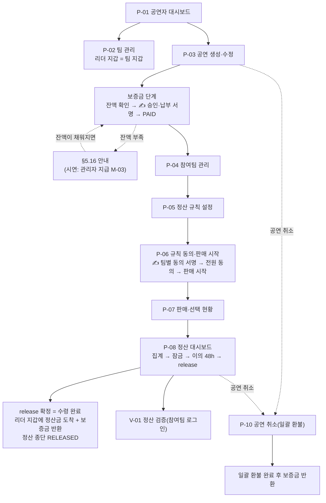
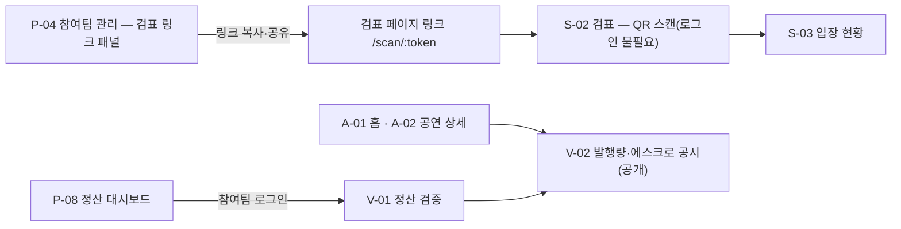
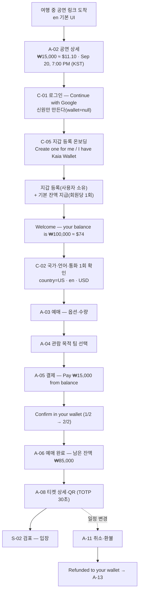
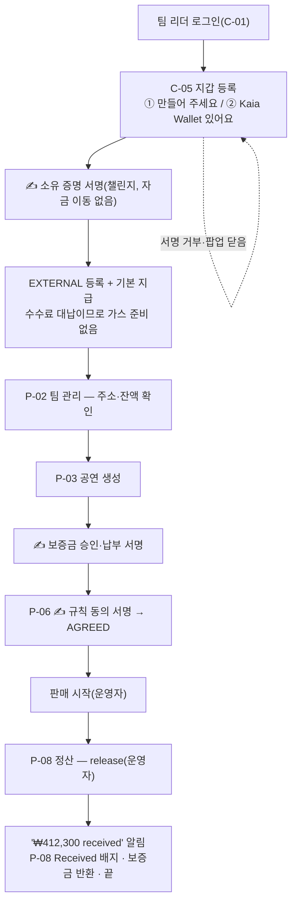

# 화면설계 v6 (구조·흐름·컴포넌트 + 레이아웃·반응형)

> 대상: S15P21B204 · 작성 2026-08-28(금) · **개정 2026-09-03(목) · 기준: [00_v6_변경계획_v1.md](./00_v6_변경계획_v1.md)(§A `HALTED` · §B 양도 제외 · §B″ 지갑 등록 분리 · §D 레이아웃·반응형)** · 상태: 초안 · 참조: [06_방향전환_코인전환_v2.md](../planning/06_방향전환_코인전환_v2.md) · [00_설계문서_작성계획_v1.md](./00_설계문서_작성계획_v1.md) §1.6 · [API 공통 응답 규격 v3](./01_API_공통_응답_규격.md) · [개발 컨벤션](./02_개발_컨벤션.md) · 이전 버전: [화면설계 v5](./07_화면설계_v5.md) · [화면설계 v4](./07_화면설계_v4.md) · [화면설계 v3](./07_화면설계_v3.md)
>
> 표기 — **[팀]** 팀 결정 / **[권]** 권고안(이견 시 변경) / **P1·P2** MVP 제외. 화면 ID·화면명·라우트는 결정 문서 v2 §10, 상태값은 §7, API 경로는 §9를 그대로 쓴다.
>
> **v6에서 다루는 범위 — 레이아웃이 들어왔다.** v1~v5는 "디자인 제외, 구조·흐름·컴포넌트만"이었다. v6부터는 **화면별 배치와 반응형 규칙까지 이 문서가 정한다**(§1.5·§1.6·§5.17~§5.21, 각 화면 절의 **레이아웃** 항목). 여전히 다루지 않는 것은 색·타이포·아이콘 모양·간격 수치·이미지·모션·비주얼 톤이며, **ASCII 와이어프레임 금지 규칙은 그대로 유지한다** — 레이아웃은 그림이 아니라 **문장으로** 기술한다.
>
> **용어 한 가지** — v4까지 UI 요소를 부르던 "카·드"라는 낱말은 이 세계에 존재하지 않는 결제 수단을 연상시키므로 문서 전체에서 쓰지 않는다. 같은 뜻의 UI 요소는 **패널**이라고 부른다(§7.5).
>
> **확정 화면 수** — **33개**(C 5 · A **12** · P 9 · S 2 · V **3** · M 2). v6의 확정 화면 31개에 **V-03 정산 공유(공개)**와 Figma 와이어프레임에서 분리된 **A-15 공연 목록**을 추가했다. **A-09·A-10은 결번으로 두고 나머지 화면 ID는 그대로 유지한다.**

> **정정(2026-09-07)** — 설계 문서 정합성 리뷰 반영.

| 위치 | 원문 | 정정 | 근거 |
|------|------|------|------|
| P-04 컴포넌트 표 "검표 페이지 링크 패널" 행 연결 API | `GET /api/v1/performances/{performanceId}` | `GET /api/v1/performances/{performanceId}/entry-link` | API-performance-10(검표 페이지 링크 조회) |
| §7.1 체크리스트 P-01 행 API 번호 | `performance-04` | `performance-06`(`GET /performances/me`) | 본문 "참여 공연 목록"·"할 일 배너" 컴포넌트의 연결 API 경로 |
| §7.1 체크리스트 P-03 행 API 번호 | `performance-01·05·06·13·14` | `performance-01·03·04·05·13·14` | 본문 컴포넌트 표: 01(생성)·04(PATCH 수정)·05(옵션)·03(GET 상세, 보증금 패널)·13·14(보증금 서명) |
| §7.1 체크리스트 P-04 행 API 번호 | `performance-07·08·09·03` | `performance-03·07·08·09·10` | 위 검표 링크 패널 정정 반영 + 지갑 미등록 경고(03) |
| §7.1 체크리스트 P-07 행 API 번호 | `performance-10` | `performance-11`(`GET .../sales`) | API-performance-10은 검표 링크, 판매·선택 현황은 API-performance-11 |
| §7.1 체크리스트 P-10 행 API 번호 | `performance-11` | `performance-12`(`POST .../cancel`) | 본문 "취소 확정 버튼" 연결 API 경로 |

---

## 0. 변경 이력

| 버전     | 날짜             | 작성       | 내용                                                                                                                                                                                                                                                                                                                                                                                                                                                                                                                                                                                                                                                                                   |
| ------ | -------------- | -------- | ------------------------------------------------------------------------------------------------------------------------------------------------------------------------------------------------------------------------------------------------------------------------------------------------------------------------------------------------------------------------------------------------------------------------------------------------------------------------------------------------------------------------------------------------------------------------------------------------------------------------------------------------------------------------------------ |
| v1     | 2026-08-28     | B204     | 최초 작성 — 화면 34개 명세(IA·흐름도·화면별 컴포넌트·공통 컴포넌트·검수표)                                                                                                                                                                                                                                                                                                                                                                                                                                                                                                                                                                                                                                       |
| v2     | 2026-08-31     | B204     | 요구사항 v2 반영 — 검표 링크 토큰화(S-01 삭제), 정산 공식 2단계, OAuth P0 승격, V-01 참여팀 전용화, 관리자 화면 최소화, 체인 Kaia Kairos 전환. 30개                                                                                                                                                                                                                                                                                                                                                                                                                                                                                                                                                                            |
| v3     | 2026-09-01     | B204     | ERD v2 반영 — 팀원·초대 UI 삭제, 정산 2단계 비율(fixed/selection/team_share), 정산 공유 링크, QR TOTP, "리더" 용어 통일, Refund 상태 배지. 30개                                                                                                                                                                                                                                                                                                                                                                                                                                                                                                                                                                     |
| v4     | 2026-09-02 오전  | B204     | 방향 전환 v1 반영 — 전부 코인 결제, 외국인 관객 타깃(en 기본·환산 병기·KST 병기), 비수탁 지갑(Web3Auth 3종), 사용자 서명 UX, 하단 탭 5개, §5.10~§5.15 신설. 35개                                                                                                                                                                                                                                                                                                                                                                                                                                                                                                                                                                  |
| v5     | 2026-09-02 오후  | B204     | **방향 전환 v2 반영(결정 문서 v2 §10)** — ① **화폐가 코인인 세계**: 법정화폐 입출구 화면이 전부 사라졌다. 코인은 **가입 시 기본 지급 + 관리자 추가 지급**으로만 생기고, 팀은 `release`로 지갑에 받으면 그것으로 끝난다 ② **삭제 2개** — A-14, P-09 ③ **개편 2개** — V-02(발행량·에스크로 공시), M-03(표시 환율·코인 지급) ④ **변경 10개** — C-01(첫 로그인 기본 잔액 안내), C-03·A-13(계좌·확보 진입 삭제), A-05(잔액 결제 단일 경로 + 서명 2단계), A-11·A-12, P-01·P-02(계좌 항목 삭제), P-08(수령 완료가 종단), V-01(예치 대비 언급 삭제·불변식 4 대사) ⑤ **공통 컴포넌트** — §5.12 삭제, §5.14 수정(수수료 대납), **§5.16 잔액 부족 안내 신설** ⑥ 9/2 팀 결정(Web3Auth 단일·외부 지갑 = Kaia Wallet·수수료 대납·양도 P2·이메일 가입 P1·체인 설정 환경변수)을 상단 노트가 아니라 **본문 규칙으로 확정 반영**. 33개                                                                                                    |
| **v6** | **2026-09-03** | **B204** | **[00_v6_변경계획_v1.md] 반영 — 네 가지** ① **정산 `HALTED` 진입 조건 정정**(§A) — P-08 `HALTED` 표시에 관리자 판정 경로 (b)를 더하고 재개 버튼이 없음을 명시, M-02에는 중단 버튼을 신설하지 않고 기존 공연 취소 경로를 재사용한다는 비고 추가. 상태값·API 변경 없음 ② **양도(선물) 기능 삭제**(§B) — A-09·A-10 화면 2개와 흐름도 ②를 삭제하고 **결번 유지**(재번호 금지), 티켓 상태 `TRANSFER_PENDING`·`Transfer` 상태 행·양도 복귀 경로를 전부 제거. **33개 → 31개** ③ **지갑 등록을 로그인에서 분리**(§B″) — C-01은 소셜 3버튼만 남고, **C-05가 전 회원이 거치는 온보딩 필수 단계로 승격**(라우트 `/onboarding/wallet`, 2택 + 자체 챌린지 서명, 환영 카드·기본 지급이 여기로 이동) ④ **반응형 레이아웃 도입**(§D) — 브레이크포인트 768px 1개, PC 최대폭 1200px, **§1.5 레이아웃 원칙 · §1.6 레퍼런스 대조표 · §5.17~§5.21 반응형 공통 규칙** 신설, **31개 화면 전 절에 "레이아웃"(모바일 배치 / PC 배치) 항목 추가**, 하단 탭바 5개 → **4개**. **31개** |
| —      | **2026-09-08**  | **B204** | 코인 개명 KRWS → YoYo (name·symbol "YoYo", 환경변수·산출물 키 YOYO/YoYo, 로직 불변)                                                                                                                                                                                                                                                                                                                                                                                                                                                                                                                                                                                                                       |
| **v6.1** | **2026-09-08** | **B204** | **2026-09-08 팀 결정 반영 — 디자인 정본이 Figma 와이어프레임으로 넘어갔다** ① **정본 전환**(§1.7 신설) — 디자인 정본이 이 문서에서 **Figma 와이어프레임**("Main Page Wireframe Design", TICKR)으로 바뀌었다. 어긋나면 **와이어프레임을 따르고 이 문서를 고친다**(반대로 하지 않는다). 접근성 요건·사용자 환경설정 존중·§1.2 원칙 2·12는 예외로 유지 ② **A-01 배너 → 대표 공연 캐러셀**(와이어프레임 A-01D) — 정적 1장에서 여러 대표 공연을 넘겨보는 커버플로우로 바뀌었다. **자동 슬라이드는 여전히 두지 않는다** ③ **§5.20 카드 그리드 열 수 확대** — ≥1024px **3열 → 4열**(와이어프레임 A-01D 기준), 상한 문구도 "4열 이상 금지"에서 **"5열 이상 금지"로 재조정** ④ **A-01 날짜 필터를 칩(chip)으로** — 폼 필드에서 가로 스크롤 칩 목록으로. 그 밖에 **§5.22 예매 진행 단계 표시(Stepper) 신설**, **A-08 관람 안내 영역 추가**(확인 필요 항목 포함) |
| **v6.2** | **2026-09-09** | **B204** | **V-03 정산 공유(공개) 신설·확정.** API-settlement-07과 P-08의 공유 링크 발급 흐름이 이미 P0 범위인데 공개 조회 엔드포인트에 대응 화면이 없음을 프론트 라우트 정합성 검토에서 확인했다. 별도 기능·API 범위를 늘리지 않고 기존 필수 흐름을 완결하는 화면으로 편입했으며, §4와 API의 연관 화면을 함께 갱신했다. 확정 화면 수 31개 → **32개**. |
| **v6.3** | **2026-09-09** | **B204** | **Figma 와이어프레임 정합성 반영.** 홈의 상태별 요약 섹션과 별개로 전체 검색·필터·정렬·페이지 탐색을 제공하는 **A-15 공연 목록**을 신설했다. 확정 화면 수는 v6.2의 32개 → **33개**다. |
| **v6.4** | **2026-09-17** | **B204** | **스튜디오 진입 정책 명확화.** 로그인 회원은 팀 리더 여부와 무관하게 C-03의 **Studio / 팀·공연 관리**에서 P-01 `/studio`로 진입한다. 팀이 없으면 P-01 빈 상태에서 P-02 팀 생성으로 유도하고, 생성 완료 시 기존 서버 규칙에 따라 자동으로 팀 리더·PERFORMER가 된다. 기존 API·서버 권한 모델은 변경하지 않는다. |

---

## 1. 개요·원칙

### 1.1 이 서비스가 화면에서 지켜야 할 전제

- **화폐가 코인인 미래를 가정한다. 플랫폼은 시연용 코인을 지급할 뿐 발행·상환·준비금의 주체가 아니며, 모든 가치 이동은 지갑 간 온체인 이체다.** 이 한 문장이 v4까지 화면에 있던 법정화폐 입출구(코인 확보 화면·팀 수령 화면·예치 대비 공시)를 전부 대체한다. 관객은 이미 지갑에 ₩를 갖고 있고, 처음 온 사람은 **로그인 직후 지갑 등록 한 단계(C-05)** 를 거치면 그 자리에서 기본 잔액이 들어온다.
- **지갑은 사용자 소유(Web3Auth/Kaia Wallet), 서버는 사용자 키를 보관하지 않는다.** 그래서 값이 움직이는 순간(결제·보증금·규칙 동의)에는 반드시 **사용자 서명 단계**가 화면에 들어간다. 서버가 대신 눌러줄 수 있는 액션은 판매 시작·환불·집계·잠금·release·보증금 반환·시연용 지급뿐이다.
- **잔액이 모자라도 화면은 안내만 한다.** 돈을 더 넣는 경로가 이 세계에는 없다. 부족하면 `Insufficient balance`와 모자란 금액을 보여주고 주문을 15분간 붙잡아 둘 뿐이며, 시연에서는 관리자가 M-03에서 지급해 해결한다(§5.16).
- **탈중앙을 주장하지 않는다.** 정산 흐름은 운영자가 발의하고 사용자가 서명한다. 화면 문구도 그 사실에 맞춘다.
- **가정 기반 시연임을 공개 화면에서 밝힌다.** V-02 하단 고지 문구는 결정 문서 v2 §2.1 그대로 — `Test network (Kaia Kairos). A demo that assumes a future where money is a coin. No real assets, no real currency.` / "테스트넷(Kaia Kairos) 시연입니다. 화폐가 코인인 미래를 가정했으며 실가상자산·실화폐가 아닙니다."

### 1.2 화면 원칙 13개

1. **기준 폭·브레이크포인트**: 모바일 기준 폭은 360px이고 **브레이크포인트는 768px 하나뿐**이다(§1.5). 관객 화면(A·C 접두)은 모바일 우선, 공연자(P)·관리자(M) 화면은 PC 우선이되 양쪽 모두에서 동작해야 한다(웹 전용, 컨벤션 §1). **화면별 배치는 각 절의 "레이아웃" 항목에 적는다.**
2. **블록체인 용어 0**: 관객이 보는 화면(A·C 접두)에는 가스·주소·tx 해시·컨트랙트·토큰·체인·mint라는 단어를 노출하지 않는다. **예외 3가지만 허용한다** — ① **V-01 정산 검증**(참여팀 리더 전용) ② **V-02 발행량·에스크로 공시**(공개) ③ **서명 단계의 한 줄** `Confirm in your wallet` / "지갑에서 확인해 주세요"(§5.14). P·M 접두 화면은 종전대로 전문 용어를 허용한다.
  - A-13의 문서상 화면명은 "내 지갑"이지만 **화면에 실제로 찍히는 라벨은 `Balance` / "잔액"** 이다. C-05는 **지갑을 정하는 단계 자체**이므로 지갑이라는 낱말을 쓴다(전 회원이 한 번 거치는 온보딩이다). 가스·해시·체인은 쓰지 않고 주소는 축약 표기만 쓴다.
3. **금액 표기 (P-22)**: 금액은 **원 값(₩ 정수, 천 단위 구분)을 항상 먼저 쓰고**, 회원의 `display_currency`가 KRW가 아니면 **환산값을 `≈`로 병기**한다(예: `₩15,000 ≈ $11.10`). 환산은 **표시 전용**이며, 결제·환불·정산·분배·지급 요청에 실리는 값은 언제나 원 정수(= YoYo, decimals=0)다. 환산값에는 사용한 환율과 시각을 툴팁으로 붙인다(§5.4).
4. **언어 (P-22·P-23)**: 관객 화면 문구는 **en 기본 + ko 병기**로 설계한다(타깃 = 외국인 관객). 공연자(P)·관리자(M) 화면은 ko. 모든 화면 헤더에서 **언어 스위치(en/ko)**에 닿을 수 있어야 한다(§5.11). 로그인 전에는 브라우저 로케일로 제안하고, 로그인 후에는 `member.locale`을 따른다.
5. **시간 표기 (P-22)**: 공연 일시·마감 시각은 **회원 시간대 기준으로 표시하고 KST를 괄호로 병기**한다(예: `Sep 20, 7:00 PM (KST 19:00)`). 공연은 한국에서 열리므로 KST가 사실상의 기준 시각이다(§5.13).
6. **서명 UX 원칙 (P-18)**: 사용자 서명이 필요한 액션은 ① **지갑 팝업을 띄우기 전에 무엇에 서명하는지 사람이 읽을 수 있는 요약**(금액·대상·건수)을 화면에 먼저 보여주고 ② **사용자가 팝업을 닫거나 거부하면 직전 화면 상태로 그대로 되돌린다**(진행 중이던 주문·요청은 사라지지 않는다) ③ **네트워크 수수료는 플랫폼이 대납하므로 사용자에게 노출하지 않는다** — 사용자 지갑에 KAIA를 넣지 않고, 프론트가 발신자 서명만 하고 서버(운영지갑 = fee payer)가 대납 서명·전송한다 `[팀 9/2]`. 서명은 결제 시 최대 2회(승인 → 결제)이며, 이미 승인이 충분하면 1회로 줄어든다.
7. **하단 탭 4개(모바일 전용)**: 관객 하단 탭은 **홈(A-01) · 내 티켓(A-07) · 잔액(A-13) · 마이(C-03)** 네 개다. v5의 5개에서 **주문내역(A-12)이 탭에서 빠져 마이페이지(C-03) 안의 진입 항목이 됐다** — 탭 4개가 모바일에서 라벨이 잘리지 않는 상한이고, 주문 내역은 티켓·잔액보다 접근 빈도가 낮다. **PC(≥768px)에는 탭바가 없다** — 헤더 내비게이션이 그 역할을 한다(§5.18).
8. **비동기 작업(202) 처리**: `POST`가 `202 + jobId`를 반환하면 화면은 즉시 "처리 중" 상태로 전환하고 `GET /api/v1/chain/jobs/{jobId}`를 폴링해 결과를 반영한다. **사용자 서명 tx도 같다** — 프론트가 발신자 서명을 만든 뒤 `POST …/signed-tx {kind, senderSignedRlp}`로 보고하면 `202 + jobId`가 오고, 서버가 대납 서명·전송·receipt 검증을 마칠 때까지 같은 방식으로 폴링한다 `[팀 9/2]`. 완료 전 이탈 시에도 재진입하면 원본 리소스 조회 API로 최신 상태를 다시 가져온다.
9. **에러 처리**: 모든 실패 응답은 `code`로 분기하고, `msg`는 그대로 토스트에 노출한다(클라이언트는 `msg` 문자열로 분기하지 않는다). 규격 v3에 없는 코드는 §8.2 "규격 v5 신설 제안"에 모아 두었다.
10. **토큰 재발급(전 화면 공통)**: 인증이 필요한 화면 어디서든 `AUTH_TOKEN_EXPIRED`(401)를 받으면 화면 전환 없이 `POST /api/v1/auth/refresh`로 조용히 재발급받아 원요청을 재시도한다. 개별 화면 절에는 반복 기재하지 않는다.
11. **체인·익스플로러**: 모든 tx 링크는 **Kaia Kairos(chainId 1001 = `0x3e9`)** 익스플로러(Kaiascan)를 새 창으로 연다. **체인·컨트랙트 설정은 프론트 환경변수로 고정한다** `[팀 9/2]` — 설정 조회 API는 P1이며 MVP 화면은 이를 호출하지 않는다. **tx 링크는 P·M·V 화면에만 노출한다.**
12. **잔액 부족은 안내만 한다(충전 유도 없음)**: 관객·리더 어느 화면에도 잔액을 늘리는 버튼·탭·링크를 두지 않는다. 부족하면 `Insufficient balance · ₩3,000 short` 형태로 **모자란 금액만** 알리고, 진행 중이던 주문·요청은 유지한다(§5.16). 시연 중 부족은 관리자 지급(M-03)으로 푼다.
13. **가정 기반 시연 고지**: 공개 화면(V-02)과 발표용 진입점에는 §1.1의 고지 문구를 그대로 노출한다. 관객 결제 흐름(A 접두) 안에서는 이 고지를 반복하지 않는다 — 세계관 설명이 예매를 방해하지 않게 한다.

### 1.3 v3·v4에서 그대로 유지되는 규칙

- **검표 화면은 링크 토큰으로 접근한다**: 검표 담당자에게 계정을 만들지 않는다. 공연 생성 시 자동 생성된 공연별 검표 페이지 링크로 `/scan/:token`에 접속하면 로그인 없이 검표 화면이 열린다(SEC-03).
- **검표 판정 피드백**: S-02 QR 스캔 판정은 1초 이내에 색상 표시 + 소리 + 진동으로 알린다(PERF-03·UX-04).
- **V-01 접근 권한**: 정산 검증은 해당 공연의 참여팀 리더만 로그인 후 접근한다(AUDIT-01). 무로그인 공개는 **V-02 발행량·에스크로 공시**만이다.
- **판매 마감과 취소 마감은 다르다**: 취소 마감은 공연일 D-3 00:00, 판매 마감은 공연 시작 1시간 전. 두 시각 사이는 "예매 가능·환불 불가" 구간이므로 A-02·A-03·A-11 문구에서 구분해 표기한다.

### 1.4 본문에 이미 반영된 팀 결정 `[팀 9/2]`

아래는 별도 노트가 아니라 이 문서 전체의 전제다. 각 화면 절은 이미 이 결정을 적용한 상태로 쓰였다.

1. **인증·지갑 = Web3Auth 단일**(구글·페이스북·카카오 3종). 자체 이메일 가입·로그인은 **P1**이며 C-02는 소셜 최초 로그인 1회 확인 폼으로만 동작한다.
2. **외부 지갑은 Kaia Wallet만 MVP** — 수수료 대납 서명을 지원하는 지갑이 그것뿐이다. **등록은 자체 챌린지 서명(API-wallet-03·04, MVP)** 으로 하며 Web3Auth 모달의 외부 지갑 어댑터에 의존하지 않는다 `[사용자 9/3]`. **C-05는 전 회원이 로그인 직후 한 번 거치는 지갑 등록 온보딩이다.**
3. **코인 확보는 시연용 지급뿐** — 가입 시 기본 **100,000 YoYo** 1회 자동, 이후는 관리자(M-03)가 지급한다. 관객 화면에는 확보 경로가 없다.
4. **체인·컨트랙트 설정은 프론트 환경변수 하드코딩**(설정 조회 API는 P1).
5. **기본 언어 en·표시 통화 USD 고정**(국가별 자동 제안 없음, 수동 스위치만).
6. **코인 이름은 티커 `YoYo`만 쓴다.** 관객 화면에는 `₩`만 노출하고 티커도 보이지 않는다.
7. **가스 = Kaia 수수료 대납(fee delegation)** — 사용자 지갑에 KAIA를 넣지 않는다. `signed-tx` 보고 본문은 `{kind, senderSignedRlp}`(발신자 서명 RLP)다.

### 1.5 레이아웃 원칙 **[v6 신설]**

v5까지 이 문서는 배치를 다루지 않았다. v6부터는 **각 화면이 모바일과 PC에서 어떻게 놓이는지**를 문장으로 정한다. 그림(ASCII 와이어프레임)은 여전히 쓰지 않는다.

**① 브레이크포인트는 1개다 — 768px.**

| 구간         | 폭          | 기본 배치                                                                                                               |
| ---------- | ---------- | ------------------------------------------------------------------------------------------------------------------- |
| **모바일**    | &lt; 768px | 1열. **하단 고정 탭바 4개**(§5.18) + 하단 고정 액션 버튼(§5.19). 헤더는 로고 + 검색 아이콘 + 햄버거(§5.17)                                       |
| **태블릿·PC** | ≥ 768px    | **콘텐츠 최대폭 1200px, 화면 중앙 정렬**. 카드 2열(768~1023px) / 4열(≥1024px, **[v6.1]** §5.20). **탭바 없음** — 헤더 내비게이션이 대신한다. 액션 버튼은 본문 또는 우측 패널 안에 둔다 |

- 3~4개 구간은 5주 일정에 과하고 화면마다 검증 부담이 는다. **768px 하나로 고정한다.**
- 1200px는 최대폭이지 고정폭이 아니다. 1200px보다 좁은 창에서는 좌우 여백만 줄고 열 수는 위 표의 규칙을 따른다.
- **모바일에서 가로 스크롤을 만들지 않는다.** 표는 §5.21 규칙대로 항목별 패널로 접는다.

**② 화면군마다 기준 뷰가 다르다.** 아래 기준 뷰가 "정본"이고 반대쪽은 그 변형이다.

| 화면군        | 기준 뷰            | 이유                                                          |
| ---------- | --------------- | ----------------------------------------------------------- |
| **관객 C·A** | **모바일 우선**      | 실제 관객은 공연장에서 폰으로 쓴다. 예매·결제·QR은 모바일 배치가 정본이고 PC는 중앙 정렬 확대판이다 |
| **공연자 P**  | **PC 우선**       | 표·폼이 많다. 모바일에서는 표를 패널로 접는다(§5.21)                           |
| **관리자 M**  | **PC 우선**       | 지급·이의 처리는 운영자가 노트북에서 한다                                     |
| **검표 S**   | **모바일 전용에 가깝다** | 카메라 뷰가 화면 대부분을 차지한다. PC는 같은 1열을 중앙 정렬해 웹캠 검표를 지원하는 수준       |
| **검증 V**   | **PC 우선**       | 심사위원이 노트북으로 본다. 숫자 표가 핵심이다                                  |

**③ 각 화면 절에 "레이아웃" 항목을 둔다.** §4의 33개 화면 절은 전부 `사용자·라우트·진입 경로·목적 → 영역 구성 → **레이아웃** → 컴포넌트 표 → 상태` 순서로 쓰였다. **레이아웃** 항목은 **모바일 배치 1~2문장 + PC 배치 1~2문장**이다.

**④ 저작권 경계** — 레퍼런스에서 가져오는 것은 **레이아웃 관용구**(정보 배치·카드 구성·내비게이션 패턴)뿐이다. 로고·이미지·서체·문구·색상 팔레트는 복제하지 않으며, 목업의 포스터·배너는 자체 더미 이미지를 쓴다.

### 1.6 레퍼런스 대조표 **[v6 신설]**

레퍼런스 2곳 — **NOL 티켓**(`nol.yanolja.com/ticket`)과 **티켓링크**(`ticketlink.co.kr`).

> **티켓링크는 본문을 확인하지 못했다.** 클라이언트 렌더링이라 9/3 조회 시점에 구조를 읽을 수 없었다. **추측으로 채우지 않는다** — 팀이 스크린샷을 공유하면 이 표에 열을 더한다. 아래 "확인된 것" 열은 **전부 NOL 티켓 실측(9/3)** 이다.

| 영역      | NOL 티켓에서 확인된 것                       | 티켓링크    | 우리 적용                                                                     |
| ------- | ------------------------------------ | ------- | ------------------------------------------------------------------------- |
| 헤더      | 로고 + 마이·찜·장바구니·최근 본 상품               | **미확인** | 로고 + 검색 + 언어 스위치 + 로그인/마이. **찜·장바구니·최근 본 상품은 기능 자체가 없어 제외**(D-D3)         |
| 카테고리 내비 | 뮤지컬·콘서트·스포츠 등 10개                    | **미확인** | **두지 않는다**(D-D2) — 인디 공연 단일 도메인이라 빈 카테고리가 생긴다                             |
| 히어로     | 대형 슬라이드 배너(16장)                      | **미확인** | **대표 공연 캐러셀**(자동 슬라이드 없음, **[v6.1]** 와이어프레임 A-01D) + 그 아래 추천 없이 상태별 섹션으로 바로 진입 |
| 섹션 구성   | 오픈 예정 / 장르별 랭킹 / 할인 / 테마 추천          | **미확인** | **오픈 예정 · 판매 중 · 곧 마감 3섹션**. 랭킹·할인은 데이터가 없어 제외                            |
| 공연 카드   | 포스터·공연명·장소·기간·뱃지(좌석우위·단독판매)·오늘/내일 표시 | **미확인** | 포스터·공연명·**출연팀 수**·장소·일시(KST 병기)·가격(₩ + ≈USD)·뱃지(**공동공연**·**마감임박**·**매진**) |
| 푸터      | 파트너 공연장 로고                           | **미확인** | 서비스 고지 + **가정 기반 시연 문구**(§1.1) + 발행량·에스크로 공시(V-02) 링크                     |
| 모바일     | 하단 탭바(홈·찜·마이) + 1컬럼                  | **미확인** | 하단 탭바 **4개**(홈·내 티켓·잔액·마이) + 1컬럼(§5.18)                                   |
| PC      | 카드 3~4열 그리드                          | **미확인** | 카드 **4열**(≥1024px, **[v6.1]** 와이어프레임 A-01D 기준) / **2열**(768~1023px), 콘텐츠 최대폭 1200px(§5.20) |

- **미확인 8칸을 추측으로 메우지 않는다**(D-D5). 스크린샷 확보 후 이 표만 갱신하면 되도록 열을 따로 뒀다.
- **HTML 목업은 이 문서가 확정된 뒤에 만든다**(D-D4). 병행하면 목업이 정본이 되어 문서와 어긋난다.

### 1.7 디자인 정본 우선순위 **[v6.1 신설]**

- **화면의 시각 디자인은 Figma 와이어프레임이 정본이다.** 이 문서는 화면의 목적·영역 구성·데이터·상태·접근성 요건을 정하고, 배치와 시각 표현은 와이어프레임("Main Page Wireframe Design", TICKR — 데스크톱 `A-01D`·`A-02DR`~`A-08DR`)을 따른다.
- **둘이 어긋나면 와이어프레임을 구현하고 이 문서를 고친다. 반대로 하지 않는다.** 지금까지는 이 문서가 정본이고 구현이 뒤따랐지만, 이 절부터는 방향이 바뀐다.
- **예외 — 와이어프레임이 이겨도 유지되는 것**: 접근성 요건(터치 타겟 44px, 색만으로 구분 금지, 키보드 접근), `prefers-reduced-motion` 등 사용자 환경설정 존중, §1.2 원칙 2(관객 화면 블록체인 용어 금지)·원칙 12(잔액 늘리는 버튼 금지). 이것들은 시각 표현이 아니라 제품 규칙이라 와이어프레임이 덮지 않는다.
- 근거: 2026-09-08 팀 결정.

---

## 2. 사용자 유형별 정보 구조(IA)·네비게이션

### GUEST

- **진입점**: 홈(A-01), 공유된 공연 상세 링크(A-02), 로그인(C-01), **발행량·에스크로 공시(V-02, 로그인 불필요)**, 검표 페이지 링크(S-02, 링크 토큰만으로 접근). **정산 검증(V-01)은 GUEST 진입점이 아니다.**
- **네비게이션**: 하단 탭 없음. 상단에 홈 / **언어 스위치(en·ko)** / 로그인만 노출한다.
- **로그인 = 소셜 3버튼**: C-01은 **구글·페이스북·카카오** 버튼 3개가 전부다(외부 지갑으로 들어오는 입구를 로그인 화면에 두지 않는다). 최초 로그인이 곧 가입이며 **여기서는 신원만 만들어진다** — 지갑과 기본 잔액은 바로 다음 단계인 **C-05 지갑 등록**에서 정해진다. 국가·언어·통화는 그 뒤 한 번 확인받는다(C-02 1회 노출).
- **권한 없는 화면 접근**: 로그인이 필요한 화면(예매·결제·내 티켓·내 지갑·마이페이지) 접근 시 C-01로 이동시키고 원래 경로를 저장해 로그인 성공 후 복귀시킨다. 토스트는 `COMMON_UNAUTHORIZED`의 `msg`를 그대로 띄운다.

### AUDIENCE

- **진입점**: 로그인 후 기본 홈(A-01).
- **네비게이션**: **모바일 하단 탭 4개** — 홈(A-01) · 내 티켓(A-07) · **잔액(A-13)** · 마이(C-03). 주문 내역(A-12)은 마이페이지(C-03) 안의 진입 항목이다. **PC(≥768px)에는 탭바가 없고 헤더 내비게이션을 쓴다**(§5.17·§5.18). 예매·결제·취소 흐름은 탭 바 없이 단계형(뒤로가기)으로 진행한다.
- **잔액 접점**: 잔액은 A-13(탭)과 A-05(결제) 두 곳에서 항상 확인할 수 있다. **잔액을 늘리는 화면은 없다** — A-13에도 A-05에도 확보 버튼이 없고, 부족하면 §5.16 안내만 뜬다.
- **설정**: 마이페이지(C-03)에서 **언어·통화 설정(C-04)**과 **지갑(C-05)**으로 들어간다. **C-05는 로그인 직후 전 회원이 한 번 거치는 온보딩 화면이고**, 등록을 마친 뒤 C-03에서 다시 들어오면 같은 라우트가 읽기 전용 확인 패널로 열린다.
- **공연자 전환**: 로그인 회원은 팀 리더 여부와 무관하게 C-03의 **Studio / 팀·공연 관리**에서 P-01에 들어간다. 팀이 없으면 P-01 빈 상태에서 P-02 팀 생성으로 이어지고, 팀 생성 완료 시 기존 서버 규칙에 따라 자동으로 팀 리더·PERFORMER가 된다. 이후 같은 계정이 관객·공연자 역할을 동시에 가진다.
- **권한 없는 화면**: 본인 소유가 아닌 티켓 상세 접근 시 `TICKET_NOT_OWNED`(403) → 목록 복귀 + 토스트.

### PERFORMER (한국인 팀 리더)

- **진입점**: C-03 **Studio / 팀·공연 관리** 또는 로그인 후 `/studio` 직접 진입. 팀이 없는 로그인 회원도 P-01 빈 상태까지 진입할 수 있다.
- **네비게이션**: 데스크톱은 사이드 메뉴 — 대시보드(P-01) · 팀 관리(P-02) · (공연 선택 후) 참여팀·규칙·동의·판매현황·정산(P-03~P-08) · 정산 검증(V-01, 참여팀 전용). 모바일은 상단 드로어 메뉴로 대체한다. **v4의 팀 수령 메뉴(P-09)는 사라졌다** — 정산금은 `release` 시점에 리더 지갑에 이미 들어와 있다.
- **서명이 필요한 지점 2곳**: ① **P-03 보증금 납부**(공연 생성 직후, 규칙 설정 진입 전) ② **P-06 규칙 동의**. 두 곳 모두 §5.14 서명 단계 컴포넌트를 같은 모양으로 쓴다.
- **지갑 = 리더 지갑 = 팀 지갑**: 팀에 별도 지갑을 만들지 않는다. P-02는 리더 지갑의 주소·잔액·익스플로러 링크를 보여준다. **정산 계좌 항목은 삭제됐다** — 이 세계에는 은행이 없고, 코인이 곧 돈이다.
- **권한**: P-01과 P-02 팀 생성 모드는 모든 로그인 회원이 접근할 수 있다. 팀 생성 완료 시 서버가 생성자를 자동으로 팀 리더·PERFORMER로 지정한다(팀원 개념 없음). 그 밖의 팀·공연 관리 기능은 기존 서버 권한을 그대로 따르며, 공연 생성자 전용 기능(공연 수정·참여팀 관리·규칙 설정·판매 시작·집계 확정·잠금·release·공연 취소·보증금)은 다른 참여팀 리더에게 비활성 처리한다.
- **권한 없는 화면**: 자기 팀이 아닌 공연 관리 화면 접근 시 `PERFORMANCE_NOT_OWNER`/`COMMON_FORBIDDEN`(403) → 안내 후 P-01 복귀.

### STAFF (검표 담당자 — 링크 토큰)

- **진입점**: 계정·로그인이 없다. 공연 생성자에게 공유받은 검표 페이지 링크 `/scan/:token`(S-02)이 유일한 진입점이다.
- **네비게이션**: 별도 탭·메뉴 없음. S-02 → S-03(입장 현황)의 단일 목적 흐름만 제공하며, 두 화면 모두 같은 토큰을 라우트에 유지한다.
- **권한 없는 화면**: 토큰이 위조·만료되었거나 다른 공연의 토큰이면 `ENTRY_SCANNER_NOT_AUTHORIZED`(403) → 접근 차단 안내(링크 재요청 안내). 복귀할 목록이 없으므로 홈(A-01) 이동 버튼만 제공한다.

### ADMIN

- **진입점**: 관리자 로그인 후 M-02(이의제기 처리). **MVP 관리자 화면은 M-02·M-03 두 개다.**
- **네비게이션**: 상단에 이의제기(M-02) · **코인 운영(M-03)** 두 항목만 둔다. 대시보드·회원/공연 관리·운영지갑·감사 로그·실패 작업 수동 재처리는 P1로 이관했다(실패한 지급·환불·분배는 시스템이 자동 재시도하고 결정적 실패만 알림).
- **M-03이 하는 일**: ① 표시 환율 등록·이력 확인 ② **시연용 코인 지급**(회원 검색 또는 주소·금액·메모) ③ **지급 이력 확인** ④ **발행량 이상 경고 확인**. 불변식이 깨지면 지급(mint)과 release가 중단되고 이 화면에 중단 상태가 뜬다.
- **권한 없는 화면**: 관리자 권한 없는 계정의 `/admin/*` 접근은 `COMMON_FORBIDDEN`(403) → 홈 또는 로그인으로 리다이렉트.

---

## 3. 화면 흐름도

### ① 관객 예매 — 잔액 결제 + 서명 2단계(부족은 안내 분기)

- 서명을 거부하면 **주문은 `PENDING_PAYMENT`로 15분간 유지되고 잔액은 그대로 남는다**(A-05 상태 절). 돈이 사라지는 경로는 없다.
- 승인·결제 두 서명은 화면상 하나의 진행 표시(1/2 → 2/2)로 묶어 보여준다.
- **부족 분기에 화면 전환이 없다** — 같은 화면에서 안내만 갱신한다.
- 이 흐름은 **지갑 등록(C-05)을 이미 마친 회원**을 전제한다. 지갑이 없는 회원이 예매로 들어오면 로그인 응답의 `wallet`이 `null`이므로 C-05로 먼저 보낸다(흐름 ⑤).

### ② 관객 취소·환불 — 지갑으로 반환

- 환불은 **운영자가 실행**하므로 관객 서명이 없다. 환불 코인은 **관객 지갑으로 돌아와 다음 예매에 그대로 쓰인다**(P-20).

### ③ 공연자 — 공연 생성 → 보증금 서명 → 참여팀 → 규칙 → 동의 서명 → 판매 → 정산 → 수령 완료

- v4에 있던 **팀 수령 화면(P-09)이 사라졌다.** `release`가 리더 지갑으로 코인을 밀어 넣는 순간이 곧 수령 완료이며, 그 뒤에 사용자가 눌러야 할 버튼이 없다.

### ④ 검표(링크 토큰) + 검증

### ⑤ 외국인 관객 end-to-end — 구글 로그인 → 지갑 등록 → 기본 잔액 → 서명 결제 → 입장 → 환불

- 이 흐름 전체에서 관객에게 노출되는 블록체인 어휘는 서명 단계의 `Confirm in your wallet` 한 줄뿐이다(§1.2 원칙 2).
- 국내 계좌·본인인증·휴대폰 인증을 한 번도 요구하지 않는다(P-23). **자국 코인 → YoYo 교환은 여행 전 플랫폼 밖에서 끝난 것으로 가정**하므로 교환 화면도 없다(P2).

### ⑥ 리더 — Kaia Wallet 등록 → 보증금 서명 → 동의 서명 → 정산금 수령

- 지갑 등록은 **회원당 1개**이고, 이미 등록된 지갑이 있으면 `WALLET_ALREADY_LINKED`로 막는다. 지갑 교체는 MVP에서 관리자 처리이며 화면은 P1(§8.1).
- **시연 기본은 데스크톱 브라우저의 Kaia Wallet 확장이다.** 소유 증명은 Web3Auth 모달 어댑터가 아니라 **자체 챌린지 서명**으로 한다 `[사용자 9/3]`. 모바일 외부 지갑은 리허설 후 결정한다.

---

## 4. 화면 명세 (확정 33개)

> **A-09·A-10은 결번이다** — 양도 화면 2개가 v6에서 삭제됐고, 나머지 화면 ID는 그대로 유지한다(재번호하지 않는다). **V-03은 v6.2(2026-09-09)에서 추가한 정산 공유(공개) 화면이고, A-15는 Figma 와이어프레임에서 홈과 별도 화면으로 분리된 공연 목록이다.**
>
> 표기 — 화면명 옆의 **[개편]·[변경]·[유지]·[P1]**는 결정 문서 v2 §10의 처분이며, **[v6 변경]**은 이번 판에서 바뀐 화면이다. 관객 화면(A·C)의 문구는 `en 예시 / ko 병기` 형태로 적었다. 실제 구현은 i18n 키로 관리하고, 이 문서의 문구는 en 원문과 ko 대역의 기준값이다. UI 요소는 모두 **패널**이라고 부른다(문서 상단 "용어 한 가지").

### C-01 로그인 **[v6 변경]**

- 사용자 GUEST / 라우트 `/login` / 진입 경로: 앱 최초 진입 시 로그인 버튼, 권한 없는 화면 접근 리다이렉트 / 목적: **소셜 로그인 3종으로 신원을 만든다.** 지갑과 기본 잔액은 이 화면에서 다루지 않는다.
- **v6 변경 요지** — ① **지갑 등록이 이 화면에서 빠졌다.** 로그인 API는 회원 생성·토큰 발급까지만 하고, 응답의 `wallet`이 `null`이면 화면은 곧바로 **C-05 지갑 등록 온보딩**으로 보낸다 ② v5의 **환영 패널·지급 지연 표시·기본 지급 실패 처리가 전부 C-05로 이동**했다 ③ **외부 지갑으로 들어오는 입구를 로그인 화면에 두지 않는다** — 소셜 버튼 위에 **가입 정보 묶음(국가 선택 + 이용약관·개인정보 동의)**이 있고 그 아래 소셜 3버튼이 전부다 **[2026-09-15 · S15P21B204-105]**. "첫 화면에서 자기 유형을 잘못 고르면 되돌릴 수 없다"는 함정을 없애기 위해서다 `[사용자 9/3]`.

**영역 구성**

- 헤더: 서비스 타이틀, **언어 스위치(en/ko)** · 본문: **가입 정보 묶음**(국가 선택 + 이용약관·개인정보 동의), 소셜 로그인 버튼 3개(구글·페이스북·카카오), 준비 중 표시, 안내 문구 · 하단 고정 액션: 없음(버튼이 본문에 있음)

**레이아웃**

- **모바일(&lt;768px)**: 세로 1열. 서비스 타이틀과 언어 스위치만 둔 얇은 헤더 아래, 소셜 버튼 3개를 화면 중앙에 세로로 쌓고 각 버튼을 폭 100%(좌우 여백 20px)로 둔다. 안내 문구는 버튼 아래 한 줄. **하단 탭바를 노출하지 않는다**(아직 회원이 아니다).
- **PC(≥768px)**: 콘텐츠를 최대폭 400px 카드 한 장으로 묶어 화면 중앙(수직·수평)에 놓고 나머지는 여백으로 둔다. 버튼 폭은 카드 폭에 맞추고 화면 폭을 따라 늘리지 않는다 — 로그인은 넓힐 정보가 없는 화면이다.

**컴포넌트**

| 컴포넌트        | 유형        | 표시 데이터 / 입력 필드                                                                                            | 동작                                                                                                    | 연결 API                                  | 연결 기능        |
| ----------- | --------- | --------------------------------------------------------------------------------------------------------- | ----------------------------------------------------------------------------------------------------- | --------------------------------------- | ------------ |
| 언어 스위치      | 토글(§5.11) | `EN` / `한국어`                                                                                              | 즉시 문구 전환(비로그인은 로컬 저장)                                                                                 | -                                       | 언어·통화 설정     |
| 국가 선택       | 셀렉트       | `Country / 국가` — ISO 3166-1 alpha-2 목록에서 1개                                                             | 고르기 전에는 소셜 버튼 3개가 비활성                                                                                  | POST /api/v1/auth/web3auth(`countryCode`) | Web3Auth 로그인 |
| 이용약관 동의     | 체크박스      | `I agree to the Terms of Use` / "이용약관에 동의합니다"                                                           | 체크 전에는 소셜 버튼 3개가 비활성                                                                                  | POST /api/v1/auth/web3auth(`termsAgreed`) | Web3Auth 로그인 |
| 개인정보 처리방침 동의 | 체크박스      | `I agree to the Privacy Policy` / "개인정보 처리방침에 동의합니다"                                                    | 체크 전에는 소셜 버튼 3개가 비활성                                                                                  | POST /api/v1/auth/web3auth(`privacyAgreed`) | Web3Auth 로그인 |
| 구글 로그인 버튼   | 버튼        | `Continue with Google` / "구글로 계속하기"                                                                       | 소셜 인증 → idToken 확보 → 서버 검증 → 세션 발급 → **응답 `wallet`이 `null`이면 C-05**, 지갑이 있으면 원래 경로 복귀(최초 회원은 C-02 1회) | POST /api/v1/auth/web3auth              | Web3Auth 로그인 |
| 페이스북 로그인 버튼 | 버튼        | `Continue with Facebook` / "페이스북으로 계속하기"                                                                  | 위와 동일                                                                                                 | POST /api/v1/auth/web3auth              | Web3Auth 로그인 |
| 카카오 로그인 버튼  | 버튼        | `Continue with Kakao` / "카카오로 계속하기"                                                                       | 위와 동일                                                                                                 | POST /api/v1/auth/web3auth              | Web3Auth 로그인 |
| 준비 중 표시     | 배지/전체 로딩  | `Setting up your account…` / "계정을 준비하고 있어요…"                                                              | 소셜 콜백 복귀 후 세션 발급까지                                                                                    | POST /api/v1/auth/web3auth(응답 `wallet`) | Web3Auth 로그인 |
| 안내 문구       | 텍스트       | `Signing in creates your account. You'll set up your wallet next.` / "로그인하면 계정이 만들어지고, 다음 단계에서 지갑을 준비해요." | -                                                                                                     | -                                       | -            |

**상태**

- 처리 중: 소셜 콜백 복귀 대기·세션 발급 중에는 전체 화면 로딩, 버튼 전부 비활성
- 에러: `AUTH_WEB3AUTH_TOKEN_INVALID`(§8.2, 잠정 `AUTH_INVALID_CREDENTIALS` 401) — "다시 시도해 주세요" 안내 후 버튼 재활성 / `COMMON_EXTERNAL_SERVICE_ERROR`(502) — 제공자 응답 없음, 다른 제공자 사용 권유 / `COMMON_TOO_MANY_REQUESTS`(429)
- **분기**: 응답 `wallet == null` → **C-05로 강제 이동**(원래 요청 경로는 저장해 두고 등록 완료 후 복귀). `wallet != null` → 최초 회원이면 C-02 1회, 아니면 저장한 경로 또는 홈
- 재로그인에서는 아무 안내도 뜨지 않는다 — 이 화면에는 축하할 사건이 없다
- **[2026-09-15 · S15P21B204-105]** 국가 미선택이거나 약관 2건 중 하나라도 미동의면 **소셜 버튼 3개가 비활성**이다(처리 중 비활성과 별개 조건)

**입력 검증**

- **[2026-09-15 · S15P21B204-105]** 국가 — 목록에 있는 ISO 3166-1 alpha-2 **1개 필수**
- 이용약관·개인정보 처리방침 — **각각 동의 필수**
- 셋이 모두 충족돼야 소셜 버튼이 활성이다. **화면이 값을 대신 채우지 않는다** — 동의는 위조할 수 없고 국가는 P-23 자기 선언이다
- 신규 회원만 실제로 쓰이지만 OAuth 전에는 구분할 수 없어 전원에게 받는다

**모바일·접근성 고려**

- 소셜 버튼은 세로 배치, 터치 타겟 44px. 체크박스·셀렉트도 터치 타겟 44px. 팝업 차단 환경에서는 리다이렉트 방식으로 대체하고 안내를 띄운다

---

### C-02 회원가입(보조) **[P1]**

- 사용자 GUEST / 라우트 `/signup` / 진입 경로: **소셜 최초 로그인 + 지갑 등록(C-05) 직후 1회 자동 노출**(MVP 용도) / 목적: 소셜 최초 로그인 회원에게 **국가·언어·통화·시간대를 한 번 확인받는다.** **[2026-09-15 · S15P21B204-105]** 국가는 C-01에서 이미 받았으므로 여기서는 그 값을 확인·수정하는 자리다.
- **P1 표기 이유** — 이메일 가입·로그인 자체가 P1로 내려갔다 `[팀 9/2]`. MVP에서 이 화면은 **이메일 폼 없이** 국가·언어·통화·시간대 확인 폼으로만 뜬다. 아래 표에서 이메일 관련 컴포넌트는 P1 표기다.

**영역 구성**

- 헤더: 뒤로가기, 언어 스위치 · 본문: 환영 문구 + 국가·언어·통화·시간대 폼, (P1) 이메일·비밀번호·이름 + 약관 동의 · 하단 고정 액션: `Continue` / "계속하기" 버튼

**레이아웃**

- **모바일(&lt;768px)**: 환영 문구 아래 국가·언어·통화·시간대 4개 필드를 1열로 쌓고, `Continue` 버튼은 하단 고정(§5.19). 국가·시간대 선택은 전체 화면 검색 목록으로 띄운다.
- **PC(≥768px)**: 최대폭 480px 폼을 중앙 정렬하고 4개 필드를 2열 × 2행 그리드로 접는다. 표시 통화 안내는 그리드 아래 폭 100%, 버튼은 폼 마지막 줄 오른쪽에 본문 배치한다(하단 고정 아님).

**컴포넌트**

| 컴포넌트               | 유형       | 표시 데이터 / 입력 필드                                                                                                                          | 동작                       | 연결 API                       | 연결 기능         |
| ------------------ | -------- | --------------------------------------------------------------------------------------------------------------------------------------- | ------------------------ | ---------------------------- | ------------- |
| 환영 문구              | 텍스트      | `You're all set — ₩100,000 is in your wallet.` / "준비 끝 — 지갑에 ₩100,000이 있어요."                                                            | 신규 회원에게만                 | GET /api/v1/wallets/me       | 내 지갑 조회       |
| 국가 선택              | 폼 필드(선택) | `Country` / "국가" — ISO 3166-1 alpha-2 목록. **자기 선언이며 증빙을 받지 않는다**                                                                        | 선택 시 언어·통화·시간대 기본값 자동 제안 | PATCH /api/v1/members/me     | 내 정보 수정       |
| 언어 선택              | 폼 필드(선택) | `Language` / "언어" — English(기본) · 한국어                                                                                                   | 즉시 미리보기 전환               | PATCH /api/v1/members/me     | 언어·통화 설정      |
| 표시 통화 선택           | 폼 필드(선택) | `Display currency` / "표시 통화" — USD(기본)·JPY·EUR·KRW                                                                                      | 안내 문구 갱신                 | PATCH /api/v1/members/me     | 언어·통화 설정      |
| 시간대 선택             | 폼 필드(선택) | `Time zone` / "시간대" — IANA. 국가로 기본 제안                                                                                                   | -                        | PATCH /api/v1/members/me     | 언어·통화 설정      |
| 표시 통화 안내           | 텍스트      | `Tickets are priced in Korean won (₩). We show an approximate amount in your currency.` / "티켓 가격은 원(₩) 기준이고, 선택한 통화로 대략의 금액을 함께 보여드려요." | -                        | -                            | -             |
| 이메일·비밀번호·이름 입력(P1) | 폼 필드     | 이메일, 비밀번호 2회, 이름                                                                                                                        | 형식·일치 검증                 | POST /api/v1/auth/signup(P1) | 자체 이메일 가입(P1) |
| 약관 동의 체크박스(P1)     | 폼 필드     | 동의 여부                                                                                                                                   | 필수 체크                    | -                            | -             |
| 계속하기 버튼            | 버튼       | -                                                                                                                                       | 제출 후 복귀 경로 또는 홈 이동       | PATCH /api/v1/members/me     | 내 정보 수정       |

**상태**

- 에러: `COMMON_VALIDATION_FAILED`(400) — 필드별 안내 / (P1) `AUTH_EMAIL_DUPLICATED`(409)
- **복귀 경로**: 로그인 전에 저장해 둔 원래 요청 화면, 없으면 홈(A-01)
- 소셜 최초 로그인 진입: 국가만 미입력이면 저장 버튼 비활성. 나머지는 제안값 그대로 저장 가능. 이 폼은 **회원당 1회만** 뜬다(이후 변경은 C-04)

**입력 검증**

- 국가 필수. **연락처·주민 정보·국내 계좌는 받지 않는다**(P-23)

**모바일·접근성 고려**

- 터치 타겟 44px, 입력 필드별 적절한 키보드 타입. 국가·시간대 선택은 검색 가능한 목록으로 제공한다

---

### C-03 마이페이지 **[변경]**

- 사용자 AUDIENCE·PERFORMER / 라우트 `/me` / 진입 경로: 모바일 하단 탭 "마이", PC 헤더 프로필 메뉴 / 목적: 프로필과 **잔액 요약(₩ + ≈ USD)**을 확인하고, 주문 내역(A-12)·언어·통화 설정(C-04)·지갑(C-05)·**Studio / 팀·공연 관리(P-01)**로 이동한다.
- **v6 변경 요지** — ① 하단 탭이 4개로 줄면서 **주문 내역(A-12) 진입 항목이 이 화면에 들어왔다**(§1.2 원칙 7) ② 지갑 패널은 **등록 여부에 따라 분기**한다 — 미등록이면 "지갑 등록이 필요해요"와 함께 C-05로, 등록됐으면 제공자 배지와 함께 같은 라우트의 읽기 전용 패널로 보낸다.
- v5 변경 요지(유지) — **계좌 항목이 완전히 사라졌다**(이 세계에는 은행이 없다). 잔액 요약 패널에서 **잔액을 늘리는 버튼도 사라졌다** — 탭하면 A-13으로만 이동한다.

**영역 구성**

- 헤더: 타이틀, 언어 스위치 · 본문: 프로필 패널, **잔액 요약 패널(§5.10)**, 주문 내역 진입 패널, 언어·통화 설정 진입 패널, 지갑 패널, **Studio / 팀·공연 관리 진입 패널**, (P1) 관람 기록 패널 · 하단 고정 액션: 로그아웃 버튼

**레이아웃**

- **모바일(&lt;768px)**: 패널을 1열로 세로 나열한다(프로필 → 잔액 요약 → 주문 내역 → 언어·통화 → 지갑 → **Studio / 팀·공연 관리**). 하단 탭바 4개가 떠 있으므로 **로그아웃은 하단 고정이 아니라 목록 맨 아래 본문 배치**한다(탭바와 겹치지 않게).
- **PC(≥768px)**: 최대폭 1200px 안에서 좌측 320px에 프로필·잔액 요약을 고정하고, 우측에 진입 패널 4개를 2열 그리드로 편다. 로그아웃은 우측 그리드 아래 오른쪽 정렬. 탭바 없음.

**컴포넌트**

| 컴포넌트         | 유형         | 표시 데이터 / 입력 필드                                                                             | 동작                          | 연결 API                                          | 연결 기능              |
| ------------ | ---------- | ------------------------------------------------------------------------------------------ | --------------------------- | ----------------------------------------------- | ------------------ |
| 프로필 패널       | 패널         | 이름·이메일·로그인 제공자 표시(`Signed in with Google` / "구글로 로그인")                                     | 이름 수정 진입                    | GET /api/v1/members/me                          | 내 정보 조회            |
| 프로필 수정 폼     | 폼 필드(바텀시트) | 이름                                                                                         | 저장                          | PATCH /api/v1/members/me                        | 내 정보 수정            |
| 잔액 요약 패널     | 패널(§5.10)  | `Balance ₩85,000 ≈ $63.00` / "잔액 ₩85,000 ≈ $63.00", **제공자 배지(§5.15)**                      | 탭 시 A-13 이동. **액션 버튼 없음**   | GET /api/v1/wallets/me · GET /api/v1/coin/rates | 내 지갑 조회 / 표시 환율 조회 |
| 언어·통화 설정 패널  | 패널         | 현재 언어·표시 통화·시간대 요약                                                                         | 탭 시 C-04 이동                 | GET /api/v1/members/me                          | 내 정보 조회            |
| 주문 내역 진입 패널  | 패널         | `Orders` / "주문 내역" + 최근 주문 1건 요약                                                           | 탭 시 A-12 이동                 | GET /api/v1/orders/me                           | 내 주문 목록 조회         |
| 지갑 패널        | 패널         | 등록됨: `Wallet ready` / "지갑 준비됨" + 제공자 배지(§5.15) · 미등록: `Set up your wallet` / "지갑 등록이 필요해요" | 탭 시 C-05 이동(등록됨이면 읽기 전용 패널) | GET /api/v1/wallets/me                          | 내 지갑 조회            |
| Studio / 팀·공연 관리 진입 패널 | 패널         | `Studio` / "팀·공연 관리"                                                                      | P-01 이동(로그인 회원에게 항상 노출)       | GET /api/v1/teams/me                            | 내 팀 목록 조회          |
| 관람 기록 패널(P1) | 패널         | -                                                                                          | -                           | -                                               | 관람 기록(P1)          |
| 로그아웃 버튼      | 버튼         | `Sign out` / "로그아웃"                                                                        | 세션 종료 후 A-01 이동             | POST /api/v1/auth/logout                        | 로그아웃               |

**상태**

- 로딩: 스켈레톤 패널 / 잔액 조회 실패: 잔액 자리에 `—`와 "다시 시도" 링크(다른 패널은 정상 표시) / 에러: `COMMON_UNAUTHORIZED`(401) → C-01 이동

**입력 검증**

- 이름 1~50자

**모바일·접근성 고려**

- 터치 타겟 44px. 잔액은 색이 아니라 금액 문자열로 읽히게 하고, 환산값은 보조 텍스트 위계로 둔다

---

### C-04 언어·통화 설정 **[유지]**

- 사용자 회원 / 라우트 `/me/preferences` / 진입 경로: C-03 언어·통화 설정 패널, 헤더 언어 스위치의 "더 보기" / 목적: **언어(locale)·표시 통화(display_currency)·시간대(timezone)**를 바꾼다.
- v4와 구조가 같다. 환산 고지 문구에서 "충전"이라는 낱말만 빠졌다.

**영역 구성**

- 헤더: 뒤로가기, 타이틀 `Language & currency` / "언어·통화" · 본문: 언어 선택, 표시 통화 선택, 시간대 선택, 미리보기 패널, 환산 고지 · 하단 고정 액션: `Save` / "저장" 버튼

**레이아웃**

- **모바일(&lt;768px)**: 언어·표시 통화·시간대 선택을 1열로 쌓고 미리보기 패널을 그 아래에 붙인다. `Save`는 하단 고정.
- **PC(≥768px)**: 최대폭 800px 2열 — 좌측 480px에 선택 필드, 우측 280px에 미리보기 패널을 고정해 **선택과 결과를 나란히** 보게 한다. 저장 버튼은 좌측 열 마지막 줄 오른쪽.

**컴포넌트**

| 컴포넌트     | 유형        | 표시 데이터 / 입력 필드                                                                                                                                             | 동작                  | 연결 API                                            | 연결 기능               |
| -------- | --------- | ---------------------------------------------------------------------------------------------------------------------------------------------------------- | ------------------- | ------------------------------------------------- | ------------------- |
| 언어 선택    | 폼 필드(라디오) | English / 한국어                                                                                                                                              | 선택 즉시 화면 문구 미리보기 전환 | PATCH /api/v1/members/me                          | 언어·통화 설정            |
| 표시 통화 선택 | 폼 필드(선택)  | USD(기본)·JPY·EUR·KRW                                                                                                                                        | 선택 시 미리보기 금액 재환산    | PATCH /api/v1/members/me · GET /api/v1/coin/rates | 언어·통화 설정 / 표시 환율 조회 |
| 시간대 선택   | 폼 필드(선택)  | IANA 시간대(검색 가능)                                                                                                                                            | 선택 시 미리보기 시각 갱신     | PATCH /api/v1/members/me                          | 언어·통화 설정            |
| 미리보기 패널  | 패널        | `₩15,000 ≈ $11.10` · `Sep 20, 7:00 PM (KST 19:00)`                                                                                                         | 선택값에 따라 실시간 갱신      | GET /api/v1/coin/rates                            | 표시 환율 조회            |
| 환산 고지    | 텍스트       | `Converted amounts are for reference only. All payments, refunds and settlements are in Korean won.` / "환산 금액은 참고용이며, 결제·환불·정산은 모두 원 기준이에요." + 적용 환율·기준 시각 | -                   | GET /api/v1/coin/rates                            | 표시 환율 조회            |
| 저장 버튼    | 버튼        | -                                                                                                                                                          | 저장 후 이전 화면 복귀 + 토스트 | PATCH /api/v1/members/me                          | 언어·통화 설정            |

**상태**

- 로딩: 환율 조회 중에는 환산값 자리에 스켈레톤. **환율 조회에 실패해도 원 값은 항상 그대로 보여준다**
- 에러: `COMMON_VALIDATION_FAILED`(400) — 지원하지 않는 통화·시간대 / `COMMON_UNAUTHORIZED`(401) → C-01
- 저장 성공: 전 화면 문구·금액 표기가 즉시 갱신된다(재로그인 불필요)

**입력 검증**

- 표시 통화는 `exchange_rate`에 등록된 pair만 선택 가능. 등록되지 않은 통화는 목록에 노출하지 않는다

**모바일·접근성 고려**

- 언어 전환 시 화면 전체 리렌더가 아니라 문구만 교체해 스크롤 위치를 유지한다. 터치 타겟 44px

---

### C-05 지갑 등록 **[v6 변경 — 온보딩 필수 단계로 승격]**

- 사용자 회원 / 라우트 `/onboarding/wallet` / 진입 경로: **로그인 응답의 `wallet`이 `null`이면 자동 진입**(C-01 직후), C-03 지갑 패널 / 목적: 회원이 쓸 지갑을 첫 1회 정하고 등록해 기본 잔액을 받는다.
- **v6 변경 요지** — ① v5의 "이미 지갑이 있는 사람만 오는 화면"에서 **전 회원이 한 번 거치는 온보딩**으로 바뀌었다 ② 연결 수단이 Web3Auth 모달 어댑터에서 **자체 챌린지 서명**(API-wallet-03·04, MVP 승격)으로 바뀌었다 ③ C-01에 있던 **환영 카드·지급 지연 표시·기본 지급 실패 처리가 이 화면으로 이동**했다 ④ 라우트가 `/me/wallet/link` → **`/onboarding/wallet**` 으로 바뀌었다(홈에 닿기 전 거치는 온보딩이므로 `/me/*` 규칙에 맞지 않는다).
- 이 화면은 §1.2 원칙 2의 예외다 — **지갑을 정하는 단계 자체이므로 "지갑"이라는 낱말을 쓴다.** 가스·해시·체인은 쓰지 않고 주소는 축약해 보여준다.

**영역 구성**

- 헤더: 타이틀 `Set up your wallet` / "지갑 준비" · 본문: (선택) 2택 카드 / (진행) 단계 표시·서명 요약 / (완료) 환영 카드 · 하단 고정 액션: 선택 확정 버튼

**레이아웃**

- **모바일(&lt;768px)**: 전체 화면 온보딩이다. 안내 문구 아래 2택 카드를 세로로 쌓고(각 카드 폭 100%), 단계 표시는 헤더 바로 아래 고정, 완료 시 환영 카드가 화면 중앙을 차지한다. **하단 탭바와 헤더 내비를 숨겨 이탈 경로를 만들지 않는다** — 등록을 마쳐야 나가는 화면이다.
- **PC(≥768px)**: 최대폭 520px 카드 한 장을 화면 중앙(수직·수평)에 놓고, 2택은 그 안에서 좌우 2열로 나란히 배치한다. 단계 표시는 카드 상단, 서명 요약은 선택한 카드 아래에 펼친다.

**컴포넌트**

| 컴포넌트          | 유형              | 표시 데이터 / 입력 필드                                                                                           | 동작                                       | 연결 API                                                | 연결 기능                  |
| ------------- | --------------- | -------------------------------------------------------------------------------------------------------- | ---------------------------------------- | ----------------------------------------------------- | ---------------------- |
| 안내 문구         | 텍스트             | `Do you already have a wallet?` / "이미 지갑이 있으신가요?"                                                        | -                                        | -                                                     | -                      |
| 선택 카드 ①       | 카드 버튼           | `Create one for me` / "만들어 주세요" — `Recommended` 배지                                                       | 탭 시 `provider=WEB3AUTH`로 등록 요청           | POST /api/v1/wallets                                  | 지갑 등록(첫 1회 선택)         |
| 선택 카드 ②       | 카드 버튼           | `I have Kaia Wallet` / "Kaia Wallet이 있어요"                                                                | 탭 시 챌린지 발급 → 지갑 서명 요청                    | POST /api/v1/wallets/challenge → POST /api/v1/wallets | 지갑 등록(첫 1회 선택)         |
| 미설치 안내(②)     | 텍스트·링크          | 지갑이 감지되지 않으면 설치 링크 + ①로 유도                                                                               | -                                        | -                                                     | -                      |
| 단계 표시(②)      | 진행 인디케이터(§5.14) | `1 Choose → 2 Sign in your wallet → 3 Done` / "1 선택 → 2 지갑에서 서명 → 3 완료"                                  | 단계 완료 시 자동 진행                            | -                                                     | -                      |
| 서명 요약(②)      | 패널(§5.14)       | `You are proving you own this wallet. No funds move.` / "이 지갑이 본인 것임을 확인하는 서명이에요. 자금은 이동하지 않아요." + 축약 주소 | 팝업 전에 항상 먼저 보여준다                         | -                                                     | -                      |
| 준비 중 표시       | 배지/로딩           | `Setting up your wallet…` / "지갑을 준비하고 있어요…"                                                              | 202 접수 후 폴링                              | GET /api/v1/chain/jobs/{jobId}                        | 비동기 작업 상태 조회           |
| **환영 카드**     | 패널              | `Welcome — your balance is ₩100,000 (≈ $74)` / "환영합니다 — 잔액 ₩100,000(≈ $74)" + 제공자 배지(§5.15)              | 확인 시 홈(A-01) 또는 원래 요청 화면(최초 회원은 C-02 1회) | GET /api/v1/wallets/me · GET /api/v1/coin/rates       | 지갑 등록·기본 지급 / 표시 환율 조회 |
| 지급 지연 표시      | 텍스트             | `Almost there…` / "거의 다 됐어요…" — 지급 job이 아직 `CONFIRMED`가 아닐 때                                             | 폴링. 지연돼도 원인(체인 처리)을 노출하지 않는다             | GET /api/v1/chain/jobs/{jobId}                        | 비동기 작업 상태 조회           |
| 연결 정보 패널(등록됨) | 패널              | 제공자 배지(§5.15), 축약 주소, 등록 시각(회원 시간대 + KST)                                                                | 읽기 전용                                    | GET /api/v1/wallets/me                                | 내 지갑 조회                |
| 교체 안내(등록됨)    | 텍스트             | `To change your wallet, contact support.` / "지갑을 바꾸려면 고객센터로 문의해 주세요." — 교체 화면은 P1                        | -                                        | -                                                     | -                      |

**상태**

- 처리 중: 선택·서명·등록 각 단계에서 버튼 비활성 + 단계 표시 갱신
- 에러: `WALLET_ALREADY_LINKED`(§8.2, 잠정 `COMMON_CONFLICT` 409) — 연결 정보 패널로 전환 / `WALLET_CHALLENGE_EXPIRED`(§8.2, 잠정 `COMMON_CONFLICT` 409) — "다시 시작해 주세요" + 1단계 복귀 / `WALLET_SIGNATURE_INVALID`(§8.2, 잠정 `COMMON_VALIDATION_FAILED` 400) — "다른 지갑으로 서명했을 수 있어요" + 재시도 / `COMMON_EXTERNAL_SERVICE_ERROR`(502)
- **서명 거부**: 지갑 팝업을 닫으면 에러 화면을 띄우지 않고 **1단계 선택 상태로 조용히 복귀**한다(§1.2 원칙 6). 등록 전이므로 되돌려도 부작용이 없다
- **기본 지급 실패**: 지갑 등록은 성공으로 두고 환영 카드의 금액 자리에 `—`와 "잠시 후 다시 확인해 주세요"를 표시한다. 지급 job은 서버가 재시도하고 관리자가 M-03에서 복구한다
- 재로그인·이미 등록된 회원: 이 화면에 자동 진입하지 않는다(C-03에서 확인만)

**입력 검증**

- 회원당 지갑 1개. 두 갈래는 요청 본문 `provider`로만 나뉘며 화면·엔드포인트는 하나다

**모바일·접근성 고려**

- 2택 카드는 터치 타겟 44px 이상, `Recommended` 배지는 색이 아니라 문구로도 읽히게 한다. 시연 기준은 데스크톱 브라우저의 확장 지갑이며, 모바일에서 ②를 골랐는데 지갑이 감지되지 않으면 ①로 안내한다

---

### A-01 홈·공연 탐색 **[v6 변경 — 레이아웃 확정]**

- 사용자 GUEST·AUDIENCE / 라우트 `/` / 진입 경로: 앱 최초 진입, 모바일 하단 탭 "홈", PC 헤더 로고 / 목적: 판매 중 공연을 탐색한다.
- **v6 변경 요지** — 이 화면이 v6 레이아웃 작업의 기준점이다. ① **배너 1장 + 상태별 3섹션**(오픈 예정 · 판매 중 · 곧 마감) 구조를 확정했다 ② **장르 카테고리 내비게이션을 두지 않는다**(D-D2) — 인디 공연 단일 도메인이고 MVP 데이터가 적어 빈 카테고리가 생긴다 ③ **찜·장바구니·최근 본 상품을 두지 않는다**(D-D3) — 기능 자체가 없다 ④ **공연 카드의 표시 항목을 고정**했다(§1.6 대조표) ⑤ 랭킹·할인 섹션은 데이터가 없어 제외한다 ⑥ **[v6.1]** 배너 1장이 대표 공연 캐러셀로 바뀌었다(와이어프레임 A-01D). 자동 슬라이드는 여전히 두지 않는다.
- v5 변경 요지(유지) — 하단 공개 링크가 **발행량·에스크로 공시(V-02)**다.

**영역 구성**

- 헤더(§5.17): 로고, 검색, **언어 스위치**, 로그인 버튼(GUEST) 또는 프로필(AUDIENCE) · 본문: **대표 공연 캐러셀**, 날짜 필터 칩, **상태별 3섹션**(제목 + 공연 카드 그리드, **판매 중 섹션만 `더 보기` 제공**), 하단 공시 링크, 푸터 · 하단 고정 액션: 없음(모바일은 하단 탭바 4개, PC는 없음). 검색 실행과 판매 중 섹션의 `더 보기`는 **A-15 공연 목록**으로 이동한다.

**레이아웃**

- **모바일(&lt;768px)**: 헤더는 로고 + 검색 아이콘 + 햄버거 1줄. 그 아래 **대표 공연 캐러셀**을 두는데, 중앙 카드 320×480 크기로 화면 중앙에 놓고 좌우 카드는 82% 크기로 화면 양옆에 걸쳐 보인다(커버플로우). 그 아래 세 섹션을 세로로 이어 붙인다. 각 섹션은 **카드 1열**(포스터를 카드 좌측 40% 폭 썸네일로 두고 우측에 텍스트를 쌓는 가로형 카드)이며 섹션당 최대 5장을 노출한다. **판매 중 섹션에만 "더 보기"를 둔다.** 하단 탭바 4개가 항상 떠 있다.
- **PC(≥768px)**: 콘텐츠 최대폭 1200px 중앙 정렬. 헤더는 로고 + 검색바 + 내비 + 로그인 1줄. **대표 공연 캐러셀**은 중앙 카드 320×480 + 좌우 카드 82% 크기로 걸쳐 보이는 커버플로우를 1200px 폭 안에 중앙 정렬한다. 각 섹션은 제목 한 줄 뒤에 **카드 4열(≥1024px) / 2열(768~1023px)** 그리드(포스터를 위, 텍스트를 아래에 두는 세로형 카드)로 최대 6장까지 편다(§5.20). **판매 중 섹션만 제목 우측에 "더 보기"를 둔다.** 탭바 없음.

**컴포넌트**

| 컴포넌트           | 유형              | 표시 데이터 / 입력 필드                                                                                    | 동작          | 연결 API                                            | 연결 기능               |
| -------------- | --------------- | ------------------------------------------------------------------------------------------------- | ----------- | ------------------------------------------------- | ------------------- |
| **대표 공연 캐러셀** | 이미지·링크          | 대표 공연 **여러 건**의 포스터·공연명·일시·장소(KST 병기) — **중앙 카드 + 좌우에 걸쳐 보이는 커버플로우, 자동 슬라이드 없음**(와이어프레임 원본에도 타이머가 없고 WCAG 2.2.2 "움직이는 콘텐츠 제어"와도 같은 방향) | 화살표·점·좌우 화살표 키로 이동, 중앙 카드 탭 시 A-02 | GET /api/v1/performances                          | 공연 목록 조회            |
| 검색 입력          | 폼 필드            | `Search shows` / "공연 검색" — 모바일은 아이콘 탭 시 전체 폭으로 펼침                                                 | 검색 실행 시 `keyword`를 담아 A-15로 이동 | GET /api/v1/performances                          | 공연 목록 조회            |
| 날짜 필터          | 칩(chip) 목록       | `Any date · This week · Next week` / "언제나 · 이번 주 · 다음 주" + 이후 월 단위 칩 — 가로 스크롤 한 줄, 선택은 배경색으로만 표시(테두리 두께 불변) | 목록 필터링      | GET /api/v1/performances                          | 공연 목록 조회            |
| **섹션 ① 오픈 예정** | 섹션(제목 + 카드 그리드) | `Opening soon` / "오픈 예정" — 판매 시작 전(`DRAFT`·`PENDING_AGREEMENT` 중 판매 예정일이 잡힌 공연)                   | 카드 탭 시 A-02, `더 보기` 없음(API-performance-02 미지원) | GET /api/v1/performances                          | 공연 목록 조회            |
| **섹션 ② 판매 중**  | 섹션(제목 + 카드 그리드) | `On sale` / "판매 중" — `ON_SALE`. **기본으로 가장 크게 노출한다**                                               | 카드 탭 시 A-02, `더 보기`는 `/performances?status=ON_SALE` | GET /api/v1/performances                          | 공연 목록 조회            |
| **섹션 ③ 곧 마감**  | 섹션(제목 + 카드 그리드) | `Closing soon` / "곧 마감" — 판매 마감(공연 시작 1시간 전)까지 48시간 이내이거나 잔여 10% 이하                               | 카드 탭 시 A-02, `더 보기` 없음(API에 전용 조건 없음) | GET /api/v1/performances · GET /api/v1/coin/rates | 공연 목록 조회 / 표시 환율 조회 |
| **공연 카드**      | 카드              | **포스터 · 공연명 · 출연팀 수(`3 bands` / "3팀") · 장소 · 일시(회원 시간대 + KST 병기) · 최저가 `₩15,000 ≈ $11.10` · 뱃지**  | 탭 시 A-02 이동 | GET /api/v1/performances · GET /api/v1/coin/rates | 공연 목록 조회 / 표시 환율 조회 |
| 카드 뱃지          | 배지              | `Joint show` / "공동공연"(참여팀 2팀 이상) · `Closing soon` / "마감 임박" · `Sold out` / "매진" — **최대 2개까지만 노출** | -           | GET /api/v1/performances                          | 공연 목록 조회            |
| 공시 링크          | 버튼              | `How the money is tracked` / "돈이 어떻게 추적되나요"                                                       | V-02 이동     | -                                                 | 발행량·에스크로 공시 조회      |
| 푸터             | 영역              | 서비스 고지 + **§1.1 가정 기반 시연 문구** + 공시(V-02) 링크. **파트너 로고·제휴 영역은 두지 않는다**                             | -           | -                                                 | -                   |
| 빈 상태 안내        | 텍스트             | `No shows match your filters.` / "조건에 맞는 공연이 없습니다"                                                | 필터 초기화      | -                                                 | -                   |

**상태**

- 로딩: 섹션별 스켈레톤 카드 / 빈: 섹션에 공연이 없으면 **섹션 자체를 감춘다**(빈 섹션을 남기지 않는다). 세 섹션이 모두 비면 화면 전체 빈 상태 안내 / 에러: `COMMON_INTERNAL_ERROR`(500) — 토스트 + 재시도
- 환율 조회 실패: 환산값만 숨기고 원 값은 그대로 표시한다(§5.4)

**모바일·접근성 고려**

- 카드 전체가 탭 타겟이며 높이는 44px 이상. 뱃지는 색이 아니라 문구로 읽히게 한다. 언어 스위치는 헤더에서 2탭 이내

---

### A-02 공연 상세 **[유지]**

- 사용자 GUEST·AUDIENCE / 라우트 `/performances/:id` / 진입 경로: A-01 패널 탭, 공유 링크 / 목적: 공연 정보를 확인하고 예매로 진입한다.
- **v5에서 달라진 점** — 결제 방식 안내 한 줄이 **잔액 결제 단일 문구**로 바뀌었다(`Pay with your balance.`). 공시 링크는 V-02로 연결된다.

**영역 구성**

- 헤더: 뒤로가기, 공유 버튼, 언어 스위치 · 본문: 공연 기본 정보, 판매 상태 배지, 출연팀 목록, 티켓 옵션 목록, 판매 마감 안내, 결제 방식 안내, 공시 링크 · 하단 고정 액션: `Book now` / "예매하기" 버튼

**레이아웃**

- **모바일(&lt;768px)**: 포스터를 폭 100%(16:9)로 상단에 두고 그 아래 공연 정보 → 출연팀 → 티켓 옵션 → 마감·결제 안내 → 공시 링크 순 1열. `Book now`는 하단 고정.
- **PC(≥768px)**: 최대폭 1200px 2열 — 좌측 약 2/3(포스터·설명·출연팀), 우측 약 1/3(360px)에 **티켓 옵션·가격·예매 버튼을 스크롤에 따라붙는 패널**로 둔다. 예매 버튼이 스크롤 어디서든 보이는 것이 목적이다.

**컴포넌트**

| 컴포넌트     | 유형  | 표시 데이터 / 입력 필드                                                                                                                          | 동작                                                                   | 연결 API                                                            | 연결 기능               |
| -------- | --- | --------------------------------------------------------------------------------------------------------------------------------------- | -------------------------------------------------------------------- | ----------------------------------------------------------------- | ------------------- |
| 공연 정보 패널 | 패널  | 제목·일시(회원 시간대 + KST)·장소·설명                                                                                                               | -                                                                    | GET /api/v1/performances/{performanceId}                          | 공연 상세 조회            |
| 출연팀 목록   | 목록  | 팀명                                                                                                                                      | -                                                                    | GET /api/v1/performances/{performanceId}                          | 공연 상세 조회            |
| 티켓 옵션 목록 | 목록  | 타입명·**가격 `₩15,000 ≈ $11.10**`·잔여 수량                                                                                                     | -                                                                    | GET /api/v1/performances/{performanceId} · GET /api/v1/coin/rates | 공연 상세 조회 / 표시 환율 조회 |
| 판매 상태 배지 | 배지  | `ON_SALE` 판매 중 / `SALE_CLOSED` 판매 마감 / `ENDED` 공연 종료 / `CANCELLED` 공연 취소됨(§5.1)                                                         | -                                                                    | GET /api/v1/performances/{performanceId}                          | 공연 상세 조회            |
| 판매 마감 안내 | 텍스트 | `Booking closes 1 hour before the show (Sep 20, 6:00 PM KST).` / "공연 시작 1시간 전까지 예매할 수 있어요" · 마감 후 `Booking has closed.` / "판매가 마감되었습니다" | -                                                                    | GET /api/v1/performances/{performanceId}                          | 공연 상세 조회            |
| 결제 방식 안내 | 텍스트 | `Priced in Korean won. Pay with your balance.` / "원(₩) 기준이며, 지갑 잔액으로 결제해요."                                                             | -                                                                    | -                                                                 | -                   |
| 공시 링크    | 버튼  | `How the money is tracked` / "돈이 어떻게 추적되나요"                                                                                             | V-02 이동                                                              | -                                                                 | 발행량·에스크로 공시 조회      |
| 예매하기 버튼  | 버튼  | `Book now` / "예매하기"                                                                                                                     | 비로그인 시 C-01, 로그인 시 A-03 이동. `SALE_CLOSED`·`ENDED`·`CANCELLED`에서는 비활성 | -                                                                 | 예매 진입               |

**상태**

- 로딩: 스켈레톤 / 에러: `PERFORMANCE_NOT_FOUND`(404) — 빈 안내 + 홈 이동 / 판매전: `TICKET_SALE_NOT_STARTED` 배지 / 매진: `TICKET_SOLD_OUT` 배지 / 판매 마감: `SALE_CLOSED` 배지 + 문구, 예매 버튼 비활성(기존 티켓의 입장은 계속 가능함을 함께 안내)

**모바일·접근성 고려**

- 터치 타겟 44px. 판매 마감은 색 배지만이 아니라 문구로도 알린다(색 의존 금지). 환산값은 원 값보다 낮은 위계로 배치한다

---

### A-03 예매 — 옵션·수량 **[유지]**

- 사용자 AUDIENCE / 라우트 `/performances/:id/order` / 진입 경로: A-02 예매하기 / 목적: 티켓 타입·수량을 선택한다.
- 구조는 v4와 같다. 주문 생성 응답에 `orderRef`·`walletBalance`·`shortfall`이 실려 A-05가 곧바로 부족 여부를 판단한다.

**영역 구성**

- 헤더: 뒤로가기, 타이틀 · 본문: 판매 마감 안내, 티켓 타입별 수량 선택, 금액 합계 · 하단 고정 액션: `Next` / "다음" 버튼

**레이아웃**

- **모바일(&lt;768px)**: 마감 안내 한 줄 아래 티켓 타입 목록 1열, 각 행 우측에 수량 증감 버튼(44px). 금액 합계와 `Next`를 하단 고정 영역에 함께 둔다.
- **PC(≥768px)**: 최대폭 960px 2열 — 좌측에 티켓 타입 목록, 우측 320px에 주문 요약 패널(합계 + `Next`)을 둔다. 버튼은 그 패널 안 본문 배치.

**컴포넌트**

| 컴포넌트     | 유형   | 표시 데이터 / 입력 필드                                                                                                                                                                                           | 동작                                    | 연결 API                                                                | 연결 기능           |
| -------- | ---- | -------------------------------------------------------------------------------------------------------------------------------------------------------------------------------------------------------- | ------------------------------------- | --------------------------------------------------------------------- | --------------- |
| 판매 마감 안내 | 텍스트  | `Booking closes at 6:00 PM KST on Sep 20.` / "공연 시작 1시간 전(MM/DD HH:mm KST)에 판매가 마감돼요" · 취소 마감(D-3)이 지난 경우 `You can still book, but this ticket is non-refundable.` / "지금부터는 예매는 가능하지만 환불은 되지 않아요"를 함께 표시 | -                                     | GET /api/v1/performances/{performanceId}                              | 공연 상세 조회        |
| 티켓 타입 목록 | 목록   | 타입명·가격(`₩` + `≈`)·잔여 수량                                                                                                                                                                                  | -                                     | GET /api/v1/performances/{performanceId}                              | 공연 상세 조회(옵션 포함) |
| 수량 선택    | 폼 필드 | 타입별 수량(0~4)                                                                                                                                                                                              | 증감                                    | -                                                                     | -               |
| 금액 합계    | 텍스트  | `Total ₩30,000 ≈ $22.20` / "합계 ₩30,000 ≈ $22.20"                                                                                                                                                         | 자동 계산                                 | GET /api/v1/coin/rates                                                | 표시 환율 조회        |
| 다음 버튼    | 버튼   | -                                                                                                                                                                                                        | 공동 공연 → A-04, 단독 공연 → 주문 생성 후 A-05 이동 | POST /api/v1/orders(단독 공연, 응답 `orderRef`·`walletBalance`·`shortfall`) | 주문 생성           |

**상태**

- 에러: `TICKET_SOLD_OUT`(409) — 옵션별 매진 표시, `TICKET_PURCHASE_LIMIT_EXCEEDED`(409), `TICKET_SALE_NOT_STARTED`(409) — 안내 후 이전 화면, `TICKET_SALE_CLOSED`(409) — 마감 안내 후 A-02 복귀

**입력 검증**

- 1인 1공연 최대 4매, 최소 1매

**모바일·접근성 고려**

- 수량 증감 버튼 터치 타겟 44px

---

### A-04 예매 — 관람 목적 팀 선택 **[유지]**

- 사용자 AUDIENCE / 라우트 `/performances/:id/order/choice` / 진입 경로: A-03 다음(공동 공연에서만 노출) / 목적: `Which band are you here to see?` / "어떤 팀을 보러 오셨나요?" 한 팀을 선택한다.
- 이 선택은 별도 트랜잭션이 아니라 **결제 서명 한 번(`purchase`)에 함께 기록된다**. 화면 동작은 v3·v4와 같고, 사용자에게는 그 사실을 노출하지 않는다.

**영역 구성**

- 헤더: 안내 문구 · 본문: 참여팀 선택 목록(단일 선택) · 하단 고정 액션: `Continue to payment` / "결제하기" 버튼

**레이아웃**

- **모바일(&lt;768px)**: 팀 카드를 1열 세로 목록으로 두고 선택 상태를 카드 테두리와 체크로 표시한다. 선택 사용처 안내는 목록 아래, `Continue to payment`는 하단 고정.
- **PC(≥768px)**: 최대폭 800px 안에서 팀 카드를 **2~3열 그리드**로 펴 참여팀 전체가 스크롤 없이 한 화면에 보이게 한다(공동 공연은 보통 3팀 이하다). 버튼은 그리드 아래 중앙.

**컴포넌트**

| 컴포넌트      | 유형           | 표시 데이터 / 입력 필드                                                                                        | 동작                 | 연결 API              | 연결 기능 |
| --------- | ------------ | ----------------------------------------------------------------------------------------------------- | ------------------ | ------------------- | ----- |
| 안내 텍스트    | 텍스트          | `Which band are you here to see?` / "어떤 팀을 보러 오셨나요?"                                                  | -                  | -                   | -     |
| 팀 선택 목록   | 목록(단일 선택 패널) | 팀명                                                                                                    | 탭 시 선택 표시          | -                   | -     |
| 선택 사용처 안내 | 텍스트          | `Your choice decides part of how the money is shared between bands.` / "이 선택이 공연 수익의 일부를 나누는 기준이 돼요." | -                  | -                   | -     |
| 결제하기 버튼   | 버튼           | -                                                                                                     | 주문 생성 요청 후 A-05 이동 | POST /api/v1/orders | 주문 생성 |

**상태**

- 에러: `TICKET_TEAM_CHOICE_REQUIRED`(400) — 선택 안내 강조, `TICKET_TEAM_CHOICE_INVALID`(400) — 목록 재조회 안내

**입력 검증**

- 한 팀 필수 선택. 미선택 시 버튼 비활성

**모바일·접근성 고려**

- 선택 패널 터치 영역 44px 이상

---

### A-05 결제 **[변경 — 재설계]**

- 사용자 AUDIENCE / 라우트 `/orders/:orderId/payment` / 진입 경로: A-04(공동 공연) 또는 A-03(단독 공연) 주문 생성 성공 시 / 목적: **지갑 잔액으로 결제한다.** 결제 확정에는 사용자 서명이 들어간다.
- **재설계 요지** — v4의 6단계 화면(잔액 확인 → 방식 선택 → 부족분 확보 → 서명 → 확정 → 완료)이 **① 주문·잔액 확인 → ② 서명 단계(승인 → 결제) → ③ Confirming → ④ 완료**의 4단계로 줄었다. **결제 방식 선택·입력 폼·환전 고지·확보 진행 표시가 전부 사라졌고**, 잔액이 모자라면 §5.16 안내만 뜬다. 결제 시작 요청에는 **본문이 없다**(v4의 `mode` 삭제).

**영역 구성**

- 헤더: 뒤로가기(서명 단계 진입 전까지만), 타이틀 `Payment` / "결제" · 본문: 주문 요약 패널, 잔액 패널, (부족 시) 잔액 부족 안내(§5.16), 서명 단계 영역(§5.14), 진행 표시 · 하단 고정 액션: `Pay ₩15,000 from balance` / "잔액으로 ₩15,000 결제" 버튼

**레이아웃**

- **모바일(&lt;768px)**: 주문 요약 → 잔액 → (부족 시) §5.16 안내 → 서명 요약을 1열로 쌓고 결제 버튼은 하단 고정. **서명이 시작되면 하단 고정 영역이 진행 표시(`1/2`·`2/2`)로 바뀐다** — 버튼과 진행이 같은 자리를 쓰므로 시선이 옮겨지지 않는다.
- **PC(≥768px)**: 최대폭 960px 2열 — 좌측에 주문 요약·서명 요약, 우측 360px에 잔액·결제 버튼 패널. 서명 대기·확정 대기(`Confirming…`)는 **우측 패널 안에서만 전환**하고 좌측 요약은 그대로 남긴다(무엇에 서명하는지 계속 보이게).

**컴포넌트**

| 컴포넌트            | 유형              | 표시 데이터 / 입력 필드                                                                                                          | 동작                                   | 연결 API                                                                                      | 연결 기능                   |
| --------------- | --------------- | ----------------------------------------------------------------------------------------------------------------------- | ------------------------------------ | ------------------------------------------------------------------------------------------- | ----------------------- |
| 주문 요약 패널        | 패널              | 공연명·티켓 옵션·수량·합계 `₩15,000 ≈ $11.10`·주문 만료 남은 시간(15분)                                                                     | 만료 임박 시 강조                           | GET /api/v1/orders/{orderId}                                                                | 주문 상세 조회                |
| 잔액 패널           | 패널(§5.10)       | `Balance ₩85,000 ≈ $63.00` / "잔액 ₩85,000"                                                                               | **액션 버튼 없음**                         | POST /api/v1/orders(응답 `walletBalance`·`shortfall`) · GET /api/v1/wallets/me                | 주문 생성 / 내 지갑 조회         |
| 잔액 부족 안내        | 텍스트·패널(§5.16)   | `Insufficient balance · ₩3,000 short` / "잔액 부족 · ₩3,000 모자라요" + `Your order is held for 15 minutes.` / "주문은 15분간 유지돼요." | **확보 버튼·링크를 두지 않는다.** 결제 버튼 비활성      | POST /api/v1/orders/{orderId}/payment(409)                                                  | 결제 시작                   |
| 결제 버튼           | 버튼              | `Pay ₩15,000 from balance` / "잔액으로 ₩15,000 결제"                                                                          | 결제 시작(본문 없음) → 서명 파라미터 수령 → 서명 단계 진입 | POST /api/v1/orders/{orderId}/payment                                                       | 결제 시작                   |
| 서명 요약 패널(§5.14) | 패널              | `Confirm ₩15,000 payment` / "₩15,000 결제를 확인해 주세요" + 공연명·매수·선택한 팀                                                        | 팝업 전 항상 먼저 표시                        | GET /api/v1/orders/{orderId}/payment(서명 파라미터 포함)                                            | 결제 상태 조회                |
| 서명 단계 진행        | 진행 인디케이터(§5.14) | `Confirm in your wallet (1/2)` → `(2/2)` / "지갑에서 확인해 주세요 (1/2 → 2/2)". **승인(allowance)이 이미 충분하면 1/1**                   | 각 서명 후 발신자 서명 RLP 보고                 | POST /api/v1/orders/{orderId}/payment/signed-tx `{kind: APPROVE|PURCHASE, senderSignedRlp}` | 결제 서명 tx 보고(수수료 대납)     |
| 확정 대기 표시        | 배지/모달           | `Confirming…` / "확인 중…" (보통 수 초)                                                                                        | 202 폴링 → `PAID` 시 A-06 이동            | GET /api/v1/chain/jobs/{jobId} · GET /api/v1/orders/{orderId}/payment                       | 비동기 작업 상태 조회 / 결제 상태 조회 |

**상태**

- 상태 매핑(§7 Payment): `REQUESTED` 요청됨 → `AWAITING_SIGNATURE` 서명 대기 → `PAYING` 확인 중 → `PAID` 결제 완료 / `FAILED` 결제 실패 / `REFUNDED` 환불됨. **v4의 `CHARGING`은 없다.**
- 처리 중: 각 단계 202 폴링(`pollAfterMs` 간격). **화면을 이탈했다 돌아와도 `GET /orders/{orderId}/payment`로 현재 단계를 복원한다**
- **잔액 부족**: `PAYMENT_INSUFFICIENT_BALANCE`(§8.2, 잠정 `COMMON_CONFLICT` 409) — 에러 화면이 아니라 §5.16 안내로 표시하고 주문은 `PENDING_PAYMENT`로 유지한다. 잔액이 채워지면(시연에서는 관리자 지급) 같은 화면에서 다시 결제 버튼이 활성화된다
- **서명 거부·팝업 닫음**: `PAYMENT_SIGNATURE_REJECTED`(§8.2, 잠정 `COMMON_CONFLICT` 409) — 에러 화면이 아니라 결제 대기 상태로 되돌리고 `Payment cancelled. Your balance is unchanged and the order is held for 15 minutes.` / "결제를 취소했어요. 잔액은 그대로이고 주문은 15분간 유지돼요."를 안내한다
- 에러: `PAYMENT_AMOUNT_MISMATCH`(409) — 처음부터 다시 시도 안내 / `PAYMENT_TX_MISMATCH`(§8.2, 잠정 `COMMON_CONFLICT` 409) — "결제 내역을 확인하는 중이에요" 후 재조회 / `PAYMENT_TIMEOUT`(504) — 주문내역(A-12) 확인 안내 / `PAYMENT_ALREADY_PAID`(409) — A-06으로 이동 / `TICKET_SOLD_OUT`(409) — 결제 직전 매진 시 잔액 그대로 유지하고 목록 복귀 / `WALLET_NOT_LINKED`(§8.2, 잠정 `COMMON_FORBIDDEN` 403) — C-05 지갑 등록으로 이동
- 주문 만료: 15분 내 미결제 시 주문 `CANCELLED`. `Your balance is unchanged.` / "잔액은 그대로예요."를 함께 안내한다

**입력 검증**

- 없음(입력 필드가 없다 — 금액은 주문에서 확정되고 사용자가 손대지 않는다)

**모바일·접근성 고려**

- 서명 단계에서는 화면 이탈 방지 안내를 띄우고 뒤로가기를 막는다. 지갑 팝업이 새 창으로 뜨는 경우 팝업 차단 안내를 제공한다. 진행 단계는 색이 아니라 `1/2`·`2/2` 문자열로도 읽히게 한다. 터치 타겟 44px

---

### A-06 예매 완료 **[유지]**

- 사용자 AUDIENCE / 라우트 `/orders/:orderId/complete` / 진입 경로: A-05 결제 성공 / 목적: 발급 안내 후 내 티켓으로 유도.

**영역 구성**

- 헤더: 없음 · 본문: 완료 안내, 주문 요약 패널, 잔여 잔액 안내 · 하단 고정 액션: `View my tickets` / "내 티켓으로 이동" 버튼

**레이아웃**

- **모바일(&lt;768px)**: 완료 안내를 화면 상단 1/3에 크게 두고 주문 요약·잔여 잔액을 그 아래 1열. `View my tickets`는 하단 고정.
- **PC(≥768px)**: 최대폭 560px 카드 한 장을 화면 중앙에 놓고 버튼을 카드 안 마지막 줄에 둔다. 넓히지 않는다 — 확인만 하고 떠나는 화면이다.

**컴포넌트**

| 컴포넌트       | 유형  | 표시 데이터 / 입력 필드                                     | 동작          | 연결 API                       | 연결 기능    |
| ---------- | --- | -------------------------------------------------- | ----------- | ---------------------------- | -------- |
| 완료 안내      | 텍스트 | `You're in! Your ticket is ready.` / "예매가 완료되었습니다" | -           | -                            | -        |
| 주문 요약 패널   | 패널  | 공연·일시(KST 병기)·티켓 정보·결제 금액(`₩` + `≈`)               | -           | GET /api/v1/orders/{orderId} | 주문 상세 조회 |
| 잔여 잔액 안내   | 텍스트 | `Remaining balance ₩85,000` / "남은 잔액 ₩85,000"      | 탭 시 A-13 이동 | GET /api/v1/wallets/me       | 내 지갑 조회  |
| 내 티켓 이동 버튼 | 버튼  | -                                                  | A-07 이동     | -                            | -        |

**상태**

- 로딩: 티켓 발급 처리 중이면 처리 중 배지(보통 즉시 완료)

**모바일·접근성 고려**

- 터치 타겟 44px

---

### A-07 내 티켓 목록 **[유지]**

- 사용자 AUDIENCE / 라우트 `/tickets` / 진입 경로: 모바일 하단 탭 "내 티켓", PC 헤더 내비, A-06 완료 후 / 목적: 보유 티켓을 상태별로 확인.

**영역 구성**

- 헤더: 타이틀 · 본문: 상태 탭(`Upcoming`·`Used`·`Cancelled` / 예정·사용완료·취소), 티켓 패널 목록 · 하단 고정 액션: 없음

**레이아웃**

- **모바일(&lt;768px)**: 상태 탭 3개를 헤더 바로 아래 가로 3분할로 고정하고 티켓 카드 1열. 하단 탭바 유지.
- **PC(≥768px)**: 최대폭 1200px. 상태 탭은 좌측 정렬 한 줄, 티켓 카드는 **4열(≥1024px, [v6.1]) / 2열(768~1023px)** 그리드(§5.20).

**컴포넌트**

| 컴포넌트     | 유형  | 표시 데이터 / 입력 필드                 | 동작          | 연결 API                 | 연결 기능      |
| -------- | --- | ------------------------------ | ----------- | ---------------------- | ---------- |
| 상태 탭     | 탭   | 예정/사용완료/취소                     | 목록 필터 전환    | GET /api/v1/tickets/me | 내 티켓 목록 조회 |
| 티켓 패널 목록 | 목록  | 공연명·일시(KST 병기)·상태 배지           | 탭 시 A-08 이동 | GET /api/v1/tickets/me | 내 티켓 목록 조회 |
| 빈 상태 안내  | 텍스트 | `No tickets yet.` / "티켓이 없습니다" | 홈 이동        | -                      | -          |

**상태**

- 로딩: 스켈레톤 / 빈: 해당 탭 티켓 없음 / 에러: `COMMON_INTERNAL_ERROR`(500)

**모바일·접근성 고려**

- 터치 타겟 44px

---

### A-08 티켓 상세·QR **[유지]**

- 사용자 AUDIENCE / 라우트 `/tickets/:ticketId` / 진입 경로: A-07 패널 탭, A-06 / 목적: 회전 QR을 보여주고 취소로 진입.

**영역 구성**

- 헤더: 뒤로가기, 타이틀 · 본문: 공연 정보, 회전 QR 영역(남은 시간, 화면 밝기 안내), 상태 배지, **관람 안내**(**[v6.1]**, 와이어프레임 A-08DR) · 하단 고정 액션: `Cancel` / "취소하기" 버튼
  - **(확인 필요)** 공연별 안내 문구를 담을 필드가 API v6 공연 응답에 없다. 0층은 고정 문구로 두고 1층에서 ERD·API에 필드를 추가한다.

**레이아웃**

- **모바일(&lt;768px)**: QR을 화면 폭의 약 70% 정사각으로 중앙에 크게 두고, 그 위에 공연 정보, 아래에 남은 시간 카운트다운·밝기 안내를 둔다. `Cancel`은 하단 고정. **검표대에서 폰을 내미는 화면이므로 QR이 가장 크다.**
- **PC(≥768px)**: 최대폭 720px 2열 — 좌측에 QR(320px 정사각 고정), 우측에 공연 정보·상태 배지·취소 버튼. **QR은 PC에서도 축소하지 않는다**(웹캠 스캔 대응).

**컴포넌트**

| 컴포넌트     | 유형  | 표시 데이터 / 입력 필드                                                     | 동작                                                                  | 연결 API                            | 연결 기능          |
| -------- | --- | ------------------------------------------------------------------ | ------------------------------------------------------------------- | --------------------------------- | -------------- |
| 공연 정보 패널 | 패널  | 공연명·일시(회원 시간대 + KST)·장소·`Standing (no seat number)` / "스탠딩(좌석 없음)" | -                                                                   | GET /api/v1/tickets/{ticketId}    | 티켓 상세 조회       |
| QR 표시 영역 | QR  | QR 이미지, 남은 유효 시간(초) 카운트다운                                          | TOTP 방식: 최초 진입 시 서버에서 `qr_secret` 수신 → 클라이언트가 30초마다 자동 회전. 네트워크 불필요 | GET /api/v1/tickets/{ticketId}/qr | 동적 QR 발급(TOTP) |
| 화면 밝기 안내 | 텍스트 | `Turn your screen brightness up.` / "화면 밝기를 높여주세요"                 | -                                                                   | -                                 | -              |
| 입장 시간 안내 | 텍스트 | `Doors open 6:00 PM (KST 18:00)` / "입장 시작 오후 6:00 (KST 18:00)"     | -                                                                   | GET /api/v1/tickets/{ticketId}    | 티켓 상세 조회       |
| 상태 배지    | 배지  | ISSUED/USED/CANCELLED → 라벨 매핑(§5.1)                                | -                                                                   | -                                 | -              |
| **관람 안내**(**[v6.1]**) | 텍스트 | 0층: 고정 문구(공연 공통 안내). **(확인 필요)** 공연별 안내 문구 필드가 API v6 공연 응답에 없어 1층에서 ERD·API 추가 필요 | -                                                                   | GET /api/v1/tickets/{ticketId}    | 티켓 상세 조회       |
| 취소하기 버튼  | 버튼  | -                                                                  | A-11 이동(취소 가능 상태만 활성)                                               | -                                 | -              |

**상태**

- 로딩: 스켈레톤 / 에러: `ENTRY_QR_EXPIRED`(401) — 자동 재발급 재시도, `TICKET_NOT_OWNED`(403) — 목록 복귀 / 사용완료·취소: QR 숨김, 상태 안내만

**모바일·접근성 고려**

- 화면 자동 잠금 방지, 밝기 최대 안내, 터치 타겟 44px

---

### A-11 취소·환불 **[변경]**

- 사용자 AUDIENCE / 라우트 `/tickets/:ticketId/cancel` / 진입 경로: A-08 취소하기 / 목적: 환불액을 확인하고 취소를 확정한다.
- **변경 요지** — 환불 문구가 `Refunded to your wallet` / **"지갑으로 환불돼요"**로 바뀌었다. v4에 있던 "다른 수단으로 되돌리는 환불"에 대한 보조 문구는 **삭제**됐다 — 이 세계에는 그런 수단이 없으므로 언급 자체가 사라진다. **사용자 서명은 없다**(운영자가 `refund` 실행).

**영역 구성**

- 헤더: 뒤로가기, 타이틀 · 본문: 환불액 미리보기(수수료 구간), 환불 방식 안내 · 하단 고정 액션: `Cancel ticket` / "취소 확정" 버튼

**레이아웃**

- **모바일(&lt;768px)**: 환불 미리보기 패널과 환불 방식 안내를 1열로 두고 `Cancel ticket`은 하단 고정. 확인 모달은 **하단에서 올라오는 시트**로 띄운다.
- **PC(≥768px)**: 최대폭 560px 중앙 카드 한 장, 버튼은 카드 안 마지막 줄. 확인 모달은 화면 중앙 다이얼로그(폭 400px).

**컴포넌트**

| 컴포넌트       | 유형     | 표시 데이터 / 입력 필드                                                                                     | 동작                 | 연결 API                                      | 연결 기능        |
| ---------- | ------ | -------------------------------------------------------------------------------------------------- | ------------------ | ------------------------------------------- | ------------ |
| 환불 미리보기 패널 | 패널     | 결제 금액·수수료율·환불 예정액(`₩` + `≈`), 구간 안내(D-7 전액 / D-3 50% / 이후 불가)                                      | -                  | GET /api/v1/tickets/{ticketId}/refund-quote | 환불액 미리보기     |
| 환불 방식 안내   | 텍스트    | `Refunded to your wallet. You can use it for your next booking.` / "지갑으로 환불되고, 다음 예매에 바로 쓸 수 있어요." | -                  | -                                           | -            |
| 취소 확정 버튼   | 버튼     | -                                                                                                  | 확인 모달 → 취소 요청(202) | POST /api/v1/tickets/{ticketId}/cancel      | 개별 취소·환불     |
| 확인 모달      | 모달     | `Cancel and get ₩15,000 back to your wallet?` / "환불 예정액 ₩15,000을 지갑으로 돌려받고 취소할까요?"                 | 확인/취소              | -                                           | -            |
| 처리 중 표시    | 배지     | `Processing refund…` / "환불 처리 중"                                                                   | 폴링                 | GET /api/v1/chain/jobs/{jobId}              | 비동기 작업 상태 조회 |
| 완료 안내      | 텍스트·버튼 | `Refunded to your wallet.` / "지갑으로 환불되었어요." → A-13 이동 버튼                                           | -                  | GET /api/v1/wallets/me                      | 내 지갑 조회      |

**상태**

- 상태 매핑(§7 Refund): `PENDING` 환불 대기 → `PROCESSING` 환불 처리 중 → `COMPLETED` 환불 완료 / `FAILED` 환불 실패
- 처리 중: 202 폴링 / 에러: `REFUND_DEADLINE_PASSED`(409) — 취소 불가 안내, `REFUND_ALREADY_REQUESTED`(409), `REFUND_AFTER_SETTLEMENT_LOCK`(409) — 고객센터 안내, `PERFORMANCE_INVALID_STATUS`(409)

**모바일·접근성 고려**

- 되돌릴 수 없는 액션이므로 확인 모달 필수, 터치 타겟 44px

---

### A-12 주문 내역 **[변경]**

- 사용자 AUDIENCE / 라우트 `/orders` · `/orders/:orderId` / 진입 경로: **마이페이지(C-03) 주문 내역 항목**, PC 헤더 내비, A-06 완료 후 / 목적: 주문·결제·환불 상태를 확인한다.
- **v6 변경 요지** — 하단 탭이 4개로 줄면서 **이 화면이 탭에서 빠지고 마이페이지(C-03) 안의 진입 항목이 됐다**(§1.2 원칙 7).
- v5 변경 요지(유지) — 결제 상태 라벨이 §7 Payment 6상태(`REQUESTED`/`AWAITING_SIGNATURE`/`PAYING`/`PAID`/`FAILED`/`REFUNDED`)로 줄었고, v4의 **결제 수단 표기와 연결 확보 내역 패널이 삭제**됐다. 결제 경로가 하나뿐이므로 구분할 것이 없다.

**영역 구성**

- 헤더: 타이틀 · 본문: 주문 목록(목록 화면), 주문 상세(상세 화면) · 하단 고정 액션: 없음

**레이아웃**

- **모바일(&lt;768px)**: 주문 카드 1열. 카드를 탭하면 **같은 카드가 아래로 펼쳐져** 상세를 보여준다(화면 이동 없음). 이어하기 버튼은 해당 카드 안에 둔다.
- **PC(≥768px)**: 최대폭 1200px 좌우 2열 — 좌측 400px 목록, 우측에 선택한 주문의 상세 패널. 목록에서 고른 주문이 우측에 열리고 목록 선택 상태를 유지한다.

**컴포넌트**

| 컴포넌트        | 유형  | 표시 데이터 / 입력 필드                                        | 동작        | 연결 API                       | 연결 기능      |
| ----------- | --- | ----------------------------------------------------- | --------- | ---------------------------- | ---------- |
| 주문 목록       | 목록  | 주문번호·공연명·금액(`₩` + `≈`)·상태 배지(§5.1)                    | 탭 시 상세 전개 | GET /api/v1/orders/me        | 내 주문 목록 조회 |
| 주문 상세 패널    | 패널  | 결제·환불 상태 이력(시각은 회원 시간대 + KST), 티켓 목록                  | -         | GET /api/v1/orders/{orderId} | 주문 상세 조회   |
| 미완료 주문 이어하기 | 버튼  | `Resume payment` / "결제 이어하기" — `PENDING_PAYMENT` 주문에만 | A-05 이동   | -                            | 결제 상태 조회   |

**상태**

- 로딩: 스켈레톤 / 빈: `No orders yet.` / "주문 내역이 없습니다" / 에러: `COMMON_INTERNAL_ERROR`(500)
- 잔액 부족으로 멈춘 주문: 목록에서 `Pending payment`로 보이고, 이어하기로 들어가면 A-05가 §5.16 안내를 다시 보여준다

**모바일·접근성 고려**

- 터치 타겟 44px. 상태 배지는 색과 함께 문구로도 구분되게 한다

---

### A-13 내 지갑 **[변경]**

- 사용자 회원(AUDIENCE·PERFORMER) / 라우트 `/wallet` / 진입 경로: **모바일 하단 탭 "잔액"(3번째)**, PC 헤더 내비, C-03 잔액 패널, A-05·A-06·A-11의 잔액 링크 / 목적: **₩ 잔액과 거래 이력을 본다.**
- **변경 요지** — **잔액을 늘리는 버튼과 그 이력 진입이 전부 삭제**됐다. 거래 이력 필터는 §7 `WalletTx.type`(`GRANT`/`PURCHASE`/`REFUND`/`RELEASE`/`DEPOSIT`/`DEPOSIT_RETURN`)에 맞춰 재정의됐고, v4의 가스 유형은 이제 존재하지 않는다(수수료 대납).
- **화면 라벨은 `Balance` / "잔액"이다**(§1.2 원칙 2). 문서상 화면명만 "내 지갑"이며, 화면에는 주소·tx 해시를 노출하지 않는다.

**영역 구성**

- 헤더: 타이틀 `Balance` / "잔액", 언어 스위치 · 본문: 잔액 패널(§5.10), 잔액 설명, 거래 이력 필터·목록 · 하단 고정 액션: 없음(모바일은 하단 탭바)

**레이아웃**

- **모바일(&lt;768px)**: 잔액 패널을 상단에 크게(금액 한 줄), 필터 탭은 가로 스크롤 가능한 한 줄, 이력은 1열 무한 스크롤 + 당겨서 새로고침. 하단 탭바 유지.
- **PC(≥768px)**: 최대폭 960px — 상단에 잔액 패널(폭 100%), 그 아래 좌측 200px 필터 목록 + 우측 이력 목록 2열. 이력은 무한 스크롤 대신 페이지 하단 "더 보기"로 바꾼다.

**컴포넌트**

| 컴포넌트     | 유형        | 표시 데이터 / 입력 필드                                                                                                                                                | 동작                        | 연결 API                                          | 연결 기능              |
| -------- | --------- | ------------------------------------------------------------------------------------------------------------------------------------------------------------- | ------------------------- | ----------------------------------------------- | ------------------ |
| 잔액 패널    | 패널(§5.10) | `₩85,000 ≈ $63.00`, 마지막 갱신 시각                                                                                                                                 | 당겨서 새로고침. **액션 버튼 없음**    | GET /api/v1/wallets/me · GET /api/v1/coin/rates | 내 지갑 조회 / 표시 환율 조회 |
| 잔액 설명    | 텍스트       | `Your balance is yours and can be used for any show.` / "잔액은 온전히 내 것이고 어떤 공연 예매에도 쓸 수 있어요."                                                                   | -                         | -                                               | -                  |
| 거래 이력 필터 | 탭·선택      | `All` · `Credit`(GRANT) · `Payment`(PURCHASE) · `Refund`(REFUND) — 팀 리더에게는 `Payout`(RELEASE) · `Deposit`(DEPOSIT·DEPOSIT_RETURN) 추가 / "전체·지급·결제·환불·정산 수령·보증금" | 목록 필터 전환                  | GET /api/v1/wallets/me/transactions             | 내 지갑 거래 이력 조회      |
| 거래 이력 목록 | 목록        | 유형 라벨·설명(공연명 등)·금액(`+₩100,000` / `−₩15,000`, `≈` 병기)·시각(회원 시간대 + KST)·상태                                                                                      | 탭 시 관련 화면(A-12 주문 등)으로 이동 | GET /api/v1/wallets/me/transactions             | 내 지갑 거래 이력 조회      |
| 지급 내역 설명 | 텍스트       | `Credit` 항목 탭 시: `Added to your wallet when you joined.` / "가입할 때 지갑에 들어온 금액이에요." (관리자 추가 지급이면 메모 노출)                                                         | -                         | GET /api/v1/wallets/me/transactions             | 내 지갑 거래 이력 조회      |
| 빈 상태 안내  | 텍스트       | `No activity yet.` / "아직 내역이 없어요"                                                                                                                             | -                         | -                                               | -                  |

**상태**

- 로딩: 잔액·목록 각각 스켈레톤 / 잔액 조회 실패: `—` + 재시도 링크(이력은 그대로 노출)
- 진행 중 항목: 지급·결제(`PAYING`)·환불(`PROCESSING`)은 "처리 중" 배지로 표시하고 완료 시 자동 갱신
- 에러: `COMMON_UNAUTHORIZED`(401) → C-01 / `WALLET_NOT_LINKED`(§8.2, 잠정 `COMMON_FORBIDDEN` 403) — C-05 지갑 등록 안내
- 지갑 정지(`SUSPENDED`): 잔액은 보여주되 결제 버튼을 비활성하고 고객센터 안내를 띄운다

**입력 검증**

- 없음(조회 전용)

**모바일·접근성 고려**

- 목록은 무한 스크롤 + 당겨서 새로고침. 방향은 색이 아니라 부호(`+`/`−`)와 유형 라벨로 구분한다. 터치 타겟 44px

---

### A-15 공연 목록 **[v6.3 신설 — Figma 반영]**

- 사용자 GUEST·AUDIENCE / 라우트 `/performances` / 진입 경로: A-01 **판매 중** 섹션의 `더 보기`, A-01 검색 실행 / 목적: **홈의 요약 노출 수를 넘는 전체 공개 공연을 검색·필터·정렬하며 탐색한다.**
- **신설 배경** — 기존 A-01은 대표 공연 캐러셀과 상태별 요약 섹션을 함께 가진 홈 화면이다. 실제 Figma 와이어프레임에서는 전체 결과를 계속 탐색하는 화면이 별도로 필요해 `A-15 Shows list`로 분리됐다. A-01은 발견·추천, A-15는 전체 탐색을 담당한다.
- 화면 ID는 기존 결번(A-09·A-10)과 삭제 ID(A-14)를 재사용하지 않고 **A-15**를 쓴다. 디자인 정본은 Figma Make `Main Page Wireframe Design`의 `A-15 Shows list`다.

**영역 구성**

- 헤더(§5.17): 뒤로가기 또는 로고, 타이틀 `Shows` / "공연", 검색, 언어 스위치, 로그인 버튼(GUEST) 또는 프로필(AUDIENCE) · 본문: 검색 입력, 날짜·판매 상태 필터, 정렬 선택, 결과 수, 공연 카드 그리드, `더 보기` · 하단 고정 액션: 없음(모바일은 하단 탭바 4개)

**레이아웃**

- **모바일(&lt;768px, Figma 기준 뷰)**: 헤더 아래 검색 입력을 폭 100%로 두고 날짜 필터 칩과 판매 상태 칩을 각각 가로 스크롤 한 줄로 배치한다. 결과 수·정렬 선택을 한 줄에 놓고, 공연 카드는 **1열 가로형 카드**로 이어 붙인다. 목록 끝에서 `더 보기`로 다음 페이지를 불러오며 하단 탭바를 유지한다.
- **PC(≥768px)**: 최대폭 1200px 중앙 정렬. 검색·날짜·상태 필터를 상단 도구막대 한 줄에 두고, 그 아래 결과 수(좌)·정렬(우)을 배치한다. 공연 카드는 **4열(≥1024px) / 2열(768~1023px)** 세로형 그리드로 표시한다(§5.20). 모바일과 동일하게 `더 보기`로 다음 결과를 기존 목록 아래에 누적한다.

**라우팅·쿼리 규칙**

- A-01 검색 실행은 `/performances?keyword={검색어}`로, **판매 중** 섹션의 `더 보기`는 `/performances?status=ON_SALE`로 이동한다. 오픈 예정·곧 마감은 API-performance-02로 같은 집합을 재현할 수 없어 `더 보기`를 제공하지 않는다. A-15에서 판매 상태를 직접 선택하면 `status=ON_SALE|SALE_CLOSED`를 사용하고, 날짜 칩은 KST 기준 `fromDate`·`toDate`로 변환한다.
- 허용 쿼리는 API-performance-02와 같은 `keyword`(최대 50자)·`fromDate`·`toDate`·`status`·`page`·`size`·`sort`뿐이다. 빈 값은 보내지 않고, 기본값은 `page=0`, `size=20`, `sort=startAt,asc`다. `status`를 생략하면 전체 공개 상태를 조회한다.
- `category`는 API-performance-02에 정의되지 않았으므로 사용하지 않는다. 알 수 없는 키나 허용 범위를 벗어난 값은 API 요청에 전달하지 않고 기본값으로 복구하며, 필터가 바뀌면 `page=0`으로 초기화한다.
- 라우트 판정은 경로의 정확한 일치를 우선한다. `/performances`(쿼리 포함)는 A-15, 양의 정수 `:id`가 붙은 `/performances/:id`는 A-02다. `/performances/:id/order`와 `/performances/:id/order/choice`는 각각 A-03·A-04로 판정하며, 형식이 잘못된 `:id`는 상세 API를 호출하지 않고 404 안내로 보낸다.

**컴포넌트**

| 컴포넌트 | 유형 | 표시 데이터 / 입력 필드 | 동작 | 연결 API | 연결 기능 |
| --- | --- | --- | --- | --- | --- |
| 검색 입력 | 폼 필드 | `Search shows` / "공연 검색", 제목·참여팀명, 최대 50자 | 입력 후 검색 또는 Enter → `keyword` 반영, 결과 갱신 | GET /api/v1/performances | 공연 목록 조회 |
| 날짜 필터 | 칩 목록 | `Any date · This week · Next week · Date range` / "전체 · 이번 주 · 다음 주 · 기간 선택" | `fromDate`·`toDate` 반영, 다른 필터와 조합 | GET /api/v1/performances | 공연 목록 조회 |
| 판매 상태 필터 | 칩·선택 | `All · On sale · Closed` / "전체 · 판매 중 · 판매 마감" | `status=ON_SALE` 또는 `SALE_CLOSED` 반영 | GET /api/v1/performances | 공연 목록 조회 |
| 정렬 선택 | 선택 | `Soonest · Latest · Newly added` / "공연 임박순 · 공연일 역순 · 최신 등록순" | `sort=startAt,asc` / `startAt,desc` / `createdAt,desc` 반영 | GET /api/v1/performances | 공연 목록 조회 |
| 결과 요약 | 텍스트 | 적용된 검색·필터와 `pageInfo.totalElements` | 필터 초기화 제공 | GET /api/v1/performances | 공연 목록 조회 |
| 공연 카드 그리드 | 목록 | 포스터·공연명·팀명·장소·일시(회원 시간대 + KST)·최저가·판매/매진 배지 | 카드 탭 시 A-02 이동 | GET /api/v1/performances | 공연 목록 조회 |
| 페이지 탐색 | 버튼·목록 | `pageInfo.page`·`hasNext`, `size=20`, `Show more` / "더 보기" | 다음 `page` 조회 후 기존 결과 아래 추가 | GET /api/v1/performances | 공연 목록 조회 |
| 빈 상태 안내 | 텍스트·버튼 | `No shows match your filters.` / "조건에 맞는 공연이 없습니다" | 필터 초기화 | - | - |

**상태**

- 최초 로딩: 카드 스켈레톤 / 다음 페이지 로딩: 기존 목록을 유지하고 하단 버튼에 진행 표시 / 초기 빈 목록: `No shows available yet.` / "아직 공개된 공연이 없습니다" / 필터 결과 없음: 빈 상태 + 필터 초기화
- 에러: `COMMON_VALIDATION_FAILED`(400) — 잘못된 기간·필터를 원래 값으로 복구하고 안내 / `COMMON_TOO_MANY_REQUESTS`(429)·`COMMON_INTERNAL_ERROR`(500) — 목록을 유지한 채 재시도

**입력 검증**

- `keyword` 최대 50자, `toDate`는 `fromDate` 이상, `status`와 `sort`는 API-performance-02의 허용값만 전송한다. 화면의 `size`는 API 기본값과 같은 20으로 고정하고(허용 범위 1~100), 필터 변경 시 `page=0`으로 초기화한다.

**모바일·접근성 고려**

- 카드 전체와 칩·정렬·`더 보기`의 터치 타겟은 44px 이상이다. 선택 상태는 색만으로 표현하지 않고 체크 또는 라벨을 함께 쓴다. 결과 갱신 시 스크린리더에 결과 수를 알리고, 다음 페이지 추가 로딩은 현재 스크롤 위치를 유지한다.

---

### P-01 공연자 대시보드 **[변경]**

- 사용자 로그인 회원(AUDIENCE·PERFORMER) / 라우트 `/studio` / 진입 경로: C-03 **Studio / 팀·공연 관리**, 로그인 후 직접 URL / 목적: 팀이 있으면 내 팀·참여 공연·정산 진행을 한눈에 확인하고, 팀이 없으면 팀 생성을 시작한다.
- **변경 요지** — ① 내 팀 목록의 **계좌 등록 배지가 지갑 등록 배지로 교체**됐다 ② 할 일 배너의 "정산금 수령" 항목이 **완료 알림**으로 바뀌었다(누를 화면이 없어졌으므로 P-08로만 보낸다) ③ 팀 잔액 패널에서 잔액을 늘리는 진입이 사라졌다.

**영역 구성**

- 헤더: 타이틀, 팀 전환(다중 팀 리더 시) · 본문: 내 팀 목록, 참여 공연 목록, 정산 진행 요약, 할 일 배너 · 하단 고정 액션: 새 공연 만들기 버튼

**레이아웃**

- **PC(≥768px, 기준 뷰)**: 최대폭 1200px, **좌측 사이드 메뉴 240px 고정 + 우측 본문**. 본문은 할 일 배너(폭 100%) → 내 팀 목록·팀 잔액 패널 2열 → 참여 공연 목록(표) 순. 새 공연 만들기 버튼은 본문 상단 오른쪽.
- **모바일(&lt;768px)**: 사이드 메뉴를 **햄버거 드로어**로 접고 본문 1열. 참여 공연 표는 §5.21 규칙대로 공연별 패널로 접는다. 새 공연 만들기 버튼만 하단 고정.

**컴포넌트**

| 컴포넌트        | 유형        | 표시 데이터 / 입력 필드                                                                           | 동작                            | 연결 API                                                                            | 연결 기능                      |
| ----------- | --------- | ---------------------------------------------------------------------------------------- | ----------------------------- | --------------------------------------------------------------------------------- | -------------------------- |
| 내 팀 목록      | 목록        | 팀명·**리더 지갑 등록 배지**(등록됨/미등록)                                                              | 탭 시 P-02 이동                   | GET /api/v1/teams/me · GET /api/v1/wallets/me                                     | 내 팀 목록 조회 / 내 지갑 조회        |
| 참여 공연 목록    | 목록        | 공연명·공연 상태 배지·정산 상태 배지·**보증금 상태 배지**(UNPAID/PAID/RETURNED)                                | 탭 시 해당 공연 관리 화면(P-03~P-08) 이동 | GET /api/v1/performances/me                                                       | 내 팀 참여 공연 목록 조회            |
| 할 일 배너      | 패널        | "보증금 납부가 필요합니다"(P-03) · "규칙 동의가 필요합니다"(P-06) · **"정산금 ₩412,300이 지갑에 도착했습니다"(P-08, 확인용)** | 탭 시 해당 화면 이동                  | GET /api/v1/performances/me · GET /api/v1/performances/{performanceId}/settlement | 내 팀 참여 공연 목록 조회 / 정산 상태 조회 |
| 팀 잔액 패널     | 패널(§5.10) | 리더 지갑 잔액(₩ 정수)                                                                           | 탭 시 P-02 이동. **액션 버튼 없음**     | GET /api/v1/wallets/me                                                            | 내 지갑 조회                    |
| 새 공연 만들기 버튼 | 버튼        | -                                                                                        | P-03 이동                       | -                                                                                 | -                          |
| 팀 만들기 버튼    | 버튼        | -                                                                                        | P-02(생성 모드) 이동                | -                                                                                 | -                          |

**상태**

- 로딩: 스켈레톤 / 빈: "아직 팀이 없습니다" — 팀 만들기 버튼으로 P-02 생성 모드 유도 / 권한: 팀이 없는 로그인 회원도 빈 상태와 팀 만들기 진입까지 접근할 수 있지만, 리더 팀이 필요한 공연 생성·관리 동작은 기존 서버 권한으로 제한한다. **팀 목록이 비어 있으면 PERFORMER 전용 `GET /api/v1/performances/me`는 호출하지 않는다.** 팀 생성 완료 시 서버가 생성자를 자동으로 팀 리더·PERFORMER로 지정하며, 이후 관리 기능도 기존 서버 권한을 그대로 따른다
- 지갑 미등록: "공연을 만들려면 먼저 지갑을 등록해야 합니다" 배너 → C-05 이동

**모바일·접근성 고려**

- 데스크톱 우선이나 모바일 접근 가능, 터치 타겟 44px

---

### P-02 팀 관리 **[변경]**

- 사용자 로그인 회원(생성 모드)·PERFORMER(리더, 관리 모드) / 라우트 `/studio/teams/:teamId`(관리) · `/studio/teams/new`(생성) / 진입 경로: P-01 팀 항목 탭, P-01 "팀 만들기" / 목적: 팀을 만들고 **리더 지갑(= 팀 지갑)**을 확인한다.
- **변경 요지** — **정산 계좌 등록 폼·안내가 통째로 삭제**됐다(은행이 없는 세계). 리더 지갑 패널에서 **잔액을 늘리는 진입도 삭제**됐고, 잔액이 모자라면 §5.16 안내만 뜬다. 팀 생성 시 서버는 리더의 지갑 연결 여부만 검사한다.

**영역 구성**

- 헤더: 팀명(관리 모드) 또는 "팀 만들기"(생성 모드) · 본문: (생성 모드) 팀명·소개 폼 + 지갑 연결 확인 / (관리 모드) 팀 정보 패널, **리더 지갑 패널**, 지갑 거래 이력 · 하단 고정 액션: (생성 모드) 팀 만들기 버튼 / (관리 모드) 없음(항목별 액션)

**레이아웃**

- **PC(≥768px, 기준 뷰)**: 사이드 메뉴 유지, 본문 최대폭 960px 2열 — 좌측에 팀 정보(또는 생성 폼), 우측에 리더 지갑 패널과 지갑 거래 이력.
- **모바일(&lt;768px)**: 1열(팀 정보 → 지갑 패널 → 거래 이력). 지갑 주소는 축약만 노출하고 전체 복사 버튼을 옆에 둔다. 거래 이력 표는 항목별 패널로 접는다(§5.21). 생성 모드의 팀 만들기 버튼은 하단 고정.

**컴포넌트**

| 컴포넌트            | 유형         | 표시 데이터 / 입력 필드                                                                    | 동작                                              | 연결 API                              | 연결 기능         |
| --------------- | ---------- | --------------------------------------------------------------------------------- | ----------------------------------------------- | ----------------------------------- | ------------- |
| 지갑 등록 확인(생성 모드) | 패널         | 등록됨: 제공자 배지(§5.15) + 축약 주소 / 미등록: "지갑 등록이 필요합니다"                                  | 미등록이면 C-05 이동, 팀 만들기 버튼 비활성                     | GET /api/v1/wallets/me              | 내 지갑 조회       |
| 팀 생성 폼(생성 모드)   | 폼 필드       | 팀명·소개                                                                             | 제출 시 서버가 생성자를 자동으로 팀 리더·PERFORMER로 지정하고 관리 모드로 전환. **정산 계좌 필드 없음** | POST /api/v1/teams                  | 팀 생성          |
| 팀 정보 패널         | 패널         | 팀명·소개                                                                             | 수정(리더)                                          | GET /api/v1/teams/{teamId}          | 팀 상세 조회       |
| 팀 정보 수정 폼       | 폼 필드       | 팀명·소개                                                                             | 저장                                              | PATCH /api/v1/teams/{teamId}        | 팀 수정          |
| 리더 지갑 패널        | 패널         | **제공자 배지(§5.15)**, 지갑 주소(축약 + 전체 복사), YoYo 잔액(₩ 정수), 익스플로러 링크, "이 지갑이 팀 지갑입니다" 안내 | 링크 탭 시 Kaia Kairos 익스플로러 새 창. **잔액을 늘리는 버튼 없음** | GET /api/v1/wallets/me              | 내 지갑 조회       |
| 지갑 거래 이력 목록     | 목록         | 유형(지급·결제·환불·정산 수령·보증금·보증금 반환)·금액·시각(KST)·tx 링크·상태                                 | 탭 시 익스플로러 이동                                    | GET /api/v1/wallets/me/transactions | 내 지갑 거래 이력 조회 |
| 잔액 부족 안내        | 텍스트(§5.16) | "보증금 ₩50,000을 내기에 잔액이 ₩12,000 모자랍니다." — 보증금 미납 공연이 있을 때만                          | 안내만 한다. 시연 중에는 관리자 지급(M-03)으로 해결                | GET /api/v1/wallets/me              | 내 지갑 조회       |

**상태**

- 로딩: 스켈레톤 / 에러: `TEAM_NOT_FOUND`(404), `WALLET_NOT_LINKED`(§8.2, 잠정 `COMMON_FORBIDDEN` 403) — 팀 생성 차단 + C-05 지갑 등록 안내
- 잔액 부족: §5.16 안내만 노출하고 다른 액션은 그대로 둔다

**입력 검증**

- 팀명 1~50자

**모바일·접근성 고려**

- 데스크톱 우선, 모바일 터치 타겟 44px. 지갑 주소는 축약 표기 + 전체 복사 버튼

---

### P-03 공연 생성·수정 **[유지]**

- 사용자 PERFORMER(리더) / 라우트 `/studio/performances/new` · `/studio/performances/:id/edit` / 진입 경로: P-01 새 공연 만들기, 공연 목록 수정 진입 / 목적: 공연 기본 정보·티켓 옵션을 설정하고, **보증금을 서명으로 납부한다.**
- **v5에서 달라진 점** — 보증금 단계에서 잔액이 모자랄 때의 처리가 **안내(§5.16)로만** 바뀌었다. 나머지 구조는 v4와 같다. 보증금은 리더가 직접 서명한다(승인 → 납부, 수수료 대납).

**영역 구성**

- 헤더: 타이틀, 단계 표시(정보 입력 → 티켓 옵션 → **보증금**) · 본문: 기본 정보(제목·설명), 일시·장소·예매 마감, 티켓 옵션 목록(추가/삭제/수정), **보증금 패널** · 하단 고정 액션: 저장 버튼 / (보증금 단계) 보증금 납부 버튼

**레이아웃**

- **PC(≥768px, 기준 뷰)**: 최대폭 960px 폼. 단계 표시(정보 → 티켓 옵션 → 보증금)는 상단 가로 3단계, 기본 정보·일시·장소는 2열 그리드, 티켓 옵션 목록과 보증금 패널은 폭 100% 1열. 저장·납부 버튼은 폼 하단 오른쪽.
- **모바일(&lt;768px)**: 모든 필드 1열, 단계 표시는 헤더 아래 고정. 티켓 옵션은 표 행 편집이 아니라 **옵션별 패널 편집**으로 접는다. 저장·보증금 납부 버튼은 하단 고정이고 서명 진행 중에는 그 자리가 진행 표시로 바뀐다.

**컴포넌트**

| 컴포넌트             | 유형              | 표시 데이터 / 입력 필드                                                                                   | 동작                                                           | 연결 API                                                                                                                                            | 연결 기능              |
| ---------------- | --------------- | ------------------------------------------------------------------------------------------------ | ------------------------------------------------------------ | ------------------------------------------------------------------------------------------------------------------------------------------------- | ------------------ |
| 기본 정보 폼          | 폼 필드            | 제목·설명                                                                                            | -                                                            | POST /api/v1/performances(생성)                                                                                                                     | 공연 생성              |
| 일시·장소 폼          | 폼 필드            | 공연 일시(KST 기준 입력)·장소·예매 마감                                                                        | -                                                            | PATCH /api/v1/performances/{performanceId}(수정)                                                                                                    | 공연 수정              |
| 티켓 옵션 목록(편집형)    | 목록·폼 필드         | 타입명·가격(원 정수)·수량                                                                                  | 추가/삭제/수정                                                     | PUT /api/v1/performances/{performanceId}/ticket-types                                                                                             | 티켓 옵션 설정           |
| 보증금 패널           | 패널              | 보증금 금액(**₩50,000 고정**), 상태 배지(`UNPAID` 미납 / `PAID` 납부 완료 / `RETURNED` 반환 완료), 리더 지갑 잔액, 반환 조건 안내 | 잔액 부족 시 §5.16 안내 표시(확보 버튼 없음)                                | GET /api/v1/performances/{performanceId} · GET /api/v1/wallets/me                                                                                 | 공연 상세 조회 / 내 지갑 조회 |
| 보증금 안내           | 텍스트             | "보증금은 정산이 완료(`RELEASED`)되거나 공연 취소 후 일괄 환불이 끝나면 리더 지갑으로 돌아옵니다."                                   | -                                                            | -                                                                                                                                                 | -                  |
| 보증금 서명 요약(§5.14) | 패널              | "₩50,000을 보증금으로 예치합니다. 공연: {공연명}" + 대상 컨트랙트 축약 주소                                                | 팝업 전 항상 먼저 표시                                                | POST /api/v1/performances/{performanceId}/deposit/prepare                                                                                         | 보증금 서명 납부          |
| 보증금 납부 버튼        | 버튼              | "보증금 납부하기"                                                                                       | ① 서명 파라미터 요청 → ② 승인 서명 → ③ 납부 서명 → ④ 발신자 서명 RLP 보고 → ⑤ 확정 대기 | POST /api/v1/performances/{performanceId}/deposit/prepare → POST /api/v1/performances/{performanceId}/deposit/signed-tx `{kind, senderSignedRlp}` | 보증금 서명 납부          |
| 보증금 진행 표시        | 진행 인디케이터(§5.14) | "지갑에서 확인해 주세요 (1/2 → 2/2)" → "확인 중…" → "납부 완료"                                                   | 202 폴링                                                       | GET /api/v1/chain/jobs/{jobId}                                                                                                                    | 비동기 작업 상태 조회       |
| 다음 단계 버튼         | 버튼              | "참여팀 관리로"                                                                                        | `deposit_status = PAID`일 때만 활성 → P-04 이동                     | -                                                                                                                                                 | -                  |
| 저장 버튼            | 버튼              | -                                                                                                | 제출                                                           | 위 API 3종                                                                                                                                          | -                  |
| 공연 취소 진입 버튼      | 버튼              | -                                                                                                | P-10 모달 진입                                                   | -                                                                                                                                                 | -                  |
| 보증금 몰수 표시(P1)    | 배지              | `FORFEITED` 몰수됨 — **P1**, 자리만 두고 비활성                                                             | -                                                            | -                                                                                                                                                 | 보증금 몰수(P1)         |

**상태**

- 에러: `PERFORMANCE_DATE_INVALID`(400) — 필드 에러, `COMMON_VALIDATION_FAILED`(400), `PERFORMANCE_ALREADY_ON_SALE`(409) — 판매 시작 후 수정 시도 시 읽기 전용 전환, `PERFORMANCE_NOT_OWNER`(403), `PERFORMANCE_DEPOSIT_REQUIRED`(§8.2, 잠정 `PERFORMANCE_INVALID_STATUS` 409) — 보증금 미납 상태에서 다음 단계 진입 시도 시 보증금 패널로 스크롤 + 강조
- **보증금 서명 거부**: 에러로 처리하지 않고 보증금 패널 초기 상태로 되돌린다. 공연은 `DRAFT`로 그대로 남는다(§1.2 원칙 6)
- **잔액 부족**: `PAYMENT_INSUFFICIENT_BALANCE`(§8.2, 잠정 `COMMON_CONFLICT` 409) — §5.16 안내. 공연은 `DRAFT`·`UNPAID`로 유지되고 나중에 다시 시도할 수 있다

**입력 검증**

- 제목 1~100자, 공연 일시는 미래, 예매 마감은 공연 일시 이전, 티켓 타입 1개 이상, 가격·수량은 양의 정수(가격은 원 정수, 소수점 없음)

**모바일·접근성 고려**

- 데스크톱 우선. 서명 단계에서는 화면 이탈 방지 안내. 터치 타겟 44px

---

### P-04 참여팀 관리 **[유지]**

- 사용자 PERFORMER(리더) / 라우트 `/studio/performances/:id/participants` / 진입 경로: P-03 보증금 납부 완료 후, 공연 관리 메뉴 / 목적: 참여팀 초대·승인을 관리하고 검표 페이지 링크를 확인·공유한다.
- 참여팀 목록에 **각 팀 리더의 지갑 등록 여부**가 표시된다. 지갑을 등록하지 않은 팀이 있으면 규칙 설정·판매 시작으로 넘어갈 수 없다(정산 수령 주소가 없기 때문).

**영역 구성**

- 헤더: 공연명 · 본문: 참여팀 목록(승인 현황·지갑 등록 배지), 참여팀 초대 폼, 참여 수락 액션, 검표 페이지 링크 패널 · 하단 고정 액션: 없음(항목별 액션)

**레이아웃**

- **PC(≥768px, 기준 뷰)**: 최대폭 1200px 2열 — 좌측 약 2/3에 참여팀 표(팀명·승인·지갑 등록)와 초대 폼, 우측 약 1/3에 검표 페이지 링크 패널.
- **모바일(&lt;768px)**: 1열. 참여팀 표는 팀별 패널로 접고(§5.21), 검표 링크 패널은 맨 아래에 둔다. 링크 복사·검표 화면 열기 버튼은 44px 이상으로 나란히 둔다.

**컴포넌트**

| 컴포넌트         | 유형   | 표시 데이터 / 입력 필드                                                       | 동작            | 연결 API                                                                 | 연결 기능     |
| ------------ | ---- | -------------------------------------------------------------------- | ------------- | ---------------------------------------------------------------------- | --------- |
| 참여팀 목록       | 목록   | 팀명·승인 상태 배지(초대중/승인/거절)·**지갑 등록 배지**(등록됨/미등록)                         | 제외(잠금 전, 생성자) | DELETE /api/v1/performances/{performanceId}/participants/{teamId}      | 참여팀 제외    |
| 참여팀 초대 폼     | 폼 필드 | 팀 검색·선택                                                              | 초대 발송(생성자)    | POST /api/v1/performances/{performanceId}/participants                 | 참여팀 초대    |
| 참여 수락 버튼     | 버튼   | -                                                                    | 수락 처리(초대팀 리더) | POST /api/v1/performances/{performanceId}/participants/{teamId}/accept | 참여 수락     |
| 지갑 미등록 경고    | 텍스트  | "지갑을 등록하지 않은 팀이 있어 정산 규칙을 설정할 수 없습니다. 해당 팀 리더에게 지갑 등록을 요청하세요."       | -             | GET /api/v1/performances/{performanceId}                               | 공연 상세 조회  |
| 검표 페이지 링크 패널 | 패널   | 검표 페이지 링크 `/scan/:token`(말줄임), 안내 문구 "이 링크를 받은 사람은 로그인 없이 검표할 수 있어요" | -             | GET /api/v1/performances/{performanceId}/entry-link                    | 검표 페이지 링크 |
| 링크 복사 버튼     | 버튼   | -                                                                    | 클립보드 복사 후 토스트 | -                                                                      | 검표 페이지 링크 |
| 검표 화면 열기 버튼  | 버튼   | -                                                                    | 새 창으로 S-02 열기 | -                                                                      | 검표 페이지 접근 |

**상태**

- 에러: `TEAM_ALREADY_JOINED`(409), `PERFORMANCE_ALREADY_ON_SALE`(409) — 잠금 후 초대·제외 비활성, `WALLET_NOT_LINKED`(§8.2, 잠정 `COMMON_FORBIDDEN` 403) — 미등록 팀 강조
- 검표 링크는 공연 생성 시점에 발급되므로 별도 생성 액션·빈 상태가 없다

**입력 검증**

- 없음(검표 링크는 발급된 값을 보여주기만 한다)

**모바일·접근성 고려**

- 데스크톱 우선. 링크는 잘려도 전체 선택·복사 가능하게 노출하고, 복사 버튼에 접근 가능한 이름을 붙인다

---

### P-05 정산 규칙 설정 **[유지]**

- 사용자 PERFORMER(생성자) / 라우트 `/studio/performances/:id/rules` / 진입 경로: P-04 완료 후, 공연 관리 메뉴 / 목적: **고정 분배·관객 선택 비율과 팀별 고정 분배 비율(2단계)**을 설정하고 시뮬레이션한다.
- 시뮬레이션 금액 단위는 YoYo(= 원 정수)이며, 보증금은 분배 대상이 아니다. 구조·공식은 v3·v4와 같다.

**영역 구성**

- 헤더: 공연명 · 본문: 1단계 비율 입력(고정/관객 선택, bp, 합 10000), 2단계 팀별 고정 분배 비율(team_share_bp, 합 10000), dust 귀속 안내, 보증금 제외 안내, 시뮬레이션 결과 · 하단 고정 액션: 저장 버튼

**레이아웃**

- **PC(≥768px, 기준 뷰)**: 최대폭 1200px 2열 — 좌측에 1단계·2단계 비율 입력과 합계 검증, 우측에 시뮬레이션 결과 패널을 고정해 **입력과 결과를 동시에** 본다. 저장 버튼은 좌측 열 하단.
- **모바일(&lt;768px)**: 1열. 비율 입력 바로 아래에 합계 검증 표시를 붙이고, 시뮬레이션 결과는 **접기 영역**으로 둔다(기본 접힘). 2단계 팀별 입력은 팀당 한 줄. 저장은 하단 고정.

**컴포넌트**

| 컴포넌트         | 유형   | 표시 데이터 / 입력 필드                                                     | 동작                                       | 연결 API                                         | 연결 기능       |
| ------------ | ---- | ------------------------------------------------------------------ | ---------------------------------------- | ---------------------------------------------- | ----------- |
| 1단계 비율 입력    | 폼 필드 | 고정 분배(fixed_ratio_bp) / 관객 선택(selection_ratio_bp), 기본값 5000 / 5000 | 한쪽 변경 시 합 10000이 되도록 나머지 자동 보정, 합계 상시 표시 | PUT /api/v1/performances/{performanceId}/rules | 정산 규칙 설정    |
| 2단계 팀별 비율 입력 | 폼 필드 | 참여팀별 고정 분배 비율(team_share_bp), 합 10000. 기본값 = 참여팀 수 균등 분할           | 합계 실시간 검증, 잔여 자동 배분 옵션                   | PUT /api/v1/performances/{performanceId}/rules | 정산 규칙 설정    |
| dust 귀속 안내   | 텍스트  | "나눗셈에서 남는 1원 단위 잔액은 공연을 만든 팀에 귀속됩니다"                               | -                                        | -                                              | -           |
| 보증금 제외 안내    | 텍스트  | "보증금 ₩50,000은 분배 대상이 아니며 정산 완료 시 별도로 반환됩니다"                        | -                                        | -                                              | -           |
| 시뮬레이션 결과 패널  | 패널   | 가상 매출 기준 팀별 예상 분배액(고정분·관객 선택분·dust 귀속분 분해, 원 정수)                   | 입력값 변경 시 재계산                             | GET /api/v1/performances/{performanceId}/rules | 규칙·동의 현황 조회 |
| 규칙 변경 경고     | 텍스트  | "규칙을 저장하면 이미 받은 팀 동의가 모두 초기화됩니다" — 동의 1건 이상일 때만                    | -                                        | GET /api/v1/performances/{performanceId}/rules | 규칙·동의 현황 조회 |
| 저장 버튼        | 버튼   | -                                                                  | 제출(동의 초기화 대상이 있으면 확인 모달)                 | PUT /api/v1/performances/{performanceId}/rules | 정산 규칙 설정    |

**상태**

- 에러: `RULE_RATIO_SUM_INVALID`(400) — 합계 필드 강조, `RULE_ALREADY_LOCKED`(409) — 판매 시작 후 읽기 전용, `PERFORMANCE_NOT_OWNER`(403), `PERFORMANCE_INVALID_STATUS`(409), `PERFORMANCE_DEPOSIT_REQUIRED`(§8.2) — 보증금 미납 시 P-03으로 안내
- 저장 성공: 공연 상태가 `PENDING_AGREEMENT`로 전이되고 P-06 진입 버튼이 활성화된다

**입력 검증**

- 1단계 합계 10000(bp), 각 항목 0 이상. 2단계 팀별 합계 10000, 각 팀 0 이상

**모바일·접근성 고려**

- 데스크톱 우선. bp 입력은 숫자 키보드와 단위 라벨(bp·%)을 함께 제공한다

---

### P-06 규칙 동의·판매 시작 **[유지]**

- 사용자 PERFORMER(리더) / 라우트 `/studio/performances/:id/agreements` / 진입 경로: P-05 저장 후, P-01 할 일 배너 / 목적: **각 팀 리더가 지갑 서명으로 규칙에 동의**하고, 전원 동의 후 생성자가 판매를 시작한다.
- v4의 재설계(동의 = 리더 지갑 서명)를 그대로 유지하며, 보고 본문만 발신자 서명 RLP다. 판매 시작은 종전대로 운영자가 실행한다.

**영역 구성**

- 헤더: 공연명 · 본문: 확정된 규칙 요약(읽기 전용), 규칙 해시, 팀별 동의 현황 목록, 서명 요약 영역 · 하단 고정 액션: 우리 팀 동의 버튼(리더), 판매 시작 버튼(생성자, 전원 동의 후 활성)

**레이아웃**

- **PC(≥768px, 기준 뷰)**: 최대폭 1200px 2열 — 좌측에 규칙 요약·규칙 해시, 우측에 팀별 동의 현황 목록. 우리 팀 동의 버튼과 판매 시작 버튼은 우측 목록 아래 본문 배치.
- **모바일(&lt;768px)**: 1열(규칙 요약 → 동의 현황). 동의 현황 표는 팀별 패널로 접는다(§5.21). **하단 고정에는 우리 팀 동의 버튼 하나만** 두고, 판매 시작(생성자용)은 본문 안에 둔다 — 두 개를 겹쳐 두면 잘못 누른다.

**컴포넌트**

| 컴포넌트            | 유형              | 표시 데이터 / 입력 필드                                                                                          | 동작                                                 | 연결 API                                                                                        | 연결 기능               |
| --------------- | --------------- | ------------------------------------------------------------------------------------------------------- | -------------------------------------------------- | --------------------------------------------------------------------------------------------- | ------------------- |
| 규칙 요약 패널        | 패널              | 1단계: 고정(fixed_ratio_bp)·관객 선택(selection_ratio_bp) / 2단계: 팀별 고정 비율(team_share_bp), **규칙 해시**, dust 귀속 규칙 | -                                                  | GET /api/v1/performances/{performanceId}/rules                                                | 규칙·동의 현황 조회         |
| 팀별 동의 현황 목록     | 목록              | 팀명·리더 지갑 주소(축약)·동의 상태 배지(`PENDING` 동의 대기 / `SIGNING` 서명 확인 중 / `AGREED` 동의 완료)·동의 tx 링크·동의 시각(KST)      | tx 링크 탭 시 익스플로러                                    | GET /api/v1/performances/{performanceId}/rules                                                | 규칙·동의 현황 조회         |
| 동의 서명 요약(§5.14) | 패널              | "이 규칙에 동의합니다. 규칙 해시 {앞6…뒤4}. 동의 후에는 판매가 시작될 때까지 규칙이 바뀌면 동의가 초기화됩니다."                                    | 팝업 전 항상 먼저 표시                                      | POST /api/v1/performances/{performanceId}/rules/agreements/prepare                            | 정산 규칙 동의            |
| 우리 팀 동의 버튼      | 버튼              | "우리 팀 동의하기"                                                                                             | ① 서명 파라미터 요청 → ② 지갑 서명 → ③ 발신자 서명 RLP 보고 → ④ 확정 대기 | POST …/rules/agreements/prepare → POST …/rules/agreements/signed-tx `{kind, senderSignedRlp}` | 정산 규칙 동의            |
| 동의 진행 표시        | 진행 인디케이터(§5.14) | "지갑에서 확인해 주세요" → "확인 중…" → "동의 완료"                                                                      | 202 폴링, 확정 시 `AGREED`로 갱신                          | GET /api/v1/chain/jobs/{jobId}                                                                | 비동기 작업 상태 조회        |
| 판매 시작 버튼        | 버튼              | "판매 시작"                                                                                                 | 전원 동의 확인 후 요청(202) — **생성자만, 서명 없음**(운영자 실행)       | POST /api/v1/performances/{performanceId}/sale/start                                          | 판매 시작(startSale 잠금) |
| 판매 시작 확인 모달     | 모달              | "판매를 시작하면 규칙과 참여팀이 잠깁니다. 계속할까요?"                                                                        | 확인/취소                                              | -                                                                                             | -                   |

**상태**

- 처리 중: 동의 tx 확정 대기(`SIGNING`), 판매 시작 202 폴링
- **서명 거부**: `PENDING` 상태로 되돌리고 "동의를 취소했어요. 언제든 다시 동의할 수 있습니다" 안내(§1.2 원칙 6). 실패로 기록하지 않는다
- 에러: `RULE_NOT_AGREED_BY_ALL`(409) — 미동의 팀 강조, `RULE_HASH_MISMATCH`(409) — 새로고침 안내, `RULE_ALREADY_LOCKED`(409), `TEAM_MIN_COUNT_NOT_MET`(409), `PERFORMANCE_NOT_OWNER`(403) — 판매 시작은 생성자만, `PAYMENT_TX_MISMATCH`(§8.2) — 보고된 tx가 규칙 해시와 다를 때 재시도 안내
- 다른 팀의 동의는 폴링으로 자동 갱신된다(현황 목록)

**입력 검증**

- 없음(읽기 + 서명)

**모바일·접근성 고려**

- 데스크톱 우선. 서명 진행 중 화면 이탈 방지 안내. 규칙 해시는 축약 표기 + 전체 복사

---

### P-07 판매·선택 현황 **[유지]**

- 사용자 PERFORMER / 라우트 `/studio/performances/:id/sales` / 진입 경로: P-01, P-06 이후 / 목적: 매출·잔여·관람 선택 집계를 확인한다.
- 매출은 에스크로에 쌓인 YoYo(= 원)이며, **에스크로 잔액과 서버 집계의 일치 여부**를 함께 표시한다.

**영역 구성**

- 헤더: 공연명 · 본문: 매출 요약, 에스크로 대조 배지, 팀별 관람 선택 집계 · 하단 고정 액션: 없음

**레이아웃**

- **PC(≥768px, 기준 뷰)**: 최대폭 1200px. 매출 요약 지표(총 매출·판매·잔여·환불)를 **가로 4열 타일**로 상단에 두고, 에스크로 대조 배지를 그 아래 한 줄, 팀별 선택 집계 표를 폭 100%로 둔다.
- **모바일(&lt;768px)**: 지표 타일을 2열 × 2행으로 접고, 팀별 집계는 **팀별 패널**로 접는다(§5.21 — 가로 스크롤 금지). 대조 배지는 지표 타일 바로 아래 고정.

**컴포넌트**

| 컴포넌트        | 유형  | 표시 데이터 / 입력 필드                       | 동작  | 연결 API                                         | 연결 기능       |
| ----------- | --- | ------------------------------------ | --- | ---------------------------------------------- | ----------- |
| 매출 요약 패널    | 패널  | 총 매출(원)·판매 매수·잔여 매수·환불 건수·환불액        | -   | GET /api/v1/performances/{performanceId}/sales | 판매·선택 현황 조회 |
| 에스크로 대조 배지  | 배지  | "에스크로 잔액 = 판매액 − 환불액 일치" 또는 불일치 경고   | -   | GET /api/v1/performances/{performanceId}/sales | 판매·선택 현황 조회 |
| 팀별 선택 집계 목록 | 목록  | 팀명·선택 수·비율(%)·서버 집계 vs 온체인 카운터 일치 배지 | -   | GET /api/v1/performances/{performanceId}/sales | 판매·선택 현황 조회 |

**상태**

- 로딩: 스켈레톤 / 불일치 표시: 대조 결과 불일치 시 경고 배지 + "관리자 확인 중" / 에러: `COMMON_INTERNAL_ERROR`(500)

**모바일·접근성 고려**

- PC 우선. **모바일에서 표는 가로 스크롤하지 않고 §5.21 규칙대로 팀별 패널로 접는다**

---

### P-08 정산 대시보드 **[변경]**

- 사용자 PERFORMER / 라우트 `/studio/performances/:id/settlement` / 진입 경로: P-01, P-07 이후 / 목적: 정산 상태 머신을 단계별로 표시하고 액션을 실행하며, **`release`로 수령이 끝났음을 확인**한다.
- **변경 요지** — ① 팀별 목록에서 **수령 이후 단계가 사라졌다**. `released`·`releasedAt`·`walletAddress`만 남고 v4의 수령 후 상태·누적액 열은 삭제됐다 ② **`Received` 배지**가 들어왔다 — release 확정이 곧 수령 완료다 ③ **v4의 "원화로 받기" 진입 버튼이 삭제**됐다(갈 화면이 없다) ④ 불일치 배너 문구가 **발행량 대사** 기준으로 바뀌었다. 정산 종단은 `RELEASED`다.

**영역 구성**

- 헤더: 공연명 · 본문: 정산 단계 표시(`NONE`→`AGGREGATED`→`LOCKED`→`DISPUTE_OPEN`→`RELEASED` / `HALTED`), 팀별 분배액 목록, release tx 패널, 보증금 반환 패널, 이의제기 내역, 정산 공유 링크 패널 · 하단 고정 액션: 단계별 액션 버튼(집계 확정·잠금·이의제기·release)

**레이아웃**

- **PC(≥768px, 기준 뷰)**: 최대폭 1200px. 정산 단계 표시를 상단 **가로 스텝**으로 폭 100%, 그 아래 좌측 약 2/3에 팀별 분배액 표·이의제기 내역, 우측 약 1/3에 release tx·보증금 반환·정산 공유 링크 패널을 세로로 둔다. **단계별 액션 버튼은 우측 패널 상단**에 모아 현재 단계에서 허용된 것만 활성으로 둔다.
- **모바일(&lt;768px)**: 단계 표시는 가로 스크롤되는 스텝 바, 나머지는 1열. 팀별 분배액은 팀별 패널로 접는다(§5.21). **현재 단계에서 허용된 액션 버튼 1개만 하단 고정**으로 노출하고 나머지는 본문에 비활성으로 둔다. `HALTED`에서는 하단 고정 영역을 비우고 중단 사유 배너를 상단 고정으로 올린다.

**컴포넌트**

| 컴포넌트          | 유형           | 표시 데이터 / 입력 필드                                                                                                          | 동작                                                        | 연결 API                                                          | 연결 기능                      |
| ------------- | ------------ | ----------------------------------------------------------------------------------------------------------------------- | --------------------------------------------------------- | --------------------------------------------------------------- | -------------------------- |
| 정산 단계 표시      | 배지(단계 인디케이터) | 현재 상태(§5.1). **종단 = `RELEASED**`                                                                                        | -                                                         | GET /api/v1/performances/{performanceId}/settlement             | 정산 상태·집계·분배액·tx 조회         |
| 팀별 분배액 목록     | 목록           | 팀명·분배액(원)·**입금 지갑 주소(축약, `walletAddress`)**·**`Received` 배지**(`released` = true)·수령 시각(`releasedAt`, KST)·release tx 링크 | tx·주소 탭 시 익스플로러 이동                                        | GET /api/v1/performances/{performanceId}/settlement             | 정산 상태·집계·분배액·tx 조회         |
| 수령 완료 안내      | 텍스트          | "release가 확정되면 정산금이 각 팀 리더 지갑에 그대로 들어옵니다. 이후 별도 절차는 없습니다."                                                              | -                                                         | -                                                               | -                          |
| release tx 패널 | 패널           | `releaseTxHash`(축약)·확정 시각(KST)·익스플로러 링크                                                                                 | 탭 시 익스플로러                                                 | GET /api/v1/performances/{performanceId}/settlement             | 정산 상태·집계·분배액·tx 조회         |
| 보증금 반환 패널     | 패널           | 보증금 금액·상태(`PAID` 예치 중 / `RETURNED` 반환 완료)·반환 tx 링크·반환 시각                                                                | 탭 시 익스플로러                                                 | GET /api/v1/performances/{performanceId}/settlement             | 정산 상태·집계·분배액·tx 조회         |
| 단계별 액션 버튼     | 버튼           | 집계 확정 / 잠금 / release — **모두 운영자 실행(서명 없음)**, 현재 단계에서 허용되는 것만 활성                                                         | 확인 모달 → 요청(202)                                           | POST …/settlement/aggregate · /lock · /release                  | 집계 확정 / 정산 잠금 / release 실행 |
| 이의제기 버튼·폼     | 버튼·폼 필드      | 이의 사유(필수)                                                                                                               | `LOCKED`·`DISPUTE_OPEN` 기간에만 활성                           | POST /api/v1/performances/{performanceId}/disputes              | 이의제기 등록                    |
| 이의제기 내역 목록    | 목록           | 제기팀·사유·상태(OPEN/RESOLVED/REJECTED)                                                                                       | -                                                         | GET /api/v1/performances/{performanceId}/settlement             | 정산 상태·집계·분배액·tx 조회         |
| 정산 검증 페이지 링크  | 버튼           | -                                                                                                                       | V-01 이동(참여팀 리더만 노출) — `LOCKED` 이상일 때 활성                   | -                                                               | 정산 검증 데이터 조회               |
| 정산 공유 링크 패널   | 패널·버튼        | 공유 링크 URL                                                                                                               | "링크 생성" → share_token 발급, "복사" → 클립보드. 재생성 시 이전 링크 무효화 안내 | POST /api/v1/performances/{performanceId}/settlement/share-link | 정산 내역 공유 링크 생성             |
| 처리 중 표시       | 배지           | "처리 중"                                                                                                                  | 폴링                                                        | GET /api/v1/chain/jobs/{jobId}                                  | 비동기 작업 상태 조회               |

**상태**

- 처리 중: 각 단계 전이 시 202 폴링 / 에러: `SETTLEMENT_NOT_LOCKED`(409) — release 버튼 비활성 안내, `SETTLEMENT_DISPUTE_PERIOD`(409) — 남은 시간 표시(48h), `SETTLEMENT_ALREADY_RELEASED`(409), `SETTLEMENT_AGGREGATE_MISMATCH`(409) — 관리자 확인 안내, `SETTLEMENT_NOT_PARTICIPANT`(403) — 참여팀만 조회 가능
- **발행량 대사 불일치**: `COIN_SUPPLY_MISMATCH`(§8.2, 잠정 `COIN_RESERVE_MISMATCH` 409) — release가 중단된 상태를 배너로 표시하고 "관리자 확인 중"으로 안내한다(M-03에서 처리)
- `HALTED`: 정산이 종단 중단된 경우(**공연 취소**, 또는 **관리자가 이의 처리 중 집계를 되돌릴 수 없다고 판정해 전액 환불을 결정한 경우**) 중단 사유 문구와 함께 일괄 환불 진행률·보증금 반환 예정을 표시하고 **집계 확정·잠금·release 버튼을 모두 비활성**으로 둔다. **재개 버튼은 두지 않는다** — 되돌아올 수 없는 상태다

**입력 검증**

- 이의제기 사유 필수 입력

**모바일·접근성 고려**

- 데스크톱 우선, 비가역 액션은 확인 모달 필수

---

### P-10 공연 취소 **[유지]**

- 사용자 PERFORMER(생성자) / 모달(P-03·P-08에서 진입) / 진입 경로: 공연 관리 화면 내 "공연 취소" 버튼 / 목적: 공연을 취소하고 전 티켓을 일괄 환불한다.
- 환불 코인은 관객 **지갑으로** 돌아가고, **일괄 환불 완료 후 보증금이 반환**된다.

**영역 구성**

- 헤더(모달): "공연을 취소하시겠어요?" · 본문: 전체 환불 안내(수수료 없음, 정산 중단, 보증금 반환), 진행률 · 하단 고정 액션: 취소 확정 버튼, 닫기 버튼

**레이아웃**

- **PC(≥768px, 기준 뷰)**: 화면 중앙 다이얼로그(폭 480px). 안내 텍스트 → 진행률 → 보증금 반환 표시 → 버튼 2개(취소 확정·닫기) 세로 배치.
- **모바일(&lt;768px)**: 하단에서 올라오는 **시트**(높이 최대 80%). 취소 확정 버튼은 시트 하단에 고정하고, 진행률은 시트 본문 상단에 둔다. 진행 중에는 닫기만 활성으로 남긴다.

**컴포넌트**

| 컴포넌트      | 유형       | 표시 데이터 / 입력 필드                                                        | 동작               | 연결 API                                              | 연결 기능        |
| --------- | -------- | --------------------------------------------------------------------- | ---------------- | --------------------------------------------------- | ------------ |
| 안내 텍스트    | 텍스트      | "전 티켓이 수수료 없이 관객 지갑으로 환불되며 정산이 중단됩니다. 일괄 환불이 끝나면 보증금 ₩50,000이 반환됩니다." | -                | -                                                   | -            |
| 취소 확정 버튼  | 버튼       | -                                                                     | 확인 후 요청(202)     | POST /api/v1/performances/{performanceId}/cancel    | 공연 취소(일괄 환불) |
| 진행률 표시    | 진행 인디케이터 | "환불 42 / 80 처리"                                                       | 건별 job 진행률 폴링    | GET /api/v1/chain/jobs/{jobId}                      | 비동기 작업 상태 조회 |
| 보증금 반환 표시 | 배지       | "보증금 반환 대기" → "보증금 반환 완료"                                             | 일괄 환불 완료 후 자동 진행 | GET /api/v1/performances/{performanceId}/settlement | 보증금 반환       |

**상태**

- 처리 중: 202 폴링(건별 진행률) / 에러: `PERFORMANCE_INVALID_STATUS`(409) — 이미 종료·취소된 공연, `PERFORMANCE_NOT_OWNER`(403), 일부 환불 실패 시 실패 건수 표시 + 자동 재시도 안내

**모바일·접근성 고려**

- 터치 타겟 44px, 비가역 액션 확인 필수

---

### S-02 검표 — QR 스캔 **[유지]**

- 사용자 STAFF(검표 페이지 링크 보유자, **로그인 불필요**) / 라우트 `/scan/:token` / 진입 경로: 공연 생성자에게 공유받은 검표 페이지 링크 / 목적: 링크 토큰으로 해당 공연의 검표 화면에 들어가 QR을 스캔하고 입장을 판정한다.
- v5에서 바뀐 것이 없다. 검표는 티켓 유효성만 판정하며 **값이 움직이지 않으므로 서명·잔액과 무관**하다.

**영역 구성**

- 헤더: 공연명·입장 가능 시간대(KST), 입장 요약(입장 완료/총 티켓), 입장 현황 이동 버튼 · 본문: 카메라 뷰, 최근 판정 결과 · 하단 고정 액션: 없음(연속 스캔)

**레이아웃**

- **모바일(&lt;768px, 기준 뷰)**: 검표는 사실상 모바일 전용이다. 얇은 컨텍스트 헤더(공연명·입장 수) 아래 **카메라 뷰가 화면 세로의 70% 이상**을 차지하고, 그 아래 최근 판정 결과 한 줄. 판정 시 전체 화면 색 플래시 + 소리 + 진동. 하단 고정 액션·탭바 없음(연속 스캔).
- **PC(≥768px)**: 같은 1열 구성을 최대폭 560px로 중앙 정렬해 웹캠 검표를 지원한다. **열을 늘리지 않는다** — 검표는 한 번에 한 건이고 옆에 놓을 정보가 없다.

**컴포넌트**

| 컴포넌트         | 유형     | 표시 데이터 / 입력 필드                           | 동작                            | 연결 API                      | 연결 기능       |
| ------------ | ------ | ---------------------------------------- | ----------------------------- | --------------------------- | ----------- |
| 검표 컨텍스트 헤더   | 패널     | 공연명·일시·장소, 입장 허용 시간대, 입장 완료/총 티켓 수       | 진입 시 토큰 검증과 함께 1회 조회          | GET /api/v1/scan/{token}    | 검표 페이지 접근   |
| 카메라 뷰        | 카메라 뷰  | 실시간 카메라 프리뷰                              | QR 인식 시 자동 검증 요청(검표 링크 토큰 첨부) | POST /api/v1/entries/verify | QR 검증·입장 처리 |
| 판정 결과 배지     | 배지     | 성공/실패 + 사유 텍스트(중복 시도는 최초 입장 시각 함께 표시)    | 표시와 동시에 소리·진동                 | POST /api/v1/entries/verify | QR 검증·입장 처리 |
| 카메라 권한 거부 안내 | 텍스트·버튼 | 권한 재요청 안내                                | 브라우저 설정 안내                    | -                           | -           |
| 입장 현황 이동 버튼  | 버튼     | -                                        | S-03 이동(같은 토큰 유지)             | -                           | 입장 현황 조회    |
| 링크 무효 안내     | 텍스트·버튼 | "검표 링크가 유효하지 않아요. 공연 담당자에게 링크를 다시 받아주세요" | 홈(A-01) 이동                    | -                           | -           |

**상태**

- 에러: `ENTRY_QR_EXPIRED`(401) — 재스캔 안내, `ENTRY_QR_SIGNATURE_INVALID`(401) — 실패 판정, `ENTRY_ALREADY_ENTERED`(409) — 최초 입장 시각 표시, `ENTRY_NOT_IN_TIME_WINDOW`(409), `TICKET_CANCELED`(409), `COMMON_NOT_FOUND`(404) — 다른 공연의 티켓
- 토큰 무효: `ENTRY_SCANNER_NOT_AUTHORIZED`(403) — 카메라를 열지 않고 링크 무효 안내만 표시
- 권한 없음: 카메라 권한 거부 시 대안 안내

**입력 검증**

- 없음(스캔 입력)

**모바일·접근성 고려**

- 판정 결과는 1초 이내에 색 + 소리 + 진동으로 표시(PERF-03·UX-04), 연속 스캔 가능(디바운스)
- 로그인 UI를 노출하지 않는다. 토큰 문자열을 화면에 그대로 보여주지 않는다

---

### S-03 입장 현황 **[유지]**

- 사용자 STAFF(검표 링크 토큰)·PERFORMER(참여팀 리더) / 라우트 `/scan/:token/entries`(검표 담당자) · `/studio/performances/:id/entries`(공연자) / 진입 경로: S-02 헤더 버튼, P-01·P-07 / 목적: 입장 진행 현황을 확인한다.

**영역 구성**

- 헤더: 공연명 · 본문: 입장 수/총 매수, 최근 입장 이력, 중복 시도 이력 · 하단 고정 액션: 없음

**레이아웃**

- **모바일(&lt;768px)**: 입장 요약("입장 42 / 총 80")을 상단에 크게 두고 입장 이력은 1열 목록. 스캔 화면 복귀 버튼은 하단 고정.
- **PC(≥768px)**: 최대폭 960px. 요약 지표를 가로 3열 타일(입장·총 매수·중복 시도)로 두고 이력은 폭 100% 표로 둔다.

**컴포넌트**

| 컴포넌트        | 유형  | 표시 데이터 / 입력 필드                                   | 동작                               | 연결 API                                                                                              | 연결 기능    |
| ----------- | --- | ------------------------------------------------ | -------------------------------- | --------------------------------------------------------------------------------------------------- | -------- |
| 입장 요약       | 텍스트 | "입장 42 / 총 80"                                   | 새로고침·폴링                          | GET /api/v1/scan/{token}/entries(검표 링크) · GET /api/v1/performances/{performanceId}/entries(참여팀 로그인) | 입장 현황 조회 |
| 입장 이력 목록    | 목록  | 시각(KST)·티켓 종류·중복 시도 여부 배지(**관객 개인정보는 표시하지 않는다**) | -                                | 위와 동일                                                                                               | 입장 현황 조회 |
| 스캔 화면 복귀 버튼 | 버튼  | -                                                | S-02 이동(토큰 유지) — 검표 링크 진입 시에만 노출 | -                                                                                                   | -        |

**상태**

- 로딩: 스켈레톤 / 빈: 입장 이력 없음 / 에러: `ENTRY_SCANNER_NOT_AUTHORIZED`(403), `COMMON_FORBIDDEN`(403)

**입력 검증**

- 없음(조회 전용)

**모바일·접근성 고려**

- 터치 타겟 44px

---

### V-01 정산 검증 **[변경]**

- 사용자 PERFORMER(**해당 공연 참여팀 리더, 로그인 필수**) / 라우트 `/verify/:performanceId` / 진입 경로: P-08 검증 페이지 링크, 직접 URL / 목적: 정산 결과를 참여팀이 직접 재계산·검증한다.
- **변경 요지** — ① **예치 대비 공시에 대한 언급이 사라졌다**. 이 세계에는 코인 뒤에 받쳐 둘 다른 화폐가 없으므로 대사 대상이 **발행량**으로 바뀌었다 ② 불변식 대사 패널이 **결정 문서 v2 §3.8의 4개**를 그대로 대조한다 ③ 하단 링크 이름이 **발행량·에스크로 공시(V-02)** 로 바뀌었다 ④ 팀별 목록의 종단 표시는 **수령 완료(`released`)** 다.
- 이 화면은 §1.2 원칙 2의 **명시적 예외**다. 전문 용어를 그대로 쓴다.

**영역 구성**

- 헤더: 공연명, "정산 검증" 타이틀, 참여팀 전용 배지 · 본문: 컨트랙트·토큰 주소 패널, 에스크로 잔액 패널, 잠긴 규칙 요약, 팀별 동의 tx 목록, 온체인 선택 카운터, 팀별 산출액·입금 주소, release tx·`Released` 이벤트, 브라우저 재계산 위젯, 불변식 대사 결과, 발행량·에스크로 공시 링크 · 하단 고정 액션: 없음

**레이아웃**

- **PC(≥768px, 기준 뷰)**: 심사위원이 노트북으로 보는 화면이다. 최대폭 1200px 2열 — 좌측에 컨트랙트·토큰 주소·에스크로 잔액·잠긴 규칙·온체인 카운터 패널, 우측에 팀별 산출액 표·재계산 위젯·불변식 대사 4행. **표는 가로 스크롤 없이 열 폭을 나눈다.**
- **모바일(&lt;768px)**: 1열. 팀별 산출액 표는 팀별 패널로 접고(§5.21) 재계산 위젯은 접기 영역에 둔다. **불변식 4행은 각 행을 패널 하나로 세로 나열**해 일치·차액이 한눈에 읽히게 한다.

**컴포넌트**

| 컴포넌트                    | 유형           | 표시 데이터 / 입력 필드                                                                                                                                                                                                                                                              | 동작                                                          | 연결 API                                                                          | 연결 기능                   |
| ----------------------- | ------------ | --------------------------------------------------------------------------------------------------------------------------------------------------------------------------------------------------------------------------------------------------------------------------- | ----------------------------------------------------------- | ------------------------------------------------------------------------------- | ----------------------- |
| 컨트랙트·토큰 주소 패널           | 패널           | **정산 컨트랙트 주소**·**YoYo 토큰 주소**(각 축약), Kaia Kairos 익스플로러 링크, chainId 1001(`0x3e9`)                                                                                                                                                                                            | 탭 시 외부 이동. 주소는 프론트 환경변수 값과 응답값이 같은지 화면에서 대조해 보여준다 `[팀 9/2]` | GET /api/v1/performances/{performanceId}/verification                           | 정산 검증 데이터 조회            |
| 에스크로 잔액 패널              | 패널           | `escrowOf(showId)` 값, `Σ purchase − Σ refund − Σ release`와의 대조 결과(불변식 ②)                                                                                                                                                                                                    | -                                                           | GET /api/v1/performances/{performanceId}/verification                           | 정산 검증 데이터 조회            |
| 잠긴 규칙 패널                | 패널           | 1단계: 고정(bp_f)·관객 선택(bp_s) / 2단계: 팀별 고정 비율(w_i), 규칙 해시, dust 귀속 규칙                                                                                                                                                                                                           | -                                                           | GET /api/v1/performances/{performanceId}/verification                           | 정산 검증 데이터 조회            |
| 팀별 동의 tx 목록             | 목록           | 팀명·리더 지갑 주소(축약)·tx 링크·동의 시각(KST)                                                                                                                                                                                                                                            | 탭 시 익스플로러                                                   | GET /api/v1/performances/{performanceId}/verification                           | 정산 검증 데이터 조회            |
| 온체인 선택 카운터              | 패널           | 팀별 선택 수(`Purchased` 이벤트 합 − `Refunded` 차감), 유효 티켓 수, 총 매출                                                                                                                                                                                                                   | -                                                           | GET /api/v1/performances/{performanceId}/verification                           | 정산 검증 데이터 조회            |
| 팀별 산출액·입금 주소 목록         | 목록           | 팀명·**입금 지갑 주소(축약)**·고정분·관객 선택분·dust 귀속분·최종 분배액·**수령 완료 여부(`released`·`releasedAt`)**                                                                                                                                                                                        | 주소 탭 시 익스플로러                                                | GET /api/v1/performances/{performanceId}/verification                           | 정산 검증 데이터 조회            |
| release·Released 이벤트 패널 | 패널·목록        | `releaseTxHash`·확정 시각(KST)·**`Released(showId, teamWallet, amount)` 이벤트 목록**                                                                                                                                                                                                | 탭 시 익스플로러                                                   | GET /api/v1/performances/{performanceId}/verification                           | 정산 검증 데이터 조회            |
| 보증금 패널                  | 패널           | 보증금 예치 tx·반환 tx·상태(`UNPAID`/`PAID`/`RETURNED`)                                                                                                                                                                                                                              | 탭 시 익스플로러                                                   | GET /api/v1/performances/{performanceId}/verification                           | 정산 검증 데이터 조회            |
| 재계산 위젯                  | 폼 필드·텍스트(결과) | 잠긴 비율(bp_f·bp_s)·팀별 고정 비율(w_i)·온체인 카운터·총 매출(자동 입력, 수정 가능)                                                                                                                                                                                                                   | "계산" → 브라우저에서 2단계 공식 실행 → 서버 표시값과 대조 → 일치/불일치 표시(2초 이내)     | GET /api/v1/performances/{performanceId}/verification                           | 정산 재계산 검증               |
| 불변식 대사 패널               | 패널           | **결정 문서 v2 §3.8 그대로 4행** — ① `totalSupply` = Σ`Minted`(시연용 지급 합, 단조 증가) ② `escrowOf(showId)` = Σpurchase − Σrefund − Σrelease(보증금은 별도 계정) ③ 공연별 Σ`Released` = 잠긴 규칙 × 카운터 재계산 합(dust 포함, 1원 오차 0) ④ `totalSupply` = Σ(전 지갑 잔액) + Σ(전 공연 `escrowOf` + 보증금) — 각 행에 일치/불일치와 차액 | ④는 전역 값이므로 V-02와 같은 소스를 쓴다                                  | GET /api/v1/performances/{performanceId}/verification · GET /api/v1/coin/supply | 온체인 대사 / 발행량·에스크로 공시 조회 |
| 발행량·에스크로 공시 링크          | 버튼           | `Coin supply & escrow` / "발행량·에스크로 공시"                                                                                                                                                                                                                                      | V-02 이동                                                     | -                                                                               | 발행량·에스크로 공시 조회          |

**상태**

- 로딩: 스켈레톤 / 빈: 정산 전 단계는 "아직 정산 데이터가 없습니다" + 현재 단계·다음 단계 예정 시각
- 에러: `PERFORMANCE_NOT_FOUND`(404), `COMMON_UNAUTHORIZED`(401) — C-01로 보내고 복귀 경로 저장, `COMMON_FORBIDDEN`(403)·`SETTLEMENT_NOT_PARTICIPANT`(403) — "이 공연의 참여팀 리더만 볼 수 있어요" 안내만 표시하고 데이터를 일절 노출하지 않는다, `COMMON_TOO_MANY_REQUESTS`(429), `CHAIN_TX_TIMEOUT`(504) — 체인 조회 지연 안내 후 재시도
- 불변식 불일치: 해당 행만 불일치로 표시하고 차액을 함께 보여준다. ①·④가 깨지면 `COIN_SUPPLY_MISMATCH`(§8.2, 잠정 `COIN_RESERVE_MISMATCH` 409) 상태로 보고 **"관리자 확인 중 — 지급·release 중단"** 배너를 상단에 띄운다(M-03에서 처리)

**입력 검증**

- 재계산 위젯의 수동 입력값은 정수(원)·비율(bp)만 허용하고, 합이 10,000bp를 넘으면 계산 전에 막는다

**모바일·접근성 고려**

- 참여팀 로그인 필수. **모바일에서 표는 가로 스크롤하지 않고 §5.21 규칙대로 접는다.** 재계산 결과의 일치/불일치는 색과 함께 문구로도 알린다

---

### V-02 발행량·에스크로 공시 **[개편]**

- 사용자 GUEST(**로그인 불필요**) / 라우트 `/verify/supply` / 진입 경로: A-01·A-02 하단 링크, V-01 하단 링크, 발표용 진입점, 직접 URL / 목적: **이 세계에 코인이 얼마나 있고, 그중 얼마가 공연 에스크로에 잠겨 있으며, 나머지가 사람들 지갑에 있는지를 로그인 없이 공개**한다.
- **개편 요지** — v4의 "예치 대비 공시"를 **발행량·에스크로 공시**로 바꿨다. ① 비교 대상이 "다른 화폐로 받쳐 둔 잔액 ↔ 유통량"에서 **`totalSupply` ↔ (에스크로 합계 + 지갑 보유 합계)** 로 바뀌었다 ② 지급은 **시연용 지급(faucet)뿐**이고 소각이 없으므로 발행량은 단조 증가한다 ③ 데이터 소스가 `GET /api/v1/coin/supply` **하나로 통합**됐다(v4의 공시 전용 API는 삭제) ④ **가정 기반 시연 고지**(§1.1)를 이 화면이 대표로 노출한다.
- 이 화면은 §1.2 원칙 2의 **명시적 예외**다. 다만 관객이 A-01·A-02에서 눌러 들어오는 화면이므로 첫 문단은 일상어로 쓰고, 주소·이벤트 같은 전문 항목은 하단 접기 영역에 둔다.

**영역 구성**

- 헤더: 타이틀 `Coin supply & escrow` / "발행량·에스크로 공시", 언어 스위치 · 본문: 한 줄 요약, 발행량 구성 패널, 대사 결과 배지, 갱신 시각, 가정 기반 시연 고지, 지급 요약, 전문 항목 접기 영역 · 하단 고정 액션: 없음

**레이아웃**

- **PC(≥768px, 기준 뷰)**: 최대폭 960px 중앙 1열. 한 줄 요약 아래 **총 발행량 · 에스크로 합계 · 지갑 보유 합계 세 값을 가로 3열 타일**로 나란히 놓고 그 아래 한 줄로 `totalSupply = escrowTotal + walletTotal` 관계를 적는다. 불변식 4행·전문 항목은 그 아래 접기 영역, 대사 배지와 중단 배너는 상단 고정.
- **모바일(&lt;768px)**: 세 값을 **세로 3단**으로 쌓고 각 단에 전체 대비 비중을 한 줄 덧붙인다(3열 타일을 좁은 폭에 넣으면 숫자가 잘린다). **가정 기반 시연 고지는 접지 않고** 항상 화면 안에 남긴다.

**컴포넌트**

| 컴포넌트        | 유형       | 표시 데이터 / 입력 필드                                                                                                                                                                                        | 동작                                                             | 연결 API                  | 연결 기능          |
| ----------- | -------- | ----------------------------------------------------------------------------------------------------------------------------------------------------------------------------------------------------- | -------------------------------------------------------------- | ----------------------- | -------------- |
| 한 줄 요약      | 텍스트      | `All the money in this world is on-chain. Here's where it is right now.` / "이 세계의 돈은 전부 온체인에 있습니다. 지금 그 돈이 어디에 있는지 그대로 공개합니다."                                                                        | -                                                              | -                       | -              |
| 발행량 구성 패널   | 패널       | **총 발행량 `totalSupply**` · **에스크로 합계 `escrowTotal**`(판매 중·정산 전 공연에 잠긴 금액 + 보증금) · **지갑 보유 합계 `walletTotal**` — 모두 원 정수(₩), 회원 통화 설정이 있으면 `≈` 병기                                                        | 세 값의 관계(`totalSupply = escrowTotal + walletTotal`)를 한 줄로 함께 표시 | GET /api/v1/coin/supply | 발행량·에스크로 공시 조회 |
| 대사 결과 배지    | 배지       | `Balanced` / "일치" · `Checking` / "확인 중" · `Mismatch` / "불일치" — 결정 문서 v2 §3.8 불변식 4개의 종합 판정                                                                                                            | 불일치면 어떤 불변식이 깨졌는지 행 단위로 펼친다                                    | GET /api/v1/coin/supply | 발행량·에스크로 공시 조회 |
| 불변식 4행 목록   | 목록       | ① `totalSupply` = Σ`Minted` ② 공연별 `escrowOf` = Σpurchase − Σrefund − Σrelease ③ 공연별 Σ`Released` = 재계산 분배액 합(1원 오차 0) ④ `totalSupply` = Σ지갑 잔액 + Σ(에스크로 + 보증금) — 각 행 일치/불일치·차액                         | 기본 접힘. ①·④는 전역, ②·③은 공연 단위 요약(상세는 V-01)                        | GET /api/v1/coin/supply | 발행량·에스크로 공시 조회 |
| 지급 요약       | 텍스트      | `grantCount`(지급 건수)와 합계 — "가입 기본 지급 + 관리자 추가 지급의 합이 곧 총 발행량입니다"(개인 식별 정보 없음)                                                                                                                          | -                                                              | GET /api/v1/coin/supply | 발행량·에스크로 공시 조회 |
| 갱신 시각 텍스트   | 텍스트      | `asOf` — 마지막 조회 시각(브라우저 시간대 + KST 병기, §5.13). 1분 캐시 안내                                                                                                                                                | -                                                              | GET /api/v1/coin/supply | 발행량·에스크로 공시 조회 |
| 가정 기반 시연 고지 | 텍스트      | **§1.1 문구 그대로** — `Test network (Kaia Kairos). A demo that assumes a future where money is a coin. No real assets, no real currency.` / "테스트넷(Kaia Kairos) 시연입니다. 화폐가 코인인 미래를 가정했으며 실가상자산·실화폐가 아닙니다." | 항상 노출(접지 않는다)                                                  | -                       | -              |
| 전문 항목 접기 영역 | 접기 영역·목록 | YoYo 토큰 주소·정산 컨트랙트 주소(축약)·chainId 1001(`0x3e9`)·익스플로러 링크·최근 `Minted` 이벤트 요약                                                                                                                           | 탭 시 익스플로러                                                      | GET /api/v1/coin/supply | 발행량·에스크로 공시 조회 |
| 중단 안내 배너    | 배너       | 불일치 시: `Coin grants and payouts are paused while we verify.` / "확인이 끝날 때까지 코인 지급과 정산금 지급이 중단됩니다."                                                                                                     | 상단 고정                                                          | GET /api/v1/coin/supply | 발행량·에스크로 공시 조회 |
| 검증 페이지 안내   | 텍스트      | `Participating teams can verify each show's settlement in detail.` / "공연별 정산 상세 검증은 참여팀 리더가 볼 수 있어요."(V-01은 로그인 필요)                                                                                   | -                                                              | -                       | -              |

**상태**

- 로딩: 스켈레톤 / 불일치: `COIN_SUPPLY_MISMATCH`(§8.2, 잠정 `COIN_RESERVE_MISMATCH` 409) 감지 시 경고 배지 + 중단 안내 배너
- 에러: `COMMON_EXTERNAL_SERVICE_ERROR`(502)·`CHAIN_TX_TIMEOUT`(504) — 체인 조회 지연, 마지막 성공 조회 시각 안내, `COMMON_INTERNAL_ERROR`(500)
- 값 일부 실패: 실패한 값만 `—`로 두고 나머지는 그대로 렌더한다(패널 전체를 에러로 덮지 않는다)

**입력 검증**

- 없음(조회 전용)

**모바일·접근성 고려**

- 로그인 없이 접근. 숫자는 큰 위계로, 불일치는 색이 아니라 배지 문구·배너 위치로 구분한다. 터치 타겟 44px

---

### V-03 정산 공유(공개) **[v6.2 신설]**

> **화면 ID `V-03`은 확정 화면 수에 포함한다.** API-settlement-07의 공개 조회 경로와 P-08 공유 링크 발급 흐름에 대응하는 화면이다.

- 사용자 **비로그인 누구나**(링크 소지자, GUEST) / 라우트 `/settlement/share/:shareToken` / 진입 경로: **P-08에서 팀 리더가 발급한 공유 링크**(정산 공유 링크 패널, `POST /api/v1/performances/{performanceId}/settlement/share-link`) / 목적: 팀 리더가 밴드 멤버 등 참여팀 외부 관계자에게 정산 결과를 보여준다.
- **신설 배경** — API-settlement-07(`GET /api/v1/public/settlement/{shareToken}`)이 API v6에는 있었으나 화면설계 v6에는 대응 화면이 없었다(해당 API의 `x-screens: []`). 프론트에서 이 라우트를 잡으며 발견해 화면을 신설한다.
- **관객 개인정보는 담지 않는다. 팀 단위 집계만 보여준다** — API 설명 그대로다: "share_token으로 팀별 분배액·선택 수·상태를 로그인 없이 조회한다. 관객 개인정보는 담지 않고 팀 단위 집계만 준다." 응답 스키마(`SettlementPublicShare`)에도 팀 ID·지갑 주소·회원 정보가 없고 `teamName`만 있다.
- **이 화면에는 로그인 유도·예매 CTA를 두지 않는다.** 링크를 받은 사람이 관객이 아닐 수 있고(밴드 멤버 등), 이 화면의 목적은 정산 결과 공유이지 회원·매출 전환이 아니다.
- 이 화면은 §1.2 원칙 2의 **명시적 예외**로 다룬다(V-01·V-02와 같은 근거) — 다만 대상 독자가 심사위원이 아니라 밴드 멤버이므로, 문구는 V-02처럼 일상어를 우선하고 주소·해시류는 노출하지 않는다(애초에 응답에 없다).

**영역 구성**

- 헤더: 공연명(`performanceTitle`), 공연 일시(`performedAt`, KST), 정산 상태 배지 · 본문: 매출 요약 패널, 배분 비율 안내, 팀별 분배 목록, release tx 패널(RELEASED일 때만), 가정 기반 시연 고지 · 하단 고정 액션: 없음

**레이아웃**

- **PC(≥768px, 기준 뷰)**: §1.5 화면군 "검증 V"의 PC 우선 관행을 따른다. 최대폭 960px 중앙 1열 — 상단에 공연 정보·상태 배지, 그 아래 매출 요약 지표를 가로 타일로, 팀별 분배 목록을 폭 100% 표로 둔다. release tx 패널·시연 고지는 하단.
- **모바일(&lt;768px)**: 1열. 매출 요약 지표는 세로로 쌓고, 팀별 분배 목록은 §5.21 규칙대로 팀별 패널로 접는다. 가정 기반 시연 고지는 V-02와 같이 접지 않고 항상 노출한다.
- **`(확인 필요)`** — 이 화면은 링크 형태로 메신저 등을 통해 전달되는 경우가 많아 실제로는 모바일 접근이 더 많을 수 있으나, 어느 쪽을 기준 뷰로 둘지는 팀 확인 전까지 V-01·V-02와 같은 PC 기준으로 잠정 표기했다.

**컴포넌트**

| 컴포넌트         | 유형    | 표시 데이터 / 입력 필드                                                                                     | 동작            | 연결 API                                       | 연결 기능              |
| ------------ | ----- | ---------------------------------------------------------------------------------------------- | ------------- | --------------------------------------------- | ------------------ |
| 공연 정보 패널     | 패널    | `performanceTitle`, `performedAt`(KST 병기)                                                       | -             | GET /api/v1/public/settlement/{shareToken}    | 정산 공유 링크 조회(공개)     |
| 정산 상태 배지     | 배지    | `settlementStatus`(§5.1 라벨: 정산 전/집계 확정/정산 잠금/이의제기 기간/**수령 완료**/**정산 중단**)                            | -             | GET /api/v1/public/settlement/{shareToken}    | 정산 공유 링크 조회(공개)     |
| 매출 요약 패널     | 패널    | `grossRevenueAmount`·`refundedAmount`·`netRevenueAmount`(원, `currency`=KRW), `rate`(표시 환율 병기)      | -             | GET /api/v1/public/settlement/{shareToken}    | 정산 공유 링크 조회(공개)     |
| 배분 비율 안내     | 텍스트   | `fixedRatioBp`·`selectionRatioBp`(bp → % 환산 표시)                                                  | -             | GET /api/v1/public/settlement/{shareToken}    | 정산 공유 링크 조회(공개)     |
| 팀별 분배 목록     | 목록/표  | `teamName`·`fixedAmount`·`choiceAmount`·`dustAmount`·`totalAmount`·`choiceCount`·`released` 배지   | -             | GET /api/v1/public/settlement/{shareToken}    | 정산 공유 링크 조회(공개)     |
| release tx 패널 | 패널   | `releaseTxHash`(축약)·`explorerUrl` — `settlementStatus = RELEASED`일 때만 표시                          | 탭 시 익스플로러     | GET /api/v1/public/settlement/{shareToken}    | 정산 공유 링크 조회(공개)     |
| 가정 기반 시연 고지  | 텍스트   | `simulationNotice`(예시값: "테스트넷 시연 정산입니다. 실제 자금이 아닙니다.")                                              | 항상 노출(접지 않음) | GET /api/v1/public/settlement/{shareToken}    | 정산 공유 링크 조회(공개)     |

**상태**

- 로딩: 스켈레톤
- 정산 미확정 단계(`settlementStatus`가 `AGGREGATED`·`LOCKED`·`DISPUTE_OPEN`일 때): 상태 배지만 확정 라벨로 보여주고 팀별 분배 목록 위에 "정산이 아직 확정되지 않았습니다" 안내를 둔다. **`(확인 필요)`** — 이 단계에서 `shares` 값이 최종 확정 전 잠정치인지, 확정 후에만 값이 채워지는지는 API 스키마·설명에 명시돼 있지 않다. 실제로는 발급 조건상(§ "정산이 AGGREGATED 이상이어야 의미 있는 데이터") `NONE` 상태로는 도달하지 않는다
- `RELEASED`: 종단 상태. release tx 패널을 표시한다
- `HALTED`: §5.1 라벨(정산 중단) 배지만 표시한다. 중단 사유 필드는 `SettlementPublic` 스키마에 없어 사유 문구는 노출하지 않는다 **`(확인 필요)`**
- 에러: `COMMON_NOT_FOUND`(404) — "존재하지 않거나 무효화된 토큰"(API 설명 그대로). 유효하지 않거나 폐기된 공유 토큰, 재발급으로 무효화된 이전 토큰 포함. 안내만 표시하고 로그인·홈 이동 등 다른 CTA는 두지 않는다
- `releaseTxHash`·`explorerUrl`는 스키마상 nullable 표기가 없으나 `RELEASED` 이전에는 값이 없을 수 있다 — 값이 없으면 패널 자체를 숨긴다 **`(확인 필요, 명세 쪽 nullable 표기 정정 필요할 수 있음)`**

**입력 검증**

- 없음(조회 전용, 폼 없음)

**모바일·접근성 고려**

- 로그인 없이 접근. **로그인 유도·예매 CTA를 두지 않는다.** 숫자는 큰 위계로 표시하고, 정산 미확정·중단 상태는 색이 아니라 배지 문구로 구분한다. 터치 타겟 44px

---

### M-02 이의제기 처리 **[유지]**

- 사용자 ADMIN / 라우트 `/admin/disputes` / 진입 경로: 관리자 로그인 후 기본 진입, 이의제기 접수 알림 / 목적: 접수된 정산 이의제기를 검토해 승인·반려한다.
- v5에서 바뀐 것이 없다. 이의제기는 분배 비율에 대한 다툼이며 값의 입출구와 무관하다.

**영역 구성**

- 헤더: 타이틀, 상태 필터(검토 중/처리 완료/반려) · 본문: 이의제기 목록, 선택 건 상세(정산 요약·사유 전문·처리 의견 입력) · 하단 고정 액션: 없음(항목별 액션)

**레이아웃**

- **PC(≥768px, 기준 뷰)**: 최대폭 1200px 좌우 2열 — 좌측 400px에 상태 필터와 이의제기 목록, 우측에 선택 건 상세(정산 요약·사유 전문)·처리 의견 입력·승인/반려 버튼.
- **모바일(&lt;768px)**: 목록 → 상세를 **2단계 화면 이동**으로 접는다(좌우 2열을 좁은 폭에 넣으면 둘 다 못 읽는다). 처리 의견 입력과 승인·반려 버튼은 상세 화면 하단 고정.

**컴포넌트**

| 컴포넌트     | 유형   | 표시 데이터 / 입력 필드                                                        | 동작                                  | 연결 API                                              | 연결 기능              |
| -------- | ---- | --------------------------------------------------------------------- | ----------------------------------- | --------------------------------------------------- | ------------------ |
| 상태 필터    | 탭    | OPEN/RESOLVED/REJECTED → 검토 중/처리 완료/반려(§5.1)                          | 목록 필터 전환                            | GET /api/v1/admin/disputes                          | 이의제기 처리            |
| 이의제기 목록  | 목록   | 공연명·제기팀·제기 일시(KST)·상태 배지                                              | 탭 시 상세 전개                           | GET /api/v1/admin/disputes                          | 이의제기 처리            |
| 이의 상세 패널 | 패널   | 사유 전문, 해당 공연의 정산 상태·팀별 분배액 요약·release tx·팀별 수령 완료 여부, 이의제기 마감 시각(48h) | -                                   | GET /api/v1/performances/{performanceId}/settlement | 정산 상태·집계·분배액·tx 조회 |
| 처리 의견 입력 | 폼 필드 | 처리 의견(필수)                                                             | -                                   | -                                                   | -                  |
| 승인·반려 버튼 | 버튼   | -                                                                     | 확인 모달(§5.6) → 처리 요청. 결과는 감사 로그에 남는다 | PATCH /api/v1/admin/disputes/{disputeId}            | 이의제기 처리            |

**비고**

- 이의를 인정해 **집계를 되돌릴 수 없다고 판정한 경우**, 관리자는 이의를 `RESOLVED`로 처리한 뒤 공연 취소 경로(P-10 / API-performance-12)로 전액 환불을 실행한다. 그 결과로 정산이 `HALTED`가 된다. **M-02에 별도 중단 버튼을 두지 않는다** — 결과가 공연 취소와 동일하므로 기존 경로를 재사용한다(§A D4).

**상태**

- 로딩: 스켈레톤 / 빈: "처리할 이의제기가 없습니다"
- 에러: `COMMON_FORBIDDEN`(403), `COMMON_UNAUTHORIZED`(401), `COMMON_NOT_FOUND`(404), `COMMON_CONFLICT`(409) — 이미 처리된 이의, `COMMON_INTERNAL_ERROR`(500)

**입력 검증**

- 처리 의견 필수 입력(승인·반려 모두)

**모바일·접근성 고려**

- 데스크톱 우선. 비가역 처리이므로 확인 모달 필수(§5.6)

---

### M-03 표시 환율·코인 지급 **[개편]**

- 사용자 ADMIN / 라우트 `/admin/coin` / 진입 경로: 관리자 메뉴 "코인 운영", 발행량 이상 알림, A-05·P-03의 잔액 부족 안내를 받은 시연 운영자 / 목적: **표시 환율을 등록·관리하고, 시연용 코인을 지급하며, 발행량 이상 경고와 중단 상태를 확인한다.**
- **개편 요지** — v4의 "예치 대비 경고" 자리에 **시연용 코인 지급**이 들어왔다. ① **지급 폼**(회원 검색 또는 주소·금액·메모)과 **지급 이력**이 신설됐다 — 이 화면이 **이 세계에서 코인이 생기는 유일한 곳**이다 ② 상태 패널이 **발행량 구성**(V-02와 같은 소스)으로 바뀌었다 ③ 표시 환율 등록·이력은 v4 그대로다.
- **§5.16 잔액 부족 안내를 받은 관객·리더의 유일한 해결 경로**가 이 화면이다. 관객 화면에는 지급을 요청하는 버튼조차 없으므로, 시연 중에는 운영자가 직접 여기서 지급한다.

**영역 구성**

- 헤더: 타이틀 "코인 운영", 탭(지급 / 표시 환율) · 본문: 발행량 상태 패널, 중단 배너, 시연용 지급 폼, 지급 이력 목록, 표시 환율 등록 폼, 환율 이력 목록 · 하단 고정 액션: 없음(항목별 액션)

**레이아웃**

- **PC(≥768px, 기준 뷰)**: 최대폭 1200px. 발행량 상태 패널과 중단 배너를 폭 100%로 상단에 두고, 탭(지급 / 표시 환율)마다 **좌측 폼 480px + 우측 이력 표** 2열로 배치한다. 회원 검색 결과는 폼 위에 펼쳐진다.
- **모바일(&lt;768px)**: 1열(폼 → 이력). 지급 이력·환율 이력 표는 항목별 패널로 접는다(§5.21). **중단 배너는 상단 고정**으로 스크롤과 무관하게 항상 보이게 한다 — 배너가 뜬 동안 지급 버튼이 비활성이기 때문이다.

**컴포넌트**

| 컴포넌트             | 유형      | 표시 데이터 / 입력 필드                                                                                    | 동작                                                                        | 연결 API                                                         | 연결 기능                    |
| ---------------- | ------- | ------------------------------------------------------------------------------------------------- | ------------------------------------------------------------------------- | -------------------------------------------------------------- | ------------------------ |
| 발행량 상태 패널        | 패널      | 총 발행량·에스크로 합계·지갑 보유 합계·갱신 시각·불변식 4행 판정(V-02와 같은 값)                                                | 새로고침                                                                      | GET /api/v1/coin/supply                                        | 발행량·에스크로 공시 조회           |
| 중단 배너            | 배너      | 불일치 시: "발행량 대사가 맞지 않아 코인 지급(mint)과 정산금 지급(release)이 중단되었습니다. 원인 확인 후 해제하세요." + 감지 시각·차액·깨진 불변식 번호 | 확인 처리(감사 로그 `STATUS_CHANGE` 기록). 해제 전까지 지급 버튼 비활성                         | GET /api/v1/coin/supply                                        | 발행량·에스크로 공시 조회           |
| 회원 검색            | 폼 필드·목록 | 검색어(이메일·회원 ID·팀명), 결과 목록(회원 표시명·지갑 주소 축약·현재 잔액)                                                   | 선택 시 지급 폼에 채움                                                             | GET /api/v1/admin/members(관리자 조회)                              | 회원 조회                    |
| 시연용 지급 폼         | 폼 필드    | **대상**(회원 선택 또는 지갑 주소 직접 입력) · **금액**(원 정수) · **메모**(지급 사유, 필수)                                   | 확인 모달(§5.6, 대상·금액 요약) → 요청(202 + jobId) → §5.2 처리 중 → `CONFIRMED` 시 잔액 갱신 | PUT /api/v1/admin/coin/grants · GET /api/v1/chain/jobs/{jobId} | 시연용 코인 지급 / 비동기 작업 상태 조회 |
| 지급 한도 안내         | 텍스트     | "가입 기본 지급 ₩100,000(자동·1회) · 관리자 1회 최대 ₩1,000,000 · 회원당 누적 상한 없음(시연)"                              | -                                                                         | -                                                              | -                        |
| 지급 이력 목록         | 목록      | 지급 시각(KST)·대상(회원 표시명·주소 축약)·금액·메모·요청자·상태(처리 중/처리 완료/처리 실패)·tx 링크                                  | 필터(대상·기간), tx 탭 시 익스플로러                                                   | GET /api/v1/admin/coin/grants                                  | 지급 이력 조회                 |
| 표시 환율 등록 폼       | 폼 필드    | 통화쌍(`USD_KRW`·`JPY_KRW`·`EUR_KRW`), 환율(1 base = n KRW), 적용 시각                                     | 저장                                                                        | PUT /api/v1/admin/coin/rates                                   | 표시 환율 등록                 |
| 환율 용도 안내         | 텍스트     | "이 환율은 **표시 환산에만** 사용됩니다. 결제·환불·정산·분배·지급 금액에는 절대 사용하지 않습니다."(P-17)                                | -                                                                         | -                                                              | -                        |
| 환율 이력 목록         | 목록      | 통화쌍·환율·적용 시각·등록자·출처(`MANUAL`)                                                                     | -                                                                         | GET /api/v1/coin/rates                                         | 표시 환율 조회                 |
| 온체인 작업 목록 진입(P1) | 버튼      | "온체인 작업 목록" — **P1**, MVP에서는 비활성 표시                                                               | -                                                                         | GET /api/v1/admin/coin/jobs(P1)                                | 온체인 작업 목록(P1)            |

**상태**

- 처리 중: 지급 요청은 202 폴링(§5.2). 같은 대상·금액·메모의 연속 요청은 멱등키(`grantRef`)로 1건 처리되며 화면은 "이미 처리된 지급"으로 안내한다
- 로딩: 스켈레톤 / 빈: 등록된 환율이 없으면 "환율을 먼저 등록하세요" — 이 경우 관객 화면의 환산 병기는 표시되지 않고 원 값만 나온다. 지급 이력이 없으면 "아직 지급 내역이 없습니다"
- 에러: `COIN_GRANT_LIMIT_EXCEEDED`(§8.2, 잠정 `COMMON_VALIDATION_FAILED` 400) — 1회 한도 초과, `WALLET_NOT_LINKED`(§8.2, 잠정 `COMMON_FORBIDDEN` 403) — 지갑 없는 회원 지급 시도, `COMMON_FORBIDDEN`(403), `COMMON_VALIDATION_FAILED`(400) — 환율 범위·통화쌍 오류, `COMMON_CONFLICT`(409) — 같은 통화쌍·적용 시각 중복, `COIN_SUPPLY_MISMATCH`(§8.2, 잠정 `COIN_RESERVE_MISMATCH` 409) — 지급 중단 상태
- 지급 실패(`FAILED`): 이력 행에 실패 사유와 재시도 버튼을 두고, 같은 멱등키로 재요청한다

**입력 검증**

- 지급 금액은 1 이상 1,000,000 이하 정수(원). 주소 직접 입력은 형식 검사 후 잔액 조회로 존재를 확인한다. 메모 필수(감사 로그에 남는다)
- 환율은 양수(소수점 6자리까지), 통화쌍은 정해진 목록. 적용 시각은 과거·현재만(미래 예약 없음)

**모바일·접근성 고려**

- 데스크톱 우선. 지급은 비가역이므로 확인 모달 필수. 중단 경고는 색이 아니라 문구와 배너 위치로 구분한다

---

## 5. 공통 컴포넌트

> **v6 추가** — **§5.17 헤더 · §5.18 하단 탭바 · §5.19 액션 버튼 배치 · §5.20 카드 그리드 · §5.21 표 → 패널 접기** 다섯 절을 신설했다. 레이아웃을 화면마다 다시 설명하지 않기 위한 공통 규칙이며, 각 화면 절의 **레이아웃** 항목은 이 다섯 절을 전제로 쓰였다.
>
> v4 §5를 계승하되 이 세계에 없는 것을 덜어냈다. **§5.12(환산 고지 문구) 삭제** — 값을 다른 화폐로 바꿔 주는 주체가 없으므로 고지할 대상 자체가 없다. **§5.14 수정** — 수수료 대납이 확정되어 "네트워크 수수료" 관련 서술이 사라졌다. **§5.16 잔액 부족 안내 신설**. §5.1 상태 배지는 **결정 문서 v2 §7 enum**으로 다시 맞췄다.

### 5.1 상태 배지 (결정 문서 v2 §7 상태값 → 화면 라벨 매핑)

| 엔티티                                 | 상태값                                                                                                                                                          | 화면 라벨(ko)                                                                                         | 화면 라벨(en)                                                                            |
| ----------------------------------- | ------------------------------------------------------------------------------------------------------------------------------------------------------------ | ------------------------------------------------------------------------------------------------- | ------------------------------------------------------------------------------------ |
| Performance                         | `DRAFT`                                                                                                                                                      | 준비 중                                                                                              | Draft                                                                                |
| Performance                         | `PENDING_AGREEMENT`                                                                                                                                          | 규칙 동의 대기                                                                                          | Pending agreement                                                                    |
| Performance                         | `ON_SALE`                                                                                                                                                    | 판매 중                                                                                              | On sale                                                                              |
| Performance                         | `SALE_CLOSED`                                                                                                                                                | 판매 마감                                                                                             | Booking closed                                                                       |
| Performance                         | `ENDED`                                                                                                                                                      | 공연 종료                                                                                             | Ended                                                                                |
| Performance                         | `CANCELLED`                                                                                                                                                  | 공연 취소됨                                                                                            | Cancelled                                                                            |
| Performance.deposit_status          | `UNPAID` / `PAID` / `RETURNED` / `FORFEITED`(P1)                                                                                                             | 보증금 미납 / 납부 완료 / 반환 완료 / 몰수됨                                                                      | — (공연자 화면 전용)                                                                        |
| Wallet                              | `LINKED` / `SUSPENDED`                                                                                                                                       | 연결됨 / 이용 정지                                                                                       | Connected / Suspended                                                                |
| Wallet.provider                     | `WEB3AUTH` / `EXTERNAL`                                                                                                                                      | 소셜 계정 지갑 / 외부 지갑(Kaia Wallet)                                                                     | Social account / External wallet                                                     |
| Member.auth_provider                | `GOOGLE` / `FACEBOOK` / `KAKAO`(`LOCAL` P1 예약)                                                                                                               | 구글 / 페이스북 / 카카오                                                                                   | Google / Facebook / Kakao                                                            |
| **Payment**                         | `REQUESTED` / `AWAITING_SIGNATURE` / `PAYING` / `PAID` / `FAILED` / `REFUNDED`                                                                               | 요청됨 / 서명 대기 / 확인 중 / 결제 완료 / 결제 실패 / 환불됨                                                          | Requested / Waiting for confirmation / Confirming / Paid / Payment failed / Refunded |
| RuleAgreement                       | `PENDING` / `SIGNING` / `AGREED`                                                                                                                             | 동의 대기 / 서명 확인 중 / 동의 완료                                                                           | — (공연자 화면 전용)                                                                        |
| Settlement                          | `NONE` / `AGGREGATED` / `LOCKED` / `DISPUTE_OPEN` / `RELEASED` / `HALTED`                                                                                    | 정산 전 / 집계 확정 / 정산 잠금 / 이의제기 기간 / **수령 완료(종단)** / **정산 중단(종단 — 공연 취소 또는 관리자 중단 판정. 되돌아오는 경로가 없다)** | —                                                                                    |
| **settlement_share**                | `released` = false / true                                                                                                                                    | 지급 대기 / **수령 완료**                                                                                 | Pending / **Received**                                                               |
| TicketOrder                         | `PENDING_PAYMENT` / `PAID` / `CANCELLED` / `REFUNDED`                                                                                                        | 결제 대기 / 결제 완료 / 주문 취소 / 환불 완료                                                                     | Pending payment / Paid / Cancelled / Refunded                                        |
| Ticket                              | `ISSUED` / `USED` / `CANCELLED` (3)                                                                                                                          | 사용 가능 / 사용 완료 / 취소됨                                                                               | Valid / Used / Cancelled                                                             |
| Refund                              | `PENDING` / `PROCESSING` / `COMPLETED` / `FAILED`                                                                                                            | 환불 대기 / 환불 처리 중 / 환불 완료 / 환불 실패                                                                   | Refund pending / Processing / Refunded / Failed                                      |
| ChainJob.status                     | `PENDING` / `SUBMITTED` / `CONFIRMED` / `FAILED`                                                                                                             | 처리 중 / 처리 중 / 처리 완료 / 처리 실패                                                                       | Processing / Processing / Done / Failed                                              |
| **ChainJob.tx_type**(관리자·공연자 화면 필터) | `MINT` / `APPROVE` / `PURCHASE` / `REFUND` / `DEPOSIT` / `DEPOSIT_RETURN` / `DEPOSIT_FORFEIT`(P1) / `AGREE` / `LOCK` / `AGGREGATE` / `RELEASE` / `HALT` (12) | 지급 / 승인 / 결제 / 환불 / 보증금 납부 / 보증금 반환 / 보증금 몰수 / 규칙 동의 / 정산 잠금 / 집계 확정 / 정산금 지급 / 정산 중단             | —                                                                                    |
| **WalletTx.type**(A-13 이력 필터)       | `GRANT` / `PURCHASE` / `REFUND` / `RELEASE` / `DEPOSIT` / `DEPOSIT_RETURN` (6)                                                                               | 지급 / 결제 / 환불 / 정산 수령 / 보증금 / 보증금 반환                                                               | Credit / Payment / Refund / Payout / Deposit / Deposit returned                      |
| Dispute                             | `OPEN` / `RESOLVED` / `REJECTED`                                                                                                                             | 검토 중 / 처리 완료 / 반려                                                                                 | —                                                                                    |

> **v6 변경** — ① `Ticket` 상태 **3값**으로 축소(`TRANSFER_PENDING` 삭제) ② `Transfer` 행 **삭제**(양도 기능 제외) ③ `Settlement`의 `HALTED` 설명을 **종단 중단**으로 정정 — 진입 경로는 공연 취소와 관리자 중단 판정 둘뿐이고, 진행을 잠시 막는 세 장치(집계 409 게이트·이의 중 release 보류·발행량 대사 `releaseHalted`)는 **정산 상태를 바꾸지 않는다**(§A).
> **v4 §5.1 대비 변경** — ① **v4에 있던 코인 확보(6상태)·팀 수령(7상태) 엔티티 행 전체 삭제**(두 엔티티가 v5에 없다) ② `Payment`에서 코인 확보 중 상태 삭제 → **6상태** ③ `WalletTx.type` 재정의(코인 확보·가스 유형 삭제, `GRANT` 신설) ④ `ChainJob.tx_type` **12종**으로 확정(소각·운영지갑 입출 유형 삭제) ⑤ `settlement_share.released` **`Received` 배지** 신설 ⑥ `Member.auth_provider` 행 추가.
> **en 라벨이 `—`인 항목**은 공연자·관리자 화면에서만 쓰이므로 ko만 정의한다.

### 5.2 202 처리 중 표시

- 트리거: `202 + { jobId, status: "IN_PROGRESS", pollAfterMs }` 응답. **운영자 실행 tx와 사용자 서명 tx 보고(`…/signed-tx`) 모두 같은 형태다.**
- 화면 반응: 액션 버튼을 비활성화하고 "처리 중" 배지 또는 모달을 노출, `pollAfterMs` 간격으로 `GET /api/v1/chain/jobs/{jobId}` 재조회.
- 종료 조건: `CONFIRMED` → 성공 상태로 갱신, `FAILED` → 에러 상태 + 재시도 안내(자동 재시도 대상이면 "확인 중"으로 표기).
- 화면 이탈 후 재진입: 원본 리소스 조회 API로 최신 상태를 다시 가져온다(로컬 상태에 의존하지 않음).
- **관객 화면에서는 `jobId`·tx 개념을 노출하지 않는다** — "확인 중…" / "잔액에 반영 중" 같은 결과 중심 문구만 쓴다.

### 5.3 tx 링크

- 표시: tx 해시를 앞 6자리…뒤 4자리로 축약해 보여주고, 탭하면 새 창으로 **Kaia Kairos(chainId 1001 = `0x3e9`)** 익스플로러(Kaiascan)를 연다. 주소도 같은 축약 규칙을 쓴다.
- **사용 화면: P-02·P-03·P-06·P-08·P-10·V-01·V-02·M-03.** 관객 화면(A·C)에는 노출하지 않는다(§1.2 원칙 11).
- **익스플로러·체인·컨트랙트 주소는 프론트 환경변수로 고정한다** `[팀 9/2]` — 설정 조회 API는 P1이며 MVP 화면은 호출하지 않는다.

### 5.4 금액 표기

- **원 값이 항상 먼저다**: `₩15,000` — 원 단위 정수, 천 단위 구분 기호, 소수점 없음(decimals=0).
- **환산 병기**: 회원의 `display_currency`가 KRW가 아니면 뒤에 `≈ $11.10`을 붙인다. 환산값에는 **적용 환율과 기준 시각을 툴팁**으로 붙인다(`1 USD = 1,350 KRW · Sep 2, 09:00 KST`).
- **환산은 표시 전용이다**: 결제·환불·정산·분배·지급 요청에 실리는 값은 언제나 원 정수(= YoYo, decimals=0)다. 사용자가 입력하는 금액도 언제나 원이다.
- **환율이 없거나 조회에 실패하면 환산값만 감춘다** — 원 값은 어떤 경우에도 그대로 보여준다.
- 부호 표기: 잔액 이력에서 들어온 값은 `+₩15,000`, 나간 값은 `−₩15,000`. 색이 아니라 부호와 유형 라벨로 구분한다.
- API 응답의 `display: {currency, amount, rate, rateAt}` 객체를 그대로 쓰고, 클라이언트가 환율을 재계산하지 않는다.

### 5.5 토스트

- API 응답의 `msg`를 그대로 노출한다. 성공 시 `msg`가 빈 문자열이면 토스트를 띄우지 않는다. 클라이언트는 `msg` 문자열로 분기하지 않고 `code`로만 분기한다.
- `Accept-Language` 헤더를 보내 서버가 en/ko `msg`를 내려주게 한다. 클라이언트 자체 문구(복사 성공 등)는 예외로 표기한다.

### 5.6 확인 모달

- 비가역 액션(취소 확정, 집계 확정·잠금·release, 공연 취소, 이의 처리, **시연용 코인 지급**)에는 항상 확인 모달을 거친다. 모달 문구는 결과를 구체적으로 요약한다(예: `Cancel and get ₩15,000 back to your wallet?` / "취소하고 ₩15,000을 지갑으로 돌려받을까요?").
- **서명 팝업은 확인 모달을 대신하지 않는다** — 서명 전 요약(§5.14)이 그 역할을 한다.

### 5.7 빈 상태

- 아이콘·이미지 없이 안내 문구 + 다음 행동 버튼으로 구성한다(예: `No tickets yet.` / "아직 티켓이 없어요" + 홈으로 이동).

### 5.8 링크 복사·공유

- 사용 화면: P-04 검표 페이지 링크, P-08 정산 공유 링크.
- 구성: 링크 전문을 읽기 전용으로 노출 + "링크 복사" 버튼(클립보드) + (지원 브라우저에 한해) "공유" 버튼(Web Share API).
- 특정 메신저 SDK에 의존하지 않는다. 미지원·비보안 컨텍스트에서는 복사만 제공하고, 복사 API가 막힌 환경에서는 링크 전문을 그대로 둔다.

### 5.9 소셜 로그인 버튼

- 사용 화면: C-01 로그인.
- **구성: 구글·페이스북·카카오 3개 버튼을 같은 크기로 세로 배치**한다. **이메일 폼이 P1로 내려갔으므로 구분선도 보조 영역도 없다** `[팀 9/2]` — 소셜 3버튼이 로그인 화면의 전부다.
- 복귀 경로: 콜백에서 돌아온 뒤 **응답 `wallet`이 `null`이면 C-05 지갑 등록으로 먼저 보내고**, 등록이 끝나면 진입 전 저장한 경로로 이동한다. 최초 회원이면 그 사이에 C-02 확인 폼을 1회 거친다.
- 제공자 브랜드 가이드(색·로고·최소 크기)는 디자인 단계에서 확정한다(§6).

### 5.10 잔액 패널

- 사용 화면: C-03, A-05, A-06, A-13, P-01, P-02. (C-05의 환영 카드는 등록 직후 1회만 뜨는 별도 패널이다.)
- 구성: **원 값(큰 위계) + 환산 병기(작은 위계) + 갱신 시각**. **액션 버튼이 없다** — 잔액을 늘리는 경로가 이 세계에 없으므로 패널에 붙일 액션이 없다(§1.2 원칙 12).
- 조회 실패 시: 금액 자리에 `—`와 "다시 시도" 링크를 두고 **다른 정보는 그대로 렌더한다**(패널 전체를 에러로 덮지 않는다).
- 진행 중 항목이 있으면 패널 하단에 "처리 중 −₩15,000"(결제) · "처리 중 +₩15,000"(환불·지급) 같은 보류 줄을 한 줄 붙인다.
- 관객 화면에서 패널 제목은 `Balance` / "잔액"이다. 지갑·주소·체인 정보를 넣지 않는다. 공연자 화면(P-02)에서는 축약 주소·provider 배지(§5.15)를 함께 보여준다.

### 5.11 언어 스위치

- 사용 화면: 전 화면 헤더(관객·GUEST 화면은 필수, 공연자·관리자 화면은 선택).
- 구성: `EN` / `한국어` 2값 토글. **기본 언어는 en, 기본 표시 통화는 USD로 고정한다** `[팀 9/2]` — 국가별 자동 제안은 하지 않고 수동 스위치만 둔다. 비로그인 값은 로컬에 저장하고, 로그인 후에는 `member.locale`을 따르며 변경 시 `PATCH /members/me`로 저장한다.
- 전환은 화면 새로고침 없이 문구만 교체하고 스크롤 위치를 유지한다. 서버 `msg`는 `Accept-Language`로 맞춘다.
- 세부 설정(표시 통화·시간대)은 스위치의 "더 보기"에서 C-04로 보낸다.

### 5.12 (삭제)

- v4 §5.12 환산 고지 문구는 **삭제한다.** 값을 다른 화폐로 바꿔 주는 주체가 이 세계에 없으므로 고지할 대상이 없다. 표시 환산에 대한 안내는 §5.4와 C-04 미리보기 패널이 대신한다.

### 5.13 KST 병기

- 사용 화면: 공연 일시·판매 마감·취소 마감·입장 시간·이의제기 마감·이력 시각 등 **시각이 나오는 모든 곳**.
- 표기: `Sep 20, 7:00 PM (KST 19:00)` / "9월 20일 오후 7:00 (KST 19:00)". 회원 시간대가 KST면 병기를 생략한다.
- 이유: 공연은 한국에서 열리고 마감·입장은 현지 시각 기준이므로, 회원 시간대만 보여주면 착오가 난다.
- 입력(공연자의 공연 일시 등)은 **KST 기준으로만 받는다**.

### 5.14 지갑 서명 단계 컴포넌트 **(수정)**

사용자 서명이 필요한 **4개 액션 — 지갑 소유 증명(C-05)·결제(A-05)·보증금 납부(P-03)·규칙 동의(P-06)** 가 모두 같은 컴포넌트를 쓴다. **v6에서 C-05가 더해졌다** — 자체 챌린지 서명이 MVP로 승격돼 외부 지갑 등록이 이 컴포넌트를 쓴다. C-05의 서명만 **값이 움직이지 않는 서명**이므로 요약 문구가 `No funds move.` / "자금은 이동하지 않아요."다.

| 단계      | 화면                                             | 문구(en / ko)                                                           |
| ------- | ---------------------------------------------- | --------------------------------------------------------------------- |
| ① 요약    | 무엇에 서명하는지 사람이 읽을 수 있게 표시. 금액·대상·건수, 필요하면 축약 주소 | `Confirm ₩15,000 payment` / "₩15,000 결제를 확인해 주세요"                     |
| ② 대기    | 지갑 팝업이 뜬 상태. 진행 카운터(`1/2`·`2/2`) 표시            | `Confirm in your wallet` / "지갑에서 확인해 주세요"                             |
| ③ 확정 대기 | 발신자 서명 RLP 보고 후 서버가 대납 서명·전송·receipt를 검증하는 동안  | `Confirming…` / "확인 중…"                                               |
| ④ 완료    | 결과 화면 전환                                       | `Done` / "완료"                                                         |
| ④' 거부   | **에러가 아니다.** 직전 화면 상태로 복귀 + 안내                 | `Payment cancelled. Your balance is unchanged.` / "취소했어요. 잔액은 그대로예요." |

규칙:

- **팝업 전에 요약을 반드시 보여준다**(결정 문서 v2 §2.3 사람이 읽을 수 있는 tx 표시). 요약 없이 곧바로 팝업을 띄우지 않는다.
- **거부·팝업 닫기는 실패가 아니다** — 진행 중이던 주문·요청은 유지되고 **잔액은 그대로 남는다**. 화면은 에러 토스트 대신 안내 문구를 쓴다.
- **네트워크 수수료는 화면에 등장하지 않는다** `[팀 9/2]`. 수수료 대납(fee delegation)이 확정이라 사용자 지갑에 네트워크 코인을 넣을 필요가 없다. 프론트는 발신자 서명만 만들고 서버(운영지갑 = fee payer)가 대납 서명·전송한다. **v4에 있던 "부족하면 플랫폼이 조용히 채운다"는 대기 문구·`Preparing…` 단계는 삭제됐다** — 채울 것이 없다. 준비 단계 실패는 `Couldn't start. Please try again.` / "시작하지 못했어요. 다시 시도해 주세요."로만 안내한다.
- **관객 화면에서 허용되는 유일한 블록체인 어휘가 `wallet` / "지갑" 한 단어**다(§1.2 원칙 2).
- 승인(approve)이 이미 충분하면 카운터는 `1/1`로 줄어든다. 두 서명은 하나의 진행 표시로 묶는다.
- 서명 진행 중에는 뒤로가기·이탈을 막고 안내를 띄운다. 팝업이 새 창으로 뜨는 브라우저에서는 팝업 차단 안내를 제공한다.
- 서명 거부는 `PAYMENT_SIGNATURE_REJECTED`(§8.2, 잠정 `COMMON_CONFLICT` 409)로 오지만, 화면은 이를 **에러 UI로 처리하지 않는다**.

### 5.15 provider 배지

- 사용 화면: C-03, **C-05(지갑 등록 온보딩 — 2택 결과와 환영 카드에 함께 노출)**, P-01(팀 잔액 패널), P-02.
- 값: `WEB3AUTH` → `Social account` / "소셜 계정 지갑"(로그인 제공자 아이콘 병기: 구글·페이스북·카카오), `EXTERNAL` → `External wallet` / "외부 지갑"(**MVP는 Kaia Wallet만** `[팀 9/2]`).
- **관객 화면(C-03)에서는 배지 문구를 "소셜 계정으로 연결됨"처럼 부드럽게 쓰고**, 공연자 화면(P-02)에서는 provider 값과 축약 주소를 함께 보여준다.
- 상태가 `SUSPENDED`면 배지 옆에 "이용 정지" 표시를 붙이고 결제·보증금·동의 액션을 비활성화한다.

### 5.16 잔액 부족 안내 **[신설]**

이 세계에는 잔액을 늘리는 화면이 없다. 그래서 부족은 **막다른 길이 아니라 안내**로 처리한다.

- **사용 화면**: A-05 결제(관객), P-03 보증금 납부(리더). A-13·C-03·P-01·P-02의 잔액 패널에는 이 안내를 띄우지 않는다(부족 여부를 상시 판정하지 않는다).
- **트리거**: ① 주문 생성 응답(`POST /orders`)의 `walletBalance`·`shortfall` ② 결제 시작(`POST /orders/{orderId}/payment`)의 **`PAYMENT_INSUFFICIENT_BALANCE**`(§8.2, 잠정 `COMMON_CONFLICT` 409) ③ 보증금 준비 요청의 같은 코드.
- **문구**: `Insufficient balance · ₩3,000 short` / "잔액이 부족해요 · ₩3,000 모자라요". 보조 문구는 `Your order is saved for 15 minutes.` / "주문은 15분 동안 그대로 둘게요." 리더용은 "보증금 ₩50,000 중 ₩3,000이 모자라요".
- **구성**: 부족액(원 값 + `≈` 병기) · 현재 잔액 · 필요 금액 · **재시도 버튼**(잔액을 다시 조회해 판정) · **잔액 보기 링크**(A-13). **끝.**
- **두지 않는 것**: 잔액을 늘리는 버튼·탭·링크, 관리자에게 지급을 요청하는 버튼, 외부 거래소·지갑 앱으로 보내는 링크, 남은 시간 카운트다운 외의 재촉 문구. **"어떻게 채우세요"라고 안내하지 않는다** — 이 세계의 사용자는 이미 돈을 갖고 있고, 시연 중 부족은 운영자가 M-03에서 지급해 푼다.
- **주문 유지**: 안내가 떠도 주문은 `PENDING_PAYMENT`로 15분 살아 있다. 그 사이 잔액이 채워지면 재시도 버튼 한 번으로 §5.14 서명 단계로 곧장 넘어간다. 15분이 지나면 주문은 `CANCELLED`가 되고 화면은 A-03으로 되돌린다.
- **접근성**: 부족액은 색이 아니라 문구로 알리고, 화면 전환 없이 결제 화면 안에서 인라인으로 표시한다(모달로 덮지 않는다).

### 5.17 헤더 **[v6 신설]**

- **사용 화면**: 전 화면(모달·시트 제외).
- **모바일(&lt;768px)**: 한 줄에 **로고 · 검색 아이콘 · 햄버거** 세 요소만 둔다. 검색 아이콘을 누르면 헤더가 전체 폭 검색 입력으로 바뀌고, 햄버거는 하단에서 올라오는 시트로 **언어 스위치 · 로그인/마이 · 공시(V-02) 링크**를 편다. 단계형 화면(예매·결제·온보딩)에서는 로고 대신 **뒤로가기 + 화면 타이틀**을 쓴다.
- **PC(≥768px)**: 한 줄에 **로고 · 검색바(펼친 상태) · 내비게이션 · 언어 스위치 · 로그인/프로필**을 둔다. 내비게이션 항목은 모바일 탭바와 같은 것들이다 — 홈 · 내 티켓 · 잔액 · 마이(§5.18). 공연자·관리자 화면은 여기에 좌측 사이드 메뉴가 더해진다.
- **찜·장바구니·최근 본 상품 아이콘을 두지 않는다**(D-D3) — 기능 자체가 없다. 레퍼런스에 있다고 자리를 만들지 않는다.
- 헤더는 스크롤에 따라붙지 않는다(모바일에서 세로 공간이 아깝다). 예외는 V-02의 중단 배너와 M-03의 중단 배너뿐이다.

### 5.18 하단 탭바 **[v6 신설 — 모바일 전용]**

- **모바일(&lt;768px)에서만 존재한다.** PC에는 탭바가 없고 헤더 내비게이션(§5.17)이 그 역할을 한다.
- **탭 4개**: **홈(A-01) · 내 티켓(A-07) · 잔액(A-13) · 마이(C-03)**. v5의 5개에서 **주문내역(A-12)이 빠져 마이페이지 안의 진입 항목이 됐다**(§1.2 원칙 7).
- 이유: 4개가 360px 폭에서 라벨이 잘리지 않는 상한이다. 주문 내역은 티켓·잔액보다 접근 빈도가 낮고, 대부분의 경우 "내 티켓"으로 충분하다.
- **탭바를 노출하지 않는 화면**: 로그인(C-01)·가입 보조(C-02)·지갑 등록 온보딩(C-05) 같은 온보딩 화면, 예매·결제·취소의 단계형 화면(A-03~A-06·A-11), 검표(S-02·S-03), 모달·시트. **탭바가 있으면 단계에서 이탈할 수 있다는 뜻**이므로 되돌아가면 안 되는 흐름에서는 감춘다.
- 하단 고정 액션 버튼과 탭바가 같은 화면에 함께 있으면 안 된다(§5.19). 둘 다 필요하면 액션을 본문으로 내린다.
- 라벨은 아이콘 아래 텍스트로 함께 쓴다(아이콘만으로 구분하지 않는다). 각 탭 터치 타겟 44px 이상.

### 5.19 액션 버튼 배치 **[v6 신설]**

- **모바일(&lt;768px)**: 화면의 주 액션 **하나만** 하단 고정 버튼으로 둔다(폭 100%, 안전영역 여백 포함). 주 액션이 둘 이상이면 하나만 고정하고 나머지는 본문에 둔다 — 예: P-06은 "우리 팀 동의"만 고정하고 "판매 시작"은 본문에 둔다.
- **PC(≥768px)**: **하단 고정을 쓰지 않는다.** 액션은 ① 해당 폼·목록의 마지막 줄 오른쪽 또는 ② 우측 사이드 패널 안에 둔다. 화면 하단에 떠 있는 바는 넓은 화면에서 맥락과 떨어져 읽힌다.
- **서명 진행 중에는 하단 고정 영역(모바일) 또는 우측 패널(PC)이 진행 표시로 바뀐다** — 버튼과 진행이 같은 자리를 써서 시선이 옮겨지지 않게 한다(§5.14).
- 비가역 액션은 어느 폭에서든 확인 모달을 거친다(§5.6). 모바일 확인 모달은 **하단 시트**, PC는 **중앙 다이얼로그**로 띄운다.

### 5.20 카드 그리드 **[v6 신설]**

- **사용 화면**: A-01(공연 카드) · A-07(티켓 카드) · A-04(팀 선택 카드) · 그 밖의 목록형 화면.
- **열 수**: **모바일(&lt;768px) 1열 / 768~1023px 2열 / ≥1024px 4열**(**[v6.1]** 와이어프레임 A-01D가 4열이다). **5열 이상은 쓰지 않는다.** MVP 공연 수가 적어 열을 다 못 채우는 구간이 생긴다는 우려는 여전히 유효하다 — **표시할 공연이 4개 미만이면 좌측 정렬로 채운다**(그리드를 늘려 빈칸을 만들지 않는다).
- **카드 형태가 폭에 따라 바뀐다**: 모바일은 **가로형**(좌측 40% 썸네일 + 우측 텍스트), PC는 **세로형**(위 포스터 + 아래 텍스트). 같은 데이터를 담되 세로 공간이 귀한 쪽에서 가로로 눕힌다.
- 카드 안 정보 순서는 폭과 무관하게 고정한다 — **포스터 → 공연명 → 출연팀 수 → 장소 → 일시 → 가격 → 뱃지**(§1.6). 좁아진다고 항목을 빼지 않고 줄바꿈으로 흡수한다.
- 뱃지는 **최대 2개**만 노출한다. 셋 이상 해당하면 매진 &gt; 마감 임박 &gt; 공동공연 순으로 자른다.
- 카드 전체가 탭 타겟이며 높이 44px 이상. 그리드 간격은 디자인 단계에서 정한다(§6).

### 5.21 표 → 패널 접기 **[v6 신설]**

- **모바일에서 표를 가로 스크롤시키지 않는다.** 공연자·관리자·검증 화면의 표는 좁은 폭에서 **행 하나 = 패널 하나**로 접는다.
- **접는 방식**: 표의 첫 열(팀명·공연명·주문번호 등 식별자)이 패널 제목이 되고, 나머지 열은 패널 안에서 `라벨: 값` 한 줄씩으로 쌓인다. 표의 행 액션(제외·복사·tx 링크)은 패널 하단 버튼 줄로 내린다.
- **적용 화면**: P-01(참여 공연) · P-02(거래 이력) · P-04(참여팀) · P-06(동의 현황) · P-07(팀별 선택 집계) · P-08(팀별 분배액·이의제기 내역) · S-03(입장 이력) · V-01(팀별 산출액·동의 tx) · M-02(이의 목록) · M-03(지급 이력·환율 이력) · A-12(주문 상세).
- **접었을 때도 열 순서를 바꾸지 않는다** — PC 표에서 왼쪽에 있던 값이 패널에서도 위에 온다. 두 폭을 오가며 보는 사람이 같은 순서를 기억할 수 있어야 한다.
- **예외**: 숫자 정합을 나란히 대조해야 하는 표(V-01 불변식 4행)는 접지 않고 **행마다 패널 하나**로 세로 나열한다 — 대조가 목적이므로 값과 차액이 한 화면에 같이 보여야 한다.
- v5의 P-07·V-01 "표는 가로 스크롤 허용" 규칙은 **이 절이 대체한다**.

### 5.22 예매 진행 단계 표시(Stepper) **[v6.1 신설]**

- **사용 화면**: A-03·A-04·A-05·A-06. 단계 배열은 **`Tickets → Team → Review → Pay`** 4단계다(공동 공연이 아니라 A-04를 거치지 않는 경우도 같은 4단계 자리를 유지하고 해당 단계만 건너뛴 것으로 표시한다).
- **완료·현재 단계 표시**: 배경색으로만 구분하고 **Outline은 쓰지 않는다.** 다만 **색만으로 구분하지 않도록 숫자와 단계 라벨을 함께 쓴다**(예: `① Tickets`가 완료·현재·예정 상태에 따라 배경색만 바뀐다).
- **지갑 온보딩(C-05)**은 같은 Stepper 컴포넌트를 3단계로 줄여 쓴다 — **`Choose → Sign → Done`**.
- 근거: 와이어프레임에 있으나 v6까지 이 문서가 명세하지 않았다(§1.7 정본 전환에 따른 반영).

---

## 6. 디자인 단계 인수인계 노트

### Figma에서 정할 것

- 컬러 팔레트(브랜드 컬러, 상태 배지별 색 — 성공/실패/진행 중/경고 구분)
- 타이포그래피(폰트, 크기·굵기 스케일). **en·ko 두 언어의 줄바꿈·글자 폭 차이**를 견디는 스케일이어야 한다(en 문구가 ko보다 길어지는 경우가 많다)
- 아이콘 세트(**하단 탭 4개**, 버튼, 상태 배지)
- 여백·그리드 시스템, 컴포넌트 간 간격 — **열 수·최대폭·브레이크포인트는 §1.5·§5.20에서 이미 정했으므로 디자인 단계에서 바꾸지 않는다.** 여기서 정할 것은 간격 수치와 카드 내부 여백이다
- 일러스트·이미지 톤(빈 상태, 온보딩)
- 로고·워드마크, 다크모드 지원 여부
- 모션(전환 애니메이션, 로딩 스피너, QR 카운트다운 시각 표현)
- 패널·버튼·모달의 실제 시각적 스타일
- **소셜 로그인 버튼 3종(구글·페이스북·카카오) 디자인** — 각 제공자 브랜드 가이드(지정 색·로고 에셋·최소 크기·여백)를 따라야 하므로 자체 컴포넌트와 별개로 확정한다. **이메일 폼이 없으므로 위계 고민은 사라졌다**(버튼 3개가 화면의 전부)
- **금액 병기의 시각 위계(§5.4)** — `₩15,000`과 `≈ $11.10`의 크기·색 대비. 환산값이 원 값보다 눈에 띄면 안 된다
- **서명 단계 컴포넌트(§5.14)의 시각 표현** — 단계 인디케이터(`1/2`·`2/2`), 대기 상태의 정적/동적 표현, 거부 시의 "실패처럼 보이지 않는" 색·문구 톤
- **잔액 패널(§5.10)** — 큰 숫자 위계, 보류 줄(처리 중) 표현. **액션 버튼이 없는 패널**이라 여백 구성이 v4와 달라진다
- **잔액 부족 안내(§5.16)** — 경고처럼 보이되 막다른 길로 보이지 않는 톤. 부족액을 가장 크게, 재시도를 유일한 주 액션으로
- **지갑 등록 온보딩(C-05)** — 2택 카드의 대비(`Recommended` 배지를 단 ①이 기본으로 읽히되 ②가 숨겨 보이지 않게), 서명 대기 상태의 표현, 그리고 **환영 카드** `Welcome — your balance is ₩100,000`의 위계. 이 세계에서 "이미 갖고 있던 돈"을 확인해 주는 장면이라 축하보다 담담한 톤이 맞다
- **검표 화면(S-02)의 판정 피드백** — 성공/실패를 1초 안에 구분할 색과 전체 화면 플래시 강도. 색만으로 판별하지 않게 아이콘·문구 병행
- **발행량·에스크로 공시(V-02)의 숫자 표현** — 총 발행량 = 에스크로 + 지갑 보유의 관계를 한눈에 보이게 하는 시각 형태(누적 막대 등). **배치 자체는 §4 V-02의 레이아웃 항목에서 정했으므로 여기서는 시각 표현만 정한다**
- **공연 카드(§5.20)의 두 형태** — 모바일 가로형과 PC 세로형이 같은 카드로 읽히게 하는 시각 일관성. 뱃지 색·포스터 비율(모바일 썸네일 1:1, PC 포스터 3:4)
- **표 → 패널 접기(§5.21)의 패널 시각** — 표 행과 접힌 패널이 같은 정보라는 것이 읽히게 하는 라벨 위계

### 이 문서에서 이미 확정된 것

- 정보 구조·내비게이션(§2, **모바일 하단 탭 4개 / PC 헤더 내비**), 화면 간 흐름(§3, **6개 흐름도**)
- 화면별 논리 영역(헤더/본문/하단 고정 액션) 구성
- 컴포넌트 목록·표시 데이터·입력 필드·동작·연결 API·연결 기능(§4, **확정 33개 화면**)
- **레이아웃 — 브레이크포인트 768px 1개, PC 최대폭 1200px, 화면군별 기준 뷰, 확정 33개 화면의 모바일·PC 배치, 공통 반응형 규칙 5개(§1.5·§1.6·§5.17~§5.21)**
- 상태 처리 규칙 — 로딩/빈/에러/권한 없음/처리 중(202)/**서명 거부**/**잔액 부족**의 화면별 반응
- 입력 검증 규칙, 상태 배지 의미 매핑(§5.1, 색상 미정)
- 문구 톤 — `msg` 그대로 노출, **관객 화면 블록체인 용어 0(예외 3가지)**, 관객 문구 en 기본 + ko 병기, 금액 원 값 우선 + 환산 병기, 시각 KST 병기
- **없는 것을 확정했다** — 잔액을 늘리는 화면·버튼, 팀 수령 이후 절차, 계좌·예치 대비 공시. 디자인 단계에서 되살리지 않는다
- 모바일 기준(360px, 터치 타겟 44px)과 접근성 최소 요건(카메라 권한 안내, 색 의존 금지, 인앱 브라우저 대응)
- **저작권 경계**(§1.5 ④) — 레퍼런스에서 가져온 것은 레이아웃 관용구뿐이며 로고·이미지·서체·문구·색상은 복제하지 않는다. 디자인 단계에서도 같다

---

## 7. 검수표

### 7.1 확정 화면 33개 체크리스트

> **레이아웃** 열은 v6에서 신설했다 — 해당 절에 모바일·PC 배치가 각각 적혀 있는지를 본다.

| ID       | 화면명             | 처분                     | 명세 존재 | 레이아웃 | 연결 API가 정의됨(결정 문서 v2 §9)                        |
| -------- | --------------- | ---------------------- | ----- | ---- | ----------------------------------------------- |
| C-01     | 로그인             | **v6 변경**              | ✅     | ✅    | ✅ (member-01)                                   |
| C-02     | 회원가입(보조)        | **P1**                 | ✅     | ✅    | ✅ (member-06 / member-02·08은 P1)                |
| C-03     | 마이페이지           | **v6 변경**              | ✅     | ✅    | ✅ (member-05·06, wallet-01, coin-02, ticket-06) |
| C-04     | 언어·통화 설정        | 유지                     | ✅     | ✅    | ✅ (member-06, coin-02)                          |
| C-05     | **지갑 등록(온보딩)**  | **v6 변경(재작성)**         | ✅     | ✅    | ✅ (wallet-01·03·04, coin-02, chain-01)          |
| A-01     | 홈·공연 탐색         | **v6 변경(레이아웃)**        | ✅     | ✅    | ✅ (performance-02, coin-02)                     |
| A-02     | 공연 상세           | 유지                     | ✅     | ✅    | ✅ (performance-03, coin-02)                     |
| A-03     | 예매 — 옵션·수량      | 유지                     | ✅     | ✅    | ✅ (performance-03, ticket-01)                   |
| A-04     | 예매 — 관람 목적 팀 선택 | 유지                     | ✅     | ✅    | ✅ (ticket-01)                                   |
| A-05     | 결제              | 유지(v5 재설계)             | ✅     | ✅    | ✅ (payment-01·02·03, wallet-01, chain-01)       |
| A-06     | 예매 완료           | 유지                     | ✅     | ✅    | ✅ (ticket-02, wallet-01)                        |
| A-07     | 내 티켓 목록         | 유지                     | ✅     | ✅    | ✅ (ticket-03)                                   |
| A-08     | 티켓 상세·QR        | **v6 변경**(양도 버튼·배지 삭제) | ✅     | ✅    | ✅ (ticket-04·05)                                |
| ~~A-09~~ | —               | **v6 삭제(결번)**          | —     | —    | —                                               |
| ~~A-10~~ | —               | **v6 삭제(결번)**          | —     | —    | —                                               |
| A-11     | 취소·환불           | 유지                     | ✅     | ✅    | ✅ (refund-01·02, chain-01, wallet-01)           |
| A-12     | 주문 내역           | **v6 변경**(탭 → C-03 진입) | ✅     | ✅    | ✅ (ticket-06)                                   |
| A-13     | 내 지갑(잔액)        | 유지                     | ✅     | ✅    | ✅ (wallet-01·02, coin-02)                       |
| A-15     | 공연 목록           | **v6.3 신설(Figma 반영)**   | ✅     | ✅    | ✅ (performance-02)                              |
| P-01     | 공연자 대시보드        | 유지                     | ✅     | ✅    | ✅ (team-02, performance-06, wallet-01)          |
| P-02     | 팀 관리            | 유지                     | ✅     | ✅    | ✅ (team-01·03·04, wallet-01·02)                 |
| P-03     | 공연 생성·수정        | 유지                     | ✅     | ✅    | ✅ (performance-01·03·04·05·13·14, chain-01)     |
| P-04     | 참여팀 관리(+검표 링크)  | 유지                     | ✅     | ✅    | ✅ (performance-03·07·08·09·10)                  |
| P-05     | 정산 규칙 설정        | 유지                     | ✅     | ✅    | ✅ (rule-01·02)                                  |
| P-06     | 규칙 동의·판매 시작     | 유지                     | ✅     | ✅    | ✅ (rule-02·03·04·05, chain-01)                  |
| P-07     | 판매·선택 현황        | 유지                     | ✅     | ✅    | ✅ (performance-11)                              |
| P-08     | 정산 대시보드         | **v6 변경**(`HALTED` 표시) | ✅     | ✅    | ✅ (settlement-01~05·07, chain-01)               |
| P-10     | 공연 취소           | 유지                     | ✅     | ✅    | ✅ (performance-12, chain-01, settlement-01)     |
| S-02     | 검표 — QR 스캔      | 유지                     | ✅     | ✅    | ✅ (entry-01·02, 토큰 경로)                          |
| S-03     | 입장 현황           | 유지                     | ✅     | ✅    | ✅ (entry-02, 토큰 경로)                             |
| V-01     | 정산 검증           | 유지                     | ✅     | ✅    | ✅ (verify-01, coin-01)                          |
| V-02     | 발행량·에스크로 공시     | 유지                     | ✅     | ✅    | ✅ (coin-01)                                     |
| V-03     | 정산 공유(공개)       | **v6.2 신설**             | ✅     | ✅    | ✅ (settlement-07)                               |
| M-02     | 이의제기 처리         | **v6 변경**(중단 판정 비고)    | ✅     | ✅    | ✅ (admin-06·09, settlement-01)                  |
| M-03     | 표시 환율·코인 지급     | 유지                     | ✅     | ✅    | ✅ (coin-07·08·01·02·03, chain-01 / coin-05는 P1) |

**확정 화면 커버리지** — 33 / 33 = **100%**. 내역: 기존 확정 31개 + **v6.2 신설 1개(V-03)** + **v6.3 신설 1개(A-15)** = 33. 전체 화면 절과 레이아웃 항목은 각각 33개다. **삭제된 API에 의존하는 화면은 0개**다 — 양도 API 4종을 쓰던 화면(A-09·A-10)이 함께 사라졌다.

### 7.2 v5 대비 화면 증감

| 구분         | ID                          | 내용                                                                                                                                       |
| ---------- | --------------------------- | ---------------------------------------------------------------------------------------------------------------------------------------- |
| **삭제(결번)** | A-09 양도 링크 생성               | 양도(선물) 기능을 설계에서 완전히 제외했다 `[사용자 9/3]`. **ID는 결번으로 남기고 재번호하지 않는다**(D-B4)                                                                   |
| **삭제(결번)** | A-10 양도 수락                  | 같은 이유. `/transfers/:token` 라우트와 관련 복귀 경로도 함께 사라졌다                                                                                        |
| **재작성**    | C-05 지갑 연결 → **지갑 등록(온보딩)** | 로그인에서 지갑 등록을 분리했다. "이미 지갑이 있는 사람만 오는 화면" → **전 회원이 한 번 거치는 온보딩**. 라우트 `/me/wallet/link` → `/onboarding/wallet`, 연결 수단은 자체 챌린지 서명(MVP 승격) |
| **신설**      | V-03 정산 공유(공개)              | API-settlement-07과 P-08 공유 링크 발급 흐름에 대응하는 비로그인 공개 조회 화면. `/settlement/share/:shareToken`을 사용한다. |
| **신설**      | A-15 공연 목록                  | Figma에서 A-01 홈과 별도로 분리한 전체 공연 탐색 화면. 검색·날짜·판매 상태 필터·정렬·페이지 탐색을 제공하며 `/performances`를 사용한다. |
| 변경         | C-01 로그인                    | 지갑 등록·기본 지급·환영 패널이 C-05로 이동. 소셜 3버튼만 남았고 외부 지갑 입구가 사라졌다                                                                                  |
| 변경         | C-03 마이페이지                  | 주문 내역(A-12) 진입 항목 추가, 지갑 패널이 등록 여부로 분기                                                                                                   |
| 변경         | A-01 홈                      | **배너 1장 + 상태별 3섹션** 구조 확정, 공연 카드 항목·뱃지 고정. 장르 내비·찜·장바구니·최근 본 상품은 두지 않는다                                                                  |
| 변경         | A-08 티켓 상세                  | 양도 버튼·`TRANSFER_PENDING` 배지 삭제                                                                                                           |
| 변경         | A-12 주문 내역                  | 하단 탭에서 빠져 C-03 안의 진입 항목이 됐다(탭 5개 → 4개)                                                                                                   |
| 변경         | P-08 정산 대시보드                | `HALTED` 표시에 관리자 중단 판정 경로를 더하고 재개 버튼이 없음을 명시                                                                                             |
| 변경         | M-02 이의제기 처리                | 중단 판정은 공연 취소 경로를 재사용한다는 비고 추가(중단 버튼 신설 안 함)                                                                                              |
| **전 화면**   | 31개                         | **레이아웃 항목 신설** — 모바일·PC 배치를 절마다 2줄로 기술                                                                                                   |

### 7.3 관객 화면 금지 용어 검사

- **대상**: C-01~C-05, A-01~A-08·A-11~A-13 절 본문(§4 해당 절 전체 — A-09·A-10은 결번).
- **검색어**: 가스 / gas · 주소 / address · tx · 해시 / hash · 컨트랙트 / contract · 체인 / chain · 토큰 / token · 발행 / mint · 소각 · 온체인.
- **결과**: 화면 노출 문구 기준 **0건**. 아래는 의도된 예외이며 화면에 찍히는 문구가 아니거나 §1.2 원칙 2의 허용 범위다.

| 위치                                          | 표현                                                    | 판정                                                                                     |
| ------------------------------------------- | ----------------------------------------------------- | -------------------------------------------------------------------------------------- |
| A-05 서명 단계                                  | `Confirm in your wallet` / "지갑에서 확인해 주세요"             | **허용**(원칙 2 예외 ③, 한 줄)                                                                 |
| C-05 전체                                     | "지갑"                                                  | **허용** — **지갑을 정하는 등록 단계 자체**이므로 대상이 곧 지갑이다(전 회원이 한 번 거친다). 가스·해시·체인은 쓰지 않고 주소는 축약 표기만 |
| A-13 화면명                                    | "내 지갑"                                                | 문서상 ID 이름일 뿐, **화면 라벨은 `Balance` / "잔액"**                                              |
| C-01·C-05·A-05·A-13 컴포넌트 표의 "연결 API"·"동작" 열 | 서명 RLP 보고, 폴링, 지급 job 등                               | **화면 문구가 아니다** — 구현 동작 서술                                                              |
| C-05 서명 요약                                  | `You are proving you own this wallet. No funds move.` | **허용**(원칙 2 예외 ③의 서명 한 줄 — 값이 움직이지 않는 서명이다)                                            |
| 각 절의 "레이아웃" 항목                              | `768px`·`1200px`·`16:9` 같은 수치                         | **화면 문구가 아니다** — 배치 서술이며 사용자에게 보이지 않는다                                                 |
| A-13 지급 내역 설명                               | "가입할 때 지갑에 들어온 금액이에요"                                 | 지급(mint)을 사용자 언어로 바꾼 문구                                                                |

- **v5 대비**: C-01의 "지갑 생성" 서술 예외가 **사라졌다**(지갑 등록이 C-05로 옮겨졌고 C-01은 지갑을 언급하지 않는다). 대신 C-05의 서명 요약 한 줄이 예외 목록에 들어왔다. **v6에서 추가된 레이아웃 항목은 화면 문구가 아니므로 검사 대상이 아니다.**
- V-01·V-02·P·M 화면 절에는 전문 용어가 의도적으로 존재하며 검색 대상에서 제외했다.

### 7.4 결정 문서 v2 §15.5 체크리스트 반영 확인

| 결정 문서 v2 §15.5 항목                        | 반영 위치                                                                        | 판정           |
| ---------------------------------------- | ---------------------------------------------------------------------------- | ------------ |
| §1 원칙: 법정화폐 입출구·코인 확보·환산 고지 서술 삭제        | §1.1·§1.2 전면 재작성, §5.12 삭제 명시                                                | ✅            |
| §1 원칙: **"잔액 부족은 안내만(확보 유도 없음)"** 추가     | §1.1 세 번째 항목, §1.2 원칙 12, §5.16                                              | ✅            |
| §1 원칙: 고지 문구 §2.1                        | §1.1 다섯 번째 항목, §1.2 원칙 13, V-02 "가정 기반 시연 고지"                                | ✅            |
| §3 흐름 ①: 잔액 결제 + 서명 2단계, 부족 분기 = 안내      | §3 ①                                                                         | ✅            |
| §3 흐름 ④: 공연자(보증금·동의·release 수령)          | §3 **③**(번호 조정)                                                              | ✅            |
| §3 흐름 ⑥: 외국인 관객 end-to-end               | §3 **⑤**(번호 조정) + C-05 지갑 등록 노드 삽입                                           | ✅            |
| §3 흐름 ⑦: 리더(Kaia Wallet → 보증금 → 동의 → 수령) | §3 **⑥**(번호 조정 — 양도 흐름도 삭제)                                                  | ✅            |
| §3: 코인 확보·팀 수령 흐름도 삭제                    | §3에 해당 흐름 없음(v4의 두 흐름 제거)                                                    | ✅            |
| §4 화면 **33개**(§10)                       | §4 전체 **31절**(A-09·A-10 삭제·결번, §B), §7.1                                     | ✅ (v6 조정)    |
| §4: A-14·P-09 삭제                         | 두 절 없음. §7.2·§8.1에 삭제 사유 기재                                                  | ✅            |
| §4: V-02·M-03 개편                         | V-02·M-03 절                                                                  | ✅            |
| §4: A-05·A-13·C-03·P-02·P-08 변경          | 각 절 "변경 요지"                                                                  | ✅            |
| §4: 디자인 제외·ASCII 금지                      | 문서 상단 "v6에서 다루는 범위", ASCII 그림 0건. **v6에서 레이아웃이 범위에 들어왔으나 그림이 아니라 문장으로 기술한다** | ✅ (v6 범위 확장) |
| §5: §5.12 삭제                             | §5.12 (삭제) 표기                                                                | ✅            |
| §5: §5.14 수정                             | §5.14 **(수정)** — 수수료 대납, 서명 3개 액션                                            | ✅            |
| §5: **§5.16 잔액 부족 안내** 신설                | §5.16                                                                        | ✅            |
| §5.1 배지 = v2 §7 enum                     | §5.1 표(Payment 6상태·WalletTx 6종·ChainJob.tx_type 12종)                         | ✅            |
| §7 검수표                                   | §7.1~§7.5                                                                    | ✅            |
| §8 예약 화면(P1·P2)                          | §8.1                                                                         | ✅            |
| 공통 규칙 ⑨ 문장 1회                            | §1.1 첫 번째 항목                                                                 | ✅ (1회)       |
| 공통 규칙 ⑩ 문장 1회                            | §1.1 두 번째 항목                                                                 | ✅ (1회)       |
| 공통 규칙 ⑪ 팀 결정 본문 반영                       | §1.4 + 각 화면 절(상단 노트로 미루지 않음)                                                 | ✅            |
| 금지 문자열 ④ 0건                              | §7.5                                                                         | ✅            |

### 7.4-b v6 변경계획 반영 확인

| 변경계획 항목                                                              | 반영 위치                        | 판정               |
| -------------------------------------------------------------------- | ---------------------------- | ---------------- |
| §A-4.7 P-08 `HALTED` 표시에 경로 (b) 추가 + 재개 버튼 없음                        | P-08 상태 절                    | ✅                |
| §A D4 M-02에 중단 버튼 신설 안 함(공연 취소 경로 재사용)                               | M-02 **비고**                  | ✅                |
| §B A-09·A-10 삭제 + **결번 유지**(D-B4)                                    | §4 머리 안내 1줄, §7.1 결번 행, §7.2 | ✅                |
| §B C-01·C-02의 양도 복귀 배너·`/transfers/:token` 분기 삭제                     | C-01·C-02·§5.9               | ✅                |
| §B 흐름도 ② 삭제 + 번호 조정                                                  | §3(6개 흐름도)                   | ✅                |
| §B 티켓 `TRANSFER_PENDING`·`Transfer` 상태 행 삭제                          | §5.1                         | ✅                |
| §B″ C-01은 소셜 3버튼만(외부 지갑 진입 삭제)                                       | C-01                         | ✅                |
| §B″ C-05 온보딩 필수 단계 승격(`/onboarding/wallet`, 2택, 서명 안내, 환영 카드, 실패 상태) | C-05 전면 재작성, §8.3            | ✅                |
| §B″ 흐름도 로그인 경로 수정                                                    | §3 ⑤·⑥                       | ✅                |
| §D 브레이크포인트 768px 1개 · PC 최대폭 1200px · 화면군별 기준 뷰                      | **§1.5**                     | ✅                |
| §D-2 레퍼런스 대조표(티켓링크 미확인 명시)                                           | **§1.6**                     | ✅ (미확인 8칸 공백 유지) |
| §D 각 화면 절 "레이아웃" 항목                                                  | §4의 **31개 절 전부**             | ✅                |
| §D §5.x 반응형 공통 규칙(헤더·탭바 4개·액션·카드 그리드·표 접기)                           | **§5.17~§5.21**              | ✅                |
| §D-D2·D3 홈 구성(장르 내비·찜·장바구니·최근 본 상품 없음, 3섹션 + 배너 1장, 카드 항목)           | A-01                         | ✅                |
| §D 저작권 경계 1줄                                                         | §1.5 ④, §1.6, §6             | ✅                |
| §D-D4 HTML 목업은 설계 확정 후                                               | §1.6 마지막 항목                  | ✅ (이 문서에 목업 없음)  |
| ASCII 아트 금지 유지                                                       | 문서 상단, §7.5 부수 검사            | ✅                |

### 7.5 금지 문자열 검사 (결정 문서 v2 §15 공통 규칙 ④)

> 검사 방법 — 18개 문자열을 문서 전체에 대해 대소문자 무시 `grep -oi`로 세었다. **아래 표에는 검사 대상을 낱말 그대로 적지 않는다**(적는 순간 그 자체가 등장 건수가 되기 때문). 대신 뜻으로 지칭한다.

| 검사 대상(v2 §15 ④의 18개)          | 본문 등장  | 비고                                                     |
| ----------------------------- | ------ | ------------------------------------------------------ |
| 실물 결제 수단 명칭                   | **0건** | UI 요소를 부르던 낱말까지 **패널**로 바꿨다(문서 상단 "용어 한 가지")           |
| 모의 입금 계좌 명칭                   | **0건** | 코인 확보 화면(A-14)과 함께 삭제                                  |
| 금융 네트워크 명칭                    | **0건** | §14-28 A안 확정                                           |
| 예치 대비 공시 용어                   | **1건** | §1.1 첫 항목 — **공통 규칙 ⑨가 토씨까지 지정한 문장** 안에서만 등장           |
| 지갑 밖으로 값을 빼는 행위 용어            | **0건** | P-09 삭제. §3.7 "플랫폼은 그 개념을 갖지 않는다"                      |
| 값을 되돌려 주는 행위 용어(환불 아님)        | **0건** |                                                        |
| 값을 되갚는 행위 용어                  | **1건** | 위와 같은 ⑨ 문장 안에서만                                        |
| 값을 옮기는 행위 용어(계좌 간)            | **1건** | 위와 같은 ⑨ 문장 안 "온체인 —" 용법. 다른 곳은 "가치 이동"·"지갑으로 돌아온다"로 표기 |
| 계좌 테이블명                       | **0건** | ERD v4에서 삭제된 테이블                                       |
| 소각 관련 2종(동사·권한 이름)            | **0건** | 코인 소각이 없다(§2.1)                                        |
| 코인 확보 접두어(도메인·API·기능 ID)      | **0건** | v4 §5.1의 엔티티 행까지 뜻으로 바꿔 적었다                            |
| 값 인출 접두어(도메인·API·기능 ID)       | **0건** | 같은 이유                                                  |
| 입출구 용어(en) 2종                 | **0건** |                                                        |
| 코인 성격을 다른 화폐에 고정된 것으로 규정하는 용어 | **0건** | YoYo는 이 세계의 원화 그 자체(§2.1)                              |
| 서버 측 키 암호화 방식 용어(en)          | **0건** | 사용자 키를 서버가 보관하지 않는다                                    |
| 삭제된 소셜 제공자명                   | **0건** | 소셜 로그인은 구글·페이스북·카카오 3종 동결                              |

**총 3건이 남았고 셋 다 §1.1 첫 항목의 한 문장 안에 있다.** 그 문장은 결정 문서 v2 §15 공통 규칙 ⑨가 "각 문서 개요에 1회" 넣으라고 **토씨까지 지정한 문장**이므로 고칠 수 없다. 규칙 ④(0건)와 ⑨(1회)가 같은 낱말에서 충돌하며, 이 문서는 **⑨를 우선**했다. 그 문장을 제외하면 18개 전부 0건이다.

부수 검사:

| 항목                                       | 결과                                                                                                                                                                                                                                                                                                                |
| ---------------------------------------- | ----------------------------------------------------------------------------------------------------------------------------------------------------------------------------------------------------------------------------------------------------------------------------------------------------------------- |
| ASCII 와이어프레임·그림                          | **0건**(mermaid 흐름도 6개만 사용). **레이아웃은 전부 문장으로 기술했다**                                                                                                                                                                                                                                                                |
| `REDEEMED` / `Redemption`                | **0건** — 정산 종단은 `RELEASED`                                                                                                                                                                                                                                                                                        |
| `CoinJob`                                | **0건** — `ChainJob`으로 단일화                                                                                                                                                                                                                                                                                         |
| 관객에게 지갑이 없다는 취지의 서술                      | **0건** — 관객도 지갑을 가진다. 화면 문구에서 그렇게 부르지 않을 뿐(§1.2 원칙 2)                                                                                                                                                                                                                                                             |
| 잔액을 늘리는 버튼·탭·링크                          | **0건** — §1.2 원칙 12, §5.10, §5.16                                                                                                                                                                                                                                                                                 |
| 화면 수                                     | `grep -c "^### [CAPSVM]-"` = **33**(확정 33개)                                                                                                                                                                                                                                                    |
| **레이아웃 항목 수**                            | `grep -c "^\*\*레이아웃\*\*"` = **33** (화면 절 수와 일치)                                                                                                                                                                                                                                                                     |
| **양도 잔존**(`양도`·`transfer`·`선물`, 대소문자 무시) | **기능 명세로는 0건.** 남은 히트는 전부 **"삭제됐다"는 이력·검수 기록**이다 — 상단 메타·변경 이력(v5·v6 행), §4 머리의 결번 안내 1줄, §5.1의 v6 변경 주석, §7.1 결번 행, §7.2 삭제 사유, §7.4-b 반영 확인, §7.5 이 행, §8.1 예약 목록, §8.2 철회 제안, §8.3 삭제 라우트, §8.4 삭제 API. **양도를 할 수 있는 화면·컴포넌트·라우트·상태값·에러 분기는 하나도 없다.** ERC-20 표준 함수·`REFUND_TRANSFER_FAILED` 계열은 이 문서에 등장하지 않는다 |
| **`HALTED` 잔존 표현**                       | "공연 취소로 정산이 중단"만 적은 곳 **0건** — P-08은 두 경로를 모두 적고 §5.1은 종단임을 명시한다                                                                                                                                                                                                                                                  |
| 하단 탭 수                                   | **4개**(§1.2 원칙 7 · §5.18) — 5개 표기 0건                                                                                                                                                                                                                                                                              |

---

## 8. 예약 화면·신설 제안

### 8.1 예약 화면 (P1·P2 — 이 문서에서 명세하지 않는다)

| 우선순위 | ID(가칭)               | 화면                         | 사유                                                                          |
| ---- | -------------------- | -------------------------- | --------------------------------------------------------------------------- |
| P1   | C-02 안의 이메일 가입·로그인 폼 | 자체 계정 가입                   | 인증은 Web3Auth 단일로 동결 `[팀 9/2]`. 화면 자리만 두고 폼은 비활성                             |
| P1   | C-06                 | 지갑 교체                      | 잔액 0 확인 후 교체. MVP는 관리자 처리이며 C-05 등록됨 상태에 안내 문구만 둔다                          |
| P1   | M-01                 | 관리자 대시보드                   | v3에서 이관, 유지                                                                 |
| P1   | M-04                 | 회원·공연 관리                   | v4의 M-03과 ID가 겹치므로 P1 승격 시 M-04로 재배정                                        |
| P1   | M-05                 | 운영지갑·감사 로그, 실패 작업 수동 재처리   | 감사 로그는 MVP에서 화면 없이 적재만. 실패 작업은 자동 재시도                                       |
| P1   | M-03 안의 "온체인 작업 목록"  | 체인 작업 조회                   | 자리만 두고 비활성                                                                  |
| P1   | —                    | 체인·컨트랙트 설정 조회 화면           | 설정은 프론트 환경변수 하드코딩 `[팀 9/2]`                                                 |
| —    | ~~A-09·A-10~~        | ~~양도 링크 생성·수락~~            | **v6에서 설계 자체를 삭제했다** `[사용자 9/3]` — 예약도 아니고 **없다**. ID는 결번으로 남긴다(D-B4)       |
| P2   | —                    | 외국인 관객의 자국 코인 ↔ YoYo 교환 화면 | 여행 전 플랫폼 밖에서 끝난 것으로 가정(결정 문서 v2 §0)                                         |
| P2   | —                    | 외부 주소 전송 화면                | 비수탁 지갑이라 사용자가 지갑 앱에서 직접 옮기는 것은 막을 수 없으나, **플랫폼은 그 경로를 화면으로 안내하지 않는다**(§3.7) |
| P2   | —                    | 외국인 팀 정산                   | 팀은 한국인 가정                                                                   |
| P2   | —                    | NFT 티켓·월렛 패스               | 결정 문서 §1 P2                                                                 |

- **v4의 예약 화면 중 법정화폐 관련 항목(관객 잔액 인출 화면)은 예약 목록에서도 삭제**했다. 예약이 아니라 **개념이 없다**. v6에서 양도 2화면도 같은 처분을 받았다.
- **화면 내 P1 요소**: C-03 관람 기록 패널, P-03 보증금 몰수 표시(`FORFEITED` 배지)는 자리만 두고 비활성으로 둔다.
- **컷 라인**(결정 문서 v2 §13, 위에서부터 먼저 제외): ① **C-05의 외부 지갑 갈래(② I have Kaia Wallet)만 컷** → 전원 `WEB3AUTH` 자동 등록(방안 C 폴백. **화면 자체는 컷하지 못한다** — 지갑 등록이 온보딩 필수 단계이므로) ② P-03 보증금 단계 → 안내만 ③ ko 번역 → en만 ④ 정산 공유 링크 ⑤ V-01 재계산 위젯 → 표시만 ⑥ **PC 전용 2열 레이아웃 → 전 폭 1열**(모바일 배치를 중앙 정렬해 재사용. 관객 화면은 모바일이 기준 뷰이므로 손실이 작다). **컷 불가**: C-01 소셜 로그인, **C-05 지갑 등록 + 기본 지급**, A-05 서명 결제, §5.16 잔액 부족 안내, P-06 동의 서명, P-08 release·`Received`, V-01·V-02, M-03 시연용 지급, en UI, **하단 탭바 4개**.

### 8.2 규격 v5 신설 제안 — 화면이 분기해야 하는 새 에러 코드

아래 코드는 **API 공통 응답 규격 v3에 없다.** 규격 v5에 추가하기 전까지는 "잠정 대체 코드"로 응답하고, 화면은 그 코드로 분기하되 문구는 아래 의미에 맞춘다. (API 명세서 v5·요구사항 명세서 v5의 동일 목록과 문자열이 일치해야 한다 — 결정 문서 v2 §15 공통 규칙 ⑧.)

| 제안 코드                              | HTTP | 의미                                                              | 잠정 대체                           | 사용 화면                    |
| ---------------------------------- | ---- | --------------------------------------------------------------- | ------------------------------- | ------------------------ |
| `AUTH_WEB3AUTH_TOKEN_INVALID`      | 401  | 소셜 로그인 토큰 검증 실패(서명·aud·exp·nonce)                               | `AUTH_INVALID_CREDENTIALS`      | C-01                     |
| `WALLET_ALREADY_LINKED`            | 409  | 회원당 지갑 1개 규칙 위반                                                 | `COMMON_CONFLICT`               | C-05                     |
| `WALLET_NOT_LINKED`                | 403  | 지갑 미연결 회원의 결제·팀 생성·잔액 조회·지급 대상 지정                               | `COMMON_FORBIDDEN`              | A-05·A-13·P-02·P-04·M-03 |
| `WALLET_CHALLENGE_EXPIRED`         | 409  | 외부 지갑 챌린지 만료(5분) 또는 재사용 — **v6에서 P1 → MVP 필수**                  | `COMMON_CONFLICT`               | C-05                     |
| `WALLET_SIGNATURE_INVALID`         | 400  | 챌린지 서명 검증 실패 — **v6에서 P1 → MVP 필수**                             | `COMMON_VALIDATION_FAILED`      | C-05                     |
| **`PAYMENT_INSUFFICIENT_BALANCE**` | 409  | **잔액 &lt; 결제·보증금 금액. 응답에 부족액(`shortfall`)을 실어 §5.16이 그대로 표시한다** | `COMMON_CONFLICT`               | A-05·P-03                |
| `PAYMENT_SIGNATURE_REJECTED`       | 409  | 사용자가 서명을 거부·취소(**화면은 에러로 처리하지 않는다**, §5.14 ④')                  | `COMMON_CONFLICT`               | A-05·P-03·P-06           |
| `PAYMENT_TX_MISMATCH`              | 409  | 보고된 발신자 서명 tx가 주문·규칙과 불일치(금액·주소·이벤트)                            | `COMMON_CONFLICT`               | A-05·P-03·P-06           |
| `PERFORMANCE_DEPOSIT_REQUIRED`     | 409  | 보증금 미납 상태에서 규칙 설정·판매 시작 시도                                      | `PERFORMANCE_INVALID_STATUS`    | P-03·P-05·P-06           |
| **`COIN_GRANT_LIMIT_EXCEEDED**`    | 400  | 관리자 1회 지급 한도(1~1,000,000) 위반                                    | `COMMON_VALIDATION_FAILED`      | M-03                     |
| **`COIN_SUPPLY_MISMATCH**`         | 409  | 발행량 대사 불일치(§3.8 불변식 ①·④) — 지급·release 중단                        | `COIN_RESERVE_MISMATCH`         | P-08·V-01·V-02·M-03      |
| `COIN_ISSUANCE_PAUSED`             | 503  | 대사 불일치로 지급·정산금 지급이 중단된 상태에서의 요청                                 | `COMMON_EXTERNAL_SERVICE_ERROR` | P-08·M-03                |

- **v6에서 철회된 제안**: 양도 관련 코드(`TICKET_TRANSFER_PENDING`·`TRANSFER_CHOICE_TEAM_REQUIRED` 등)는 **발생 경로가 없어져 제안 목록에 올리지 않는다.** 규격 §3.12에 남아 있는 `TRANSFER_*` 6코드도 v6에서는 쓰이지 않는다.
- **v4에서 철회된 제안**: 코인 확보 관련 4종·값 인출 관련 3종은 해당 화면·API가 사라져 **제안 목록에서 삭제**했다(결정 문서 v2 §9).
- `COIN_SUPPLY_MISMATCH`의 잠정 대체 `COIN_RESERVE_MISMATCH`는 규격 v3에 이미 있는 409 코드다. 이름이 옛 개념을 담고 있으므로 규격 v5에서 개명하는 것이 이 제안의 요지다.

### 8.3 라우트

| 라우트                                     | 화면        | 비고                                                                                                                                                                                           |
| --------------------------------------- | --------- | -------------------------------------------------------------------------------------------------------------------------------------------------------------------------------------------- |
| `/login`                                | C-01      | 소셜 3버튼                                                                                                                                                                                       |
| `/me/preferences`                       | C-04      | 언어·통화·시간대                                                                                                                                                                                    |
| **`/onboarding/wallet**`                | **C-05**  | **v6 변경** — v5의 `/me/wallet/link`를 대체한다. 홈에 닿기 전 거치는 온보딩이므로 `/me/*`(로그인 후 설정 영역) 규칙에서 빼냈다. 진입 가드는 "로그인 응답 `wallet == null` → 강제 이동"이며, C-03에서 확인 목적으로 들어오는 경로도 같은 라우트를 재사용한다(등록됨 = 읽기 전용 패널) |
| `/wallet`                               | A-13      | **모바일 하단 탭 3번째**. 화면 라벨은 "잔액"                                                                                                                                                                |
| `/performances`                         | A-15      | **v6.3 신설** — A-01의 검색 실행과 판매 중 섹션 `더 보기`로 진입하는 전체 공연 목록                                                                                                                                       |
| `/scan/:token` · `/scan/:token/entries` | S-02·S-03 | 링크 토큰                                                                                                                                                                                        |
| `/verify/:performanceId`                | V-01      | 참여팀 리더 로그인                                                                                                                                                                                   |
| **`/verify/supply**`                    | **V-02**  | **신설** — v4의 공시 라우트를 대체한다. 화면 개편에 맞춰 경로 이름도 발행량 기준으로 바꿨다                                                                                                                                     |
| `/admin/disputes`                       | M-02      |                                                                                                                                                                                              |
| `/admin/coin`                           | M-03      | 표시 환율·코인 지급(v4 라우트 유지)                                                                                                                                                                       |
| `/studio/…`                             | P-01~P-10 | v4 그대로                                                                                                                                                                                       |

- **v6에서 삭제된 라우트 3개** — ① `/tickets/:ticketId/transfer`(A-09) ② `/transfers/:token`(A-10) ③ `/me/wallet/link`(C-05 구 경로). ①②는 프론트 라우터에서 제거하고 들어오면 **A-08 또는 홈으로** 보낸다. ③은 `/onboarding/wallet`으로 리다이렉트한다 `[권]`.
- **v4에서 삭제된 라우트 3개** — 코인 확보 화면(A-14)·팀 수령 화면(P-09)·예치 대비 공시(V-02 구 경로). 세 경로 문자열은 금지 문자열 ④에 걸리므로 여기 적지 않는다. 옛 링크는 각각 A-13 · P-08 · `/verify/supply`로 리다이렉트한다 `[권]`.

### 8.4 화면이 의존하는 API 중 v5에서 신설·변경된 것

- **신설**: `GET /coin/supply`(V-02·V-01·M-03) · `PUT /admin/coin/grants`(M-03) · `GET /admin/coin/grants`(M-03).
- **v6 신설·변경**: `POST /api/v1/wallets`(**지갑 등록 첫 1회 선택** — 2 provider 공통. v5의 `POST /wallets/verify`를 대체하며 P1 → P0 — C-05) · `POST /api/v1/wallets/challenge`(외부 지갑 소유 증명 챌린지, P1 → P0 — C-05).
- **v6 변경**: `POST /auth/web3auth`(**지갑 생성·기본 지급 트리거가 빠졌다.** 응답에 `wallet`(없으면 `null`)만 남고 `grantJobId?`는 지갑 등록 API로 이동 — C-01) · **삭제**: 양도 API 4종(`transfer-01~04`)은 화면과 함께 사라졌다.
- v5 **변경**: `GET /wallets/me`(가스 상태 삭제 — A-13·P-02) · `GET /wallets/me/transactions`(`WalletTx.type` 6종 — A-13) · `POST /orders`(응답 `orderRef`·`walletBalance`·`shortfall` — A-03·A-04) · `POST /orders/{orderId}/payment`(본문 없음, 부족이면 409 — A-05) · `GET /orders/{orderId}/payment`(코인 확보 중 상태 없음 — A-05) · `POST /teams`·`GET /teams/{teamId}`(정산 계좌 필드 없음 — P-02) · `GET /performances/{performanceId}/settlement`(팀별 `released`·`releasedAt`·`walletAddress`, 수령 이후 항목 삭제 — P-08) · `GET /performances/{performanceId}/verification`(대사 3종, 예치 대비 언급 삭제 — V-01).
- **삭제된 API에 의존하던 화면 정리**: 코인 확보 4종·값 인출 4종·계좌 등록 2종·공시 전용 1종은 **그 화면과 함께 사라졌다.** 남은 화면 중 삭제된 API를 호출하는 곳은 **0개**다(§7.1).
- `POST /orders/{orderId}/payment/signed-tx` · `POST /performances/{id}/deposit/prepare`·`/signed-tx` · `POST /performances/{id}/rules/agreements/prepare`·`/signed-tx`는 v4 그대로이며, 본문은 `{kind, senderSignedRlp}`(발신자 서명 RLP) 규약을 따른다 `[팀 9/2]`.
