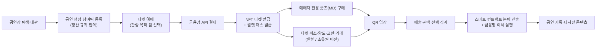

# [기획 초안] 소규모 공연 통합 플랫폼

> SSAFY 15기 특화 프로젝트 · B204 · **팀원 5명** · **발표일 2026-09-28 (월)** — 잔여 기간 약 4주 5일 · 작성일 2026-08-26 · 상태: **초안 (팀 검토 전)**
>
> 사전조사 결과: [02_사전조사.md](./02_사전조사.md)
>
> 원본 아이디어 문서: [노션 - [아이디어2] 인디밴드 구체화](https://app.notion.com/p/3c22746d15ab804a91ffc769a2d34945)

---

## 1. 프로젝트 개요

### 한 줄 소개

> 공연장 대관부터 공연 등록, 티켓 예매·입장, 굿즈 판매, 공동 공연 수익 정산까지 지원하는 **소규모 공연 통합 플랫폼**

### 블록체인 특화 관점

> **NFT 티켓**으로 안전한 소유권 이전을 지원하고, 관객의 공연팀 선택 데이터를 기반으로 **공동 공연 수익을 스마트 컨트랙트로 투명하게 분배**하는 소규모 공연 플랫폼

### 핵심 가치 (프로젝트의 두 기둥)

1. **공동 공연의 투명한 수익 분배** — 관객이 "누구를 보러 왔는지"를 데이터로 수집하고, 사전에 합의·고정된 규칙에 따라 스마트 컨트랙트가 자동 정산
2. **NFT 티켓의 안전한 이전** — 선물·재판매 시 소유권 이전 이력을 체인에 기록하여 위조·이중 판매·중복 입장 방지

---

## 2. 기획 배경 및 문제 정의

소규모 공연·인디 밴드 공연은 대형 티켓 플랫폼(인터파크·멜론티켓 등)에 등록하기 어렵고, 공연 준비 과정(대관 → 홍보 → 예매 → 입장 → 정산)이 서로 다른 채널에 흩어져 있어 공연자가 직접 수작업으로 관리한다.

| # | 문제 | 현재 상황 |
|---|------|-----------|
| P1 | 대형 티켓 플랫폼 진입 장벽 | 소규모 공연은 등록 자체가 어려움 |
| P2 | 공연 준비 과정 파편화 | 대관(스페이스클라우드), 홍보(SNS), 예매(구글폼·계좌이체), 입장(수기 명단) 이 따로 놀음 |
| P3 | 티켓 판매·입장 관리 부담 | 공연자가 입금 확인, 명단 대조를 직접 수행 |
| P4 | 공동 공연 기여도 산정 불가 | 여러 팀이 함께 공연할 때 "누구 덕에 팔린 티켓인지" 알 수 없음 |
| P5 | 수기 정산의 불투명성 | 티켓·굿즈 수익 정산이 수작업 → 분쟁 소지 |
| P6 | 티켓 선물·재판매 리스크 | 사기, 중복 사용, 웃돈 거래 |
| P7 | 공연 기록 부재 | 공연 종료 후 관람 기록·콘텐츠가 남지 않음 |

→ **이 문제들을 하나의 서비스 안에서 해결**하는 것이 목표. 특히 P4·P5(공동 공연 정산)와 P6(티켓 이전)이 블록체인 특화 기술로 차별화하는 지점.

---

## 3. 주요 사용자

| 사용자 | 주요 목적 |
|--------|-----------|
| **공연자** (단독 / 공동) | 공연 생성, 참여팀 관리, 티켓·굿즈 판매, 수익 정산 |
| **관객** | 공연 탐색, 예매, 굿즈 구매, 티켓 선물·거래, QR 입장, 공연 기록 |
| **공연장 운영자** | 공간 등록, 일정 관리, 대관 요청 승인, 공연 이력 관리 |
| **플랫폼 관리자** | 사용자·공연·거래·신고·입장·정산 관리 |

공연자는 **단독 공연자**와 여러 팀이 함께 공연을 구성하는 **공동 공연자**로 구분한다.

---

## 4. 유사 서비스 분석 및 차별점

| 서비스 | 커버 영역 | 한계 |
|--------|-----------|------|
| 인터파크·멜론·예스24 티켓 | 예매·입장 | 소규모 공연 등록 어려움, 정산·대관 미지원 |
| 스페이스클라우드 | 공간 대관 | 공연 특화 아님, 예매·정산과 단절 |
| 구글폼 + 계좌이체 (현행 관행) | 예매 | 수기 관리, 검증 불가, 정산 수작업 |
| 텀블벅 등 펀딩 플랫폼 | 자금 조달 | 공연 운영 전반 미지원 |

### 차별점 (사전조사 검증 반영 — 상세: 02_사전조사.md §2.2)

1. ✅ **대관 → 공연 페이지 자동 생성 연결** (검증: 유효) — 대관 축(스페이스클라우드)과 예매 축(플레이티켓·인디스트릿)을 잇는 서비스는 확인되지 않음. "통합" 구호보다 "대관 확정 시 공연 페이지 자동 생성" 같은 구체 연결 기능으로 표현
2. ✅ **관객 선택 기반 공동 공연 수익 자동 정산** (검증: 최강 차별점) — 국내 상용 사례 없음. 기존 수작업 관행("팀별 매표 코드 분리", Door Split 구두계약)의 분쟁 사례가 실증됨
3. ⚠️ **NFT 티켓** (검증: 조건부 유효) — "NFT 보유" 자체가 아니라 **양도 통제 + 관람 증명 + 정산 근거 데이터** 기능으로 프레이밍. 콘크릿 청산으로 시장은 공백 상태
4. **공연 기록 콘텐츠** (포토 티켓, AI 스티커) — 인디 특화 관람 기록 서비스는 부재 (관람 기록 앱 수요는 콘서트일기·너겟 등으로 방증)

> ❌ QR 입장은 단독 차별점이 못 됨 (이미 보편화) — "수기 명단 확인으로 입장하던 초소형 공연 구간의 자동화"로 좁혀서 서술할 것.
> ⚠️ 경쟁 동향: 인디스트릿이 2026년 자체 예매 시스템 오픈 — 인디 특화 '예매'만으로는 후발. 무게중심은 ①대관 연결 + ②정산 자동화.

---

## 5. 전체 서비스 흐름


<details>
<summary>텍스트 버전 (mermaid)</summary>


</details>

---

## 6. 주요 기능 정의 및 우선순위

우선순위: **P0** = MVP 필수 / **P1** = MVP 이후 1차 확장 / **P2** = 추후 확장

| 영역 | 기능 | 우선순위 | 비고 |
|------|------|:--------:|------|
| 회원·지갑 | 회원가입 시 내장형 블록체인 지갑 자동 생성 | P0 | 개인키·가스비를 사용자에게 노출하지 않음 |
| 공연장 | 공연장 등록, 일정 조회, 대관 요청·승인 | P0 | 대관료 **결제**는 P2 |
| 공연 | 단독·공동 공연 생성, 출연팀 등록(초대·승인), 티켓 옵션 설정 | P0 | |
| 공연 | 공동 공연 정산 규칙 사전 합의 → 컨트랙트 기록 | P0 | 판매 시작 후 변경 불가 |
| 예매 | 티켓 예매, 관람 목적 팀 선택, 주문 조회 | P0 | 결제는 금융망 API 연동 |
| 결제 | 금융망 API 기반 결제 시스템 (예매 결제, 환불, 정산 이체 실행) | P0 | SSAFY 교육용 금융망 API 활용 가정. 자동정산의 실제 자금 이동 담당 |
| 취소·환불 | 개별 티켓 취소(기한별 수수료), 공연 전체 취소 일괄 환불, NFT 무효화 + 금융망 환불 이체, 정산 집계 반영 | P0 | 취소 시점별 환불 규정은 §10에서 확정 |
| NFT | 예매 완료 시 NFT 티켓 발급·귀속, 상태 관리(정상·취소·사용완료) | P0 | ERC-721 기반 |
| 양도(선물) | 링크(카카오톡 공유)로 무료 양도 → 수락 시 NFT 소유권 이전, 기존 QR 폐기 | P0 | 카카오 메시지 API 대신 공유 링크 방식 가능 |
| 교환 | 티켓 옵션 교환(회차·좌석·등급 변경), 관객 간 1:1 티켓 교환 | P1 | 차액 발생 시 금융망 결제·환불 연동 |
| 입장 | 서명된 동적 QR 발급, 관계자용 스캔 화면, 실시간 검증·재사용 차단 | P0 | 고정 티켓번호 QR 금지 (복제 취약) |
| 굿즈 | 온라인 MD(굿즈) — 예매자 전용 구매, 팀별/공동 구분, 수익 분리 집계 | P0(임시) | 권한 기준 정책 결정 필요 (§10). 범위 조정 가능성 있어 "임시" 표시 |
| 정산 | 관객 선택 집계 → 스마트 컨트랙트 자동 분배 → 금융망 API 이체 실행 → 정산 결과·트랜잭션 조회 | P0 | 핵심 차별 기능. 체인 = 규칙·검증, 금융망 = 실제 자금 이동 |
| 월렛 | 월렛 티켓 패스 발급 (항공권 스타일) — **구글월렛 1순위** (demo mode 즉시 발급 + RotatingBarcode로 동적 QR 그대로 구현) → 애플 2순위($99/년, 갱신 정책 타협) → 삼성 3순위(파트너 승인 필요) | P1 | NFC는 3사 모두 비현실 확정 → QR 패스. **국내 공연 티켓 월렛 발급은 공백 시장** (기획 명분) |
| 디자인 | AI 이미지 생성 기반 공연 포스터·티켓 디자인 | P1 | 공연 등록 시 포스터 생성, 포토 티켓 디자인과 연계 |
| 홍보 | **AI 공연 홍보 릴스 제작** — 업로드한 사진·영상에서 AI가 장면 선별·자막 생성·자동 편집한 15/30초 세로형 릴스 (상세: §15.1) | P1~P2 | **템플릿 기반 자동 편집** (신규 영상 생성 아님 — 비용·품질 통제). 공동 공연은 전체/팀별/예매 홍보 릴스 분리 생성, 팀별 예매 링크로 홍보→예매 전환 추적 |
| 거래(재판매) | 구매자 간 유료 티켓 재판매 (최초가 이하 제한) | P1 | 무료 양도 완성 후 확장. **법적 근거: 개정 공연법(2026-08-28 시행)이 구입가 초과 재판매를 전면 금지** — 이를 컨트랙트로 코드화한 기능 (02_사전조사.md §4) |
| 기록 | 관람 이력, 사용 완료 디지털 티켓, 장르별 포토 티켓 | P1 | 입장 처리된 관객에게만 발급 |
| 콘텐츠 | AI 공연 스티커 생성, 포토 티켓 꾸미기 | P1~P2 | 초상권·AI 가공 동의 절차 필요 |
| 스탬프 | 현장 관람 인증 스탬프 — GPS + NFC 이중 측위 인증 (검토 중) | P2 (검토) | ⚠️ 모바일 웹 제약: iOS는 Web NFC 불가 → 구현 방식 제한 (토글 참조). 1차 버전은 **QR 입장 이력 기반 자동 스탬프**가 현실적 |
| 펀딩 | 공연 크라우드펀딩 (목표액·리워드·자동 환불) | P2 | 컨트랙트 확장 여지 |
| 대관 결제 | 실제 대관료 결제·정산 | P2 | |

### 6.1 기능별 사용 가능 기술 (토글)

> 조사 에이전트 결과 반영 전 후보 목록. ✅ = 검증됨 / 🔍 = 조사 진행 중

<details>
<summary><b>회원·내장형 지갑 (커스터디얼)</b></summary>

- 인증: Spring Security + JWT, 소셜 로그인(카카오/구글 OAuth)
- 지갑 생성: web3j `WalletUtils` 개별 키 생성 또는 **BIP-39/44 HD 지갑** — 마스터 시드 하나에서 사용자별 키 파생 (키 관리 단순화)
- 키 보관: ✅ **envelope encryption 확정** — 개인키를 사용자별 DEK(AES-256-GCM)로 암호화, DEK는 KEK(KMS 또는 서버 외부 주입 마스터키)로 재암호화해 DB 저장. 복호화는 서명 순간만 + 감사 로그
- 서명: 서버 사이드 서명(사용자는 개인키·가스비 개념 노출 없음), 가스비는 플랫폼 운영 계정이 부담
</details>

<details>
<summary><b>결제 시스템 (금융망)</b></summary>

- SSAFY 교육용 금융망 API — 계좌 생성·조회·이체 (예매 결제, 환불, 정산 이체)
- 대안/병행: 포트원(구 아임포트)·토스페이먼츠 **테스트 모드** (실 PG 흐름 시연용)
- 이체 안정성: 멱등키(idempotency key) 기반 재시도, 정산 상태 머신(산출→이체요청→완료/실패→보상)
</details>

<details>
<summary><b>NFT 티켓</b></summary>

- Solidity + OpenZeppelin **v5** ERC-721 (`ERC721URIStorage`, `Pausable`)
- 양도 제한: ✅ **OZ v5는 `_beforeTokenTransfer` 삭제됨 → `_update(to, tokenId, auth)` 오버라이드 확정** — 민팅·소각·승인된 operator 외 전송 revert. 재판매는 컨트랙트 내 `resale()` 함수로만 허용 + 최초가 이하 강제
- 상태 관리: tokenId별 enum(ISSUED/USED/CANCELLED) + 이벤트 기록
- 메타데이터: 서버 호스팅 JSON (IPFS는 선택), 개인정보·QR 원본 미포함
- 개발 도구: ✅ **Hardhat 3 확정** (자료량·JS 연계 우위. v2와 설정 형식 다름 주의)
</details>

<details>
<summary><b>스마트 컨트랙트 정산</b></summary>

- 정산 규칙: 공연 생성 시 struct로 기록, `startSale()` 호출 시 one-way `locked=true` 잠금 → 이후 setter 전부 revert
- 분배 패턴: ✅ **pull 방식 `release()` 확정** — push 루프는 수신자 revert 하나로 전체 정산 DoS. ⚠️ OZ PaymentSplitter는 v5에서 삭제됨 — 4.x 소스 참조해 커스텀 작성
- 관객 선택 집계: 서버 집계 → `keccak256` 해시를 온체인 앵커링 (개인정보·수수료 회피)
- 이벤트 로그를 백엔드에서 인덱싱하여 정산 결과·트랜잭션 조회 화면 구성
</details>

<details>
<summary><b>QR 입장 처리</b></summary>

- 동적 QR: 짧은 만료시간의 **서명 토큰** (JWT exp 30~60초 또는 HMAC-TOTP 방식)
- 재사용 차단: Redis `SETNX` 원타임 처리 + 입장 이력 기록
- 스캐너: 관계자용 모바일 웹 — `getUserMedia` 카메라 + jsQR/ZXing 라이브러리 (별도 앱 불필요)
- 검증 시 NFT 현재 소유자 조회(서버 캐시 + 체인 대사)
</details>

<details>
<summary><b>티켓 취소·양도·교환 시스템</b></summary>

- 티켓 상태 머신: `발급 → (양도중) → 사용완료 / 취소 / 교환됨` — 서버 상태와 NFT 상태 동기화
- 취소: 금융망 환불 이체(수수료 차감) + NFT `취소` 상태 전환(소각 또는 상태 플래그) + 관객 선택 집계에서 제외
- 공연 전체 취소: 배치 일괄 환불 + 컨트랙트 정산 중단 처리
- 양도: 서명된 일회용 수락 링크 → 수락 시 컨트랙트 `transfer` + 기존 QR 시드 폐기
- 교환(옵션 변경): 기존 NFT 무효화 + 신규 발급, 차액은 금융망 결제/환불 — "취소 후 재예매"를 하나의 트랜잭션으로 묶어 구현하면 단순
- 관객 간 1:1 교환: 양쪽 수락 시 동시 소유권 스왑 (에스크로성 상태 필요, P1)
- 동시성 제어: 양도중·교환중 티켓의 입장·중복 처리 차단 (Redis 락 + 상태 검증)
</details>

<details>
<summary><b>티켓 선물 (카카오톡)</b></summary>

- Kakao JavaScript SDK **공유하기** (커스텀 템플릿 링크) — 메시지 API 승인 없이 구현 가능
- 수락 링크: 서명된 일회용 토큰 딥링크 → 웹에서 수락 → 컨트랙트 소유권 이전
- 이전 완료 시 기존 QR 시드 즉시 폐기·재발급
</details>

<details>
<summary><b>월렛 패스 (구글 1순위 → 애플 → 삼성)</b></summary>

- ✅ **Google Wallet 확정 (1순위)**: 구글 계정만으로 issuer 등록 → **demo mode 즉시 발급** (팀원·심사위원 계정을 테스트 사용자로 등록하면 시연 충분). **`RotatingBarcode` 공식 지원** — TOTP 기반 매분 QR 자동 회전, 스크린샷 무력화 → 우리 동적 QR 정책과 정확히 양립 (3사 중 유일)
- 🔶 Apple (2순위, 선택): `.pkpass` + Pass Type ID 인증서, **$99/년** 계정 1개 필요. 웹 배포 가능(`application/vnd.apple.pkpass` MIME). 회전 바코드 없음 — APNs 푸시 갱신이라 "입장 시간대 개시 시 1회 갱신" 정책 타협 필요
- ❌ Samsung (3순위): 비즈니스 파트너 승인 전제 — SSAFY 사무국/멘토 경유 문의만 시도
- NFC: ✅ **3사 모두 비현실 확정** → QR 바코드 패스
- 기획 명분: **국내 공연 티켓의 월렛 발급은 사실상 공백** (항공사는 지원, CGV·티켓링크 등 공연·영화는 미지원)
</details>

<details>
<summary><b>AI 포스터·티켓 디자인 / 스티커</b></summary>

- 이미지 생성 API: ✅ **Google Nano Banana(Gemini) 확정** — 한글 텍스트 렌더링 현재 최강, 장당 ~$0.034(Lite)~$0.067, Gemini API 무료 티어 존재. 카카오 Karlo는 2024-09 종료로 국내 대안 없음
- 구현 방식: ✅ **B안 확정 — "no text" 프롬프트로 AI 배경만 생성 + 서버 템플릿 오버레이** (Sharp/Canvas로 공연명·일시 합성 → 오탈자 리스크 0). **같은 배경을 월렛 패스 strip/hero 이미지에 재사용**해 포스터-티켓-패스 디자인 일관성 확보. 한글 직접 렌더링(A안)은 포스터 원본 한정 옵션 데모
- 스티커: 생성 이미지 배경 제거(rembg 등) → 투명 PNG 팩
- 포토 티켓 꾸미기: 프론트 Canvas 편집 + `html2canvas` 저장
</details>

<details>
<summary><b>AI 홍보 릴스 제작</b></summary>

- 장면 분석·선별: 멀티모달 LLM(Gemini)으로 이미지·영상 프레임 분석 → 고품질 컷 선정
- 편집·합성: **서버 사이드 ffmpeg + 템플릿 프리셋** (자막 스타일·전환 효과·세로 1080×1920 크롭) — 신규 영상 생성이 아닌 템플릿 기반 자동 편집으로 시간·비용·품질 통제
- 자막·홍보 문구: LLM (A1 홍보 문구 생성 파이프라인 재사용), 공연명·일정·장소·예매 정보는 플랫폼 등록 데이터 자동 삽입
- 렌더링: 영상 렌더는 수십 초~분 단위 → 비동기 작업 큐 + 완료 알림, 미리보기 후 MP4 다운로드
- BGM: 사용 권한 확보된 음원 라이브러리만
- 공동 공연: 전체 릴스 / 팀별 릴스 / 예매 홍보 릴스 3종 템플릿, **팀별 예매 링크(UTM)로 홍보→예매 전환 추적** → 관객 선택 데이터·정산 서사와 연결
- 정책: 업로드 자료 저작권·초상권 확인 절차, 자동 게시 금지(공연자 최종 확인 후 다운로드)
</details>

<details>
<summary><b>공연장 대관</b></summary>

- 지도·위치 검색: 카카오맵 API
- 일정·예약: FullCalendar + 서버 측 예약 충돌 검증
- 공연장 사진: S3 presigned URL 업로드
</details>

<details>
<summary><b>온라인 MD (굿즈)</b></summary>

- 재고 동시성: Redis 분산락 또는 DB 낙관적 락
- 구매 권한: 현재 유효 티켓 소유자 조회 API로 검증 (§10 정책 확정 후)
- 결제: 금융망 API 재사용
</details>

<details>
<summary><b>현장 인증 스탬프 (GPS + NFC 이중 측위 — 검토 중)</b></summary>

**전제 제약 — 우리 서비스는 모바일 웹**:
- **iOS는 Web NFC 자체가 불가** (Safari 미지원, 애플 정책상 웹에서 NFC 능동 스캔 불가). Android Chrome만 Web NFC 지원 → "웹페이지에서 NFC 스캔" 방식은 안드로이드 전용이 됨
- iOS에서 앱 없이 가능한 유일한 NFC 경로: **NDEF URL 태그** — 아이폰(XS+)이 태그에 가까이 가면 백그라운드 태그 리딩으로 URL 배너가 떠서 Safari가 열림. 이 방식은 양 OS 모두 동작

**현실적 구현안 (앱 없이)**:
1. 공연장에 **NTAG 424 DNA** 태그 부착 (개당 1~2천 원 수준) — 탭할 때마다 **동적 CMAC 서명이 포함된 URL** 생성(SUN 방식) → 서버가 서명·카운터 검증 → URL 복사·공유로는 재사용 불가 (일반 NDEF 태그는 URL이 정적이라 복제되면 원격 스탬프 가능하므로 반드시 424 DNA급 필요)
2. + **Geolocation API**로 공연장 반경 지오펜스 소프트 체크 (실내 GPS 오차 수십~수백 m + Android mock location 스푸핑 가능 → 보조 신호로만, 하드 차단 금지)
3. 스탬프 발급을 NFT/SBT(soulbound)로 하면 공연 기록·포토 티켓과 연결되는 어필 포인트

**판정 권고**:
- 이미 **QR 입장 처리가 곧 현장 인증** (관계자 스캔 = 그 시각 그 장소에 있었다는 증명) → 1차 버전은 **입장 이력 기반 자동 스탬프**로 충분하며 추가 개발비 거의 0
- GPS+NFC 이중 인증이 고유 가치를 갖는 경우: 검표 없는 자유 입장 공연(현매), 공연장 스탬프 투어 같은 확장 시나리오 → **P2 (일정상 5주 내 신규 하드웨어 도입은 비권장, 발표 로드맵 소재로 활용)**
</details>

<details>
<summary><b>공연 기록·포토 티켓</b></summary>

- 입장 이력 기반 발급 (QR 처리 데이터 재사용)
- 장르별 템플릿 렌더링 → 이미지 저장(`html2canvas`)
- NFT 사용완료 티켓과 연동해 "관람 인증" 표기
</details>

---

## 7. 핵심 차별 기능: 공동 공연 수익 분배 설계

### 관객 선택 방식 (예매 시)

> "어떤 팀의 공연을 보고 싶어서 예매하셨나요?"

- 기본값: **한 팀 선택** (집계·설명이 가장 단순)
- 옵션: 여러 팀 선택(동일 비율 반영), 전체 공연 선택(참여팀 공통 몫에 반영)

### 정산 공식 (혼합 방식)

관객 선택만으로 분배하면 기획·운영 기여가 무시되므로 4단계 혼합:

```
1) 공통 비용 차감   : 대관료·장비비 우선 차감
2) 균등 분배        : 모든 참여팀 동일 지급
3) 관객 선택 분배   : 관객 선택 비율에 따라 추가 지급
4) 기획 기여도 분배 : 사전 합의된 기획·운영 담당팀 몫

팀별 최종 정산액 = 균등 분배액 + 관객 선택 비율 분배액 + 기획 기여도 분배액
```

- 각 영역의 비율은 **공연 생성 단계에서 참여팀이 합의**
- **티켓 판매 시작 이후 변경 불가** — 스마트 컨트랙트에 규칙을 기록하여 강제

---

## 8. 블록체인 적용 설계 방향

원칙: **온체인은 검증에 필요한 최소 정보만, 상세·개인정보는 서버(오프체인)에.**

### 8.1 공연 수익 정산 컨트랙트

| 온체인 기록 | 오프체인(서버) 보관 |
|-------------|---------------------|
| 공연 식별 정보, 참여팀 지갑 주소 | 관객 개별 선택 원본 데이터 |
| 사전 합의 정산 규칙 (판매 시작 후 불변) | 주문·결제 상세 |
| 관객 선택 **집계값 또는 해시** | |
| 팀별 최종 정산 금액, 분배 실행 내역 | |

- 기대 효과: 사후 비율 조작 방지, 전 참여팀 동일 규칙·결과 확인, 자동 분배, 검증 가능성
- **자금 흐름 이원화**: 스마트 컨트랙트는 정산 규칙 고정·집계 검증·분배액 산출을 담당하고, 실제 자금 이동은 **금융망 API 이체**로 실행. 컨트랙트 산출액과 이체 내역을 상호 대사(reconciliation)하여 투명성 확보
- 컨트랙트 내부 분배 시연용으로는 프로젝트용 테스트 토큰 병행 사용 가능 (실가상자산 미사용)

### 8.2 NFT 티켓 (ERC-721)

| 온체인 기록 | 오프체인(서버) 보관 |
|-------------|---------------------|
| 티켓 식별 정보, 보유 지갑 주소 | 공연명, 좌석, 사용자 개인정보 |
| 발급·소유권 이전 이력 | QR 원본·서명 키 |
| 상태 (정상 / 취소 / 사용완료) | |

- 기대 효과 (검증 반영 — 02_사전조사.md §7): **정산의 근거 원장** (팀별 유효 티켓 수가 분배의 입력) + **안전한 양도 채널** (소유권 이전 이력의 소급 수정 불가)
- ⚠️ **"위조 방지·QR 입장 보안"을 블록체인 성과로 주장하지 말 것** — 게이트 검증은 100% 서버 서명 동적 QR의 몫 (실서비스 어디도 게이트에서 온체인 조회를 하지 않음). 발표에서 이 지점을 섞으면 "그냥 DB로 되잖아요" 공격에 무너짐

### 8.3 지갑 설계

- 회원가입 시 자동 생성되는 **내장형(커스터디얼) 지갑** — 외부 지갑 설치 불요
- 개인키·네트워크·가스비 개념을 UX에서 완전히 숨김 (서버 측 키 관리 + 가스비 대납 구조 검토)
- 키 보관·복구·보안 방식은 별도 설계 필요 (§10 리스크)

### 8.4 신뢰 보강 3종 + 정산 시점 규칙 (적대적 검증 반영 — 필수)

완전 커스터디얼 구조에서 "그냥 DB로 되잖아요"를 방어하려면 아래 3개가 반드시 필요하다 (상세: 02_사전조사.md §7):

1. **관객 선택을 민팅 이벤트로 기록** — `mint()` 시 `ChoiceRecorded(ticketId, teamBitmap)` 이벤트 + 컨트랙트 내 카운터. 집계가 서버 입력값이 아니라 **체인 이벤트의 합**이 되어 오라클 조작 비판이 소멸. 취소 시 카운터 감소.
2. **팀별 동의 트랜잭션** — 각 팀의 지갑 주소에서 `agreeToRules(showId, rulesHash)` 호출 후에만 `startSale()` 가능. 세 팀의 서로 다른 주소가 같은 규칙 해시에 동의한 기록이 익스플로러에 남음 (핵심 시연 장면).
3. **공개 정산 검증 페이지** — 공연별 컨트랙트 주소·잠긴 규칙·온체인 집계·팀별 산출액·release tx 링크 + 브라우저 재계산 위젯. 심사위원이 직접 검증하는 데모 동선.

**정산 시점 규칙 (컨트랙트가 강제)**:
```
취소·환불 마감 → 집계 확정 → 정산 잠금 → 이의제기 기간(48h) → release 활성화
```
- release 후 환불은 회수 불가 → 마감 후 환불은 오프체인 준비금 정책으로 분리
- 테스트 토큰은 **decimals=0, 1토큰=1원** — 온체인 분배액과 금융망 이체액의 단위 불일치 원천 제거
- 재판매 가격 상한 기준 = 티켓 타입 정가가 아닌 **해당 티켓의 실제 최초 구매가** (얼리버드 티켓을 정가로 되팔면 개정 공연법 위반 상황이 재현되므로)
- 발표 프레임: **"온체인 정산액 = 이체 지시서, 금융망 = 집행, 대사(reconciliation) 리포트로 불일치 0건 증명"**

---

## 9. MVP 범위

### MVP 기능 목록 (14개)

1. 사용자 및 블록체인 지갑 생성
2. 공연자·공연팀 등록
3. 단독·공동 공연 생성
4. 참여팀 등록 및 정산 규칙 설정
5. 티켓 예매 (금융망 API 결제)
6. 예매 시 관람 목적 팀 선택
7. NFT 티켓 발급
8. 티켓 취소·환불 (NFT 무효화 + 금융망 환불)
9. 예매자 전용 굿즈(MD) 구매
10. 티켓 양도(선물) 및 소유권 이전
11. QR 입장 처리
12. 관객 선택 결과 집계
13. 스마트 컨트랙트 기반 수익 분배 + 금융망 이체
14. 팀별 정산 결과·트랜잭션 조회

> 일정 부족 시: 구매자 간 **유료 거래는 후순위**, **무료 선물 먼저 완성**.

### 핵심 시연 시나리오

> 세 밴드가 하나의 공동 공연을 생성하고 정산 규칙을 합의한다. 관객은 티켓을 예매하면서 보고 싶은 밴드를 선택하고, 자신의 지갑으로 NFT 티켓을 발급받는다. 관객은 티켓을 친구에게 선물하거나 모바일 QR로 입장한다. 공연 종료 후 관객 선택 결과와 사전 합의 규칙을 기반으로 스마트 컨트랙트가 참여 밴드에 수익을 자동 분배한다.

---

## 10. 정책 결정 필요 사항 (팀 논의 안건)

기능 명세 확정 전에 팀에서 결정해야 하는 항목:

- [ ] **클라이언트 플랫폼**: 관객용 모바일 웹(PWA) vs 네이티브 앱 — 권고: **모바일 웹(PWA) 유지**. 근거 ① 선물·양도가 "카카오톡 링크 클릭 → 즉시 수락" UX인데 네이티브면 수신자에게 앱 설치를 강요(콘크릿의 마찰 지점 재현) ② 5주·5명 제약에서 iOS 심사·TestFlight 배포 부담 ③ 월렛 패스·QR·결제 모두 웹에서 가능. NFC가 꼭 필요하면 **관계자용 검표 스캐너만 안드로이드 네이티브**로 분리 검토 (관계자 단말은 팀이 통제하므로 단일 OS 무방)
- [ ] **굿즈 구매 권한**: 최초 예매자 vs 현재 티켓 보유자 (선물받은 사람 포함 여부) — 구현 일관성은 "현재 유효한 티켓 소유자" 기준이 유리
- [ ] **관객 선택 방식 기본값**: 한 팀 선택 고정 vs 복수 선택 허용 범위
- [ ] **정산 공식의 각 비율 범위**: 균등/관객선택/기획기여 비율의 허용 범위와 기본값
- [ ] **공연 취소·환불 정책**: NFT 무효화 + 정산 상태 + 거래된 티켓 환불 규칙 일괄 처리 흐름
- [ ] **개별 취소 환불 규정**: 공연일 기준 취소 마감·수수료 구간 (예: D-7 전액 / D-3 50% / 당일 불가 등)
- [ ] **교환 허용 범위**: 회차·좌석·등급 변경만 vs 관객 간 1:1 교환 포함 여부, 차액 처리 방식
- [ ] **재판매 대금 귀속**: 판매자 개인 귀속 vs 공동 정산 편입 (검증 권고: 개인 귀속, 공동 정산은 1차 판매만)
- [ ] **MD(굿즈) 수익의 온체인 정산 편입 여부**: 티켓과 동일 시점 규칙에 편입 vs 1차 버전은 오프체인 정산 분리 (검증 권고: 분리 명시)
- [ ] **재판매 가격 상한**: 최초 구매가 이하 고정 여부
- [ ] **블록체인 네트워크 선택**: 퍼블릭 테스트넷 vs 프라이빗 네트워크 (가스비 대납·속도·시연 안정성 기준)
- [ ] **결제·정산 자금 흐름**: 금융망 API 결제 + 컨트랙트 검증(이원화) vs 테스트 토큰 온체인 정산 — 두 방식의 역할 경계 확정
- [ ] **월렛 패스 범위**: 구글월렛 1순위 확정 (demo mode + RotatingBarcode). 남은 결정 — 애플월렛 포함 여부($99/년 계정 비용 부담 + "입장 시간대 개시 시 1회 푸시 갱신" 정책 타협 수용 여부). 삼성은 SSAFY 사무국/멘토 경유 문의만 시도 (3순위)
- [ ] **온라인 MD 범위**: 임시 기능으로 표시됨 — MVP 유지 여부와 축소 범위(주문만 vs 재고·배송 포함)

---

## 11. 리스크 및 대응 방향

| 리스크 | 대응 |
|--------|------|
| 관객 선택 데이터 조작 가능성 | 선택 원본은 서버 보관 + 집계 해시를 온체인 기록하여 사후 검증 가능하게 |
| NFT에 개인정보 유입 | 온체인에는 식별자·소유권·상태만, 개인정보·QR 원본은 저장 금지 |
| QR 복제 | 짧은 유효기간의 **서명된 동적 QR** (고정 번호 금지) |
| 선물·거래 후 기존 QR 악용 | 소유권 이전 즉시 기존 QR 폐기·재발급 |
| 지갑 키 관리 사고 | 커스터디얼 키의 암호화 보관·복구 정책 별도 설계 |
| 원화·가상자산 정산의 법률 문제 | 실가상자산 미사용. 자금 이동은 교육용 금융망 API, 체인은 검증 계층으로 한정 |
| 월렛 NFC 인증 장벽 | **조사 확정: 3사 모두 NFC 비현실** (애플 VAS entitlement 심사·전용 리더기, 구글 Smart Tap 인증 단말, 삼성 파트너 승인) → QR 패스 확정. 발표 시 "VAS 인증 요건상 QR 채택"으로 근거 제시 |
| 금융망 API 장애·제약 | 이체 실패 시 재시도·보상 트랜잭션 설계, 정산 상태 머신(산출→이체요청→완료/실패) 분리 |
| 블록체인 트랜잭션 지연이 UX 저해 | 발급·이전은 비동기 처리 + 서버 상태 우선 표시, 체인은 검증 계층으로 |
| AI 스티커·릴스의 저작권·초상권 | 업로드 시 저작권·초상권·AI 가공 동의 절차. 릴스 BGM은 권한 확보 음원만, 자동 게시 금지(공연자 확인 후 다운로드) |
| 범위 과다 (기능 15개+) vs 실기간 5주 미만 | P0/P1/P2 준수 + §13 컷 라인 사전 합의. W4 주말 기능 동결 |
| 인디스트릿의 2026 예매 시스템 오픈 (경쟁) | 차별화 무게중심을 대관 연결 + 정산 자동화로 이동 (예매 단독 어필 금지) |
| Amoy faucet 일일 한도·시연 당일 장애 | 시연 1주 전 가스 확보, Besu 프라이빗 백업 노드에 동일 컨트랙트 이중 배포 + 리허설 |

---

## 12. 기술 스택 (사전조사 기반 권고안 — 상세 근거: 02_사전조사.md §5)

| 영역 | 권고안 | 비고 |
|------|------|------|
| 프론트엔드 | React (+ TypeScript), 모바일 웹 중심 반응형 | 관객 흐름이 전부 모바일 웹에서 동작해야 함 (티켓·QR·선물 수락) |
| 백엔드 | Spring Boot, JPA, MySQL, Redis | Redis: QR 검증·재사용 차단, 예매 동시성 |
| 블록체인 네트워크 | **Polygon Amoy(주) + EC2 Besu 프라이빗 단일노드(시연 백업) 이중 배포**, 개발은 로컬 Hardhat node | 커스터디얼이라 faucet 제약이 사용자 수와 무관. 퍼블릭 익스플로러 링크가 발표 어필. 시연 당일 장애 대비 백업 필수 |
| 컨트랙트 | Solidity + **OpenZeppelin v5** — ERC-721 티켓(`_update` 오버라이드 양도 제한 + `resale()` 가격 상한), ERC-20 테스트 토큰, 커스텀 정산 Splitter(`startSale()` 잠금, pull `release()`) | ⚠️ OZ v5에서 `_beforeTokenTransfer`·`PaymentSplitter` 삭제됨 — v4 예제 코드 이식 금지 |
| 개발 도구 | **Hardhat 3** (2025-08 릴리스) | v2 튜토리얼과 설정 형식 다름 — 문서 버전 확인 |
| 체인 연동 | **web3j 단독** (v5.0.2, 2026-03 — LFDT 이관 후 활발) | 서버 운영지갑이 전 트랜잭션 서명·전송, nonce 큐 직렬화 필요. Node 사이드카 불필요 |
| 지갑 키 관리 | **envelope encryption** — 개인키 AES-256-GCM(사용자별 DEK) + KEK(KMS/외부 주입) | DB 평문·하드코딩 마스터키 금지 (즉시 감점 요인) |
| 결제 | SSAFY 교육용 금융망 API (계좌·이체) | 예매 결제, 환불, 정산 이체 실행 |
| 월렛 패스 | Apple PassKit(.pkpass), Google Wallet API, Samsung Wallet | 항공권 스타일 티켓 패스. 바코드(QR) 기반, NFC는 인증 제약 조사 후 |
| 인프라 | Docker, Jenkins/GitLab CI, EC2, Nginx | SSAFY 표준 배포 환경 기준 |
| 기타 | 카카오톡 공유(선물 링크), AI 이미지 생성 API(포스터·티켓 디자인·스티커, P1) | |

---

## 13. 일정 (실제 제약: 2026-08-26 ~ 09-28 발표, 약 4주 5일)

> ⚠️ 원래 7주 가정이었으나 실제 잔여 기간은 **5주 미만**. 기능 전부 + 발표 + 장표까지 완료해야 하므로, 설계·개발 병행과 컷 라인 관리가 필수.

| 주차 | 기간 | 목표 |
|------|------|------|
| W1 | 8/26(수)~8/31(월) | 기획 확정·정책 결정(§10), 와이어프레임, ERD·API 초안, **컨트랙트 설계·개발 환경·CI/CD를 같은 주에 병행 착수** |
| W2 | 9/1(화)~9/7(월) | 회원·지갑(키 관리), 공연장 등록·대관, 공연 생성·참여팀·정산 규칙 / 컨트랙트 3종(TicketNFT·TestToken·Splitter) 로컬 테스트 완료 |
| W3 | 9/8(화)~9/14(월) | 예매+관람 목적 팀 선택, 금융망 결제, NFT 발급, QR 입장, 취소·환불 |
| W4 | 9/15(화)~9/21(월) | 양도(선물), 굿즈(MD), 관객 선택 집계 → 컨트랙트 정산 → 금융망 이체, 정산 조회. **주말: 기능 동결(feature freeze)** |
| W5 | 9/22(화)~9/28(월) | 통합 테스트·버그 수정, Amoy+백업 노드 시연 리허설 2회, **발표 장표 작성(9/24까지 초안)**, 9/28(월) 발표 |

### 컷 라인 (일정 압박 시 순서대로 제외)

1. 교환 시스템 → 취소 후 재예매로 안내 (P1)
2. 월렛 패스 → 애플 또는 구글 1개사만, 그것도 어려우면 데모 영상으로 대체 (P1)
3. AI 릴스 → 1차 "사진 슬라이드형"만 유지, 영상 장면 선별(2차)은 로드맵으로 (P1)
4. AI 포스터 → 스티커 없이 포스터 생성만 (P1)
5. 온라인 MD → 주문 기능만 (재고·기간 관리 제거)
6. 유료 거래·공연 기록 → 발표 로드맵 슬라이드로 이동 (P1~P2)

**절대 지킬 것 (컷 불가)**: 공동 공연 생성 + 정산 규칙 잠금 + 예매·팀 선택 + NFT 발급 + QR 입장 + 자동 정산·이체 — 핵심 시연 시나리오 경로.

---

## 14. 팀 역할 분담 (5명 구성안 — 팀 회의에서 확정)

| 역할 | 인원 | 담당 | 주요 범위 |
|------|:---:|------|-----------|
| 프론트엔드 | 2 | 미정 | ①관객 모바일 웹(예매·티켓·QR·양도), ②공연자·공연장·관리자 화면 + 정산 대시보드 |
| 백엔드 | 2 | 미정 | ①공연·예매·취소환불 도메인 + 금융망 결제, ②QR 검증·양도·굿즈 + web3j 체인 연동·키 관리. 한 명이 인프라(CI/CD·배포) 겸임 |
| 블록체인 | 1 | 미정 | 컨트랙트 3종 설계·개발·테스트, Amoy·Besu 배포, 정산 로직 + 백엔드 연동 지원. 발표 자료 리드 겸임 권장 (블록체인 스토리가 발표 핵심이므로) |

- 팀장/PM은 위 역할 중 1인 겸임. 발표자는 W4에 확정.
- 5명 × 5주 제약상 **전원이 W5에는 통합 테스트·발표 준비로 전환**하는 것을 전제로 함.

---

## 15. AI 활용 방안

블록체인이 특화 기술이지만, AI를 서비스 곳곳에 실용적으로 얹어 완성도를 높인다. 구현 비용이 낮은 순으로:

> 전수 조사 완료 (02_사전조사.md §8) — 사용자 여정 9단계별 적용 가능성을 업계 사례로 검증한 결과를 반영한 최종 포트폴리오.

| # | 기능 | 내용 | 우선순위 | 구현 난이도 |
|---|------|------|:--------:|:-----------:|
| A2 | **AI 포스터·티켓 디자인 생성** | 장르·컨셉 키워드 → **Nano Banana(Gemini)**로 배경 생성("no text") → 서버에서 공연명·일시·장소 오버레이 합성. 배경을 월렛 패스 이미지에 재사용 | **P1 (데모 필수)** | 중 — Canva Magic Design도 "생성+템플릿 결합" 동일 구조 (업계 정합성 근거) |
| A3 | **정산 리포트 자연어 설명** | 정산 완료 후 "팀 A는 관객 선택 42%로 균등 분배 X원 + 선택 분배 Y원…"을 LLM이 팀별 리포트로 생성 — 핵심 차별점(정산 투명성)과 직결 | **P1 (데모 필수)** | 하 — 정산 JSON → LLM 1콜 |
| A7 | **AI 공연 홍보 릴스 제작** | 사진·영상 업로드 → AI 장면 선별·자막 생성 → 템플릿 기반 자동 편집 → 15/30초 세로 릴스 (상세: §15.1). **단계화: 1차 "사진 슬라이드형 릴스"(이미지 선별+자막+BGM+ffmpeg) → 2차 영상 장면 선별(PySceneDetect+Gemini)** | P1 | 중~상 — Opus Clip·Vrew 등 상용 도구도 "생성이 아닌 선별+템플릿 편집" 구조 (기술 타당성 검증됨) |
| A1 | 공연 소개·홍보 문구 생성 | LLM이 소개문·SNS 문구·해시태그 생성 — **A7의 자막·문구 생성과 같은 LLM 호출로 통합** (별도 기능으로 세지 않음) | P1 (A7에 흡수) | 하 |
| A8 | **자연어 대관 검색** (신규) | "홍대 근처, 50명, 밴드 가능, 주말 저녁" → LLM 함수 호출로 구조화 필터 변환 → 기존 검색 API 재사용 | P1~P2 (여유 시) | 하 — 데모 오프닝에서 "AI 있는 서비스" 인상 |
| A9 | **신고·리뷰 AI 모더레이션** (신규) | 신고 접수 시 LLM이 카테고리·심각도 자동 분류·우선순위 배정 (네이버 클린봇 사례 인용 가능) | P2 (여유 시) | 하 — API 1콜, 관리자 기능 보강 |
| A6 | 관객 선택 데이터 인사이트 | 공연자 대시보드 AI 요약 ("관객의 60%가 A팀 목적 예매…") — A3와 같은 패턴이라 A3 완성 후 델타 작음 | P2 | 하~중 |
| A4 | AI 공연 스티커 | 공연 사진 → 스티커 생성(배경 제거·스타일 변환) → 포토 티켓 꾸미기 팩 | P2 | 중 |
| A5 | 공연 추천 | 관람 이력·팀 선택 데이터 기반 취향 추천 (Bandsintown 사례) — 콜드스타트라 로드맵 언급용 | P2 | 중 |

### 버릴 것 (조사 결과 — 효과 대비 비용 불량, 발표에서도 꺼내지 말 것)

1. **다이내믹 프라이싱·수요 예측** — 신규 플랫폼이라 데이터 전무 + Ticketmaster 사례가 소비자 반발·EU 조사로 이어짐. **"정가 이하 재판매 제한"이라는 우리의 공정가격 서사와 정면 충돌** — 꺼내면 역효과.
2. **ML 기반 봇·매크로 탐지** — 전용 행동 데이터·인프라 필요, 5주 내 비현실. 룰 기반(1인 구매 제한·rate limit)으로 충분. Ticketmaster Verified Fan(재판매율 20~30%→5%)은 로드맵 슬라이드용으로만.
3. **AI 신규 영상 생성(Veo류) 릴스** — 비용·시간·품질 편차 통제 불가. "템플릿 기반" 방침이 상용 도구의 실제 구조와도 일치하므로 유지.
4. **범용 챗봇** — 흔하고(인터파크 톡집사) 차별성 없음. FAQ 정적 페이지로 대체.

- **발표 서사 (확정 권고)**: "AI가 공연의 시작(포스터·릴스 홍보)과 끝(정산 설명·인사이트)을 담당하고, 그 사이를 블록체인이 잇는다" — **A7 릴스의 팀별 예매 링크 → 관객 선택 데이터 → 스마트 컨트랙트 정산 → A3 리포트로 하나의 데이터 루프가 완성**됨.
- 초상권·AI 가공 동의 절차는 A4·A7 구현 시 필수 (§10).

### 15.1 AI 공연 홍보 릴스 제작 (상세)

소규모 공연팀은 홍보에 사용할 사진과 영상을 보유하고 있어도 영상 편집 인력과 비용이 부족해 이를 효과적으로 활용하기 어렵다. 플랫폼은 공연자가 업로드한 사진과 짧은 영상을 AI가 분석·편집하여 SNS용 공연 홍보 릴스를 자동으로 제작한다.

#### 주요 기능

- 공연 포스터, 팀 사진, 연습 영상 및 이전 공연 영상 업로드
- 공연 예고, 팀 소개, 예매 마감 등 홍보 목적 선택
- 록, 인디, 어쿠스틱 등 공연 분위기 선택
- AI 기반 주요 장면 및 고품질 이미지 선별
- 홍보 문구와 영상 자막 자동 생성
- 세로 화면에 맞는 이미지·영상 자동 조정
- 장면 순서, 화면 전환 및 자막 배치 자동 구성
- 공연명, 일정, 장소, 출연팀 및 예매 정보 자동 삽입
- 15초 또는 30초 길이의 세로형 영상 생성
- 결과물 미리보기 및 문구·장면 수정
- MP4 형식 다운로드 및 SNS 공유

#### 공동 공연 맞춤 릴스

여러 팀이 참여하는 공동 공연에서는 하나의 공연 자료를 바탕으로 전체 공연용 릴스와 참여팀별 맞춤 릴스를 각각 생성할 수 있다.

- 전체 참여팀을 소개하는 공동 공연 릴스
- 특정 팀의 사진과 영상을 중심으로 구성한 팀별 릴스
- 공연 일정과 티켓 정보를 강조한 예매 홍보 릴스

각 참여팀은 자신에게 맞게 제작된 릴스를 SNS에 게시할 수 있다. **팀별 예매 링크를 함께 제공하면 어떤 팀의 홍보가 실제 티켓 예매로 연결됐는지도 확인할 수 있다** — 관객 선택 기반 정산 데이터와 연결되는 지점.

#### 제작 과정

1. 공연자가 사진과 짧은 영상을 업로드한다.
2. 홍보 목적과 원하는 영상 분위기를 선택한다.
3. AI가 활용할 장면과 홍보 문구를 선정한다.
4. 플랫폼에 등록된 공연 정보를 자동으로 불러온다.
5. AI가 자막, 장면 순서 및 화면 전환을 구성한다.
6. 공연자가 결과물을 미리 확인하고 수정한다.
7. 완성된 릴스를 내려받아 SNS 홍보에 활용한다.

#### 기대 효과

- 영상 편집 경험이 없는 공연자의 홍보 콘텐츠 제작 지원
- 홍보 영상 제작에 필요한 시간과 비용 절감
- 공연 정보 입력 과정에서 발생하는 반복 작업 감소
- 공동 공연 참여팀별 맞춤형 홍보물 제공
- 공연 상세 페이지 및 티켓 예매 유입 확대
- 공연자가 보유한 사진과 영상의 활용도 향상

#### 구현 원칙

- 초기 버전은 AI가 새로운 영상을 직접 생성하는 방식이 아니라, **업로드된 자료에서 주요 장면을 선택하고 홍보 문구·자막을 생성하는 템플릿 기반 자동 편집 방식** — 생성 시간과 비용을 줄이고 일정한 품질 확보.
- 업로드된 사진·영상의 저작권과 출연자의 초상권을 확인해야 하며, 배경음악은 사용 권한이 확보된 음원만 사용.
- AI가 제작한 영상은 자동 게시하지 않고 공연자가 최종 확인한 후 내려받도록 구성.

---

## 다음 단계

1. 팀 회의에서 본 초안 검토 및 §10 정책 결정
2. 요구사항 정의서(기능 명세) 상세화
3. 와이어프레임 / 화면 설계 (Figma)
4. ERD·API 명세 초안
5. 스마트 컨트랙트 설계 문서 (정산·NFT 티켓)
