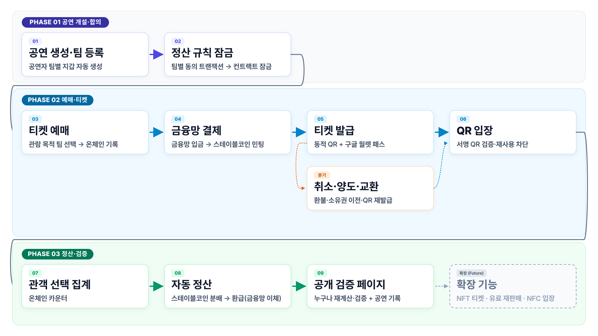
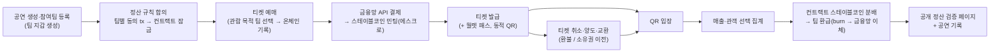

# [기획 초안 v2.1] 소규모 공연 티켓팅·공동 정산 플랫폼

> SSAFY 15기 특화 프로젝트 · 핀테크 트랙 · B204 · **팀원 5명** · **발표일 2026-09-28 (월)** · 작성 2026-08-26 · **v2 2026-08-27 범위 재조정 → v2.1 2026-08-27 스테이블코인 채택** · 상태: 초안 (팀 검토 중) · **v1(8/26 풀스코프)은 [01_기획_초안_v1.md](./01_기획_초안_v1.md)**
>
> 원본 아이디어: [노션 - [아이디어2] 인디밴드 구체화](https://app.notion.com/p/3c22746d15ab804a91ffc769a2d34945) · 사전조사: [02_사전조사.md](./02_사전조사.md) · 협의 안건: [노션](https://app.notion.com/p/3c92746d15ab81cd91c6f0073a274fe7)

> **2026-08-27 범위 재조정 요약**: 공연장·대관·스탬프·콘텐츠·펀딩·대관 결제·**굿즈(MD)** 삭제 / 지갑은 공연자(팀) 전용 / 티켓은 일반 티켓으로 양도, **NFT는 시간이 남으면 마지막 부가 기능** / NFC·유료 거래 후순위 / **AI 기능은 전부 기획에서 제외 — 적용 여부는 팀 협의로 결정**.
>
> **v2.1 변경 (8/27)**: 정산 자산을 테스트 토큰 → **원화 1:1 스테이블코인(테스트넷 자체 발행, 가칭 KRWS)**으로 교체. 금융망 API는 입출금(on/off-ramp) 담당, 온체인 정산은 스테이블코인으로 실제 수행, 예치금 1:1 준비금 증명을 검증 페이지에 공개. v2 원문은 git 커밋 `fdf145a`에 보존.

---

## 1. 프로젝트 개요

### 한 줄 소개

> 여러 밴드가 함께 여는 소규모 공연의 **티켓 예매·입장·양도부터 수익 정산까지** 하나로 잇는 티켓팅·공동 정산 플랫폼

### 블록체인 특화 관점

> 참여팀이 사전 합의한 정산 규칙을 **스마트 컨트랙트에 잠그고**, 관객의 "관람 목적 팀" 선택을 온체인에 기록해 **공동 공연 수익을 원화 스테이블코인으로 투명하게 자동 분배**한다. 금융망 API는 입출금(on/off-ramp)을 맡고, 예치금과 발행량의 1:1 준비금 증명을 누구나 확인할 수 있다

### 핵심 가치 (두 기둥)

1. **공동 공연의 투명한 수익 분배** (핵심) — 관객이 "누구를 보러 왔는지"를 예매 시 선택하고, 판매 시작 전 참여팀 전원이 동의해 잠근 규칙에 따라 스마트 컨트랙트가 **스테이블코인으로 팀별 분배를 온체인에서 실행**, 팀은 환급 시 금융망으로 원화 수령. 누구나 공개 검증 페이지에서 재계산 가능
2. **안전한 티켓 양도** — 카카오톡 링크로 양도 → 수락 시 소유권 이전 + 기존 QR 즉시 폐기·재발급. (NFT 소유권 이전은 확장 기능)

---

## 2. 기획 배경 및 문제 정의

취미·인디 밴드 공연은 3~4팀이 함께 무대를 채우는 **공동 공연이 표준**이다. 그런데 정산은 "팀별 매표 코드 분리 → 자기가 판 만큼 가져가기"나 구두 합의로 이뤄지고, 사후 규칙 변경·불투명한 계산 때문에 분쟁이 잦다. 예매는 구글폼·계좌이체, 입장은 수기 명단 확인이 현실이다.

| # | 문제 | 현재 상황 |
|---|------|-----------|
| P1 | 대형 티켓 플랫폼 진입 장벽 | 메일 문의→심사→판매대행 계약, 사업자등록증 요구 등 절차 장벽 |
| P2 | 예매·입장·정산 파편화 | 홍보(SNS), 예매(구글폼·계좌이체), 입장(수기 명단), 정산(수작업)이 따로 놀음 |
| P3 | 판매·입장 관리 부담 | 공연자가 입금 확인, 명단 대조를 직접 수행 |
| P4 | **공동 공연 기여도 산정 불가** | "누구 덕에 팔린 티켓인지" 알 수 없음 |
| P5 | **수기 정산의 불투명성** | 규칙 사후 변경·계산 불투명 → 분쟁 ("카운팅 정산" 보이콧 사례) |
| P6 | 티켓 선물·양도 리스크 | 사기, 중복 사용 |
| P7 | 공연 기록 부재 | 관람 기록·콘텐츠가 남지 않음 |

→ **P4·P5(공동 정산)가 이 프로젝트의 중심**이고, P6(양도)·P2/P3(티켓팅 자동화)이 그 주변을 받친다. **타겟**: 티켓 100매 이내 규모의 취미·소규모 밴드, 3~4팀 공동 공연.

---

## 3. 주요 사용자

| 사용자 | 주요 목적 | 지갑 |
|--------|-----------|------|
| **공연자** (단독 / 공동, 팀 단위) | 공연 생성, 참여팀 관리, 정산 규칙 동의, 티켓 판매, 정산 수령 | **팀별 지갑 자동 생성** — 정산 컨트랙트의 팀 주소, 동의 트랜잭션, 정산 수령, 가스비 지출 |
| **관객** | 공연 탐색, 예매(관람 목적 팀 선택), 티켓 양도, QR 입장, 공연 기록 | 없음 (일반 티켓) |
| **플랫폼 관리자** | 사용자·공연·거래·신고·입장·정산 관리 | 운영지갑 (컨트랙트 operator) |

---

## 4. 유사 서비스 분석 및 차별점

| 서비스 | 커버 영역 | 한계 |
|--------|-----------|------|
| 인터파크·멜론·예스24 티켓 | 예매·입장 | 소규모 공연 등록 어려움, 공동 정산 미지원 |
| 플레이티켓·인디스트릿 | 소규모/인디 예매 | 예매에 한정, 공동 정산·검표 고도화 없음 |
| 구글폼 + 계좌이체 (현행 관행) | 예매 | 수기 관리, 검증 불가, 정산 수작업 |

### 차별점 (사전조사 검증 반영 — 상세: 02_사전조사.md §2.2)

1. ✅ **관객 선택 기반 공동 공연 수익 자동 정산** (검증: 최강 차별점 — 국내 상용 사례 없음, 수작업 관행의 분쟁 사례 실증) — **유일한 핵심 차별점으로 집중**
2. **안전한 티켓 양도** — 링크 수락 즉시 소유권 이전 + QR 재발급 (일반 티켓 기반)
3. **공연 기록** (포토 티켓) — 인디 특화 관람 기록 서비스 부재
4. ⚠️ NFT 티켓 — 확장 기능 (양도 이력의 소급 수정 불가 + 정산 근거 원장)

> ❌ QR 입장은 단독 차별점이 못 됨 — "수기 명단 확인 구간의 자동화"로 좁혀 서술.
> ⚠️ 경쟁: 인디스트릿이 2026년 자체 예매 시스템 오픈 — 예매 단독 어필 금지, 무게중심은 정산.
> 📌 "대관 → 공연 페이지 연결"은 조사에서 유효 판정이었으나 **범위 재조정으로 제외** — 추후 확장 후보로만 기록.

---

## 5. 전체 서비스 흐름



<details>
<summary>텍스트 버전 (mermaid)</summary>


</details>

---

## 6. 주요 기능 정의 및 우선순위

우선순위: **P0** = MVP 필수 / **P1** = MVP 이후 1차 확장 / **P2** = 후순위·부가

| 영역 | 기능 | 우선순위 | 비고 |
|------|------|:--------:|------|
| 공연자 지갑 | **공연자(팀) 지갑 자동 생성** — 정산 컨트랙트 팀 주소, 동의 트랜잭션, 정산 수령, 가스비 지출 | P0 | 관객 지갑은 만들지 않음. 개인키·가스 개념은 UX에서 숨김 |
| 공연 | 단독·공동 공연 생성, 출연팀 등록(초대·승인), 티켓 옵션 설정, **정산 규칙 합의 → 팀별 동의 tx → 컨트랙트 잠금** | P0 | 판매 시작 후 변경 불가 |
| 예매 | 티켓 예매, **관람 목적 팀 선택(→ 온체인 기록)**, 주문 조회 | P0 | 결제는 금융망 API |
| 결제 | 금융망 API 기반 결제 → **결제액만큼 스테이블코인 민팅(에스크로 컨트랙트 예치)**, 환불 시 소각 | P0 | SSAFY 교육용 금융망 API = 입출금(on/off-ramp) |
| 스테이블코인 | **원화 1:1 스테이블코인(가칭 KRWS) 발행·환급** — 금융망 입금 확인 시 mint, 환불·환급 시 burn, **준비금 증명(에스크로 잔액 ≥ 유통량)** 공개 | P0 | 테스트넷 자체 발행(모의). 실서비스는 인가 발행사 코인 연동 로드맵 |
| 취소·환불 | 개별 취소(기한별 수수료), 공연 전체 취소 일괄 환불, 금융망 환불 이체, 선택 카운터 롤백·정산 집계 반영 | P0 | 환불 규정은 §10 |
| 양도(선물) | 카카오톡 공유 링크로 **일반 티켓 양도** → 수락 시 소유권 이전(DB) + 기존 QR 폐기·재발급 | P0 | 카카오 메시지 API 대신 공유 링크 |
| 교환 | 티켓 옵션 교환(회차·좌석·등급), 관객 간 1:1 교환 | P1 | 차액은 금융망 결제·환불 |
| 입장 | 서명된 동적 QR, 관계자용 스캔 화면, 실시간 검증·재사용 차단 | P0 | 고정 티켓번호 QR 금지 |
| 정산 | 관객 선택 집계 → 스마트 컨트랙트가 **스테이블코인을 팀 지갑에 분배(release)** → 팀 환급(burn → 금융망 원화 이체) → 정산 결과·트랜잭션 조회 | P0 | **핵심 차별 기능** — 온체인 분배가 곧 실제 정산 |
| 검증 | **공개 정산 검증 페이지** — 컨트랙트 주소·잠긴 규칙·온체인 집계·팀별 산출액·tx 링크 + 브라우저 재계산 | P0 | "그냥 DB로 되잖아요" 방어의 실체 |
| 월렛 | 월렛 티켓 패스 (항공권 스타일) — 구글월렛 1순위(demo mode + RotatingBarcode) → 애플 2순위 | P1 | NFC는 **추후** |
| 기록 | 관람 이력, 사용 완료 디지털 티켓, 장르별 포토 티켓 | P1 | 입장 처리된 관객에게만 |
| NFT | **NFT 티켓 (ERC-721)** — 티켓 소유권·이전 이력 온체인, 관객 지갑 생성 포함 | **P2 (부가 — 시간 남으면 마지막)** | OZ v5 `_update` 양도 제한 설계는 유지 |
| 거래(재판매) | 구매자 간 유료 재판매 (최초 구매가 이하 제한) | **P2 (후순위)** | 개정 공연법(2026-08-28 시행) 근거는 유지 |

### 6.1 기능별 사용 가능 기술 (토글)

> ✅ = 사전조사로 검증·확정된 항목

<details>
<summary><b>공연자(팀) 지갑 (커스터디얼)</b></summary>

- 생성 시점: 공연자 회원가입 또는 팀 생성 시 팀별 EOA 1개 — web3j `WalletUtils` 또는 BIP-39/44 HD 파생
- 키 보관: ✅ **envelope encryption** — 개인키를 팀별 DEK(AES-256-GCM)로 암호화, DEK는 KEK(KMS 또는 서버 외부 주입 마스터키)로 재암호화해 DB 저장. 복호화는 서명 순간만 + 감사 로그
- 용도: 정산 컨트랙트의 팀 주소 · `agreeToRules()` 동의 서명 · `release()` 정산 수령 · **가스비 지출** (테스트넷 가스 충전 절차는 팀 협의 — §10)
- 관객 지갑은 없음 → 관객 UX에 블록체인 개념 노출 0
</details>

<details>
<summary><b>결제 시스템 (금융망)</b></summary>

- SSAFY 교육용 금융망 API — 계좌 생성·조회·이체 (예매 결제, 환불, 정산 이체)
- 대안/병행: 포트원·토스페이먼츠 테스트 모드
- 이체 안정성: 멱등키 기반 재시도, 정산 상태 머신(산출→이체요청→완료/실패→보상)
</details>

<details>
<summary><b>스마트 컨트랙트 정산 (RevenueSplitter + KRWS 스테이블코인)</b></summary>

- Solidity + OpenZeppelin v5, Hardhat 3 ✅
- 정산 규칙: 공연 생성 시 struct 기록 → 각 팀 지갑이 `agreeToRules(showId, rulesHash)` → 전원 동의 후 `startSale()`로 one-way `locked=true` → 이후 setter 전부 revert
- **관객 선택 기록**: 예매 확정 시 서버(operator)가 `recordChoice(ticketId, teamBitmap)` 호출 → 이벤트 + 팀별 카운터 누적. 취소 시 `cancelChoice()`로 감소. 집계가 서버 DB값이 아니라 **체인 이벤트의 합**
- 분배: ✅ **pull 방식 `release()`** — push 루프 DoS 회피. ⚠️ OZ PaymentSplitter는 v5에서 삭제 — 4.x 참조해 커스텀
- **KRWS 스테이블코인**: ERC-20, **decimals=0 (1 KRWS = 1원)**. 금융망 입금(결제) 확인 시 운영지갑이 동일 금액 mint → 공연별 에스크로(RevenueSplitter 잔액)에 예치. 환불 시 burn + 금융망 환불. 정산 release 후 팀이 환급 요청 → burn + 금융망 원화 이체. **준비금 증명**: 금융망 에스크로 계좌 잔액 ≥ KRWS 유통량을 검증 페이지에 상시 표시
- 이벤트 로그를 백엔드가 인덱싱 → 정산 조회·검증 페이지
</details>

<details>
<summary><b>공개 정산 검증 페이지</b></summary>

- 공연별: 컨트랙트 주소(익스플로러 링크) · 잠긴 규칙 해시와 원문 · 팀별 동의 tx · 온체인 선택 카운터 · 팀별 산출액 · release tx
- 브라우저에서 (잠긴 가중치 × 온체인 카운터)를 재계산해 서버 표시값과 대조하는 위젯
- 온체인-금융망 대사: `Released`·`Redeemed` 이벤트 vs 금융망 이체 내역 → "불일치 0건" 표시
- **준비금 증명**: 금융망 에스크로 계좌 잔액(API 조회) vs KRWS 총 유통량 — 1:1 여부 상시 표시
</details>

<details>
<summary><b>QR 입장 처리</b></summary>

- 동적 QR: 짧은 만료시간의 **서명 토큰** (JWT exp 30~60초 또는 HMAC-TOTP)
- 재사용 차단: Redis `SETNX` 원타임 처리 + 입장 이력 기록
- 스캐너: 관계자용 모바일 웹 — `getUserMedia` + jsQR/ZXing (별도 앱 불필요)
</details>

<details>
<summary><b>티켓 취소·양도·교환 (일반 티켓)</b></summary>

- 티켓 상태 머신(DB): 발급 → (양도중) → 사용완료 / 취소 / 교환됨
- 취소: 금융망 환불(수수료 차감) + `cancelChoice()`로 온체인 선택 카운터 롤백
- 공연 전체 취소: 배치 일괄 환불 + 컨트랙트 정산 중단(show 상태 플래그)
- 양도: 서명된 일회용 수락 링크 → 수락 시 소유자 변경(DB 트랜잭션) + 기존 QR 시드 폐기·재발급
- 교환(옵션 변경): "취소 후 재예매"를 하나의 트랜잭션으로, 차액은 금융망
- 관객 간 1:1 교환: 양쪽 수락 시 동시 스왑 (에스크로성 상태, P1)
- 동시성: 양도중·교환중 티켓의 입장·중복 처리 차단 (Redis 락)
- NFT 확장 시: 위 상태 전이에 컨트랙트 `transfer`/상태 동기화만 추가
</details>

<details>
<summary><b>티켓 선물 링크 (카카오톡)</b></summary>

- Kakao JavaScript SDK **공유하기** (커스텀 템플릿 링크) — 메시지 API 승인 없이 구현 가능
- 수락 링크: 서명된 일회용 토큰 딥링크 → 모바일 웹에서 수락 (앱 설치 불필요)
</details>

<details>
<summary><b>월렛 패스 (구글 1순위 → 애플)</b></summary>

- ✅ **Google Wallet**: 구글 계정만으로 issuer 등록 → demo mode 즉시 발급. **RotatingBarcode**(TOTP 매분 회전)로 동적 QR 정책과 양립 (3사 중 유일)
- 🔶 Apple (선택): `.pkpass`, $99/년 계정, 회전 바코드 없음 → "입장 시간대 1회 갱신" 타협
- NFC: 3사 모두 파트너 인증 필요 → **추후**
- 기획 명분: 국내 공연 티켓의 월렛 발급은 사실상 공백
</details>

<details>
<summary><b>공연 기록·포토 티켓</b></summary>

- 입장 이력 기반 발급 (QR 처리 데이터 재사용) / 장르별 템플릿 렌더링 → `html2canvas` 저장 / "관람 인증" 표기
</details>

<details>
<summary><b>NFT 티켓 (확장 — P2)</b></summary>

- ERC-721 (OZ v5): ✅ `_beforeTokenTransfer` 삭제됨 → **`_update(to, tokenId, auth)` 오버라이드**로 플랫폼 경유 이전만 허용, `resale()`에서 최초 구매가 이하 강제
- 상태 enum(ISSUED/USED/CANCELLED), 메타데이터는 서버 JSON (개인정보·QR 원본 미포함)
- 도입 시 필요한 것: 관객 지갑 생성(커스터디얼) + 발급·양도 시 컨트랙트 동기화 — 일반 티켓 상태 머신 위에 얹는 구조로 설계해 두어 나중에 붙이기 쉽게
</details>

---

## 7. 핵심 차별 기능: 공동 공연 수익 분배 설계

### 관객 선택 방식 (예매 시)

> "어떤 팀의 공연을 보고 싶어서 예매하셨나요?"

- 기본값: **한 팀 선택** (집계·설명이 가장 단순)
- 옵션: 여러 팀 선택(동일 비율 반영), 전체 공연 선택(참여팀 공통 몫에 반영)

### 정산 공식 (혼합 방식)

```
1) 공통 비용 차감   : 장비비 등 우선 차감
2) 균등 분배        : 모든 참여팀 동일 지급
3) 관객 선택 분배   : 관객 선택 비율에 따라 추가 지급
4) 기획 기여도 분배 : 사전 합의된 기획·운영 담당팀 몫

팀별 최종 정산액 = 균등 분배액 + 관객 선택 비율 분배액 + 기획 기여도 분배액
```

- 각 영역의 비율은 **공연 생성 단계에서 참여팀이 합의하고 팀별 지갑으로 동의 서명**
- **티켓 판매 시작 이후 변경 불가** — 컨트랙트가 강제

---

## 8. 블록체인 적용 설계 방향

원칙: **블록체인 적용 영역은 정산 하나에 집중.** 온체인은 검증에 필요한 최소 정보만, 상세·개인정보는 서버에. 발표 프레임은 "정산에 블록체인이 유용하다" — 블록체인은 수단, 신뢰 구조가 목적.

### 8.1 정산 컨트랙트 (RevenueSplitter)

| 온체인 기록 | 오프체인(서버) 보관 |
|-------------|---------------------|
| 공연 식별 정보, 참여팀 지갑 주소 | 관객 개인정보, 주문·결제 상세 |
| 정산 규칙 + 팀별 동의 tx (판매 시작 후 불변) | 티켓 상세(좌석·QR 원본) |
| 관객 선택 카운터 (`recordChoice` 이벤트의 합) | |
| 팀별 최종 정산 금액, `release` 실행 내역 | |

- **자금 흐름**: 관객 결제(금융망) → 동일 금액 **KRWS 스테이블코인 mint → 에스크로 예치** → 컨트랙트가 팀 지갑으로 KRWS 분배(release) → 팀 환급 요청 시 burn + 금융망 원화 이체. **온체인 분배가 곧 실제 정산**이고 금융망은 입출금(on/off-ramp)
- **준비금 증명**: 금융망 에스크로 계좌 잔액 ≥ KRWS 유통량을 검증 페이지에 공개 — 발행이 예치금 없이 이뤄지지 않았음을 보인다
- 실가상자산 미사용 — 테스트넷 자체 발행 모의 스테이블코인

### 8.2 지갑 설계 (공연자 전용)

- 공연자 팀별 커스터디얼 지갑 — 개인키·네트워크·가스 개념은 UX에서 숨김 (envelope encryption, §6.1)
- **가스비는 공연자 지갑에서 지출** — 테스트넷 가스 충전 절차(faucet 분배 주기·담당)는 팀 협의 (§10)
- 관객은 지갑 없음. NFT 확장 시 관객 지갑을 같은 방식으로 추가

### 8.3 신뢰 보강 3종 + 정산 시점 규칙 (적대적 검증 반영 — 필수)

완전 커스터디얼 구조에서 "그냥 DB로 되잖아요"를 방어하는 장치 (상세: 02_사전조사.md §7):

1. **관객 선택을 온체인 이벤트로 기록** — 예매 확정 시 `recordChoice(ticketId, teamBitmap)` → 집계가 서버 입력값이 아니라 체인 이벤트의 합. 취소 시 `cancelChoice()`
2. **팀별 동의 트랜잭션** — 각 팀 지갑에서 `agreeToRules(showId, rulesHash)` 후에만 `startSale()` — 서로 다른 주소가 같은 규칙 해시에 동의한 기록이 익스플로러에 남음 (핵심 시연 장면)
3. **공개 정산 검증 페이지** — 심사위원이 직접 재계산·검증하는 데모 동선

**정산 시점 규칙 (컨트랙트가 강제)**:
```
취소·환불 마감 → 집계 확정 → 정산 잠금 → 이의제기 기간(48h) → release 활성화
```
- release 후 환불은 회수 불가 → 마감 후 환불은 오프체인 준비금 정책으로 분리
- KRWS **decimals=0, 1 KRWS = 1원** — 온체인 분배액과 금융망 환급액 단위 일치
- 발표 프레임: **"정산은 스테이블코인으로 온체인에서 실제로 이뤄지고, 금융망은 입출금 창구다. 예치금 1:1 준비금 증명으로 발행의 신뢰를 공개한다"**

**보장하는 것 / 보장하지 않는 것**
- 보장: 잠긴 규칙의 사후 변조 불가 · 기록의 소급 수정 불가 · 분배 계산의 결정론적 재현 · 참여팀의 독립 검증 경로
- 보장하지 않음: 입력 데이터(선택·매출)의 진실성 — "위조하면 발각되는 구조"로 대응. **QR 입장 보안은 서버 서명 QR의 몫이며 블록체인 성과가 아님**

### 8.4 KRWS 스테이블코인 설계 (v2.1)

| 항목 | 설계 |
|------|------|
| 발행 모델 | 플랫폼 자체 발행(테스트넷 모의) ERC-20, 원화 1:1, decimals=0 |
| mint | 금융망 결제 입금 확인 시 운영지갑이 동일 금액 mint → 공연별 에스크로 예치. 예치 없는 mint 금지(서버 규율 + 준비금 증명으로 검증) |
| burn | 티켓 환불 시 해당 금액 burn + 금융망 환불 / 팀 환급 시 burn + 금융망 원화 이체 |
| 환급 방식 | release 후 팀이 "출금" → burn → 금융망 이체 (자동 환급 여부는 §10 협의) |
| 준비금 증명 | 금융망 에스크로 계좌 잔액(API 조회) vs 유통량 — 검증 페이지 상시 표시 |
| 법적 위치 | **2026-08 기준 원화 스테이블코인 발행 법제는 입법 추진 중(미시행)** — 정부가 「디지털자산기본법」 연내 제정을 추진하며 **발행 인가제·발행액 상응 준비자산 보유 의무·이용자 상환청구권·공시 체계**를 핵심으로 논의 중. 프로젝트는 **테스트넷 모의 발행**이며, 이 법안의 핵심 요건 4가지(준비자산 1:1 = 준비금 증명, 상환청구권 = 환급, 공시 = 검증 페이지)를 설계에 선반영한 것으로 발표. 상용화 시 인가 발행사 코인 연동으로 교체 |
| 대안 검토 | Circle이 Polygon Amoy 테스트넷에 실제 USDC를 제공(faucet 20 USDC/2h) → 자체 발행 대신 사용 가능. 그러나 **원화 정산에 달러 스테이블코인을 쓰면 환율 개념이 끼어 1원=1토큰 단순성이 깨짐** → 자체 발행 KRWS 권고, USDC는 Q&A 대비 지식으로만 |
| 새 신뢰 지점 | mint는 플랫폼(커스터디) 신뢰에 의존 → 준비금 대사를 공개해 "예치 없이 찍었으면 발각되는 구조"로 대응. 잔액 조회값이 서버 경유라는 한계는 발표에서 인정 |

### 8.5 NFT 티켓 (확장 — P2)

시간이 남으면 마지막에 붙이는 부가 기능. 양도 이력의 소급 수정 불가 + 정산 근거 원장 역할. 설계는 §6.1 토글 참조. 발표에서는 로드맵으로만.

---

## 9. MVP 범위

### MVP 기능 목록 (12개)

1. 공연자·공연팀 등록 + **팀별 지갑 자동 생성**
2. 단독·공동 공연 생성
3. 참여팀 등록 · 정산 규칙 설정 · **팀별 동의 → 컨트랙트 잠금**
4. 티켓 예매 (금융망 API 결제 → **KRWS 스테이블코인 민팅·에스크로 예치**)
5. 예매 시 관람 목적 팀 선택 → **온체인 선택 기록**
6. 티켓 발급 (동적 QR)
7. 티켓 취소·환불 (KRWS 소각 + 금융망 환불 + 선택 카운터 롤백)
8. 티켓 양도(선물) — 일반 티켓 소유권 이전
9. QR 입장 처리
10. 관객 선택 결과 집계
11. 스마트 컨트랙트 **KRWS 분배(release)** → 팀 환급(burn → 금융망 원화 이체)
12. 팀별 정산 결과·트랜잭션 조회 + **공개 정산 검증 페이지(준비금 증명 포함)**

> 부가(시간 남으면): NFT 티켓 · 유료 재판매 · NFC · 교환 · 월렛 패스. AI 적용은 팀 협의로 별도 결정

### 핵심 시연 시나리오

> 세 밴드가 하나의 공동 공연을 만들고, 각 팀 지갑으로 정산 규칙에 동의해 컨트랙트에 잠근다. 관객은 예매하며 보고 싶은 밴드를 선택하고(온체인 기록), 티켓을 친구에게 카톡 링크로 선물하거나 QR로 입장한다. 공연이 끝나면 온체인 선택 집계와 잠긴 규칙으로 컨트랙트가 팀 지갑에 스테이블코인을 분배하고, 팀은 환급 버튼으로 금융망 계좌에 원화를 받는다. 심사위원이 공개 검증 페이지에서 직접 재계산해 결과를 확인한다.

---

## 10. 정책 결정 필요 사항 (팀 논의 안건)

- [ ] **클라이언트 플랫폼**: 모바일 웹(PWA) vs 네이티브 — 권고 PWA (양도 링크 UX, 5주 제약, 앱 설치 장벽)
- [ ] **공연자 지갑 가스 충전 절차**: 팀별 지갑에 테스트넷 가스를 누가·언제·얼마나 충전할지 (faucet 분배 주기, 담당자). 대안: 서버 운영지갑 대납
- [ ] **관객 선택 방식 기본값**: 한 팀 고정 vs 복수 선택 허용 범위
- [ ] **정산 공식 비율 범위**: 균등/관객선택/기획기여 비율의 허용 범위와 기본값
- [ ] **공연 취소·환불 정책**: 정산 상태 + 티켓 환불 일괄 처리 흐름
- [ ] **개별 취소 환불 규정**: 취소 마감·수수료 구간 (예: D-7 전액 / D-3 50% / 당일 불가)
- [ ] **교환 허용 범위**: 옵션 변경만 vs 관객 간 1:1 교환 포함
- [ ] **블록체인 네트워크**: Polygon Amoy 주 + Besu 백업 권고안 수용 여부
  - 2026-08-28 리서치: Kaia Kairos 주 + Besu 백업 권고(Amoy 공개 RPC 종료·faucet 요건 강화) — [05_테스트넷_선정_리서치_v1.md](./05_테스트넷_선정_리서치_v1.md), 8/31 결정
- [ ] **스테이블코인 세부**: 명칭(가칭 KRWS)·decimals(0 권고), 환급 방식(팀 수동 출금 vs release 시 자동 환급), 준비금 증명 표시 방식(금융망 잔액 조회 주기)
- [ ] **결제·정산 자금 흐름**: 금융망 입금 → mint → 분배 → burn → 금융망 출금 경계와 실패 시 보상 처리
- [ ] **월렛 패스 범위**: 구글 확정, 애플 포함 여부($99/년)
- [ ] **AI 적용 여부·범위**: 기획에서 제외된 상태 — 도입할지, 한다면 무엇을(후보 목록은 02_사전조사.md §8) 팀 협의로 결정
- 후순위(거래 도입 시 결정): 재판매 대금 귀속, 재판매 가격 상한 기준

---

## 11. 리스크 및 대응 방향

| 리스크 | 대응 |
|--------|------|
| 관객 선택 데이터 조작 의심 | 선택을 `recordChoice` 이벤트로 체인에 기록 — 집계가 체인 이벤트의 합 |
| 온체인 개인정보 유입 | 온체인에는 티켓 ID·팀 ID·지갑 주소·금액만, 개인정보는 서버 |
| QR 복제 | 짧은 유효기간의 서명된 동적 QR (고정 번호 금지) |
| 양도 후 기존 QR 악용 | 소유권 이전 즉시 기존 QR 폐기·재발급 |
| 공연자 지갑 키 관리 사고 | envelope encryption + KEK 외부화, 복구 정책 별도 설계 |
| 원화·가상자산 정산의 법률 문제 | 실가상자산 미사용 — 테스트넷 모의 스테이블코인. 자금 이동은 교육용 금융망 API |
| 스테이블코인 발행 규제 | 원화 스테이블코인 발행 인가제는 「디지털자산기본법」으로 입법 추진 중(2026-08 미시행, §8.4) → 프로젝트는 테스트넷 모의 발행, 법안 핵심 요건(준비자산·상환청구권·공시)을 설계에 선반영했다고 방어. 실서비스는 인가 발행사 코인 연동 |
| 준비금 불일치(예치 없는 mint) | 준비금 증명(에스크로 잔액 ≥ 유통량) 상시 공개 + mint를 금융망 입금 확인 이벤트에만 결합 |
| 금융망 API 장애·제약 | 재시도·보상 트랜잭션, 정산 상태 머신 분리 |
| 블록체인 트랜잭션 지연이 UX 저해 | 선택 기록·정산은 비동기 + 서버 상태 우선 표시 |
| 범위 vs 실기간 5주 미만 | P0 집중 + §13 컷 라인. W4 주말 기능 동결 |
| 인디스트릿의 2026 예매 시스템 오픈 (경쟁) | 예매 단독 어필 금지 — 정산 자동화로 무게중심 |
| Amoy faucet 한도·시연 당일 장애 | 시연 1주 전 운영지갑·팀 지갑 가스 확보, Besu 백업 노드 이중 배포 + 리허설 |

---

## 12. 기술 스택 (사전조사 기반 권고안 — 협의 안건 §1에서 확정)

| 영역 | 권고안 | 비고 |
|------|------|------|
| 프론트엔드 | React + TypeScript + Vite, 모바일 웹(PWA) | 관객 흐름 전부 모바일 웹 (티켓·QR·양도 수락) |
| 백엔드 | Spring Boot 3, Java 17, JPA, MySQL, Redis, Flyway | Redis: QR 원타임·동시성 |
| 블록체인 네트워크 | **Polygon Amoy(주) + EC2 Besu 프라이빗(시연 백업)**, 개발은 로컬 Hardhat node | 퍼블릭 익스플로러가 검증 페이지·발표 어필 |
| 컨트랙트 | Solidity + **OpenZeppelin v5** — **RevenueSplitter**(동의·잠금·선택 카운터·pull release) + **KRWS 스테이블코인**(ERC-20 mint/burn, decimals=0, 준비금 증명). TicketNFT는 확장 | ⚠️ OZ v5에서 `PaymentSplitter`·`_beforeTokenTransfer` 삭제 — v4 예제 이식 금지 |
| 개발 도구 | **Hardhat 3** | v2와 설정 형식 다름 |
| 체인 연동 | **web3j 단독** (v5.0.2) | 운영지갑·팀 지갑 서명, nonce 큐 직렬화 |
| 지갑 키 관리 | **envelope encryption** (AES-256-GCM DEK + KEK) | DB 평문·하드코딩 마스터키 금지 |
| 결제 | SSAFY 교육용 금융망 API | 결제·환불·정산 이체 |
| 월렛 패스 | Google Wallet API (RotatingBarcode) → Apple PassKit(선택) | NFC 추후 |
| AI | 미정 — 팀 협의 후 결정 | 후보는 02_사전조사.md §8 |
| 인프라 | Docker, Jenkins/GitLab CI, EC2, Nginx | SSAFY 표준 |
| 기타 | 카카오톡 공유(양도 링크) | |

---

## 13. 일정 (2026-08-26 → 09-28 발표, 약 4주 5일)

| 주차 | 기간 | 목표 |
|------|------|------|
| W1 | 8/26(수)~8/31(월) | 기획·범위 확정, 협의 안건 결정, 요구사항 정의서, 와이어프레임, ERD·API 초안, **컨트랙트 설계·개발환경·CI/CD 병행 착수** |
| W2 | 9/1(화)~9/7(월) | 공연자 회원·팀 지갑(키 관리), 공연 생성·참여팀·정산 규칙·팀별 동의 / 컨트랙트 2종(Splitter·KRWS) 로컬 테스트 완료 |
| W3 | 9/8(화)~9/14(월) | 예매 + 팀 선택(온체인 기록), 금융망 결제, 티켓 발급·QR 입장, 취소·환불 |
| W4 | 9/15(화)~9/21(월) | 양도(선물), 집계 → 컨트랙트 KRWS 분배 → 환급(금융망 이체), 정산 조회 + **공개 검증 페이지**. **주말: 기능 동결** |
| W5 | 9/22(화)~9/28(월) | 통합 테스트·버그 수정, Amoy+백업 노드 리허설 2회, **발표 장표(9/24 초안)**, 9/28 발표. *시간 남으면 NFT 티켓* |

### 컷 라인 (일정 압박 시 순서대로 제외)

1. 교환 → 취소 후 재예매로 안내
2. 월렛 패스 → 구글 1개사만, 어려우면 데모 영상
3. 공연 기록 → 로드맵 슬라이드

**절대 지킬 것 (컷 불가)**: 공동 공연 생성 + 팀별 동의·규칙 잠금 + 예매·팀 선택(온체인 기록) + QR 입장 + 자동 정산·이체 + 공개 검증 페이지 — 핵심 시연 경로.

---

## 14. 팀 역할 분담 (5명 구성안 — 협의 안건 §11에서 확정)

| 역할 | 인원 | 주요 범위 |
|------|:---:|-----------|
| 프론트엔드 | 2 | ①관객 모바일 웹(예매·티켓·QR·양도 수락), ②공연자·관리자 화면 + 정산 대시보드 + **공개 검증 페이지** |
| 백엔드 | 2 | ①공연·예매·취소환불 + 금융망 결제, ②QR 검증·양도 + web3j 연동·팀 지갑 키 관리. 1명 인프라 겸임 |
| 블록체인 | 1 | RevenueSplitter·KRWS 스테이블코인 설계·개발·테스트, Amoy·Besu 배포, 정산 로직 연동. (NFT 확장) 발표 리드 겸임 권장 |

---

## 15. AI 활용 — 팀 협의 사항 (기획 미포함)

- 8/26 컨설턴트·코치 미팅 권고: **API 호출 수준의 AI는 특장점이 아니므로 발표에서 강조하지 않는다.** 이에 따라 AI 포스터·스티커·릴스·자연어 검색 등 AI 기능은 **모두 기획 범위에서 제외**했다.
- AI를 어디에, 얼마나 적용할지는 **팀 협의로 결정** (협의 안건 §12). 후보 목록과 업계 사례 검증 결과는 [02_사전조사.md §8](./02_사전조사.md)에 보존 — 협의 시 참고용.
- 조사에서 유일하게 "정산 투명성 서사와 직결"로 판정된 후보는 **정산 리포트 자연어 설명(A3)** — 도입한다면 이것부터.

---

## 다음 단계

1. 협의 안건 페이지에서 §10 정책 + 컨벤션 + AI 적용 여부 결정
2. 요구사항 정의서 (정산·티켓팅 중심으로 상세화)
3. 와이어프레임 / 화면 설계 (Figma)
4. ERD·API 명세 초안
5. 컨트랙트 설계 문서 (RevenueSplitter · KRWS 스테이블코인 + 신뢰 보강 3종)
