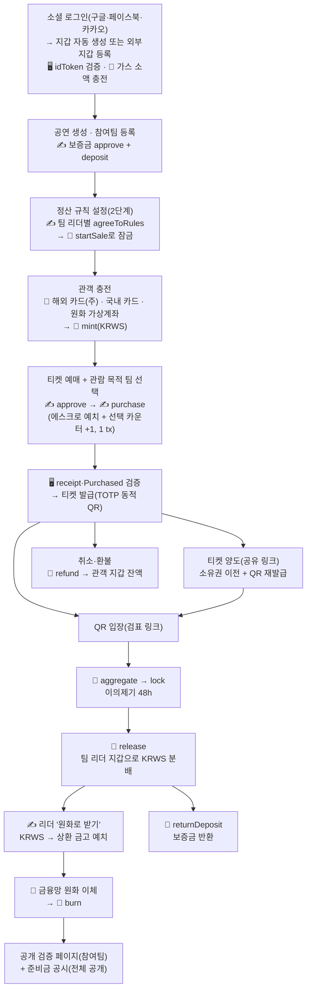

# [기획 초안 v3] 소규모 공연 티켓팅·공동 정산 플랫폼 — 전부 코인 · 외국인 관객 · 사용자 소유 지갑

> **9/2 팀 결정 — 최소 사이즈 원칙 + Web3Auth 동결**: 결정 문서 §14의 모든 안건을 "사이즈를 늘리지 않는" 쪽으로 확정했다. ① 인증·지갑 = **Web3Auth 단일**(소셜 3종). 자체 이메일 가입·로그인 삭제 → **P1**(F-member-02·10, API-member-02·08, C-02). ② 외부 지갑 연결은 **Web3Auth 모달의 외부 지갑 어댑터**(MetaMask·WalletConnect)로 처리하고 자체 챌린지 서명 API(API-wallet-03·04, F-wallet-05)는 **P1**. C-05는 모달 안내 화면으로 축소. ③ 충전 수단은 **카드만**(해외·국내). 가상계좌 충전·입금 시뮬레이션(F-charge-02, API-charge-04, A-14 `Bank transfer` 탭)은 **P1** — ERD 컬럼은 유지. ④ 체인·컨트랙트 설정은 프론트 환경변수 하드코딩, API-coin-04·F-coin-09는 **P1**. ⑤ 기본 언어 en·통화 USD 고정(국가별 자동 제안 없음, 수동 스위치만). ⑥ 코인 이름은 가칭 **KRWS 그대로 발표**. ⑦ **양도(선물)는 최후순위(P2)** — F-transfer-01~04, API-transfer-01~04, A-09·A-10, `transfer` 테이블 유지·구현 마지막. ⑧ **가스 = Kaia 수수료 대납(fee delegation) 채택 [팀 9/2]** — 사용자 지갑에 KAIA를 넣지 않는다. 사용자 서명 tx는 Kaia `FeeDelegatedSmartContractExecution` 타입으로 프론트(Web3Auth 키 + `@kaiachain/ethers-ext`)가 발신자 서명만 하고, 서버(운영지갑 = fee payer, `web3j` + Kaia `web3j-ext`)가 대납 서명 후 전송한다. 따라서 `signed-tx` 보고 본문은 `txHash`가 아니라 **발신자 서명 RLP**가 되고, 가스 자동 충전(F-wallet-04, API-wallet-05)은 삭제(P1 예비). 외부 지갑은 수수료 대납 서명을 지원하는 **Kaia Wallet만 MVP**, MetaMask는 P1. 나머지(approve+purchase 2단계·잔액 유지·카운터 미갱신·V-01 로그인 유지·모바일 외부 지갑 미지원)는 권고안 확정. 본문에서 위 항목은 제목에 `[P1 — 9/2 최소화]`로 표시했고 본문 서술은 v4 작성 시점 그대로다.

> SSAFY 15기 특화 프로젝트 · 핀테크 트랙 · B204 · **팀원 5명** · **발표일 2026-09-28 (월)** · 상태: 초안 (팀 검토 중)
>
> 작성 이력 — 작성 2026-08-26(v1 풀스코프) · **v2 2026-08-27 범위 재조정** · **v2.1 2026-08-27 스테이블코인 채택** · **v3 2026-09-02 전부 코인·외국인 관객 타깃·Web3Auth 지갑 전환** · 개정 2026-09-02(수) · 기준: [06_방향전환_코인전환_v1.md](./06_방향전환_코인전환_v1.md)
>
> 이전 버전 — **v2.1(8/27)은 [01_기획_초안_v2.md](./01_기획_초안_v2.md)**, **v1(8/26 풀스코프)은 [01_기획_초안_v1.md](./01_기획_초안_v1.md)** — 원문 그대로 보존한다.
>
> 원본 아이디어: [노션 - [아이디어2] 인디밴드 구체화](https://app.notion.com/p/3c22746d15ab804a91ffc769a2d34945) · 사전조사: [02_사전조사.md](./02_사전조사.md) · 협의 안건: [노션](https://app.notion.com/p/3c92746d15ab81cd91c6f0073a274fe7) · 네트워크 근거: [05_테스트넷_선정_리서치_v1.md](./05_테스트넷_선정_리서치_v1.md) · 시장·규제 근거: [핀테크 트렌드 종합분석 v1](../research/fintech-trends-2024-2026/00_종합분석_및_프로젝트_적용안_v1.md)
>
> 표기 — **[권]** = 권고안을 확정값으로 적은 항목(팀이 뒤집으면 §10 "뒤집을 때 고칠 곳"대로 수정) · **P0** MVP 필수 / **P1** MVP 이후 1차 확장 / **P2** 후순위·부가(시간 남으면 마지막)

> **v3 전환 요약 (2026-09-02)**
>
> 1. **모든 가치 이동을 코인 하나로.** 티켓 결제·환불·보증금·정산 분배·팀 수령이 전부 원화 스테이블코인(가칭 **KRWS**, decimals=0, 1 KRWS = 1원)으로 이뤄진다. SSAFY 교육용 금융망 API는 **충전(on-ramp)·팀 원화 출금(off-ramp) 창구로만** 남고 티켓 결제 수단에서 빠진다.
> 2. **타깃 전환 — 외국인 관객(내국인도 가능) · 한국인 팀.** 외국인 관객이 국내 계좌·본인인증 없이 소셜 로그인으로 지갑을 얻고 자국 카드로 원화를 충전해 예매한다. 화면 기본 언어는 en(ko 병행), 금액은 원 값 항상 + 표시 통화(USD 기본) 환산 병기.
> 3. **지갑 설계 전면 교체.** v2.1의 팀 전용 수탁형(커스터디얼) 서버 서명 지갑과 서버 보관 팀 키 설계는 **폐기**한다. 관객·팀 리더 모두 Web3Auth(소셜 로그인 기반 MPC) 자동 생성 지갑 또는 외부 지갑(Kaia Wallet·MetaMask) 등록을 쓴다.
> 4. **결제·동의·보증금·출금 예치는 사용자가 서명한다.** 프론트가 tx를 구성하고 사용자가 지갑에서 서명하며, 판매 시작·환불·release·mint·burn·가스 충전만 운영자가 실행한다.
> 5. 로그인은 **Web3Auth 소셜 3종(구글·페이스북·카카오) 동결** + 자체 이메일 가입(보조). 네트워크는 **Kaia Kairos(chainId 1001, `0x3e9`) 주 + EC2 Besu 백업**(v2.1의 테스트넷 전제는 8/31 결정으로 교체됨, 근거 05 §0).
> 6. MVP 컨트랙트 **2종**(KRWS + RevenueSplitter), MVP 기능 **12 → 15개**, 화면 35개, 도메인 16개. v2.1 §8.4 스테이블코인 설계는 복원·개정되었고 §8.2 지갑 절은 새로 쓰였다.
>
> 이 문서는 [06_방향전환_코인전환_v1.md](./06_방향전환_코인전환_v1.md)(결정 문서·SSOT)를 유일한 입력으로 삼아 v2.1의 구조 위에 새로 쓴 것이다. 결정 문서와 이 문서가 다르면 **결정 문서가 우선**한다.

---

## 1. 프로젝트 개요

### 한 줄 소개

> 한국 인디 공연을 보러 온 **외국인 관객**이 소셜 로그인으로 지갑을 얻고 자국 카드로 **원화 코인**을 충전해 예매하고, 여러 **한국인 밴드**가 사전 합의한 규칙대로 **원 단위로 정확히 나눠 받는** 티켓팅·공동 정산 플랫폼

### 블록체인 특화 관점

> 참여팀이 사전 합의한 정산 규칙을 **스마트 컨트랙트에 잠그고**, 관객의 "관람 목적 팀" 선택을 **결제 트랜잭션 안에 함께 기록**해 공동 공연 수익을 원화 스테이블코인으로 투명하게 자동 분배한다. **플랫폼이 시연용 가상 원화 스테이블코인을 발행·소각·준비금 공시한다** — 금융망 원화 입금 확인에만 결합된 mint, 원화 이체 성공 후 burn, 예치 잔액 ≥ 유통량의 준비금 공시를 누구나 확인할 수 있다. 그리고 **지갑은 사용자 소유(Web3Auth/외부 지갑)이며, 서버는 사용자 키를 보관하지 않는다** — 관객의 잔액과 팀의 정산금은 플랫폼 계정이 아니라 사용자 지갑에 있다.

### 핵심 가치 (세 기둥)

1. **공동 공연의 투명한 수익 분배** (핵심 차별점) — 관객이 예매 시 "누구를 보러 왔는지" 선택하고, 그 선택이 결제 트랜잭션(`purchase`) 안에 온체인 카운터로 남는다. 판매 시작 전 참여팀 리더 전원이 지갑으로 동의해 잠근 규칙에 따라 컨트랙트가 팀 리더 지갑에 코인을 분배(`release`)하고, 리더는 "원화로 받기" 서명 한 번으로 금융망 원화를 수령한다. 참여팀은 검증 페이지에서 1원 단위까지 재계산할 수 있다.
2. **외국인 관객이 국내 금융 절차 없이 예매하는 경험** (v3 신설) — 국내 계좌·본인인증·휴대폰 인증 없이 구글 로그인만으로 가입·지갑 생성이 끝나고, 자국 카드로 원화를 충전한다(카드사가 환전). **환전은 가장자리에서만 일어나고 정산 원장은 원화 하나**이므로, 환율 오라클 없이도 "누구나 재계산 가능"이 유지된다. T-money·Suica 선불 잔액과 같은 설명으로 통한다.
3. **안전한 티켓 양도** — 공유 링크로 양도 → 수락 시 소유권 이전 + 기존 QR 즉시 폐기·재발급. 개정 공연법이 남긴 **합법 경로(최초 판매자가 동의한 정가 이하 공식 양도 채널)**의 전형이다(§2 각주).

> 유지되는 원칙 — **탈중앙은 주장하지 않는다.** 정산 흐름(판매 시작·집계·잠금·release·환불)은 여전히 운영자가 발의·실행한다. 우리가 주장하는 것은 "잠긴 규칙과 기록이 사후에 바뀌지 않고, 계산을 누구나 재현할 수 있으며, 사용자 자산이 플랫폼 금고가 아니라 사용자 지갑에 있다"는 세 가지다.

---

## 2. 기획 배경 및 문제 정의

취미·인디 밴드 공연은 3~4팀이 함께 무대를 채우는 **공동 공연이 표준**이다. 그런데 정산은 "팀별 매표 코드 분리 → 자기가 판 만큼 가져가기"나 구두 합의로 이뤄지고, 사후 규칙 변경·불투명한 계산 때문에 분쟁이 잦다. 예매는 구글폼·계좌이체, 입장은 수기 명단 확인이 현실이다. 여기에 v3에서 **외국인 관객의 결제 공백**이 문제 축으로 추가된다.

| # | 문제 | 현재 상황 |
|---|------|-----------|
| P1 | 대형 티켓 플랫폼 진입 장벽 | 메일 문의→심사→판매대행 계약, 사업자등록증 요구 등 절차 장벽 |
| P2 | 예매·입장·정산 파편화 | 홍보(SNS), 예매(구글폼·계좌이체), 입장(수기 명단), 정산(수작업)이 따로 놀음 |
| P3 | 판매·입장 관리 부담 | 공연자가 입금 확인, 명단 대조를 직접 수행 |
| P4 | **공동 공연 기여도 산정 불가** | "누구 덕에 팔린 티켓인지" 알 수 없음 |
| P5 | **수기 정산의 불투명성** | 규칙 사후 변경·계산 불투명 → 분쟁 ("카운팅 정산" 보이콧 사례) |
| P6 | 티켓 선물·양도 리스크 | 사기, 중복 사용 |
| P7 | 공연 기록 부재 | 관람 기록·콘텐츠가 남지 않음 |
| **P8** | **외국인 관객의 예매 불가 (v3 신설)** | 소규모 공연 예매는 국내 카드·계좌이체·휴대폰 본인인증 전제. 방한 관광객·체류 외국인은 홍대 인디 공연을 알아도 **결제 단계에서 이탈**한다. 현장 현금 판매로 흘러 정산 근거도 남지 않음 |
| **P9** | **정산 지연·판매대금 유보 (v3 명문화)** | 국내 판매대행 수수료 7.7~8.8% + 공연 종료 후 사후 정산, 해외도 순매출 유보가 기본(리서치 00 A7). "공연이 끝나도 돈이 안 들어오고, 여러 팀이 나누는 건 알아서 하라"는 공백 |

→ **P4·P5(공동 정산)가 이 프로젝트의 중심**이고, **P8(외국인 결제 공백)이 v3의 새 진입점**이다. P6(양도)·P2/P3(티켓팅 자동화)이 그 주변을 받친다. **타겟**: 티켓 100매 이내 규모의 취미·소규모 밴드의 3~4팀 공동 공연, 관객은 **방한·체류 외국인 우선(내국인도 가능)**.

### 2.1 시대적 근거 (발표 도입부)

| 근거 | 내용 | 출처 |
|---|---|---|
| 정산자금 분리·정산주기 단축의 법제화 | 티메프 사태(2024.7) 이후 전금법 개정(PG 정산자금 외부관리, 2026-12-17 시행)·대규모유통업법 개정(**공연 등 서비스는 이용일+10일 정산**, 판매대금 50% 별도관리). 규제가 강제하는 방향(자금 분리·신속 정산·공시)을 컨트랙트 에스크로 + 공개 검증으로 선반영 | 리서치 00 A1·A2 |
| 은행권의 원화 스테이블코인 정산 실증 | **KB×Kaia 통합 PoC(2026-05-17)** — 발행 → 오프라인 결제 → 가맹점 정산 → 해외송금까지 통합 검증. "은행이 원화 스테이블코인 정산을 검증한 체인의 테스트넷에서 시연한다" | 리서치 00 A3, 05 §0 |
| 프로그래머블 결제의 상용 선례 | JPMorgan Kinexys 누적 $4T — "입금 수령 시 규칙 기반 자동 분배"는 글로벌 은행이 상용화한 패턴. RevenueSplitter는 그 소규모 공연 버전 | 리서치 00 A5 |
| 지갑의 소멸(invisible wallet) | 패스키·계정 추상화·임베디드 지갑으로 "시드문구·가스비·체인을 모르는" 온보딩이 2026 표준. Web3Auth 소셜 로그인 지갑이 그 표준의 구현 | 리서치 00, 02 §10 |
| 인바운드 관광·외국인 결제 수요 | 방한 관광객·체류 외국인 증가, 카카오페이 해외결제 +20%, 트래블카드 확산 | 리서치 01 §9, 06 §5 |
| 공연 시장의 성장과 양극화 | 티켓판매액 1.27조(2023) → 1.73조(2025, +18.8%)인데 대형·수도권이 82.7%, 홍대 라이브클럽 절반이 공연장 미등록 회색지대 | 리서치 00 A6 |

### 2.2 개정 공연법 표현 정정 (v2.1 문구 교체)

v2.1과 이전 명세의 "개정 공연법 = 재판매 **상한 금액**의 근거" 표현은 부정확했다. 실제 구조는 **별도 상한 금액을 정한 것이 아니라, ① 구입가를 초과하는 판매를 상습·영업으로 하는 행위를 금지하고 ② 최초 판매자가 동의한 채널에서만 재판매를 허용**하는 것이다(제4조의2). 즉 **사실상의 상한은 본인 구입가**다. 시행일도 이원 구조로, **법률은 2026-08-11, 시행령(과징금 2~50배·포상금)은 2026-08-28** 시행이다.

> 권고 표현(이후 전 문서 통일) — "개정 공연법(법률 2026-08-11 · 시행령 2026-08-28 시행)은 **구입가 초과 재판매를 금지하고 최초 판매자가 동의한 공식 양도 채널만 허용**한다. 본 플랫폼의 **정가 이하 양도 기능이 그 공식 채널에 해당**한다."

또한 제4조의2 제2항은 판매자·중개 플랫폼에 부정거래 방지를 위한 **기술적·관리적 조치**(본인 확인, 신고 기능, 제재 공지 등) 의무를 둔다 — 양도 이력 기록·신고 기능은 P1 후보로 §10에 올린다. 유료 재판매(P2)의 가격 상한은 "최초 구입가 이하"로 유지한다. *(최종 확정 전 국가법령정보센터 원문 대조 필요 — 리서치 00 §3-1)*

---

## 3. 주요 사용자

| 사용자(actor) | 주요 목적 | 지갑 |
|---|---|---|
| `GUEST` | 공연 탐색·상세(en/ko, USD 환산), 양도 링크 진입, **준비금 공시 열람**, 표시 환율 조회 | 없음 |
| `AUDIENCE` **관객 — 외국인 우선(내국인도 가능)** | 소셜 로그인 가입, 카드 충전, 잔액 결제·"원화로 결제"(서명), 관람 목적 팀 선택, 티켓 양도·QR 입장, 환불(잔액으로 반환) | **사용자 소유** — Web3Auth 자동 생성 지갑 또는 외부 지갑 등록. 회원당 1개 |
| `PERFORMER` **팀 리더 — 한국인** | 공연 생성·참여팀 관리, 보증금 납부(서명), 정산 규칙 동의(서명), 판매 현황, 정산금 수령, **"원화로 받기"** | **사용자 소유** — 리더 지갑 = 팀 지갑(팀당 리더 1인). 정산 계좌(예금주 검증) 별도 등록 |
| `STAFF` 검표 관계자 | 링크 토큰으로 검표 페이지 진입, QR 스캔·입장 처리 | 없음 |
| `ADMIN` 플랫폼 관리자 | 이의제기 처리, **표시 환율 등록·준비금 경고 확인**, (P1) 실패 작업 재시도·회원/공연 관리 | 운영지갑(operator) — 서버 보관 |

### 3.1 페르소나 3종

| # | 페르소나 | 시나리오 | 이 사람에게 필요한 것 |
|---|---|---|---|
| ① | **에밀리, 27세 · 미국인 · 서울 여행 5일차** | 홍대 라이브클럽 공동 공연(3팀)을 인스타에서 보고 예매하려 하나 국내 카드·본인인증이 없다 | 구글 로그인 1번 → 지갑 자동 생성 → 자국 카드로 ₩30,000 충전(≈ $22.20, 카드사 환전) → "Confirm in your wallet" 서명 결제 → 모바일 QR 입장. **영어 UI·USD 병기** |
| ② | **지훈, 24세 · 한국인 관객** | 친구가 공유한 양도 링크로 들어왔고, 카드 대신 계좌 입금을 선호한다 | 카카오 로그인 → 원화 가상계좌 충전(30분 기한) → 잔액 결제. 환불금은 **잔액으로 남아 다음 공연에 사용** |
| ③ | **민서, 29세 · 한국인 3인 밴드 리더(공연 생성팀)** | 3팀 공동 공연을 열고 정산 분쟁 없이 나누고 싶다. 이미 Kaia Wallet을 쓴다 | 구글 로그인 지갑 또는 **외부 지갑 등록(서명 챌린지)** → 보증금 50,000 서명 납부 → 규칙 설정·전원 동의 서명 → 공연 후 리더 지갑으로 정산금 도착 → 정산 계좌(예금주 검증) 등록 후 **"원화로 받기" 서명 1회** → 원화 수령 |

> v2.1의 "관객은 지갑이 없다 · 팀 지갑 키를 플랫폼이 보관한다" 전제는 v3에서 **폐기**되었다. 관객·팀 리더 모두 자기 지갑을 갖고, 서버가 보관하는 키는 운영자·발행·소각 3개뿐이다(§8.2).

---

## 4. 유사 서비스 분석 및 차별점

| 서비스 | 커버 영역 | 한계 |
|---|---|---|
| 인터파크·멜론·예스24 티켓 | 예매·입장 | 소규모 공연 등록 어려움, 공동 정산 미지원, 외국인 결제는 국내 카드·본인인증 전제 |
| 플레이티켓·인디스트릿 | 소규모/인디 예매 | 예매에 한정, 공동 정산·검표 고도화 없음 |
| 구글폼 + 계좌이체 (현행 관행) | 예매 | 수기 관리, 검증 불가, 정산 수작업, 외국인 사실상 불가 |
| 해외 관광객용 티켓 플랫폼(클룩·마이리얼트립 등) | 관광 액티비티 예약 | 소규모 인디 공연은 취급 대상 밖, 공동 정산 개념 없음 |

### 차별점 (사전조사 검증 + v3 전환 반영 — 상세: 02_사전조사.md §2.2)

1. ✅ **관객 선택 기반 공동 공연 수익 자동 정산** (검증: 최강 차별점 — 국내 상용 사례 없음, 수작업 관행의 분쟁 사례 실증) — **유일한 핵심 차별점으로 집중**
2. 🆕 **국내 금융 절차 없는 외국인 예매 경로** — 소셜 로그인 지갑 + 자국 카드 원화 충전 + 영어 UI. "환전은 카드사에서, 정산은 원화 코인 하나로"
3. 🆕 **사용자 소유 지갑 위의 정산** — 관객 잔액과 팀 정산금이 플랫폼 예수금이 아니라 사용자 지갑에 있다. 티메프 이후의 "정산자금 분리" 서사와 직결
4. **안전한 티켓 양도** — 링크 수락 즉시 소유권 이전 + QR 재발급 (일반 티켓 기반, 공연법 공식 채널)
5. **공연 기록** (포토 티켓) — 인디 특화 관람 기록 서비스 부재 (P1)
6. ⚠️ NFT 티켓 — **P2**. 차별화 논리는 "암표 방지"가 아니라 **유통 이력 투명화·양도 규칙의 온체인 강제**로 잡는다(국내 암표 대응 주류는 얼굴인식으로 이동, 리서치 00 C1)

> ❌ QR 입장은 단독 차별점이 못 됨 — "수기 명단 확인 구간의 자동화"로 좁혀 서술.
> ⚠️ 경쟁: 인디스트릿이 2026년 자체 예매 시스템 오픈 — 예매 단독 어필 금지, 무게중심은 정산.
> 📌 "대관 → 공연 페이지 연결"은 조사에서 유효 판정이었으나 범위 재조정으로 제외 — 확장 후보로만 기록.

---

## 5. 전체 서비스 흐름

표기: 🔗 운영자 온체인 tx · ✍️ **사용자 서명** tx · 🏦 금융망 API · 🖥 서버 처리



핵심은 **원장이 하나**라는 것이다. 관객이 카드로 결제하든 잔액으로 결제하든 티켓 대금은 반드시 `purchase`로 에스크로에 들어오고, 팀이 받는 돈은 반드시 `release`에서 나온다. 금융망은 그 앞(충전)과 뒤(팀 원화 출금)에만 붙는다.

> v2.1 흐름도([assets/service-flow_v2.1.svg](./assets/service-flow_v2.1.svg))는 금융망 직접 결제 전제이므로 v3에서는 사용하지 않는다. 새 SVG는 화면설계 v4 확정 후 갱신 예정.

---

## 6. 주요 기능 정의 및 우선순위

우선순위: **P0** = MVP 필수 / **P1** = MVP 이후 1차 확장 / **P2** = 후순위·부가

| 영역 | 기능 | 우선순위 | 비고 |
|---|---|:---:|---|
| **인증** | **Web3Auth 소셜 로그인 3종(구글·페이스북·카카오)** — 최초 로그인 = 가입, idToken(JWKS) 검증 → 세션 JWT(access 30분/refresh 14일) | P0 | 3종 동결. 자체 이메일 가입은 **보조**(지갑은 첫 결제 전 연결 필수) |
| **지갑** | **사용자 소유 지갑** — Web3Auth MPC 지갑 자동 생성 **또는** 외부 지갑(Kaia Wallet·MetaMask) 등록(서명 챌린지). 회원당 1개, 관객·리더 동일. 잔액·거래 이력 조회, 가스 자동 충전 | P0 | 서버는 사용자 키를 보관하지 않는다. 외부 지갑 등록은 컷 라인 1순위 |
| **충전** | **해외 카드(주)** · 국내 카드 · 원화 가상계좌 충전 → 금융망 입금 확인 후 `mint` | P0 | 1회 최소 1,000 / 최대 1,000,000 KRWS, 가상계좌 기한 30분 [권] |
| **스테이블코인** | **플랫폼이 시연용 가상 원화 스테이블코인(가칭 KRWS)을 발행·소각·준비금 공시** — ERC-20, decimals=0, 1 KRWS = 1원. 원화 입금 확인 시 mint, 원화 이체 성공 후 burn, **예치 잔액 ≥ 유통량 공개** | P0 | 테스트넷 자체 발행(모의). 발행 로직은 얇은 `CoinIssuerPort` 뒤(§8.6) |
| **결제** | **잔액 결제** / **"원화로 결제"**(부족분 자동 충전 → 서명 결제). ✍️ `approve` + `purchase` 2단계 서명, **결제 tx가 관람 목적 팀 선택을 함께 기록** | P0 | 금융망 직접 결제 없음(원장 단일화). ERC20Permit 1-서명은 P1 |
| **공연** | 단독·공동 공연 생성, 출연팀 등록(초대·승인), 티켓 옵션 설정, 판매 현황, 검표 링크 발급 | P0 | 판매 시작 후 규칙 변경 불가 |
| **보증금** | 공연 생성팀 리더가 ✍️ `deposit`으로 **50,000 KRWS** 납부 [권] → 규칙 설정 가능. 정산 확정 또는 일괄 환불 완료 시 반환 | P0 | 몰수(`forfeitDeposit`)는 P1 |
| **정산 규칙** | 2단계 규칙(고정 분배 비율 + 관객 선택 비율, 합 10000bp / 고정 풀 내 팀별 비율) 설정 → ✍️ **팀 리더별 동의 서명** → 🔗 `startSale` 잠금 | P0 | 서로 다른 주소가 같은 규칙 해시에 동의한 기록이 핵심 시연 장면 |
| **예매·티켓** | 티켓 예매, 관람 목적 팀 선택, 주문 조회, TOTP 동적 QR 발급 | P0 | 판매 마감 = 공연 시작 1시간 전 |
| **취소·환불** | 개별 취소(기한별 수수료 D-7 전액 / D-3 50% / 이후 불가), 공연 전체 취소 일괄 환불. 🔗 `refund` → **관객 지갑 잔액으로 반환**, 선택 카운터 −1 | P0 | 수수료분은 에스크로에 남아 정산 재원. 카드 취소(모의)는 P1 |
| **양도(선물)** | 공유 링크로 **일반 티켓 양도** → 수락 시 소유권 이전(DB) + 기존 QR 폐기·재발급 | P0 | 정가 이하·플랫폼 동의 채널(§2.2) |
| **입장** | TOTP 동적 QR, 검표 링크 페이지, 실시간 검증·재사용 차단 | P0 | 고정 티켓번호 QR 금지 |
| **정산** | 관객 선택 집계 → 🔗 `aggregate` → `lock` → 이의제기 48h → 🔗 **`release`로 팀 리더 지갑에 KRWS 분배** | P0 | **핵심 차별 기능** — 온체인 분배가 곧 실제 정산 |
| **팀 원화 출금** | 리더가 ✍️ "원화로 받기"(KRWS → 상환 금고 예치) → 🏦 금융망 원화 이체 → 🔗 `burn`. 정산 계좌 등록·예금주 검증 | P0 | 자동 push 이체 없음(서명 필요). 이체 실패 시 금고 → 리더 반환 |
| **검증** | **공개 정산 검증 페이지**(참여팀 로그인) — 컨트랙트·토큰 주소, 잠긴 규칙, 온체인 카운터, 팀별 산출액, tx 링크 + 브라우저 재계산 / **준비금 공시(전체 공개)** | P0 | "그냥 DB로 되잖아요" 방어의 실체 |
| **i18n·통화** | **en 기본 · ko 병행**, 금액은 **₩ 정수 항상 + 표시 통화(USD 기본) ≈ 환산 병기**, 회원 시간대 + KST 병기 | P0 | 환율은 **표시 전용** — 정산·분배·컨트랙트·충전 금액에 사용 금지 |
| **관리자** | 이의제기 처리, 표시 환율 등록, 준비금 불일치 경고 확인 | P0(최소) | 실패 작업 재시도·회원/공연 관리 화면은 P1 |
| 교환 | 티켓 옵션 교환(회차·좌석·등급), 관객 간 1:1 교환 | P1 | 차액은 코인 결제·환불 |
| 결제 UX 개선 | **ERC20Permit + `purchaseWithPermit` 1-서명 결제**, Kaia 수수료 대납(fee delegation) | P1 | 서명 2회 → 1회, 가스 개념 완전 은닉 |
| 관객 출금 | 충전 카드 취소(모의) / 원화 계좌 출금 | P1 | MVP는 잔액 유지(출금 화면 없음) |
| 월렛 | 월렛 티켓 패스 (구글월렛 demo mode + RotatingBarcode → 애플 2순위) | P1 | NFC는 추후 |
| 기록 | 관람 이력, 사용 완료 디지털 티켓, 장르별 포토 티켓 | P1 | 입장 처리된 관객에게만 |
| 코인 교환 | **USDC ↔ KRWS 교환·역교환**(모의 `tUSDC` + `KRWSExchange`) | **P2** | 설계만 기록, MVP 미배포 |
| 온체인 출금·외국인 팀 | 팀의 온체인 주소 출금, 외국인 팀의 해외 수령 | **P2** | 외국환거래법 검토 필요 |
| 발행 주체 교체 | `ExternalIssuer` — 인가 발행사 코인 연동 | **P2** | 문서 설계만, 코드 없음(Q&A 방어) |
| NFT | **NFT 티켓 (ERC-721)** — 티켓 소유권·이전 이력 온체인 | **P2** | 이제 관객도 지갑을 가지므로 **전제 조건이 이미 충족**된다는 점이 v3의 이점 |
| 거래(재판매) | 구매자 간 유료 재판매 (최초 구입가 이하) | **P2** | 근거는 §2.2 |

### 6.1 기능별 사용 가능 기술 (토글)

> ✅ = 사전조사·리서치로 검증·확정된 항목

<details>
<summary><b>인증 — Web3Auth 소셜 로그인 (v3 전면 교체)</b></summary>

- **로그인 = Web3Auth 소셜 로그인 3종(구글·페이스북·카카오) 동결.** 프론트가 Web3Auth SDK로 소셜 로그인 → `idToken` + MPC 지갑(주소) 확보 → `POST /auth/web3auth {idToken, address}`
- 백엔드: **idToken JWKS 검증**(aud·exp·nonce) → 회원 생성/조회 → `wallet(provider=WEB3AUTH, address)` 등록 → 세션 JWT 발급 → 운영지갑이 가스 소액 충전 job 제출
- 자체 이메일 + 비밀번호 가입은 **보조 경로**로 남기고, 이 회원은 **첫 결제 전 지갑 연결 필수**(Web3Auth 이메일 패스워드리스 또는 외부 지갑 등록) [권]
- 미결: Web3Auth 무료 요금제의 **MAW(월 활성 지갑) 한도**와 커스텀 verifier·화이트라벨 포함 여부를 9/3까지 공식 요금표로 확인(§10-16). 장애 시 외부 지갑 경로로 우회
- 체인 설정(§10-17): `chainNamespace=eip155`, `chainId=0x3e9`, `rpcTarget=https://public-en-kairos.node.kaia.io`, `displayName=Kaia Kairos`, `ticker=KAIA`, 익스플로러 `kairos.kaiascan.io` — 프론트는 서버 API로 받아 초기화(하드코딩 금지)
</details>

<details>
<summary><b>지갑 — 사용자 소유(비수탁) (v3 전면 교체)</b></summary>

- **두 경로**: ① Web3Auth MPC 지갑 자동 생성(키 샤드는 클라이언트에서 재구성, 서명도 클라이언트) ② 외부 지갑 등록 — `POST /wallets/challenge`로 서버 난수 nonce + 도메인 바인딩 메시지(5분·1회용) 발급 → 지갑 앱 서명 → `POST /wallets/verify`로 소유 증명
- **회원당 지갑 1개**(주소 UNIQUE). 팀 지갑 = 팀 리더 지갑. 지갑 교체는 MVP 미지원(잔액 0 확인 후 관리자 처리, 화면은 P1)
- **서버 DB·로그·코드에 사용자 개인키·니모닉·MPC 샤드가 0건**이어야 한다
- 가스: 지갑 등록·생성 시 운영지갑이 KAIA 자동 충전(관객 **0.05** · 팀 리더 **0.5** [권]), 서명 직전 임계 미달(관객 0.01·리더 0.05) 시 재충전 후 진행. 사용자에게 가스 개념은 노출하지 않고 "Confirm in your wallet" 한 줄만 보인다
- 모바일 외부 지갑 서명(WalletConnect·딥링크)은 리허설 후 결정 — 시연은 데스크톱 확장 지갑 + Web3Auth 중심(§10-19)
</details>

<details>
<summary><b>사용자 서명 tx 패턴 — 플랫폼 발의·사용자 서명</b></summary>

- 프론트가 `to`·`data`·`value=0`·`gas`를 구성해 Web3Auth 내장 프로바이더(`eth_sendTransaction`) 또는 연결된 외부 지갑으로 서명·전송한다. **사용자가 지갑 앱에서 입금 주소로 직접 보내는 흐름은 없다**(입금 매칭·오입금 리스크)
- API 규약: `POST …/prepare`가 서명 파라미터(`to`, `data`, `chainId=1001`, 사람이 읽을 요약)를 반환 → 프론트 서명·전송 → `POST …/signed-tx {txHash}` 보고 → 서버가 **receipt·이벤트를 검증**해 상태 전이(`chain_job.signer_type=USER`)
- 서명 전 화면에 tx의 `to`·요약("Confirm ₩15,000 payment")을 사람이 읽을 수 있게 표시한다
- 사용자가 팝업을 닫으면 주문은 `PENDING_PAYMENT` 유지(15분 만료)이고 **충전된 코인은 잔액으로 남는다** — 돈이 사라지는 경로를 만들지 않는다
</details>

<details>
<summary><b>충전·출금 (금융망 = on/off-ramp)</b></summary>

- SSAFY 교육용 금융망 API — 카드 거래 생성(해외/국내), 가상계좌 발급·입금 확인, 원화 이체, 예치 계좌 잔액 조회
- **해외 카드**가 주 경로. 카드사가 환전해 원화로 매입한다고 가정하므로 **준비금은 항상 원화 한 종류**다. 국내 카드는 같은 API에 `card_region` 표시와 환전 고지 유무만 다름
- 멱등키 기반 재시도, 실패·타임아웃 보상(오류 = FAILED, 타임아웃 = 결과 재조회 예약, **어느 경우도 mint 없음**)
- 팀 원화 출금: ✍️ 리더 `transfer(상환금고)` → 🏦 이체 → 🔗 `burn`. **순서 불변** — 이체 성공 확인 후에만 burn, 이체 실패 시 운영자가 금고 → 리더 반환
</details>

<details>
<summary><b>스마트 컨트랙트 — MVP 2종 (RevenueSplitter + KRWS)</b></summary>

- Solidity + **OpenZeppelin v5**, **Hardhat 3** ✅ (Kairos는 Prague·Osaka 하드포크 적용된 최신 EVM이라 툴체인 변경 없음, 05 §0)
- **KRWS**: `ERC20` + `AccessControl` + `ERC20Pausable`, decimals=0. `mint(to, amount, chargeRef)`(MINTER) · `burn(amount, withdrawalRef)`(BURNER=상환 금고 자기 잔액) · `pause/unpause`(ADMIN, 준비금 불일치 시) · 표준 `transfer/approve/transferFrom`. `totalSupply` = 유통량 공시 소스. (P1) `permit`
- **RevenueSplitter**: 생성자 인자 `IERC20 token`으로 **어떤 ERC-20 원화 코인과도 동작**한다(`transferFrom`·`transfer`·`balanceOf`만 사용, mint/burn 없음)
  - `createShow(showId, teamWallets[], teamShareBp[], fixedRatioBp, rulesHash, depositAmount)` (OPERATOR) — 팀 지갑 = 각 리더의 등록 지갑 주소 **스냅샷**
  - ✍️ `deposit(showId)`(생성팀 리더) · ✍️ `agreeToRules(showId, rulesHash)`(참여팀 리더) · 🔗 `startSale(showId)`(전원 동의 후 잠금)
  - ✍️ **`purchase(showId, orderRef, teamIndex, amount)`(관객)** — `transferFrom` + `escrow += amount` + `choiceCount[teamIndex]++`. **결제와 관객 선택 기록이 한 tx**
  - 🔗 `refund(showId, orderRef, to, teamIndex, amount)`(OPERATOR) — 에스크로 → 관객 지갑, 카운터 −1, `orderRef`당 누적 환불 ≤ 구매액, lock 이후 revert
  - 🔗 `aggregate` / `lock` / `release`(push, dust 처리) / `returnDeposit` / `forfeitDeposit`(P1) / `halt`
  - view: `escrowOf`, `choiceCountOf`, `computeShares`, `rulesHashOf`, `agreedOf`, `token()` — 검증 페이지가 직접 읽는다
- ⚠️ OZ v5에서 `PaymentSplitter`·`_beforeTokenTransfer` 삭제 — v4 예제 이식 금지
- ⚠️ Kairos legacy tx는 `gasPrice ≥ baseFee`(하한 25 gkei) 강제 → web3j에서 `eth_gasPrice` 값을 그대로 사용. KaiaScan 컨트랙트 검증은 웹 UI에서 수동(2종·1회)
</details>

<details>
<summary><b>공개 정산 검증 페이지 + 준비금 공시</b></summary>

- 공연별(참여팀 로그인): 컨트랙트·**토큰 주소**(익스플로러 링크) · 잠긴 규칙 해시와 원문 · 팀별 동의 tx · **온체인 선택 카운터** · 팀별 산출액 · `release` tx · 팀 지갑 주소 · 에스크로 잔액
- 브라우저에서 (잠긴 비율 × 온체인 카운터)를 재계산해 서버 표시값과 대조하는 위젯 — **1원도 다르지 않아야 한다**
- **준비금 공시(전체 공개)**: 금융망 원화 예치 잔액 vs KRWS 총 유통량, 차액, 갱신 시각(1분 캐시), "플랫폼 시연용 가상 발행(테스트넷)" 고지. 불일치 시 mint·release 중단 + 관리자 알림
- 자금 흐름 불변식 4개를 대사한다(§8.3)
</details>

<details>
<summary><b>QR 입장 처리</b></summary>

- 동적 QR: **TOTP 방식**(`ticket.qr_secret`) — 짧은 만료의 서명 토큰. 고정 티켓번호 QR 금지
- 재사용 차단: Redis `SETNX` 원타임 처리 + 입장 결과 기록(`ticket.entry_result`·`entered_at`)
- 스캐너: 검표 링크로 진입하는 모바일 웹 — `getUserMedia` + jsQR/ZXing (별도 앱 불필요)
- 근거 보강: QR 피싱(quishing) 2026년 월 1,870만 건 급증(리서치 00 B4). 단 **QR 보안은 서버 서명의 성과이며 블록체인 성과로 주장하지 않는다**
</details>

<details>
<summary><b>티켓 취소·양도·교환 (일반 티켓)</b></summary>

- 티켓 상태 머신(DB): 발급 → (양도중) → 사용완료 / 취소 / 교환됨
- 취소: 🔗 `Splitter.refund`로 에스크로 → **관객 지갑 잔액** 반환 + 온체인 선택 카운터 −1 (v2.1의 `cancelChoice` 별도 tx 삭제)
- 공연 전체 취소: 건별 `refund` job 일괄 실행(수수료 0) + 진행률 표시 → 완료 후 보증금 반환
- 양도: 서명된 일회용 수락 링크 → 수락 시 소유자 변경(DB 트랜잭션) + 기존 QR 시드 폐기·재발급
- 교환(P1): "취소 후 재예매"를 하나의 흐름으로, 차액은 코인 결제·환불
- 동시성: 양도중·교환중 티켓의 입장·중복 처리 차단 (Redis 락)
</details>

<details>
<summary><b>티켓 양도 링크 공유</b></summary>

- 공유 링크(카카오 JavaScript SDK **공유하기** 커스텀 템플릿) — 메시지 API 승인 없이 구현 가능
- 수락 링크: 서명된 일회용 토큰 딥링크 → 모바일 웹에서 수락(앱 설치 불필요)
- 외국인 관객 대응: 링크 랜딩은 **en 기본**, 수락에도 소셜 로그인 + 지갑 생성이 필요하다는 점을 사전 안내
</details>

<details>
<summary><b>i18n·표시 통화·시간대 (v3 신설)</b></summary>

- 회원 속성: `country_code`(ISO 3166-1 alpha-2, 자기 선언) · `locale`(**en 기본**, ko) · `display_currency`(**USD 기본**) · `timezone`(IANA)
- 금액 표기 규칙: **₩ 정수 항상 표시** + 표시 통화가 KRW가 아니면 "≈ $11.10" 환산 병기(환율·기준 시각 툴팁)
- 환율: 관리자가 `exchange_rate` 등록(`USD_KRW` **1,350** [권], 하루 1회, 시연 고정). **표시 환산에만 사용** — 정산·분배·컨트랙트·티켓 가격·충전 금액에 절대 사용 금지
- 시간: 회원 시간대 + **KST 병기**(공연 시각 오인 방지)
</details>

<details>
<summary><b>월렛 패스 (P1 — 구글 1순위 → 애플)</b></summary>

- ✅ **Google Wallet**: 구글 계정만으로 issuer 등록 → demo mode 즉시 발급. **RotatingBarcode**(TOTP 매분 회전)로 동적 QR 정책과 양립 (3사 중 유일)
- 🔶 Apple(선택): `.pkpass`, $99/년, 회전 바코드 없음 → "입장 시간대 1회 갱신" 타협
- NFC: 3사 모두 파트너 인증 필요 → 추후. 국내 공연 티켓의 월렛 발급은 사실상 공백
</details>

<details>
<summary><b>NFT 티켓 (P2)</b></summary>

- ERC-721 (OZ v5): ✅ `_beforeTokenTransfer` 삭제됨 → **`_update(to, tokenId, auth)` 오버라이드**로 플랫폼 경유 이전만 허용, `resale()`에서 최초 구입가 이하 강제
- 상태 enum(ISSUED/USED/CANCELLED), 메타데이터는 서버 JSON(개인정보·QR 원본 미포함)
- **v3의 이점**: 관객도 이미 자기 지갑을 갖고 있으므로 "관객 지갑 생성"이라는 최대 선행 작업이 사라진다. 일반 티켓 상태 머신 위에 컨트랙트 동기화만 얹으면 된다
</details>

---

## 7. 핵심 차별 기능: 공동 공연 수익 분배 설계

### 관객 선택 방식 (예매 시)

> "어떤 팀의 공연을 보고 싶어서 예매하셨나요?" / *"Which band are you coming to see?"*

- 기본값: **한 팀 선택** (집계·설명이 가장 단순, `purchase`의 `teamIndex` 1개)
- 선택은 **결제 트랜잭션 안에서 함께 기록**된다 — 별도 `recordChoice` tx는 v3에서 삭제. 취소 시 `refund`가 카운터를 되돌린다
- 옵션(협의 안건 §10): 여러 팀 선택(동일 비율 반영), 전체 공연 선택(공통 몫에 반영)

### 정산 공식 (2단계 — 요구사항 v3에서 확정, v2.1의 4단계 혼합식 대체)

```
1단계) 풀 분할        : 고정 분배 비율(fixed_ratio_bp) + 관객 선택 비율(selection_ratio_bp) = 10000bp
                        기본값 [권]: 고정 5000 · 관객 선택 5000
2단계) 고정 풀 내 배분 : 참여팀별 team_share_bp (합 10000bp)

팀별 최종 정산액 = (정산 재원 × fixed_ratio_bp/10000 × team_share_bp/10000)
                 + (정산 재원 × selection_ratio_bp/10000 × 팀 선택수/전체 선택수)

정산 재원 = 에스크로 잔액(판매액 − 환불액 + 취소 수수료), dust는 공연 생성 팀 귀속
```

- 각 비율은 **공연 생성 단계에서 참여팀이 합의하고 팀 리더 지갑으로 ✍️ 동의 서명**한다
- **티켓 판매 시작 이후 변경 불가** — `startSale`이 one-way로 잠그고 이후 setter는 전부 revert
- v2.1의 "공통 비용 우선 차감" 항목은 요구사항 v3에서 제거됐다(계산 단순화·설명 용이성)

### 이 기능이 컨트랙트를 쓰는 이유

| 질문 | 답 |
|---|---|
| "그냥 DB로 되잖아요?" | 규칙과 관객 선택이 **판매 시작 시점에 잠긴 해시·온체인 카운터**로 남는다. 팀은 서버를 믿지 않고 익스플로러와 검증 페이지에서 재계산할 수 있다 |
| "왜 코인이 필요한가?" | 분배 대상이 원화 계좌 이체면 "누가 언제 얼마 보냈는지"가 다시 서버 기록이 된다. 에스크로·분배가 **컨트랙트 잔액의 이동**이면 판매 총액·환불·분배 합이 체인에서 대사된다 |
| "왜 원화 코인 1종인가?" | RevenueSplitter는 비율로 나누는 계약이다. 안에 통화가 둘이면 매 결제마다 환율 오라클이 필요하고 "누구나 재계산"이 무너진다. 환전은 카드사(충전)와 은행(출금)에서만 — Visa가 카드사 단계에서 환전하고 가맹점은 현지 통화로 정산받는 구조와 같다 |

---

## 8. 블록체인 적용 설계 방향

원칙: **블록체인 적용 영역은 정산 하나에 집중.** 온체인은 검증에 필요한 최소 정보만, 상세·개인정보는 서버에. 발표 프레임은 "정산에 블록체인이 유용하다" — 블록체인은 수단, 신뢰 구조가 목적. v3에서 여기에 두 가지가 더해진다: **가치 이동 레일의 단일화(코인 1종)**와 **자산 보유 주체의 이동(사용자 지갑)**.

### 8.1 정산 컨트랙트 (RevenueSplitter)

| 온체인 기록 | 오프체인(서버) 보관 |
|---|---|
| 공연 식별 정보, 참여팀 리더 지갑 주소(생성 시점 스냅샷) | 관객 개인정보, 주문·결제 상세 |
| 정산 규칙 해시 + 팀별 동의 tx (판매 시작 후 불변) | 티켓 상세(좌석·QR 원본·TOTP 시크릿) |
| 에스크로 잔액, 관객 선택 카운터 (`Purchased` 이벤트의 합) | 충전·출금의 금융망 거래 번호, 정산 계좌 |
| 팀별 최종 정산 금액, `release`·`refund`·보증금 실행 내역 | 표시 환율, 회원 로케일·통화 |

- **자금 흐름**: 관객 카드·가상계좌 충전(🏦) → **동일 금액 KRWS `mint`(🔗) → 관객 지갑** → ✍️ `purchase`로 **에스크로 컨트랙트 예치** → 🔗 `release`로 팀 리더 지갑에 분배 → ✍️ 리더 "원화로 받기"(상환 금고 예치) → 🏦 원화 이체 → 🔗 `burn`. **온체인 분배가 곧 실제 정산**이고 금융망은 입출금(on/off-ramp) 창구다
- **원장 단일화**: 금융망 직접 결제(코인 우회)는 **병행하지 않는다.** 직접 받은 원화는 에스크로에 없어 `escrowOf` ≠ 실제 판매액이 되고, 검증 페이지가 판매의 일부만 검증하게 된다. "원화로 결제" 원스텝이 같은 사용자 경험을 주면서 원장을 하나로 유지하는 방법이며, 비용은 결제 지연(카드 승인 + mint ≈1초 + 서명 2회)과 보상 로직 하나다
- 실가상자산 미사용 — 테스트넷 자체 발행 모의 스테이블코인

### 8.2 지갑 설계 — 사용자 소유(비수탁) **[v3 전면 교체]**

v2.1의 "팀별 수탁형(커스터디얼) 지갑 + 서버가 팀 개인키를 암호화 보관하고 대신 서명" 설계는 **전부 폐기**한다. v3에서 **지갑은 사용자 소유(Web3Auth/외부 지갑)이며, 서버는 사용자 키를 보관하지 않는다.**

| 구분 | v2.1 (폐기) | v3 (확정) |
|---|---|---|
| 관객 지갑 | 없음 | **있음** — Web3Auth 자동 생성 또는 외부 지갑 등록 |
| 팀 지갑 | 팀별 서버 보관 키, 서버가 서명 | **팀 리더 개인 지갑**(회원 1:1, 팀당 리더 1인) |
| 서버 보관 키 | 팀 키 N개 + 운영지갑 | **3개만** — OPERATOR · MINTER · BURNER |
| 키 암호화·복호화 감사 | 서버 측 키 보호 설계 필요 | **불필요**(사용자 키 미보관). 서버는 서명 이벤트 감사 로그만 |
| 서명 주체 | 대부분 서버 | **사용자 4종 + 운영자 나머지**(아래 표) |

**서버 보관 키 3개**

| 키 | 보관 | 사용처 |
|---|---|---|
| `OPERATOR`(운영지갑) | 서버 내부 서브넷(KMS/환경변수 주입) | `createShow`·`startSale`·`refund`·`aggregate`·`lock`·`release`·`returnDeposit`·`halt`, 가스 충전 전송 |
| `MINTER` | 서버 내부 서브넷 | `KRWS.mint` — 충전 확정 후 발행 |
| `BURNER`(= 상환 금고 지갑) | 서버 내부 서브넷 | 상환 금고가 보유한 KRWS `burn` — 팀 원화 이체 성공 후 |

- 권한 분리: MINTER ≠ OPERATOR ≠ BURNER, 각각 별도 주소·별도 권한, KEK 외부 주입. 키 하나 유출 시 — MINTER: 무한 발행 가능하지만 **준비금 공시로 발각·`pause`** / OPERATOR: 에스크로 `refund` 남용 가능하지만 잠금 이후 revert·`orderRef` 검증 / BURNER: 상환 금고분만 소각 가능
- **서버 DB·로그·코드에 사용자 개인키·니모닉·MPC 샤드가 0건**이어야 한다

**서명 주체 표**

| 동작 | 서명자 | 함수 |
|---|---|---|
| 결제(2단계) | **관객** ✍️ | `KRWS.approve` → `Splitter.purchase` |
| 보증금 납부 | **생성팀 리더** ✍️ | `KRWS.approve` → `Splitter.deposit` |
| 정산 규칙 동의 | **참여팀 리더** ✍️ | `Splitter.agreeToRules` |
| 팀 원화 출금 예치 | **팀 리더** ✍️ | `KRWS.transfer(상환 금고)` |
| 판매 시작·환불·집계·잠금·분배·보증금 반환·중단 | 운영자 🔗 | `startSale`·`refund`·`aggregate`·`lock`·`release`·`returnDeposit`·`halt` |
| 발행·소각·가스 충전 | 운영자(MINTER/BURNER) 🔗 | `mint`·`burn`·KAIA 전송 |

- 새 보안 요구: Web3Auth idToken 검증(JWKS, aud·exp·nonce) · 외부 지갑 등록 **서명 챌린지**(난수 nonce + 도메인 바인딩, 5분, 1회용, 재사용 방지) · 회원당 지갑 1개(주소 UNIQUE) · 서명 전 tx의 `to`·`data` 요약을 사람이 읽을 수 있게 표시
- 업계 정합성: 패스키·계정 추상화·임베디드 지갑으로 대표되는 2026년 표준(리서치 00, 02 §10)과 일치한다. "플랫폼이 관객 돈을 쥐고 있지 않다"가 티메프 이후 정산자금 분리 서사와 맞물린다. 단 **정산 흐름을 운영자가 발의하므로 탈중앙은 주장하지 않는다**

### 8.3 신뢰 보강 3종 + 정산 시점 규칙 (적대적 검증 반영 — 필수)

"그냥 DB로 되잖아요"를 방어하는 장치 (상세: 02_사전조사.md §7):

1. **관객 선택을 결제 tx 안에 온체인 기록** — ✍️ `purchase(showId, orderRef, teamIndex, amount)`가 대금 예치와 선택 카운터 증가를 한 트랜잭션으로 처리한다. 집계가 서버 입력값이 아니라 **체인 이벤트(`Purchased`)의 합**이고, **관객 자신이 서명한 기록**이라 v2.1(서버가 대신 기록)보다 근거가 강해졌다. 취소 시 `refund`가 카운터를 되돌린다
2. **팀별 동의 트랜잭션** — 각 팀 **리더 개인 지갑**에서 `agreeToRules(showId, rulesHash)` 후에만 `startSale()` — 서로 다른 주소가 같은 규칙 해시에 동의한 기록이 익스플로러에 남는다 (핵심 시연 장면). v3에서는 그 주소가 **플랫폼이 만든 지갑이 아니라 팀의 지갑**이다
3. **공개 정산 검증 페이지 + 준비금 공시** — 참여팀이 직접 재계산하는 동선(V-01)과, 누구나 보는 발행 대사 페이지(V-02)

**정산 시점 규칙 (컨트랙트가 강제)**

```
취소·환불 마감 → 집계 확정(aggregate) → 정산 잠금(lock) → 이의제기 기간(48h) → release 활성화
```

- `release` 후 환불은 회수 불가 → 마감 후 환불은 오프체인 준비금 정책으로 분리
- KRWS **decimals=0, 1 KRWS = 1원** — 온체인 분배액과 팀 원화 출금액의 단위가 같다
- 발표 프레임: **"정산은 원화 코인으로 온체인에서 실제로 이뤄지고, 금융망은 충전·출금 창구다. 사용자 자산은 사용자 지갑에 있고, 발행은 준비금 공시로 검증된다"**

**자금 흐름 불변식 (검증 페이지가 대사하는 값)**

1. `token.totalSupply` = Σ(충전 mint) − Σ(팀 출금 burn)
2. 공연별 `escrowOf(showId)` = Σ(purchase) − Σ(refund) − Σ(release) (+ 보증금 별도 계정)
3. 공연별 Σ`Released` = 잠긴 규칙 × 카운터로 재계산한 분배액 합 (dust 포함, **1원도 다르지 않아야 한다**)
4. 준비금: 금융망 원화 예치 잔액 ≥ `totalSupply`

**보장하는 것 / 보장하지 않는 것**

- 보장: 잠긴 규칙의 사후 변조 불가 · 기록의 소급 수정 불가 · 분배 계산의 결정론적 재현 · 참여팀의 독립 검증 경로 · **사용자 자산의 자기 보관**
- 보장하지 않음: 입력 데이터(선택·매출)의 진실성 — "위조하면 발각되는 구조"로 대응. **QR 입장 보안은 서버 서명 QR의 몫이며 블록체인 성과가 아님**. 준비금 잔액 조회가 서버(금융망 API) 경유라는 한계는 발표에서 인정한다

### 8.4 KRWS 스테이블코인 설계 (v2.1 복원 + v3 개정)

**플랫폼이 시연용 가상 원화 스테이블코인을 발행·소각·준비금 공시한다.** 9/1 커밋에서 한 번 제거됐던 코인이 v3에서 정산·결제 레일 전체로 복귀했다.

| 항목 | 설계 |
|---|---|
| 명칭 | **가칭 KRWS**(Korean Won Stable). 관객 화면에는 "₩ / KRW"로만 보이고, 공연자·검증 화면에서만 코인명을 노출한다. 발표용 이름은 §10-1 |
| 발행 모델 | 플랫폼 자체 발행(테스트넷 모의) ERC-20 — OZ v5 `ERC20` + `AccessControl` + `ERC20Pausable`. 원화 1:1, **decimals=0** |
| mint | **금융망 원화 입금 확인(`FIAT_CONFIRMED`) 시에만** `mint(회원 지갑, amount, chargeRef)`. 입금 확인 없는 발행은 어떤 경로로도 금지 |
| burn | **팀 원화 이체 성공 확인 후에만** 상환 금고 잔액에서 `burn(amount, withdrawalRef)`. 순서 불변(이체 → burn) |
| 결제·환불·분배·보증금 | mint/burn 없이 **KRWS 이동만** — 관객 지갑 ↔ 에스크로 ↔ 팀 리더 지갑 |
| 전송 가능성 | 표준 ERC-20이라 자유 전송. 플랫폼이 제공하는 화면 경로는 결제·환불·분배·보증금·팀 출금 예치 5종. 외부 주소 출금 화면은 P2 |
| 준비금 공시 | **금융망 원화 예치 잔액 ≥ KRWS 총 유통량.** 예치·유통·차액·갱신 시각 공개(1분 캐시). 불일치 시 **mint·release 중단 + 관리자 알림**. 해외 카드 충전은 카드사가 환전해 원화로 매입한다고 가정하므로 준비금은 항상 원화 한 종류 |
| 법적 위치 | **원화 스테이블코인 발행 법제는 입법 추진 중.** 「디지털자산기본법」은 2026-08 기준 **미통과**이고, **2026-09 초 당정 통합안 발의 → 연내 통과 목표**다. 논의 중인 핵심 요건(발행 인가제·자기자본·발행액 상응 준비자산·이용자 상환청구권·공시)을 본 프로젝트는 **테스트넷 모의 발행**으로 선반영한다 — 준비자산 1:1 = 준비금 공시(V-02), 상환청구권 = 팀 원화 출금, 공시 = 검증 페이지. '51% 룰'(은행 컨소시엄) 논쟁은 "은행이 아닌 우리가 발행하는 건 테스트넷 실증이기에 가능"이라는 **한계 고지**로 답한다 |
| 대안 검토 | 테스트넷 실제 USDC를 faucet으로 받아 쓰는 방안이 있으나, **원화 정산에 달러 스테이블코인을 쓰면 환율 개념이 끼어 1원 = 1토큰의 단순성이 깨진다.** 자체 발행 KRWS를 채택하고 USDC 교환은 **P2**(모의 `tUSDC` + `KRWSExchange`, 설계만) |
| 새 신뢰 지점 | mint는 여전히 플랫폼 신뢰에 의존한다 → 준비금 대사를 공개해 "예치 없이 찍었으면 발각되는 구조"로 대응하고, 발행 로직은 §8.6의 인터페이스 뒤에 둔다 |

### 8.5 NFT 티켓 (확장 — P2)

시간이 남으면 마지막에 붙이는 부가 기능. 양도 이력의 소급 수정 불가 + 정산 근거 원장 역할. 설계는 §6.1 토글 참조. 발표에서는 로드맵으로만 다루고, 차별화 논리는 "암표 방지"가 아니라 유통 이력 투명화·양도 규칙의 온체인 강제로 잡는다.

### 8.6 발행 어댑터 — `CoinIssuerPort` (얇은 인터페이스) **[v3 신설]**

1차 서사는 **"플랫폼이 시연용 가상 원화 스테이블코인을 발행·소각·준비금 공시한다"**이다. 다만 mint·burn·유통량·준비금 조회는 서비스 코드에서 컨트랙트를 직접 부르지 않고 **인터페이스 하나** 뒤에 둔다. 개발 범위는 인터페이스 1개 + 구현 1개(분기 로직 없음) 수준이고, 목적은 Q&A 방어다.

```java
public interface CoinIssuerPort {
    String tokenAddress();                                   // Splitter·프론트 approve가 쓰는 ERC-20 주소
    JobRef mint(Address to, long amount, String chargeRef);   // on-ramp
    JobRef burnFromTreasury(long amount, String withdrawalRef); // off-ramp (상환 금고 잔액 소각)
    long totalSupply();
    ReserveSnapshot reserve();                               // 금융망 예치 잔액
}
```

| 어댑터 | 바인딩 | mint | burn | 준비금 |
|---|---|---|---|---|
| `MockIssuer` (**MVP 유일 구현**) | 우리 KRWS + MINTER/BURNER 키 | `KRWS.mint` tx | `KRWS.burn` tx | 금융망 예치 잔액 |
| `ExternalIssuer` (**P2**, 설계만·코드 없음) | 인가 발행사 코인 주소 | 발행사 on-ramp API | 발행사 off-ramp API | 발행사 공시 API |

- **Splitter·프론트 approve·검증 페이지는 `tokenAddress()`만 의존**한다. 표준 ERC-20이면 정산 흐름은 코드 변경 0
- Q&A 방어(§11): "학생 팀이 스테이블코인을 발행하는 것이 규제상 가능한가" → "테스트넷 시연용 가상 발행이며 실화폐가 없다. 발행 로직은 인터페이스 하나 뒤에 있어 **인가 발행사 코인이 나오면 구현체만 바꾸고**, 정산 컨트랙트는 토큰 주소만 바꾼다"

### 8.7 외국인 관객 공용 설계 **[v3 신설]**

| 축 | 설계 |
|---|---|
| 가입 | 소셜 로그인만으로 완료. **국내 본인인증·휴대폰·국내 계좌 불필요.** `country_code`는 자기 선언 |
| 지갑 | 소셜 로그인 순간 자동 생성(사용자 소유). 화면에 "지갑"이라는 말은 서명 단계에서만 등장("Confirm in your wallet") |
| 충전 | **해외 카드가 주 경로**(카드사가 환전해 원화로 매입) · 국내 카드는 표시만 구분 · 원화 가상계좌는 내국인 부가 |
| 통화 | **원장은 원화 하나.** 환율은 **표시(≈ $)에만** 사용하고 정산·분배·컨트랙트·충전 금액에는 쓰지 않는다 — "환전은 가장자리에서만" |
| 설명 방식 | "This show is priced in Korean won. Sign in with Google, top up with your card — your issuer converts — and we buy your ticket with the won balance." **T-money·Suica 선불 잔액 경험**으로 설명 |
| 언어·시간 | en 기본 / ko 병행. 시간은 회원 시간대 + KST 병기 |
| 잔액 정책 | **잔액 유지(출금 화면 없음).** 환불금·미사용 충전액은 다음 예매에 사용 — 체류 중 재관람 수요 + 카드 취소의 건별 매칭 부담 회피. 카드 취소(모의)·원화 출금은 P1, 온체인 출금은 P2. 비수탁 지갑이라 관객이 지갑 앱에서 코인을 직접 옮기는 것은 막을 수 없고, 옮긴 코인의 원화 상환 경로는 없다고 고지한다 |
| 팀 쪽 | **한국인 팀 가정.** 정산금은 리더 지갑으로 받고 원화 계좌로 출금한다. 외국인 팀·온체인 출금은 **P2**(외국환거래법 검토 필요) |


---

## 9. MVP 범위

### MVP 기능 목록 (15개 — v2.1의 12개에서 지갑 연결·충전·팀 원화 출금 추가)

1. **Web3Auth 소셜 로그인 3종(구글·페이스북·카카오)으로 가입·로그인** — idToken 검증 → 세션
2. **지갑 자동 생성 / 외부 지갑 등록**(서명 챌린지) + 가스 자동 충전 — 관객·팀 리더 공통, 회원당 1개
3. **원화 충전** — 해외 카드(주) · 국내 카드 · 원화 가상계좌 → 금융망 입금 확인 후 **KRWS `mint`**
4. 공연자·공연팀 등록 + 팀 리더 지갑 = 팀 지갑 연결 검사
5. 단독·공동 공연 생성 + **보증금 서명 납부(`deposit`)**
6. 참여팀 등록 · 정산 규칙 설정(2단계) · **팀 리더별 동의 서명 → 컨트랙트 잠금(`startSale`)**
7. **티켓 예매 — 잔액 결제 / "원화로 결제"(부족분 자동 충전) → ✍️ `approve` + `purchase`**
8. **예매 시 관람 목적 팀 선택 → `purchase` 트랜잭션에 온체인 기록**
9. 티켓 발급 (TOTP 동적 QR)
10. 티켓 취소·환불 (🔗 `refund` → **관객 지갑 잔액 반환** + 선택 카운터 롤백)
11. 티켓 양도(선물) — 일반 티켓 소유권 이전 + QR 재발급
12. QR 입장 처리 (검표 링크)
13. 관객 선택 결과 집계 → 🔗 `aggregate` → `lock` → 이의제기 48h → **`release`로 팀 리더 지갑에 KRWS 분배** + 보증금 반환
14. **팀 원화 출금** — ✍️ 리더 "원화로 받기"(상환 금고 예치) → 🏦 금융망 원화 이체 → 🔗 `burn`
15. 팀별 정산 결과·트랜잭션 조회 + **공개 정산 검증 페이지(참여팀) + 준비금 공시(전체 공개)**

> 부가(시간 남으면): NFT 티켓 · 유료 재판매 · NFC · 교환 · 월렛 패스 · 공연 기록. AI 적용은 팀 협의로 별도 결정(§15)

### 핵심 시연 시나리오

> **① 세 한국인 밴드가 하나의 공동 공연을 만든다.** 생성팀 리더가 구글 로그인으로 지갑을 얻고 보증금 50,000을 **지갑에서 서명해** 납부한다. 고정 50% · 관객 선택 50%로 규칙을 정하고, 세 팀 리더가 각자의 지갑(한 명은 Kaia Wallet 외부 지갑)으로 **같은 규칙 해시에 동의 서명**한다. 운영자가 판매를 시작하면 규칙은 잠기고 이후 변경 시도는 전부 revert된다.
>
> **② 서울을 여행 중인 미국인 관객이 영어 화면에서 예매한다.** 구글 로그인 한 번으로 가입과 지갑 생성이 끝난다(국내 계좌·본인인증 없음). "₩15,000 (≈ $11.10)"을 보고 "Pay with card (KRW)"를 누르면 자국 카드로 원화가 충전되고(카드사 환전), **"Confirm in your wallet"** 팝업에서 서명한다. 그 한 트랜잭션에 **대금 에스크로 예치와 "B팀을 보러 왔다"는 선택 기록이 함께** 들어간다. 1초 뒤 티켓과 QR이 나온다.
>
> **③ 티켓을 친구에게 공유 링크로 선물하고, QR로 입장한다.** 수락 즉시 소유권이 옮겨가고 기존 QR은 폐기·재발급된다. 검표 관계자는 링크로 열린 스캔 화면에서 입장을 처리한다.
>
> **④ 공연이 끝나면 컨트랙트가 나눈다.** 집계 확정 → 잠금 → 이의제기 48시간(시연에서는 단축) → `release`가 잠긴 규칙과 온체인 카운터로 산출한 금액을 **세 팀 리더 지갑에 직접** 보낸다. 보증금도 반환된다.
>
> **⑤ 팀 리더가 원화로 받는다.** 정산금 도착 알림 → 정산 계좌(예금주 검증 완료) 선택 → **"원화로 받기" 서명 한 번** → 코인이 상환 금고로 들어가고 금융망 원화 이체가 실행되며, 이체 성공 후 그만큼 소각된다.
>
> **⑥ 심사위원이 직접 검증한다.** 검증 페이지에서 컨트랙트·토큰 주소, 잠긴 규칙, 세 팀의 동의 tx, 온체인 선택 카운터, 팀별 산출액을 보고 브라우저에서 재계산해 1원까지 일치를 확인한다. 준비금 공시 페이지에서는 **금융망 원화 예치 잔액 ≥ 코인 유통량**이 성립함을 확인한다.

리허설 시나리오 2종(W5): **외국인 관객 시나리오**(구글 로그인 · en UI · 해외 카드 충전 · 서명 결제) / **외부 지갑 리더 시나리오**(Kaia Wallet 규칙 동의 · 원화 출금).

---

## 10. 정책 결정 필요 사항 (팀 논의 안건 — 각 항목에 권고안을 확정값으로 적었다)

> 표기 [권] = 권고안을 확정값으로 문서에 반영한 항목. 팀이 뒤집으면 "고칠 곳"만 수정하면 된다. 결정 기한은 대체로 **9/3**(문서 v4 확정일).

| # | 안건 | 확정값 [권] | 대안 | 뒤집을 때 고칠 곳 |
|---|---|---|---|---|
| 1 | **코인 명칭** | 문서 가칭 **KRWS** 유지. 발표용 이름 후보: **① 원코인(WONCOIN)** — 직관·외국인 발음 용이 / ② StageWon — 공연+원 서사 / ③ K-Won. **권고 ①, 9/3 팀 투표** | 가칭 그대로 발표 | §8.4, 발표 장표 |
| 2 | 표시 환율 | 관리자 수동 등록 `USD_KRW` **1,350**, 하루 1회, 시연 고정 | 외부 시세 API(P1) | §6.1 i18n 토글 |
| 3 | 관객 잔액 처리 | **잔액 유지**, 환불은 잔액으로. 카드 취소(모의)는 P1 | 충전 건 단위 카드 취소 | §8.7 |
| 4 | 가스 정책 | 운영지갑 자동 충전(관객 **0.05** · 리더 **0.5** KAIA), 임계 미달 시 재충전 | **Kaia 수수료 대납(fee delegation)** — P1(SDK 필요) | §6.1 지갑 토글 |
| 5 | 로그인 방식 | **Web3Auth 소셜 로그인 = 서비스 로그인**(idToken 검증 → 세션 JWT) | 자체 OAuth + Web3Auth 커스텀 verifier(요금제 확인 필요) | §6 인증 행 |
| 6 | 결제 서명 수 | **`approve` + `purchase` 2단계** | ERC20Permit + `purchaseWithPermit` 1-서명(P1) | §6.1 서명 토글, §8.2 |
| 7 | 기본 언어·통화 | **en · USD 기본**, 국가로 자동 제안, ₩ 항상 병기 | 브라우저 로케일 따르기 | §6.1 i18n 토글 |
| 8 | 준비금 공시 출처 | 우리 금융망 예치 계좌 잔액 | 발행사 공시(P2) | §8.4 |
| 9 | 보증금 | **50,000 KRWS 고정**, 정산 확정 또는 일괄 환불 완료 시 반환, 몰수 P1 | 티켓 총액 10% | §6 보증금 행 |
| 10 | USDC 교환·`tUSDC` | **P2**(설계만) | MVP 포함 | §6 코인 교환 행 |
| 11 | 정산 종단 상태 | `RELEASED` 종단(구 `REDEEMED` 삭제) | `PAID_OUT` 추가 | 상태 정의(요구사항 v4) |
| 12 | 선택 기록 위치 | **`purchase`에 포함(1 tx)** | `recordChoice` 별도 tx | §7, §8.1 |
| 13 | 도메인 `redeem` → `withdraw` 개명 | 개명 | 유지 | 도메인 목록(요구사항 v4) |
| 14 | 지갑 교체 | MVP 없음(잔액 0 확인 후 관리자 처리). 교체 화면 P1 | 즉시 허용 | §6.1 지갑 토글 |
| 15 | `ExternalIssuer` 범위 | **P2** — 문서 설계만, 코드 없음 | 인터페이스 스텁까지 | §8.6 |
| 16 | **Web3Auth 요금제·한도** | 무료 요금제 **MAW(월 활성 지갑) 한도**와 커스텀 verifier·화이트라벨 포함 여부를 **9/3까지 공식 요금표로 확인**. 시연 규모(수십 지갑)는 무료 범위로 가정 | 유료 1개월 결제 | §11 리스크, §6.1 인증 토글 |
| 17 | **Web3Auth 체인 설정** | `chainNamespace=eip155` · `chainId=0x3e9` · `rpcTarget=https://public-en-kairos.node.kaia.io` · `displayName=Kaia Kairos` · `ticker=KAIA` · 익스플로러 kairos.kaiascan.io. **프론트는 서버 API로 받아 초기화** | 프론트 하드코딩 | §6.1 인증 토글 |
| 18 | 자체 이메일 가입 회원의 지갑 | **첫 결제 전 지갑 연결 필수** | 이메일 가입 자체를 삭제 | §6 인증 행 |
| 19 | 모바일 외부 지갑 서명 | 시연은 **데스크톱 확장 지갑 + Web3Auth**. 모바일 WalletConnect는 리허설 후 결정 | 모바일 외부 지갑 미지원 명시 | §11 리스크 |
| 20 | 팀 리더 교체 | **MVP 불가**(리더 고정). 정산 주소는 `createShow` 시점 지갑 스냅샷으로 고정 | 교체 허용 | ERD v3 |
| 21 | 클라이언트 플랫폼 | **모바일 웹(PWA)** — 양도 링크 UX, 5주 제약, 앱 설치 장벽 | 네이티브 | §12 |
| 22 | 관객 선택 방식 기본값 | **한 팀 고정** | 복수 선택 허용 | §7 |
| 23 | 정산 비율 기본값·허용 범위 | 고정 **5000** · 관객 선택 **5000**bp, 각 항목 0도 허용, dust는 생성 팀 귀속 | 범위 제한 추가 | §7 |
| 24 | 개별 취소 환불 규정 | **D-7 전액 / D-3 50% / 이후 불가**, 수수료분은 정산 재원에 포함 | 구간 변경 | §6 취소·환불 행 |
| 25 | 공연 취소 일괄 환불 | 수수료 0, 건별 job + 진행률 표시, 완료 후 보증금 반환 | 즉시 일괄 tx | §6 취소·환불 행 |
| 26 | 교환 허용 범위 | **P1** — 옵션 변경만, 관객 간 1:1 교환은 그 다음 | MVP 포함 | §6 교환 행 |
| 27 | 월렛 패스 범위 | **구글만 P1**, 애플은 보류($99/년) | 애플 포함 | §6 월렛 행 |
| 28 | 공연법 대응 조치(제4조의2 제2항) | 양도 이력 기록은 MVP, **신고 기능·제재 공지는 P1 후보** | MVP 포함 | §2.2, §6 양도 행 |
| 29 | AI 적용 여부·범위 | **기획 미포함 유지**, 도입 시 후보는 정산 리포트 자연어 설명 | 도입 확정 | §15 |
| 30 | 후순위(유료 재판매 도입 시) | 재판매 대금 귀속, 가격 상한 = **최초 구입가 이하** | — | §6 거래 행 |

---

## 11. 리스크 및 대응 방향

### 11.1 규제 경계 (발표 Q&A 대비 — 실서비스 전환 시 필요한 것까지 함께)

| 영역 | 해당 가능성 | 현 프로젝트 위치 | 실서비스 전환 시 |
|---|---|---|---|
| **디지털자산기본법**(스테이블코인 발행 인가) | 원화 스테이블코인 발행 | **테스트넷 시연용 가상 발행(실화폐 없음)**, 법안 요건 선반영. Q&A 방어: 발행 로직은 `CoinIssuerPort` 뒤에 있어 **인가 발행사 코인이 나오면 구현체만 교체**(P2) | `ExternalIssuer` 전환, 자체 발행 중단 |
| 전자금융거래법 — **선불전자지급수단** | 충전 잔액으로 다수 가맹점(팀) 결제 | 모의. 잔액이 **사용자 지갑**에 있어 플랫폼 예수금 성격이 약함을 Q&A로. 면제 기준(잔액 30억·연 발행 500억) 인지 | 선불업 등록 또는 혁신금융서비스 샌드박스 |
| 전자금융거래법 — **PG** | 티켓 대금 수취·분배 대행 | 모의(교육용 금융망) | PG 등록·제휴 |
| 해외 카드 매입·PG | 외국인 카드 수취 | 금융망 카드 API의 "해외 카드" 모의, 카드사 환전 가정 | 해외 카드 매입 PG, DCC 고지 |
| 특정금융정보법(VASP) | 코인 보관·교환 | **비수탁**이라 보관업 해당성 낮음. 발행·상환은 모의 | 신고 검토 |
| 외국환거래법 | (P2) USDC·외국인 팀 출금 | **MVP 해당 없음**(원화만) | P2 착수 시 검토 |
| 개인정보·국외 이전 | 외국인 회원, Web3Auth(해외 SaaS)에 소셜 식별자 전달 | 최소 수집, en 고지, 처리 위탁 고지 | 국외 이전 고지·동의 |
| 공연법 제4조의2 | 양도 = **최초 판매자 동의 하의 구입가 이하 이전** | 유효 — 우리 양도 기능이 공식 채널의 전형(§2.2) | 유지 + 조치 의무 보강 |
| **Web3Auth 의존** | 요금제(MAW 한도)·서비스 장애·체인 설정 | 무료 요금제 한도 9/3 확인(§10-16), 장애 시 **외부 지갑 경로로 우회**, 시연 전 리허설 | 유료 요금제·자체 verifier |
| **모바일 외부 지갑 UX** | Kaia Wallet·MetaMask 모바일 서명(딥링크·WalletConnect) | 시연은 데스크톱 확장 + Web3Auth 중심, 모바일은 리허설 후 결정 | — |

### 11.2 기술·운영 리스크

| 리스크 | 대응 |
|---|---|
| 관객 선택 데이터 조작 의심 | 선택이 **관객 본인이 서명한 `purchase` tx**에 기록된다 — 집계가 체인 이벤트의 합 |
| 온체인 개인정보 유입 | 온체인에는 공연 ID·팀 인덱스·지갑 주소·금액·주문 참조 해시만, 개인정보는 서버 |
| **사용자 서명 거부·팝업 이탈** | 주문은 `PENDING_PAYMENT` 15분 유지, **충전된 코인은 잔액으로 남는다.** 프론트가 사유 표시 후 재시도 안내 |
| **금융망 성공 후 mint 실패** | mint job 멱등키 고정 재시도. **입금 확인 없는 mint는 없고, mint 없는 입금은 재시도로 수렴** |
| **서명 결제 실패(재고·잠금·allowance)** | `purchase` revert 시 잔액 그대로 유지, 서버 상태 전이 없음 |
| **팀 원화 이체 실패** | 이체 성공 전에는 **절대 burn하지 않는다.** 실패 시 운영자가 상환 금고 → 리더 지갑 반환(`RETURNED`) |
| 준비금 불일치(예치 없는 mint) | 준비금 공시 상시 공개 + mint를 금융망 입금 확인 이벤트에만 결합 + **불일치 시 mint·release 중단 및 알림** |
| 서버 보관 키 유출 | 키 3개 권한 분리(MINTER/OPERATOR/BURNER), 내부 서브넷·KEK 외부 주입, 서명 이벤트 감사 로그. 유출 영향은 §8.2 |
| 사용자 키 분실(지갑 복구) | Web3Auth 소셜 계정 복구에 의존. **잔액 손실 가능성을 en/ko 고지**. 지갑 교체는 잔액 0 확인 후 관리자 처리(§10-14) |
| 가스 부족으로 서명 불가 | 지갑 등록 시 선충전 + 서명 직전 임계 미달 시 자동 재충전. faucet **50 KAIA/일·조건 없음**(Kairos)이라 확보 용이 |
| QR 복제·quishing | 짧은 유효기간의 TOTP 동적 QR + 서버 검증 (고정 번호 금지). **블록체인 성과로 주장하지 않는다** |
| 양도 후 기존 QR 악용 | 소유권 이전 즉시 기존 QR 폐기·재발급 |
| 원화·가상자산 정산의 법률 문제 | 실가상자산 미사용 — 테스트넷 모의 코인. 자금 이동은 교육용 금융망 API |
| 금융망 API 장애·제약 | 멱등키 재시도·보상 트랜잭션, 충전·출금 상태 머신 분리 |
| 온체인 지연이 UX 저해 | Kairos **블록 1초·즉시 확정(리오그 없음)** → "Confirming…"이 수 초. 상태는 서버 우선 표시 |
| 결제 단계가 v2.1보다 길어짐 | 서명 2회 + 충전 1회. **원장 단일화의 대가**로 수용하고, ERC20Permit 1-서명(P1)으로 줄일 계획을 발표에 명시 |
| **블록체인 1인 W2 부담 최대** | 백엔드 ②가 KRWS 컨트랙트 테스트·`MockIssuer`·receipt 검증 모듈을 분담(§14) |
| 범위 vs 실기간 5주 미만 | P0 집중 + §13 컷 라인. W4 주말 기능 동결 |
| 인디스트릿의 2026 예매 시스템 오픈 (경쟁) | 예매 단독 어필 금지 — 정산 자동화 + 외국인 결제 경로로 무게중심 |
| 시연 당일 네트워크 장애 | 시연 1주 전 운영지갑·사용자 지갑 가스 확보, **EC2 Besu 백업 노드 이중 배포** + 리허설 2회 |

---

## 12. 기술 스택 (사전조사·리서치 기반 — v3 개정)

| 영역 | 확정·권고 | 비고 |
|---|---|---|
| 프론트엔드 | React + TypeScript + Vite, 모바일 웹(PWA), **i18n(en 기본·ko)** | 관객 흐름 전부 모바일 웹 (티켓·QR·양도 수락) |
| **지갑 SDK** | **Web3Auth SDK**(소셜 로그인 + MPC 지갑, 내장 프로바이더로 서명) | 체인 설정은 서버 API로 주입(§10-17). 요금제 한도 확인 필요(§10-16) |
| **외부 지갑 연결** | Kaia Wallet · MetaMask (EIP-1193), 모바일은 WalletConnect/딥링크(리허설 후 결정) | 등록은 서명 챌린지로 소유 증명 |
| **프론트 체인 라이브러리** | **ethers 또는 viem** — tx 구성·서명·전송, receipt 조회 | 서버가 아니라 프론트가 사용자 tx를 만든다 |
| 백엔드 | Spring Boot 3, Java 17, JPA, MySQL, Redis, Flyway | Redis: QR 원타임·동시성 락 |
| 블록체인 네트워크 | **Kaia Kairos(chainId 1001 = `0x3e9`) 주 + EC2 Besu 프라이빗(시연 백업)**, 개발은 로컬 Hardhat node | 근거: faucet 50 KAIA/일 조건 없음 · 블록 1초·즉시 확정 · KB×Kaia 원화 스테이블코인 PoC 서사 (05 §0) |
| 컨트랙트 | Solidity + **OpenZeppelin v5** — **KRWS**(ERC-20 mint/burn/pause, decimals=0) + **RevenueSplitter**(`IERC20` 주입, 동의·잠금·`purchase`·`refund`·보증금·pull/push release). TicketNFT는 P2 | ⚠️ OZ v5에서 `PaymentSplitter`·`_beforeTokenTransfer` 삭제 — v4 예제 이식 금지 |
| 개발 도구 | **Hardhat 3** | v2와 설정 형식 다름. KaiaScan 자동 검증 미지원 → 웹 UI 수동 검증(2종) |
| 서버 체인 연동 | **web3j** (v5.0.2) — 운영자 tx 서명·nonce 큐 직렬화, **사용자 tx는 receipt·이벤트 검증만** | legacy tx는 `eth_gasPrice` 값 그대로 사용(하한 25 gkei) |
| 키 관리 | **서버 보관 키 3개(OPERATOR·MINTER·BURNER)만** — 내부 서브넷, KEK 외부 주입, 서명 이벤트 감사 로그 | **사용자 키는 서버에 없다.** v2.1의 서버 측 팀 키 보관·복호화 설계는 폐기 |
| 발행 어댑터 | `CoinIssuerPort` 인터페이스 + `MockIssuer` 구현 1개(분기 없음) | `ExternalIssuer`는 P2 설계만 |
| 결제·정산 레일 | **KRWS 코인(온체인)** + SSAFY 교육용 금융망 API(**충전·팀 원화 출금 전용**) | 금융망 직접 티켓 결제 없음(원장 단일화) |
| 월렛 패스 | Google Wallet API (RotatingBarcode) → Apple PassKit(보류) | P1. NFC 추후 |
| AI | 미정 — 팀 협의 후 결정 | 후보는 02_사전조사.md §8 |
| 인프라 | Docker, Jenkins/GitLab CI, EC2, Nginx, **망분리(DMZ·내부 서브넷)** | SSAFY 표준 + 키 3개는 내부 서브넷 |
| 기타 | 카카오톡 공유(양도 링크) | |

---

## 13. 일정 (2026-08-26 → 09-28 발표, 약 4주 5일 — v3 개정)

| 주차 | 기간 | 목표 |
|---|---|---|
| W1 | 8/26(수)~8/31(월) | 기획·범위 확정, 협의 안건 결정, 요구사항 정의서, 와이어프레임, ERD·API 초안, 컨트랙트 설계·개발환경·CI/CD 착수 **(완료)** |
| **W2** | 9/1(화)~9/7(월) | **Web3Auth 통합**(소셜 3종·idToken 검증·지갑 등록·Kairos `0x3e9` 설정) + 외부 지갑 챌린지, 가스 자동 충전, **`CoinIssuerPort` + `MockIssuer`**, 공연 생성·참여팀·규칙·**동의 서명 흐름(`prepare`/`signed-tx` 공통 모듈)** / 컨트랙트 **KRWS + RevenueSplitter** 로컬 테스트. **문서 v4 확정(9/3)** |
| **W3** | 9/8(화)~9/14(월) | **충전 ①카드 ②가상계좌 + 서명 결제(`approve`·`purchase`) + "원화로 결제" 원스텝**, 티켓 발급·QR 입장, 환불(잔액 반환), 보증금 서명, **i18n(en 기본·ko) + 환산 컴포넌트 + 서명 단계 컴포넌트** |
| **W4** | 9/15(화)~9/21(월) | 집계 → `lock` → `release` → **팀 원화 출금(서명 예치 → 이체 → burn)** → 보증금 반환, 정산 대시보드, **검증 페이지 + 준비금 공시**, 관리자 환율 등록. **주말 기능 동결** |
| **W5** | 9/22(화)~9/28(월) | 통합 테스트, **Kairos + Besu 리허설 2회**(외국인 관객 시나리오 / 외부 지갑 리더 시나리오), 발표 장표(9/24 초안), **9/28 발표** |

### 컷 라인 (일정 압박 시 순서대로 제외)

1. **외부 지갑 등록** → Web3Auth 지갑만
2. **원화 가상계좌 충전** → 카드 충전만
3. **보증금** → 화면 안내만 남기고 P1 이관
4. **ko 번역** → en만
5. 코인 교환 · 월렛 패스 · 공연 기록

**P1 대기**: ERC20Permit 1-서명 결제, Kaia 수수료 대납, 관객 카드 취소·원화 출금, 보증금 몰수, 환율 자동 조회, 지갑 교체 화면, 관리자 운영 화면, 교환, 월렛 패스, 공연 기록.
**P2 대기**: USDC 교환·역교환, 팀 온체인 출금, 외국인 팀, `ExternalIssuer`, NFT 티켓, 유료 재판매.

**절대 지킬 것 (컷 불가)**: Web3Auth 로그인·지갑 + 공동 공연 생성 + 팀 리더 **동의 서명**·규칙 잠금 + **해외 카드 충전** + **서명 결제·선택 기록(`purchase`)** + QR 입장 + **`release`** + **팀 원화 출금(서명 → 이체 → burn)** + 검증 페이지·준비금 공시 + **en UI** — 핵심 시연 경로.

---

## 14. 팀 역할 분담 (5명 구성안 — v3 개정)

| 역할 | 인원 | 주요 범위 |
|---|:---:|---|
| 프론트엔드 | 2 | ① **Web3Auth SDK 초기화·서명 단계 컴포넌트**, 관객 모바일 웹(결제 A-05 · 내 지갑 · 충전), i18n·환산 컴포넌트 ② 공연자·관리자 화면, **규칙 동의·팀 출금 서명 흐름**, 정산 대시보드, **공개 검증 페이지·준비금 공시** |
| 백엔드 | 2 | ① **Web3Auth idToken 검증·지갑 챌린지 + 충전·출금 서비스**(금융망 카드·가상계좌·이체, 멱등·보상), 공연·예매·취소환불 ② **web3j 연동 · KRWS 컨트랙트 테스트 · `MockIssuer` · 사용자 서명 tx receipt 검증 모듈**, QR 검증·양도. 1명 인프라 겸임 |
| 블록체인 | 1 | RevenueSplitter(`purchase`·`refund`·`deposit` 추가)·KRWS 설계·개발·테스트, Kairos·Besu 배포, 정산 로직 연동. 발표 리드 겸임 권장 |

- **W2 부담이 블록체인 1인에게 몰린다** → 백엔드 ②가 KRWS 컨트랙트 테스트·`MockIssuer`·receipt 검증 모듈을 맡는다 [권]
- v2.1에서 예정했던 **서버 측 팀 키 보관·암호화·복호화 감사 작업이 전부 삭제**되어 그만큼 여유가 생겼고, 그 여유를 Web3Auth 통합과 충전·출금 서비스에 투입한다

---

## 15. AI 활용 — 팀 협의 사항 (기획 미포함)

- 8/26 컨설턴트·코치 미팅 권고: **API 호출 수준의 AI는 특장점이 아니므로 발표에서 강조하지 않는다.** 이에 따라 AI 포스터·스티커·릴스·자연어 검색 등 AI 기능은 **모두 기획 범위에서 제외**했다. v3에서도 유지한다.
- AI를 어디에, 얼마나 적용할지는 **팀 협의로 결정**(협의 안건 §12). 후보 목록과 업계 사례 검증 결과는 [02_사전조사.md §8](./02_사전조사.md)에 보존.
- 조사에서 유일하게 "정산 투명성 서사와 직결"로 판정된 후보는 **정산 리포트 자연어 설명** — 도입한다면 이것부터. 금융 AI 가이드라인(2026-06) 7원칙의 "AI는 보조수단·최종 책임은 사람"과 정합적이라는 논리를 쓸 수 있다(리서치 00 C3).
- v3에서 새로 생긴 AI 후보(참고용, 미채택): 외국인 관객용 공연 소개 자동 번역·요약. 단 **번역 품질 오류가 결제·정산 표기에 닿지 않도록** 금액·시간 표기는 AI 경로에서 제외해야 한다.

---

## 다음 단계

1. **9/3 문서 v4 확정** — 요구사항 명세서 v4 · 기능 명세서 v4 · API 명세서 v4 · 화면설계 v4 · ERD v3 (모두 [06_방향전환_코인전환_v1.md](./06_방향전환_코인전환_v1.md) §15 지시서 기준)
2. **§10 안건 30개 팀 결정** — 특히 ①코인 발표명 투표, ⑯Web3Auth 요금제·MAW 한도 확인, ⑰체인 설정 값 확정
3. 컨트랙트 2종(KRWS · RevenueSplitter) 로컬 테스트 → Kairos 배포 → KaiaScan 수동 검증
4. `prepare` / `signed-tx` **사용자 서명 tx 공통 모듈**을 W2에 먼저 세우고 결제·동의·보증금·출금이 그것을 재사용
5. 발표 장표(9/24 초안) — 결정 문서 §12.1 발표 프레임 한 문장 + 동의 서명 화면 + 서명 결제 화면 + 검증·준비금 공시 화면
