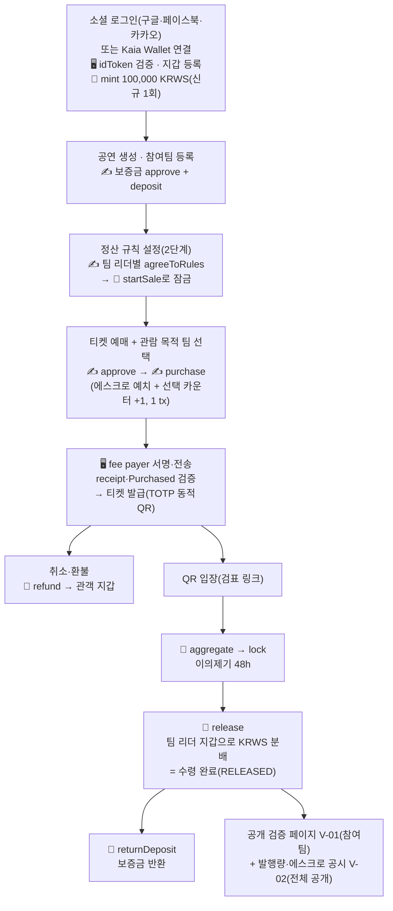

# [기획 초안 v4] 소규모 공연 티켓팅·공동 정산 플랫폼 — 화폐가 코인인 세계 · 지갑 간 코인 거래만

> SSAFY 15기 특화 프로젝트 · 핀테크 트랙 · B204 · **팀원 5명** · **발표일 2026-09-28 (월)** · 상태: 초안 (팀 검토 중)
>
> 작성 이력 — 작성 2026-08-26(v1 풀스코프) · **v2 2026-08-27 범위 재조정** · **v2.1 2026-08-27 코인 레일 채택** · **v3 2026-09-02 오전 전부 코인·외국인 관객 타깃·Web3Auth 지갑 전환** · **v4 2026-09-02 오후: 화폐가 코인인 세계 · 지갑 간 코인 거래만 · 법정화폐 입출구 삭제** · 기준: [06_방향전환_코인전환_v2.md](./06_방향전환_코인전환_v2.md)(+ 덧씌워지지 않은 절은 [v1](./06_방향전환_코인전환_v1.md))
>
> 이전 버전 — **v3(9/2 오전)은 [01_기획_초안_v3.md](./01_기획_초안_v3.md)**, **v2.1(8/27)은 [01_기획_초안_v2.md](./01_기획_초안_v2.md)**, **v1(8/26 풀스코프)은 [01_기획_초안_v1.md](./01_기획_초안_v1.md)** — 원문 그대로 보존한다.
>
> 원본 아이디어: [노션 - [아이디어2] 인디밴드 구체화](https://app.notion.com/p/3c22746d15ab804a91ffc769a2d34945) · 사전조사: [02_사전조사.md](./02_사전조사.md) · 협의 안건: [노션](https://app.notion.com/p/3c92746d15ab81cd91c6f0073a274fe7) · 네트워크 근거: [05_테스트넷_선정_리서치_v1.md](./05_테스트넷_선정_리서치_v1.md) · 시장·규제 근거: [핀테크 트렌드 종합분석 v1](../research/fintech-trends-2024-2026/00_종합분석_및_프로젝트_적용안_v1.md)
>
> 표기 — **[권]** = 권고안을 확정값으로 적은 항목(팀이 뒤집으면 §10 "뒤집을 때 고칠 곳"대로 수정) · **P0** MVP 필수 / **P1** MVP 이후 1차 확장 / **P2** 후순위·부가(시간 남으면 마지막)

> **v4 전환 요약 (2026-09-02 오후)**
>
> 1. **세계관을 먼저 고정한다.** 이 서비스는 **화폐가 코인인 미래**를 무대로 한다. 법정화폐·은행·금융 결제망이 존재하지 않고, **KRWS는 "원화에 연동된 무엇"이 아니라 이 세계의 원(₩) 그 자체**다(decimals=0, 1 KRWS = 1원).
> 2. **가치 이동은 지갑 ↔ 컨트랙트 ↔ 지갑의 온체인 코인 거래뿐이다.** v3에 있던 법정화폐 입출구(코인 확보 경로·팀 법정화폐 수령 경로)와 그에 딸린 도메인 2개(v3의 코인 확보 도메인·팀 수령 도메인)를 **전부 삭제**했다.
> 3. **코인 확보 = 시연용 지급(faucet).** 가입(지갑 등록) 시 운영자가 기본 잔액 **100,000 KRWS** [권]를 mint하고, 관리자 화면에서 추가 지급한다. 이것이 유일한 발행 경로이고 소각은 없다.
> 4. **팀 수령의 종단이 짧아졌다.** `release`로 리더 지갑에 코인이 들어오면 그것으로 끝이다(정산 종단 `RELEASED`). 코인이 곧 돈이므로 그 뒤 단계가 존재하지 않는다.
> 5. **SSAFY 교육용 금융 결제망 API는 [팀 9/2] A안으로 완전 제거**한다. 본문·화면·API·ERD 어디에도 호출이 없다.
> 6. 공시 축이 바뀐다 — 예치 대비 유통량 공시는 폐기되고, **총 발행량 · 에스크로 합계 · 지갑 보유 합계 · 불변식 4종 대사**를 공개하는 **V-02 발행량 공시**로 개편된다.
> 7. MVP 기능 **15 → 13개**, 화면 **35 → 33개**, 도메인 **16 → 14개**, 테이블 **24 → 21개**(MVP 20), P0 API 약 **62개**. 서버 보관 키는 **2개**(OPERATOR·MINTER)로 줄었다.
> 8. v1 §14 `[팀 9/2]` 결정(최소 사이즈 원칙 · Web3Auth 동결 · Kaia 수수료 대납 · 양도 P2 · 이메일 가입 P1 · 외부 지갑 = Kaia Wallet · 체인 설정 env)은 **전부 유지**되며, 이 문서에는 **이미 반영된 상태로** 쓰여 있다.
>
> 이 문서는 [06_방향전환_코인전환_v2.md](./06_방향전환_코인전환_v2.md)(결정 문서·SSOT)를 유일한 입력으로 삼아 v3의 구조 위에 새로 쓴 것이다. 결정 문서와 이 문서가 다르면 **결정 문서가 우선**한다.

---

## 1. 프로젝트 개요

### 한 줄 소개

> **화폐가 코인이 된 미래, 한국 인디 공연을 보러 온 외국인 관객이 소셜 로그인 한 번으로 지갑을 열고 지갑 속 ₩로 예매하면, 한국인 밴드들은 공연이 끝난 뒤 자기 지갑으로 원 단위까지 정확히 나눠 받는다 — 은행도, 결제 대행사도, 정산 대행사도 없이, 누구나 재계산할 수 있는 컨트랙트 하나로.**

### 블록체인 특화 관점

> 참여팀이 사전 합의한 정산 규칙을 **스마트 컨트랙트에 잠그고**, 관객의 "관람 목적 팀" 선택을 **결제 트랜잭션 안에 함께 기록**해 공동 공연 수익을 코인으로 투명하게 자동 분배한다. **화폐가 코인인 미래를 가정한다. 플랫폼은 시연용 코인을 지급할 뿐 발행·상환·준비금의 주체가 아니며, 모든 가치 이동은 지갑 간 온체인 이체다.** 그리고 **지갑은 사용자 소유(Web3Auth/Kaia Wallet), 서버는 사용자 키를 보관하지 않는다** — 관객의 잔액과 팀의 정산금은 플랫폼 계정이 아니라 사용자 지갑에 있다.

### 핵심 가치 (세 기둥)

1. **공동 공연의 투명한 수익 분배** (핵심 차별점) — 관객이 예매 시 "누구를 보러 왔는지" 선택하고, 그 선택이 결제 트랜잭션(`purchase`) 안에 온체인 카운터로 남는다. 판매 시작 전 참여팀 리더 전원이 지갑으로 동의해 잠근 규칙에 따라 컨트랙트가 팀 리더 지갑에 코인을 분배(`release`)하고, **그 입금이 곧 정산 완료**다. 참여팀은 검증 페이지에서 1원 단위까지 재계산할 수 있다.
2. **외국인 관객이 국내 절차 없이 예매하는 경험** — 국내 본인인증·휴대폰 인증·국내 발급 결제 수단이 필요 없다. 구글 로그인만으로 가입·지갑 생성이 끝나고, **이미 지갑에 있던 ₩**로 바로 예매한다. 자국 코인을 KRWS로 바꾸는 일은 여행 전 환전처럼 **플랫폼 밖에서 이미 끝났다고 가정**한다(교환 연동은 P2). 원장은 코인 한 종이므로 환율 오라클 없이 "누구나 재계산 가능"이 유지된다.
3. **사용자 소유 지갑 위의 정산** — 관객 잔액과 팀 정산금이 플랫폼 예수금이 아니라 사용자 지갑에 있다. 컨트랙트는 판매~정산 기간에만 대금을 맡고, 플랫폼이 보관하는 키는 운영·발행 2개뿐이다.

> 유지되는 원칙 — **탈중앙은 주장하지 않는다.** 정산 흐름(판매 시작·집계·잠금·release·환불)은 여전히 운영자가 발의·실행한다. 우리가 주장하는 것은 "잠긴 규칙과 기록이 사후에 바뀌지 않고, 계산을 누구나 재현할 수 있으며, 사용자 자산이 플랫폼 금고가 아니라 사용자 지갑에 있다"는 세 가지다.

---

## 2. 기획 배경 및 문제 정의

### 2.0 세계관 가정 (v4 신설 — 발표 도입 첫 30초)

> **"이 시연은 화폐가 코인인 미래를 가정한다. 법정화폐 입출구·결제 대행망·은행은 등장하지 않는다."**

이 한 줄이 v3까지 문서 절반을 차지하던 규제 서사를 대체한다. 가정의 내용은 다음 네 가지다.

| 가정 | 내용 | 이 문서에서의 귀결 |
|---|---|---|
| ① 화폐 = 코인 | 사람들은 이미 지갑에 코인을 갖고 있고, 그것으로 물건을 산다. KRWS는 "원화에 연동된 토큰"이 아니라 **이 세계의 원(₩)** 그 자체다 | 페그·예치 자산·되돌려 받을 청구권·입출구 개념이 소멸 |
| ② 가치 이동 = 온체인 거래 | 모든 지불·환불·분배·보증금이 지갑 ↔ 컨트랙트 ↔ 지갑 사이의 ERC-20 이동이다 | 외부 결제망 호출 0건 |
| ③ 코인 확보 = 플랫폼 밖 | 관객은 이 세계에서 이미 돈을 갖고 있다. 시연에서는 그 상태를 **가입 시 기본 잔액 지급**으로 재현한다 | 발행은 시연용 지급 하나뿐, 소각 없음 |
| ④ 외국인의 통화 교환 = 플랫폼 밖 | 자국 코인 → KRWS 교환은 여행 전 환전처럼 이미 이뤄졌다고 본다 | 교환 화면·DEX 연동은 **P2**, 표시 통화 환산(≈ $)만 유지 |

- **가정을 쓰는 이유**: 이 프로젝트가 증명하려는 것은 "공동 공연의 정산을 잠긴 규칙과 온체인 기록으로 재현 가능하게 만들 수 있는가"다. 법정화폐 입출구는 그 증명에 기여하지 않으면서 개발 범위·규제 서사·Q&A 리스크만 키운다. 세계관을 하나 고정하면 팀은 5주 동안 정산 하나에 집중할 수 있다.
- **현실 매핑(Q&A 대비)**: 오늘의 현실에서는 KRWS 자리에 **인가 발행사의 원화 스테이블코인 또는 CBDC**가 들어간다. 정산 컨트랙트는 표준 ERC-20이면 **코드 변경이 0**이다(§8.6).
- **고지 문구(전 화면 공통)**: "화폐가 코인인 미래를 가정한 테스트넷 시연입니다. 실가상자산·실화폐는 사용되지 않습니다."

### 2.1 문제 정의

취미·인디 밴드 공연은 3~4팀이 함께 무대를 채우는 **공동 공연이 표준**이다. 그런데 정산은 "팀별 매표 코드 분리 → 자기가 판 만큼 가져가기"나 구두 합의로 이뤄지고, 사후 규칙 변경·불투명한 계산 때문에 분쟁이 잦다. 예매는 구글폼·개별 송금, 입장은 수기 명단 확인이 현실이다.

| # | 문제 | 현재 상황 |
|---|------|-----------|
| P1 | 대형 티켓 플랫폼 진입 장벽 | 메일 문의→심사→판매대행 계약, 사업자등록증 요구 등 절차 장벽 |
| P2 | 예매·입장·정산 파편화 | 홍보(SNS), 예매(구글폼·개별 송금), 입장(수기 명단), 정산(수작업)이 따로 놀음 |
| P3 | 판매·입장 관리 부담 | 공연자가 입금 확인, 명단 대조를 직접 수행 |
| P4 | **공동 공연 기여도 산정 불가** | "누구 덕에 팔린 티켓인지" 알 수 없음 |
| P5 | **수기 정산의 불투명성** | 규칙 사후 변경·계산 불투명 → 분쟁 ("카운팅 정산" 보이콧 사례) |
| P6 | 티켓 선물·양도 리스크 | 사기, 중복 사용 |
| P7 | 공연 기록 부재 | 관람 기록·콘텐츠가 남지 않음 |
| **P8** | **외국인 관객의 예매 이탈** | 소규모 공연 예매는 국내 발급 결제 수단·휴대폰 본인인증을 전제한다. 방한 관광객·체류 외국인은 홍대 인디 공연을 알아도 **결제 단계에서 이탈**한다. 현장 판매로 흘러 정산 근거도 남지 않음 |
| **P9** | **정산 지연·판매대금 유보** | 국내 판매대행 수수료 7.7~8.8% + 공연 종료 후 사후 정산, 해외도 순매출 유보가 기본(리서치 00 A7). "공연이 끝나도 돈이 안 들어오고, 여러 팀이 나누는 건 알아서 하라"는 공백 |

→ **P4·P5(공동 정산)가 이 프로젝트의 중심**이고, **P8(외국인 진입 장벽)이 v3부터의 진입점**이다. P6(양도, P2)·P2/P3(티켓팅 자동화)이 그 주변을 받친다. **타겟**: 티켓 100매 이내 규모의 취미·소규모 밴드의 3~4팀 공동 공연, 관객은 **방한·체류 외국인 우선(내국인도 가능)**.

### 2.2 시대적 근거 (발표 도입부 — 배경 한 장)

세계관은 가정이지만, 그 가정이 **가까워지고 있다는 배경**은 실제 자료로 받친다.

| 근거 | 내용 | 출처 |
|---|---|---|
| 정산자금 분리·정산주기 단축의 법제화 | 티메프 사태(2024.7) 이후 전금법 개정(PG 정산자금 외부관리, 2026-12-17 시행)·대규모유통업법 개정(**공연 등 서비스는 이용일+10일 정산**, 판매대금 50% 별도관리). 규제가 강제하는 방향(자금 분리·신속 정산·공시)을 컨트랙트 에스크로 + 공개 검증으로 선반영 | 리서치 00 A1·A2 |
| 은행권의 원화 디지털화폐 정산 실증 | **KB×Kaia 통합 PoC(2026-05-17)** — 발행 → 오프라인 결제 → 가맹점 정산까지 통합 검증. "은행이 원화 디지털화폐 정산을 검증한 체인의 테스트넷에서 시연한다" | 리서치 00 A3, 05 §0 |
| 프로그래머블 결제의 상용 선례 | JPMorgan Kinexys 누적 $4T — "입금 수령 시 규칙 기반 자동 분배"는 글로벌 은행이 상용화한 패턴. RevenueSplitter는 그 소규모 공연 버전 | 리서치 00 A5 |
| 지갑의 소멸(invisible wallet) | 패스키·계정 추상화·임베디드 지갑으로 "시드문구·가스비·체인을 모르는" 온보딩이 2026 표준. Web3Auth 소셜 로그인 지갑 + 수수료 대납이 그 표준의 구현 | 리서치 00, 02 §10 |
| 인바운드 관광 수요 | 방한 관광객·체류 외국인 증가, 해외 결제 수요 증가 | 리서치 01 §9, 06 §5 |
| 공연 시장의 성장과 양극화 | 티켓판매액 1.27조(2023) → 1.73조(2025, +18.8%)인데 대형·수도권이 82.7%, 홍대 라이브클럽 절반이 공연장 미등록 회색지대 | 리서치 00 A6 |

### 2.3 개정 공연법 표현 (v2.1에서 정정, v4 유지)

개정 공연법 제4조의2는 **별도 상한 금액을 정한 것이 아니라, ① 구입가를 초과하는 판매를 상습·영업으로 하는 행위를 금지하고 ② 최초 판매자가 동의한 채널에서만 재판매를 허용**한다. 즉 **사실상의 상한은 본인 구입가**다. 시행일은 **법률 2026-08-11, 시행령(과징금 2~50배·포상금) 2026-08-28**이다.

> 권고 표현(전 문서 통일) — "개정 공연법(법률 2026-08-11 · 시행령 2026-08-28 시행)은 **구입가 초과 재판매를 금지하고 최초 판매자가 동의한 공식 양도 채널만 허용**한다. 본 플랫폼의 **정가 이하 양도 기능(P2)이 그 공식 채널에 해당**한다."

제4조의2 제2항의 기술적·관리적 조치 의무(본인 확인, 신고 기능, 제재 공지)는 양도 기능이 P2이므로 함께 후순위다. *(최종 확정 전 국가법령정보센터 원문 대조 필요 — 리서치 00 §3-1)*

---

## 3. 주요 사용자

| 사용자(actor) | 주요 목적 | 지갑 |
|---|---|---|
| `GUEST` | 공연 탐색·상세(en/ko, USD 환산), 양도 링크 진입(P2), **발행량·에스크로 공시(V-02) 열람**, 표시 환율 조회 | 없음 |
| `AUDIENCE` **관객 — 외국인 우선(내국인도 가능)** | 소셜 로그인 가입 → **지갑 + 기본 잔액**, 잔액 결제(서명), 관람 목적 팀 선택, QR 입장, 환불(지갑으로 반환) | **사용자 소유** — Web3Auth 자동 생성 지갑 또는 Kaia Wallet 연결. 회원당 1개 |
| `PERFORMER` **팀 리더 — 한국인** | 공연 생성·참여팀 관리, 보증금 납부(서명), 정산 규칙 동의(서명), 판매 현황, **정산금 지갑 수령 = 완료** | **사용자 소유** — 리더 지갑 = 팀 지갑(팀당 리더 1인) |
| `STAFF` 검표 관계자 | 링크 토큰으로 검표 페이지 진입, QR 스캔·입장 처리 | 없음 |
| `ADMIN` 플랫폼 관리자 | 이의제기 처리, 표시 환율 등록, **시연용 코인 지급(M-03)**, 발행량 이상 경고 확인. (P1) 실패 작업 재시도·회원/공연 관리 | 운영지갑(OPERATOR) · 발행 키(MINTER) — 서버 보관 |

### 3.1 페르소나 3종

| # | 페르소나 | 시나리오 | 이 사람에게 필요한 것 |
|---|---|---|---|
| ① | **에밀리, 27세 · 미국인 · 서울 여행 5일차** | 홍대 라이브클럽 공동 공연(3팀)을 인스타에서 보고 예매하려 한다. 이 세계에서는 이미 지갑에 돈이 있다 | 구글 로그인 1번 → 지갑 자동 생성 → "Welcome — your balance is ₩100,000 (≈ $74)" → "Pay ₩15,000 from balance" → "Confirm in your wallet" 서명 → 모바일 QR 입장. **영어 UI·USD 병기** |
| ② | **지훈, 24세 · 한국인 관객** | 친구가 공유한 링크로 들어왔다 | 카카오 로그인 → 지갑·기본 잔액 → 잔액 결제. 환불금은 **지갑으로 돌아와** 다음 공연에 쓴다 |
| ③ | **민서, 29세 · 한국인 3인 밴드 리더(공연 생성팀)** | 3팀 공동 공연을 열고 정산 분쟁 없이 나누고 싶다. 이미 Kaia Wallet을 쓴다 | 구글 로그인 지갑 또는 **Kaia Wallet 연결** → 보증금 50,000 서명 납부 → 규칙 설정·전원 동의 서명 → 공연 후 **리더 지갑으로 정산금 도착 → 그것으로 끝** |

> v3의 "관객이 결제 수단으로 코인을 확보한다 · 팀이 법정화폐로 최종 수령한다" 전제는 v4에서 **폐기**되었다. 관객·팀 리더 모두 이미 코인을 가진 사람이고, 정산의 종단은 지갑 입금이다.

---

## 4. 유사 서비스 분석 및 차별점

| 서비스 | 커버 영역 | 한계 |
|---|---|---|
| 인터파크·멜론·예스24 티켓 | 예매·입장 | 소규모 공연 등록 어려움, 공동 정산 미지원, 외국인은 국내 결제 수단·본인인증 전제 |
| 플레이티켓·인디스트릿 | 소규모/인디 예매 | 예매에 한정, 공동 정산·검표 고도화 없음 |
| 구글폼 + 개별 송금 (현행 관행) | 예매 | 수기 관리, 검증 불가, 정산 수작업, 외국인 사실상 불가 |
| 해외 관광객용 티켓 플랫폼(클룩·마이리얼트립 등) | 관광 액티비티 예약 | 소규모 인디 공연은 취급 대상 밖, 공동 정산 개념 없음 |

### 차별점 (사전조사 검증 + v4 반영 — 상세: 02_사전조사.md §2.2)

1. ✅ **관객 선택 기반 공동 공연 수익 자동 정산** (검증: 최강 차별점 — 국내 상용 사례 없음, 수작업 관행의 분쟁 사례 실증) — **유일한 핵심 차별점으로 집중**
2. 🆕 **국내 절차 없는 외국인 예매 경로** — 소셜 로그인 지갑 + 지갑 잔액 결제 + 수수료 대납 + 영어 UI. "환전은 플랫폼 밖에서, 정산은 코인 하나로"
3. 🆕 **사용자 소유 지갑 위의 정산** — 관객 잔액과 팀 정산금이 플랫폼 예수금이 아니라 사용자 지갑에 있다. 티메프 이후의 "정산자금 분리" 서사와 직결
4. **정산의 종단이 지갑 입금** — 분배 트랜잭션 하나가 곧 실제 수령이다. 대행사도, 사후 정산 대기도 없다
5. **안전한 티켓 양도**(P2) — 링크 수락 즉시 소유권 이전 + QR 재발급 (공연법 공식 채널)
6. **공연 기록** (포토 티켓) — 인디 특화 관람 기록 서비스 부재 (P1)
7. ⚠️ NFT 티켓 — **P2**. 차별화 논리는 "암표 방지"가 아니라 **유통 이력 투명화·양도 규칙의 온체인 강제**로 잡는다(리서치 00 C1)

> ❌ QR 입장은 단독 차별점이 못 됨 — "수기 명단 확인 구간의 자동화"로 좁혀 서술.
> ⚠️ 경쟁: 인디스트릿이 2026년 자체 예매 시스템 오픈 — 예매 단독 어필 금지, 무게중심은 정산.
> 📌 "대관 → 공연 페이지 연결"은 조사에서 유효 판정이었으나 범위 재조정으로 제외 — 확장 후보로만 기록.

---

## 5. 전체 서비스 흐름

표기: 🔗 운영자 온체인 tx · ✍️ **사용자 서명** tx(발신자 서명 RLP → 서버 fee payer 서명·전송) · 🖥 서버 처리. **외부 결제망 단계는 이 흐름에 없다.**



핵심은 **원장이 하나**라는 것이다. 티켓 대금은 반드시 `purchase`로 에스크로에 들어오고, 팀이 받는 돈은 반드시 `release`에서 나온다. 그 앞뒤에 붙는 외부 창구가 없으므로 **판매액·환불액·분배액이 전부 체인에서 대사**된다.

> v2.1 흐름도([assets/service-flow_v2.1.svg](./assets/service-flow_v2.1.svg))는 세계관이 다르므로 v4에서는 사용하지 않는다. 새 SVG는 화면설계 v5 확정 후 갱신 예정.

---

## 6. 주요 기능 정의 및 우선순위

우선순위: **P0** = MVP 필수 / **P1** = MVP 이후 1차 확장 / **P2** = 후순위·부가

| 영역 | 기능 | 우선순위 | 비고 |
|---|---|:---:|---|
| **인증** | **Web3Auth 소셜 로그인 3종(구글·페이스북·카카오)** — 최초 로그인 = 가입, idToken(JWKS) 검증 → 세션 JWT(access 30분/refresh 14일, **리프레시 토큰은 Redis 보관 — 전용 테이블 없음**) | P0 | 3종 동결 [팀 9/2]. 자체 이메일 가입·로그인은 **P1** |
| **지갑** | **사용자 소유 지갑** — Web3Auth MPC 지갑 자동 생성 **또는 Kaia Wallet 연결**(Web3Auth 모달 어댑터). 회원당 1개, 관객·리더 동일. 잔액·거래 이력 조회 | P0 | 서버는 사용자 키를 보관하지 않는다. 가스 개념은 노출되지 않는다(수수료 대납) |
| **시연용 지급** | **가입 시 기본 잔액 `mint` 100,000 KRWS**(신규 1회, 멱등키 `grant:signup:{memberId}`) + **관리자 추가 지급**(M-03, 1회 최대 1,000,000) | P0 | 이 세계에서 "이미 갖고 있던 돈"의 재현. 유일한 발행 경로이며 소각은 없다 |
| **KRWS (이 세계의 원화)** | ERC-20, **decimals=0, 1 KRWS = ₩1**. 페그·예치 자산 개념 없음. `mint`(MINTER)·`pause/unpause`(ADMIN)·표준 `transfer/approve/transferFrom` | P0 | 테스트넷 모의. 발행 로직은 얇은 `CoinIssuerPort` 뒤(§8.6) |
| **결제** | **잔액 결제만** — ✍️ `approve` + ✍️ `purchase` 2단계 서명, **결제 tx가 관람 목적 팀 선택을 함께 기록**. 잔액 부족이면 **409 안내**(유도 버튼 없음) | P0 | ERC20Permit 1-서명은 P1 |
| **수수료 대납** | Kaia `FeeDelegatedSmartContractExecution` — 프론트가 발신자 서명(Web3Auth 키 + `@kaiachain/ethers-ext`), 서버 운영지갑이 fee payer 서명·전송(`web3j` + `web3j-ext`) | P0 | [팀 9/2] 사용자 지갑 KAIA 0 |
| **공연** | 단독·공동 공연 생성, 출연팀 등록(초대·승인), 티켓 옵션 설정, 판매 현황, 검표 링크 발급 | P0 | 판매 시작 후 규칙 변경 불가 |
| **보증금** | 공연 생성팀 리더가 ✍️ `deposit`으로 **50,000 KRWS** 납부 [권] → 규칙 설정 가능. 정산 확정 또는 일괄 환불 완료 시 반환 | P0 | 잔액 부족 시 안내(시연에서는 관리자 지급). 몰수(`forfeitDeposit`)는 P1 |
| **정산 규칙** | 2단계 규칙(고정 분배 비율 + 관객 선택 비율, 합 10000bp / 고정 풀 내 팀별 비율) 설정 → ✍️ **팀 리더별 동의 서명** → 🔗 `startSale` 잠금 | P0 | 서로 다른 주소가 같은 규칙 해시에 동의한 기록이 핵심 시연 장면 |
| **예매·티켓** | 티켓 예매, 관람 목적 팀 선택, 주문 조회, TOTP 동적 QR 발급 | P0 | 판매 마감 = 공연 시작 1시간 전 |
| **취소·환불** | 개별 취소(기한별 수수료 D-7 전액 / D-3 50% / 이후 불가), 공연 전체 취소 일괄 환불. 🔗 `refund` → **관객 지갑으로 반환**, 선택 카운터 −1 | P0 | 수수료분은 에스크로에 남아 정산 재원 |
| **입장** | TOTP 동적 QR, 검표 링크 페이지, 실시간 검증·재사용 차단 | P0 | 고정 티켓번호 QR 금지 |
| **정산·수령** | 관객 선택 집계 → 🔗 `aggregate` → `lock` → 이의제기 48h → 🔗 **`release`로 팀 리더 지갑에 KRWS 분배 = 수령 완료(`RELEASED`)** + 보증금 반환 | P0 | **핵심 차별 기능** — 온체인 분배가 곧 실제 정산이고, 그 뒤 단계가 없다 |
| **검증·공시** | **공개 정산 검증 페이지 V-01**(참여팀 로그인) — 컨트랙트·토큰 주소, 잠긴 규칙, 온체인 카운터, 팀별 산출액, tx 링크 + 브라우저 재계산 / **발행량·에스크로 공시 V-02(전체 공개)** — 총 발행량·에스크로 합계·지갑 보유 합계·불변식 4종 대사·가정 고지 | P0 | "그냥 DB로 되잖아요" 방어의 실체 |
| **i18n·통화** | **en 기본 · ko 병행**, 금액은 **₩ 정수 항상 + 표시 통화(USD 기본) ≈ 환산 병기**, 회원 시간대 + KST 병기 | P0 | 환율은 **표시 전용** — 정산·분배·컨트랙트·지급 금액에 사용 금지 |
| **관리자** | 이의제기 처리, 표시 환율 등록, **시연용 코인 지급(M-03)**, 발행량 불일치 경고 확인 | P0(최소) | 실패 작업 재시도·회원/공연 관리 화면은 P1 |
| 결제 UX 개선 | **ERC20Permit + `purchaseWithPermit` 1-서명 결제** | P1 | 서명 2회 → 1회 |
| 이메일 가입·외부 지갑 챌린지 | 자체 이메일 가입·로그인, 자체 지갑 소유 증명 챌린지 API | P1 | [팀 9/2] 최소화 결정 |
| 교환 | 티켓 옵션 교환(회차·좌석·등급), 관객 간 1:1 교환 | P1 | 차액은 코인 결제·환불 |
| 월렛 | 월렛 티켓 패스 (구글월렛 demo mode + RotatingBarcode → 애플 2순위) | P1 | NFC는 추후 |
| 기록 | 관람 이력, 사용 완료 디지털 티켓, 장르별 포토 티켓 | P1 | 입장 처리된 관객에게만 |
| **양도(선물)** | 공유 링크로 일반 티켓 양도 → 수락 시 소유권 이전(DB) + 기존 QR 폐기·재발급 | **P2** | [팀 9/2] 최후순위. 설계·테이블은 유지 |
| 코인 교환 | **외국인 자국 코인 ↔ KRWS 교환**(모의 `tUSDC` + `KRWSExchange`, DEX 연동) | **P2** | 설계만 기록, MVP 미배포 — 플랫폼 밖 가정 |
| 발행 주체 교체 | `ExternalIssuer` — 인가 발행사 코인·CBDC 연동 | **P2** | 문서 설계만, 코드 없음(Q&A 방어) |
| NFT | **NFT 티켓 (ERC-721)** — 티켓 소유권·이전 이력 온체인 | **P2** | 관객도 지갑을 가지므로 전제 조건은 이미 충족 |
| 거래(재판매) | 구매자 간 유료 재판매 (최초 구입가 이하) | **P2** | 근거는 §2.3 |

### 6.1 기능별 사용 가능 기술 (토글)

> ✅ = 사전조사·리서치로 검증·확정된 항목

<details>
<summary><b>인증 — Web3Auth 소셜 로그인 [팀 9/2 동결]</b></summary>

- **로그인 = Web3Auth 소셜 로그인 3종(구글·페이스북·카카오).** 프론트가 Web3Auth SDK로 소셜 로그인 → `idToken`(+ `wallets` 클레임) + MPC 지갑 주소 확보 → `POST /auth/web3auth {idToken}`
- 백엔드: **idToken JWKS 검증**(aud·exp·nonce) → 회원 생성/조회 → `wallet(provider, address)` 등록 → 세션 JWT 발급 → **신규 회원이면 기본 지급 MINT job 제출**(응답 `grantJobId?`)
- 자체 이메일 가입·로그인은 **P1**(F-member-02·10, API-member-02·08, C-02) — [팀 9/2] 최소 사이즈 원칙
- 체인 설정: `chainNamespace=eip155`, `chainId=0x3e9`, `rpcTarget=https://public-en-kairos.node.kaia.io`, `displayName=Kaia Kairos`, `ticker=KAIA`, 익스플로러 `kairos.kaiascan.io` — **프론트 환경변수 하드코딩**(설정 API는 P1)
- 미결: Web3Auth 무료 요금제의 **MAW(월 활성 지갑) 한도**·커스텀 verifier 포함 여부를 9/3까지 공식 요금표로 확인(§10-16)
</details>

<details>
<summary><b>지갑 — 사용자 소유(비수탁)</b></summary>

- **두 경로**: ① Web3Auth MPC 지갑 자동 생성(키 샤드는 클라이언트에서 재구성, 서명도 클라이언트) ② **Kaia Wallet 연결** — Web3Auth 모달의 외부 지갑 어댑터로 연결하고 `wallets` 클레임의 주소를 등록(자체 챌린지 API는 P1)
- **회원당 지갑 1개**(주소 UNIQUE). 팀 지갑 = 팀 리더 지갑. 지갑 교체는 MVP 미지원(잔액 0 확인 후 관리자 처리, 화면 P1)
- **서버 DB·로그·코드에 사용자 개인키·니모닉·MPC 샤드가 0건**이어야 한다
- 가스: **사용자 지갑에 KAIA를 넣지 않는다.** Kaia 수수료 대납으로 처리하므로 사용자에게 가스 개념은 노출되지 않고 "Confirm in your wallet" 한 줄만 보인다
- 잔액 = 지갑의 KRWS 잔액이며 그것이 곧 돈이다. 지갑 앱에서 외부 주소로 옮기는 것은 사용자 자유이고 플랫폼 화면은 그 경로를 제공하지 않는다
- 모바일 외부 지갑 서명(WalletConnect·딥링크)은 리허설 후 결정 — 시연은 데스크톱 확장 지갑 + Web3Auth 중심(§10-19)
</details>

<details>
<summary><b>사용자 서명 tx 패턴 — 플랫폼 발의·사용자 서명 + 수수료 대납 [팀 9/2]</b></summary>

- API 규약: `POST …/prepare`(또는 결제 시작 API)가 서명 파라미터(`to`·`data`·`chainId=1001`·사람이 읽을 요약)를 반환 → 프론트가 `FeeDelegatedSmartContractExecution` **발신자 서명** → `POST …/signed-tx {kind, senderSignedRlp}` 보고 → 서버(운영지갑 = fee payer)가 대납 서명 후 `kaia_sendRawTransaction` 전송 → **receipt·이벤트 검증**해 상태 전이(`chain_job.signer_type=USER`, `fee_delegated=true`)
- 서버는 **발신자 서명 RLP를 검증**한다(발신자 주소 = 회원 지갑, to·data·값 일치). 임의의 RLP를 대납해 주지 않는다
- 서명 전 화면에 tx의 `to`·요약("Confirm ₩15,000 payment")을 사람이 읽을 수 있게 표시한다
- 사용자가 팝업을 닫으면 주문은 `PENDING_PAYMENT` 유지(15분 만료)이고 **잔액은 그대로 남는다** — 돈이 사라지는 경로를 만들지 않는다
- 결제는 `approve` + `purchase` 2단계(allowance가 충분하면 approve 생략). ERC20Permit 1-서명은 P1
</details>

<details>
<summary><b>시연용 지급 (faucet) — 코인 확보의 유일한 경로</b></summary>

- **가입 시**: `POST /auth/web3auth` 성공(지갑 등록 확정) → `mint(회원 지갑, 100000, grantRef)`(MINTER) — **신규 회원 1회**, 멱등키 `grant:signup:{memberId}`. 재로그인·지갑 교체(P1)에서 재지급 없음
- **관리자 추가 지급**: `PUT /admin/coin/grants {memberId | address, amount, memo}` → `chain_job(tx_type=MINT, requester_id=관리자)` → `mint` → 202 + jobId. 화면 M-03
- 한도 [권]: 가입 기본 **100,000**, 관리자 1회 최대 **1,000,000**, 회원당 누적 상한 없음(시연)
- **지급 이력 테이블을 따로 만들지 않는다** [권] — `chain_job(tx_type='MINT', wallet_id, amount, requester_id, idempotency_key=grantRef)`가 이력이다
- 관객 화면에는 잔액을 늘리는 버튼이 없다. 잔액이 모자라면 "Insufficient balance · ₩3,000 short"만 표시하고(§5.16 컴포넌트), 시연에서는 관리자가 지급해 해결한다
</details>

<details>
<summary><b>스마트 컨트랙트 — MVP 2종 (KRWS + RevenueSplitter)</b></summary>

- Solidity + **OpenZeppelin v5**, **Hardhat 3** ✅ (Kairos는 Prague·Osaka 하드포크 적용된 최신 EVM이라 툴체인 변경 없음, 05 §0)
- **KRWS**: `ERC20` + `AccessControl` + `ERC20Pausable`, decimals=0. `mint(to, amount, grantRef)`(MINTER, 이벤트 `Minted`) · `pause/unpause`(ADMIN, 발행량 이상 시) · 표준 `transfer/approve/transferFrom/totalSupply/balanceOf`. `totalSupply` = **발행량 공시 소스**. (P1) `permit`
- **RevenueSplitter**(v3 대비 **코드 변경 0**): 생성자 인자 `IERC20 token`으로 **어떤 ERC-20 화폐와도 동작**한다(`transferFrom`·`transfer`·`balanceOf`만 사용)
  - `createShow(showId, teamWallets[], teamShareBp[], fixedRatioBp, rulesHash, depositAmount)` (OPERATOR) — 팀 지갑 = 각 리더의 등록 지갑 주소 **스냅샷**
  - ✍️ `deposit(showId)`(생성팀 리더) · ✍️ `agreeToRules(showId, rulesHash)`(참여팀 리더) · 🔗 `startSale(showId)`(전원 동의 후 잠금)
  - ✍️ **`purchase(showId, orderRef, teamIndex, amount)`(관객)** — `transferFrom` + `escrow += amount` + `choiceCount[teamIndex]++`. **결제와 관객 선택 기록이 한 tx**
  - 🔗 `refund(showId, orderRef, to, teamIndex, amount)`(OPERATOR) — 에스크로 → 관객 지갑, 카운터 −1, `orderRef`당 누적 ≤ 구매액, lock 이후 revert
  - 🔗 `aggregate` / `lock` / `release`(push, dust 처리) / `returnDeposit` / `forfeitDeposit`(P1) / `halt`
  - view: `escrowOf`, `choiceCountOf`, `computeShares`, `rulesHashOf`, `agreedOf`, `token()` — 검증 페이지가 직접 읽는다
- ⚠️ OZ v5에서 `PaymentSplitter`·`_beforeTokenTransfer` 삭제 — v4 예제 이식 금지
- ⚠️ Kairos legacy tx는 `gasPrice ≥ baseFee`(하한 25 gkei) 강제 → web3j에서 `eth_gasPrice` 값을 그대로 사용. KaiaScan 컨트랙트 검증은 웹 UI에서 수동(2종·1회)
</details>

<details>
<summary><b>공개 검증 페이지(V-01) + 발행량·에스크로 공시(V-02)</b></summary>

- **V-01 공연별(참여팀 로그인)**: 컨트랙트·**토큰 주소**(익스플로러 링크) · 잠긴 규칙 해시와 원문 · 팀별 동의 tx · **온체인 선택 카운터** · 팀별 산출액 · `release` tx · 팀 지갑 주소 · 에스크로 잔액
- 브라우저에서 (잠긴 비율 × 온체인 카운터)를 재계산해 서버 표시값과 대조하는 위젯 — **1원도 다르지 않아야 한다**
- **V-02 발행량·에스크로 공시(전체 공개)**: `totalSupply`(총 발행) · Σ`escrowOf`(에스크로 합계, 보증금 포함) · 지갑 보유 합계 · 지급 건수 · 갱신 시각(1분 캐시) · 불변식 4종 대사 결과 · "화폐가 코인인 미래를 가정한 테스트넷 시연" 고지
- 불일치(`totalSupply` ≠ Σ지갑 + Σ에스크로) 시 **`mint`·`release` 중단 + 관리자 알림**
</details>

<details>
<summary><b>QR 입장 처리</b></summary>

- 동적 QR: **TOTP 방식**(`ticket.qr_secret`) — 짧은 만료의 서명 토큰. 고정 티켓번호 QR 금지
- 재사용 차단: Redis `SETNX` 원타임 처리 + 입장 결과 기록(`ticket.entry_result`·`entered_at`)
- 스캐너: 검표 링크로 진입하는 모바일 웹 — `getUserMedia` + jsQR/ZXing (별도 앱 불필요)
- 근거 보강: QR 피싱(quishing) 2026년 월 1,870만 건 급증(리서치 00 B4). 단 **QR 보안은 서버 서명의 성과이며 블록체인 성과로 주장하지 않는다**
</details>

<details>
<summary><b>티켓 취소·양도(P2)·교환(P1)</b></summary>

- 티켓 상태 머신(DB): 발급 → (양도중) → 사용완료 / 취소 / 교환됨
- 취소: 🔗 `Splitter.refund`로 에스크로 → **관객 지갑** 반환 + 온체인 선택 카운터 −1
- 공연 전체 취소: 건별 `refund` job 일괄 실행(수수료 0) + 진행률 표시 → 완료 후 보증금 반환
- 양도(**P2**): 서명된 일회용 수락 링크 → 수락 시 소유자 변경(DB 트랜잭션) + 기존 QR 시드 폐기·재발급. 양도 후 관람 목적 팀 재선택은 **표시용 오프체인 기록**이고 온체인 카운터는 갱신하지 않는다(정산은 원 구매 시점 카운터 기준, v1 §14-21)
- 교환(P1): "취소 후 재예매"를 하나의 흐름으로, 차액은 코인 결제·환불
- 동시성: 양도중·교환중 티켓의 입장·중복 처리 차단 (Redis 락)
</details>

<details>
<summary><b>i18n·표시 통화·시간대</b></summary>

- 회원 속성: `country_code`(ISO 3166-1 alpha-2, 자기 선언) · `locale`(**en 기본**, ko) · `display_currency`(**USD 기본**) · `timezone`(IANA)
- 금액 표기 규칙: **₩ 정수 항상 표시** + 표시 통화가 KRW가 아니면 "≈ $11.10" 환산 병기(환율·기준 시각 툴팁)
- 환율: 관리자가 `exchange_rate` 등록(`USD_KRW` **1,350** [권], 하루 1회, 시연 고정). **표시 환산에만 사용** — 정산·분배·컨트랙트·티켓 가격·**지급 금액**에 절대 사용 금지
- [팀 9/2] en·USD 고정, 국가별 자동 제안 없이 **수동 스위치만**
- 시간: 회원 시간대 + **KST 병기**(공연 시각 오인 방지)
</details>

<details>
<summary><b>월렛 패스 (P1) · NFT 티켓 (P2)</b></summary>

- ✅ **Google Wallet**: 구글 계정만으로 issuer 등록 → demo mode 즉시 발급. **RotatingBarcode**(TOTP 매분 회전)로 동적 QR 정책과 양립 (3사 중 유일). 🔶 Apple: `.pkpass`, $99/년, 회전 바코드 없음
- NFT(P2): ERC-721(OZ v5) — `_update(to, tokenId, auth)` 오버라이드로 플랫폼 경유 이전만 허용, `resale()`에서 최초 구입가 이하 강제. **관객도 이미 자기 지갑을 갖고 있으므로 최대 선행 작업이 사라진 상태**
</details>

---

## 7. 핵심 차별 기능: 공동 공연 수익 분배 설계

### 관객 선택 방식 (예매 시)

> "어떤 팀의 공연을 보고 싶어서 예매하셨나요?" / *"Which band are you coming to see?"*

- 기본값: **한 팀 선택** (집계·설명이 가장 단순, `purchase`의 `teamIndex` 1개)
- 선택은 **결제 트랜잭션 안에서 함께 기록**된다 — 별도 `recordChoice` tx 없음. 취소 시 `refund`가 카운터를 되돌린다
- 옵션(협의 안건 §10): 여러 팀 선택(동일 비율 반영), 전체 공연 선택(공통 몫에 반영)

### 정산 공식 (2단계)

```
1단계) 풀 분할        : 고정 분배 비율(fixed_ratio_bp) + 관객 선택 비율(selection_ratio_bp) = 10000bp
                        기본값 [권]: 고정 5000 · 관객 선택 5000
2단계) 고정 풀 내 배분 : 참여팀별 team_share_bp (합 10000bp)

팀별 최종 정산액 = (정산 재원 × fixed_ratio_bp/10000 × team_share_bp/10000)
                 + (정산 재원 × selection_ratio_bp/10000 × 팀 선택수/전체 선택수)

정산 재원 = 에스크로 잔액(판매액 − 환불액 + 취소 수수료), dust는 공연 생성 팀 귀속
```

- 각 비율은 **공연 생성 단계에서 참여팀이 합의하고 팀 리더 지갑으로 ✍️ 동의 서명**한다
- **티켓 판매 시작 이후 변경 불가** — `startSale`이 one-way로 잠그고 이후 setter는 전부 revert
- 계산 결과가 곧 리더 지갑 입금액이다. **산출액과 실제 수령액 사이에 다른 단계가 없다**는 점이 v4에서 더 강해진 논거다

### 이 기능이 컨트랙트를 쓰는 이유

| 질문 | 답 |
|---|---|
| "그냥 DB로 되잖아요?" | 규칙과 관객 선택이 **판매 시작 시점에 잠긴 해시·온체인 카운터**로 남는다. 팀은 서버를 믿지 않고 익스플로러와 검증 페이지에서 재계산할 수 있다 |
| "왜 코인이 필요한가?" | 이 세계의 화폐가 코인이기 때문이기도 하지만, 설계상으로도 에스크로·분배가 **컨트랙트 잔액의 이동**이어야 판매 총액·환불·분배 합이 체인에서 대사된다. 분배가 장부 기록이면 그 장부는 다시 서버의 것이 된다 |
| "왜 화폐가 1종인가?" | RevenueSplitter는 비율로 나누는 계약이다. 안에 통화가 둘이면 매 결제마다 환율 오라클이 필요하고 "누구나 재계산"이 무너진다. 외국인은 여행 전 환전하듯 자국 코인을 KRWS로 바꿔 온다고 가정한다(교환은 P2) |
| "왜 에스크로를 없애고 관객 → 팀 직접 송금으로 하지 않나?" | 관객 선택 비율은 **판매 종료 후에야** 정해지고, 환불·취소·이의제기는 돈이 한곳에 모여 있어야 처리된다. 컨트랙트 보관은 "정산 대행사 없는 정산 대행"이다 |

---

## 8. 블록체인 적용 설계 방향

원칙: **블록체인 적용 영역은 정산 하나에 집중.** 온체인은 검증에 필요한 최소 정보만, 상세·개인정보는 서버에. 발표 프레임은 "정산에 블록체인이 유용하다" — 블록체인은 수단, 신뢰 구조가 목적. v4에서 여기에 **레일의 단일화(화폐 = 코인 1종)**와 **자산 보유 주체의 이동(사용자 지갑)**이 완결된 형태로 더해진다.

### 8.1 자금 흐름 (v4 개정)

| 온체인 기록 | 오프체인(서버) 보관 |
|---|---|
| 공연 식별 정보, 참여팀 리더 지갑 주소(생성 시점 스냅샷) | 관객 개인정보, 주문·결제 상세 |
| 정산 규칙 해시 + 팀별 동의 tx (판매 시작 후 불변) | 티켓 상세(좌석·QR 원본·TOTP 시크릿) |
| 에스크로 잔액, 관객 선택 카운터 (`Purchased` 이벤트의 합) | 시연용 지급 이력(`chain_job` MINT), 작업 큐 상태 |
| 팀별 최종 정산 금액, `release`·`refund`·보증금 실행 내역 | 표시 환율, 회원 로케일·통화 |

**흐름 한 줄**: 🔗 시연용 지급 `mint` → **관객 지갑** → ✍️ `purchase`로 **에스크로 컨트랙트 예치** → 🔗 `release`로 **팀 리더 지갑 = 수령 완료**. 환불은 🔗 `refund`로 에스크로 → 관객 지갑, 보증금은 ✍️ `deposit` / 🔗 `returnDeposit`.

- **원장 단일화**: 모든 티켓 대금은 `purchase`로 에스크로에 들어온다. 우회 경로가 없으므로 `escrowOf` = 실제 판매액이고 검증 페이지가 판매 **전량**을 검증한다
- **잔액 정책**: 관객·팀 모두 잔액 = 지갑의 KRWS 잔액이며 그것이 곧 돈이다. 플랫폼은 그 밖으로 빼는 개념을 갖지 않는다. 지갑 앱에서 외부 주소로 옮기는 것은 사용자 자유이고 화면은 안내하지 않는다
- 실가상자산 미사용 — 테스트넷 자체 발행 모의 코인

### 8.2 지갑 설계 — 사용자 소유(비수탁)

**지갑은 사용자 소유(Web3Auth/Kaia Wallet), 서버는 사용자 키를 보관하지 않는다.**

| 구분 | v2.1 (폐기) | v4 (확정) |
|---|---|---|
| 관객 지갑 | 없음 | **있음** — Web3Auth 자동 생성 또는 Kaia Wallet 연결 |
| 팀 지갑 | 팀별 서버 보관 키, 서버가 서명 | **팀 리더 개인 지갑**(회원 1:1, 팀당 리더 1인) |
| 서버 보관 키 | 팀 키 N개 + 운영지갑 | **2개만** — OPERATOR · MINTER |
| 사용자 가스 | 사용자 지갑에 KAIA 보유 | **0** — Kaia 수수료 대납 |
| 서명 주체 | 대부분 서버 | **사용자 3종 + 운영자 나머지**(아래 표) |

**서버 보관 키 2개**

| 키 | 보관 | 사용처 |
|---|---|---|
| `OPERATOR`(운영지갑 = fee payer) | 서버 내부 서브넷(KMS/환경변수 주입) | `createShow`·`startSale`·`refund`·`aggregate`·`lock`·`release`·`returnDeposit`·`halt`, **사용자 tx 수수료 대납 서명** |
| `MINTER` | 서버 내부 서브넷 | `KRWS.mint` — 시연용 지급(가입 자동·관리자 수동) |

- 권한 분리: MINTER ≠ OPERATOR, 각각 별도 주소·별도 권한, KEK 외부 주입, 서명 감사 로그. 키 하나 유출 시 — MINTER: 무제한 발행 가능하지만 **발행량 공시로 발각·`pause`** / OPERATOR: 에스크로 `refund` 남용 가능하지만 잠금 이후 revert·`orderRef` 검증
- **서버 DB·로그·코드에 사용자 개인키·니모닉·MPC 샤드가 0건**이어야 한다
- v3의 세 번째 서버 키는 v4에서 **삭제**되었다(대응하던 기능 자체가 없어졌다)

**서명 주체 표**

| 동작 | 서명자 | 함수 |
|---|---|---|
| 결제(2단계) | **관객** ✍️ | `KRWS.approve` → `Splitter.purchase` |
| 보증금 납부 | **생성팀 리더** ✍️ | `KRWS.approve` → `Splitter.deposit` |
| 정산 규칙 동의 | **참여팀 리더** ✍️ | `Splitter.agreeToRules` |
| 판매 시작·환불·집계·잠금·분배·보증금 반환·중단 | 운영자 🔗 | `startSale`·`refund`·`aggregate`·`lock`·`release`·`returnDeposit`·`halt` |
| 시연용 지급 | 운영자(MINTER) 🔗 | `mint` |
| 위 사용자 tx의 수수료 | 운영자(fee payer) 🖥🔗 | 발신자 서명 RLP 검증 → 대납 서명·전송 |

- 새 보안 요구: Web3Auth idToken 검증(JWKS, aud·exp·nonce) · 회원당 지갑 1개(주소 UNIQUE) · 서명 전 tx의 `to`·요약을 사람이 읽게 표시 · **대납 대상 RLP의 발신자·to·data 검증**
- 업계 정합성: 패스키·계정 추상화·임베디드 지갑으로 대표되는 2026년 표준(리서치 00, 02 §10)과 일치. 단 **정산 흐름을 운영자가 발의하므로 탈중앙은 주장하지 않는다**

### 8.3 신뢰 보강 3종 + 정산 시점 규칙

"그냥 DB로 되잖아요"를 방어하는 장치 (상세: 02_사전조사.md §7):

1. **관객 선택을 결제 tx 안에 온체인 기록** — ✍️ `purchase(showId, orderRef, teamIndex, amount)`가 대금 예치와 선택 카운터 증가를 한 트랜잭션으로 처리한다. 집계가 서버 입력값이 아니라 **체인 이벤트(`Purchased`)의 합**이고, **관객 자신이 서명한 기록**이다
2. **팀별 동의 트랜잭션** — 각 팀 **리더 개인 지갑**에서 `agreeToRules(showId, rulesHash)` 후에만 `startSale()` — 서로 다른 주소가 같은 규칙 해시에 동의한 기록이 익스플로러에 남는다 (핵심 시연 장면)
3. **공개 검증 페이지 V-01 + 발행량·에스크로 공시 V-02** — 참여팀이 직접 재계산하는 동선과, 누구나 보는 대사 페이지

**정산 시점 규칙 (컨트랙트가 강제)**

```
취소·환불 마감 → 집계 확정(aggregate) → 정산 잠금(lock) → 이의제기 기간(48h) → release 활성화 → RELEASED(수령 완료)
```

- `release` 후 환불은 회수 불가 → 마감 후 환불은 오프체인 정책으로 분리
- KRWS **decimals=0, 1 KRWS = ₩1** — 화면 표기 단위와 온체인 단위가 같아 반올림이 개입하지 않는다
- 발표 프레임: **"정산은 코인으로 온체인에서 실제로 이뤄지고, 그 트랜잭션이 곧 수령이다. 사용자 자산은 사용자 지갑에 있고, 발행량은 공시로 대사된다"**

**자금 흐름 불변식 (V-01·V-02가 대사하는 값)**

1. `token.totalSupply` = Σ(`Minted`) — 시연용 지급의 합. 소각이 없으므로 **단조 증가**
2. 공연별 `escrowOf(showId)` = Σ(purchase) − Σ(refund) − Σ(release) (+ 보증금 별도 계정)
3. 공연별 Σ`Released` = 잠긴 규칙 × 카운터로 재계산한 분배액 합 (dust 포함, **1원도 다르지 않아야 한다**)
4. `totalSupply` = Σ(전 지갑 잔액) + Σ(전 공연 `escrowOf` + 보증금) — **V-02가 표시**하며, 불일치 시 `mint`·`release` 중단 + 알림

**보장하는 것 / 보장하지 않는 것**

- 보장: 잠긴 규칙의 사후 변조 불가 · 기록의 소급 수정 불가 · 분배 계산의 결정론적 재현 · 참여팀의 독립 검증 경로 · **사용자 자산의 자기 보관** · **산출액 = 실제 수령액**
- 보장하지 않음: 입력 데이터(선택·매출)의 진실성 — "위조하면 발각되는 구조"로 대응. **QR 입장 보안은 서버 서명 QR의 몫이며 블록체인 성과가 아님**. 세계관이 가정이라는 점은 발표 도입에서 먼저 밝힌다

### 8.4 KRWS — 이 세계의 원화 (v4 재정의)

| 항목 | 설계 |
|---|---|
| 정의 | **이 세계의 원화 그 자체.** "Korean Won Stable"이라는 풀네임은 문서에서 삭제하고 티커 **KRWS**만 유지한다(§10-1). 관객 화면에는 "₩ / KRW"만 노출 |
| 표준 | ERC-20 (OZ v5 `ERC20` + `AccessControl` + `ERC20Pausable`). (P1) `ERC20Permit` |
| decimals | **0** — 1 KRWS = ₩1 |
| 페그·예치 자산 | **개념 없음.** 코인이 화폐이므로 무엇에도 고정되지 않는다 |
| 네트워크 | Kaia Kairos(chainId 1001 = `0x3e9`) 주 + EC2 Besu 백업 |
| 발행 | **시연용 지급(faucet)만** — 가입 시 기본 잔액 + 관리자 추가 지급. `Minted(to, amount, grantRef)` |
| 소각 | **없음**(P2 `ExternalIssuer`에서 재검토) |
| 전송 가능성 | 표준 ERC-20. 플랫폼이 제공하는 화면 경로는 **결제·환불·분배·보증금 4종**. 외부 주소 전송은 지갑 앱에서 사용자 자유(화면 없음) |
| 공시 | **발행량·에스크로 공시(V-02)** — `totalSupply` · 에스크로 합계 · 지갑 보유 합계 · 갱신 시각 · 불변식 4종 대사 |
| 모의 고지 | "화폐가 코인인 미래를 가정한 테스트넷 시연. 실가상자산·실화폐 없음" |
| 대안 검토 | 테스트넷 USDC를 faucet으로 받아 쓰는 방안이 있으나, **원 단위 정산에 달러 표시 자산을 쓰면 환율 개념이 끼어 1원 = 1토큰의 단순성이 깨진다.** 자체 발행 KRWS를 채택하고 자국 코인 교환은 **P2** |
| 새 신뢰 지점 | 지급은 여전히 플랫폼 신뢰에 의존한다 → 발행량 대사를 상시 공개해 "몰래 찍으면 발각되는 구조"로 대응하고, 발행 로직은 §8.6의 인터페이스 뒤에 둔다 |

### 8.5 NFT 티켓 (확장 — P2)

시간이 남으면 마지막에 붙이는 부가 기능. 양도 이력의 소급 수정 불가 + 정산 근거 원장 역할. 설계는 §6.1 토글 참조. 발표에서는 로드맵으로만 다루고, 차별화 논리는 유통 이력 투명화·양도 규칙의 온체인 강제로 잡는다.

### 8.6 발행 어댑터 — `CoinIssuerPort` (v4 축소)

지급·발행량 조회는 서비스 코드에서 컨트랙트를 직접 부르지 않고 **인터페이스 하나** 뒤에 둔다. 개발 범위는 인터페이스 1개 + 구현 1개(분기 로직 없음)이고, 목적은 Q&A 방어다.

```java
public interface CoinIssuerPort {
    String tokenAddress();                                   // Splitter·approve·검증이 의존하는 ERC-20 주소
    JobRef mint(Address to, long amount, String grantRef);   // 시연용 지급
    long totalSupply();                                      // 발행량 공시
}
```

| 어댑터 | 바인딩 | mint | 공시 |
|---|---|---|---|
| `MockIssuer` (**MVP 유일 구현**) | 우리 KRWS + MINTER 키 | `KRWS.mint` tx | `totalSupply` |
| `ExternalIssuer` (**P2**, 설계만·코드 없음) | 인가 발행사 코인 / CBDC 주소 | 없음(발행사가 발행) — 지급은 운영지갑 보유분 `transfer`로 대체 | 발행사 공시 |

- **Splitter·프론트 approve·검증 페이지는 `tokenAddress()`만 의존**한다. 표준 ERC-20이면 정산 흐름은 **코드 변경 0**
- Q&A 방어(§11): "현실에는 화폐가 있고 학생이 코인을 발행할 수 없다" → "이 시연은 **화폐가 코인인 미래를 가정**한다. 현실 매핑은 인가 발행사의 원화 스테이블코인이나 CBDC를 `tokenAddress()`에 꽂는 것이고, 정산 컨트랙트는 표준 ERC-20이면 코드 변경이 없다"

### 8.7 외국인 관객 공용 설계

| 축 | 설계 |
|---|---|
| 가입 | 소셜 로그인만으로 완료. **국내 본인인증·휴대폰·국내 발급 결제 수단 불필요.** `country_code`는 자기 선언 |
| 지갑 | 소셜 로그인 순간 자동 생성(사용자 소유) + **기본 잔액 지급**. 화면에 "지갑"이라는 말은 서명 단계에서만 등장("Confirm in your wallet") |
| 코인 확보 | **플랫폼 밖.** 이 세계의 사람은 이미 코인을 갖고 있고, 시연에서는 가입 시 지급으로 재현한다 |
| 통화 교환 | **플랫폼 밖 가정** — 자국 코인 → KRWS는 여행 전 환전처럼 이미 끝났다고 본다. DEX·`KRWSExchange` 연동은 **P2** |
| 통화 | **원장은 KRWS 하나.** 환율은 **표시(≈ $)에만** 사용하고 정산·분배·컨트랙트·지급 금액에는 쓰지 않는다 |
| 설명 방식 | "This show is priced in Korean won. Sign in with Google — your wallet already holds ₩ — and we buy your ticket from that balance." **T-money·Suica 선불 잔액 경험**으로 설명 |
| 언어·시간 | en 기본 / ko 병행. 시간은 회원 시간대 + KST 병기 |
| 잔액 부족 | 유도 버튼 없이 **"Insufficient balance · ₩3,000 short"** 안내만(§5.16). 시연에서는 관리자 지급으로 해결 |
| 팀 쪽 | **한국인 팀 가정.** 정산금은 리더 지갑으로 받고 그것으로 끝난다. 외국인 팀도 같은 구조로 동작하지만 MVP 시연 대상은 아니다 |

---

## 9. MVP 범위

### MVP 기능 목록 (13개 — v3의 15개에서 코인 확보 경로·법정화폐 수령 경로를 빼고 시연용 지급을 넣었으며, 양도는 P2로 내렸다)

1. **Web3Auth 소셜 로그인 3종(구글·페이스북·카카오)으로 가입·로그인** — idToken 검증 → 세션
2. **사용자 소유 지갑**(Web3Auth 자동 생성 / Kaia Wallet 연결) + **가입 시 기본 잔액 100,000 KRWS `mint`** + **Kaia 수수료 대납 공통 모듈**(`prepare`/`signed-tx`)
3. 공연자·공연팀 등록 + 팀 리더 지갑 = 팀 지갑 연결 검사
4. 단독·공동 공연 생성 + **보증금 서명 납부(`deposit`)**
5. 참여팀 등록 · 정산 규칙 설정(2단계) · **팀 리더별 동의 서명 → 컨트랙트 잠금(`startSale`)**
6. **티켓 예매 — 잔액 결제(✍️ `approve` + ✍️ `purchase`), 잔액 부족은 409 안내**
7. **예매 시 관람 목적 팀 선택 → `purchase` 트랜잭션에 온체인 기록**
8. 티켓 발급 (TOTP 동적 QR)
9. 티켓 취소·환불 (🔗 `refund` → **관객 지갑 반환** + 선택 카운터 롤백)
10. QR 입장 처리 (검표 링크)
11. 관객 선택 결과 집계 → 🔗 `aggregate` → `lock` → 이의제기 48h → **`release`로 팀 리더 지갑에 KRWS 분배 = 수령 완료** + 보증금 반환
12. 팀별 정산 결과·트랜잭션 조회 + **공개 정산 검증 페이지 V-01(참여팀) + 발행량·에스크로 공시 V-02(전체 공개)**
13. **관리자 — 시연용 코인 지급(M-03) + 표시 환율 등록 + 이의제기 처리**

> **P2로 내린 것**: 티켓 양도(선물) · 자국 코인 교환 · `ExternalIssuer` · NFT 티켓 · 유료 재판매
> **P1 대기**: ERC20Permit 1-서명, 자체 이메일 가입, 외부 지갑 챌린지 API, 보증금 몰수, 지갑 교체 화면, 관리자 운영 화면, 교환, 월렛 패스, 공연 기록. AI 적용은 팀 협의로 별도 결정(§15)

### 핵심 시연 시나리오 (6장면)

> **⓪ 무대를 먼저 설명한다.** "이 시연은 **화폐가 코인인 미래**를 가정합니다. 이 세계에는 은행도 법정화폐도 없고, 사람들은 지갑 속 ₩로 물건을 삽니다." — 30초.
>
> **① 세 한국인 밴드가 하나의 공동 공연을 만든다.** 생성팀 리더가 구글 로그인으로 지갑을 얻고(가입 순간 ₩100,000이 지급된다) 보증금 50,000을 **지갑에서 서명해** 납부한다. 고정 50% · 관객 선택 50%로 규칙을 정하고, 세 팀 리더가 각자의 지갑(한 명은 Kaia Wallet)으로 **같은 규칙 해시에 동의 서명**한다. 운영자가 판매를 시작하면 규칙은 잠기고 이후 변경 시도는 전부 revert된다.
>
> **② 서울을 여행 중인 미국인 관객이 영어 화면에서 예매한다.** 구글 로그인 한 번으로 가입과 지갑 생성이 끝나고 **"Welcome — your balance is ₩100,000 (≈ $74)"**가 뜬다. "₩15,000 (≈ $11.10)"을 보고 **"Pay ₩15,000 from balance"**를 누르면 **"Confirm in your wallet"** 팝업이 뜨고, 서명하면 서버가 수수료를 대신 내고 전송한다(사용자 지갑에 KAIA는 0). 그 한 트랜잭션에 **대금 에스크로 예치와 "B팀을 보러 왔다"는 선택 기록이 함께** 들어간다. 1초 뒤 티켓과 QR이 나온다.
>
> **③ 잔액이 모자란 관객을 보여준다.** 잔액 ₩12,000인 계정으로 같은 티켓을 시도하면 **"Insufficient balance · ₩3,000 short"**만 뜨고 주문은 15분간 살아 있다. 관리자 화면(M-03)에서 ₩50,000을 지급하면 즉시 결제가 이어진다 — **이 세계에서 돈이 생기는 유일한 경로**를 그대로 보여주는 장면.
>
> **④ QR로 입장하고, 공연이 끝나면 컨트랙트가 나눈다.** 검표 관계자는 링크로 열린 스캔 화면에서 입장을 처리한다. 집계 확정 → 잠금 → 이의제기 48시간(시연에서는 단축) → `release`가 잠긴 규칙과 온체인 카운터로 산출한 금액을 **세 팀 리더 지갑에 직접** 보낸다. 리더 화면에 **"₩412,300 received"** 배지가 뜨고 **그것으로 정산은 끝난다**(RELEASED). 보증금도 반환된다.
>
> **⑤ 심사위원이 직접 검증한다.** V-01에서 컨트랙트·토큰 주소, 잠긴 규칙, 세 팀의 동의 tx, 온체인 선택 카운터, 팀별 산출액을 보고 브라우저에서 재계산해 1원까지 일치를 확인한다. V-02에서는 **총 발행량 = 지갑 보유 합계 + 에스크로 합계**가 성립함을 확인한다.

리허설 시나리오 2종(W5): **외국인 관객 시나리오**(구글 로그인 · 기본 잔액 · en UI · 서명 결제 · 입장 · 환불) / **외부 지갑 리더 시나리오**(Kaia Wallet 연결 · 보증금 · 규칙 동의 · release 수령).

---

## 10. 정책 결정 필요 사항 (팀 논의 안건)

> 표기 [권] = 권고안을 확정값으로 문서에 반영한 항목. `[팀 9/2]` = 팀 회의에서 확정된 항목. 결정 기한은 대체로 **9/3**(문서 v5 확정일).

| # | 안건 | 확정값 | 대안 | 뒤집을 때 고칠 곳 |
|---|---|---|---|---|
| 1 | 코인 명칭 | 티커 **KRWS 유지**, 풀네임 삭제(고정 대상이 없으므로). 관객 화면은 "₩" | "WON" 티커로 개명 | §8.4, 장표 |
| 2 | 표시 환율 | 관리자 수동 등록 `USD_KRW` **1,350**, 하루 1회, 시연 고정 | 외부 시세 API(P1) | §6.1 i18n 토글 |
| 3 | 관객 잔액 | **코인이 곧 돈** — 잔액을 플랫폼 밖으로 빼는 개념 자체가 없다 | — | §8.1, §8.7 |
| 4 | 가스 정책 | **[팀 9/2] Kaia 수수료 대납.** 사용자 지갑 KAIA 0, 발신자 서명 RLP → 서버 fee payer 서명·전송 | 자동 지급 방식(P1 예비) | §6.1 서명 토글, 모든 `signed-tx` API |
| 5 | 로그인 방식 | **[팀 9/2 동결] Web3Auth 소셜 3종 = 서비스 로그인** | 자체 OAuth + 커스텀 verifier | §6 인증 행 |
| 6 | 결제 서명 수 | **`approve` + `purchase` 2단계** | ERC20Permit 1-서명(P1) | §6.1 서명 토글, §8.2 |
| 7 | 기본 언어·통화 | **[팀 9/2] en · USD 고정, 수동 스위치만**, ₩ 항상 병기 | 국가 자동 제안(P1) | §6.1 i18n 토글 |
| 8 | ~~예치 대비 공시~~ | **폐기** → **발행량·에스크로 공시**(V-02) | — | §8.3, §8.4, V-02 |
| 9 | 보증금 | **50,000 KRWS 고정**, `RELEASED`/일괄 환불 완료 시 반환, 몰수 P1 | 티켓 총액 10% | §6 보증금 행 |
| 10 | 자국 코인 교환·`tUSDC` | **P2**(설계만) | MVP 포함 | §6 코인 교환 행 |
| 11 | 정산 종단 상태 | **`RELEASED` 종단** — 지갑 입금이 곧 완료 | `PAID_OUT` 추가 | 상태 정의(요구사항 v5) |
| 12 | 선택 기록 위치 | **`purchase`에 포함(1 tx)** | `recordChoice` 별도 tx | §7, §8.1 |
| 13 | ~~도메인 개명 안건~~ | **폐기** — 해당 도메인 2개가 삭제됨 | — | 도메인 목록(요구사항 v5) |
| 14 | 지갑 교체 | MVP 없음(잔액 0 확인 후 관리자 처리). 교체 화면 P1 | 즉시 허용 | §6.1 지갑 토글 |
| 15 | `ExternalIssuer` 범위 | **P2** — 현실 매핑(발행사 코인·CBDC) 설계만 | 인터페이스 스텁까지 | §8.6 |
| 16 | **Web3Auth 요금제·한도** | 무료 요금제 **MAW 한도**·커스텀 verifier 포함 여부를 **9/3까지 공식 요금표로 확인**. 시연 규모(수십 지갑)는 무료 범위로 가정 | 유료 1개월 결제 | §11 리스크, §6.1 인증 토글 |
| 17 | **Web3Auth 체인 설정** | **[팀 9/2] 프론트 환경변수 하드코딩**(`chainNamespace=eip155`·`chainId=0x3e9`·`rpcTarget=https://public-en-kairos.node.kaia.io`·`ticker=KAIA`·kairos.kaiascan.io). 설정 API는 P1 | 서버 설정 API | §6.1 인증 토글 |
| 18 | 자체 이메일 가입 | **[팀 9/2] P1** — 회원은 소셜 3종으로만 가입 | 이메일 패스워드리스 | §6 인증 행 |
| 19 | 모바일 외부 지갑 서명 | 시연은 **데스크톱 확장 지갑 + Web3Auth**. 모바일 WalletConnect는 리허설 후 결정 | 모바일 미지원 명시 | §11 리스크 |
| 20 | 팀 리더 교체 | **MVP 불가**(리더 고정). 정산 주소는 `createShow` 시점 지갑 스냅샷으로 고정 | 교체 허용 | ERD v4 |
| 21 | 양도 후 선택 재지정 | 온체인 카운터 **갱신 없음** — 재선택은 표시용 오프체인 기록, 정산은 원 구매 시점 기준(양도 자체가 P2) | 운영자 조정 함수 추가 | §6.1 양도 토글 |
| 22 | 검증 페이지 공개 범위 | **V-01은 참여팀 로그인 필수**, V-02는 전체 공개. 심사위원 재계산은 정산 공유 링크로 충족 | V-01도 공개 | §8.3, V-01 |
| 23 | **[팀 9/2] 외부 지갑 연결 방식** | Web3Auth 모달의 외부 지갑 어댑터로 연결하고 `wallets` 클레임 주소를 등록. 자체 챌린지 API는 **P1** | 자체 챌린지 유지 | §6.1 지갑 토글, C-05 |
| 24 | ~~코인 확보 수단 범위~~ | **폐기** — 이 세계에는 확보 창구가 없다. 시연용 지급만 | — | §6 시연용 지급 행 |
| 25 | **[팀 9/2] 양도(선물) 우선순위** | **최후순위(P2)** — 핵심 시연(결제→입장→정산 수령) 완성 후 시간이 남을 때만 | MVP 포함 | §6 양도 행 |
| 26 | **[팀 9/2] 수수료 대납에 따른 외부 지갑 범위** | 대납 tx 서명을 지원하는 **Kaia Wallet만 MVP**. MetaMask·WalletConnect는 P1 | 외부 지갑 전체 P1 | §6.1 지갑 토글, C-05 |
| 27 | **수수료 대납 검증 항목(9/3까지)** | ① Web3Auth 지갑에서 `eth_private_key` 내보내기 → `ethers-ext`로 대납 tx 발신자 서명 ② `web3j-ext` fee payer 서명·`kaia_sendRawTransaction` ③ Kairos에서 대납 tx 영수증·이벤트 파싱 | 실패 시 자동 지급 방식 복귀 | §11 리스크 |
| **28** | **SSAFY 교육용 금융 결제망 API 활용 여부** | **[팀 9/2] A안 확정 — 완전 제거.** 본문·화면·API·ERD 어디에도 호출이 없다 | B안 최소 유지 | (되돌릴 때) 시연용 지급을 "계좌 시뮬레이션 → mint"로 묶어 지급 API 내부 호출 1종만 추가(화면 비노출) |
| **29** | 가입 기본 지급액 | **100,000 KRWS** [권] — 티켓 15,000원 기준 6매. 관리자 1회 최대 **1,000,000** | 50,000 / 무제한 | §6 시연용 지급 행, §8.4 |
| **30** | V-02 개편 범위 | 총 발행량·에스크로 합계·지갑 보유 합계·불변식 4종 대사·가정 고지 [권] | V-02 삭제(V-01만) | §8.3, §6 검증 행 |
| **31** | 지급 이력 저장 | **`chain_job(tx_type='MINT')`로 대체**, 별도 테이블 없음 [권] | `coin_grant` 테이블 신설 | ERD v4 |
| **32** | 외국인 자국 코인 교환 | **플랫폼 밖 가정**, DEX·`KRWSExchange`는 P2 | 모의 교환 화면 추가 | §2.0, §8.7 |
| 33 | 개별 취소 환불 규정 | **D-7 전액 / D-3 50% / 이후 불가**, 수수료분은 정산 재원에 포함 | 구간 변경 | §6 취소·환불 행 |
| 34 | 공연 취소 일괄 환불 | 수수료 0, 건별 job + 진행률 표시, 완료 후 보증금 반환 | 즉시 일괄 tx | §6 취소·환불 행 |
| 35 | 정산 비율 기본값 | 고정 **5000** · 관객 선택 **5000**bp, 각 항목 0도 허용, dust는 생성 팀 귀속 | 범위 제한 추가 | §7 |
| 36 | 관객 선택 방식 기본값 | **한 팀 고정** | 복수 선택 허용 | §7 |
| 37 | 클라이언트 플랫폼 | **모바일 웹(PWA)** — 5주 제약, 앱 설치 장벽 | 네이티브 | §12 |
| 38 | AI 적용 여부·범위 | **기획 미포함 유지**, 도입 시 후보는 정산 리포트 자연어 설명 | 도입 확정 | §15 |

---

## 11. 리스크 및 대응 방향

### 11.1 규제 경계 (발표 Q&A 대비 — v2 §12.3 축소판)

세계관 가정 덕분에 v3의 규제 표 절반이 **해당 없음**이 되었다. 남은 것만 적는다.

| 영역 | 현 프로젝트 위치 | Q&A |
|---|---|---|
| **가정 기반 시연** | 화폐가 코인인 미래를 가정. 실화폐·실가상자산 없음(테스트넷) | "학생이 화폐를 발행하나?" → "가정 세계의 **시연용 지급**이며, 현실 매핑은 인가 발행사 코인·CBDC다(§8.6)" |
| 특정금융정보법(VASP) | **비수탁**(사용자 키 미보관), 교환 기능 없음 → 보관·교환업 해당성 낮음 | 실서비스 시 신고 검토 |
| 공연법 제4조의2 | 양도(P2)는 플랫폼 동의 하 구입가 이하 | §2.3 표현 유지 |
| 개인정보·국외 이전 | 외국인 회원, Web3Auth(해외 SaaS)에 소셜 식별자 전달 | 최소 수집, en 고지, 처리 위탁 고지 |
| **Web3Auth 의존** | 요금제(MAW 한도)·서비스 장애·체인 설정 | 무료 한도 9/3 확인(§10-16), 장애 시 Kaia Wallet 경로로 우회, 시연 전 리허설 |
| **수수료 대납 의존** | 발신자 서명·fee payer 서명·영수증 파싱 3단계 | §10-27 검증 항목 9/3까지 완료 |
| ~~디지털자산기본법·선불업·PG·해외 결제·외국환~~ | **해당 없음**(법정화폐가 존재하지 않는 세계) | 질문 시 §2.0 가정 + §8.6 현실 매핑으로 답한다 |

### 11.2 기술·운영 리스크

| 리스크 | 대응 |
|---|---|
| 관객 선택 데이터 조작 의심 | 선택이 **관객 본인이 서명한 `purchase` tx**에 기록된다 — 집계가 체인 이벤트의 합 |
| 온체인 개인정보 유입 | 온체인에는 공연 ID·팀 인덱스·지갑 주소·금액·주문 참조 해시만, 개인정보는 서버 |
| **사용자 서명 거부·팝업 이탈** | 주문은 `PENDING_PAYMENT` 15분 유지, **잔액은 그대로 남는다.** 프론트가 사유 표시 후 재시도 안내 |
| **서명 결제 실패(재고·잠금·allowance)** | `purchase` revert 시 잔액 그대로 유지, 서버 상태 전이 없음. 15분 후 주문 `CANCELLED` |
| **잔액 부족** | 유도 버튼 없이 409 + "Insufficient balance" 안내만. 시연은 관리자 지급(M-03)으로 해결 |
| **수수료 대납 실패**(fee payer 잔액·RLP 검증 실패) | 운영지갑 KAIA 잔액 임계 알림 + faucet 확보(Kairos 50 KAIA/일·조건 없음). RLP 검증 실패는 4xx로 반려하고 대납하지 않는다 |
| **발행량 불일치** | V-02 상시 공개 + 불변식 4번 대사 실패 시 **`mint`·`release` 중단 및 관리자 알림**. 지급은 멱등키로 중복 방지 |
| 서버 보관 키 유출 | 키 **2개** 권한 분리(MINTER/OPERATOR), 내부 서브넷·KEK 외부 주입, 서명 감사 로그. 유출 영향은 §8.2 |
| 사용자 키 분실(지갑 복구) | Web3Auth 소셜 계정 복구에 의존. **잔액 손실 가능성을 en/ko 고지**. 지갑 교체는 잔액 0 확인 후 관리자 처리(§10-14) |
| QR 복제·quishing | 짧은 유효기간의 TOTP 동적 QR + 서버 검증. **블록체인 성과로 주장하지 않는다** |
| 온체인 지연이 UX 저해 | Kairos **블록 1초·즉시 확정(리오그 없음)** → "Confirming…"이 수 초. 상태는 서버 우선 표시 |
| **세계관 가정에 대한 심사 반문** | 발표 도입 30초에 가정을 먼저 명시(§2.0) + §8.6 현실 매핑 + §2.2 배경 자료 한 장으로 방어 |
| **블록체인 1인 W2 부담** | 백엔드 ②가 KRWS 컨트랙트 테스트·`MockIssuer`·receipt 검증 모듈을 분담(§14). v4에서 컨트랙트 작업량은 오히려 줄었다 |
| 범위 vs 실기간 5주 미만 | P0 집중 + §13 컷 라인. W4 주말 기능 동결. v4의 범위 축소로 **W3·W4에 약 6~7일 여유**가 생겼다 |
| 인디스트릿의 2026 예매 시스템 오픈 (경쟁) | 예매 단독 어필 금지 — 정산 자동화 + 외국인 진입 경로로 무게중심 |
| 시연 당일 네트워크 장애 | 시연 1주 전 운영지갑 가스 확보, **EC2 Besu 백업 노드 이중 배포** + 리허설 2회 |

---

## 12. 기술 스택 (v4 개정)

| 영역 | 확정·권고 | 비고 |
|---|---|---|
| 프론트엔드 | React + TypeScript + Vite, 모바일 웹(PWA), **i18n(en 기본·ko)** | 관객 흐름 전부 모바일 웹 (티켓·QR) |
| **지갑 SDK** | **Web3Auth SDK**(소셜 로그인 + MPC 지갑, 내장 프로바이더로 서명) | 체인 설정은 프론트 환경변수(§10-17). 요금제 한도 확인 필요(§10-16) |
| **외부 지갑 연결** | **Kaia Wallet**(Web3Auth 모달 어댑터 경유) — 대납 서명 지원 지갑만 MVP | MetaMask·WalletConnect는 P1 |
| **프론트 체인 라이브러리** | **`@kaiachain/ethers-ext`** — `FeeDelegatedSmartContractExecution` 발신자 서명·RLP 생성 | 서버가 아니라 프론트가 사용자 tx를 만든다 |
| 백엔드 | Spring Boot 3, Java 17, JPA, MySQL, Redis, Flyway | Redis: **세션 리프레시 토큰(`auth:refresh:{jti}` TTL 14일)**·QR 원타임·동시성 락·지갑 등록 챌린지 |
| 블록체인 네트워크 | **Kaia Kairos(chainId 1001 = `0x3e9`) 주 + EC2 Besu 프라이빗(시연 백업)**, 개발은 로컬 Hardhat node | 근거: faucet 50 KAIA/일 조건 없음 · 블록 1초·즉시 확정 · 수수료 대납 네이티브 지원 (05 §0) |
| 컨트랙트 | Solidity + **OpenZeppelin v5** — **KRWS**(ERC-20 `mint`/`pause`, decimals=0) + **RevenueSplitter**(`IERC20` 주입, 동의·잠금·`purchase`·`refund`·보증금·release). TicketNFT는 P2 | ⚠️ OZ v5에서 `PaymentSplitter`·`_beforeTokenTransfer` 삭제 |
| 개발 도구 | **Hardhat 3** | KaiaScan 자동 검증 미지원 → 웹 UI 수동 검증(2종) |
| 서버 체인 연동 | **web3j (v5.0.2) + Kaia `web3j-ext`** — 운영자 tx 서명·nonce 큐 직렬화, **fee payer 대납 서명·전송**, 사용자 tx는 receipt·이벤트 검증 | legacy tx는 `eth_gasPrice` 값 그대로 사용(하한 25 gkei) |
| 키 관리 | **서버 보관 키 2개(OPERATOR·MINTER)만** — 내부 서브넷, KEK 외부 주입, 서명 감사 로그 | **사용자 키는 서버에 없다** |
| 발행 어댑터 | `CoinIssuerPort`(`tokenAddress`·`mint`·`totalSupply`) + `MockIssuer` 구현 1개 | `ExternalIssuer`는 P2 설계만 |
| 결제·정산 레일 | **KRWS 코인(온체인) 단일** | 외부 결제망 연동 없음 — 원장 단일화 |
| 월렛 패스 | Google Wallet API (RotatingBarcode) → Apple PassKit(보류) | P1. NFC 추후 |
| AI | 미정 — 팀 협의 후 결정 | 후보는 02_사전조사.md §8 |
| 인프라 | Docker, Jenkins/GitLab CI, EC2, Nginx, **망분리(DMZ·내부 서브넷)** | SSAFY 표준 + 서버 키 2개의 서명·`mint` 처리는 내부 서브넷 |
| 기타 | 카카오톡 공유(양도 링크, P2) | |

---

## 13. 일정 (2026-08-26 → 09-28 발표, 약 4주 5일 — v4 개정)

| 주차 | 기간 | 목표 |
|---|---|---|
| W1 | 8/26(수)~8/31(월) | 기획·범위 확정, 협의 안건 결정, 요구사항 정의서, 와이어프레임, ERD·API 초안, 컨트랙트 설계·개발환경·CI/CD 착수 **(완료)** |
| **W2** | 9/1(화)~9/7(월) | **Web3Auth 통합**(소셜 3종·idToken 검증·지갑 등록) + **가입 시 기본 지급(MINT job)** + **수수료 대납 공통 모듈**(`prepare`/`signed-tx`), 공연·참여팀·규칙·**동의 서명 흐름** / 컨트랙트 **KRWS(mint·roles·pause) + RevenueSplitter** 로컬 테스트. **문서 v5 확정(9/3)** |
| **W3** | 9/8(화)~9/14(월) | **서명 결제(`approve`·`purchase`)** + 티켓 발급·QR 입장 + 환불(지갑 반환) + 보증금 서명 + **i18n(en 기본·ko)·환산 컴포넌트·서명 단계 컴포넌트·잔액 부족 안내**. **(코인 확보 화면 작업이 사라져 약 3~4일 여유)** |
| **W4** | 9/15(화)~9/21(월) | 집계 → `lock` → `release` → 보증금 반환, 정산 대시보드(수령 배지), **검증 페이지 V-01 + 발행량 공시 V-02**, 관리자 환율·**코인 지급 M-03**. **(법정화폐 수령 경로 삭제로 약 3일 여유)** 주말 기능 동결 |
| **W5** | 9/22(화)~9/28(월) | 통합 테스트, **Kairos + Besu 리허설 2회**(외국인 관객 / Kaia Wallet 리더), 발표 장표(9/24 초안), **9/28 발표** |

### 여유 시간 사용 순서 [권]

① **수수료 대납 검증·안정화**(§10-27) → ② ERC20Permit 1-서명(P1) → ③ ko 번역 완성 → ④ 양도(P2)

### 컷 라인 (일정 압박 시 순서대로 제외)

1. **보증금** → 화면 안내만 남기고 P1 이관
2. **ko 번역** → en만
3. **외부 지갑(Kaia Wallet)** → Web3Auth 지갑만
4. 월렛 패스 · 공연 기록

**절대 지킬 것 (컷 불가)**: Web3Auth 로그인·지갑 + **기본 지급** + 공동 공연 생성 + 팀 리더 **동의 서명**·규칙 잠금 + **서명 결제·선택 기록(`purchase`)** + QR 입장 + **`release` 수령** + **검증 페이지·발행량 공시** + **en UI** — 핵심 시연 경로.

---

## 14. 팀 역할 분담 (5명 구성안 — v4 개정)

| 역할 | 인원 | 주요 범위 |
|---|:---:|---|
| 프론트엔드 | 2 | ① **Web3Auth SDK 초기화·발신자 서명 컴포넌트**, 관객 모바일 웹(A-05 결제 재설계 · A-13 내 지갑), i18n·환산·**잔액 부족 안내** ② 공연자·관리자 화면, **규칙 동의 서명 흐름(P-06)**, 정산 대시보드(P-08), **검증 페이지 V-01 · 발행량 공시 V-02 · 코인 지급 M-03** |
| 백엔드 | 2 | ① **Web3Auth idToken 검증 · 시연용 지급 서비스 · 수수료 대납 전송 모듈**(멱등·보상), 공연·예매·취소환불 ② **web3j 연동 · KRWS 컨트랙트 테스트 · `MockIssuer` · 사용자 서명 tx receipt 검증**, QR 검증. 1명 인프라 겸임 |
| 블록체인 | 1 | RevenueSplitter(v3 대비 변경 0)·KRWS(소각 삭제로 부담 감소) 설계·개발·테스트, Kairos·Besu 배포, 정산 로직 연동. 발표 리드 겸임 권장 |

- v3에서 백엔드 ①이 맡던 코인 확보·수령 서비스가 통째로 사라졌다 → 그 여유를 **Web3Auth 검증·지급·수수료 대납 전송 모듈**에 투입한다
- **W2 부담이 블록체인 1인에게 몰린다** → 백엔드 ②가 KRWS 컨트랙트 테스트·`MockIssuer`·receipt 검증 모듈을 맡는다 [권]

---

## 15. AI 활용 — 팀 협의 사항 (기획 미포함)

- 8/26 컨설턴트·코치 미팅 권고: **API 호출 수준의 AI는 특장점이 아니므로 발표에서 강조하지 않는다.** 이에 따라 AI 포스터·스티커·릴스·자연어 검색 등 AI 기능은 **모두 기획 범위에서 제외**했다. v4에서도 유지한다.
- AI를 어디에, 얼마나 적용할지는 **팀 협의로 결정**(협의 안건 §12). 후보 목록과 업계 사례 검증 결과는 [02_사전조사.md §8](./02_사전조사.md)에 보존.
- 조사에서 유일하게 "정산 투명성 서사와 직결"로 판정된 후보는 **정산 리포트 자연어 설명** — 도입한다면 이것부터. 금융 AI 가이드라인(2026-06) 7원칙의 "AI는 보조수단·최종 책임은 사람"과 정합적이라는 논리를 쓸 수 있다(리서치 00 C3).
- 참고용(미채택): 외국인 관객용 공연 소개 자동 번역·요약. 단 **번역 품질 오류가 결제·정산 표기에 닿지 않도록** 금액·시간 표기는 AI 경로에서 제외해야 한다.

---

## 다음 단계

1. **9/3 문서 v5 확정** — 요구사항 명세서 v5 · 기능 명세서 v5 · API 명세서 v5 · 화면설계 v5 · ERD v4 (모두 [06_방향전환_코인전환_v2.md](./06_방향전환_코인전환_v2.md) §15 지시서 기준)
2. **§10 안건 팀 결정** — 특히 ㉙ 가입 기본 지급액(100,000), ㉚ V-02 개편 범위, ⑯ Web3Auth 요금제·MAW 한도 확인
3. **§10-27 수수료 대납 검증 3항목**을 9/3까지 완료 — 실패 시 가스 정책 대안으로 즉시 복귀
4. 컨트랙트 2종(KRWS · RevenueSplitter) 로컬 테스트 → Kairos 배포 → KaiaScan 수동 검증
5. `prepare` / `signed-tx` **사용자 서명 tx + 대납 공통 모듈**을 W2에 먼저 세우고 결제·동의·보증금이 그것을 재사용
6. 발표 장표(9/24 초안) — **§2.0 세계관 가정 30초** + §1 발표 프레임 한 문장 + 동의 서명 화면 + 서명 결제 화면 + 검증·발행량 공시 화면
