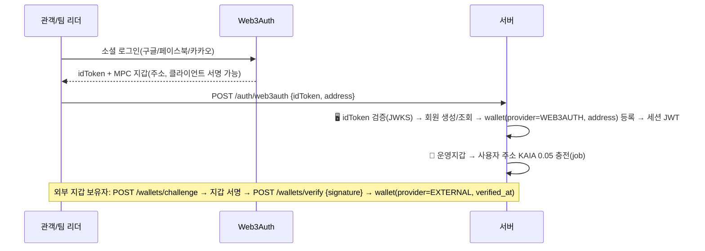
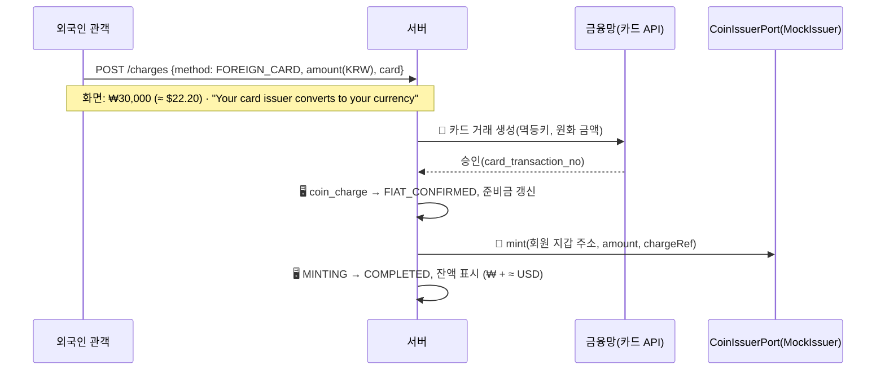

# 방향 전환 결정 문서 v1 — 전부 코인(가상 원화 스테이블코인 1종) · 외국인 관객 타깃 · Web3Auth 지갑

> 대상: SSAFY 15기 특화 프로젝트 · 핀테크 트랙 · B204 · 작성 2026-09-02(수) · 상태: **결정 문서(SSOT) — 후속 6개 문서 재작성의 유일한 입력** · 표기 **[권]** = 권고안을 확정값으로 적은 항목(팀이 뒤집으면 §14 영향 열대로 고침) · **P1/P2** = MVP 제외(P2 = 시간 남으면 마지막)
>
> 기준 문서 — [설계 문서 작성 계획 v1 §1](../design/00_설계문서_작성계획_v1.md) · [ERD v2](../design/09_ERD_v2.md) · [요구사항 명세서 v3](../design/04_요구사항_명세서_v3.md) · [기획 초안 v2.1 §8.4](./01_기획_초안_v2.md) · [테스트넷 선정 리서치 v1](./05_테스트넷_선정_리서치_v1.md) · [핀테크 트렌드 종합분석 v1](../research/fintech-trends-2024-2026/00_종합분석_및_프로젝트_적용안_v1.md) · 9/1 KRWS 제거 커밋 `69fa8e9`
>
> 읽는 법 — 이 문서는 00 계획 v1 §1(SSOT)을 **부분 덧씌우기** 한다. §5~§11에 적힌 것은 00 §1.2~§1.8의 해당 행을 대체하고, 적히지 않은 것은 00 §1이 그대로 유효하다. 후속 문서는 반드시 **새 버전 파일**로 쓰고 기존 파일은 손대지 않는다(버전 분리 규칙).

---

## 0. 해석 전제

사용자 지시(2026-09-02): **"전부 코인으로 사용하는걸로 하고, 스테이블 코인을 사용하는 대신 내국인과 외국인 모두 사용할 수 있게 할거야. 전체 프로젝트 방향을 바꿀거야."** 이어진 검토와 사용자 결정(① USDC 교환 P2 강등 ② **타깃 = 외국인 관람객, 밴드팀 = 한국인** ③ 시연 시나리오 ④ **코인 = 우리가 만든 가상 원화 스테이블코인** ⑤ **지갑 = Web3Auth / 외부 지갑, 커스터디얼 폐기** ⑥ OAuth 3종 동결 ⑦ 플랫폼 발의·사용자 서명 UX)을 전제로 확정했다.

| 사용자 문장·결정 | 이 문서의 해석 | 다르게 읽힐 가능성 |
|---|---|---|
| "전부 코인으로 사용" | 티켓 결제·환불·보증금·정산 분배·팀 수령 등 **모든 가치 이동을 코인 하나로**. 코인 외 결제 레일은 두지 않는다 | 병행은 원장 이원화로 공개 검증 서사를 깨므로 배제(§12.4) |
| "스테이블 코인을 사용하는 대신" | **플랫폼이 발행하는 시연용 가상 원화 스테이블코인 1종**(가칭 KRWS, 테스트넷 자체 발행, v2.1 설계 복원). 그 코인 하나로 외국인 관객과 한국인 팀이 모두 쓴다 | "인가 발행사 코인의 대역" 프레임은 §12.3 Q&A 방어 논리로만 |
| "내국인과 외국인 모두" | **관객은 외국인 우선**(내국인도 가능), **팀은 한국인 가정**. 외국인 관객이 국내 계좌·본인인증 없이 소셜 로그인(Web3Auth)으로 지갑을 얻고 자국 카드로 충전·예매·환불받는다. 한국인 팀은 원화 계좌로 받는다 | 외국인 팀·온체인 출금은 **P2** |
| 결정 ⑤ | 지갑 = **Web3Auth**(소셜 로그인 기반 MPC 키, 클라이언트 측 서명) 자동 생성 또는 **외부 지갑 등록**(Kaia Wallet·MetaMask, 서명 챌린지 소유 증명, 회원당 1개). 서버는 사용자 키를 보관하지 않는다 | v3의 "커스터디얼 서버 서명 + envelope encryption 팀 키" 전제는 **폐기** |
| 결정 ⑦ | 사용자 지갑이 보내는 tx(결제·보증금·팀 출금 예치·규칙 동의)는 **프론트가 tx를 구성하고 사용자가 서명**. 지갑 앱에서 입금 주소로 직접 보내는 방식은 채택하지 않음(입금 매칭·오입금 리스크) | — |

확정 전제 9개(요약, 상세는 본문):

1. **모든 가치 이동은 KRWS 코인으로.** 금융망(SSAFY 교육용)은 원화 충전(on-ramp)·팀 원화 출금(off-ramp) 창구로만 남고 티켓 결제 수단에서 빠진다. 금융망 직접 결제 병행은 비권고(§12.4).
2. **플랫폼이 시연용 가상 원화 스테이블코인을 발행·소각·준비금 공시한다**(1차 서사). ERC-20, decimals=0, 1 KRWS = 1원. 원화 입금 확인 시 mint, 원화 이체 성공 후 burn. 법적 서사는 v2.1(디지털자산기본법 입법 추진 중·모의 발행·법안 요건 선반영) 복원 + 최신 경과(9월 당정 통합안 발의 예정). 발행 로직은 얇은 `CoinIssuerPort` 인터페이스 뒤에 두어 "인가 발행사 코인으로 교체 가능"을 **Q&A 방어 논리**로 확보(§2.6, `ExternalIssuer`는 P2).
3. **환전은 가장자리에서만, 정산 원장은 원화 하나.** 환율은 표시(≈ $10.80)에만 쓰고 정산·분배·컨트랙트·충전 금액에는 절대 쓰지 않는다. 외국인 관객에게는 "T-money·Suica처럼 원화를 미리 충전하는 경험"으로 설명.
4. **지갑 = Web3Auth 또는 외부 지갑, 비수탁.** 관객·팀 리더 모두 동일. 서버가 보관하는 키는 **운영자(operator)·발행(minter)·소각(burner)** 3개만. 팀 지갑 = 팀 리더의 지갑(팀당 리더 1인). 지갑 등록·생성 시 운영지갑이 소액 KAIA 자동 충전(관객 0.05·팀 리더 0.5), Kaia 수수료 대납은 P1.
5. **로그인 = Web3Auth 소셜 로그인 3종(구글·페이스북·카카오) 동결**, 네이버 삭제, 자체 이메일 가입은 보조. 백엔드는 Web3Auth idToken을 검증해 세션(JWT)을 발급한다 [권].
6. **서명 주체**: 결제(approve + purchase)·보증금·팀 출금 예치·규칙 동의(agreeToRules) = **사용자 서명**(Web3Auth 내장 프로바이더 또는 외부 지갑 팝업) / 판매 시작·환불·release·mint·burn·가스 충전 = **운영자**. 관객 선택 기록은 `purchase` 안에서 함께 처리(별도 recordChoice tx 없음). ERC20Permit으로 approve 생략은 P1.
7. **외국인 관객 우선.** 국내 계좌·본인인증 불필요, **기본 언어 en**(ko 병행), 표시 통화(**USD 기본, 원 값 항상 병기**), 시간대. 충전 = ① **해외 카드**(주) ② 원화 가상계좌(내국인 관객 부가). 국내 카드는 ①과 같은 API라 표시만 구분. "원화로 결제" 원스텝 UX(충전 → 서명 결제). 관객 잔액은 **유지**(출금 없음, 카드 취소 모의는 P1) [권].
8. **한국인 팀.** release로 리더 지갑에 KRWS → 리더가 "원화로 받기" 서명(KRWS를 플랫폼 상환 금고로 예치) → 금융망 원화 이체 → 이체 성공 후 burn. 팀 정산 계좌 등록·예금주 검증 유지. 팀 온체인 출금·USDC 역교환은 P2.
9. **컨트랙트·네트워크·기존 결정.** MVP 컨트랙트 **2종**(KRWS + RevenueSplitter). Kaia Kairos(chainId 1001 = 0x3e9) 주 + Besu 백업. web3j + Kaia web3j-ext(서버, fee payer)·ethers-ext(프론트 서명)·OZ v5·Hardhat 3·정산 규칙 2단계·TOTP QR·양도·이의제기·공개 검증 페이지·NFT P2·9/28 발표 유지.

---

## 1. 한눈에 — 전환 전(v3, 9/1) vs 전환 후(v4)

| 항목 | 전환 전 (요구사항 v3 · ERD v2) | 전환 후 (이 문서) |
|---|---|---|
| 타깃 | 국내 관객·국내 팀 | **외국인 관객(내국인도 가능) · 한국인 팀** |
| 티켓 결제 수단 | 금융망 가상계좌 / 카드 (원화 직접 결제) | **KRWS 코인만.** 잔액 결제 또는 "원화로 결제"(부족분 자동 충전 → 서명 결제) |
| 정산 자산 | 원화 (금융망 이체) | **KRWS** (RevenueSplitter가 보관·분배) |
| 코인 | 없음 (9/1 KRWS 삭제) | **플랫폼이 발행하는 시연용 가상 원화 스테이블코인 1종**(가칭 KRWS, decimals=0) |
| 발행 주체 | (없음) | **플랫폼(시연용 가상 발행).** 얇은 `CoinIssuerPort` 뒤에 `MockIssuer`. `ExternalIssuer`(인가 발행사 코인)는 P2 — Q&A 방어 |
| 지갑 | 팀 커스터디얼(서버 서명, envelope encryption) | **Web3Auth(MPC, 클라이언트 서명) 자동 생성 또는 외부 지갑 등록.** 관객·팀 리더 동일, 회원당 1개. 서버는 사용자 키 미보관 |
| 로그인 | 이메일 + 카카오·네이버 OAuth | **Web3Auth 소셜 3종(구글·페이스북·카카오)** + 자체 이메일(보조). 네이버 삭제 |
| 서명 주체 | 팀 키는 agreeToRules 1회, 나머지 운영자 | **사용자 서명**: approve·purchase·deposit·agreeToRules·팀 출금 예치 / **운영자**: startSale·refund·release·mint·burn·가스 |
| 금융망 역할 | 결제·환불·환급의 원화 이동 전부 | **충전(on-ramp)·팀 출금(off-ramp)만** |
| 카드 API 역할 | 티켓 결제 수단 | **충전 수단** — 해외 카드(주)·국내 카드(표시 구분) |
| 외국인 관객 | 사실상 불가 | **소셜 로그인으로 지갑·가입, 자국 카드 충전, 결제·환불(잔액), en UI, USD 환산 병기** |
| 환불 | 금융망 환불 이체 | **에스크로 → 관객 지갑 KRWS 반환**(잔액으로 남아 재사용) |
| 보증금 | 금융망 거래 | **리더가 KRWS로 서명 납부, release 후 반환** |
| 팀 수령 | 금융망 이체 | **release → 리더 지갑 KRWS → 리더 서명으로 상환 금고 예치 → 원화 이체 → burn** |
| 관객 선택 기록 | `recordChoice` 별도 tx | **`purchase` 안에서 함께 기록** |
| 준비금 공시 | 없음(V-02 삭제) | **부활·공개** — 금융망 원화 예치 ≥ 유통량 |
| 표시 통화·언어 | 원 정수, ko | **원 값 항상 + 표시 통화(USD 기본) 환산, en 기본·ko 병행** |
| 도메인 코드 | 15 | **16** (`charge` 신설, `redeem`→`withdraw`) |
| 테이블 | 22 | **24** (§8) |
| 컨트랙트 | RevenueSplitter 1종 | **KRWS + RevenueSplitter** 2종 |
| P1 | — | ERC20Permit 1-서명 결제, Kaia 수수료 대납, 관객 카드 취소 출금, 보증금 몰수, 환율 자동 |
| P2 | — | **양도(선물) [팀 9/2]**, USDC 교환·역교환, 온체인 출금, 외국인 팀, ExternalIssuer, NFT |

---

## 2. 코인 명세 — KRWS

### 2.1 기본 속성

| 항목 | 확정값 |
|---|---|
| 명칭 | **가칭 KRWS** (Korean Won Stable) — 발표용 이름 후보는 §14-1. 관객 화면에서는 "₩ / KRW"로만 보이고(§5 원칙 3), 공연자·검증 화면에서만 코인명 노출 |
| 표준 | ERC-20 (OpenZeppelin v5 `ERC20` + `AccessControl` + `ERC20Pausable`). (P1) `ERC20Permit` |
| decimals | **0** — 1 KRWS = 1원. 온체인 분배액과 원화 출금액의 단위가 같다 |
| 페그 | 원화 1:1. 발행은 **원화 입금 확인 없이는 어떤 경로로도 금지** |
| 네트워크 | Kaia Kairos(chainId 1001, hex `0x3e9`) 주 + EC2 Besu 백업 |
| 전송 가능성 | 표준 ERC-20이라 자유 전송. 플랫폼이 제공하는 화면 경로는 결제·환불·분배·보증금·팀 출금 예치 5종. 외부 주소 출금 화면은 P2 |
| 모의 고지 | 테스트넷 자체 발행 시연용 가상 코인. 실가상자산 아님 |
| **발행 주체** | **플랫폼(시연용 가상 발행).** 우리가 만든 가상 원화 스테이블코인을 발행·소각하고 준비금을 공시한다(v2.1 §8.4 복원). 발행 로직은 얇은 `CoinIssuerPort` 뒤에 두어 미래 인가 발행사 코인으로 교체 가능(P2, §2.6·§12.3 Q&A) |

### 2.2 mint / burn 규칙

| 이벤트 | 온체인 | 오프체인 근거(필수) | 실행 키 |
|---|---|---|---|
| 원화 충전(해외 카드·국내 카드·가상계좌) | `mint(to=회원 지갑, amount)` | `coin_charge.status = FIAT_CONFIRMED` (금융망 성공 응답) | MINTER |
| 팀 원화 출금 | ① 리더 서명 `KRWS.transfer(상환금고, amount)` ② 🏦 원화 이체 ③ `burn(amount)` (상환금고 잔액에서) | **②이체 성공 확인 후에만** ③burn(순서 불변, v3 원칙 5). ②실패 시 운영자가 금고→리더 반환 | ①리더 / ③BURNER(=상환금고 키) |
| 결제·환불·분배·보증금 | KRWS 이동만(mint/burn 없음) — §2.4 Splitter | — | 관객·리더 서명 / OPERATOR |
| (P2) USDC 교환 / 온체인 출금 | 어댑터 `mint`·사용자 `transfer` | — | — |

- **준비금 공시**(P-11 개정): `금융망 원화 예치 잔액 ≥ KRWS 총 유통량`. 예치·유통·차액·갱신 시각 공개(1분 캐시). 불일치 시 mint·release 중단 + 관리자 알림(`COIN_RESERVE_MISMATCH` — 규격 v3 기존 코드, v3 본문의 `SETTLEMENT_BALANCE_MISMATCH`는 규격 미등재라 교정).
- 해외 카드 충전은 **카드사가 환전해 원화로 매입**한다고 가정하므로 준비금은 항상 원화 한 종류다.

### 2.3 서버 보관 키 3개와 사용자 키 (SEC-04·05 재정의)

| 키 | 보관 주체 | 사용처 |
|---|---|---|
| OPERATOR(운영지갑) | 서버(내부 서브넷, KMS/환경변수 주입) | `Splitter.createShow/startSale/refund/aggregate/lock/release/returnDeposit/halt`, 가스 충전 전송 |
| MINTER | 서버(내부 서브넷) | `KRWS.mint` — 충전 확정 후 발행 |
| BURNER(= 상환 금고 지갑) | 서버(내부 서브넷) | 상환 금고가 보유한 KRWS `burn` — 팀 원화 이체 성공 후 |
| **관객·팀 리더 지갑 키** | **사용자**(Web3Auth MPC 샤드 — 클라이언트 측 재구성·서명 / 외부 지갑 앱) | approve·purchase·deposit·agreeToRules·팀 출금 예치 transfer |

- 서버 DB·로그·코드에 사용자 개인키·니모닉·MPC 샤드가 **0건**이어야 한다. v3 SEC-04(팀 키 envelope encryption·복호화 감사 로그)는 **폐기**하고 "서버 보관 키는 3개, 각각 별도 주소·별도 권한, KEK 외부 주입, 서명 이벤트 감사 로그"로 축소 재정의한다.
- 권한 분리: MINTER≠OPERATOR≠BURNER. 키 하나 유출 시 — MINTER: 무한 발행 가능 → 준비금 공시로 발각·pause / OPERATOR: 에스크로 refund 남용 가능 → 잠금 이후 revert·환불 대상 검증(orderRef) / BURNER: 상환 금고분만 소각 가능.
- 새 보안 요구: Web3Auth idToken 검증(JWKS, aud·exp·nonce), 외부 지갑 등록 시 **서명 챌린지**(서버 난수 nonce + 도메인 바인딩, 5분 유효, 1회용) 재사용 방지, 회원당 지갑 1개(주소 UNIQUE), 프론트가 구성한 tx의 `to`·`data`를 서명 전 화면에 사람이 읽을 수 있게 표시.

### 2.4 컨트랙트 함수 목록 (MVP 2종)

**KRWS (ERC-20)**

| 함수 | 권한 | 비고 |
|---|---|---|
| `mint(address to, uint256 amount, bytes32 chargeRef)` | MINTER_ROLE | `chargeRef` = `coin_charge.idempotency_key` 해시, 이벤트 `Minted` |
| `burn(uint256 amount, bytes32 withdrawalRef)` | BURNER_ROLE(상환 금고 자신의 잔액) | 이벤트 `Burned` |
| `pause()/unpause()` | DEFAULT_ADMIN | 준비금 불일치 시 |
| 표준 `transfer/approve/transferFrom/totalSupply/balanceOf` | — | `totalSupply` = 유통량 공시 소스 |
| (P1) `permit` (ERC20Permit) | — | 1-서명 결제용 |

**RevenueSplitter** — 생성자 인자 `IERC20 token`으로 **어떤 ERC-20 원화 코인과도 동작**한다. `transferFrom`·`transfer`·`balanceOf`만 쓴다(mint/burn 없음).

| 함수 | 서명 주체 | 비고 |
|---|---|---|
| `constructor(address token, address operator)` | — | `token` = KRWS 배포 주소 |
| `createShow(showId, address[] teamWallets, uint16[] teamShareBp, uint16 fixedRatioBp, bytes32 rulesHash, uint256 depositAmount)` | OPERATOR | 팀 지갑 = 각 팀 리더의 등록 지갑 주소(생성 시점 스냅샷, `performance_participant.wallet_address`) |
| `deposit(showId)` | **생성팀 리더 서명** | `token.transferFrom(msg.sender, this, depositAmount)` — 사전 `approve` 필요. 이벤트 `DepositPaid` |
| `agreeToRules(showId, rulesHash)` | **참여팀 리더 서명** | msg.sender가 `teamWallets`에 있어야 함 |
| `startSale(showId)` | OPERATOR | 전원 동의 확인 후 잠금 |
| `purchase(showId, bytes32 orderRef, uint8 teamIndex, uint256 amount)` | **관객 서명** | `token.transferFrom(msg.sender, this, amount)` + `escrow[showId] += amount` + `choiceCount[showId][teamIndex]++` — **결제와 관객 선택 기록이 한 tx.** 사전 `approve(this, amount)` 필요(기본안 2단계). 이벤트 `Purchased(showId, orderRef, buyer, teamIndex, amount)`. ON_SALE 아니면 revert. (P1) `purchaseWithPermit(..., deadline, v, r, s)`로 1-서명 |
| `refund(showId, bytes32 orderRef, address to, uint8 teamIndex, uint256 amount)` | OPERATOR | 에스크로 → 관객 지갑, 선택 카운터 −1, 이벤트 `Refunded`. lock 이후 revert. `orderRef`당 누적 환불 ≤ 구매액 |
| `aggregate(showId, validTicketCount)` / `lock(showId)` | OPERATOR | 집계 확정·정산 잠금(48h 이의제기 시작) |
| `release(showId)` | OPERATOR | 잠긴 규칙·카운터로 산출 → 각 팀 리더 지갑에 `transfer`(push), dust 처리, 이벤트 `Released(showId, teamWallet, amount)`. 이의제기 마감 전 revert |
| `returnDeposit(showId)` / `forfeitDeposit(showId)` | OPERATOR | 보증금 반환(생성팀 리더 지갑) / 몰수(P1) |
| `halt(showId)` | OPERATOR | 공연 취소 — 이후 refund만 허용 |
| view: `escrowOf`, `choiceCountOf`, `computeShares`, `rulesHashOf`, `agreedOf`, `token()` | 공개 | 검증 페이지가 직접 읽는다 |

**P2 컨트랙트(설계만 기록)**: `tUSDC`(모의 테스트 USDC) · `KRWSExchange`. MVP에는 배포하지 않는다.

### 2.5 사용자 서명 tx 규칙 (P-18)

- **플랫폼 발의·사용자 서명**: 프론트가 `to`·`data`·`value=0`·`gas`를 구성해 Web3Auth 내장 프로바이더(`eth_sendTransaction`) 또는 연결된 외부 지갑(Kaia Wallet·MetaMask, 모바일은 WalletConnect/딥링크)으로 서명·전송한다. 사용자가 지갑 앱에서 주소로 직접 보내는 흐름은 없다.
- **결제 기본안 = 2단계**: ① `KRWS.approve(Splitter, amount)` ② `Splitter.purchase(...)`. 프론트는 두 서명을 연속 요청하고, ①의 allowance가 이미 충분하면 ①을 생략한다. (P1) `ERC20Permit` + `purchaseWithPermit`로 1-서명.
- **tx 결과 보고**: 프론트가 tx 해시를 서버에 보고(`POST .../signed-tx {txHash}`)하면 서버가 receipt·이벤트(`Purchased` 등)를 검증해 상태를 전이한다. 사용자 서명 tx도 `chain_job`에 `signer_type=USER`로 기록(운영자 job은 `OPERATOR`).
- **가스**: 지갑 등록·생성 시 운영지갑이 KAIA 자동 충전(관객 **0.05**, 팀 리더 **0.5** [권]), 서명 직전 잔액 < 임계(관객 0.01·리더 0.05)면 자동 재충전 후 진행. Kaia 수수료 대납(fee delegation)은 P1.
- **서명 취소·실패**: 사용자가 팝업을 닫으면 주문은 `PENDING_PAYMENT` 유지(15분 만료), 충전된 코인은 잔액으로 남는다.

### 2.6 발행 어댑터 — `CoinIssuerPort` (얇은 인터페이스, P-25)

1차 서사는 **"플랫폼이 시연용 가상 원화 스테이블코인을 발행·소각·준비금 공시한다"**이다. 다만 mint·burn·유통량·준비금 조회는 서비스 코드에서 직접 컨트랙트를 부르지 않고 **인터페이스 하나** 뒤에 둔다. 개발 범위를 늘리지 않는 수준(인터페이스 1개 + 구현 1개)이며, 목적은 §12.3 Q&A에서 "인가 발행사 코인이 나오면 이 구현체만 바꿔 끼운다"고 답할 수 있게 하는 것이다.

```java
public interface CoinIssuerPort {
    String tokenAddress();                                              // Splitter·프론트 approve가 쓰는 ERC-20 주소
    JobRef mint(Address to, long amount, String chargeRef);             // on-ramp
    JobRef burnFromTreasury(long amount, String withdrawalRef);         // off-ramp (상환 금고 잔액 소각)
    long totalSupply();
    ReserveSnapshot reserve();                                          // 금융망 예치 잔액
}
```

| 어댑터 | 바인딩 | mint | burn | 준비금 |
|---|---|---|---|---|
| `MockIssuer` (**MVP 유일 구현**) | 우리 KRWS + MINTER/BURNER 키 | `KRWS.mint` tx | `KRWS.burn` tx | 금융망 예치 잔액 |
| `ExternalIssuer` (**P2**, 설계만·코드 없음) | 인가 발행사 코인 주소 | 발행사 on-ramp API | 발행사 off-ramp API | 발행사 공시 API |

- 설정 `coin.issuer.token-address`(KRWS 배포 주소). 분기 로직은 만들지 않는다. `chain_job.issuer_type` 기본값 `MOCK` 기록만(P2 대비 감사 컬럼).
- **Splitter·프론트 approve·검증 페이지는 `tokenAddress()`만 의존.** 표준 ERC-20이면 정산 흐름은 코드 변경 0.
- Q&A 방어(§12.3): "학생 팀이 스테이블코인을 발행하는 것이 규제상 가능한가" → "테스트넷 시연용 가상 발행이며 실화폐가 없다. 발행 로직은 인터페이스 하나 뒤에 있어 인가 발행사 코인이 나오면 구현체만 바꾸고, 정산 컨트랙트는 토큰 주소만 바꾼다."

---

## 3. 자금 흐름

표기: 🔗 온체인 tx · ✍️ 사용자 서명 tx · 🏦 금융망 API · 🖥 서버 처리. 운영자 🔗는 `202 + jobId` 폴링, ✍️는 프론트 서명 → tx 해시 보고 → 서버 receipt 검증.

### 3.0 가입·지갑 준비 (모든 흐름의 전제)



- 회원당 지갑 1개. Web3Auth 회원이 나중에 외부 지갑으로 바꾸려면 기존 지갑 잔액 0 확인 후 교체(P1 화면, MVP는 관리자 처리).
- 자체 이메일 가입(보조) 회원은 지갑이 없으므로 **첫 결제 전 지갑 연결 필수**(Web3Auth 이메일 패스워드리스 또는 외부 지갑 등록) [권].

### 3.1 충전 ① 해외 카드 (주 경로) · 국내 카드 (표시 구분)



국내 카드(`DOMESTIC_CARD`)는 같은 호출, `card_region` 표시와 환전 고지 유무만 다르다. 실패·타임아웃은 v3 결제 실패 처리와 같은 보상 규칙(오류 = FAILED, 타임아웃 = 결과 재조회 예약, 어느 경우도 mint 없음).

### 3.2 충전 ② 원화 가상계좌 (내국인 관객 부가)

`POST /charges {method: VIRTUAL_ACCOUNT, amount}` → 🏦 가상계좌 발급 → `202 chargeId + 계좌번호·기한(30분)` → 입금(시연: 금융망 입금 API 시뮬레이션) → 🏦 입금 확인 폴링 → `FIAT_CONFIRMED` → 🔗 `mint` → `COMPLETED`. 30분 미입금 = `EXPIRED`.

### 3.3 결제 — 잔액 결제 / "원화로 결제" 원스텝 (관객 서명)

```mermaid
flowchart LR
  A[주문 생성<br/>PENDING_PAYMENT 15분] --> B{잔액 ≥ 금액?}
  B -- 예 --> S1[✍️ approve Splitter, amount<br/>allowance 충분하면 생략]
  B -- 아니오 --> C[원화로 결제 선택<br/>부족분 = 금액 − 잔액]
  C --> D[🏦 충전 ①/② 실행<br/>coin_charge purpose=AUTO_PAYMENT]
  D --> M[🔗 mint 부족분 → COMPLETED]
  M --> S1
  S1 --> S2[✍️ Splitter.purchase showId, orderRef, teamIndex, amount<br/>transferFrom + 선택 카운터 +1]
  S2 --> R[프론트 → POST /orders/:id/payment/signed-tx {txHash}]
  R --> T[🖥 receipt·Purchased 이벤트 검증 → payment PAID → 주문 PAID → 티켓 발급]
```

- `POST /orders/{orderId}/payment {mode: BALANCE | AUTO_CHARGE, chargeMethod?, card?}` → 응답에 서명에 필요한 **tx 파라미터**(`tokenAddress`, `splitterAddress`, `showId`, `orderRef`, `teamIndex`, `amount`, 필요 approve 여부)와 `chargeId?`(AUTO_CHARGE).
- **실패 보상**: 금융망 성공·mint 실패 → mint job 재시도(멱등키 고정). mint 성공·서명 거부/실패 → 코인은 잔액으로 남고 주문은 15분 만료 시 `CANCELLED`(돈은 사라지지 않는다). purchase revert(재고·잠금·allowance) → 잔액 그대로, 프론트가 사유 표시 후 재시도 안내.
- 관객 화면 문구(en 기본): "Pay with balance" / "Pay with card (KRW)". 서명 팝업 직전 "Confirm ₩15,000 payment" 확인 화면(§2.3 사람이 읽을 수 있는 tx 표시). 블록체인 용어는 "Confirm in your wallet" 한 줄만 허용(§5 원칙 3 개정).
- 티켓 발급은 receipt 확정 직후. Kairos 블록 1초라 "Confirming…" 표시는 수 초.

### 3.4 환불 (개별·공연 취소 일괄) — 운영자

1. 수수료 구간 판정(P-8 유지: D-7 전액 / D-3 50% / 이후 불가).
2. 🔗 `Splitter.refund(showId, orderRef, 관객 지갑, teamIndex, refundAmount)` — 에스크로 → 관객 지갑, 선택 카운터 −1 (v3 `cancelChoice` 별도 tx 삭제).
3. 수수료분은 에스크로에 남아 정산 재원에 포함(v3 동일).
4. 환불 코인은 **관객 잔액으로 남는다.** 화면: "Refunded to your balance." 카드 취소는 P1.
5. 공연 취소 일괄 환불: 수수료 0, 건별 `refund` job, 진행률 표시(v3 유지). 완료 후 `returnDeposit`.
6. **양도 후 재선택(9/2 교차 검증 확정)**: `recordChoice`·`cancelChoice` 삭제로 양도 수락자의 팀 재선택은 **오프체인 기록만** 하고 온체인 카운터는 원 구매자의 `purchase` 시점 값을 유지한다. 정산 집계도 그 값을 쓴다. 양도에 온체인 tx 없음. 대안(`adjustChoice` 운영자 함수)은 §14-21.

### 3.5 보증금 (P-21) — 리더 서명

- 공연 생성 시 `performance.deposit_amount`(기본 **50,000 KRWS** [권]). 생성 직후 `DRAFT`, 규칙 설정 진입 전에 **리더가 ✍️ approve + `Splitter.deposit(showId)`** 서명. 리더 지갑 잔액 부족이면 P-02/P-03에서 충전 유도(리더 회원 지갑에 충전 ①②).
- `deposit_status = PAID` 후 규칙 설정 가능. 반환: 정산 `RELEASED` 확정 시 또는 공연 취소 일괄 환불 완료 시 🔗 `returnDeposit` → `RETURNED`(리더 지갑). 몰수 P1.

### 3.6 정산 → 한국인 팀 수령 → 원화 출금 (리더 서명 + 운영자)

```mermaid
flowchart TD
  L[정산 LOCKED · 이의제기 48h] --> R[🔗 Splitter.release<br/>팀 리더 지갑들로 KRWS push]
  R --> N[리더 알림: 정산금 도착 → P-09 '원화로 받기']
  N --> Q{검증된 정산 계좌 있음?}
  Q -- 아니오 --> A[정산 계좌 등록·예금주 검증]
  A --> W0
  Q -- 예 --> W0[POST /teams/:id/withdrawals → 서명 파라미터]
  W0 --> W1[✍️ KRWS.transfer 상환금고, amount]
  W1 --> W2[프론트 txHash 보고 → 🖥 receipt 검증 → TRANSFERRING]
  W2 --> W3[🏦 금융망 원화 이체 → TRANSFERRED]
  W3 --> W4[🔗 KRWS.burn amount (BURNER) → COMPLETED]
  W3 -. 이체 실패 .-> W5[🔗 운영자: 금고 → 리더 지갑 반환, FAILED]
```

- P-10 개정: 자동 push 이체는 **불가**(리더 서명 필요). release 확정 시 리더에게 알림 + P-09 배지. 리더가 "원화로 받기"를 누르면 서명 1회 → 이체 → burn. 팀 잔액 전액 또는 일부 금액 선택.
- 팀 출금은 **원화 금융망 이체만**. 온체인 출금·USDC 역교환은 P2. 정산 종단 상태 `RELEASED`(§7).

### 3.7 관객 잔액 정책 (P-20)

관객 잔액은 **유지**(출금 화면 없음). 환불금·미사용 충전액은 다음 예매에 사용. 이유: ① 카드 취소는 충전 건 단위 매칭 부담 ② 외국인 관객의 체류 중 재관람 수요 ③ 선불업 잔액 환급 의무는 실서비스 항목으로 Q&A. 카드 취소(모의)·원화 계좌 출금은 P1, 온체인 출금은 P2. 비수탁 지갑이므로 관객이 지갑 앱에서 KRWS를 직접 옮기는 것은 막을 수 없다 — 화면은 안내하지 않으며, 옮긴 코인의 원화 상환 경로는 없다고 고지(P2까지).

### 3.8 자금 흐름 불변식 (검증 페이지가 대사하는 값)

1. `token.totalSupply` = Σ(충전 mint) − Σ(팀 출금 burn).
2. 공연별 `escrowOf(showId)` = Σ(purchase) − Σ(refund) − Σ(release) (+ 보증금 별도 계정).
3. 공연별 Σ`Released` = 잠긴 규칙 × 카운터로 재계산한 분배액 합 (dust 포함, 1원도 다르지 않아야 한다).
4. 준비금: 금융망 원화 예치 ≥ `totalSupply`.

---

## 4. actor 변경

| 코드 | 변경 | 내용 |
|---|---|---|
| `GUEST` | 유지 | 공연 탐색·상세(en/ko, USD 환산), 양도 링크 진입, **준비금 공시(V-02) 열람**, 표시 환율 조회 |
| `AUDIENCE` | **변경** | **외국인 관객 우선.** Web3Auth 소셜 로그인으로 가입·지갑 자동 생성(또는 외부 지갑 등록). 자국 카드 충전·잔액 결제·원스텝 결제(서명)·환불(잔액). 언어(en 기본)·표시 통화(USD 기본)·시간대 |
| `PERFORMER` | 변경 | **한국인 팀 리더.** 리더 지갑 = 팀 지갑. 보증금·규칙 동의·원화 출금 예치를 서명. 정산 계좌 등록·예금주 검증 유지 |
| `STAFF` | 유지 | 링크 토큰 검표 (v3 그대로) |
| `ADMIN` | 변경 | 이의제기 처리(MVP) + **표시 환율 등록·준비금 경고 확인**(MVP 최소) · 실패 작업 재시도·회원/공연 관리(P1) |

- "관객에게는 지갑이 없다"·"팀 지갑 키를 플랫폼이 보관한다" 문장은 **전 문서에서 삭제**. 대신 "지갑은 사용자 소유(Web3Auth MPC 또는 외부 지갑), 서버는 사용자 키를 보관하지 않는다"로 바꾼다. 탈중앙 주장은 여전히 하지 않는다(운영자가 정산 흐름을 발의·실행).
- 회원 신규 속성: `country_code`(ISO 3166-1 alpha-2), `locale`(**en 기본**, ko), `display_currency`(**USD 기본**), `timezone`(IANA), `auth_provider`(GOOGLE/FACEBOOK/KAKAO/LOCAL), `web3auth_verifier_id`.
- 페르소나(기획 v3 §3용): ① 서울 여행 중 홍대 인디 공연을 찾은 미국·일본 관객(구글 로그인, 영어 UI, 자국 카드) ② 한국인 관객(카카오 로그인, 가상계좌 부가) ③ 한국인 3인 밴드 리더(구글 로그인 지갑 또는 Kaia Wallet 등록, 정산 계좌, 원화 수령).

---

## 5. 도메인 코드 변경 (00 계획 §1.3 대체 — 16개)

| 코드 | 이름 | 다루는 것 | 변경 | 규격 코드 접두 |
|---|---|---|---|---|
| `member` | 회원·인증 | **Web3Auth 로그인(idToken 검증)**·자체 이메일(보조)·토큰·프로필(국가·로케일·통화) | 변경 | `AUTH_*` |
| `team` | 공연팀 | 팀 생성·정산 계좌(예금주 검증). 팀 지갑 = 리더 지갑 | 변경 | `TEAM_*` |
| `wallet` | 지갑 | **Web3Auth 지갑 등록·외부 지갑 챌린지/검증·주소·KRWS 잔액·거래 이력·가스 충전** | 변경 | `WALLET_*` |
| `performance` | 공연 | 공연 생성(**보증금 서명 납부**)·수정·목록·상세·티켓 옵션·참여팀·취소·판매 현황·검표 링크 | 변경 | `PERFORMANCE_*` |
| `rule` | 정산 규칙 | 규칙 설정·**동의(리더 서명 tx 보고)**·판매 시작 | 변경 | `RULE_*` |
| `ticket` | 예매·티켓 | 주문·티켓·QR | 유지 | `TICKET_*` |
| `payment` | 코인 결제 | **서명 파라미터 발급·서명 tx 보고·receipt 검증·자동 충전 연계** — `Splitter.purchase` | 변경 | `PAYMENT_*` |
| `charge` | **충전(신설)** | 해외 카드·국내 카드·가상계좌 충전, 충전 이력 | 신설 | `CHARGE_*`(규격 v4 신설) |
| `coin` | KRWS | 발행 어댑터(mint/burn)·유통량·준비금·**표시 환율**·온체인 작업 큐(`chain_job`) | 변경 | `COIN_*`, `CHAIN_*` |
| `refund` | 취소·환불 | 환불액 미리보기·개별 취소·일괄 환불 — `Splitter.refund` → 잔액 | 변경 | `REFUND_*` |
| `transfer` | 양도 | 유지 | 유지 | `TRANSFER_*` |
| `entry` | 입장 | 유지 | 유지 | `ENTRY_*` |
| `settlement` | 정산 | 집계·잠금·이의·release·조회·공유 링크·보증금 반환 | 변경 | `SETTLEMENT_*` |
| `withdraw` | **출금(구 `redeem`)** | 팀 원화 출금(리더 서명 예치 → 이체 → burn)·이력·재시도 | 개명 | `WITHDRAW_*`(구 `REDEEM_*`) |
| `verify` | 공개 검증 | 공연별 검증(참여팀 로그인)·**준비금 공시(공개)** | 변경 | `CHAIN_*`, `COIN_*` |
| `admin` | 관리자 | 이의제기·환율 등록·(P1) 실패 작업·회원·공연 | 변경 | `COMMON_*` |

브랜치 도메인: `charge`·`withdraw`는 `payment` 브랜치 도메인에 포함, `coin`은 `contract`.

---

## 6. 정책 전제 변경 (00 §1.4 대체 행 + 신설)

| # | 항목 | 개정 전제 | 변경 |
|---|---|---|---|
| P-1 | 인증 방식 | **Web3Auth 소셜 로그인 3종(구글·페이스북·카카오) 동결**, 네이버 삭제. 백엔드는 Web3Auth idToken(JWKS) 검증 → 세션 JWT(access 30분/refresh 14일 유지). 자체 이메일+비밀번호는 보조(지갑은 첫 결제 전 연결 필수) | 변경 |
| P-2 | 지갑 구조 | **비수탁.** Web3Auth MPC 지갑 자동 생성 또는 외부 지갑(Kaia Wallet·MetaMask) 등록(서명 챌린지). 회원당 1개, 관객·팀 리더 동일, 팀 지갑 = 리더 지갑. 서버 보관 키는 OPERATOR·MINTER·BURNER 3개만 | 대체 |
| P-3 | 가스 | 지갑 등록·생성 시 운영지갑이 KAIA 자동 충전(관객 **0.05**·팀 리더 **0.5** [권]), 서명 직전 임계 미달 시 재충전. 사용자에게 가스 개념 비노출("Confirm in your wallet"만). Kaia 수수료 대납 P1 | 변경 |
| P-7 | 결제 수단 | **KRWS 잔액 결제 + "원화로 결제"(부족분 자동 충전 → 서명 결제).** 결제 tx(`purchase`)가 관객 선택을 함께 기록. 금융망 직접 결제 없음 | 대체 |
| P-8 | 취소 수수료 | 구간 유지. 환불 = 운영자 `Splitter.refund` → **관객 지갑 잔액 반환** | 변경 |
| P-9 | 정산 시점 | 유지. release 후 → 리더 서명 원화 출금 | 부분 변경 |
| P-10 | 팀 수령 | release = 리더 지갑 KRWS 입금. **리더가 P-09에서 "원화로 받기" 서명**(상환 금고 예치) → 이체 → burn. 자동 push 이체 없음(서명 필요). 정산 종단 `RELEASED` | 대체 |
| P-11 | 준비금 공시 | 금융망 원화 예치 ≥ 유통량, 1분 캐시, 공개. 불일치 시 mint·release 중단 | 변경 |
| P-12 | 공연 취소 | 유지 + 일괄 환불 완료 후 보증금 반환 | 부분 변경 |
| **P-17** | 표시 환율 | 관리자가 `exchange_rate` 등록(`USD_KRW` **1,350** [권] 등, 하루 1회, 시연 고정). **표시 환산(≈)에만 사용.** 정산·분배·컨트랙트·티켓 가격·충전 금액 금지 | 신설 |
| **P-18** | 사용자 서명 tx | **플랫폼 발의·사용자 서명.** 프론트가 tx 구성 → Web3Auth 프로바이더/외부 지갑 팝업 서명 → tx 해시 서버 보고 → receipt 검증. 결제 기본안 approve+purchase 2단계, ERC20Permit 1-서명 P1. 지갑 앱에서 주소로 직접 송금하는 흐름 없음 | 신설 |
| **P-19** | 충전 한도 | 1회 최소 1,000 / 최대 1,000,000 KRWS, 가상계좌 입금 기한 30분 [권] | 신설 |
| **P-20** | 잔액·출금 | **관객 잔액 유지(출금 없음)**, 환불은 잔액으로. 팀 출금 = 원화 금융망 이체만(리더 서명 예치, 최소 1,000, 수수료 0). 관객 카드 취소·원화 출금 P1, 온체인 출금 P2 | 신설 |
| **P-21** | 보증금 | 공연당 50,000 KRWS 고정 [권], 생성팀 리더 서명 `deposit`. `RELEASED` 또는 일괄 환불 완료 시 반환. 몰수 P1 | 신설 |
| **P-22** | 언어·통화 표시 | **en 기본**, ko 병행. 금액은 **원 값(₩) 항상 표시** + `display_currency`(USD 기본) 환산 "≈" 병기(환율·시각 툴팁). 시간은 회원 시간대 + KST 병기 | 신설 |
| **P-23** | 외국인 가입 | 소셜 로그인만으로 가입 완료. 국내 본인인증·휴대폰·국내 계좌 불필요. `country_code` 자기 선언 | 신설 |
| **P-24** | 원장 단일화 | **금융망 직접 결제(코인 우회) 병행 금지.** 모든 티켓 대금은 `purchase`로 에스크로에 들어와야 한다 | 신설 |
| **P-25** | 발행 주체 교체 가능성 | 1차 서사 = **플랫폼이 시연용 가상 원화 스테이블코인을 발행·소각·준비금 공시.** 발행 로직은 얇은 `CoinIssuerPort`(구현 `MockIssuer` 1개, 분기 없음). `ExternalIssuer`는 P2 — Q&A 방어. Splitter·approve·검증은 `tokenAddress()`만 의존 | 신설 |

P-4·P-5·P-6·P-13·P-14·P-15·P-16은 그대로.

---

## 7. 상태 enum 변경 (00 §1.5 대체 행 + 신설)

| 엔티티 | 상태 | 전이 | 변경 |
|---|---|---|---|
| **Wallet** | `LINKED` / `SUSPENDED` | Web3Auth 등록 즉시 LINKED, 외부 지갑은 챌린지 검증 성공 시 LINKED. 관리자 정지 | 신설 |
| **Wallet.provider** | `WEB3AUTH` / `EXTERNAL` | | 신설 |
| **CoinCharge** | `REQUESTED → FIAT_CONFIRMED → MINTING → COMPLETED` / `FAILED` / `EXPIRED` | 금융망 성공 = FIAT_CONFIRMED · mint job 제출 = MINTING · mint 확정 = COMPLETED · 가상계좌 30분 미입금 = EXPIRED | 신설 |
| **Payment** | `REQUESTED → CHARGING → AWAITING_SIGNATURE → PAYING → PAID` / `FAILED` / `REFUNDED` | AUTO_CHARGE면 CHARGING 경유 → 충전 완료 시 AWAITING_SIGNATURE → 프론트 txHash 보고 = PAYING → receipt 확정 = PAID. 주문 만료 = FAILED. 전 티켓 환불 = REFUNDED | 변경 |
| **CoinWithdrawal** | `AWAITING_SIGNATURE → TRANSFERRING → TRANSFERRED → BURNING → COMPLETED` / `FAILED` / `RETURNED` | 리더 서명 tx 보고 = TRANSFERRING(금고 예치 확정) → 🏦 이체 성공 = TRANSFERRED → burn 확정 = COMPLETED. 이체 실패 후 금고→리더 반환 = RETURNED | 신설(구 Redemption 대체) |
| **RuleAgreement** | `PENDING → SIGNING → AGREED` | 리더가 서명 tx 해시 보고 = SIGNING, receipt 확정 = AGREED | 변경 |
| **ChainJob.tx_type** | `GAS_CHARGE / MINT / BURN / APPROVE / PURCHASE / REFUND / DEPOSIT / DEPOSIT_RETURN / DEPOSIT_FORFEIT / AGREE / LOCK / AGGREGATE / RELEASE / HALT / TREASURY_IN / TREASURY_RETURN` | `RECORD_CHOICE`·`CANCEL_CHOICE` 삭제(PURCHASE·REFUND에 흡수). `TREASURY_IN` = 리더 출금 예치 transfer | 변경 |
| **ChainJob.signer_type** | `OPERATOR` / `USER` | USER = 프론트 서명 후 해시 보고, 서버는 receipt 검증만 | 신설 |
| **ChainJob.issuer_type** | `MOCK` / `EXTERNAL` | 기본 MOCK | 신설 |
| **ChainJob.status** | `PENDING → SUBMITTED → CONFIRMED / FAILED` | USER job은 해시 보고 시 SUBMITTED로 생성 | 유지 |
| **Settlement** | `NONE → AGGREGATED → LOCKED → DISPUTE_OPEN → RELEASED` / `HALTED` | **`REDEEMED` 삭제** | 변경 |
| **Performance.deposit_status** | `UNPAID → PAID → RETURNED / FORFEITED` | 리더 `deposit` receipt 확정 = PAID | 유지(명문화) |
| **Refund** | `PENDING → PROCESSING → COMPLETED / FAILED` | PROCESSING = `refund` tx 제출, COMPLETED = 확정 | 정의 변경 |
| **WalletTx.type**(이력 필터) | `CHARGE / PURCHASE / REFUND / RELEASE / DEPOSIT / DEPOSIT_RETURN / WITHDRAW_BANK / GAS` | | 신설 |
| **Member.auth_provider** | `GOOGLE / FACEBOOK / KAKAO / LOCAL` | NAVER 삭제 | 변경 |
| **AuditLog.action_type** | `ADMIN_ACTION / OPERATOR_SIGN / MINT / BURN / RELEASE / CHARGE / WITHDRAW / RATE_CHANGE / WALLET_LINK / STATUS_CHANGE` | `KEY_DECRYPT` 삭제(사용자 키 없음) → `OPERATOR_SIGN`·`WALLET_LINK` 신설 | 변경 |
| Team·Performance·Participant·TicketOrder·Ticket·Transfer·Dispute | 유지 | | 유지 |

---

## 8. ERD v3 변경 지시 (DDL 수준)

파일: `docs/design/10_ERD_v3.md` + `docs/design/10_ERD_v3_import.sql`(ERD Cloud용, COMMENT 논리명 포함, v2 SQL 형식 그대로). **22 → 24 테이블.** P1·P2 항목을 위한 컬럼은 만들지 않는다(enum 값 예약만 주석).

| # | 테이블 | 처분 | 요지 |
|---|---|---|---|
| 1 | `member` | 컬럼 변경 | `auth_provider ENUM('GOOGLE','FACEBOOK','KAKAO','LOCAL')`, `provider_user_id` 유지, **`web3auth_verifier_id VARCHAR(255)`** 추가, `country_code CHAR(2) NOT NULL`, `locale VARCHAR(10) NOT NULL DEFAULT 'en'`, `display_currency CHAR(3) NOT NULL DEFAULT 'USD'`, `timezone VARCHAR(50) NOT NULL DEFAULT 'UTC'`. `password_hash` NULL(LOCAL만) |
| 2 | `refresh_token` | 유지 | |
| 3 | `bank_account` | 유지 | 팀 정산 계좌(예금주 검증) |
| 4 | `team` | 유지 | 팀 지갑 주소는 `leader_id → wallet`으로 파생, 컬럼 없음 |
| 5 | **`wallet`** | **신설(`team_wallet` 대체, 회원 1:1)** | 아래 DDL. **암호화 키 컬럼 없음** |
| 6 | `performance` | 컬럼 변경 | `deposit_bank_tx_id` 삭제 → `deposit_job_id BIGINT`(FK chain_job) · `deposit_tx_hash CHAR(66)` · `deposit_return_tx_hash CHAR(66)`. `deposit_amount` 단위 = KRWS |
| 7 | `ticket_type` | 유지 | 가격 단위 KRWS(=원) |
| 8 | `performance_participant` | 컬럼 추가 | **`wallet_address CHAR(42)`** — createShow 시점 리더 지갑 스냅샷(온체인 teamWallets와 1:1) |
| 9 | `settlement_rule` | 유지 | |
| 10 | `rule_agreement` | 컬럼 변경 | `status ENUM('PENDING','SIGNING','AGREED')`, `agree_job_id BIGINT`(FK chain_job, signer_type=USER) 추가, `requested_by` 유지 |
| 11~13 | `ticket_order` `order_item` `ticket` | 유지 | `ticket.choice_tx_hash` = `purchase` tx 해시(주석). `ticket_order.order_ref CHAR(66)` 추가(온체인 orderRef = keccak(orderId)) |
| 14 | `payment` | **컬럼 교체** | 아래 DDL |
| 15 | **`coin_charge`** | **신설** | 아래 DDL |
| 16 | `chain_job` | 컬럼 추가·enum 확장 | `tx_type` §7, **`signer_type ENUM('OPERATOR','USER') NOT NULL DEFAULT 'OPERATOR'`**, **`issuer_type ENUM('MOCK','EXTERNAL') NOT NULL DEFAULT 'MOCK'`**, `wallet_id BIGINT`(FK wallet, NULL), `amount BIGINT`, `idempotency_key VARCHAR(255) UNIQUE`(OPERATOR만 NOT NULL). 역방향 FK만. `coin_job` 부활하지 않음 |
| 17 | `refund` | 컬럼 교체 | `bank_refund_tx_id`·`cancel_choice_tx_hash` 삭제 → `refund_job_id`(FK chain_job)·`refund_tx_hash CHAR(66)`·`to_wallet_id`(FK wallet) |
| 18 | `transfer` | 유지 | |
| 19 | `settlement` | 컬럼 추가·enum | `release_tx_hash CHAR(66)` 복원, `status`에서 `REDEEMED` 제거 |
| 20 | `settlement_share` | 컬럼 교체 | `transfer_confirmed` 삭제 → `released BOOLEAN DEFAULT FALSE`, `released_at`, `wallet_address CHAR(42)`(수령 주소 스냅샷), `withdrawn_amount BIGINT DEFAULT 0` |
| 21 | `dispute` | 유지 | |
| 22 | **`coin_withdrawal`** | **신설(`redemption` 삭제·대체)** | 아래 DDL |
| 23 | **`exchange_rate`** | **신설(표시 환율)** | 아래 DDL |
| 24 | `audit_log` | enum 변경 | `action_type` §7 |
| — | `team_wallet` | **삭제** | `wallet`(회원 1:1)로 대체 |
| — | `redemption` | **삭제** | `coin_withdrawal`로 대체 |

```sql
CREATE TABLE wallet (
    wallet_id             BIGINT AUTO_INCREMENT PRIMARY KEY,
    member_id             BIGINT NOT NULL UNIQUE,          -- 회원당 지갑 1개 (팀 지갑 = 리더 지갑)
    provider              ENUM('WEB3AUTH','EXTERNAL') NOT NULL,
    address               CHAR(42) NOT NULL UNIQUE,
    verified_at           DATETIME(6) NOT NULL,            -- WEB3AUTH: idToken 검증 시각 / EXTERNAL: 챌린지 서명 검증 시각
    status                ENUM('LINKED','SUSPENDED') NOT NULL DEFAULT 'LINKED',
    gas_funded_at         DATETIME(6),                     -- 마지막 KAIA 자동 충전
    last_balance_check_at DATETIME(6),
    cached_krws_balance   BIGINT NOT NULL DEFAULT 0,       -- 조회 캐시(원장은 체인)
    created_at            DATETIME(6) NOT NULL DEFAULT CURRENT_TIMESTAMP(6),
    FOREIGN KEY (member_id) REFERENCES member(member_id)
) ENGINE=InnoDB;
-- 서버는 사용자 개인키·MPC 샤드·니모닉을 어떤 형태로도 저장하지 않는다.

-- 외부 지갑 등록 챌린지(nonce·메시지·만료)는 테이블로 만들지 않는다 [권]:
--   Redis key `wallet:challenge:{memberId}` TTL 300s. ERD 문서에는 메모로만 기재(24 테이블에 미포함).

CREATE TABLE coin_charge (
    charge_id        BIGINT AUTO_INCREMENT PRIMARY KEY,
    member_id        BIGINT NOT NULL,
    wallet_id        BIGINT NOT NULL,                      -- mint 대상 지갑
    purpose          ENUM('MANUAL','AUTO_PAYMENT') NOT NULL DEFAULT 'MANUAL',
    ticket_order_id  BIGINT,                               -- AUTO_PAYMENT일 때 대상 주문
    method           ENUM('FOREIGN_CARD','DOMESTIC_CARD','VIRTUAL_ACCOUNT') NOT NULL,  -- P2 예약: USDC_SWAP
    amount           BIGINT NOT NULL,                      -- 원화 금액 = 발행 KRWS (1:1)
    display_rate_id  BIGINT,                               -- 화면 환산에 쓴 표시 환율 스냅샷(영수증용, 선택)
    virtual_account_no VARCHAR(30),
    virtual_account_expires_at DATETIME(6),
    card_no_masked   VARCHAR(19),
    card_transaction_no BIGINT,
    bank_tx_id       VARCHAR(255),
    mint_job_id      BIGINT,
    mint_tx_hash     CHAR(66),
    status           ENUM('REQUESTED','FIAT_CONFIRMED','MINTING','COMPLETED','FAILED','EXPIRED') NOT NULL DEFAULT 'REQUESTED',
    failure_code     VARCHAR(100),
    idempotency_key  VARCHAR(255) NOT NULL UNIQUE,
    requested_at     DATETIME(6) NOT NULL DEFAULT CURRENT_TIMESTAMP(6),
    fiat_confirmed_at DATETIME(6),
    completed_at     DATETIME(6),
    FOREIGN KEY (member_id) REFERENCES member(member_id),
    FOREIGN KEY (wallet_id) REFERENCES wallet(wallet_id),
    FOREIGN KEY (ticket_order_id) REFERENCES ticket_order(ticket_order_id),
    FOREIGN KEY (display_rate_id) REFERENCES exchange_rate(rate_id),
    FOREIGN KEY (mint_job_id) REFERENCES chain_job(chain_job_id)
) ENGINE=InnoDB;

CREATE TABLE payment (
    payment_id      BIGINT AUTO_INCREMENT PRIMARY KEY,
    ticket_order_id BIGINT NOT NULL UNIQUE,
    payer_wallet_id BIGINT NOT NULL,
    amount          BIGINT NOT NULL,                       -- KRWS
    mode            ENUM('BALANCE','AUTO_CHARGE') NOT NULL,
    auto_charge_id  BIGINT,                                -- AUTO_CHARGE일 때 coin_charge
    approve_job_id  BIGINT,                                -- APPROVE chain_job (USER, 생략 가능)
    purchase_job_id BIGINT,                                -- PURCHASE chain_job (USER)
    purchase_tx_hash CHAR(66),
    status          ENUM('REQUESTED','CHARGING','AWAITING_SIGNATURE','PAYING','PAID','FAILED','REFUNDED') NOT NULL DEFAULT 'REQUESTED',
    failure_code    VARCHAR(100),
    idempotency_key VARCHAR(255) NOT NULL UNIQUE,
    requested_at    DATETIME(6) NOT NULL DEFAULT CURRENT_TIMESTAMP(6),
    paid_at         DATETIME(6),
    FOREIGN KEY (ticket_order_id) REFERENCES ticket_order(ticket_order_id),
    FOREIGN KEY (payer_wallet_id) REFERENCES wallet(wallet_id),
    FOREIGN KEY (auto_charge_id) REFERENCES coin_charge(charge_id),
    FOREIGN KEY (approve_job_id) REFERENCES chain_job(chain_job_id),
    FOREIGN KEY (purchase_job_id) REFERENCES chain_job(chain_job_id)
) ENGINE=InnoDB;

CREATE TABLE coin_withdrawal (
    withdrawal_id   BIGINT AUTO_INCREMENT PRIMARY KEY,
    team_id         BIGINT NOT NULL,
    wallet_id       BIGINT NOT NULL,                       -- 리더 지갑
    settlement_id   BIGINT,                                -- 대상 정산(선택, 잔액 통합 출금이면 NULL)
    kind            ENUM('BANK_TRANSFER') NOT NULL DEFAULT 'BANK_TRANSFER',  -- P1 예약: CARD_CANCEL, P2: ONCHAIN
    amount          BIGINT NOT NULL,                       -- KRWS
    bank_account_id BIGINT NOT NULL,
    treasury_in_job_id BIGINT,                             -- TREASURY_IN chain_job (USER: 리더 → 상환 금고)
    treasury_in_tx_hash CHAR(66),
    bank_tx_id      VARCHAR(255),
    burn_job_id     BIGINT,                                -- BURN chain_job (OPERATOR/BURNER)
    burn_tx_hash    CHAR(66),
    return_job_id   BIGINT,                                -- TREASURY_RETURN (이체 실패 시)
    status          ENUM('AWAITING_SIGNATURE','TRANSFERRING','TRANSFERRED','BURNING','COMPLETED','FAILED','RETURNED') NOT NULL DEFAULT 'AWAITING_SIGNATURE',
    retry_count     INT NOT NULL DEFAULT 0,
    failure_reason  VARCHAR(500),
    idempotency_key VARCHAR(255) NOT NULL UNIQUE,
    requested_at    DATETIME(6) NOT NULL DEFAULT CURRENT_TIMESTAMP(6),
    completed_at    DATETIME(6),
    FOREIGN KEY (team_id) REFERENCES team(team_id),
    FOREIGN KEY (wallet_id) REFERENCES wallet(wallet_id),
    FOREIGN KEY (settlement_id) REFERENCES settlement(settlement_id),
    FOREIGN KEY (bank_account_id) REFERENCES bank_account(account_id),
    FOREIGN KEY (treasury_in_job_id) REFERENCES chain_job(chain_job_id),
    FOREIGN KEY (burn_job_id) REFERENCES chain_job(chain_job_id),
    FOREIGN KEY (return_job_id) REFERENCES chain_job(chain_job_id)
) ENGINE=InnoDB;

CREATE TABLE exchange_rate (
    rate_id        BIGINT AUTO_INCREMENT PRIMARY KEY,
    pair           VARCHAR(10) NOT NULL,                   -- 'USD_KRW', 'JPY_KRW', 'EUR_KRW' … 표시용만
    rate           DECIMAL(18,6) NOT NULL,                 -- 1 base = rate KRW
    effective_from DATETIME(6) NOT NULL,
    published_by   BIGINT NOT NULL,
    source         VARCHAR(100) NOT NULL DEFAULT 'MANUAL',
    created_at     DATETIME(6) NOT NULL DEFAULT CURRENT_TIMESTAMP(6),
    KEY idx_pair_eff (pair, effective_from),
    FOREIGN KEY (published_by) REFERENCES member(member_id)
) ENGINE=InnoDB;
```

- 외부 지갑 챌린지는 **테이블로 만들지 않는다**(Redis TTL 300s [권]). ERD 문서에는 메모로만 적고 24 테이블 수에 넣지 않는다.
- 생성 순서: `member` → `exchange_rate` → `chain_job` → `wallet` → … `chain_job.wallet_id` FK는 `ALTER TABLE`로 뒤에.
- 인덱스 권고 추가: `coin_charge(wallet_id, status)`, `coin_charge(status, virtual_account_expires_at)`, `coin_withdrawal(team_id, status)`, `coin_withdrawal(status, requested_at)`, `wallet(address)`, `chain_job(tx_type, status)`, `chain_job(signer_type, status)`, `chain_job(tx_hash)`.
- 관계 요약·v2→v3 변경 이력 표는 v2 문서 형식 그대로.

---

## 9. API 인벤토리 변경 (00 §1.7 대체 행)

규약 유지(base `/api/v1`, 운영자 tx `202 + jobId` → `GET /chain/jobs/{jobId}`). 추가 규약: ① **사용자 서명 tx 패턴** — `POST …/prepare`가 서명 파라미터(`to`, `data`, `chainId=1001`, 표시용 요약)를 반환하고, 프론트가 서명·전송 후 `POST …/signed-tx {txHash}`로 보고하면 서버가 `202 + jobId(signer_type=USER)`를 돌려주고 receipt를 검증한다 ② `Accept-Language`(en 기본/ko) ③ 금액 필드 `amount`(KRWS 정수) + `display: {currency, amount, rate, rateAt}`. **`REDEEM_*` → `WITHDRAW_*`, 신설 `CHARGE_*`·`WALLET_CHALLENGE_*`는 규격 v4 신설 목록.**

| 번호 | 메서드 | 경로 | 이름 | actor | 화면 | 변경 |
|---|---|---|---|---|---|---|
| **API-member-01** | POST | `/auth/web3auth` | **Web3Auth 로그인/가입**(idToken·address 검증 → 회원 생성·지갑 등록·세션·가스 충전 job) | GUEST | C-01 | 대체(구 signup/login/kakao) |
| API-member-02 | POST | `/auth/login` | 자체 이메일 로그인(보조) | GUEST | C-01 | 유지(보조) |
| API-member-03·04 | POST | `/auth/refresh` · `/auth/logout` | 유지 | 회원 | 공통 | 유지 |
| API-member-05·06 | GET·PATCH | `/members/me` | 내 정보 조회·수정(국가·로케일·통화·시간대) | 회원 | C-03·C-04 | 변경 |
| API-member-07 | PUT | `/members/me/bank-account` | **P1** | — | — | P1 |
| API-member-08 | POST | `/auth/signup` | 자체 이메일 가입(보조, 지갑 없음) | GUEST | C-02 | 번호 이동 |
| **API-wallet-01** | GET | `/wallets/me` | 내 지갑(provider·주소·잔액 KRWS + display·가스 상태) | 회원 | A-13·P-02 | 신설 |
| **API-wallet-02** | GET | `/wallets/me/transactions` | 내 지갑 거래 이력(WalletTx.type 필터) | 회원 | A-13 | 신설 |
| **API-wallet-03** | POST | `/wallets/challenge` | 외부 지갑 등록 챌린지 발급(nonce·메시지·5분) | 회원 | C-05 | 신설 |
| **API-wallet-04** | POST | `/wallets/verify` | 챌린지 서명 검증 → 지갑 등록(EXTERNAL) + 가스 충전 job | 회원 | C-05 | 신설 |
| **API-wallet-05** | POST | `/wallets/me/gas` | 가스 부족 시 재충전 요청 → 202 | 회원 | 공통 | 신설 |
| API-team-01 | POST | `/teams` | 팀 생성(지갑 생성 없음 — 리더 지갑 연결 필수 검사) | 회원 | P-02 | 변경 |
| API-team-07 | PUT | `/teams/{teamId}/settlement-account` | 정산 계좌 등록(예금주 검증) | 리더 | P-02 | 유지 |
| API-performance-01 | POST | `/performances` | 공연 생성 — 응답에 `depositAmount`·`depositStatus=UNPAID` | 리더 | P-03 | 변경 |
| **API-performance-13** | POST | `/performances/{performanceId}/deposit/prepare` | 보증금 서명 파라미터(approve·deposit) | 생성자 | P-03 | 신설 |
| **API-performance-14** | POST | `/performances/{performanceId}/deposit/signed-tx` | 보증금 tx 해시 보고 → 202 | 생성자 | P-03 | 신설 |
| API-rule-03 | POST | `/performances/{performanceId}/rules/agreements/prepare` | 동의 서명 파라미터(agreeToRules) | 리더 | P-06 | 변경(구 202 운영자 tx) |
| **API-rule-05** | POST | `/performances/{performanceId}/rules/agreements/signed-tx` | 동의 tx 해시 보고 → 202 | 리더 | P-06 | 신설 |
| API-ticket-01 | POST | `/orders` | 주문 생성 — 응답에 `orderRef`·`walletBalance`·`shortfall` | AUDIENCE | A-03·A-04 | 변경 |
| API-payment-01 | POST | `/orders/{orderId}/payment` | 결제 시작 `{mode, chargeMethod?, card?}` → BALANCE: 서명 파라미터 즉시 / AUTO_CHARGE: `chargeId` + 충전 완료 후 서명 파라미터(payment-02 폴링) | AUDIENCE | A-05 | 변경 |
| API-payment-02 | GET | `/orders/{orderId}/payment` | 결제 상태(+ AWAITING_SIGNATURE면 서명 파라미터 포함) | AUDIENCE | A-05 | 변경 |
| **API-payment-03** | POST | `/orders/{orderId}/payment/signed-tx` | approve/purchase tx 해시 보고 `{kind: APPROVE\|PURCHASE, txHash}` → 202 | AUDIENCE | A-05 | 신설 |
| **API-charge-01** | POST | `/charges` | 충전 요청 `{method, amount, card?}` → 202 (가상계좌면 계좌번호·기한) | 회원 | A-14 | 신설 |
| **API-charge-02** | GET | `/charges/{chargeId}` | 충전 상태 | 요청자 | A-14 | 신설 |
| **API-charge-03** | GET | `/charges/me` | 내 충전 이력 | 회원 | A-13 | 신설 |
| **API-charge-04** | POST | `/charges/{chargeId}/simulate-deposit` | (시연 전용) 가상계좌 입금 시뮬레이션. 운영 프로필 비활성 | 요청자 | A-14 | 신설 |
| API-coin-01 | GET | `/coin/supply` | 유통량·준비금 요약(예치·유통·차액·시각·발행 주체 라벨) | GUEST | V-02 | 변경 |
| **API-coin-02** | GET | `/coin/rates` | 현재 표시 환율 | GUEST | 공통 | 신설 |
| **API-coin-03** | PUT | `/admin/coin/rates` | 표시 환율 등록 | ADMIN | M-03 | 신설 |
| **API-coin-04** | GET | `/coin/config` | 체인·컨트랙트 설정(chainId 0x3e9, RPC, tokenAddress, splitterAddress, 익스플로러) — 프론트 Web3Auth 초기화용 | GUEST | 공통 | 신설 |
| API-coin-05·06 | GET·POST | `/admin/coin/jobs` · `/admin/coin/jobs/{jobId}/retry` | 온체인 작업 목록·재시도 | ADMIN | M-02 | 번호 이동(P1) |
| API-chain-01 | GET | `/chain/jobs/{jobId}` | 비동기 작업 상태(USER job 포함) | 요청자 | 공통 | 유지 |
| API-refund-01·02 | GET·POST | `/tickets/{ticketId}/refund-quote` · `/cancel` | 환불(운영자 `refund`) → 잔액 | 소유자 | A-11 | 변경 |
| API-settlement-01 | GET | `/performances/{performanceId}/settlement` | + `releaseTxHash`, 팀별 `released`·`walletAddress`·`withdrawnAmount`, 보증금 반환 상태 | PERFORMER | P-08 | 변경 |
| API-settlement-05 | POST | `/performances/{performanceId}/settlement/release` | release → 202. 확정 시 리더 알림·보증금 반환 | 생성자·ADMIN | P-08 | 변경 |
| **API-withdraw-01** | POST | `/teams/{teamId}/withdrawals` | 팀 출금 시작 `{amount, bankAccountId}` → 서명 파라미터(transfer to 상환 금고) | 리더 | P-09 | 신설 |
| **API-withdraw-02** | POST | `/teams/{teamId}/withdrawals/{withdrawalId}/signed-tx` | 예치 tx 해시 보고 → 202 → 이체 → burn | 리더 | P-09 | 신설 |
| API-withdraw-03 | GET | `/teams/{teamId}/withdrawals` | 팀 출금 이력(구 redeem-01) | 리더 | P-09 | 개명 |
| API-withdraw-04 | POST | `/admin/withdrawals/{withdrawalId}/retry` | 이체·burn 재시도(구 redeem-02) | ADMIN | M-02 | 개명(P1) |
| API-verify-01 | GET | `/performances/{performanceId}/verification` | + `tokenAddress`·`escrowBalance`·`releaseTxHash`·팀 지갑 주소·`Released` 이벤트·§3.8 불변식 대사 | 참여팀(로그인) | V-01 | 변경 |
| API-verify-02 | GET | `/public/reserve-proof` | 준비금 공시(공개) + "플랫폼 시연용 가상 발행(테스트넷)" 고지 | GUEST | V-02 | 부활 |
| API-member-08(v3 카카오·네이버 OAuth) | — | — | **삭제 → member-01(Web3Auth)로 통합** | | | 삭제 |
| API-redeem-01·02 | — | — | **삭제(withdraw-03·04)** | | | 삭제 |

기타 유지: team-02~04, performance-02~12, rule-01·02·04, ticket-02~06, transfer-01~04, entry-01~02, settlement-02~04·06·07, admin-06·09. `API-admin-01~05·07·08` P1. 예약 경로(P1: `/withdrawals`(관객), `/orders/{id}/payment/permit`; P2: USDC)는 "예약 경로" 절에 경로만.

---

## 10. 화면 ID 변경 (00 §1.6 · 화면설계 v3 대비)

| ID | 화면명 | 사용자 | 라우트 | 변경 | 한 줄 |
|---|---|---|---|---|---|
| C-01 | 로그인 | GUEST | `/login` | **재설계** | **Web3Auth 소셜 버튼 3개(구글·페이스북·카카오)** + "이메일로 계속"(보조). 최초 로그인 = 가입 |
| C-02 | 회원가입(보조) | GUEST | `/signup` | 변경 | 이메일 가입 시 국가·언어·통화·시간대. 소셜 최초 로그인 후에도 같은 폼을 1회 보임(국가 필수) |
| C-03 | 마이페이지 | 회원 | `/me` | 변경 | 내 지갑 요약(provider 배지·₩ 잔액 + ≈ USD), 언어·통화 진입, 내 팀 진입 |
| **C-04** | 언어·통화 설정 | 회원 | `/me/preferences` | 신설 | locale·display_currency·timezone |
| **C-05** | 지갑 연결 | 회원 | `/me/wallet/link` | 신설 | "이미 지갑이 있나요?" → Kaia Wallet/MetaMask 연결 → 챌린지 서명 → 등록. Web3Auth 회원은 정보 표시만 |
| A-01·A-02 | 홈·공연 상세 | GUEST·AUDIENCE | | 변경 | 가격 "₩15,000 ≈ $11.10", en 기본 |
| A-05 | 결제 | AUDIENCE | `/orders/:orderId/payment` | **재설계** | 잔액·부족분 → "Pay with balance" / "Pay with card (KRW)" → (카드 탭·환전 고지) → 충전 진행 → **"Confirm in your wallet"** 서명 단계(approve → purchase 진행 표시) → Confirming → Paid |
| A-11 | 취소·환불 | AUDIENCE | `/tickets/:ticketId/cancel` | 변경 | "Refunded to your balance" |
| A-12 | 주문 내역 | AUDIENCE | `/orders` | 변경 | 결제 상태 라벨(§7 Payment) |
| **A-13** | 내 지갑 | 회원 | `/wallet` | 신설 | ₩ 잔액 + ≈ 환산·거래 이력·충전 버튼. 하단 탭 5번째 |
| **A-14** | 충전 | 회원 | `/wallet/charge` | 신설 | 탭: **해외 카드** / 국내 카드 / 가상계좌(시연용 입금 버튼). 금액 프리셋 + ≈ 환산 |
| P-02 | 팀 관리 | 리더 | `/studio/teams/:teamId` | 변경 | 리더 지갑(= 팀 지갑) 주소·잔액·익스플로러, 정산 계좌(예금주 검증), 충전 진입 |
| P-03 | 공연 생성·수정 | 리더 | `/studio/performances/new` | 변경 | **보증금 단계: 잔액 확인 → 서명(approve·deposit) → PAID** |
| P-06 | 규칙 동의·판매 시작 | 리더 | `.../agreements` | 변경 | 동의 버튼 = **지갑 서명 팝업**(SIGNING 표시 → AGREED) |
| P-08 | 정산 대시보드 | PERFORMER | `.../settlement` | 변경 | release tx·팀별 입금 주소·출금 상태·보증금 반환 |
| P-09 | 팀 출금 | 리더 | `/studio/teams/:teamId/withdrawals` | **개명·재설계** | 팀 잔액, **"원화로 받기"**(금액·계좌 → 서명 → 이체 → 완료 단계 표시), 이력 |
| V-01 | 정산 검증 | 참여팀(로그인) | `/verify/:performanceId` | 변경 | + 토큰 주소·팀 지갑 주소·에스크로 잔액·`Released` 이벤트·§3.8 대사 |
| **V-02** | 준비금 공시 | GUEST | `/verify/reserve` | **부활** | 원화 예치·유통량·차액·1:1 성립·"플랫폼 시연용 가상 발행(테스트넷)" 고지 |
| **M-03** | 표시 환율·준비금 경고 | ADMIN | `/admin/coin` | 신설(MVP 최소) | 환율 등록·이력, 준비금 불일치 알림·mint 중단 상태 |
| M-02 | 이의제기 처리 | ADMIN | `/admin/disputes` | 유지 | |
| A-03·04·06~10, P-01·04·05·07·10, S-02·03 | | | | 유지 | 금액 표기 P-22, 문구 en/ko |

합계 **35개**(v3 30 + C-04·C-05·A-13·A-14·M-03 신설 5, V-02 부활은 v3 목록 빈 자리 재사용). 화면설계 v4는 §4에서 35개를 전부 명세한다. A-15(관객 출금)은 P1 "예약 화면".

공통 컴포넌트: §5.4 금액 표기 → "₩ 정수 항상 + 표시 통화≠KRW이면 ≈ 환산·툴팁". 신설 §5.10 잔액 카드, §5.11 언어 스위치(en/ko), §5.12 환전 고지 문구, §5.13 KST 병기, **§5.14 지갑 서명 단계 컴포넌트**(tx 요약 → "Confirm in your wallet" → 대기 → 확정/거부, 가스 부족 시 자동 충전 안내), **§5.15 provider 배지**(Web3Auth/외부 지갑).

---

## 11. 기능 목록 변경 (기능 명세서 v3 대비)

| 번호 | 기능 | 처분 | 요지 |
|---|---|---|---|
| F-member-01 | Web3Auth 로그인·가입 | **대체**(구 회원 가입·OAuth) | idToken 검증, 회원·지갑 등록, 세션, 가스 충전 트리거 |
| F-member-02 | 자체 이메일 로그인(보조) | 변경 | |
| F-member-06 | 내 정보 수정 | 변경 | 로케일·통화·시간대 |
| F-member-07 | 금융망 계좌 연결 | **P1** | |
| F-member-08 | OAuth 로그인(카카오·네이버) | **삭제** | member-01에 통합 |
| **F-member-09** | 언어·통화 설정 | 신설 | C-04 |
| **F-member-10** | 자체 이메일 가입(보조) | 신설(구 01 분리) | 지갑 미보유, 첫 결제 전 연결 필수 |
| F-team-01 | 팀 생성 | 변경 | 지갑 생성 없음, 리더 지갑 연결 검사 |
| F-team-07 | 정산 계좌 등록 | 유지 | |
| F-wallet-01 | 지갑 등록(Web3Auth) | **대체**(구 팀 지갑 자동 생성) | 로그인 시 자동 |
| **F-wallet-05** | 외부 지갑 등록(챌린지·서명 검증) | 신설 | C-05 |
| F-wallet-02·03 | 지갑 조회·거래 이력 | 변경 | 회원 1:1 |
| F-wallet-04 | 가스 자동 충전 | 변경 | 등록 시·임계 미달 시, 관객 0.05/리더 0.5 |
| **F-wallet-06** | 사용자 서명 tx 보고·검증 | 신설 | txHash 수신 → receipt·이벤트 검증 → 상태 전이(공통 기능) |
| **F-charge-01~04** | 카드 충전(해외·국내) / 가상계좌 충전 / 충전 상태·이력 / 충전 실패·만료 처리 | 신설 | |
| F-payment-01 | 결제 시작(잔액) | 변경 | 서명 파라미터 발급 |
| **F-payment-04** | 원화로 결제(자동 충전 연계) | 신설 | 충전 → 서명 파라미터 |
| **F-payment-05** | 결제 서명 tx 보고(approve·purchase) | 신설 | `Purchased` 이벤트 검증 → PAID → 티켓 발급 |
| F-payment-02·03 | 결제 상태·실패 처리 | 변경 | 상태 §7, 서명 거부 처리 |
| F-ticket-10 | 관람 목적 팀 선택 기록 | 변경 | `purchase`에 포함 |
| F-rule-03 | 정산 규칙 동의 | 변경 | 리더 서명 파라미터 + tx 보고(SIGNING→AGREED) |
| F-coin-01 | 발행(mint) 실행 | 개명·변경 | 충전 확정 후 `CoinIssuerPort.mint` |
| F-coin-02 | 유통량·준비금 조회 | 변경 | |
| F-coin-03·04 | 온체인 작업 목록 [P1] / 자동 재시도 | 변경 | USER job은 receipt 재조회만 |
| F-coin-05 | 소각(burn) 실행 | 개명·변경 | 팀 이체 성공 후 상환 금고 잔액 소각 |
| **F-coin-06·07** | 표시 환율 조회 / 등록 | 신설 | |
| **F-coin-08** | 발행 어댑터 바인딩 | 신설 | `CoinIssuerPort` + `MockIssuer` 1개 |
| **F-coin-09** | 체인·컨트랙트 설정 조회 | 신설 | 프론트 Web3Auth 초기화(chainId 0x3e9·RPC·주소) |
| **F-performance-10·11** | 보증금 서명 납부 / 보증금 반환 | 신설 | |
| F-refund-01·02·03 | 환불 | 변경 | 운영자 `refund` → 잔액 |
| F-settlement-05 | release 실행 | 변경 | 리더 지갑 입금 → 리더 알림·보증금 반환 |
| F-redeem-01~03 | 환급 | **삭제 → F-withdraw-*** | |
| **F-withdraw-01** | 팀 원화 출금 시작(서명 파라미터) | 신설 | |
| **F-withdraw-02** | 출금 예치 tx 보고 → 이체 → burn | 신설 | 실패 시 금고→리더 반환 |
| **F-withdraw-03·04** | 출금 이력 조회 / 이체·burn 자동 재시도 | 신설 | 구 redeem-01·02 |
| F-verify-01·02·03 | 검증·준비금 공시·재계산 | 변경 | §3.8 대사, 팀 지갑 주소 |
| 그 외 | | 유지 | member-03~05, team-02~04, performance-01~09(01은 보증금 단계), rule-01·02·04, ticket-01~09·11, transfer, entry, settlement-01~04·06, admin |

우선순위: Web3Auth 로그인·지갑, 카드 충전, 서명 결제(2단계), release, 팀 출금, 준비금 공시, en UI = 상 / 외부 지갑 등록·가상계좌·보증금·환율 등록 = 중 / ERC20Permit·수수료 대납·몰수·관객 출금 = P1 / USDC·온체인 출금·외국인 팀·ExternalIssuer = P2.

---

## 12. 법·규제 서사 재정렬

### 12.1 발표 프레임 (한 문장)

> **"한국 인디 공연을 보러 온 외국인 관객이 소셜 로그인으로 지갑을 얻고 자국 카드로 원화 코인을 충전해 예매하고, 한국인 밴드들이 원 단위로 정확히 나눠 받는다."** 환전은 가장자리(카드사)에서, 정산은 원화 코인 하나로. 플랫폼이 **시연용 가상 원화 스테이블코인(KRWS)을 발행·소각하고 준비금을 공시**하며, 사용자 자산은 사용자 지갑에 있고, 그 전 과정을 누구나 재계산할 수 있다.

### 12.2 서사 구성

0. **플랫폼이 시연용 가상 원화 스테이블코인을 발행한다**(1차 서사) — 금융망 원화 입금 확인에만 결합된 mint, 이체 성공 후 burn, 예치 잔액 ≥ 유통량 준비금 공시. v2.1 §8.4 "법안 핵심 요건(준비자산·상환청구권·공시) 선반영" 복원. "인가 발행사 코인으로 교체 가능"은 §12.3 Q&A 방어 논리로만.
1. **왜 원화 코인 1종인가** — RevenueSplitter는 비율로 나누는 계약이다. 안에 통화가 둘이면 매 결제마다 환율 오라클이 필요하고 "누구나 재계산"이 무너진다. 환전은 카드사(충전)와 은행(출금)에서만. Visa가 카드사 단계에서 환전하고 가맹점은 현지 통화로 정산받는 구조와 같다.
2. **외국인 관객에게 설명하는 법** — "This show is priced in Korean won. Sign in with Google, top up with your card — your issuer converts — and we buy your ticket with the won balance." T-money·Suica 선불 잔액 경험 + 소셜 로그인만으로 끝나는 지갑(invisible wallet, 연구 02 §10).
3. **비수탁 지갑의 의미** — 2026년 업계 표준(패스키·AA·임베디드 지갑)과 일치. 사용자 자산은 사용자 지갑에, 플랫폼은 운영자·발행·소각 3개 키만 보관. "플랫폼이 관객 돈을 쥐고 있지 않다"가 티메프 이후 정산자금 분리 서사(연구 00 A1)와 맞물린다. 단 정산 흐름은 운영자가 발의하므로 탈중앙을 주장하지 않는다.
4. **제도 근거** — 디지털자산기본법: 2026-08 미통과, 9월 당정 통합안 발의 → 연내 통과 목표(연구 02 §6.1). 법안 요건을 준비금 공시(V-02)·팀 원화 출금(상환)·검증 페이지로 선반영. '51% 룰' 논쟁은 "테스트넷 시연이기에 가능" 한계 고지 + 발행 어댑터 교체 가능성으로 답한다.
5. **체인 선택 근거** — KB×Kaia 통합 PoC(2026-05-17). "은행이 원화 스테이블코인 정산을 검증한 체인의 테스트넷에서 시연한다." Web3Auth·Kaia Wallet 모두 Kairos 지원.
6. **정산 규제와의 대응** — 정산자금 외부관리·공연 서비스 이용일+10일 정산 법제화(연구 00 A1·A2). 컨트랙트 에스크로 = 외부관리의 온체인 구현, 공개 검증 = 공시.
7. **인바운드 관광 서사** — 방한 관광객·체류 외국인 증가, 카카오페이 해외결제 +20%, 트래블카드 확산(연구 01 §9·06 §5).

### 12.3 규제 경계 표 (리스크 표에 그대로 옮긴다)

| 영역 | 해당 가능성 | 현 프로젝트 위치 | 실서비스 전환 시 |
|---|---|---|---|
| 디지털자산기본법(스테이블코인 발행 인가) | 원화 스테이블코인 발행 | **테스트넷 시연용 가상 발행(실화폐 없음)**, 법안 요건 선반영. **Q&A 방어**: 발행 로직은 `CoinIssuerPort` 뒤에 있어 인가 발행사 코인이 나오면 구현체만 교체(P2) | `ExternalIssuer`, 자체 발행 중단 |
| 전자금융거래법 — 선불전자지급수단 | 충전 잔액 → 다수 가맹점(팀) 결제 구조 | 모의. 잔액이 **사용자 지갑**에 있어 플랫폼 예수금 성격이 약함을 Q&A로. 면제 기준(잔액 30억·연 500억) 준비 | 선불업 등록 또는 샌드박스 |
| 전자금융거래법 — PG | 티켓 대금 수취·분배 대행 | 모의 | PG 등록·제휴 |
| 해외 카드 매입·PG | 외국인 카드 수취 | 금융망 카드 API "해외 카드" 모의, 카드사 환전 가정 | 해외 카드 매입 PG, DCC 고지 |
| 특정금융정보법(VASP) | 코인 보관·교환 | **비수탁**이라 보관업 해당성 낮음. 발행·상환은 모의 | 신고 검토 |
| 외국환거래법 | (P2) USDC·외국인 팀 출금 | MVP 해당 없음(원화만) | P2 시 검토 |
| 개인정보·국외 이전 | 외국인 회원, Web3Auth(해외 SaaS)에 소셜 식별자 전달 | 최소 수집, en 고지, Web3Auth 처리 위탁 고지 | 국외 이전 고지 |
| 공연법 제4조의2 | 양도 = 플랫폼 동의 하의 구입가 이하 이전 | 유효(연구 00 B1) | 유지 |
| **Web3Auth 의존** | 요금제(MAW 한도)·서비스 장애·체인 설정 | 무료 요금제 MAW 한도 확인(§14-16), 장애 시 외부 지갑 경로로 우회, 시연 전 리허설 | 유료 요금제·자체 verifier |
| **모바일 외부 지갑 UX** | Kaia Wallet·MetaMask 모바일 서명(딥링크·WalletConnect) | 시연은 데스크톱 브라우저 확장 + Web3Auth 중심, 모바일 외부 지갑은 리허설 후 결정 | — |

### 12.4 금융망 직접 결제 병행을 하지 않는 이유 (Q&A 대비)

금융망으로 직접 받은 원화는 에스크로 컨트랙트에 없다. 그러면 `escrowOf` ≠ 실제 판매액이 되어 검증 페이지가 판매의 일부만 검증하고, release 총량이 팀이 받아야 할 돈과 달라진다. "원화로 결제" 원스텝은 관객에게 같은 경험을 주면서 원장을 하나로 유지하는 방법이며, 비용은 결제 지연(카드 승인 + mint 1초 + 서명 2회)과 보상 로직 하나다.

---

## 13. 일정·역할 영향 (기획 v2.1 §13·§14 개정안)

| 주차 | 기간 | 개정 목표 |
|---|---|---|
| W2 | 9/1(화)~9/7(월) | **Web3Auth 통합**(소셜 3종, idToken 검증, 지갑 등록, Kairos 0x3e9 설정) + 외부 지갑 챌린지, 가스 자동 충전, **`CoinIssuerPort` + `MockIssuer`**, 공연 생성·참여팀·규칙·**동의 서명 흐름(prepare/signed-tx 패턴 공통 모듈)** / 컨트랙트 **KRWS(mint/burn/roles) + RevenueSplitter(token 주입·createShow·deposit·agree·startSale·purchase·refund·lock·release)** 로컬 테스트. 문서 v4 확정(9/3) |
| W3 | 9/8(화)~9/14(월) | **충전 ①(카드) ②(가상계좌) + 서명 결제(approve·purchase) + 원스텝**, 티켓 발급·QR 입장, 환불(잔액), 보증금 서명, **i18n(en 기본·ko) + 환산 컴포넌트 + 서명 단계 컴포넌트** |
| W4 | 9/15(화)~9/21(월) | 집계→lock→release→**팀 출금(서명 예치→이체→burn)**→보증금 반환, 정산 대시보드, **검증 페이지 + 준비금 공시**, 관리자 환율. **주말 기능 동결** |
| W5 | 9/22(화)~9/28(월) | 통합 테스트, Kairos+Besu 리허설 2회(**외국인 관객 시나리오**: 구글 로그인·en UI·해외 카드·서명 결제 / **외부 지갑 리더 시나리오**: Kaia Wallet 동의·출금), 장표(9/24 초안), 9/28 발표 |

컷 라인(순서대로 제외): ① 외부 지갑 등록 → Web3Auth만 ② 가상계좌 충전 → 카드만 ③ 보증금 → 안내만(P1) ④ ko 번역 → en만 ⑤ 교환·월렛 패스·공연 기록. **P1 대기**: ERC20Permit 1-서명, Kaia 수수료 대납, 관객 카드 취소 출금, 몰수. **P2 대기**: USDC, 온체인 출금, 외국인 팀, ExternalIssuer, 외부 지갑 교체 화면, NFT.

**컷 불가**: Web3Auth 로그인·지갑 + 공동 공연 + 동의 서명·잠금 + 해외 카드 충전 + 서명 결제·선택 기록(`purchase`) + QR 입장 + release + 팀 출금(서명→이체→burn) + 검증 페이지·준비금 공시 + en UI.

역할: 블록체인 1인 — Splitter에 purchase/refund/deposit 추가, **W2 부담 최대** → 백엔드 ②(web3j)가 KRWS 컨트랙트 테스트·`MockIssuer`·receipt 검증 모듈을 맡는다 [권]. 백엔드 ①은 **Web3Auth idToken 검증·지갑 챌린지 + 충전·출금 서비스**(금융망 카드·가상계좌·이체 + 멱등·보상). 프론트 ①은 **Web3Auth SDK·서명 단계 컴포넌트·A-05·A-13·A-14**, 프론트 ②는 P-06·P-09 서명 흐름·검증 페이지. 서버 envelope encryption·KMS 팀 키 작업은 **전부 삭제**되어 그만큼 여유가 생긴다.

---

## 14. 미결 안건 — **9/2 팀 결정: 최대한 사이즈를 늘리지 않는 방향으로 확정, 인증·지갑은 Web3Auth로 동결**(`[팀 9/2]` 표시 행이 변경분, 나머지는 권고안 그대로 확정)

| # | 안건 | 확정값(권고) | 대안 | 뒤집을 때 고칠 곳 |
|---|---|---|---|---|
| 1 | 코인 명칭 | **[팀 9/2] 가칭 KRWS 그대로 발표**(이름 작업 없음). 후보 원코인·StageWon·K-Won은 장표 단계 선택지로만 | — | §2.1 |
| 2 | 표시 환율 | 관리자 수동 등록 `USD_KRW` 1,350 등, 하루 1회, 시연 고정 | 외부 시세 API(P1) | P-17 |
| 3 | 관객 잔액 처리 | **잔액 유지**, 환불은 잔액으로. 카드 취소(모의) P1 | 충전 건 단위 카드 취소 | P-20, §3.7 |
| 4 | 가스 정책 | **[팀 9/2] 방식 B — Kaia 수수료 대납(fee delegation)**. 사용자 지갑 KAIA 0. 프론트가 `FeeDelegatedSmartContractExecution` 발신자 서명(Web3Auth 키 + `@kaiachain/ethers-ext`) → 서버 운영지갑이 fee payer 서명·전송(`web3j` + Kaia `web3j-ext`). 가스 자동 충전(F-wallet-04·API-wallet-05) 삭제 | 자동 충전(P1 예비) | P-3, §2.5, F-wallet-06, 모든 `signed-tx` API |
| 5 | 로그인 방식 | **[팀 9/2 동결] Web3Auth 소셜 로그인 = 서비스 로그인**(idToken 검증 → 세션). 자체 이메일 가입·로그인 삭제(P1) | — | P-1, member-01 |
| 6 | 결제 서명 수 | **approve + purchase 2단계**(기본) | ERC20Permit + `purchaseWithPermit` 1-서명(P1) | §2.5, payment-03 |
| 7 | 기본 언어·통화 | **[팀 9/2] en·USD 고정, 수동 스위치만**(국가별 자동 제안 없음), ₩ 항상 병기 | 국가 자동 제안(P1) | P-22 |
| 8 | 준비금 공시 출처 | 우리 금융망 예치 계좌 잔액 | 발행사 공시(P2) | P-11 |
| 9 | 보증금 | 50,000 KRWS 고정, `RELEASED`/일괄 환불 완료 시 반환, 몰수 P1 | 티켓 총액 10% | P-21 |
| 10 | Exchange·tUSDC | P2 | — | §2.4 |
| 11 | 정산 종단 상태 | `RELEASED` 종단, `REDEEMED` 삭제 | `PAID_OUT` 추가 | §7 |
| 12 | 선택 기록 위치 | `purchase`에 포함(1 tx) | `recordChoice` 별도 | §2.4 |
| 13 | `redeem`→`withdraw` 개명 | 개명 | 유지 | §5 |
| 14 | 지갑 교체 | MVP 없음(관리자 처리). 잔액 0 확인 후 교체 화면 P1 | 즉시 허용 | §3.0 |
| 15 | ExternalIssuer 범위 | **P2**(문서 설계만, 코드 없음) | 인터페이스 스텁까지 | §2.6 |
| 16 | **Web3Auth 요금제·한도** | 무료 요금제 **MAW(월 활성 지갑) 한도와 커스텀 verifier·화이트라벨 포함 여부를 9/3까지 공식 요금표로 확인**. 시연 규모(수십 지갑)는 무료 범위로 가정 | 유료 1개월 | §12.3 리스크, P-1 |
| 17 | Web3Auth 체인 설정 | **[팀 9/2] 프론트 환경변수 하드코딩**(`chainNamespace=eip155`, `chainId=0x3e9`, `rpcTarget=https://public-en-kairos.node.kaia.io`, `ticker=KAIA`, kairos.kaiascan.io). API-coin-04·F-coin-09는 P1 | 서버 설정 API | §9 coin-04 |
| 18 | 자체 이메일 가입 | **[팀 9/2] 삭제(P1)** — 회원은 Web3Auth 소셜 3종으로만 가입. F-member-02·10, API-member-02·08, C-02 P1 | 이메일 패스워드리스(Web3Auth) | P-1, F-member-10 |
| 19 | 모바일 외부 지갑 서명 | 시연은 데스크톱 확장 지갑 + Web3Auth. 모바일 WalletConnect는 리허설 후 결정 | 모바일 외부 지갑 미지원 명시 | §12.3 |
| 20 | 팀 리더 교체 | MVP 불가(리더 고정, v3 결정 유지). 지갑 스냅샷 `performance_participant.wallet_address`로 정산 주소 고정 | — | §8 |
| 21 | **양도 후 관람 목적 팀 재선택과 온체인 카운터** | 카운터 갱신 없음 — 재선택은 표시용 오프체인 기록, 정산은 원 구매 시점 카운터 기준(§3.4-6). 4개 문서(요구사항·기능·API·화면 v4) 동일 | 운영자 `adjustChoice(showId, from, to)` 추가 시 컨트랙트 함수 +1·chain_job tx_type +1·F-transfer-03 동작 변경 | §2.4, §3.4, F-transfer-03, API-transfer-03 |
| 22 | 정산 검증 페이지(V-01) 공개 범위 | 참여팀 로그인 필수(v3 유지, 경로 `/performances/{id}/verification`). 기획의 "심사위원이 직접 재계산"은 정산 공유 링크(API-settlement-07)로 충족 | 공개 전환 시 경로 `/public/…`·개인정보 마스킹 재검토·API-verify-01 권한 변경 | §9, F-verify-01, V-01 |
| 23 | **[팀 9/2] 외부 지갑 연결 방식** | Web3Auth 모달의 외부 지갑 어댑터(MetaMask·WalletConnect)로 연결하고 idToken의 `wallets` 클레임으로 주소를 등록 — 자체 챌린지 서명 API(API-wallet-03·04, F-wallet-05) **P1** | 자체 챌린지 유지 | §3.0, C-05 |
| 24 | **[팀 9/2] 충전 수단 범위** | **카드만**(해외·국내, 금융망 카드 API). 가상계좌 충전·입금 시뮬레이션(F-charge-02, API-charge-04, A-14 Bank transfer 탭) **P1**. ERD `coin_charge` 가상계좌 컬럼은 유지 | 가상계좌 포함 | §3.2, P-7 |
| 25 | **[팀 9/2] 양도(선물) 우선순위** | **최후순위(P2)** — 핵심 시연(결제→입장→정산→출금) 완성 후 시간이 남을 때만. 설계·테이블은 유지 | MVP 포함 | §11 transfer, A-09·A-10, API-transfer-* |
| 26 | **[팀 9/2] 수수료 대납에 따른 외부 지갑 범위** | 대납 tx 서명을 지원하는 **Kaia Wallet만 MVP**(Web3Auth 모달 어댑터 경유). MetaMask·WalletConnect는 대납 서명 불가 → P1(자체 가스 방식 병행 시) | 외부 지갑 전체 P1 | §3.0, C-05 |
| 27 | **수수료 대납 검증 항목(9/3까지)** | ① Web3Auth 소셜 지갑에서 `eth_private_key` 내보내기 → ethers-ext로 대납 tx 발신자 서명 가능 여부 ② `web3j-ext` fee payer 서명·`kaia_sendRawTransaction` ③ Kairos에서 대납 tx 영수증·이벤트 파싱 | 실패 시 방식 A(자동 충전) 복귀 | §12.3 리스크 |

---

## 15. 후속 문서 작성 지시서 (6개 문서 · Opus 병렬)

공통 규칙 — ① **새 파일만** 생성, 기존 v3·v2 파일 무수정 ② 이 문서 §0~§14를 유일한 입력으로 삼고 00 계획 v1 §1은 "이 문서가 덧씌우지 않은 부분만" 참조 ③ 상단 인용 블록에 `개정 2026-09-02(수) · 기준: 06_방향전환_코인전환_v1.md` ④ v3 잔재("원화 발행"·"금융망 환불 이체" 중복, "관객에게는 지갑이 없다", "팀 지갑 키 envelope encryption", 네이버 OAuth)를 **새로 쓰기**로 정리 ⑤ 화면·API·기능은 §9~§11 ID·이름 그대로 ⑥ 금액 "KRWS(=원)" 정수 + `display` 객체 ⑦ 상태값 §7 문자열 ⑧ 규격 v3에 없는 코드(`CHARGE_*`, `WITHDRAW_*`, `WALLET_CHALLENGE_EXPIRED`, `WALLET_SIGNATURE_INVALID`, `WALLET_ALREADY_LINKED`, `WALLET_NOT_LINKED`, `AUTH_WEB3AUTH_TOKEN_INVALID`, `PAYMENT_SIGNATURE_REJECTED`, `PAYMENT_TX_MISMATCH`, `PERFORMANCE_DEPOSIT_REQUIRED`)는 대체 코드로 응답하게 쓰고 말미 "규격 v4 신설 제안" 표에 ⑨ **"플랫폼이 시연용 가상 원화 스테이블코인을 발행·소각·준비금 공시한다"** 문장을 각 문서 개요에 1회 이상, "인가 발행사 코인 교체 가능"은 리스크·Q&A 절에만 ⑩ **"지갑은 사용자 소유(Web3Auth/외부 지갑), 서버는 사용자 키를 보관하지 않는다"** 문장을 각 문서 개요에 1회 이상 ⑪ 시연 시나리오·페르소나는 §0 결정 ③·§4.

### 15.1 기획 초안 v3 — `docs/planning/01_기획_초안_v3.md`

- [ ] 변경 이력 "v3 2026-09-02 전부 코인·외국인 관객 타깃·Web3Auth 지갑 전환", v2.1 링크 보존
- [ ] §1 한 줄 소개·핵심 가치: §12.1 프레임
- [ ] §2 배경: 인바운드 관광·외국인 결제 공백(§12.2-7)
- [ ] §3 주요 사용자: §4 페르소나 3종
- [ ] §5 흐름도: 소셜 로그인(지갑) → 해외 카드 충전 → 서명 결제(purchase) → 입장 → release → 팀 출금(서명→이체→burn)
- [ ] §6 기능 표: 인증(Web3Auth 3종)·지갑(비수탁)·결제(서명)·충전·출금 행, 스테이블코인 행 복원(§2)
- [ ] §8.1·8.4 복원+개정, **8.2 지갑 설계 전면 교체**(Web3Auth/외부 지갑, 서버 키 3개, 서명 주체 표 §2.4), 8.6 신설 "발행 어댑터(얇은 인터페이스)", 8.7 신설 "외국인 관객 공용 설계"
- [ ] §9 MVP 목록 12 → 15개(지갑 연결·충전·팀 출금 추가), **시연 시나리오 = 결정 ③ 문장 기반 + 구글 로그인·서명 장면**
- [ ] §10 안건: §14 표 · §11 리스크: §12.3 표 · §12 기술 스택: Web3Auth SDK(프론트)·ethers/viem·web3j(서버)·컨트랙트 2종 · §13·§14: §13 개정안 · P1/P2 목록
- [ ] 공연법 표현 정정(연구 00 §3)

### 15.2 요구사항 명세서 v4 — `docs/design/04_요구사항_명세서_v4.md`

- [ ] §1 변경 이력, §3 서비스 개요 재작성(코인 1종·비수탁 지갑·충전/출금·외국인 관객·한국인 팀)
- [ ] §4 actor 표 §4 반영
- [ ] §5 운영 원칙: 2(탈중앙 미주장 유지, "플랫폼은 사용자 키를 보관하지 않는다" 추가), 3(용어 0 — 예외 V-01·V-02·서명 단계 "Confirm in your wallet"), 5(§3.8 불변식), 6(준비금), 12(모의 고지에 해외 카드 모의·가상 발행), 13(망분리 — 내부 서브넷 키 3개), **신설 14 "환전은 가장자리에서만"**, **15 "원장 단일화(P-24)"**, **16 "플랫폼 발의·사용자 서명(P-18)"**, **17 "발행 주체 교체 가능(P-25)"**
- [ ] §5-1 상태 정의: §7 전부(Wallet·CoinCharge·Payment·CoinWithdrawal·RuleAgreement·ChainJob signer/issuer·Settlement·Refund·Member.auth_provider)
- [ ] §6 도메인 16장(§5 순서): `member`(Web3Auth 로그인·idToken 검증·이메일 보조), `wallet`(등록·챌린지·가스·서명 tx 보고 공통 흐름), **`charge` 신설**, `payment` 재작성(서명 파라미터·tx 보고·receipt 검증·자동 충전), `rule`(동의 = 리더 서명), `coin`(어댑터·mint·burn·환율·준비금·설정 조회·작업 큐), `refund`, `settlement`, **`withdraw` 신설**(서명 예치→이체→burn·실패 반환), `verify`, `performance`(보증금 서명). v3 형식(주요 정보 → 흐름 1·2·3 → 실패 사유) 유지
- [ ] §7 정산 공식 유지 + 7.5 보증금 제외
- [ ] §8 비기능: **SEC-04 재정의**(사용자 키 0건, 서버 키 3개 KEK 외부 주입·서명 감사 로그), SEC-05 권한 분리, **신설 SEC "idToken 검증·챌린지 nonce 1회성·tx 표시"**, CON "선불·PG·해외카드·Web3Auth 위탁 고지", UX "원 값 항상 표시·서명 단계 안내", MAINT "발행 어댑터 교체 시 코어 변경 0", AVAIL "Web3Auth 장애 시 외부 지갑 우회"
- [ ] §9 MVP 15개, §10 확장 범위(P1·P2 목록 §1), §11 최종 방향(§12.1·12.2), §12 신설 제안 표

### 15.3 기능 명세서 v4 — `docs/design/05_기능_명세서_v4.md`

- [ ] §A 목록을 §11 기준 재작성(도메인 §5, 연관화면 §10, API §9, 요구사항 흐름 15.2와 1:1)
- [ ] §B 상세: 신설·대체 항목 전부(F-member-01·09·10, F-wallet-01·05·06, F-charge-01~04, F-payment-04·05, F-rule-03, F-coin-06~09, F-performance-10·11, F-withdraw-01~04) 선행조건/트리거/동작/예외·제한/비고. 삭제(F-member-08·F-redeem-*)·P1(F-member-07) 표기
- [ ] 우선순위: §11 말미

### 15.4 API 명세서 v4 — `docs/design/06_API_명세서_v4.md`

- [ ] §0 공통 규약에 **prepare/signed-tx 패턴**, `display` 객체, `Accept-Language`, `chainId`·주소 노출 규칙 추가
- [ ] §9 신설·변경 API 전부를 v3 형식으로. 특히 member-01(Web3Auth), wallet-03·04(챌린지), payment-01~03(서명 파라미터·tx 보고), performance-13·14, rule-03·05, withdraw-01·02, coin-01~04, verify-01·02
- [ ] 삭제·개명·P1 표기, 규격 v4 신설 코드 부록, 예약 경로 절

### 15.5 화면설계 v4 — `docs/design/07_화면설계_v4.md`

- [ ] §1 원칙: 용어 0(예외 V-01·V-02·서명 단계 한 줄), 금액 P-22, en 기본·언어 스위치, 하단 탭 5개, KST 병기, **서명 UX 원칙(팝업 전 요약·거부 시 복귀·가스 자동 처리)**
- [ ] §2 IA: GUEST 로그인 = 소셜 3버튼, AUDIENCE 지갑·충전, PERFORMER 서명 흐름(보증금·동의·출금), ADMIN M-03
- [ ] §3 흐름도: ① 예매(잔액/원스텝 + 서명 2단계) ⑥ 신설 "외국인 관객: 구글 로그인 → en UI → 해외 카드 충전 → 서명 결제 → 입장 → 환불(잔액)" ⑦ 신설 "외부 지갑 리더: Kaia Wallet 등록 → 보증금 서명 → 동의 서명 → 출금 서명" ④ 공연자 흐름 개정
- [ ] §4 화면 35개(§10). 신설 C-04·C-05·A-13·A-14·M-03, 부활 V-02, 재설계 C-01·A-05·P-06·P-09. 디자인 제외·ASCII 금지. 관객 문구 en 예시 + ko
- [ ] §5 공통 컴포넌트 §5.4 개정 + §5.10~5.15 신설, §6 인수인계, §7 검수표, 예약 화면(P1·P2) 절

### 15.6 ERD v3 — `docs/design/10_ERD_v3.md` + `docs/design/10_ERD_v3_import.sql`

- [ ] §8 표·DDL 반영, 24 테이블 전체 DDL(md ENUM, SQL VARCHAR+COMMENT). `wallet`에 **암호화 키 컬럼 없음** 명시, `wallet_challenge`는 Redis 메모, `chain_job.signer_type·issuer_type`, `performance_participant.wallet_address`, `ticket_order.order_ref`
- [ ] md: 엔티티 목록·상세·관계 요약(wallet 회원 1:1, 팀 지갑 파생, chain_job 역참조)·인덱스·**v2→v3 변경 이력 표**·P1/P2 예약 enum 주석
- [ ] SQL: 상단 주석 변경 요약, 생성 순서(member → exchange_rate → chain_job → wallet → …, ALTER로 상호 FK), 컬럼 COMMENT
- [ ] `team_wallet`·`redemption` 삭제, `coin_job` 부활하지 않음 명시

### 15.7 작성 후 교차 검증 (오케스트레이터)

- 화면 ID·API 번호·기능 번호·상태 문자열이 §7·§9·§10·§11과 1:1인지 스크립트 대조(xcheck.py 방식).
- ERD 컬럼 ↔ 요구사항 엔티티 "주요 정보" 대조(wallet·coin_charge·payment·coin_withdrawal·chain_job·performance_participant·rule_agreement).
- 규격 v4 신설 코드 목록이 4개 문서에서 동일한지. 공통 규칙 ⑨·⑩ 문장이 6개 문서에 있는지. "envelope encryption"·"네이버"·"관객에게는 지갑이 없다" 문자열이 v4 문서에 0건인지.
