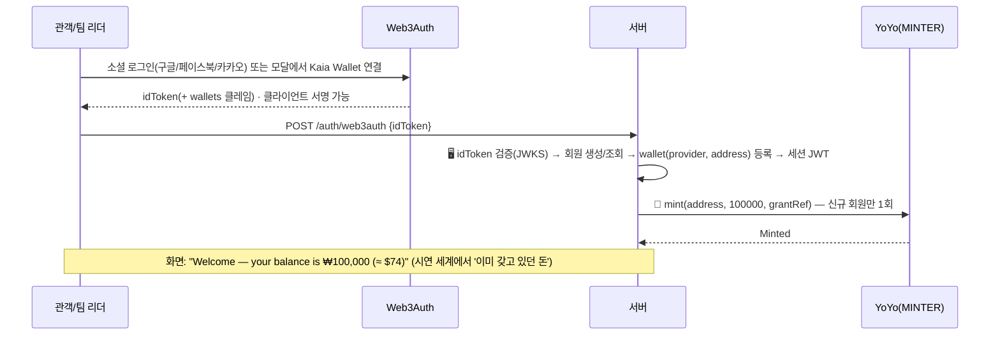
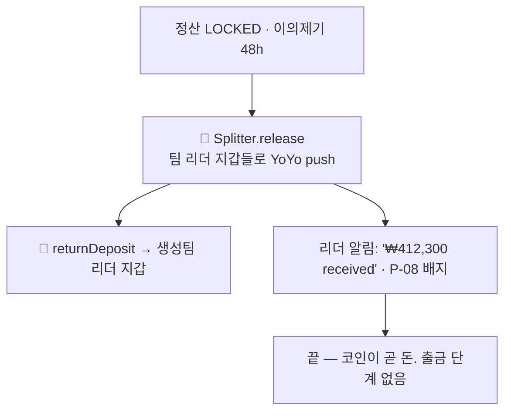

# 방향 전환 결정 문서 v2 — 화폐가 코인인 세계 · 지갑 간 코인 P2P 거래만 · 법정화폐 입출구 전부 삭제

> 대상: SSAFY 15기 특화 프로젝트 · 핀테크 트랙 · B204 · 작성 2026-09-02(수) 오후 · 상태: **결정 문서(SSOT) — v1을 덧씌운다. 후속 6개 문서(기획 v4 · 요구사항/기능/API/화면 v5 · ERD v4) 재작성의 유일한 입력** · 표기 **[권]** = 권고안을 확정값으로 적은 항목 · **P1/P2** = MVP 제외
>
> 기준 문서 — [방향 전환 결정 문서 v1](./06_방향전환_코인전환_v1.md)(오늘 오전, 커밋 `9229c0c`·`b515a81`) · [요구사항 명세서 v4](../design/04_요구사항_명세서_v4.md) · [ERD v3.1](../design/10_ERD_v3.md) · [기능 명세서 v4](../design/05_기능_명세서_v4.md) · [API 명세서 v4](../design/06_API_명세서_v4.md) · [화면설계 v4](../design/07_화면설계_v4.md)
>
> 읽는 법 — **v1과 같은 절 번호**를 쓴다. 이 문서에 적힌 절은 v1의 같은 절을 **전부 대체**하고, "v1 §n 그대로"라고만 적힌 절은 v1이 유효하다. v1 §14의 `[팀 9/2]` 결정(최소 사이즈·Web3Auth 동결·수수료 대납·양도 P2·이메일 가입 P1·외부 지갑 = Kaia Wallet)은 **전부 유지**된다. 후속 문서는 반드시 새 버전 파일로 쓰고 기존 파일은 손대지 않는다.

---

## 0. 해석 전제

사용자 지시(2026-09-02 오후): **"지금 전체적인 서비스 개요에 원화나 현금, 카드 등으로 결제한다고 작성되어 있는데 내국인과 외국인은 코인으로 P2P 거래만 지원하는 걸로 갈 거야."** 이어서 **"지금 가정을 하는 거야. 미래에는 화폐가 없어지고 코인을 사용하는 시대가 온 거지."** 에스크로(RevenueSplitter 컨트랙트 보관)는 정산 자동화·환불·검증에 필요하다는 설명에 동의했다.

| 사용자 문장 | 이 문서의 해석 | 다르게 읽힐 가능성 |
|---|---|---|
| "미래에는 화폐가 없어지고 코인을 사용하는 시대" | **세계관 전제.** 법정화폐(원화 현금·카드·계좌·은행·금융망)가 존재하지 않는다. YoYo는 "원화 스테이블코인"이 아니라 **원(₩) 단위의 디지털 화폐 그 자체**다. 페그·준비금·상환청구권·on/off-ramp 개념이 사라진다 | "코인은 있지만 원화도 남아 있다"로 읽으면 v1(충전·출금)이 맞다. 사용자가 "화폐가 없어졌다"고 명시했으므로 배제 |
| "코인으로 P2P 거래만 지원" | **가치 이동은 지갑 ↔ 컨트랙트 ↔ 지갑의 온체인 코인 이체뿐.** 카드·가상계좌 충전, 원화 출금, 금융망 API 호출이 전부 사라진다. "P2P"는 플랫폼이 사용자 돈을 쥐지 않는다는 뜻이며, 정산 자동화를 위한 컨트랙트 보관(에스크로)은 유지한다 | "에스크로 없이 관객 → 팀 직접 송금"은 관객 선택 기반 분배·환불·검증을 불가능하게 하므로 배제(사용자 동의) |
| "내국인과 외국인" | 둘 다 같은 코인을 쓴다. 외국인의 자국 코인 → YoYo 교환은 **여행 전 환전처럼 플랫폼 밖에서 이미 이뤄졌다고 가정**(DEX 연동은 P2). 표시 통화 환산(≈ $)은 유지 | — |

확정 전제 8개:

1. **세계관**: 화폐 = 코인. YoYo(decimals=0, 1 YoYo = 1원 표기 유지)는 이 세계의 원화다. 사람들은 이미 지갑에 코인을 갖고 있다.
2. **삭제**: `charge` 도메인 전체(해외·국내 카드, 가상계좌, `coin_charge`), `withdraw` 도메인 전체(원화 이체, burn, 상환 금고, `coin_withdrawal`), `bank_account` 테이블·`team.settlement_account_id`·정산 계좌 등록·예금주 검증, 금융망 API 의존 전부, 준비금 공시(원화 예치 대비), "원화로 결제" 원스텝(`AUTO_CHARGE`), 관객 카드 취소(P1이었음).
3. **코인 확보 = 시연용 지급(faucet)**: 회원 가입(지갑 등록) 시 운영자가 기본 잔액 **100,000 YoYo** [권]를 mint하고, 관리자 화면에서 추가 지급할 수 있다. 이것이 유일한 mint. burn은 삭제(P2 `ExternalIssuer` 때 재검토). `CoinIssuerPort`는 `mint` 하나만 남긴 얇은 인터페이스.
4. **팀 수령**: `release`로 리더 지갑에 코인이 들어오면 **끝**. 정산 종단 `RELEASED`. 코인이 곧 돈이므로 출금 개념이 없다. 외부 주소 전송은 지갑 앱에서 자유(플랫폼 화면 없음).
5. **결제**: 잔액 결제(approve + purchase, Kaia 수수료 대납)만. 잔액 부족이면 "잔액 부족" 안내(시연에서는 관리자 지급으로 해결). 환불 = 에스크로 → 관객 지갑.
6. **유지**: Web3Auth 동결(소셜 3종)·외부 지갑(Kaia Wallet, Web3Auth 모달 어댑터)·수수료 대납·`purchase` 1 tx(결제 + 선택 기록)·양도 P2·보증금(코인)·정산 규칙 2단계·이의제기 48h·검증 페이지 V-01·Kaia Kairos·i18n(en 기본·USD 환산)·표시 환율 `exchange_rate`.
7. **법·규제 서사 재작성**: 디지털자산기본법·스테이블코인 인가·전자금융거래법(선불·PG)·외국환·해외 카드 PG 서사 **전부 삭제** → "화폐가 코인인 세계의 공동 공연 정산"이라는 **가정 기반 시연** 서사. Q&A 방어: "현실에서는 인가 발행사 코인·CBDC를 YoYo 자리에 꽂는다(어댑터)".
8. **SSAFY 금융망 API — [팀 9/2] 완전 제거(A안 확정).** 본문 어디에도 금융망 호출을 두지 않는다. 최소 유지(B안)는 §14-28 "되돌릴 때 고칠 곳" 열에만 남긴다.

---

## 1. 한눈에 — v4(v1 결정) → v5(이 문서)

| 항목 | v4 (v1 결정, 9/2 오전) | v5 (이 문서) |
|---|---|---|
| 세계관 | 원화가 있고, YoYo는 원화 1:1 스테이블코인 | **화폐가 코인인 세계. YoYo = 원 단위 디지털 화폐 그 자체** |
| 코인 확보 | 해외·국내 카드 충전, 가상계좌(P1) → mint | **시연용 지급(faucet)**: 가입 시 기본 잔액 mint + 관리자 추가 지급 |
| 티켓 결제 | 잔액 결제 + "원화로 결제"(자동 충전) | **잔액 결제만**(approve + purchase, 수수료 대납). 부족 시 안내 |
| 팀 수령 | release → 리더 서명 예치 → 원화 이체 → burn | **release → 리더 지갑 코인. 끝** |
| 환불 | 에스크로 → 관객 지갑(잔액) | 동일 |
| 보증금 | 리더 서명 코인 납부·반환 | 동일 |
| burn | 팀 출금 시 | **없음** |
| 준비금 공시 | 원화 예치 ≥ 유통량(V-02) | **삭제** → V-02는 **발행량·에스크로 대사 공시**로 축소 개편 |
| 금융망 API | 카드·가상계좌·이체 | **없음 — [팀 9/2] 완전 제거 확정**(§14-28) |
| 서버 보관 키 | OPERATOR·MINTER·BURNER 3개 | **OPERATOR·MINTER 2개** |
| 정산 계좌·예금주 검증 | 팀 필수 | **삭제** |
| 도메인 코드 | 16 | **14** (`charge`·`withdraw` 삭제) |
| 테이블 | 24 (MVP 23) | **21** (MVP = 양도 제외 **20**) |
| 컨트랙트 | YoYo(mint/burn) + RevenueSplitter | **YoYo(mint만) + RevenueSplitter**(변경 없음) |
| 법 서사 | 스테이블코인 발행 인가·선불업·PG·해외 카드 | **가정 기반 시연 세계관** + 현실 매핑 Q&A |
| 화면 | 35 | **33** (A-14·P-09 삭제, V-02·M-03 개편) |
| P0 API | 70 | **약 62** (§9) |
| 지갑·인증·가스·양도·이메일 가입 | v1 §14 `[팀 9/2]` 결정 | **그대로** |

---

## 2. 코인 명세 — YoYo (재정의)

### 2.1 기본 속성

| 항목 | 확정값 |
|---|---|
| 정의 | **이 세계의 원화.** "Korean Won Stable"이라는 풀네임은 문서에서 삭제하고 티커 **YoYo**만 유지 [권](§14-1). 관객 화면은 "₩ / KRW"만 노출 |
| 표준 | ERC-20 (OpenZeppelin v5 `ERC20` + `AccessControl` + `ERC20Pausable`). (P1) `ERC20Permit` |
| decimals | **0** — 1 YoYo = ₩1 |
| 페그·준비금 | **개념 없음.** 코인이 화폐이므로 무엇에도 고정되지 않고 준비금도 없다 |
| 네트워크 | Kaia Kairos(chainId 1001 = `0x3e9`) 주 + Besu 백업 (v1 그대로) |
| 발행 | **시연용 지급(faucet)만.** 가입 시 기본 잔액·관리자 추가 지급. 실서비스 매핑은 §12 |
| 소각 | **없음**(P2 `ExternalIssuer`에서 재검토) |
| 전송 가능성 | 표준 ERC-20. 플랫폼 화면 경로는 결제·환불·분배·보증금 4종. 외부 주소 전송은 지갑 앱에서 자유(화면 없음) |
| 모의 고지 | "화폐가 코인인 미래를 가정한 테스트넷 시연. 실가상자산·실화폐 없음" |

### 2.2 mint 규칙 (burn 삭제)

| 이벤트 | 온체인 | 오프체인 근거 | 실행 키 |
|---|---|---|---|
| 가입 시 기본 지급 | `mint(to=회원 지갑, 100000, grantRef)` | `wallet` 등록 확정(API-member-01 성공) | MINTER |
| 관리자 추가 지급 | `mint(to, amount, grantRef)` | `chain_job(tx_type=MINT, requester_id=관리자)` 생성 | MINTER |
| 결제·환불·분배·보증금 | YoYo 이동만 | — | 관객·리더 서명 / OPERATOR |

- 지급 이력 테이블은 만들지 않는다 [권]. `chain_job(tx_type=MINT, wallet_id, amount, requester_id, idempotency_key=grantRef)`가 이력이다(§8).
- 지급 한도(P-19 대체): 가입 기본 **100,000**, 관리자 1회 최대 **1,000,000**, 회원당 누적 상한 없음(시연) [권].
- **발행량 공시**(P-11 대체): `totalSupply`(총 발행) · Σ`escrowOf`(에스크로 합계) · 지갑 보유 합계(= 발행 − 에스크로) · 갱신 시각을 V-02에 공개. 불일식 §3.8.

### 2.3 서버 보관 키 2개와 사용자 키

| 키 | 보관 주체 | 사용처 |
|---|---|---|
| OPERATOR(운영지갑 = fee payer) | 서버(내부 서브넷, KMS/환경변수) | `Splitter.createShow/startSale/refund/aggregate/lock/release/returnDeposit/halt`, **사용자 tx 수수료 대납 서명** |
| MINTER | 서버(내부 서브넷) | `YoYo.mint` — 시연용 지급 |
| 관객·팀 리더 지갑 키 | **사용자**(Web3Auth MPC / Kaia Wallet) | approve·purchase·deposit·agreeToRules |

- v1 §2.3의 BURNER(상환 금고)는 **삭제**. SEC-04는 "서버 보관 키 2개, 별도 주소·별도 권한, KEK 외부 주입, 서명 감사 로그"로 재정의.
- 권한 분리: MINTER ≠ OPERATOR. MINTER 유출 → 무한 발행 → **발행량 공시로 발각·pause** / OPERATOR 유출 → refund 남용 → 잠금 이후 revert·`orderRef` 검증(v1 동일).
- Web3Auth idToken 검증(JWKS)·회원당 지갑 1개·서명 전 tx 요약 표시·수수료 대납 발신자 서명 RLP 검증(v1 §14-4)은 그대로.

### 2.4 컨트랙트 함수 목록 (MVP 2종)

**YoYo (ERC-20)** — burn 삭제.

| 함수 | 권한 | 비고 |
|---|---|---|
| `mint(address to, uint256 amount, bytes32 grantRef)` | MINTER_ROLE | 이벤트 `Minted(to, amount, grantRef)` |
| `pause()/unpause()` | DEFAULT_ADMIN | 발행량 이상 시 |
| 표준 `transfer/approve/transferFrom/totalSupply/balanceOf` | — | `totalSupply` = 총 발행량 공시 소스 |
| (P1) `permit` | — | 1-서명 결제 |

**RevenueSplitter** — **v1 §2.4 그대로**(constructor·createShow·deposit·agreeToRules·startSale·purchase·refund·aggregate·lock·release·returnDeposit·forfeitDeposit(P1)·halt·view). 코드 변경 0.

P2 컨트랙트(설계만): `tUSDC`·`YoYoExchange`(외국인 자국 코인 교환) — MVP 배포 없음.

### 2.5 사용자 서명 tx 규칙 (P-18) — v1 §2.5 + v1 §14-4(수수료 대납) 그대로

- 플랫폼 발의·사용자 서명. 결제 = approve + purchase 2단계(Permit P1). 사용자 지갑 KAIA 0, 발신자 서명 RLP → 서버 fee payer 서명·전송 → receipt 검증.
- **삭제**: "충전된 코인은 잔액으로 남는다" 문구 → "잔액은 그대로 남는다".

### 2.6 발행 어댑터 — `CoinIssuerPort` (축소)

```java
public interface CoinIssuerPort {
    String tokenAddress();                                   // Splitter·approve·검증이 의존하는 ERC-20 주소
    JobRef mint(Address to, long amount, String grantRef);   // 시연용 지급
    long totalSupply();                                      // 발행량 공시
}
```

| 어댑터 | 바인딩 | mint | 공시 |
|---|---|---|---|
| `MockIssuer` (**MVP 유일 구현**) | 우리 YoYo + MINTER 키 | `YoYo.mint` tx | `totalSupply` |
| `ExternalIssuer` (**P2**, 설계만) | 인가 발행사 코인 / CBDC 주소 | 없음(발행사가 발행) — 지급은 운영지갑 보유분 `transfer`로 대체 | 발행사 공시 |

Q&A 방어(§12.3): "현실에는 화폐가 있고 학생이 코인을 발행할 수 없다" → "이 시연은 화폐가 코인인 미래를 가정한다. 현실 매핑은 인가 발행사 코인·CBDC를 `tokenAddress()`에 꽂는 것이고, 정산 컨트랙트는 표준 ERC-20이면 코드 변경이 없다."

---

## 3. 자금 흐름

표기: 🔗 운영자 tx(202 + jobId) · ✍️ 사용자 서명 tx(발신자 서명 RLP → fee payer 서명·전송) · 🖥 서버. **🏦(금융망)은 이 문서에 없다.**

### 3.0 가입·지갑·기본 잔액 (모든 흐름의 전제)



- 회원당 지갑 1개(v1 §14-14·23·26 그대로). 가스 충전 없음(수수료 대납).
- 기본 지급은 **신규 회원 1회**, 멱등키 `grant:signup:{memberId}`. 재로그인·지갑 교체(P1)에서는 재지급 없음.

### 3.1 시연용 추가 지급 (관리자)

`PUT /admin/coin/grants {memberId | address, amount, memo}` → 🖥 `chain_job(MINT, requester=관리자)` → 🔗 `mint` → 202 + jobId. 화면 M-03. 이것이 v1 §3.1·§3.2(충전)를 **대체**한다. 관객 화면에는 충전 버튼이 없다 — 잔액 부족이면 "Insufficient balance"만 표시.

### 3.2 (삭제) 충전 ②

v1 §3.2 가상계좌 충전은 존재하지 않는다.

### 3.3 결제 — 잔액 결제만 (관객 서명)

```mermaid
flowchart LR
  A[주문 생성<br/>PENDING_PAYMENT 15분] --> B{잔액 ≥ 금액?}
  B -- 아니오 --> X[409 잔액 부족 안내<br/>주문 유지, 관객이 잔액 확보 후 재시도]
  B -- 예 --> S1[✍️ approve Splitter, amount<br/>allowance 충분하면 생략]
  S1 --> S2[✍️ Splitter.purchase showId, orderRef, teamIndex, amount<br/>transferFrom + 선택 카운터 +1]
  S2 --> R[프론트 → POST /orders/:id/payment/signed-tx {kind, senderSignedRlp}]
  R --> F[🖥 fee payer 서명·전송 → receipt·Purchased 검증 → PAID → 티켓 발급]
```

- `POST /orders/{orderId}/payment` (mode 없음) → 서명 파라미터(`tokenAddress`·`splitterAddress`·`showId`·`orderRef`·`teamIndex`·`amount`·approve 필요 여부). 잔액 부족은 **409 `PAYMENT_INSUFFICIENT_BALANCE`**(규격 v5 신설 제안, 대체 `COMMON_CONFLICT`).
- 실패 보상: 서명 거부/purchase revert → 잔액 그대로, 주문 15분 만료 시 `CANCELLED`. **충전 실패 분기는 없다.**
- 관객 문구(en): "Pay ₩15,000 from balance" → "Confirm in your wallet" → "Confirming…" → "Paid".

### 3.4 환불 — v1 §3.4 그대로 (운영자 `refund` → 관객 지갑, 양도 재선택 규칙 포함)

"환불 코인은 관객 잔액으로 남는다. 카드 취소는 P1" 문장 → **"환불 코인은 관객 지갑으로 돌아온다"**로 교체. 카드 취소 항목 삭제.

### 3.5 보증금 — v1 §3.5 그대로

"리더 지갑 잔액 부족이면 충전 유도" → **"잔액 부족이면 안내(시연: 관리자 지급)"**.

### 3.6 정산 → 팀 수령 (운영자)



- v1 §3.6의 "원화로 받기" 서명·상환 금고·이체·burn·이체 실패 반환은 **전부 삭제**. P-09 화면 삭제.
- 정산 종단 `RELEASED`. `settlement_share.released`·`released_at`·`wallet_address`로 수령 확인. `withdrawn_amount` 삭제.

### 3.7 잔액 정책 (P-20 대체)

관객·팀 모두 잔액 = 지갑의 YoYo 잔액이며 곧 돈이다. 플랫폼은 "출금"·"환급"·"상환"이라는 개념을 갖지 않는다. 지갑 앱에서 외부로 옮기는 것은 사용자 자유이며, 화면은 안내하지 않는다.

### 3.8 자금 흐름 불변식 (검증 페이지가 대사하는 값)

1. `token.totalSupply` = Σ(`Minted`) — 시연용 지급의 합. burn이 없으므로 단조 증가.
2. 공연별 `escrowOf(showId)` = Σ(purchase) − Σ(refund) − Σ(release) (+ 보증금 별도 계정). (v1 동일)
3. 공연별 Σ`Released` = 잠긴 규칙 × 카운터 재계산 합 (dust 포함, 1원 오차 0). (v1 동일)
4. **(삭제)** 준비금 불변식. 대체: `totalSupply` = Σ(전 지갑 잔액) + Σ(전 공연 `escrowOf` + 보증금) — V-02가 표시.

---

## 4. actor 변경

| 코드 | 변경 | 내용 |
|---|---|---|
| `GUEST` | 유지 | 공연 탐색·상세(en/ko, USD 환산), 양도 링크 진입(P2), **발행량·에스크로 공시(V-02)**, 표시 환율 조회 |
| `AUDIENCE` | 변경 | 외국인 우선. 소셜 로그인 → 지갑 + **기본 잔액**. 잔액 결제(서명)·환불(지갑). **충전·출금 없음** |
| `PERFORMER` | 변경 | 한국인 팀 리더. 리더 지갑 = 팀 지갑. 보증금·규칙 동의 서명. **정산 계좌 없음, release로 수령 완료** |
| `STAFF` | 유지 | 링크 토큰 검표 |
| `ADMIN` | 변경 | 이의제기 처리 + 표시 환율 등록 + **시연용 코인 지급**(M-03). 실패 작업 재시도·회원/공연 관리 P1 |

- 페르소나(기획 v4 §3): ① 서울 여행 중 홍대 인디 공연을 찾은 미국·일본 관객 — 구글 로그인, 영어 UI, **지갑에 이미 있던 ₩로 예매** ② 한국인 관객 — 카카오 로그인 ③ 한국인 3인 밴드 리더 — 구글 로그인 지갑 또는 Kaia Wallet, **정산금이 지갑에 코인으로 도착하면 끝**.
- 회원 속성은 v1 §4 그대로(`country_code`·`locale`·`display_currency`·`timezone`·`auth_provider`(LOCAL은 P1 예약)·`web3auth_verifier_id`).

---

## 5. 도메인 코드 (00 계획 §1.3 대체 — 14개)

| 코드 | 이름 | 다루는 것 | v4 대비 | 규격 접두 |
|---|---|---|---|---|
| `member` | 회원·인증 | Web3Auth 로그인(idToken)·토큰·프로필. **가입 시 기본 지급 트리거** | 변경 | `AUTH_*` |
| `team` | 공연팀 | 팀 생성·조회·수정. **정산 계좌 삭제** | 변경 | `TEAM_*` |
| `wallet` | 지갑 | 지갑 등록·주소·YoYo 잔액·거래 이력·**서명 tx 보고·대납 전송(공통)** | 변경 | `WALLET_*` |
| `performance` | 공연 | v1 그대로(보증금 서명 포함) | 유지 | `PERFORMANCE_*` |
| `rule` | 정산 규칙 | v1 그대로 | 유지 | `RULE_*` |
| `ticket` | 예매·티켓 | 유지 | 유지 | `TICKET_*` |
| `payment` | 코인 결제 | 서명 파라미터·tx 보고·receipt 검증. **자동 충전 연계 삭제** | 변경 | `PAYMENT_*` |
| ~~`charge`~~ | ~~충전~~ | **삭제** | 삭제 | ~~`CHARGE_*`~~ 규격 신설 제안 철회 |
| `coin` | YoYo | 발행 어댑터(mint)·**시연용 지급**·발행량 공시·표시 환율·온체인 작업 큐 | 변경 | `COIN_*`, `CHAIN_*` |
| `refund` | 취소·환불 | 유지 | 유지 | `REFUND_*` |
| `transfer` | 양도 | P2(유지, MVP 미사용) | 유지 | `TRANSFER_*` |
| `entry` | 입장 | 유지 | 유지 | `ENTRY_*` |
| `settlement` | 정산 | 집계·잠금·이의·release·보증금 반환·조회·공유 링크. **출금 상태 삭제** | 변경 | `SETTLEMENT_*` |
| ~~`withdraw`~~ | ~~출금~~ | **삭제** | 삭제 | ~~`WITHDRAW_*`~~ 규격 개명 제안 철회 |
| `verify` | 공개 검증 | 공연별 검증(참여팀)·**발행량·에스크로 공시(공개)** | 변경 | `CHAIN_*`, `COIN_*` |
| `admin` | 관리자 | 이의제기·환율·**코인 지급** | 변경 | `COMMON_*` |

브랜치 도메인: `coin`은 `contract`, `payment`는 그대로.

---

## 6. 정책 전제 변경 (v1 §6 대체 행 + 신설)

| # | 항목 | 개정 전제 | 변경 |
|---|---|---|---|
| P-1·P-2 | 인증·지갑 | v1 + `[팀 9/2]`(Web3Auth 동결, 이메일 가입 P1, 외부 지갑 = Kaia Wallet) | 유지 |
| P-3 | 가스 | v1 §14-4 수수료 대납 | 유지 |
| P-7 | 결제 수단 | **YoYo 잔액 결제만**(approve + purchase). "원화로 결제"·자동 충전 삭제. 잔액 부족 = 409 안내 | 대체 |
| P-8 | 취소 수수료 | 유지. 환불 = `refund` → 관객 지갑 | 유지 |
| P-9 | 정산 시점 | 유지. **release가 곧 수령 완료** | 부분 변경 |
| P-10 | 팀 수령 | **release = 리더 지갑 코인 입금 = 완료.** 서명·이체·burn 없음. 정산 종단 `RELEASED` | 대체 |
| P-11 | 공시 | **준비금 삭제.** `totalSupply`·에스크로 합계·지갑 보유 합계·갱신 시각을 공개(1분 캐시). `totalSupply` ≠ Σ지갑 + Σ에스크로면 mint·release 중단 + 알림(`COIN_RESERVE_MISMATCH` → 규격 v5에서 `COIN_SUPPLY_MISMATCH`로 개명 제안, 대체 코드는 기존 이름) | 대체 |
| P-12 | 공연 취소 | 유지(일괄 환불 후 보증금 반환) | 유지 |
| P-17 | 표시 환율 | 유지(관리자 수동, 표시 전용). "충전 금액 금지" → "지급 금액 금지" | 부분 변경 |
| P-18 | 사용자 서명 tx | 유지 | 유지 |
| P-19 | ~~충전 한도~~ → **지급 한도** | 가입 기본 100,000 YoYo(1회), 관리자 1회 최대 1,000,000, 시연 누적 상한 없음 [권] | 대체 |
| P-20 | 잔액 | **코인이 곧 돈.** 출금·환급·상환 개념 없음. 관객·팀 잔액 = 지갑 잔액 | 대체 |
| P-21 | 보증금 | 유지(50,000 YoYo, 리더 서명, RELEASED/일괄 환불 후 반환, 몰수 P1) | 유지 |
| P-22·P-23 | 언어·통화 표시 / 외국인 가입 | 유지(en·USD 고정, 원 값 항상 병기) | 유지 |
| P-24 | 원장 단일화 | **모든 티켓 대금은 `purchase`로 에스크로에 들어온다.** (금융망 경로 언급 삭제) | 문구 변경 |
| P-25 | 발행 주체 교체 | 1차 서사 = **"화폐가 코인인 미래를 가정하고, 플랫폼이 시연용 코인을 지급한다."** `CoinIssuerPort`(mint·totalSupply). 현실 매핑 = 인가 발행사 코인·CBDC(P2) | 대체 |
| **P-26** | 세계관 전제 | 법정화폐·은행·카드·금융망은 존재하지 않는다. 문서·화면·발표 어디에도 원화 입출금 경로를 두지 않는다. 고지 문구: "화폐가 코인인 미래를 가정한 테스트넷 시연" | 신설 |
| **P-27** | 시연용 지급 | 가입 시 자동 1회 + 관리자 수동. 지급은 `chain_job(MINT)`에 요청자·금액·멱등키로 남기고 V-02 발행량에 즉시 반영 | 신설 |

P-4·P-5·P-6·P-13·P-14·P-15·P-16 유지. **P-13(망분리)**: "금융망 API 호출" 삭제 → "서버 보관 키 2개의 서명·mint 처리는 내부 서브넷".

---

## 7. 상태 enum 변경 (v1 §7 대체 행)

| 엔티티 | 상태 | 변경 |
|---|---|---|
| Wallet / Wallet.provider | v1 그대로 | 유지 |
| ~~CoinCharge~~ | — | **삭제** |
| **Payment** | `REQUESTED → AWAITING_SIGNATURE → PAYING → PAID` / `FAILED` / `REFUNDED` | `CHARGING` 삭제. 서명 파라미터 발급 = AWAITING_SIGNATURE, RLP 보고·전송 = PAYING, receipt = PAID |
| ~~CoinWithdrawal~~ | — | **삭제** |
| RuleAgreement | `PENDING → SIGNING → AGREED` | 유지 |
| **ChainJob.tx_type** | `MINT / APPROVE / PURCHASE / REFUND / DEPOSIT / DEPOSIT_RETURN / DEPOSIT_FORFEIT / AGREE / LOCK / AGGREGATE / RELEASE / HALT / CREATE_SHOW / START_SALE` (**14** — 9/9 §14-39) | `BURN`·`TREASURY_IN`·`TREASURY_RETURN` 삭제(`GAS_CHARGE`는 v3.1에서 이미 삭제). `MINT` = 시연용 지급 |
| ChainJob.signer_type / issuer_type / status / fee_delegated | v3.1 그대로 | 유지 |
| Settlement | `NONE → AGGREGATED → LOCKED → DISPUTE_OPEN → RELEASED` / `HALTED` | 유지 |
| Performance.deposit_status | `UNPAID → PAID → RETURNED / FORFEITED(P1)` | 유지 |
| Refund | `PENDING → PROCESSING → COMPLETED / FAILED` | 유지 |
| **WalletTx.type**(이력 필터) | `GRANT / PURCHASE / REFUND / RELEASE / DEPOSIT / DEPOSIT_RETURN` | `CHARGE`→`GRANT`, `WITHDRAW_BANK`·`GAS` 삭제 |
| Member.auth_provider | `GOOGLE / FACEBOOK / KAKAO`(`LOCAL` P1 예약) | 유지 |
| **AuditLog.action_type** | `ADMIN_ACTION / OPERATOR_SIGN / MINT / RELEASE / GRANT / RATE_CHANGE / WALLET_LINK / STATUS_CHANGE` | `BURN`·`CHARGE`·`WITHDRAW` 삭제, `GRANT` 신설 |
| 그 외 | v1 그대로 | 유지 |

---

## 8. ERD v4 변경 지시 (DDL 수준)

파일: `docs/design/11_ERD_v4.md` + `docs/design/11_ERD_v4_import.sql`(전체) + `docs/design/11_ERD_v4_import_mvp.sql`(양도 제외, ERD Cloud 반영본). v3.1(24) → **v4 20 테이블**(v4.1에서 `refresh_token`까지 삭제), MVP(transfer 제외) **19**. 형식은 v3 문서 그대로.

| # | 테이블 | 처분 | 요지 |
|---|---|---|---|
| 1 | `member` | 유지 | v3.1 그대로 |
| — | ~~`refresh_token`~~ | **삭제 (v4.1)** | 세션 리프레시 토큰은 **Redis** `auth:refresh:{jti}` TTL 14일 + `auth:refresh:member:{memberId}` 집합으로 대체. 회전·폐기 = 키 삭제, 폐기 플래그·정리 배치 없음 |
| — | ~~`bank_account`~~ | **삭제** | 계좌 개념 없음 |
| 3 | `team` | 컬럼 삭제 | **`settlement_account_id` 삭제**(FK 포함) |
| 4 | `wallet` | 유지 | v3.1(키 컬럼 없음, `gas_funded_at` 없음) 그대로 |
| 5 | `performance` | 유지 | 보증금 온체인 컬럼 그대로 |
| 6 | `ticket_type` | 유지 | |
| 7 | `performance_participant` | 유지 | `wallet_address` 스냅샷 |
| 8 | `settlement_rule` | 유지 | |
| 9 | `rule_agreement` | 유지 | |
| 10~12 | `ticket_order`·`order_item`·`ticket` | 유지 | |
| 13 | `payment` | 컬럼 삭제·enum 축소 | **`mode`·`auto_charge_id` 삭제**(FK 포함). `status` = §7 Payment |
| — | ~~`coin_charge`~~ | **삭제** | |
| 14 | `chain_job` | enum 축소·주석 | `tx_type` §7(**14종**, 9/9 §14-39). `MINT` job은 `wallet_id`(수신)·`amount`·`requester_id`(관리자 또는 NULL=가입 자동)·`idempotency_key`(grantRef) 필수. `sender_signed_rlp`·`fee_*`(v3.1) 유지 |
| 15 | `refund` | 유지 | |
| 16 | `transfer` | 유지(P2) | MVP SQL에서 제외 |
| 17 | `settlement` | 유지 | |
| 18 | `settlement_share` | 컬럼 삭제 | **`withdrawn_amount` 삭제** |
| 19 | `dispute` | 유지 | |
| — | ~~`coin_withdrawal`~~ | **삭제** | |
| 20 | `exchange_rate` | 유지 | 표시 전용 |
| 21 | `audit_log` | enum 변경 | `action_type` §7 |

```sql
-- payment (v4)
CREATE TABLE payment (
    payment_id      BIGINT AUTO_INCREMENT PRIMARY KEY,
    ticket_order_id BIGINT NOT NULL UNIQUE,
    payer_wallet_id BIGINT NOT NULL,
    amount          BIGINT NOT NULL,                       -- YoYo
    approve_job_id  BIGINT,                                -- APPROVE chain_job (USER, 생략 가능)
    purchase_job_id BIGINT,                                -- PURCHASE chain_job (USER)
    purchase_tx_hash CHAR(66),
    status          ENUM('REQUESTED','AWAITING_SIGNATURE','PAYING','PAID','FAILED','REFUNDED') NOT NULL DEFAULT 'REQUESTED',
    failure_code    VARCHAR(100),
    idempotency_key VARCHAR(255) NOT NULL UNIQUE,
    requested_at    DATETIME(6) NOT NULL DEFAULT CURRENT_TIMESTAMP(6),
    paid_at         DATETIME(6),
    FOREIGN KEY (ticket_order_id) REFERENCES ticket_order(ticket_order_id),
    FOREIGN KEY (payer_wallet_id) REFERENCES wallet(wallet_id),
    FOREIGN KEY (approve_job_id) REFERENCES chain_job(chain_job_id),
    FOREIGN KEY (purchase_job_id) REFERENCES chain_job(chain_job_id)
) ENGINE=InnoDB;
-- team: settlement_account_id 컬럼·FK 제거. settlement_share: withdrawn_amount 제거.
-- chain_job.tx_type ENUM('MINT','APPROVE','PURCHASE','REFUND','DEPOSIT','DEPOSIT_RETURN','DEPOSIT_FORFEIT','AGREE','LOCK','AGGREGATE','RELEASE','HALT','CREATE_SHOW','START_SALE')  -- 14종, Flyway V2 (9/9)
-- 시연용 지급 이력 = chain_job WHERE tx_type='MINT' (별도 테이블 없음 [권])
```

- 생성 순서: `member → exchange_rate → chain_job → wallet → team → performance → …`(회원 계좌·리프레시 토큰 제거). `chain_job` 역참조 FK 4개는 말미 ALTER(v3 동일).
- 인덱스 권고: v3 §4에서 `coin_charge`·`coin_withdrawal` 행 삭제, `chain_job(tx_type, wallet_id)` 추가(지급 이력 조회).
- v3.1 → v4 변경 이력 표 필수. ERD Cloud(`kpxqsmzYGNrskWTMF`)는 v4 MVP SQL로 재반영(기존 23 테이블 삭제 후 import, 한글 논리명·색상 재적용).

---

## 9. API 인벤토리 변경 (v1 §9 대체 행)

규약 유지(v1 + v3.1 대납: `signed-tx` 본문 = `{kind, senderSignedRlp}`). **`CHARGE_*`·`WITHDRAW_*` 규격 신설 제안 철회**, 신설 제안은 `PAYMENT_INSUFFICIENT_BALANCE`·`COIN_GRANT_LIMIT_EXCEEDED`·`COIN_SUPPLY_MISMATCH`(개명).

| 번호 | 메서드 | 경로 | 이름 | actor | 화면 | 변경 |
|---|---|---|---|---|---|---|
| API-member-01 | POST | `/auth/web3auth` | Web3Auth 로그인/가입 — **신규 회원이면 기본 지급 MINT job 트리거**, 응답에 `grantJobId?` | GUEST | C-01 | 변경 |
| API-member-02·08 | | `/auth/login`·`/auth/signup` | 이메일 로그인·가입 | | | P1(v1 §14-18) |
| API-member-03~06 | | | 유지 | | | 유지 |
| ~~API-member-07~~ | | ~~`/members/me/bank-account`~~ | **삭제** | | | 삭제 |
| API-wallet-01 | GET | `/wallets/me` | 내 지갑(주소·잔액 + display). **가스 상태 삭제** | 회원 | A-13·P-02 | 변경 |
| API-wallet-02 | GET | `/wallets/me/transactions` | 거래 이력(WalletTx.type §7) | 회원 | A-13 | 변경 |
| API-wallet-03·04 | | | 외부 지갑 챌린지 | | | P1(v1 §14-23) |
| ~~API-wallet-05~~ | | | 가스 재충전 — v3.1에서 삭제 | | | 삭제 |
| API-team-01 | POST | `/teams` | 팀 생성(리더 지갑 연결 검사). **정산 계좌 필드 없음** | 회원 | P-02 | 변경 |
| API-team-02~04 | | | 유지(응답에서 정산 계좌 제거) | | | 변경 |
| ~~API-team-07~~ | | ~~`/teams/{teamId}/settlement-account`~~ | **삭제** | | | 삭제 |
| API-performance-01~14 | | | v1 그대로(보증금 prepare/signed-tx 포함) | | | 유지 |
| API-rule-01~05 | | | 유지 | | | 유지 |
| API-ticket-01 | POST | `/orders` | 응답 `orderRef`·`walletBalance`·`shortfall`(부족액, 안내용) | AUDIENCE | A-03·A-04 | 변경 |
| API-ticket-02~06 | | | 유지 | | | 유지 |
| API-payment-01 | POST | `/orders/{orderId}/payment` | 결제 시작 — **본문 없음**(mode 삭제). 잔액 ≥ 금액이면 서명 파라미터, 부족이면 **409 `PAYMENT_INSUFFICIENT_BALANCE`**(대체 `COMMON_CONFLICT`) | AUDIENCE | A-05 | 변경 |
| API-payment-02 | GET | `/orders/{orderId}/payment` | 결제 상태(+ AWAITING_SIGNATURE면 서명 파라미터). `CHARGING` 없음 | AUDIENCE | A-05 | 변경 |
| API-payment-03 | POST | `/orders/{orderId}/payment/signed-tx` | `{kind: APPROVE\|PURCHASE, senderSignedRlp}` → 202 | AUDIENCE | A-05 | 유지 |
| ~~API-charge-01~04~~ | | | **삭제** | | | 삭제 |
| **API-coin-01** | GET | `/coin/supply` | **발행량·에스크로 공시**(공개): `totalSupply`·`escrowTotal`·`walletTotal`·`grantCount`·`asOf`·불변식 4 대사 결과·고지 문구 | GUEST | V-02 | 개편 |
| API-coin-02·03 | | `/coin/rates`·`/admin/coin/rates` | 표시 환율 | | | 유지 |
| API-coin-04 | | `/coin/config` | P1(v1 §14-17) | | | P1 |
| API-coin-05·06 | | `/admin/coin/jobs…` | P1 | | | P1 |
| **API-coin-07** | PUT | `/admin/coin/grants` | **시연용 코인 지급** `{memberId \| address, amount, memo}` → 202 + jobId(MINT). 멱등키 필수 | ADMIN | M-03 | 신설 |
| **API-coin-08** | GET | `/admin/coin/grants` | 지급 이력(= chain_job MINT 목록) | ADMIN | M-03 | 신설 |
| API-chain-01 | GET | `/chain/jobs/{jobId}` | 유지(MINT 포함) | | | 유지 |
| API-refund-01·02 | | | 유지 | | | 유지 |
| API-transfer-01~04 | | | P2 | | | P2 |
| API-entry-01·02 | | | 유지 | | | 유지 |
| API-settlement-01 | GET | `/performances/{performanceId}/settlement` | 팀별 `released`·`releasedAt`·`walletAddress`. **`withdrawnAmount`·출금 상태 삭제** | PERFORMER | P-08 | 변경 |
| API-settlement-02~07 | | | 유지(05 release 확정 시 리더 알림 = 수령 완료) | | | 유지 |
| ~~API-withdraw-01~04~~ | | | **삭제** | | | 삭제 |
| API-verify-01 | GET | `/performances/{performanceId}/verification` | 유지(대사 3종). "준비금" 언급 삭제 | 참여팀 | V-01 | 변경 |
| ~~API-verify-02~~ | | ~~`/public/reserve-proof`~~ | **삭제 → API-coin-01로 통합** | | | 삭제 |
| API-admin-06·09 | | | 유지 | | | 유지 |

P0 합계 약 **62**(v4 70 − member-07 − team-07 − charge 3 − withdraw 3 − verify-02 + coin-07). 예약 경로(P1: `/orders/{id}/payment/permit`; P2: `/exchange`, transfer)는 "예약 경로" 절에 경로만.

---

## 10. 화면 ID 변경 (v1 §10 대비)

| ID | 화면명 | 변경 | 한 줄 |
|---|---|---|---|
| C-01 | 로그인 | 변경 | 소셜 3버튼. 최초 로그인 직후 **"Welcome — ₩100,000 in your wallet"** 안내(시연 세계) |
| C-02 | 회원가입(보조) | P1 | v1 §14-18 |
| C-03 | 마이페이지 | 변경 | 지갑 요약(₩ + ≈ USD). **계좌 항목 삭제** |
| C-04 | 언어·통화 설정 | 유지 | |
| C-05 | 지갑 연결 | 유지 | Kaia Wallet 안내 화면(v1 §14-23·26) |
| A-01·A-02 | 홈·공연 상세 | 유지 | |
| A-05 | 결제 | **재설계** | 잔액·금액 → "Pay from balance" → 서명 단계(approve → purchase) → Paid. **카드 탭·충전 진행·환전 고지 삭제.** 잔액 부족 = "Insufficient balance" 안내(충전 버튼 없음) |
| A-11 | 취소·환불 | 변경 | "Refunded to your wallet" |
| A-13 | 내 지갑 | 변경 | ₩ 잔액 + ≈ 환산·거래 이력(GRANT/PURCHASE/REFUND/RELEASE/DEPOSIT). **충전 버튼 삭제** |
| ~~A-14~~ | ~~충전~~ | **삭제** | |
| P-02 | 팀 관리 | 변경 | 리더 지갑 주소·잔액·익스플로러. **정산 계좌·충전 진입 삭제** |
| P-03·P-06 | 공연 생성 / 규칙 동의 | 유지 | 보증금·동의 서명 |
| P-08 | 정산 대시보드 | 변경 | release tx·팀별 입금 주소·**"Received" 배지**·보증금 반환. **출금 상태 삭제** |
| ~~P-09~~ | ~~팀 출금~~ | **삭제** | |
| V-01 | 정산 검증 | 변경 | "준비금" 언급 삭제 |
| **V-02** | **발행량·에스크로 공시** | **개편**(구 준비금 공시) | 총 발행·에스크로 합계·지갑 보유 합계·불변식 4 대사·"화폐가 코인인 미래 가정" 고지 |
| **M-03** | **표시 환율·코인 지급** | **개편** | 환율 등록·이력 + **시연용 지급 폼(회원 검색/주소·금액·메모) + 지급 이력** + 발행량 이상 경고 |
| A-09·A-10 | 양도 | P2 | |
| 나머지 | | 유지 | |

합계 **33개**(v4 35 − A-14 − P-09). 공통 컴포넌트: §5.12 환전 고지 **삭제**, §5.14 서명 단계 컴포넌트에서 "가스 부족 시 자동 충전 안내" 삭제, 신설 **§5.16 잔액 부족 안내**(충전 유도 없이 "Insufficient balance · ₩3,000 short").

---

## 11. 기능 목록 변경 (기능 명세서 v4 대비)

| 번호 | 기능 | 처분 | 요지 |
|---|---|---|---|
| F-member-01 | Web3Auth 로그인·가입 | 변경 | 신규 회원 기본 지급 트리거 |
| F-member-07 | 금융망 계좌 연결 | **삭제** | |
| F-team-01 | 팀 생성 | 변경 | 정산 계좌 없음 |
| F-team-07 | 정산 계좌 등록 | **삭제** | |
| F-wallet-02·03 | 지갑 조회·거래 이력 | 변경 | 가스 상태 삭제, 이력 type §7 |
| F-wallet-06 | 사용자 서명 tx 보고·검증(대납) | 유지 | |
| F-payment-01·02·03·05 | 결제 시작·상태·실패·tx 보고 | 변경 | mode 삭제, 잔액 부족 409, `CHARGING` 삭제 |
| F-payment-04 | 원화로 결제(자동 충전) | **삭제** | |
| F-charge-01~04 | 충전 | **삭제** | |
| F-coin-01 | mint 실행 | 변경 | **시연용 지급 mint**(가입 자동·관리자) |
| F-coin-02 | 유통량·준비금 조회 | **개편** → 발행량·에스크로 공시 조회 | |
| F-coin-05 | burn 실행 | **삭제** | |
| F-coin-08 | 발행 어댑터 바인딩 | 변경 | mint·totalSupply만 |
| **F-coin-10** | 시연용 코인 지급(관리자) | **신설** | M-03, API-coin-07·08, 한도 P-19 |
| F-withdraw-01~04 | 출금 | **삭제** | |
| F-settlement-05 | release 실행 | 변경 | 리더 알림 = 수령 완료, 보증금 반환 |
| F-verify-02 | 준비금 공시 조회 | **개편** → 발행량·에스크로 공시(V-02) | |
| F-verify-01·03 | 검증·재계산 | 변경 | 준비금 언급 삭제 |
| F-transfer-01~04 | 양도 | P2 | |
| 그 외 | | 유지 | v4 그대로 |

우선순위(상): Web3Auth 로그인·지갑·기본 지급, 서명 결제(purchase), QR 입장, release, 검증 페이지·발행량 공시, en UI, 관리자 지급. 중: 보증금·환율·이의제기. P1: Permit 1-서명, 이메일 가입, 외부 지갑 챌린지, 몰수. P2: 양도, 외국인 자국 코인 교환(DEX), ExternalIssuer, NFT.

---

## 12. 서사 재작성

### 12.1 발표 프레임 (한 문장)

> **"화폐가 코인이 된 미래, 한국 인디 공연을 보러 온 외국인 관객이 소셜 로그인 한 번으로 지갑을 열고 지갑 속 ₩로 예매하면, 한국인 밴드들은 공연이 끝난 뒤 자기 지갑으로 원 단위까지 정확히 나눠 받는다 — 은행도, 카드도, 정산 대행사도 없이, 누구나 재계산할 수 있는 컨트랙트 하나로."**

### 12.2 서사 구성

0. **가정을 먼저 말한다** — "이 시연은 화폐가 코인인 미래를 가정한다. 원화 입출금·카드·은행은 등장하지 않는다." 이 한 줄이 규제 서사 대부분을 대체한다.
1. **왜 코인 하나인가** — RevenueSplitter는 비율로 나누는 계약이다. 통화가 둘이면 환율 오라클이 필요하고 "누구나 재계산"이 무너진다(v1 동일). 외국인은 여행 전 환전하듯 자국 코인을 YoYo로 바꿔 온다고 가정(DEX P2).
2. **P2P의 의미** — 사용자 자산은 사용자 지갑에, 컨트랙트가 정산 기간에만 맡는다. 플랫폼은 운영자·발행 2개 키만 보관하고 사용자 코인을 임의로 옮길 수 없다. 탈중앙은 주장하지 않는다(정산 흐름은 운영자 발의).
3. **에스크로가 필요한 이유** — 관객 선택 비율은 판매 종료 후에야 정해지고, 환불·취소·이의제기는 돈이 모여 있어야 처리된다. 컨트랙트 보관은 "정산 대행사 없는 정산 대행"이다.
4. **현실 매핑(Q&A)** — 오늘의 현실에서는 YoYo 자리에 인가 발행사 원화 스테이블코인 또는 CBDC가 들어간다(`CoinIssuerPort`). 정산 컨트랙트는 표준 ERC-20이면 코드 변경 0. KB×Kaia PoC(2026-05)·프로젝트 한강·디지털자산기본법 논의는 "이 미래가 가까워지고 있다"는 **배경**으로만 한 장.
5. **정산 규제와의 대응** — 정산자금 외부관리·이용일+10일 정산 법제화의 온체인 구현이라는 서사(v1 §12.2-6) 유지.
6. **인바운드 관광** — 유지(v1 §12.2-7).

### 12.3 규제 경계 표 (축소)

| 영역 | 현 프로젝트 위치 | Q&A |
|---|---|---|
| 가정 기반 시연 | 화폐가 코인인 미래 가정. 실화폐·실가상자산 없음(테스트넷) | "학생이 화폐를 발행하나?" → "가정 세계의 시연용 지급이며, 현실 매핑은 발행사 코인·CBDC" |
| 특정금융정보법(VASP) | 비수탁(사용자 키 미보관), 교환 없음 → 보관·교환업 해당성 낮음 | 실서비스 시 신고 검토 |
| 공연법 제4조의2 | 양도(P2)는 플랫폼 동의 하 구입가 이하 | 유지 |
| 개인정보·국외 이전 | Web3Auth 위탁 고지, 최소 수집 | 유지 |
| Web3Auth·수수료 대납 의존 | v1 §14-16·27 검증 항목 | 유지 |
| ~~디지털자산기본법·선불업·PG·해외 카드·외국환~~ | **삭제**(법정화폐 없음) | 질문 시 12.2-4로 답 |

### 12.4 (삭제) 금융망 직접 결제 병행 논의 — 금융망이 없으므로 절 삭제. 대신 **"왜 에스크로를 없애지 않았나"**(12.2-3)로 대체.

---

## 13. 일정·역할 영향 (v1 §13 개정)

| 주차 | 개정 목표 |
|---|---|
| W2 9/1~9/7 | Web3Auth 통합·지갑 등록·**가입 시 기본 지급(MINT job)**·수수료 대납 공통 모듈(prepare/signed-tx)·공연·참여팀·규칙·동의 서명 / 컨트랙트 YoYo(mint/roles/pause) + RevenueSplitter 로컬 테스트. 문서 v5 확정(9/3) |
| W3 9/8~9/14 | 서명 결제(approve·purchase)·티켓·QR 입장·환불(지갑)·보증금 서명·i18n·서명 단계 컴포넌트. **(충전·카드 작업 삭제 → 약 3~4일 여유)** |
| W4 9/15~9/21 | 집계→lock→release→보증금 반환, 정산 대시보드, 검증 페이지 + **발행량 공시(V-02)**, 관리자 환율·**코인 지급(M-03)**. **(출금·이체·burn 삭제 → 약 3일 여유)** 주말 기능 동결 |
| W5 9/22~9/28 | 통합 테스트, 리허설 2회(외국인 관객: 구글 로그인 → 기본 잔액 → 서명 결제 / 리더: Kaia Wallet 동의 → release 수령), 장표, 발표 |

여유 시간 사용 순서 [권]: ① 수수료 대납 검증·안정화(§14-27) ② ERC20Permit 1-서명(P1) ③ ko 번역 완성 ④ 양도(P2). 컷 라인: ① 보증금 → 안내만 ② ko → en만 ③ 외부 지갑(Kaia Wallet) → Web3Auth만. **컷 불가**: Web3Auth 로그인·지갑·기본 지급 + 공동 공연 + 동의 서명·잠금 + 서명 결제·선택 기록 + QR 입장 + release + 검증·발행량 공시 + en UI.

역할: 백엔드 ① — 충전·출금 서비스가 사라져 **Web3Auth 검증·지급·수수료 대납 전송 모듈**에 집중. 백엔드 ② — YoYo 컨트랙트 테스트·`MockIssuer`·receipt 검증. 프론트 ① — A-05 재설계(단순화)·A-13·서명 컴포넌트. 프론트 ② — P-06·P-08·V-02·M-03. 블록체인 1인 — Splitter 변경 없음, YoYo burn 삭제로 부담 감소.

---

## 14. 미결 안건 — v1 §14 1~27 승계(변경분만 아래) + 신설 28~37

§14는 **누적 안건 대장**이다. 본문의 서술과 §14의 결정이 어긋나면 **§14가 정본**이고, 본문은 그 시점의 결정을 남긴 기록으로 둔다(소급 수정하지 않는다). 예 — 본문 §1·§3.0·§9·§10의 "외부 지갑 = Web3Auth 모달 어댑터"·"API-wallet-03·04는 P1"·"C-05 = Kaia Wallet 안내 화면"은 **§14-35로 번복됐고**, 본문 곳곳의 "양도 P2"는 **§14-34로 폐기됐다.**

| # | 안건 | 확정값(권고) | 대안 | 뒤집을 때 고칠 곳 |
|---|---|---|---|---|
| 1 | 코인 명칭 | 티커 **KRWS 유지**, 풀네임 "Korean Won Stable" 삭제(스테이블 아님). 관객 화면 "₩" | "WON" 티커로 개명 | §2.1, 장표 |
| 3 | 관객 잔액 | **코인이 곧 돈** — 출금·카드 취소 개념 자체 삭제 | — | P-20 |
| 8 | ~~준비금 공시 출처~~ | **폐기** → 발행량·에스크로 공시(P-11) | — | V-02 |
| 13 | ~~`redeem`→`withdraw`~~ | **폐기** — 도메인 삭제 | — | §5 |
| 15 | ExternalIssuer 범위 | P2. 현실 매핑(발행사 코인·CBDC) 설계만 | — | §2.6 |
| 21 | ~~양도 후 관람 목적 팀 재선택과 온체인 카운터~~ | **폐기 — 34번으로 대체.** 양도 기능이 v6 설계에서 삭제되어 "재선택"이라는 행위 자체가 없어졌다. 오프체인 기록 규칙·집계 한계 고지도 함께 사라진다 | — | §14-34, 요구사항 v6 `ticket`·`verify` 장 |
| 23 | **[팀 9/2] 외부 지갑 연결 방식** | **일부 번복 — 35번 참조.** 연결을 Web3Auth 모달의 외부 지갑 어댑터에 맡기던 결정을 뒤집고, **자체 챌린지 서명(API-wallet-03·04)을 MVP 필수 경로로** 쓴다. idToken `wallets` 클레임은 소셜 계정 지갑(`WEB3AUTH`) 등록에만 쓴다 | 모달 어댑터로 복귀(방안 C와 병행) | §14-35, §3.0, C-05, API-wallet-03·04 |
| 24 | ~~충전 수단 범위~~ | **폐기** — 충전 없음 | — | §3 |
| 25 | ~~[팀 9/2] 양도(선물) 우선순위~~ | **폐기 — 34번으로 대체.** "P2 최후순위(설계·테이블은 유지)"에서 **설계 산출물에서 삭제**로 격상됐다 | — | §14-34 |
| 26 | **[팀 9/2] 수수료 대납에 따른 외부 지갑 범위** | **일부 번복 — 35번 참조.** "대납 tx 서명을 지원하는 **Kaia Wallet만 MVP**"라는 결론은 **유지**하고, 연결 수단만 모달 어댑터 → 자체 챌린지 서명으로 바뀐다 | 외부 지갑 전체 P1(방안 C) | §14-35, §3.0, C-05 |
| **27** | **수수료 대납 검증 항목(9/3까지)** | **[사용자 9/3] 항목 축소** — ① **Web3Auth MPC 키로 대납 tx 발신자 서명 가능 여부** ② **Kaia Wallet으로 같은 형식의 발신자 서명 가능 여부** ③ `web3j-ext` fee payer 서명·`kaia_sendRawTransaction` ④ Kairos에서 대납 tx 영수증·이벤트 파싱. **Web3Auth 모달의 Kaia 어댑터 동작 여부는 검증 대상에서 제외한다(§14-35).** | 실패 시 방안 C(외부 지갑 P1 하향, 전원 MPC) | §12.3 리스크, §14-35 |
| **28** | **SSAFY 금융망 API 활용 여부** | **[팀 9/2] A안 확정 — 완전 제거.** 본문·화면·API·ERD 어디에도 금융망 호출 없음 | — | (B안 최소 유지로 되돌릴 때) 시연용 지급을 "금융망 계좌 이체 시뮬레이션 → mint"로 묶어 API-coin-07 내부 호출 1종만 추가(화면 비노출): §3.1·API-coin-07·F-coin-10·P-27·비기능 CON, `chain_job.bank_tx_id` 컬럼 1개 |
| **29** | 가입 기본 지급액 | **100,000 KRWS** [권](티켓 15,000원 기준 6매), 관리자 1회 최대 1,000,000 | 50,000 / 무제한 | P-19, §3.0 |
| **30** | V-02 개편 범위 | 발행량·에스크로 합계·지갑 보유 합계·불변식 4 대사·고지 [권] | V-02 삭제(V-01만) | §10, API-coin-01, F-verify-02 |
| **31** | 지급 이력 저장 | `chain_job(MINT)`로 대체, 별도 테이블 없음 [권] | `coin_grant` 테이블 | §8 |
| **32** | 외국인 자국 코인 교환 | 플랫폼 밖 가정, DEX·`KRWSExchange` P2 | 모의 교환 화면 | §2.4, §12.2-1 |
| **33** | **리프레시 토큰 저장소 (v4.1)** | **[팀 9/3] Redis만 사용** — `auth:refresh:{jti}` TTL 14일, 회전·폐기는 키 삭제. `refresh_token` 테이블 삭제(20 테이블) | RDB 테이블 유지 | §8, ERD v4, 요구사항 v5 `member` 장, API-member-03·04 |
| **34** | **양도(선물) 기능 범위 (9/3)** | **[사용자 9/3] 설계에서 완전 삭제** — §14-25의 "P2 최후순위"를 격상한다. `transfer` 도메인·API 4개·화면 A-09/A-10·`transfer` 테이블·티켓 상태 `TRANSFER_PENDING`·`TRANSFER_*` 코드 6종을 v6/ERD v5에서 제거하고, 양도 후 재선택의 온체인 반영 한계(§14-21)도 함께 폐기한다. 티켓의 소유자·구매자 식별자는 하나로 합친다 | P2로 되돌려 재도입 | §5 도메인 표, §8 ERD, §10 화면, §11 API, §14-21·25 |
| **35** | **지갑 등록 단계 분리 + 자체 챌린지 MVP 승격 (9/3)** | **[사용자 9/3] 방안 B 확정** — 로그인(Web3Auth 소셜 3종)은 신원만 만들고, **지갑 등록을 로그인 후 첫 1회 별도 단계**로 뺀다. C-05가 전 회원 온보딩이 되고, 기본 지급(`MINT`)은 지갑 등록 성공 직후로 옮긴다. 외부 지갑 소유 증명은 Web3Auth 모달 어댑터 대신 **자체 챌린지(API-wallet-03·04) MVP 승격**으로 한다. §14-23(모달 어댑터로 연결)·§14-26(대납 지원 지갑만 MVP) 중 **연결 방식 부분을 번복**하고, 대상 지갑이 Kaia Wallet뿐이라는 결론은 유지한다. §14-27 검증 항목에서 **"Web3Auth Kaia 어댑터 유무"를 삭제**하고 "MPC 키·Kaia Wallet 각각으로 대납 발신자 서명 가능"만 남긴다 | 방안 C(외부 지갑 P1 하향, 전원 MPC) | §5 도메인 표, §9 API(wallet-03·04 P0), §10 화면(C-05), §14-23·26·27 |
| **36** | **기술 스택 v2 (9/4)** | **[팀 9/4] 확정** — ① 체인 **Kaia Kairos 단일**, Besu 백업 삭제(대납 tx 타입은 Kaia 전용이라 백업 불가) ② 서버 체인 연동 **web3j 4.9.8**(`io.kaia:web3j-ext` v2.0.7이 고정, **web3j 5.0.2 표기는 오류** — 5.x는 Java 21 필수) ③ **Java 17 유지**(Kaia 보증 11~18, Java 21 금지) · Spring Boot 3.5.x · Flyway 11 + `flyway-mysql` · `ddl-auto=none` ④ 프론트 React 19 · Vite 7 · React Router 7 · TanStack Query 5 · react-i18next · Tailwind v4 · ethers 6 + `@kaiachain/ethers-ext/v6` · Node 22 ⑤ 지갑 **Web3Auth Plug-and-Play Modal**(SSS 방식 — 문서·발표에서 "MPC" 표기 금지, "비수탁 키 분산 지갑") + Kaia Wallet은 자체 챌린지(§14-35) ⑥ **GitLab CI + EC2 셀프 러너**(러너 등록 확인), Jenkins 폐기 ⑦ 삭제: 금융망 API · envelope encryption · Kakao SDK. 성립 조건 PoC 6항목(Web3Auth×React 19, 대납 RLP 생성·전송, web3j-ext 기동, Flyway ENUM)은 Jira -14 스파이크에 포함. 상세: [`09_기술_스택_v2.md`](../design/09_기술_스택_v2.md) | React 18.3 폴백 · Boot 4.0 · 외부 지갑 P1 하향(방안 C, PoC 3 실패 시) | 컨벤션 §1·§4, 현황 시트 v2 §6~§9·§15, 기술 설명 v1 §7·§8, Jira -12 |
| **37** | **MVP 3층 범위·W3~W5 인원 배분 (9/4)** | **[사용자 9/4] 확정** — 0층 시연 세로축(약 30건·화면 16, 컷 불가, W3에 Kairos 실제 tx로 관통) → 1층 MVP 완성(약 35건, W4) → 2층 컷 후보(요구사항 v6 컷 라인 순서). **W3 금요일(9/12) 판정**: 세로축 미관통 시 1층 착수 보류·전원 투입. 역할: UI/UX 신현경(마크업·토큰) · FE 강병구(로직·지갑 연동) · BE 양해미(체인 무관 도메인 + entry) · BE/컨트랙트 오민근 · Infra/서버 체인 모듈 이강륜. 체인은 컨트랙트(오민근) ↔ 서버 체인 모듈(이강륜)로 절단, 계약 = ABI·이벤트·tx 타입, 컨트랙트 인터페이스 9/9 고정. Jira 에픽 -38 + 작업 15건. 상세: [`09_MVP_범위_인원분배_v1.md`](./09_MVP_범위_인원분배_v1.md) | 체인 1인 전담(오민근) · 강병구 과부하 시 신현경이 검증 페이지 로직 | 현황 시트 v2 §5, Jira -38 하위 |
| **38** | **코인 개명 (9/8)** | **[팀 9/8] 확정** — 티커·컨트랙트 이름 `KRWS` → **`YoYo`**. 컨트랙트 파일 `YoYo.sol`, ERC-20 `name`·`symbol` 둘 다 `"YoYo"`. 환경변수 `CONTRACT_KRWS_ADDRESS` → `CONTRACT_YOYO_ADDRESS`, `VITE_CONTRACT_KRWS_ADDRESS` → `VITE_CONTRACT_YOYO_ADDRESS`, 배포 산출물 키 `contracts.KRWS` → `contracts.YoYo`. `decimals=0`·mint만·burn 없음·정산 공식·상태 기계는 **불변** — 이름만 바뀐다 | 티커 유지(§14-1 원래 권고안으로 복귀) | §2.1, `blockchain/`·`backend/`·`frontend/` 코드, `docs/design/13_컨트랙트_인터페이스_v1.md`, `.env.example` |
| **39** | **`chain_job.tx_type` 14종 + `createShow` 호출 시점 (9/9)** | **[팀 9/9] 확정 — S15P21B204-67.** ① `CREATE_SHOW`·`START_SALE` 신설(12→**14종**, Flyway `V2__chain_job_tx_type_create_show.sql`). `LOCK`은 정산 잠금 전용. ② `createShow`는 **지연 생성** — 보증금 서명 준비(performance-13)·규칙 동의 서명 준비(rule-03)·판매 시작(rule-04) 중 **먼저 오는 요청**이 `CREATE_SHOW` job을 걸고 `prerequisiteJobId`를 응답. 순서 **규칙 → createShow → 보증금**(컨트랙트 `agreeToRules`가 `Stage.CREATED` 요구). ③ `teamWallets` 순서 정본 = 참여팀 PK 오름차순 `performance_participant.on_chain_index`. develop `96b080a` | 규칙 저장(rule-01) 시 자동 호출(9/8 안건 ② 추천안) | §7 tx_type 표, §8 DDL 주석, 문서 13 §5·안건 ②, `ChainJob.TxType`, `ShowCreationService` |

| **40** | **표별 응원 팀 배분(주문 그룹) (9/22)** | **[팀 9/22] 스크럼 확정 — 관객 선택 단위 = 표, 한 주문에서 팀별 배분 허용.** A-04를 "관람 목적 팀 선택(한 팀)"에서 "표별 응원 팀 배분"으로 확장한다. 서버가 배분을 **팀별 하위 주문**(기존 `ticket_order`가 그대로 하위 주문, `orderRef`·`purchase` tx·`payment` 행 각 1)으로 쪼개고 **주문 그룹**(`ticket_order.order_group_id` — 대표 주문의 `ticket_order_id`, 대표 = 첫 하위 주문)으로 묶는다. **컨트랙트 무변경**(`purchase`는 여전히 orderRef 1개 = 팀 1개). 결제 서명 = APPROVE 1(미결제 하위 주문 합계) + PURCHASE × 미결제 하위 주문 수(2팀이면 3회). 1인 4매 한도·재고 차감은 **그룹 합산**. 부분 실패(하위 주문 일부만 확정)는 **확정분 유지, 실패분만 15분 만료 경로로 취소** — 되돌리기(자동 환불) 없음, 그룹 상태 `PARTIALLY_PAID`. 구현 Jira -170(BE)·-171(FE)·-169(명세)·-172(검증) | 폴백 C(단일 팀 선택으로 되돌림), 시한 **9/24 18:00** | 요구사항 v6 §7·§5-1, 기능 v6 F-ticket-01, API v6 ticket-01/02/03/04·payment-01/02/03, ERD v5 `ticket_order`(Flyway `V8__ticket_order_group.sql`), 화면 v7.5 A-04/05/07 |
| **41** | **패스키 본인 확인(step-up) — 결제 + 공연자 동작 4개 (9/24)** | **[사용자 9/24] 확정 — 스위치 하나(`STEP_UP_ENABLED`), 기본 off.** 서명·지급 직전에 WebAuthn platform authenticator(Windows Hello 지문·Face ID 등)로 본인 확인을 한 번 더 받는다. 대상 동작 5개 — 관객 **결제**(API-payment-03), 공연자 **규칙 동의**(API-rule-05) · **보증금 납부**(API-performance-14, APPROVE→DEPOSIT) · **정산 조기 동의**(API-settlement-08) · **정산금 지급**(API-settlement-05). 생체 정보는 기기 밖으로 나가지 않고 서버는 공개키·signCount만 저장(`webauthn_credential`, ERD v6.1)해 서명만 검증한다. 토큰은 **회원 + 동작 + 대상** 범위로 발급되고(본인 확인 옵션이 범위를 받아 챌린지에 묶는다) 120초·1회용이며, 첫 사용이 범위 키에 묶여 같은 동작 시퀀스(결제 APPROVE+PURCHASE×N, 보증금 APPROVE→DEPOSIT)는 한 번의 확인으로 통과한다. 켜지면 해당 prepare·조회 응답(payment-01·02, performance-13, rule-03, settlement-01)이 `stepUpRequired: true`를 싣고 보호 API가 `X-Step-Up-Token`을 요구한다(없으면 403 `WEBAUTHN_STEP_UP_REQUIRED`). **꺼져 있으면 모든 계약·흐름이 이 결정 전과 같다.** 로그인 대체가 아니라 step-up이므로 `webauthn4j-core`로 검증만 한다. 자동 release 스케줄은 사람이 없어 가드하지 않는다 | 결정 없음(현행 유지) / 결제만 / 로그인 자체를 패스키로 | API v7 §7.W·§0.12·payment-01~03·performance-13·14·rule-03·05·settlement-01·05·08, 규격 §3.18, ERD v6.1, 요구사항 v7 결제 장, 화면 v8·v7 A-05, `.env.example`·compose |
| **42** | **금액 화면 표기 YoYo 전환 (9/24)** | **[사용자 9/24] 확정** — 서비스 전체 화면의 금액을 `10,000 YoYo`(천 단위 쉼표, 숫자 뒤 공백 + `YoYo`, ko·en 동일)로 표기한다. 부호 `+15,000 YoYo` / `−15,000 YoYo`. ₩ 기호·`KRW`·금액 뒤 "원"은 쓰지 않는다 — **원화 표기는 관객이 현금·카드 결제로 오해한다.** §2.1 정의의 "관객 화면은 ₩ / KRW만 노출"과 §14-1의 "관객 화면 ₩"을 덮어쓴다. 블록체인 용어 0 원칙(지갑·가스·tx·해시·서명)은 유지 — 허용된 것은 화폐 이름뿐이다. 외국인용 근사 환산(`≈ $`)은 유지하고, API 식별자(`currency`=`KRW`·통화쌍 `USD_KRW`)는 바꾸지 않는다 | 관객 화면만 ₩ 유지(종전) — 현금 오해 문제가 남는다 | 화면 v8 §1.2-3·§1.4-6·§5.4 · 요구사항 v7 원칙 3·18 · API v7 §0.5 · 프론트 `formatYoyo` |

그 외 v1 §14 행(2·4·5·6·7·9~12·14·16~20·22)은 그대로. **21·23·25·26·27은 위 표에서 덮어썼다**(9/3 결정 34·35의 연쇄).

---

## 15. 후속 문서 작성 지시서 (6개 문서 · Opus 병렬)

공통 규칙 — ① **새 파일만** 생성(`docs/planning/01_기획_초안_v4.md`, `docs/design/04_요구사항_명세서_v5.md`, `05_기능_명세서_v5.md`, `06_API_명세서_v5.md`, `07_화면설계_v5.md`, `11_ERD_v4.md` + `11_ERD_v4_import.sql` + `11_ERD_v4_import_mvp.sql`), 기존 v4·v3 파일 무수정 ② 입력 = **이 문서(v2) + v1(덧씌워지지 않은 절)** + 직전 버전(v4/v3.1) 본문(유지 부분 복사용) ③ 상단 인용 블록 `개정 2026-09-02(수) 오후 · 기준: 06_방향전환_코인전환_v2.md(+v1)` ④ **금지 문자열(0건)**: "카드", "가상계좌", "금융망", "준비금", "출금", "환급", "상환", "이체", "bank_account", "burn", "BURNER", "charge"(도메인·API·기능 ID), "withdraw", "on-ramp", "off-ramp", "스테이블코인"(Q&A·현실 매핑 문맥 제외), "envelope encryption", "네이버" ⑤ 화면·API·기능은 §9~§11 ID·이름 그대로 ⑥ 금액 "YoYo(=₩)" 정수 + `display` 객체 ⑦ 상태값 §7 ⑧ 규격에 없는 코드는 대체 코드 + 말미 "규격 v5 신설 제안"(`PAYMENT_INSUFFICIENT_BALANCE`·`COIN_GRANT_LIMIT_EXCEEDED`·`COIN_SUPPLY_MISMATCH`·v1의 `WALLET_*`·`AUTH_WEB3AUTH_*`·`PAYMENT_*`·`PERFORMANCE_DEPOSIT_*` 유지, `CHARGE_*`·`WITHDRAW_*` 철회) ⑨ 문장 교체: v1 ⑨ → **"화폐가 코인인 미래를 가정한다. 플랫폼은 시연용 코인을 지급할 뿐 발행·상환·준비금의 주체가 아니며, 모든 가치 이동은 지갑 간 온체인 이체다"** 각 문서 개요에 1회 ⑩ 유지: **"지갑은 사용자 소유(Web3Auth/Kaia Wallet), 서버는 사용자 키를 보관하지 않는다"** ⑪ v1 §14 `[팀 9/2]`·v3.1(수수료 대납·양도 P2·이메일 가입 P1·외부 지갑 = Kaia Wallet·체인 설정 env)은 본문에 **이미 반영된 상태로** 쓴다(상단 노트로 미루지 말 것).

### 15.1 기획 초안 v4 — `01_기획_초안_v4.md`
- [ ] 변경 이력 "v4 2026-09-02 화폐가 코인인 세계 · 지갑 간 코인 거래만 · 법정화폐 입출구 삭제", v3 링크 보존
- [ ] §1 한 줄 소개 = §12.1 · §2 배경에 **세계관 가정 절 신설**(§12.2-0) · §3 페르소나 §4
- [ ] §5 흐름도: 소셜 로그인(지갑·기본 잔액) → 보증금 서명 → 동의 서명·잠금 → 서명 결제(purchase) → 입장 → release(수령 완료) → 검증·발행량 공시
- [ ] §6 기능 표: 충전·출금·정산 계좌 행 삭제, "시연용 지급" 행 신설, 스테이블코인 행 → "YoYo(이 세계의 원화)"
- [ ] §8.1 자금 흐름(§3), 8.4 YoYo(§2 재정의), 8.6 어댑터 축소, 8.7 외국인 공용 설계(자국 코인 교환은 플랫폼 밖) · §9 MVP 15 → **13개**(충전·출금 삭제, 지급 추가) + 시연 시나리오 6장면(§13 W5) · §10 안건 §14 · §11 리스크 §12.3 · §12 스택(금융망 삭제) · §13·§14 §13 개정안

### 15.2 요구사항 명세서 v5 — `04_요구사항_명세서_v5.md`
- [ ] §3 서비스 개요 **전면 재작성**(세계관 가정 첫 문단, 코인 = 화폐, 지급·결제·환불·정산·수령, 외국인·한국인 팀)
- [ ] §5 원칙: 5(자금 한 방향: 지급 mint → purchase → refund/release), 6(준비금 → **발행량 대사**), 12(고지 문구 §2.1), 13(망분리 키 2개), 14(환전 가장자리 → "자국 코인 교환은 플랫폼 밖"), 15(원장 단일화 문구), 17(발행 주체 → 현실 매핑), **신설 19 "화폐가 코인인 세계(P-26)"**, **20 "시연용 지급(P-27)"**
- [ ] §5-1 상태: CoinCharge·CoinWithdrawal 삭제, Payment·ChainJob·WalletTx·AuditLog §7
- [ ] §6 도메인 **14장**(§5 순서): `member`(가입 시 지급), `team`(계좌 삭제), `wallet`, `performance`, `rule`, `ticket`, `payment`(잔액 결제만·409), `coin`(지급·발행량 공시·환율·작업 큐), `refund`, `transfer`(P2 표기), `entry`, `settlement`(release = 수령 완료), `verify`(발행량 공시), `admin`(지급). v4 형식 유지. `charge`·`withdraw` 장 **삭제**
- [ ] §7 정산 공식 유지(7.6 불변식 §3.8) · §8 비기능: SEC-04 키 2개, CON-06 규제 표 §12.3로 축소, CON "가정 기반 시연 고지", REL-10 불변식 4 대사, **금융망 관련 항목 전부 삭제** · §9 MVP 13 · §10 P1/P2 · §11 §12.1 · §12 규격 v5 제안(⑧)

### 15.3 기능 명세서 v5 — `05_기능_명세서_v5.md`
- [ ] §A 표: §11 반영(삭제 행은 `[v5 삭제]` 한 줄, 신설 F-coin-10, 개편 F-coin-02·F-verify-02). 활성 약 **80개**
- [ ] §B: 변경·신설 항목 재작성(F-member-01, F-team-01, F-wallet-02·03, F-payment-01·02·03·05, F-coin-01·02·08·10, F-settlement-05, F-verify-01·02·03). 삭제 항목은 §B에서 제거
- [ ] §C 커버리지 표 갱신, §D 신설 제안(⑧)

### 15.4 API 명세서 v5 — `06_API_명세서_v5.md`
- [ ] §0: 금융망·충전·`mode` 언급 삭제, `signed-tx` 본문 = `{kind, senderSignedRlp}`(대납) 명시
- [ ] §9 변경·신설 API 재작성: member-01(지급 트리거), team-01~04, ticket-01, payment-01·02, coin-01(개편)·07·08(신설), settlement-01, verify-01. 삭제 API는 장 말미 한 줄(사유). `charge`·`withdraw` 장 삭제
- [ ] §17 예약 경로, §18 규격 v5 제안(⑧), §19 검수표(P0 약 62)

### 15.5 화면설계 v5 — `07_화면설계_v5.md`
- [ ] §1 원칙: 금융망·충전·환전 고지 삭제, **"잔액 부족은 안내만(충전 유도 없음)"** 추가, 고지 문구 §2.1
- [ ] §3 흐름도: ① 예매(잔액 결제 + 서명 2단계, 부족 분기 = 안내) ④ 공연자(보증금·동의·release 수령) ⑥ 외국인 관객(구글 로그인 → 기본 잔액 → 서명 결제 → 입장 → 환불) ⑦ 리더(Kaia Wallet → 보증금 → 동의 → 수령). 충전·출금 흐름 삭제
- [ ] §4 화면 **33개**(§10): A-14·P-09 삭제, V-02·M-03 개편, A-05·A-13·C-03·P-02·P-08 변경. 디자인 제외·ASCII 금지
- [ ] §5: §5.12 삭제, §5.14 수정, **§5.16 잔액 부족 안내** 신설 · §7 검수표 · §8 예약 화면

### 15.6 ERD v4 — `11_ERD_v4.md` + `11_ERD_v4_import.sql` + `11_ERD_v4_import_mvp.sql`
- [ ] §8 반영: 21 테이블 DDL(md ENUM / SQL VARCHAR+COMMENT), `bank_account`·`coin_charge`·`coin_withdrawal` 삭제, `team.settlement_account_id`·`payment.mode`·`payment.auto_charge_id`·`settlement_share.withdrawn_amount` 삭제, `chain_job.tx_type` 12종, `audit_log.action_type` §7
- [ ] MVP SQL = transfer 제외 20 테이블. 생성 순서·ALTER·인덱스·**v3.1 → v4 변경 이력 표**
- [ ] SQL은 MySQL 8.4 컨테이너에서 실행 검증(21 / 20 테이블, FK 수 보고)

### 15.7 작성 후 교차 검증 (오케스트레이터)
- 화면·API·기능 ID·상태 문자열 §7·§9·§10·§11 1:1 대조(v4 검증 스크립트 재사용).
- **금지 문자열 ④ 0건**(6개 문서). ⑨·⑩ 문장 각 1회 이상.
- ERD 컬럼 ↔ 요구사항 엔티티(wallet·payment·chain_job·settlement_share·team) 대조. ERD Cloud 재반영.
- 금융망 관련 문자열이 0건인지(§14-28 A안 확정 — 금지 문자열 ④에 포함).
