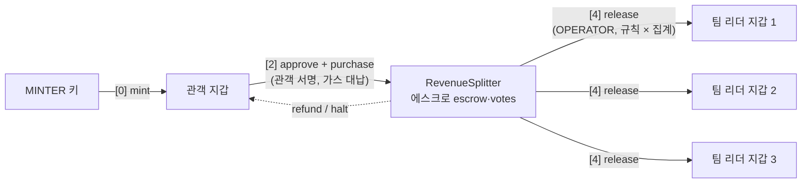
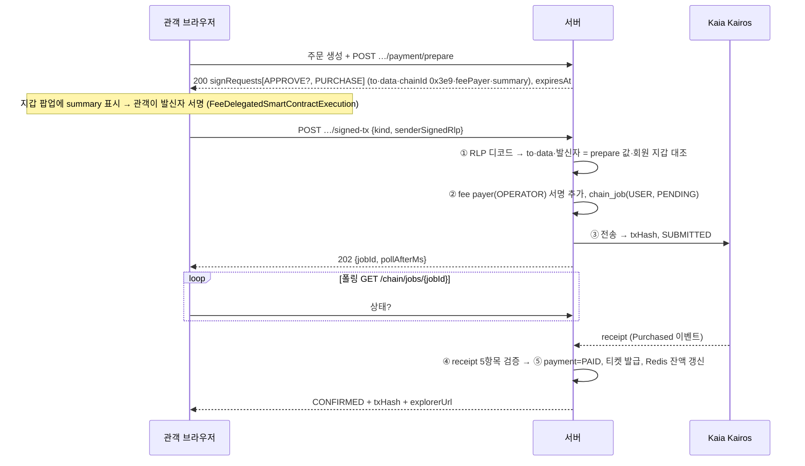

# 결제·정산 코인 흐름 v1

- 작성 2026-09-04 · 대상: 팀 전원(구현 착수 전 공통 이해) · 발표 5번 슬라이드(서비스 흐름도)의 원본
- 정본 근거: API 명세 v6 §0.3(운영자 tx 202 규약)·§0.4(사용자 서명 tx 규약), 결정 문서 v2 §3 자금 흐름, ERD v5 `chain_job`·`payment`, 블록체인 기술 설명 v1 §4~§7
- 읽는 법: 코인은 처음부터 끝까지 **세 곳** 중 하나에만 있다 — **관객 지갑 · RevenueSplitter 컨트랙트(에스크로) · 팀 리더 지갑**. 서버 DB에는 코인이 없고 "무슨 일이 있었는지" 기록만 있다.
- **2026-09-08** — 코인 개명 KRWS → YoYo (name·symbol "YoYo", 환경변수·산출물 키 YOYO/YoYo, 로직 불변)

---

## 1. 전체 흐름 한 장

```
단계          누가 서명            컨트랙트 호출                                코인 위치 변화
[0] 지급      서버 MINTER          YoYo.mint(관객, 100000)                     (없음) → 관객 지갑
[1] 준비      팀 리더 각자 / OPER  agreeToRules → lock                          이동 없음
[2] 결제      관객 (대납: OPER)    YoYo.approve → RevenueSplitter.purchase      관객 지갑 → 컨트랙트(에스크로)
[3] 입장      —                   (체인 무관: 서버 HMAC QR + Redis SETNX)        이동 없음
[4] 정산      서버 OPERATOR        aggregate → lockSettlement → (48h) → release 컨트랙트 → 팀 리더 지갑들
[5] 검증      —                   이벤트·잔액 읽기(무료 call)                   이동 없음
예외          서버 OPERATOR        refund(공연 전 개별 취소) / halt(치명·공연 취소)  컨트랙트 → 관객 지갑
```



---

## 2. [0] 지급 — 코인이 생기는 순간

1. 관객이 Web3Auth 소셜 로그인 → 서버가 idToken을 JWKS로 검증해 회원·세션 JWT 발급. **지갑은 아직 없다.**
2. 첫 1회 지갑 등록 단계(C-05). 소셜 지갑이면 Web3Auth 프로바이더 주소를, 외부 지갑이면 서명 챌린지로 증명한 주소를 `wallet.address`에 저장.
3. 등록 성공 직후 서버가 `chain_job(tx_type=MINT, signer_type=OPERATOR, idempotency_key=grantRef)` 생성. 별도 지급 이력 테이블은 없고 이 행이 이력이다.
4. 워커가 MINTER 키로 `YoYo.mint(관객주소, 100000)` 전송 → `SUBMITTED` → receipt → `CONFIRMED`.
5. 이제 YoYo 컨트랙트 저장소에 `balances[관객] = 100000`. 서버는 Redis `wallet:balance`에 캐시만 한다. **DB에 잔액 컬럼은 없다.**

관리자 추가 지급도 같은 경로(`chain_job MINT`, requester=관리자, 1회 상한 1,000,000).

---

## 3. [1] 준비 — 규칙 잠금

1. 공연 생성팀 리더가 공연을 만들고 참여팀을 초대. 정산 규칙(균등·득표 비례·혼합, 비율)을 JSON으로 저장.
2. 서버가 규칙 JSON의 keccak256 = `rulesHash`를 계산해 `createPerformance(showId, leaders[], rulesHash)`를 OPERATOR로 배포(202).
3. **각 팀 리더가 자기 지갑으로 `agreeToRules(showId, rulesHash)`에 서명**(§0.4 패턴, kind=AGREE, 대납). 이 tx가 익스플로러에 남는 것이 신뢰 장치 ②.
4. 전원 동의 → OPERATOR가 `lock(showId)` → 판매 시작. 이후 규칙 변경 불가.
5. (P-21) 생성팀 리더는 보증금 50,000 YoYo를 `approve` + `deposit(showId)` 서명으로 납부. 코인: 리더 지갑 → 컨트랙트.

---

## 4. [2] 결제 — 서명 2번, 서버는 대납만

### 4.1 단계



**① prepare** — 서버가 주문(`PENDING`, 15분 만료)을 만들고 서명할 tx를 내려준다.

| kind | 내용 | 뜻 |
|---|---|---|
| `APPROVE` | `YoYo.approve(RevenueSplitter, 50000)` | "컨트랙트가 내 잔액에서 5만까지 빼가도 됨". allowance가 이미 충분하면 `required=false`로 생략 |
| `PURCHASE` | `RevenueSplitter.purchase(showId, orderRef, teamIndex, 50000)` | 결제 + 관람 목적 팀 선택 기록을 **1 tx**로 |

**② 관객 서명** — 프론트가 Web3Auth 프로바이더 또는 Kaia Wallet으로 **발신자 서명만** 만든다(`@kaiachain/ethers-ext/v6`). 관객 지갑 KAIA 잔액은 0이어도 된다. 결과는 `senderSignedRlp`(0x hex).

**③ signed-tx 보고** — 서버 처리 5단계.
1. RLP 디코드 → `txType`·`to`·`data`·`value`·`chainId`·복구된 발신자 주소를 prepare 발급값 및 `wallet.address`와 대조. 다르면 **대납하지 않고** 4xx(`PAYMENT_TX_MISMATCH`). `chain_job`도 만들지 않는다.
2. OPERATOR 키로 fee payer 서명 추가, `chain_job(tx_type=PURCHASE, signer_type=USER, fee_delegated=true, sender_signed_rlp 저장)` = `PENDING`.
3. Kairos 전송 → `txHash` → `SUBMITTED`.
4. receipt 검증(4.2).
5. 통과 시 도메인 상태 전이, 실패 시 `FAILED` 고정.

같은 `senderSignedRlp`를 두 번 보고하면 최초 `jobId`를 재생한다(RLP 자체가 멱등키).

### 4.2 컨트랙트 안에서 일어나는 일 (`purchase`)

```
YoYo.transferFrom(관객 → RevenueSplitter, 50000)   balances[관객] -= 50000, balances[Splitter] += 50000
escrow[showId] += 50000                             공연별 에스크로 장부
votes[showId][teamIndex] += 1                       팀 선택 카운터 ← 신뢰 장치 ①
emit Purchased(showId, orderRef, buyer, teamIndex, amount)
```

### 4.3 receipt 검증 5항목 (서버 워커)

1. `status == 1` (revert 아님)
2. `to` == 서버가 내려준 컨트랙트 주소
3. `from` == 요청자의 등록 지갑 주소
4. 기대 이벤트 존재 — `Purchased` / `Approval` / `DepositPaid` / `RulesAgreed`
5. 이벤트 인자(`orderRef`·`amount`·`teamIndex`·`showId`·`rulesHash`)가 DB 상태와 일치

전부 통과 → `payment=PAID`, 티켓 발급(`ISSUED`, `qr_secret` 생성), Redis `wallet:balance` 갱신. 하나라도 어긋나면 상태 전이 없이 `chain_job=FAILED`, 운영자 알림.

### 4.4 실패 경로

| 단계 | 상황 | 결과 |
|---|---|---|
| ① prepare | 잔액·재고·상태 불충족 | 서명 파라미터 없이 4xx. 코인 이동 없음 |
| ② 서명 | 관객이 팝업을 닫음(거부) | 보고 없음 → 15분 뒤 주문 `CANCELLED`. **잔액 그대로** |
| ③ RLP 검증 | 발신자·to·data 불일치 | 대납 거절 4xx. `chain_job` 없음 |
| ③ 전송 | 노드 오류·운영지갑 KAIA 부족 | `FAILED` + `CHAIN_GAS_INSUFFICIENT`(운영자 알림) |
| ④ revert | 재고 소진·잠금·allowance 부족 | `status=0` → `FAILED` + 사유. APPROVE만 성공했으면 allowance만 남고 코인 이동 없음(회수 안 함, 다음 결제에 재사용) |
| ④ 불일치 | 이벤트·인자 불일치 | 상태 전이 없음, `FAILED` 고정, 운영자 알림 |

USER job은 서버가 발신자 서명을 다시 만들 수 없으므로 **자동 재시도하지 않는다.** 관객이 다시 결제한다.

---

## 5. [3] 입장 — 체인 무관

티켓의 `qr_secret`으로 30초 윈도우 HMAC QR 생성. 검표 시 서버가 서명·만료·공연 일치를 확인하고 Redis `SETNX`로 원타임 처리(중복 입장 `ENTRY_ALREADY_ENTERED`). 코인·체인과 무관하다. 블록체인 성과로 말하지 않는다.

---

## 6. [4] 정산 — 코인이 컨트랙트에서 나가는 유일한 길

전부 OPERATOR 키로 서버가 보내는 tx(§0.3, 202 + jobId, 큐 최대 3회 자동 재시도, 지갑별 nonce 직렬).

```
NONE → AGGREGATED → LOCKED → DISPUTE_OPEN(48h) → RELEASED
                                            ↘ HALTED (종착, 전액 환불)
```

1. **aggregate(showId)** — 컨트랙트가 `votes[showId]`를 확정. 서버는 DB 티켓 집계(group by 팀)와 온체인 카운터를 **대사**한다. 다르면 `SETTLEMENT_AGGREGATE_MISMATCH` 409로 멈추고 관리자 판단 대기. **HALTED로 자동 전이하지 않는다.**
2. **lockSettlement(showId)** — 이후 취소·환불 차단(`refund-03`).
3. **이의제기 창 48h** — 참여팀이 이의를 내면 `DISPUTE_OPEN`, release 보류. 관리자 처리 후 재개.
4. **release(showId)** — 컨트랙트가 잠긴 규칙 × 확정 집계로 팀별 금액을 계산하고 `YoYo.transfer(Splitter → 리더지갑_i, amount_i)`를 팀 수만큼 실행. `escrow[showId] = 0`, `Released` 이벤트. **이 순간이 곧 수령 완료**이고 별도 출금 단계가 없다. dust(나머지)는 규칙에 명시된 팀에 귀속.
5. **returnDeposit(showId)** — 보증금이 있으면 생성팀 리더에게 반환.

release 이후에는 어떤 tx도 되돌릴 수 없다. 그래서 1~3이 앞에 있다.

### 6.1 되돌리는 경로

| 경로 | 언제 | 컨트랙트 | 코인 |
|---|---|---|---|
| **refund(showId, orderRef)** | 공연 전 관객 개별 취소(정산 잠금 전) | 해당 주문 금액을 구매자에게 반환, `votes[showId][team] -= 1` | 컨트랙트 → 관객 지갑 |
| **halt(showId)** | 공연 취소 또는 관리자 중단 판정(치명) | `escrow[showId]`를 구매자별로 전액 반환, 보증금 반환, 상태 `HALTED` 종착 | 컨트랙트 → 관객 지갑들 |

되돌릴 수 있는 문제(집계 불일치·이의제기)는 HALTED로 가지 않고 그 앞 단계에서 멈춘다(요구사항 v6 정정, 결정 §14 D1). HALTED는 사람이 결정한다.

---

## 7. [5] 검증 — 누구나, 무료

- **정산 검증 페이지(V-01, 참여팀)**: 잠긴 `rulesHash`와 규칙 JSON, 온체인 `votes` 확정값, 팀별 산출액, `Released` tx 링크. 브라우저가 규칙 × 집계를 **직접 재계산**해 서버 표시값·온체인 전송액과 대조.
- **발행량 공시(V-02, 공개)**: `YoYo.totalSupply()` = Σ 지갑 잔액 + Σ 에스크로 불변식 대사, 공연별 에스크로 합계.

전부 읽기(call)라 서명·가스가 없다. 신뢰 장치 ③.

---

## 8. 역할 경계 — 무엇이 어디에 있나

| 있는 곳 | 무엇 | 예 |
|---|---|---|
| **체인 (정본)** | 코인 잔액, 에스크로, 팀 선택 카운터, 동의 서명, 분배 결과 | `balances`, `escrow`, `votes`, `Purchased`·`RulesAgreed`·`Released` 이벤트 |
| **MySQL** | 업무 기록과 상태 | 회원·지갑 주소, 공연·팀·규칙 JSON, 주문·결제 상태, 티켓, `chain_job` 이력, 정산 상태 |
| **Redis** | 빠른 표시·원타임 | `wallet:balance` 캐시, `auth:refresh:{jti}`, `wallet:challenge:{memberId}`, 입장 SETNX |

서버 키는 **두 개**뿐이다. MINTER는 만들기만, OPERATOR는 에스크로 안의 코인을 규칙대로 옮기기만(+ fee payer). 관객 지갑의 코인은 관객 서명 없이는 누구도 옮길 수 없다.

### 8.1 `chain_job` tx_type 12종과 서명자

| signer_type | tx_type | 서명 |
|---|---|---|
| OPERATOR(MINTER 키) | `MINT` | 서버 |
| USER (대납) | `APPROVE` `PURCHASE` `DEPOSIT` `AGREE` | 사용자 발신자 서명 + 서버 fee payer 서명 |
| OPERATOR | `REFUND` `DEPOSIT_RETURN` `DEPOSIT_FORFEIT`(P1) `LOCK` `AGGREGATE` `RELEASE` `HALT` | 서버 |

상태 `PENDING → SUBMITTED → CONFIRMED / FAILED`. 폴링은 `GET /api/v1/chain/jobs/{jobId}` 하나. 온체인 반영 목표 ≤ 60초(PERF-04).

---

## 9. 발표용 요약 (5번 슬라이드 문안)

> 관객은 로그인하면 지갑과 코인을 받습니다. 결제는 관객 지갑이 서명하고 가스는 플랫폼이 냅니다. 코인은 팀에게 바로 가지 않고 컨트랙트에 맡겨지며, 결제와 "누구를 보러 왔는지"가 한 트랜잭션에 기록됩니다. 공연이 끝나면 팀들이 미리 서명한 규칙대로 컨트랙트가 리더 지갑에 나눠 줍니다. 그 사이에 집계 대사와 48시간 이의제기 창이 있어 잘못된 분배는 나가기 전에 멈춥니다. 결과는 누구나 재계산할 수 있습니다.
