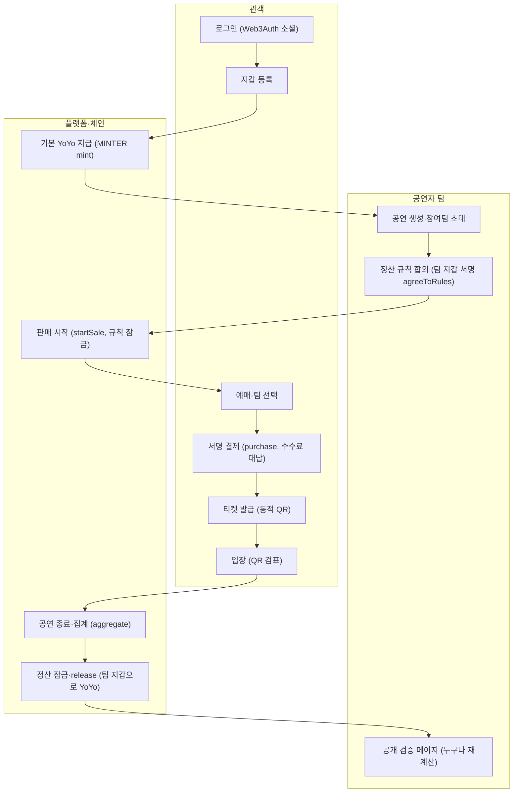
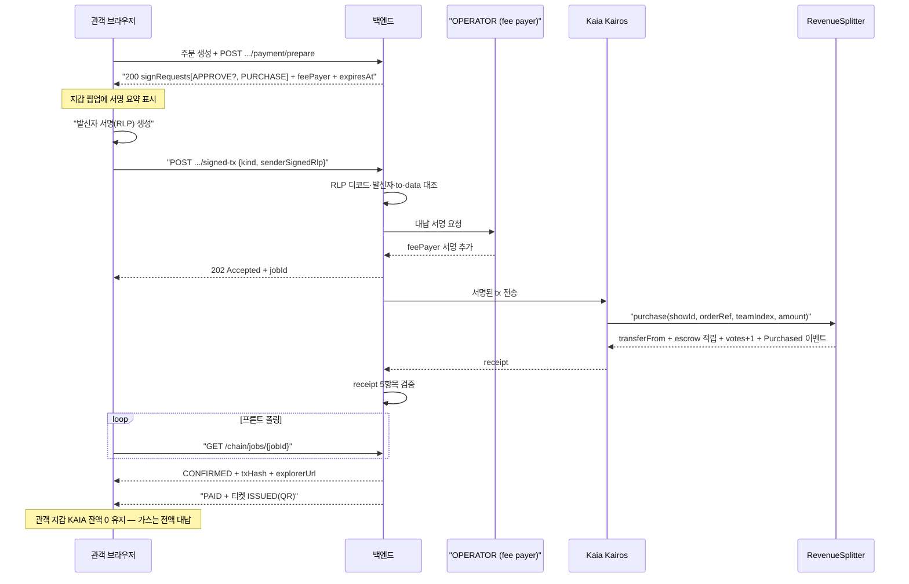
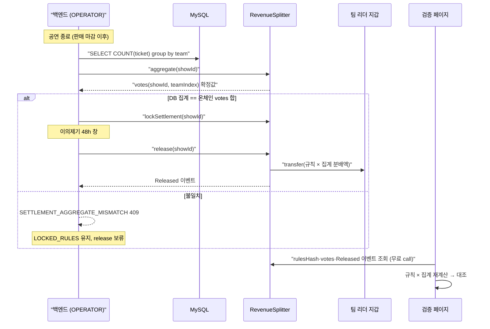

# 서비스 흐름도 v5

- 작성 2026-09-07 · 대상: 발표 자료(서비스 흐름 슬라이드) · Jira S15P21B204-37
- 이전 버전 — [v2.1 (svg)](./assets/service-flow_v2.1.svg) · [v2 (svg)](./assets/service-flow_v2.svg) · [v1 (svg)](./assets/service-flow_v1.svg). 금융망 API·커스터디얼 팀 지갑·양도·Polygon+Besu 기준이라 폐기하고 현행 세계관으로 다시 그린다.
- 근거 문서 — [요구사항 명세서 v6](../design/04_요구사항_명세서_v6.md) §3·§4·§5-1 · [API 명세서 v6](../design/06_API_명세서_v6.md) §0.3(202 규약)·§0.4(서명 tx 규약) · [MVP 범위·인원분배 v1](./09_MVP_범위_인원분배_v1.md) §2(0층 세로축) · [블록체인 기술 설명 v1](./08_블록체인_기술_설명_v1.md) §4(RevenueSplitter) · [결제·정산 코인 흐름 v1](./10_결제_정산_코인_흐름_v1.md)
- 렌더 — 저장소 뷰어(GitLab)에서 mermaid 블록이 그대로 도표로 보인다. 발표 자료용 SVG 내보내기는 §5 참고.
- **2026-09-08** — 코인 개명 KRWS → YoYo (name·symbol "YoYo", 환경변수·산출물 키 YOYO/YoYo, 로직 불변)

---

## 1. 전체 서비스 흐름

노드 13개, 3레인(관객 6 · 공연자 팀 3 · 플랫폼·체인 4).

---

## 2. 결제·대납 시퀀스

메시지 17개(참여자 5, 관객 지갑 KAIA 0 강조 Note 포함).

---

## 3. 정산 시퀀스

메시지 12개(alt 분기 1개 — 대사 불일치 시 release 보류).

---

## 4. v2.1 대비 바뀐 것

| 구분 | v2.1 (폐기) | v5 (현행) |
|---|---|---|
| 화폐 입출구 | 금융망 결제·환급(계좌 이체) | 없음 — 화폐가 코인인 세계, YoYo는 원 단위 코인 자체 |
| 팀 지갑 | 커스터디얼(플랫폼이 팀별 지갑 자동 생성·보관) | 사용자 소유 지갑(Web3Auth MPC 또는 Kaia Wallet), 팀 지갑 = 리더 지갑 |
| 양도 | 취소·양도·교환 지원 | 삭제 — 티켓 상태 3값(`ISSUED`/`USED`/`CANCELLED`), `TRANSFER_*` 코드 철회 |
| 체인 | Polygon + Besu 이원화 | Kaia Kairos(chainId 1001) 단일 |
| 서명 주체 | 서버가 전 tx 서명 | 사용자 자산 이동 tx는 사용자 서명, 서버(OPERATOR)는 수수료 대납 서명만 |
| 운영 키 | 서버 커스터디(팀 지갑 포함) | **서버 런타임 키 2개(OPERATOR fee payer·MINTER)** — API v6 §0 그대로. 여기에 **배포·pause·rotate 전용 admin 콜드 키 1개**가 서버 밖(Jenkins 배포 스테이지 Secret text)에 추가됨 — 컨트랙트 인터페이스 v1(오민근 9/7, `RevenueSplitter` 생성자가 admin≠OPERATOR≠MINTER 강제). 서버 `.env`에는 들어가지 않는다 |

---

## 5. 발표용 메모

1. **1장(전체 흐름)** — 슬라이드 "서비스 개요"에 쓴다. 강조점은 "코인이 지갑·에스크로·지갑 사이에서만 움직인다"는 한 문장.
2. **2장(결제·대납)** — 슬라이드 "결제 UX"에 쓴다. 강조점은 관객 지갑 KAIA 잔액 0(가스 없이 결제)과 서명 2단계(발신자 서명 → 서버 대납).
3. **3장(정산)** — 슬라이드 "정산·검증"에 쓴다. 강조점은 대사(DB ↔ 온체인 votes 일치) 게이트와 48시간 이의제기 창, 그리고 release 이후 검증 페이지가 온체인 값만으로 재계산한다는 점.
4. SVG 내보내기는 [mermaid.live](https://mermaid.live)에 각 블록을 붙여넣거나, 로컬에서 `npx -y @mermaid-js/mermaid-cli -i 12_서비스_흐름도_v5.md -o service-flow_v5.svg`로 뽑는다.
5. 발표 담당이 SVG를 확정하면 `docs/planning/assets/service-flow_v5.svg`로 저장하고 이 문서 상단 링크를 갱신한다(이 문서는 아직 SVG를 갖지 않는다).
